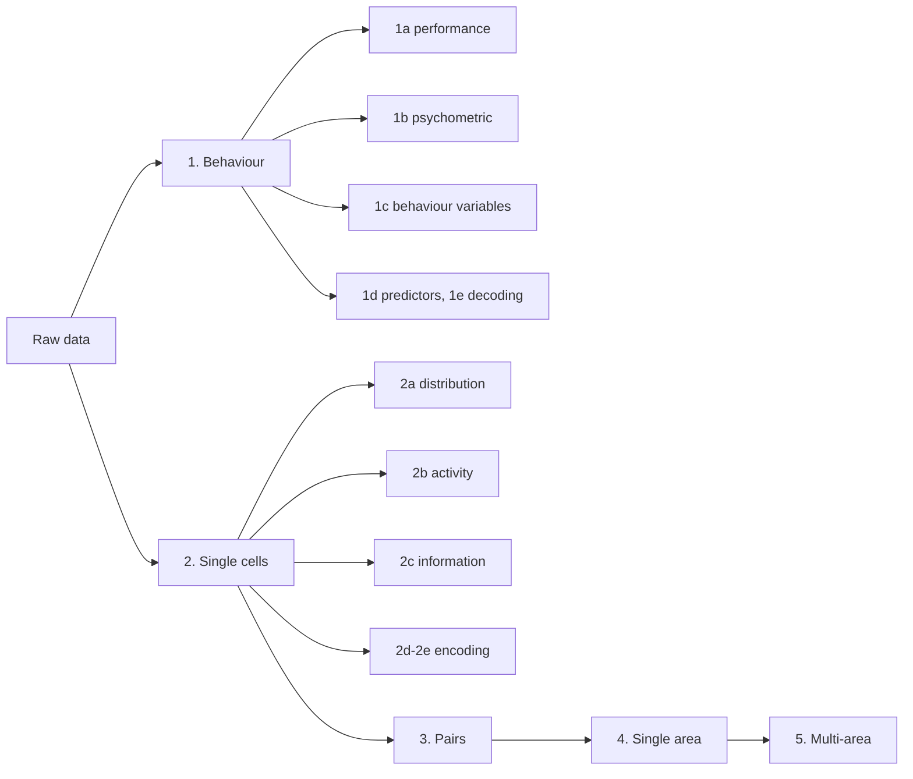

<!-- slide bg="#1f2a44" class="title" -->

# Feedforward and feedback contribution to stimulus detection

###   Matías Lorenz

Lab meeting · 26/10/2026

---

## Today

1. Why this question matters
2. Neuroscience in 5 minutes: what you need to follow the talk
3. The experiment: mice, virtual reality, a detection task
4. How we analyse it: behaviour → single cells → populations
5. Results so far
6. Next steps and open questions

note:
~30 s. Tell them sections 2–3 are the "tutorial" part, so they know it's fine if things feel new.

---

<!-- slide bg="#e8edf5" -->

# Part 1
## The big picture

---

## From seeing to deciding

- Light hits the eye → signals reach the **visual cortex** at the back of the brain
- The cortex builds a representation of what we see
- Other areas use it to **decide** and **act**

<!-- element class="fragment" -->

**Our question, in one line:** does the visual cortex send *the same* message to every area it talks to, or does each area get its own version?

<!-- element class="fragment" -->

note:
Analogy: a newsroom that sends the same story to every outlet vs. tailoring it for each. Keep it concrete.

---

## Why it matters

- [Reason 1: e.g. understanding how perception becomes a decision]
- [Reason 2: e.g. explains why some signals reach awareness and others don't]
- [Reason 3: e.g. relevance for models of the cortex / AI / disease]

note:
Pick the 2–3 motivations that fit your lab's interests. Non-specialists respond best to one concrete example.

---

<!-- slide bg="#e8edf5" -->

# Part 2
## Neuroscience in 5 minutes

---

## Neurons talk in spikes

<split even gap="3">

- A **neuron** is a cell that sends electrical pulses ("spikes")
- Information = *how many* spikes, *when*, and *in which neurons*
- Cortex has millions of neurons arranged in **areas** with different jobs

[FIGURE: simple neuron sketch or spike raster]
<!-- ![[neuron_sketch.png]] -->

</split>

note:
Analogy: spikes are like a Morse code; the "message" is in the pattern across many neurons.

---

## The visual cortex is a hierarchy

<split even gap="3">

- **V1** (primary visual cortex): first cortical stop for vision
- **Higher visual areas** (e.g. **PM**): more specialised processing
- Signals go **forward** (V1 → higher) and **back** (higher → V1)
- Feedback is thought to matter for *perceiving* what we see

[FIGURE: mouse brain top view with V1 and higher areas highlighted]
<!-- ![[mouse_visual_areas.png]] -->

</split>

note:
Mention Lamme & Roelfsema 2000 idea in plain terms: fast feedforward sweep vs. slower recurrent loop. Don't go deep.

---

## Projection neurons: same area, different destinations

<split even gap="3">

- Neurons in V1 send their long "cables" (axons) to different targets
- Neurons next to each other can talk to **different areas**
- We label them by destination: **V1→PM** vs **V1→[other area]**

[FIGURE: schematic of V1 with two coloured neuron types projecting to different areas]
<!-- ![[projection_schematic.png]] -->

</split>

note:
Postal analogy: same sorting office, different delivery addresses. The question is whether the letters' content differs too.

---

## How we see neurons work: calcium imaging

<split even gap="3">

- When a neuron spikes, calcium flows in
- A fluorescent sensor glows with calcium
- A **two-photon microscope** films hundreds of neurons at once
- **Retrograde labelling**: a tracer injected in the target area marks the V1 neurons that project there

[FIGURE: field of view with labelled cells + example fluorescence traces]
<!-- ![[fov_example.png]] -->

</split>

note:
Key point: we get activity *and* the identity (destination) of each recorded neuron.

---

## What is already known

| Finding | Reference |
|---|---|
| [One-line summary] | Chen et al. 2013 |
| [One-line summary] | Makino & Komiyama 2015 |
| [One-line summary] | Manita et al. 2015 |
| [One-line summary] | Oude Lohuis et al. 2022 |
| [One-line summary] | Ciceri et al. 2024 |

**Gap:** [what nobody has tested yet]

note:
Keep each row one sentence. End on the gap so the research questions follow naturally.

---

## Research questions

1. Do V1 neurons projecting to PM **encode** the task differently from those projecting to other areas?
2. Do their **dynamics** differ (timing, variability, correlations)?
3. What **mechanisms** could produce these differences, and what **roles** might they serve?

note:
Read them aloud slowly. These three questions structure the rest of the talk.

---

<!-- slide bg="#e8edf5" -->

# Part 3
## The experiment

---

## A mouse in virtual reality

<split even gap="3">

- Mouse runs on a wheel through a virtual corridor
- A visual stimulus may appear, at different strengths
- If it sees it → **lick** for a reward
- If nothing appears → **don't lick**

[FIGURE: VR setup photo or schematic + corridor screenshot]
<!-- ![[vr_setup.png]] -->

</split>

note:
Emphasise the mouse is head-fixed so we can image, but it moves freely on the wheel.

---

## Four possible outcomes

|  | Mouse licks | Mouse doesn't lick |
|---|---|---|
| **Stimulus present** | ✅ Hit | ❌ Miss |
| **No stimulus** | ❌ False alarm | ✅ Correct rejection |

- **d′ (d-prime)**: one number for how well the mouse separates "stimulus" from "nothing", independent of how eager it is to lick
- We keep sessions with d′ ≥ 1 and false-alarm rate ≤ 0.5, and only trials where the mouse is engaged

note:
This table is the same as a medical test (true/false positives). Many people know that analogy.

---

## Three training stages (protocols)

| Protocol | Stimulus strengths | Neural recording | Purpose |
|---|---|---|---|
| **DM** | 0% and 100% | No | Learn the task |
| **DP** | 0%, 100% + intermediate | No | Measure the threshold |
| **DN** | 0%, 100% + intermediate (from DP) | **Yes** | Record neurons near threshold |

note:
Intermediate strengths in DN are set per mouse from its DP psychometric curve, so stimuli sit near the detection threshold, where the interesting decisions happen.

---

## Dataset at a glance

| | Value |
|---|---|
| Mice | [N] |
| Sessions (DM / DP / DN) | [N / N / N] |
| Sessions passing criteria | [N] |
| Recorded neurons | [N] |
| Labelled: V1→PM / V1→[other] / unlabelled | [N / N / N] |

note:
Update once the filtering is final.

---

<!-- slide bg="#e8edf5" -->

# Part 4
## How we analyse it

---

## Analysis pipeline

note:
Behaviour first: we need to trust the mouse is doing the task before interpreting neurons. Grey out future stages if you style it.

---

<!-- slide bg="#e8edf5" -->

# Part 5
## Results: behaviour

---

## 1a · Do mice learn the task?

<split even gap="3">

[FIGURE: d′ / hit and FA rates across sessions]
<!-- ![[1a_performance.png]] -->

- [Takeaway 1]
- [Takeaway 2]
- [Engagement: fraction of engaged trials]

</split>

note:
State the takeaway first, then point at the figure.

---

## 1b · Detection threshold

<split even gap="3">

[FIGURE: psychometric curve, P(lick) vs stimulus strength]
<!-- ![[1b_psychometric.png]] -->

- **Psychometric curve**: probability of licking vs. stimulus strength
- The **threshold** = strength the mouse detects about half the time
- [Takeaway: threshold value / variability across mice]

</split>

note:
Explain axes explicitly. Non-specialists need the axes read out.

---

## 1c · What else is the mouse doing?

<split even gap="3">

[FIGURE: running speed, position, pupil, video motion around stimulus]
<!-- ![[1c_behavior.png]] -->

- Running speed, position, pupil size, face movement
- Pupil size tracks **arousal** (alertness)
- [Takeaway]

</split>

note:
Why it matters: neurons respond to movement and arousal, not just the stimulus, so we must account for them.

---

## 1d–1e · Can behaviour predict success?

<split even gap="3">

[FIGURE: decoding accuracy from behavioural variables]
<!-- ![[1e_decoding.png]] -->

- A **decoder** guesses the trial outcome from behavioural variables
- 50% = chance; higher = behaviour carries information
- [Takeaway: which variables matter most]

</split>

note:
Mention LDA / logistic regression only if asked; "a simple classifier" is enough.

---

<!-- slide bg="#e8edf5" -->

# Part 6
## Results: single neurons

---

## 2a · Where are the neurons?

<split even gap="3">

[FIGURE: spatial map of recorded cells, coloured by projection target]
<!-- ![[2a_distribution.png]] -->

- [Takeaway: are projection types intermixed or clustered?]

</split>

---

## 2b · How active are they?

<split even gap="3">

[FIGURE: activity statistics by projection type]
<!-- ![[2b_activity.png]] -->

- [Takeaway: firing / responsiveness differences]

</split>

---

## 2c · How much does a neuron "know"?

<split even gap="3">

- **Mutual information**: how much observing a neuron reduces our uncertainty about the stimulus or the choice
- 0 bits = the neuron tells us nothing
- Compared against shuffled data to rule out chance

[FIGURE: MI about stimulus and choice, V1→PM vs other]
<!-- ![[2c_information.png]] -->

</split>

note:
Analogy: a game of 20 questions; each bit is one yes/no question the neuron answers for you.

---

## 2d–2e · Simple or complex relationships?

<split even gap="3">

[FIGURE: linear R² vs mutual information per neuron]
<!-- ![[2d_linear_vs_mi.png]] -->

- **Linear encoding**: activity rises/falls in proportion to the variable
- If information ≫ what the linear model captures → nonlinear relationship
- [Takeaway]

</split>

---

## Key comparison: V1→PM vs V1→[other]

<split even gap="3">

[FIGURE: main comparison panel]
<!-- ![[key_comparison.png]] -->

- [Main result in one sentence]
- [Statistics: test, n, p]
- [Caveat]

</split>

note:
This is the slide people should remember. Pause here.

---

## Summary so far

- **Behaviour:** [one line]
- **Single cells:** [one line]
- **Projection types:** [one line]

---

## Next steps

| Stage | Question | Status |
|---|---|---|
| 3 · Pairwise correlations | Do neurons of the same type fire together? | [Planned] |
| 4 · Single-area populations | What does the whole V1 population encode? | [Planned] |
| 5 · Multi-area | How does V1 interact with its targets? | [Planned] |

---

## Open questions for discussion

- [Question you want input on]
- [Methodological choice you're unsure about]
- [Idea from another field the team might contribute]

note:
For a mixed-background team, ask for perspectives from their fields (stats, ML, engineering, physics).

---

<!-- slide bg="#1f2a44" -->

# Thank you

Questions?

---

## Glossary (backup)

| Term | Meaning |
|---|---|
| V1 | Primary visual cortex |
| PM | Posteromedial higher visual area |
| Projection neuron | Neuron sending its axon to another area |
| Calcium imaging | Measuring neural activity via a fluorescent calcium sensor |
| Hit / Miss / FA / CR | The four trial outcomes |
| d′ | Detection sensitivity, independent of bias |
| Psychometric curve | P(response) vs stimulus strength |
| Mutual information | Uncertainty reduced by observing a variable (bits) |
| Decoder | Classifier predicting a variable from data |

--

## Backup: [extra figure]

[FIGURE]
<!-- ![[backup_1.png]] -->

--

## Backup: methods details

- Imaging: [rate, sensor, depth]
- Cell selection: [criteria]
- Statistics: [tests, corrections]

---

<!-- slide bg="#fff4d6" -->

# Layout templates
### Delete this section before presenting

--

## Template · Figure + takeaways

<split even gap="3">

[FIGURE]
<!-- ![[figure.png]] -->

- [Takeaway 1]
- [Takeaway 2]

</split>

--

## Template · Two figures side by side

<split even gap="3">

[FIGURE A]
<!-- ![[figA.png]] -->

[FIGURE B]
<!-- ![[figB.png]] -->

</split>

[One-line caption comparing A and B]

--

## Template · Step-by-step reveal

- First point
<!-- element class="fragment" -->
- Second point
<!-- element class="fragment" -->
- Third point
<!-- element class="fragment" -->

--

<!-- slide bg="#1f2a44" -->

# [One sentence result]
