# 1_behav

*Auto-generated from `2_pipeline/1_behav/out/` on 2026-10-30 11:38. Re-run `make_progress_md.py` after the script's output changes -- don't hand-edit this file.*

## Figures

### Outcomes by stimcat protocol

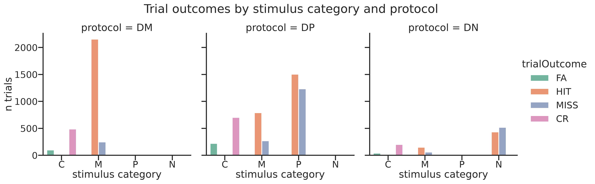

### Psychometric by session

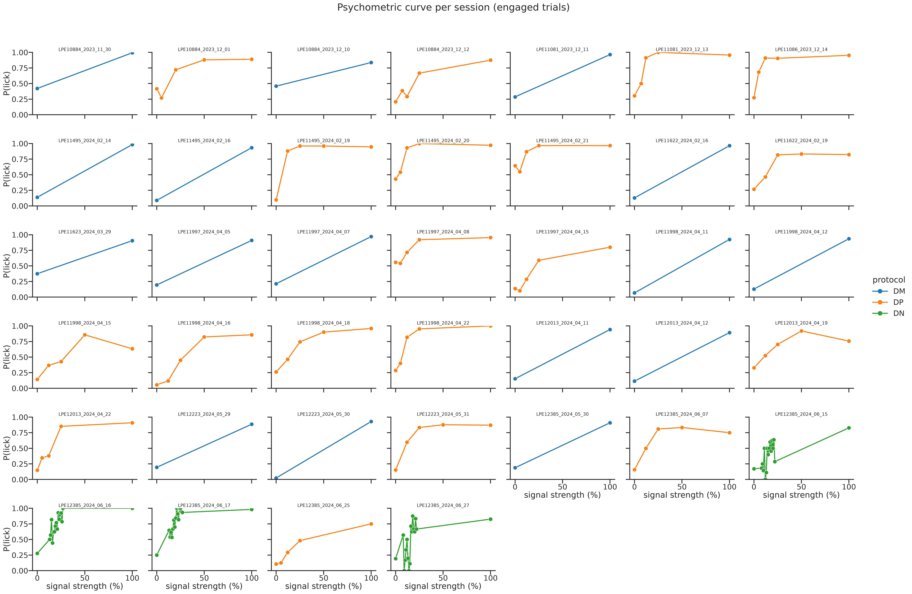

### Psychometric pooled by protocol

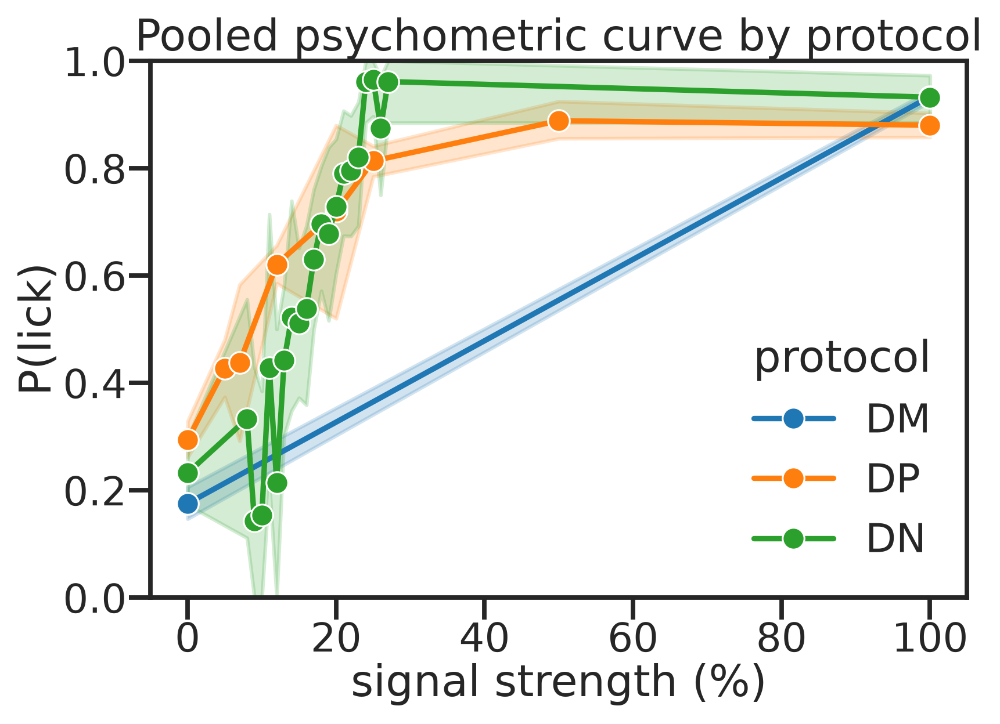

### Engagement by session fraction

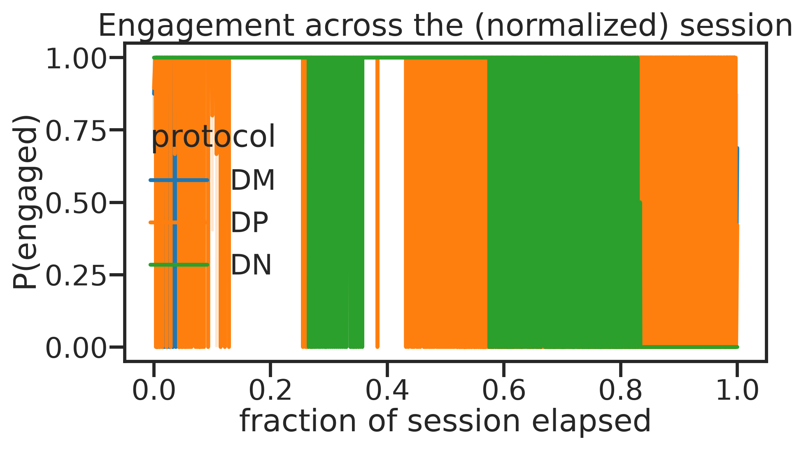

### Nlicks by outcome

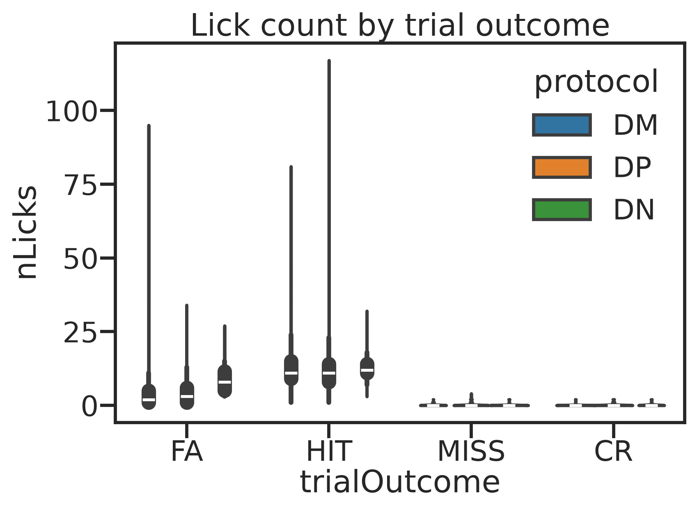

### Response latency hit

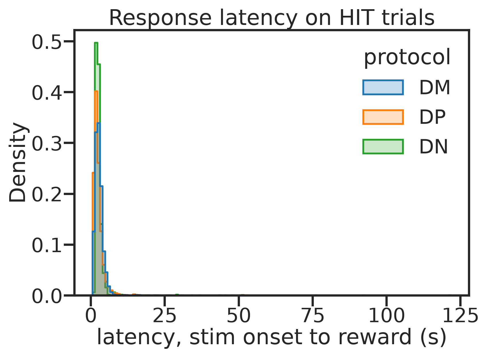

### Duration by outcome

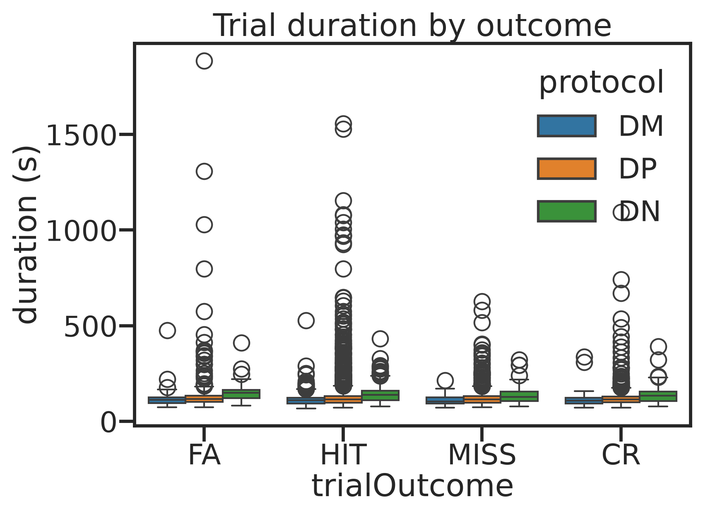

### Hit vs fa rate by session

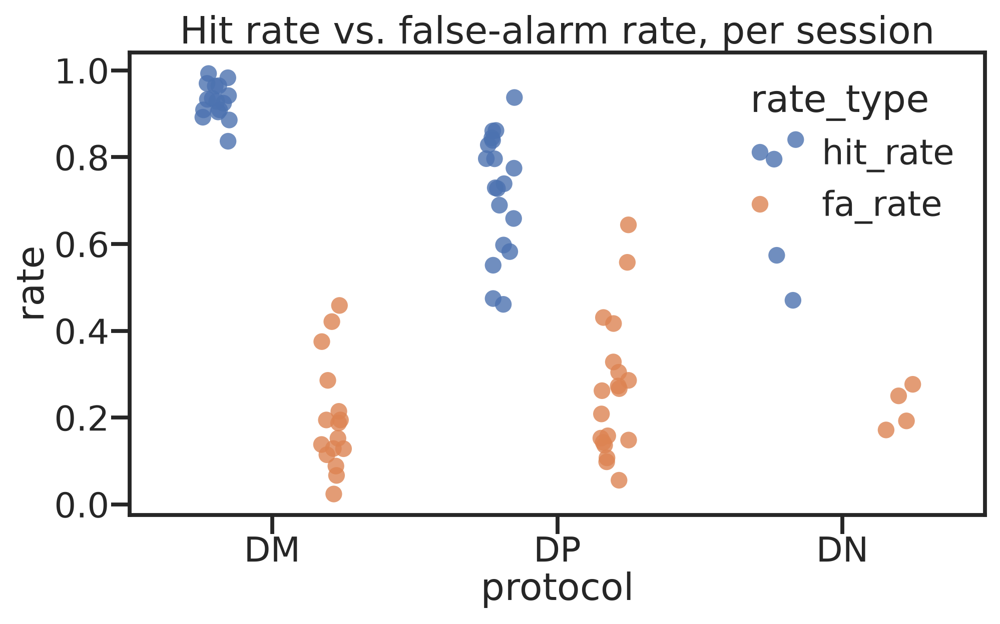

### Runspeed distribution

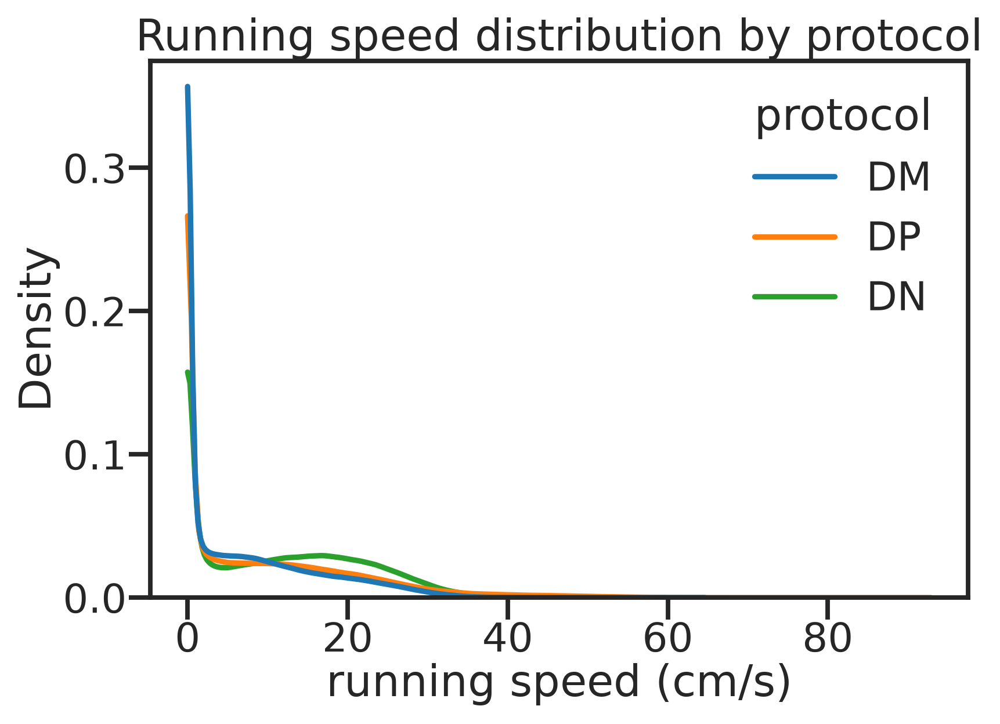

### Position occupancy

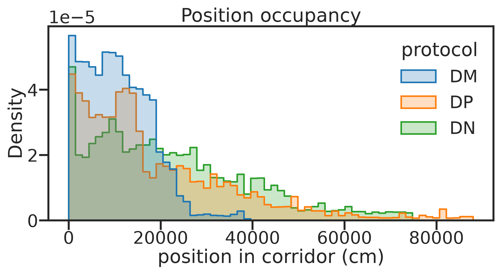

### Speed profile by position

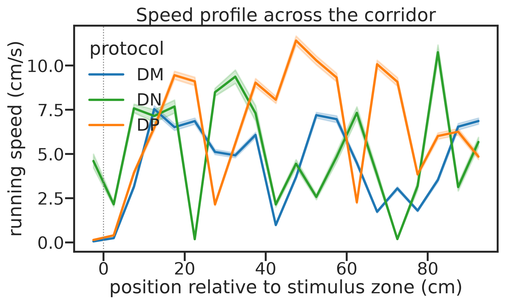

### Speed profile by outcome

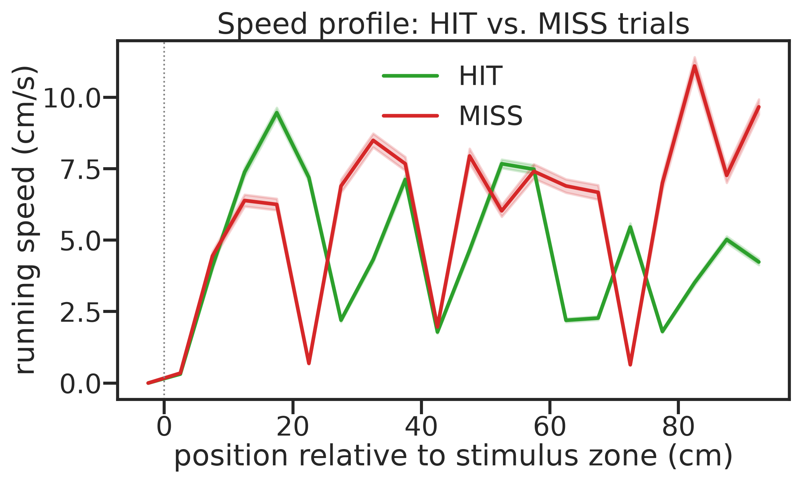

### Speed vs position hexbin

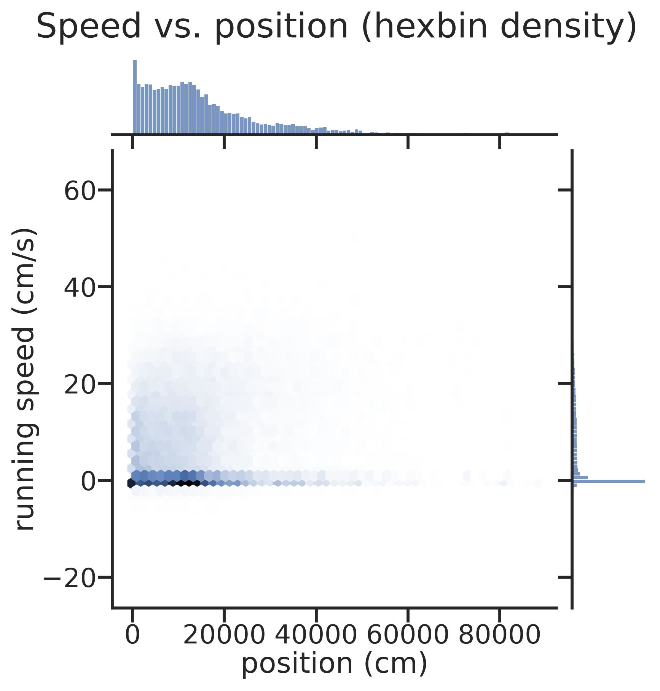
