# 1_behavior

*Auto-generated from `2_pipeline/1_behavior/out/` on 2026-10-30 11:38. Re-run `make_progress_md.py` after the script's output changes -- don't hand-edit this file.*

## Tables

### Session dprime

| session_id | dprime | criterion | hit_rate | fa_rate | n_trials |
| --- | --- | --- | --- | --- | --- |
| LPE10884_2023_12_10 | 1.086 | -0.4382 | 0.8367 | 0.4583 | 122 |
| LPE10884_2023_11_30 | 2.644 | -1.123 | 0.9928 | 0.4211 | 157 |
| LPE11997_2024_04_07 | 2.673 | -0.545 | 0.9701 | 0.2143 | 209 |
| LPE11997_2024_04_05 | 2.197 | -0.2368 | 0.9091 | 0.1944 | 179 |
| LPE11081_2023_12_11 | 2.363 | -0.6157 | 0.9639 | 0.2857 | 104 |
| LPE11998_2024_04_12 | 2.653 | -0.1915 | 0.9355 | 0.1282 | 194 |
| LPE11998_2024_04_11 | 2.936 | 0.033 | 0.9244 | 0.06667 | 149 |
| LPE11495_2024_02_16 | 2.853 | -0.07469 | 0.9333 | 0.08824 | 169 |
| LPE11495_2024_02_14 | 3.211 | -0.5158 | 0.9831 | 0.1379 | 147 |
| LPE12013_2024_04_11 | 2.597 | -0.2715 | 0.9418 | 0.1522 | 235 |
| LPE12013_2024_04_12 | 2.442 | -0.01683 | 0.8921 | 0.1143 | 174 |
| LPE12385_2024_05_30 | 2.222 | -0.224 | 0.9091 | 0.1875 | 164 |
| LPE11623_2024_03_29 | 1.625 | -0.4938 | 0.9043 | 0.375 | 118 |
| LPE12223_2024_05_29 | 2.066 | -0.1712 | 0.8857 | 0.1944 | 176 |
| LPE12223_2024_05_30 | 3.446 | 0.2578 | 0.9286 | 0.02381 | 210 |
| LPE11622_2024_02_16 | 2.941 | -0.3372 | 0.9647 | 0.1286 | 353 |
| LPE11495_2024_02_19 | 2.913 | -0.1635 | 0.9474 | 0.09804 | 259 |
| LPE11495_2024_02_20 | 2.095 | -0.8728 | 0.9726 | 0.4306 | 361 |
| LPE11495_2024_02_21 | 1.472 | -1.105 | 0.9672 | 0.6441 | 301 |
| LPE11081_2023_12_13 | 2.224 | -0.5999 | 0.9565 | 0.3043 | 113 |
| LPE10884_2023_12_01 | 1.431 | -0.5051 | 0.8889 | 0.4167 | 127 |
| LPE10884_2023_12_12 | 1.963 | -0.1691 | 0.875 | 0.2083 | 122 |
| LPE12385_2024_06_25 | 1.916 | 0.2837 | 0.75 | 0.1071 | 143 |
| LPE12385_2024_06_07 | 1.678 | 0.1643 | 0.75 | 0.1579 | 104 |
| LPE12223_2024_05_31 | 2.157 | -0.05269 | 0.871 | 0.1525 | 295 |
| LPE11086_2023_12_14 | 2.273 | -0.5319 | 0.9524 | 0.2727 | 108 |
| LPE11622_2024_02_19 | 1.552 | -0.153 | 0.8235 | 0.2667 | 225 |
| LPE11998_2024_04_15 | 1.408 | 0.3634 | 0.6333 | 0.1429 | 112 |
| LPE11998_2024_04_16 | 2.661 | 0.2628 | 0.8571 | 0.05556 | 100 |
| LPE11998_2024_04_18 | 2.379 | -0.5519 | 0.9592 | 0.2619 | 215 |

*(showing first 30 of 40 rows -- see the linked CSV for the rest)*

[session_dprime.csv](../2_pipeline/1_behavior/out/session_dprime.csv)

## Figures

### Duration by outcome

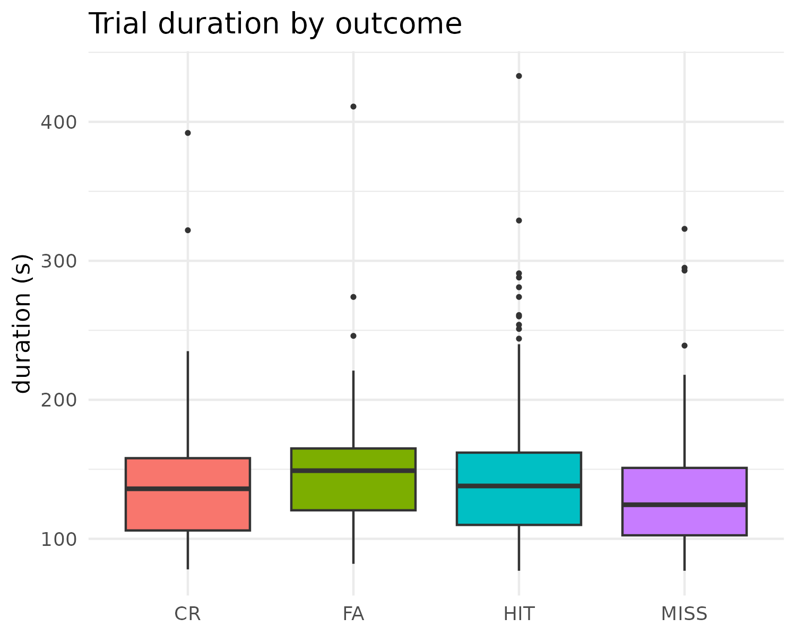

### Engagement timeline

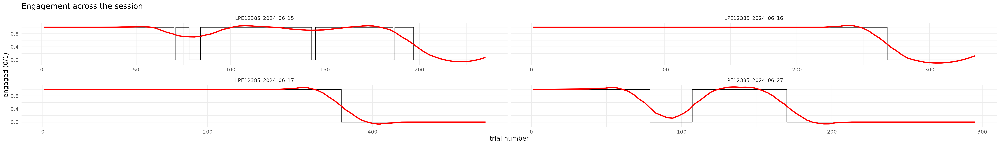

### Hit fa rates

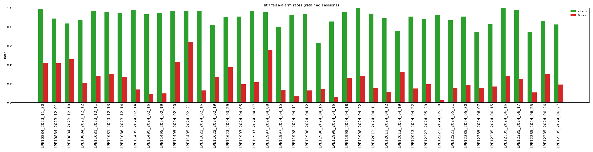

### Nlicks by outcome

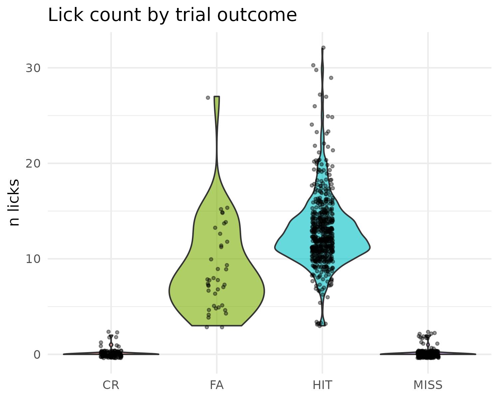

### Outcomes by stimcat

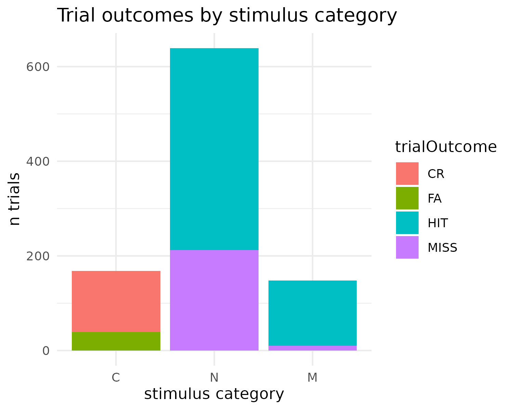

### Psychometric by engagement

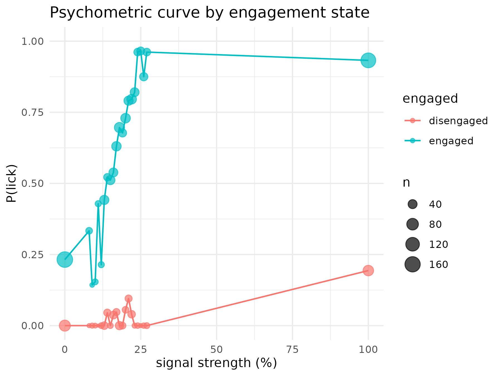

### Psychometric curves

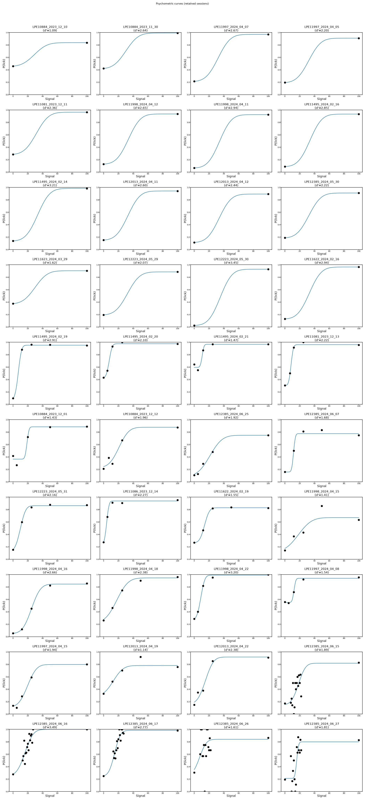

### Psychometricfit by session

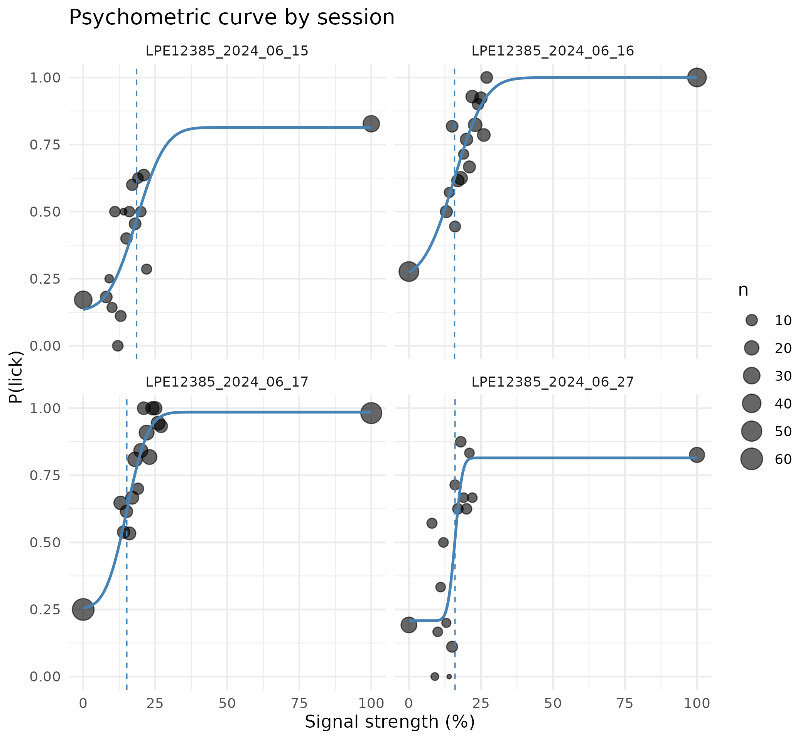

### Psychometricfit by session all prot

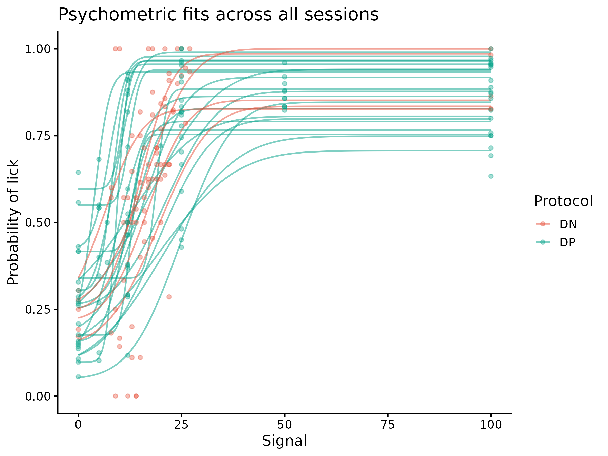

### Response latency

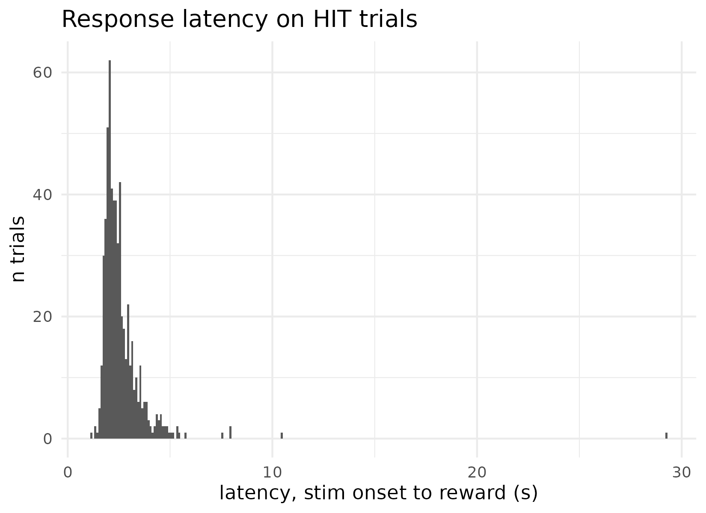

### Runspeed by outcome

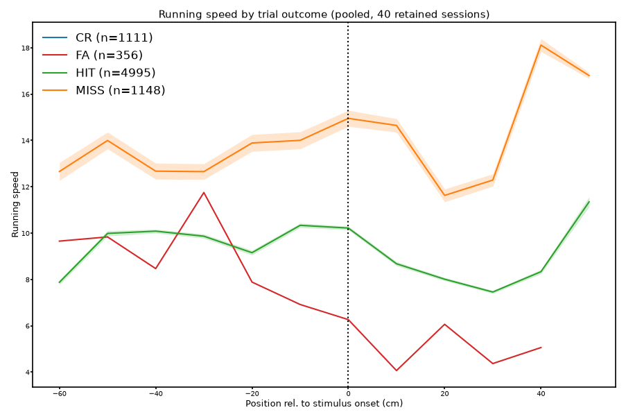

### Session dprime summary

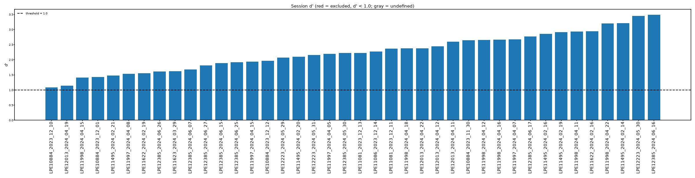
