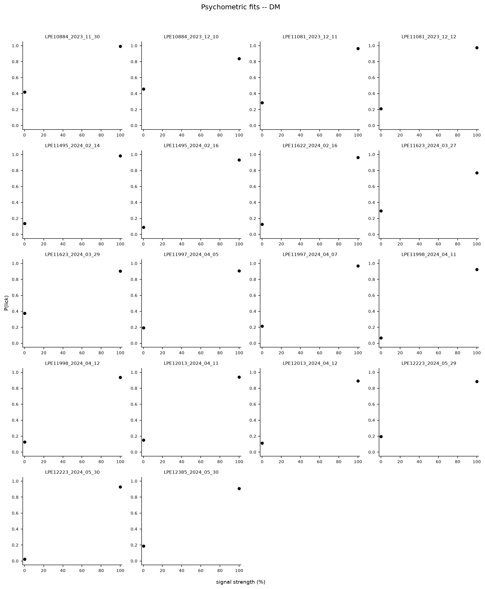
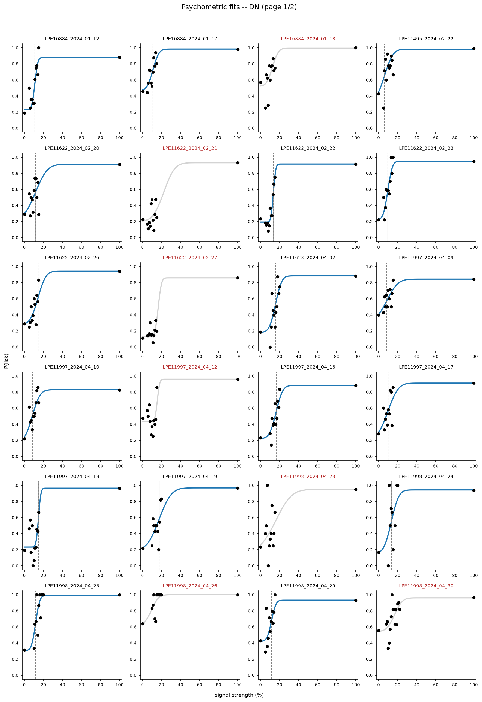
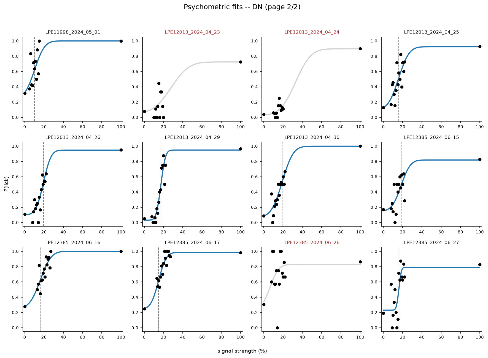
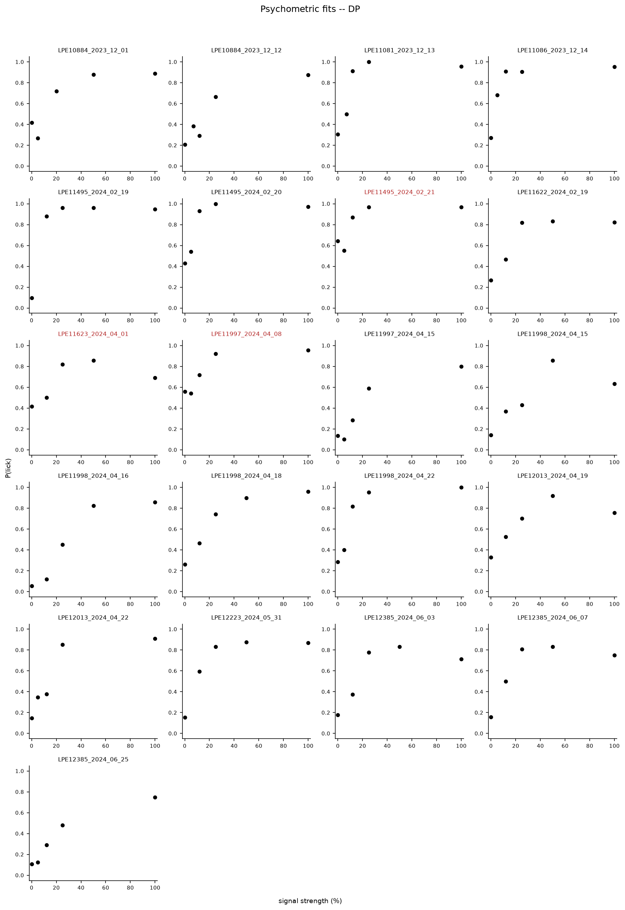
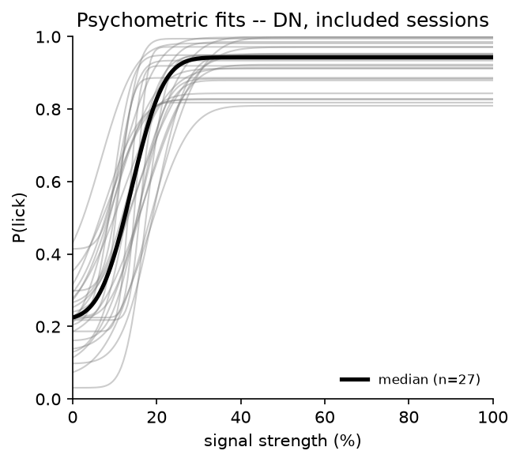
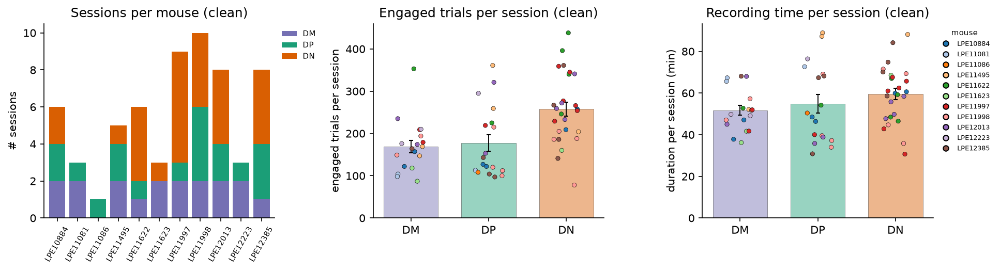
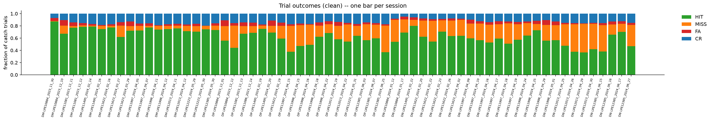
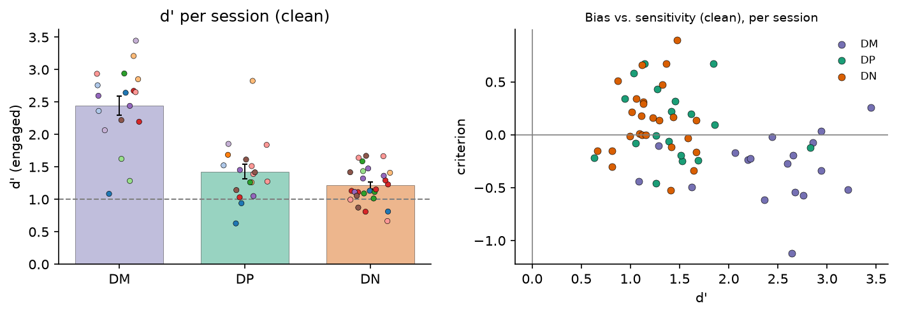
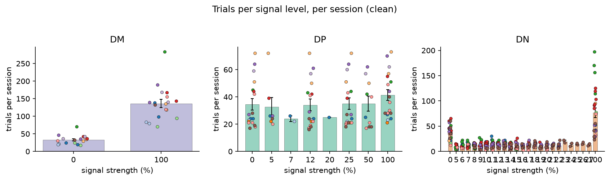
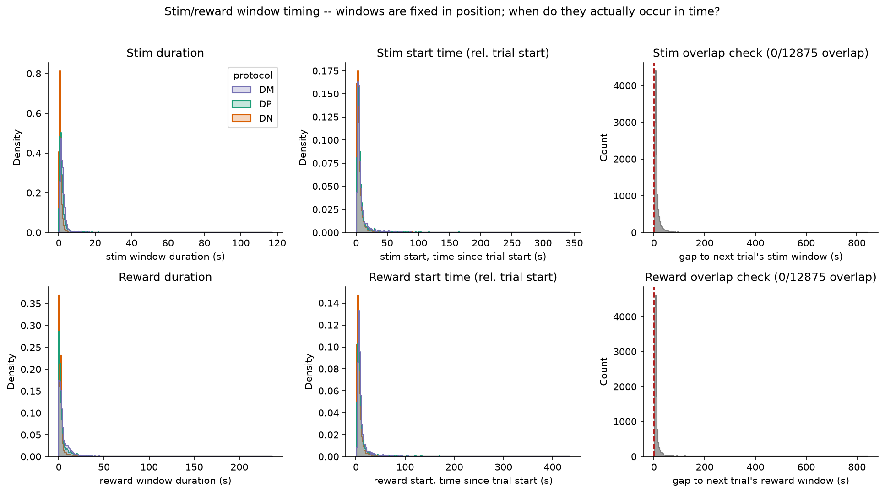

# 1b_psychometric

*Auto-generated from `2_pipeline/1b_psychometric/out/` on 2026-10-16 17:39. Re-run `make_progress_md.py` after the script's output changes -- don't hand-edit this file.*

## Tables

### Clean unit summary session

| protocol | animal_id | session_id | n_trials | duration_min | n_engaged | n_HIT_all | n_MISS_all | n_FA_all | n_CR_all | n_HIT_engaged | n_MISS_engaged | n_FA_engaged | n_CR_engaged | n_sessions |
| --- | --- | --- | --- | --- | --- | --- | --- | --- | --- | --- | --- | --- | --- | --- |
| DM | LPE10884 | LPE10884_2023_11_30 | 157 | 47.1 | 157 | 137 | 1 | 8 | 11 | 137 | 1 | 8 | 11 | 1 |
| DM | LPE10884 | LPE10884_2023_12_10 | 122 | 37.82 | 122 | 82 | 16 | 11 | 13 | 82 | 16 | 11 | 13 | 1 |
| DM | LPE11081 | LPE11081_2023_12_11 | 104 | 67.31 | 104 | 80 | 3 | 6 | 15 | 80 | 3 | 6 | 15 | 1 |
| DM | LPE11081 | LPE11081_2023_12_12 | 98 | 65.63 | 98 | 77 | 2 | 4 | 15 | 77 | 2 | 4 | 15 | 1 |
| DM | LPE11495 | LPE11495_2024_02_14 | 147 | 52.12 | 147 | 116 | 2 | 4 | 25 | 116 | 2 | 4 | 25 | 1 |
| DM | LPE11495 | LPE11495_2024_02_16 | 169 | 51.75 | 169 | 126 | 9 | 3 | 31 | 126 | 9 | 3 | 31 | 1 |
| DM | LPE11622 | LPE11622_2024_02_16 | 353 | 52.76 | 353 | 273 | 10 | 9 | 61 | 273 | 10 | 9 | 61 | 1 |
| DM | LPE11623 | LPE11623_2024_03_27 | 87 | 41.67 | 87 | 54 | 16 | 5 | 12 | 54 | 16 | 5 | 12 | 1 |
| DM | LPE11623 | LPE11623_2024_03_29 | 118 | 36.19 | 118 | 85 | 9 | 9 | 15 | 85 | 9 | 9 | 15 | 1 |
| DM | LPE11997 | LPE11997_2024_04_05 | 179 | 51.96 | 179 | 130 | 13 | 7 | 29 | 130 | 13 | 7 | 29 | 1 |
| DM | LPE11997 | LPE11997_2024_04_07 | 209 | 41.74 | 209 | 162 | 5 | 9 | 33 | 162 | 5 | 9 | 33 | 1 |
| DM | LPE11998 | LPE11998_2024_04_11 | 149 | 47.06 | 149 | 110 | 9 | 2 | 28 | 110 | 9 | 2 | 28 | 1 |
| DM | LPE11998 | LPE11998_2024_04_12 | 194 | 57.29 | 194 | 145 | 10 | 5 | 34 | 145 | 10 | 5 | 34 | 1 |
| DM | LPE12013 | LPE12013_2024_04_11 | 235 | 45 | 235 | 178 | 11 | 7 | 39 | 178 | 11 | 7 | 39 | 1 |
| DM | LPE12013 | LPE12013_2024_04_12 | 174 | 67.98 | 174 | 124 | 15 | 4 | 31 | 124 | 15 | 4 | 31 | 1 |
| DM | LPE12223 | LPE12223_2024_05_29 | 176 | 49.75 | 176 | 124 | 16 | 7 | 29 | 124 | 16 | 7 | 29 | 1 |
| DM | LPE12223 | LPE12223_2024_05_30 | 210 | 49.11 | 210 | 156 | 12 | 1 | 41 | 156 | 12 | 1 | 41 | 1 |
| DM | LPE12385 | LPE12385_2024_05_30 | 164 | 68.08 | 164 | 120 | 12 | 6 | 26 | 120 | 12 | 6 | 26 | 1 |
| DN | LPE10884 | LPE10884_2024_01_12 | 209 | 59.91 | 209 | 113 | 75 | 4 | 17 | 113 | 75 | 4 | 17 | 1 |
| DN | LPE10884 | LPE10884_2024_01_17 | 258 | 60.61 | 258 | 178 | 56 | 11 | 13 | 178 | 56 | 11 | 13 | 1 |
| DN | LPE11495 | LPE11495_2024_02_22 | 204 | 88.15 | 204 | 163 | 20 | 9 | 12 | 163 | 20 | 9 | 12 | 1 |
| DN | LPE11622 | LPE11622_2024_02_20 | 396 | 66.99 | 396 | 247 | 104 | 13 | 32 | 247 | 104 | 13 | 32 | 1 |
| DN | LPE11622 | LPE11622_2024_02_22 | 438 | 59.25 | 438 | 238 | 149 | 12 | 39 | 238 | 149 | 12 | 39 | 1 |
| DN | LPE11622 | LPE11622_2024_02_23 | 246 | 48.44 | 246 | 174 | 45 | 6 | 21 | 174 | 45 | 6 | 21 | 1 |
| DN | LPE11622 | LPE11622_2024_02_26 | 340 | 46.5 | 340 | 215 | 87 | 11 | 27 | 215 | 87 | 11 | 27 | 1 |
| DN | LPE11623 | LPE11623_2024_04_02 | 160 | 68.53 | 160 | 102 | 42 | 3 | 13 | 102 | 42 | 3 | 13 | 1 |
| DN | LPE11997 | LPE11997_2024_04_09 | 277 | 67.59 | 277 | 165 | 67 | 18 | 27 | 165 | 67 | 18 | 27 | 1 |
| DN | LPE11997 | LPE11997_2024_04_10 | 254 | 65.7 | 254 | 144 | 69 | 9 | 32 | 144 | 69 | 9 | 32 | 1 |
| DN | LPE11997 | LPE11997_2024_04_16 | 359 | 61.01 | 359 | 190 | 104 | 15 | 50 | 190 | 104 | 15 | 50 | 1 |
| DN | LPE11997 | LPE11997_2024_04_17 | 345 | 62.45 | 345 | 205 | 80 | 17 | 43 | 205 | 80 | 17 | 43 | 1 |

*(showing first 15 of 21 columns; showing first 30 of 62 rows -- see the linked CSV for the rest)*

[clean_unit_summary_session.csv](../2_pipeline/1b_psychometric/out/clean_unit_summary_session.csv)

### Excluded sessions

| session_id | protocol | exclude_reasons |
| --- | --- | --- |
| LPE10884_2024_01_18 | DN | FA rate (engaged) = 57% > 50% |
| LPE11622_2024_02_21 | DN | threshold (mu=22%) outside tested stimulus range (z-range [-1.93, -0.82] doesn't bracket 0) |
| LPE11622_2024_02_27 | DN | threshold (mu=17%) outside tested stimulus range (z-range [-4.28, -0.59] doesn't bracket 0) |
| LPE11997_2024_04_12 | DN | threshold (mu=16%) outside tested stimulus range (z-range [-5.32, -0.32] doesn't bracket 0) |
| LPE11998_2024_04_23 | DN | threshold (mu=16%) outside tested stimulus range (z-range [-0.85, -0.08] doesn't bracket 0) |
| LPE11998_2024_04_26 | DN | FA rate (engaged) = 64% > 50%; threshold (mu=9%) outside tested stimulus range (z-range [0.09, 1.76] doesn't bracket 0) |
| LPE11998_2024_04_30 | DN | FA rate (engaged) = 56% > 50% |
| LPE12013_2024_04_23 | DN | threshold (mu=28%) outside tested stimulus range (z-range [-1.23, -0.54] doesn't bracket 0) |
| LPE12013_2024_04_24 | DN | threshold (mu=33%) outside tested stimulus range (z-range [-1.83, -1.04] doesn't bracket 0) |
| LPE12385_2024_06_26 | DN | threshold (mu=6%) outside tested stimulus range (z-range [0.22, 2.20] doesn't bracket 0) |
| LPE11495_2024_02_21 | DP | FA rate (engaged) = 64% > 50% |
| LPE11623_2024_04_01 | DP | d' (engaged) = 0.71 < 1.0 |
| LPE11997_2024_04_08 | DP | FA rate (engaged) = 56% > 50% |

[excluded_sessions.csv](../2_pipeline/1b_psychometric/out/excluded_sessions.csv)

### Psychometric fits

| session_id | protocol | n_trials_engaged | dprime_engaged | fa_rate_engaged | frac_engaged | n_signal_levels | fit_status | mu | sigma | lapse_rate | guess_rate | r2 | included | exclude_reasons |
| --- | --- | --- | --- | --- | --- | --- | --- | --- | --- | --- | --- | --- | --- | --- |
| LPE10884_2023_11_30 | DM | 157 | 2.644 | 0.4211 | 1 | 2 | not_applicable |  |  |  |  |  | True |  |
| LPE10884_2023_12_10 | DM | 122 | 1.086 | 0.4583 | 1 | 2 | not_applicable |  |  |  |  |  | True |  |
| LPE11081_2023_12_11 | DM | 104 | 2.363 | 0.2857 | 1 | 2 | not_applicable |  |  |  |  |  | True |  |
| LPE11081_2023_12_12 | DM | 98 | 2.759 | 0.2105 | 1 | 2 | not_applicable |  |  |  |  |  | True |  |
| LPE11495_2024_02_14 | DM | 147 | 3.211 | 0.1379 | 1 | 2 | not_applicable |  |  |  |  |  | True |  |
| LPE11495_2024_02_16 | DM | 169 | 2.853 | 0.08824 | 1 | 2 | not_applicable |  |  |  |  |  | True |  |
| LPE11622_2024_02_16 | DM | 353 | 2.941 | 0.1286 | 0.9833 | 2 | not_applicable |  |  |  |  |  | True |  |
| LPE11623_2024_03_27 | DM | 87 | 1.285 | 0.2941 | 1 | 2 | not_applicable |  |  |  |  |  | True |  |
| LPE11623_2024_03_29 | DM | 118 | 1.625 | 0.375 | 1 | 2 | not_applicable |  |  |  |  |  | True |  |
| LPE11997_2024_04_05 | DM | 179 | 2.197 | 0.1944 | 1 | 2 | not_applicable |  |  |  |  |  | True |  |
| LPE11997_2024_04_07 | DM | 209 | 2.673 | 0.2143 | 1 | 2 | not_applicable |  |  |  |  |  | True |  |
| LPE11998_2024_04_11 | DM | 149 | 2.936 | 0.06667 | 0.8187 | 2 | not_applicable |  |  |  |  |  | True |  |
| LPE11998_2024_04_12 | DM | 194 | 2.653 | 0.1282 | 0.8858 | 2 | not_applicable |  |  |  |  |  | True |  |
| LPE12013_2024_04_11 | DM | 235 | 2.597 | 0.1522 | 0.9833 | 2 | not_applicable |  |  |  |  |  | True |  |
| LPE12013_2024_04_12 | DM | 174 | 2.442 | 0.1143 | 0.8246 | 2 | not_applicable |  |  |  |  |  | True |  |
| LPE12223_2024_05_29 | DM | 176 | 2.066 | 0.1944 | 0.9362 | 2 | not_applicable |  |  |  |  |  | True |  |
| LPE12223_2024_05_30 | DM | 210 | 3.446 | 0.02381 | 0.9633 | 2 | not_applicable |  |  |  |  |  | True |  |
| LPE12385_2024_05_30 | DM | 164 | 2.222 | 0.1875 | 1 | 2 | not_applicable |  |  |  |  |  | True |  |
| LPE10884_2024_01_12 | DN | 209 | 2.056 | 0.1905 | 0.7207 | 13 | ok | 10.97 | 2.48 | 0.1213 | 0.2286 | 0.8028 | True |  |
| LPE10884_2024_01_17 | DN | 258 | 2.175 | 0.4583 | 0.7914 | 13 | ok | 11 | 5.078 | 0.01538 | 0.4675 | 0.733 | True |  |
| LPE10884_2024_01_18 | DN | 146 | 1.948 | 0.5714 | 0.7157 | 13 | ok | 12.53 | 4.906 | 0.005372 | 0.523 | 0.4945 | False | FA rate (engaged) = 57% > 50% |
| LPE11495_2024_02_22 | DN | 204 | 2.487 | 0.4286 | 1 | 13 | ok | 6.348 | 7.039 | 0.01699 | 0.3329 | 0.4519 | True |  |
| LPE11622_2024_02_20 | DN | 396 | 1.908 | 0.2889 | 0.6092 | 13 | ok | 11.81 | 9.77 | 0.08918 | 0.2211 | 0.4007 | True |  |
| LPE11622_2024_02_21 | DN | 438 | 2.233 | 0.2245 | 0.5516 | 13 | threshold_out_of_range | 22.43 | 9.034 | 0.07001 | 0.2008 | 0.7157 | False | threshold (mu=22%) outside tested stimulus range (z-range [-1.93, -0.82] doesn't bracket 0) |
| LPE11622_2024_02_22 | DN | 438 | 2.085 | 0.2353 | 0.6596 | 13 | ok | 13.43 | 2 | 0.08546 | 0.1925 | 0.9396 | True |  |
| LPE11622_2024_02_23 | DN | 246 | 2.385 | 0.2222 | 0.4409 | 13 | ok | 9.687 | 3.799 | 0.0507 | 0.223 | 0.8195 | True |  |
| LPE11622_2024_02_26 | DN | 340 | 2.129 | 0.2895 | 0.5852 | 13 | ok | 14.35 | 6.484 | 0.05734 | 0.2812 | 0.7214 | True |  |
| LPE11622_2024_02_27 | DN | 336 | 2.3 | 0.1111 | 0.5185 | 13 | threshold_out_of_range | 16.61 | 2.714 | 0.1402 | 0.1333 | 0.8724 | False | threshold (mu=17%) outside tested stimulus range (z-range [-4.28, -0.59] doesn't bracket 0) |
| LPE11623_2024_04_02 | DN | 160 | 2.078 | 0.1875 | 1 | 13 | ok | 15.73 | 5.144 | 0.1156 | 0.1827 | 0.6393 | True |  |
| LPE11997_2024_04_09 | DN | 277 | 1.267 | 0.4 | 0.6925 | 13 | ok | 8.594 | 9.315 | 0.1559 | 0.31 | 0.6246 | True |  |

*(showing first 30 of 75 rows -- see the linked CSV for the rest)*

[psychometric_fits.csv](../2_pipeline/1b_psychometric/out/psychometric_fits.csv)

### Window timing

| session_id | protocol | trialNumber | stim_start_time | stim_end_time | stim_duration | stim_start_rel_tStart | stim_gap_to_next | reward_start_time | reward_end_time | reward_duration | reward_start_rel_tStart | reward_gap_to_next |
| --- | --- | --- | --- | --- | --- | --- | --- | --- | --- | --- | --- | --- |
| LPE10884_2023_11_30 | DM | 1 | 8.627e+05 | 8.627e+05 | 10.53 | 62.4 | 14.69 | 8.627e+05 | 8.627e+05 | 2.09 | 71.77 | 14.76 |
| LPE10884_2023_11_30 | DM | 2 | 8.627e+05 | 8.627e+05 | 1.95 | 13.65 | 12.13 | 8.627e+05 | 8.627e+05 | 1.72 | 14.65 | 12.15 |
| LPE10884_2023_11_30 | DM | 3 | 8.627e+05 | 8.627e+05 | 2.41 | 11.2 | 7.14 | 8.627e+05 | 8.627e+05 | 2.75 | 11.99 | 7.08 |
| LPE10884_2023_11_30 | DM | 4 | 8.627e+05 | 8.627e+05 | 2.31 | 5.84 | 11.01 | 8.627e+05 | 8.627e+05 | 3.25 | 6.91 | 10.26 |
| LPE10884_2023_11_30 | DM | 5 | 8.627e+05 | 8.627e+05 | 3.48 | 8.753 | 11.36 | 8.627e+05 | 8.627e+05 | 4.24 | 10.01 | 10.04 |
| LPE10884_2023_11_30 | DM | 6 | 8.628e+05 | 8.628e+05 | 1.34 | 9.142 | 10.96 | 8.628e+05 | 8.628e+05 | 1.45 | 9.842 | 12.07 |
| LPE10884_2023_11_30 | DM | 7 | 8.628e+05 | 8.628e+05 | 2.3 | 9.992 | 12.76 | 8.628e+05 | 8.628e+05 | 4.311 | 11.91 | 10.78 |
| LPE10884_2023_11_30 | DM | 8 | 8.628e+05 | 8.628e+05 | 2.8 | 8.704 | 18.79 | 8.628e+05 | 8.628e+05 | 7.59 | 10.65 | 17.72 |
| LPE10884_2023_11_30 | DM | 9 | 8.628e+05 | 8.628e+05 | 6.48 | 11.8 | 12.46 | 8.628e+05 | 8.628e+05 | 6.16 | 17.47 | 9.07 |
| LPE10884_2023_11_30 | DM | 10 | 8.628e+05 | 8.628e+05 | 3.72 | 7.011 | 11.47 | 8.628e+05 | 8.628e+05 | 5.57 | 8.971 | 9.22 |
| LPE10884_2023_11_30 | DM | 11 | 8.628e+05 | 8.628e+05 | 3.33 | 7.528 | 13.17 | 8.628e+05 | 8.628e+05 | 3.42 | 9.088 | 13.02 |
| LPE10884_2023_11_30 | DM | 12 | 8.629e+05 | 8.629e+05 | 2.281 | 11.29 | 10.33 | 8.629e+05 | 8.629e+05 | 6.14 | 12.79 | 6.7 |
| LPE10884_2023_11_30 | DM | 13 | 8.629e+05 | 8.629e+05 | 2.51 | 4.802 | 14.47 | 8.629e+05 | 8.629e+05 | 2.55 | 6.532 | 14.45 |
| LPE10884_2023_11_30 | DM | 14 | 8.629e+05 | 8.629e+05 | 2.21 | 12.51 | 17.83 | 8.629e+05 | 8.629e+05 | 8.75 | 14.26 | 11.5 |
| LPE10884_2023_11_30 | DM | 15 | 8.629e+05 | 8.629e+05 | 3.26 | 9.453 | 12.1 | 8.629e+05 | 8.629e+05 | 3.13 | 11.41 | 11.58 |
| LPE10884_2023_11_30 | DM | 16 | 8.629e+05 | 8.629e+05 | 2.7 | 10.08 | 13.07 | 8.629e+05 | 8.629e+05 | 3.35 | 11.4 | 12.85 |
| LPE10884_2023_11_30 | DM | 17 | 8.629e+05 | 8.629e+05 | 3.71 | 10.86 | 10.05 | 8.629e+05 | 8.629e+05 | 7.89 | 12.6 | 6.24 |
| LPE10884_2023_11_30 | DM | 18 | 8.629e+05 | 8.629e+05 | 3.04 | 3.913 | 10.69 | 8.629e+05 | 8.63e+05 | 3.31 | 6.023 | 9.91 |
| LPE10884_2023_11_30 | DM | 19 | 8.63e+05 | 8.63e+05 | 2.84 | 8.182 | 12.09 | 8.63e+05 | 8.63e+05 | 2.69 | 9.782 | 11.95 |
| LPE10884_2023_11_30 | DM | 20 | 8.63e+05 | 8.63e+05 | 1.77 | 10.47 | 9.02 | 8.63e+05 | 8.63e+05 | 2.98 | 11.78 | 7.77 |
| LPE10884_2023_11_30 | DM | 21 | 8.63e+05 | 8.63e+05 | 2.8 | 6.339 | 11.29 | 8.63e+05 | 8.63e+05 | 5.17 | 7.609 | 8.7 |
| LPE10884_2023_11_30 | DM | 22 | 8.63e+05 | 8.63e+05 | 2.4 | 7.517 | 9.2 | 8.63e+05 | 8.63e+05 | 6.71 | 8.567 | 5.23 |
| LPE10884_2023_11_30 | DM | 23 | 8.63e+05 | 8.63e+05 | 1.76 | 3.695 | 8.721 | 8.63e+05 | 8.63e+05 | 3.791 | 5.085 | 6.619 |
| LPE10884_2023_11_30 | DM | 24 | 8.63e+05 | 8.63e+05 | 3.279 | 5.189 | 7.7 | 8.63e+05 | 8.63e+05 | 4.6 | 6.508 | 6.52 |
| LPE10884_2023_11_30 | DM | 25 | 8.63e+05 | 8.63e+05 | 5.39 | 4.948 | 14.45 | 8.63e+05 | 8.63e+05 | 10.22 | 6.408 | 9.21 |
| LPE10884_2023_11_30 | DM | 26 | 8.631e+05 | 8.631e+05 | 1.45 | 8.003 | 7.47 | 8.631e+05 | 8.631e+05 | 1.31 | 9.053 | 8.06 |
| LPE10884_2023_11_30 | DM | 27 | 8.631e+05 | 8.631e+05 | 2.15 | 6.365 | 7.01 | 8.631e+05 | 8.631e+05 | 2.98 | 7.865 | 5.94 |
| LPE10884_2023_11_30 | DM | 28 | 8.631e+05 | 8.631e+05 | 2.91 | 4.585 | 8.16 | 8.631e+05 | 8.631e+05 | 5.01 | 5.845 | 5.45 |
| LPE10884_2023_11_30 | DM | 29 | 8.631e+05 | 8.631e+05 | 0.97 | 4.696 | 8.36 | 8.631e+05 | 8.631e+05 | 1.87 | 5.346 | 7.85 |
| LPE10884_2023_11_30 | DM | 30 | 8.631e+05 | 8.631e+05 | 1.84 | 6.624 | 7.62 | 8.631e+05 | 8.631e+05 | 5.3 | 7.664 | 4.52 |

*(showing first 30 of 12937 rows -- see the linked CSV for the rest)*

[window_timing.csv](../2_pipeline/1b_psychometric/out/window_timing.csv)

## Figures

### Psychometric fits DM

### Psychometric fits DN page1

### Psychometric fits DN page2

### Psychometric fits DP

### Psychometric population DN

### Dataset overview clean

### Trial outcomes clean

### Dprime criterion clean

### Signal level balance clean

### Window timing

