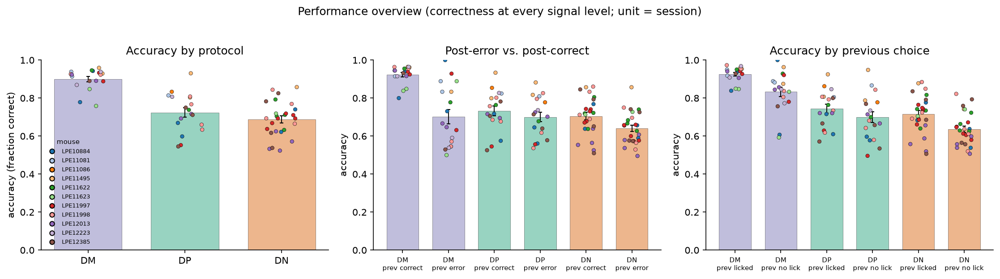
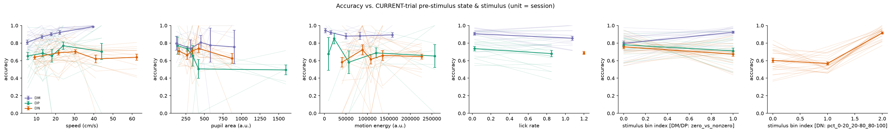
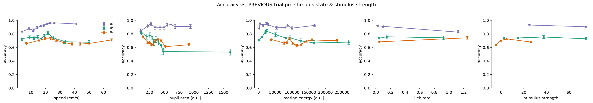
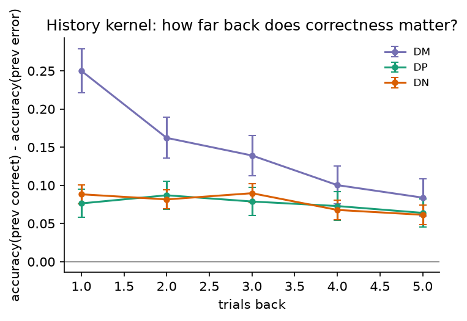
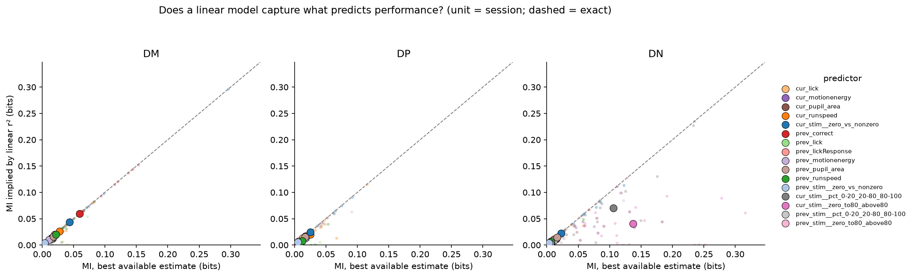
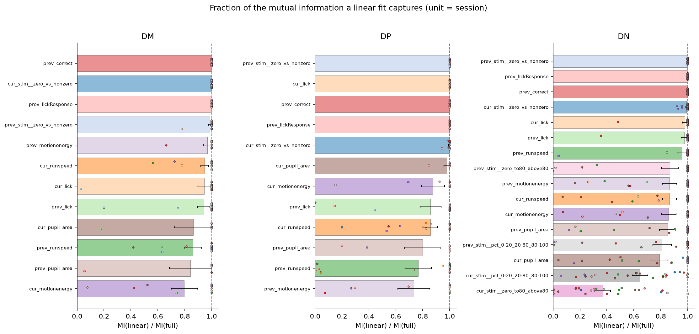
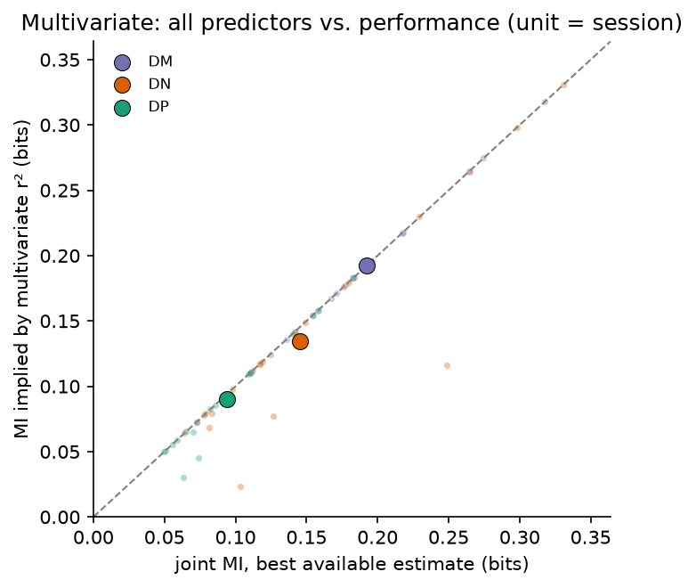
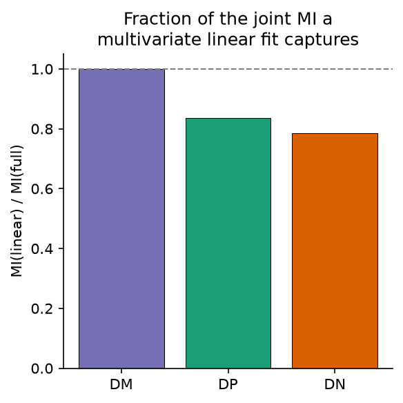

# 1d_performance_predictors

*Auto-generated from `2_pipeline/1d_performance_predictors/out/` on 2026-10-30 11:38. Re-run `make_progress_md.py` after the script's output changes -- don't hand-edit this file.*

## Tables

### Performance binning used

| protocol | response_bins | response_bin_method | min_trials_per_target_bin | min_trials_analysis | pairwise_stim_strategies | multivariate_stim_strategy | strategy_definitions |
| --- | --- | --- | --- | --- | --- | --- | --- |
| DM | 3 | quantile | 1 | 20 | zero_vs_nonzero | zero_vs_nonzero | {"zero_vs_nonzero": {"edges": [0.0], "kind": "contrast", "names": ["0", ">0"], "zero_separate": false}} |
| DP | 3 | quantile | 1 | 20 | zero_vs_nonzero | zero_vs_nonzero | {"zero_vs_nonzero": {"edges": [0.0], "kind": "contrast", "names": ["0", ">0"], "zero_separate": false}} |
| DN | 3 | quantile | 1 | 20 | zero_to80_above80, pct_0-20_20-80_80-100, zero_vs_nonzero | pct_0-20_20-80_80-100 | {"pct_0-20_20-80_80-100": {"edges": [0.2, 0.8], "kind": "curve_pct", "names": ["0-20%", "20-80%", "80-100%"], "zero_separate": false}, "zero_to80_above80": {"edges": [0.8], "kind": "curve_pct", "names": ["0", "<=80%", ">80%"], "zero_separate": true}, "zero_vs_nonzero": {"edges": [0.0], "kind": "contrast", "names": ["0", ">0"], "zero_separate": false}} |

[performance_binning_used.csv](../2_pipeline/1d_performance_predictors/out/performance_binning_used.csv)

### Performance history kernel  session

| protocol | lag | delta_accuracy | n_prev_correct | n_prev_error | unit | animal_id |
| --- | --- | --- | --- | --- | --- | --- |
| DM | 1 | -0.06122 | 147 | 9 | LPE10884_2023_11_30 | LPE10884 |
| DM | 2 | -0.06164 | 146 | 9 | LPE10884_2023_11_30 | LPE10884 |
| DM | 3 | 0.05594 | 145 | 9 | LPE10884_2023_11_30 | LPE10884 |
| DM | 4 | 0.2017 | 145 | 8 | LPE10884_2023_11_30 | LPE10884 |
| DM | 5 | -0.0625 | 144 | 8 | LPE10884_2023_11_30 | LPE10884 |
| DM | 1 | 0.06923 | 95 | 26 | LPE10884_2023_12_10 | LPE10884 |
| DM | 2 | 0.02947 | 95 | 25 | LPE10884_2023_12_10 | LPE10884 |
| DM | 3 | 0.08851 | 94 | 25 | LPE10884_2023_12_10 | LPE10884 |
| DM | 4 | 0.04645 | 93 | 25 | LPE10884_2023_12_10 | LPE10884 |
| DM | 5 | -0.05739 | 92 | 25 | LPE10884_2023_12_10 | LPE10884 |
| DM | 1 | 0.026 | 94 | 9 | LPE11081_2023_12_11 | LPE11081 |
| DM | 2 | 0.147 | 93 | 9 | LPE11081_2023_12_11 | LPE11081 |
| DM | 3 | 0.03502 | 92 | 9 | LPE11081_2023_12_11 | LPE11081 |
| DM | 4 | -0.08791 | 91 | 9 | LPE11081_2023_12_11 | LPE11081 |
| DM | 5 | -0.08889 | 90 | 9 | LPE11081_2023_12_11 | LPE11081 |
| DM | 1 | 0.1117 | 91 | 6 | LPE11081_2023_12_12 | LPE11081 |
| DM | 2 | 0.1111 | 90 | 6 | LPE11081_2023_12_12 | LPE11081 |
| DM | 3 | 0.1217 | 89 | 6 | LPE11081_2023_12_12 | LPE11081 |
| DM | 4 | -0.04545 | 88 | 6 | LPE11081_2023_12_12 | LPE11081 |
| DM | 5 | -0.04598 | 87 | 6 | LPE11081_2023_12_12 | LPE11081 |
| DM | 1 | 0.131 | 140 | 6 | LPE11495_2024_02_14 | LPE11495 |
| DM | 2 | -0.04317 | 139 | 6 | LPE11495_2024_02_14 | LPE11495 |
| DM | 3 | -0.04348 | 138 | 6 | LPE11495_2024_02_14 | LPE11495 |
| DM | 4 | -0.0438 | 137 | 6 | LPE11495_2024_02_14 | LPE11495 |
| DM | 5 | -0.0365 | 137 | 5 | LPE11495_2024_02_14 | LPE11495 |
| DM | 1 | 0.4163 | 157 | 11 | LPE11495_2024_02_16 | LPE11495 |
| DM | 2 | 0.1305 | 156 | 11 | LPE11495_2024_02_16 | LPE11495 |
| DM | 3 | 0.0393 | 155 | 11 | LPE11495_2024_02_16 | LPE11495 |
| DM | 4 | 0.03896 | 154 | 11 | LPE11495_2024_02_16 | LPE11495 |
| DM | 5 | 0.1361 | 153 | 11 | LPE11495_2024_02_16 | LPE11495 |

*(showing first 30 of 310 rows -- see the linked CSV for the rest)*

[performance_history_kernel__session.csv](../2_pipeline/1d_performance_predictors/out/performance_history_kernel__session.csv)

### Performance mi vs linear

| protocol | predictor | n_trials | r | r2 | p_linear | mi_bits_raw | mi_bits_shuffle_mean | mi_bits_corrected | mi_p_value | mi_bits_from_r2 | mi_reference_bits | frac_explained_linearly | linear_sufficient |
| --- | --- | --- | --- | --- | --- | --- | --- | --- | --- | --- | --- | --- | --- |
| DM | cur_stim_bin | 3045 | 0.1515 | 0.02295 | 4.319e-17 | 0.01416 | 0.0002497 | 0.01391 | 0 | 0.01674 | 0.01674 | 1 | True |
| DM | prev_stim_bin | 3027 | -0.0345 | 0.00119 | 0.05774 | 0.0009082 | 0.0001938 | 0.0007144 | 0.01 | 0.0008589 | 0.0008589 | 1 | True |
| DM | cur_runspeed | 3045 | 0.1607 | 0.02582 | 4.633e-19 | 0.02754 | 0.004411 | 0.02313 | 0 | 0.01887 | 0.02313 | 0.8157 | True |
| DM | cur_pupil_area | 988 | 0.05336 | 0.002848 | 0.09365 | 0.0235 | 0.01488 | 0.00862 | 0.06 | 0.002057 | 0.00862 | 0.2386 | False |
| DM | cur_motionenergy | 2014 | -0.0201 | 0.0004042 | 0.3672 | 0.01553 | 0.006853 | 0.008676 | 0 | 0.0002916 | 0.008676 | 0.03361 | False |
| DM | cur_lick | 3045 | -0.06611 | 0.004371 | 0.0002616 | 0.009481 | 0.0008751 | 0.008606 | 0 | 0.00316 | 0.008606 | 0.3672 | False |
| DM | prev_runspeed | 3027 | 0.1291 | 0.01666 | 1.022e-12 | 0.01842 | 0.004695 | 0.01372 | 0 | 0.01212 | 0.01372 | 0.8829 | True |
| DM | prev_pupil_area | 982 | 0.04882 | 0.002383 | 0.1263 | 0.02465 | 0.01502 | 0.009633 | 0.01 | 0.001721 | 0.009633 | 0.1787 | False |
| DM | prev_motionenergy | 2003 | -0.02849 | 0.0008115 | 0.2025 | 0.009303 | 0.007181 | 0.002122 | 0.18 | 0.0005856 | 0.002122 | 0.276 | False |
| DM | prev_lick | 3027 | -0.06437 | 0.004143 | 0.0003949 | 0.007184 | 0.0006149 | 0.00657 | 0 | 0.002995 | 0.00657 | 0.4558 | False |
| DM | prev_correct | 3027 | 0.2493 | 0.06214 | 4.202e-44 | 0.03057 | 0.0002507 | 0.03032 | 0 | 0.04628 | 0.04628 | 1 | True |
| DM | prev_lickResponse | 3027 | 0.1419 | 0.02012 | 4.475e-15 | 0.01266 | 0.0002945 | 0.01237 | 0 | 0.01466 | 0.01466 | 1 | True |
| DP | cur_stim_bin | 3194 | 0.1932 | 0.03732 | 3.155e-28 | 0.03667 | 0.0007427 | 0.03593 | 0 | 0.02743 | 0.03593 | 0.7636 | False |
| DP | prev_stim_bin | 3176 | -0.009245 | 8.547e-05 | 0.6025 | 0.0001967 | 0.0006715 | 0 | 0.8 | 6.165e-05 | 6.165e-05 | 1 | True |
| DP | cur_runspeed | 3194 | -0.02597 | 0.0006746 | 0.1422 | 0.009254 | 0.004578 | 0.004676 | 0 | 0.0004868 | 0.004676 | 0.1041 | False |
| DP | cur_pupil_area | 1137 | -0.1712 | 0.0293 | 6.305e-09 | 0.03533 | 0.01207 | 0.02326 | 0 | 0.02145 | 0.02326 | 0.9222 | True |
| DP | cur_motionenergy | 2085 | -0.1116 | 0.01245 | 3.252e-07 | 0.03094 | 0.006821 | 0.02412 | 0 | 0.009039 | 0.02412 | 0.3748 | False |
| DP | cur_lick | 3194 | -0.06012 | 0.003614 | 0.0006752 | 0.002063 | 0.0009257 | 0.001137 | 0.05 | 0.002612 | 0.002612 | 1 | True |
| DP | prev_runspeed | 3176 | -0.04404 | 0.00194 | 0.01306 | 0.007671 | 0.004175 | 0.003496 | 0.01 | 0.001401 | 0.003496 | 0.4006 | False |
| DP | prev_pupil_area | 1130 | -0.1661 | 0.02758 | 1.957e-08 | 0.03569 | 0.01251 | 0.02319 | 0 | 0.02018 | 0.02319 | 0.8701 | True |
| DP | prev_motionenergy | 2075 | -0.1077 | 0.01161 | 8.716e-07 | 0.03284 | 0.006475 | 0.02637 | 0 | 0.00842 | 0.02637 | 0.3193 | False |
| DP | prev_lick | 3176 | -0.007104 | 5.046e-05 | 0.689 | 0.0003961 | 0.0008908 | 0 | 0.69 | 3.64e-05 | 3.64e-05 | 1 | True |
| DP | prev_correct | 3176 | 0.07635 | 0.00583 | 1.65e-05 | 0.004097 | 0.0002382 | 0.003859 | 0 | 0.004218 | 0.004218 | 1 | True |
| DP | prev_lickResponse | 3176 | 0.1052 | 0.01106 | 2.814e-09 | 0.007849 | 0.000253 | 0.007596 | 0 | 0.008026 | 0.008026 | 1 | True |
| DN | cur_stim_bin | 6698 | 0.3275 | 0.1073 | 3.227e-167 | 0.1095 | 0.0003282 | 0.1092 | 0 | 0.08184 | 0.1092 | 0.7496 | False |
| DN | prev_stim_bin | 6672 | 0.01058 | 0.0001118 | 0.3878 | 0.003493 | 0.0003122 | 0.003181 | 0 | 8.068e-05 | 0.003181 | 0.02537 | False |
| DN | cur_runspeed | 6698 | 0.002196 | 4.821e-06 | 0.8574 | 0.00743 | 0.00211 | 0.00532 | 0 | 3.478e-06 | 0.00532 | 0.0006537 | False |
| DN | cur_pupil_area | 6212 | -0.03416 | 0.001167 | 0.007084 | 0.009661 | 0.002348 | 0.007313 | 0 | 0.0008424 | 0.007313 | 0.1152 | False |
| DN | cur_motionenergy | 6431 | -0.02451 | 0.0006008 | 0.04936 | 0.006698 | 0.002172 | 0.004525 | 0 | 0.0004335 | 0.004525 | 0.09579 | False |
| DN | cur_lick | 6698 | -0.01938 | 0.0003756 | 0.1127 | 0.0004039 | 0.0002697 | 0.0001343 | 0.21 | 0.000271 | 0.000271 | 1 | True |

*(showing first 30 of 36 rows -- see the linked CSV for the rest)*

[performance_mi_vs_linear.csv](../2_pipeline/1d_performance_predictors/out/performance_mi_vs_linear.csv)

### Performance mi vs linear  session

| protocol | predictor | n_trials | r | r2 | p_linear | mi_bits_raw | mi_bits_shuffle_mean | mi_bits_corrected | mi_p_value | mi_bits_from_r2 | mi_reference_bits | frac_explained_linearly | linear_sufficient | unit |
| --- | --- | --- | --- | --- | --- | --- | --- | --- | --- | --- | --- | --- | --- | --- |
| DM | cur_stim__zero_vs_nonzero | 157 | 0.5806 | 0.3371 | 1.587e-15 | 0.1435 | 0.005624 | 0.1378 | 0 | 0.2965 | 0.2965 | 1 | True | LPE10884_2023_11_30 |
| DM | prev_stim__zero_vs_nonzero | 156 | -0.09215 | 0.008491 | 0.2526 | 0.01116 | 0.004973 | 0.006184 | 0.35 | 0.006151 | 0.006184 | 0.9947 | True | LPE10884_2023_11_30 |
| DM | cur_runspeed | 157 | 0.143 | 0.02044 | 0.07407 | 0.01449 | 0.01053 | 0.003965 | 0.2 | 0.0149 | 0.0149 | 1 | True | LPE10884_2023_11_30 |
| DM | cur_lick | 157 | -0.182 | 0.03311 | 0.02255 | 0 | 0 | 0 | 1 | 0.02429 | 0.02429 | 1 | True | LPE10884_2023_11_30 |
| DM | prev_runspeed | 156 | 0.09052 | 0.008193 | 0.2611 | 0.01422 | 0.009905 | 0.004311 | 0.27 | 0.005935 | 0.005935 | 1 | True | LPE10884_2023_11_30 |
| DM | prev_lick | 156 | 0.03373 | 0.001138 | 0.6759 | 0 | 0 | 0 | 1 | 0.0008213 | 0.0008213 | 1 | True | LPE10884_2023_11_30 |
| DM | prev_correct | 156 | -0.06122 | 0.003748 | 0.4477 | 0.005099 | 0.004916 | 0.0001835 | 0.61 | 0.002709 | 0.002709 | 1 | True | LPE10884_2023_11_30 |
| DM | prev_lickResponse | 156 | -0.07143 | 0.005102 | 0.3756 | 0.006871 | 0.004639 | 0.002232 | 0.59 | 0.00369 | 0.00369 | 1 | True | LPE10884_2023_11_30 |
| DM | cur_stim__zero_vs_nonzero | 122 | 0.2826 | 0.07984 | 0.001615 | 0.05106 | 0.006192 | 0.04487 | 0 | 0.06002 | 0.06002 | 1 | True | LPE10884_2023_12_10 |
| DM | prev_stim__zero_vs_nonzero | 121 | -0.05838 | 0.003409 | 0.5247 | 0.002575 | 0.005681 | 0 | 0.54 | 0.002463 | 0.002463 | 1 | True | LPE10884_2023_12_10 |
| DM | cur_runspeed | 122 | 0.2059 | 0.04239 | 0.02291 | 0.03481 | 0.01163 | 0.02318 | 0.05 | 0.03124 | 0.03124 | 1 | True | LPE10884_2023_12_10 |
| DM | cur_lick | 122 | -0.1148 | 0.01318 | 0.208 | 0.01054 | 0.006245 | 0.004294 | 0.21 | 0.009567 | 0.009567 | 1 | True | LPE10884_2023_12_10 |
| DM | prev_runspeed | 121 | 0.2114 | 0.04467 | 0.01995 | 0.03949 | 0.01249 | 0.027 | 0.05 | 0.03297 | 0.03297 | 1 | True | LPE10884_2023_12_10 |
| DM | prev_lick | 121 | -0.1336 | 0.01786 | 0.144 | 0.006754 | 0.005123 | 0.001631 | 0.32 | 0.013 | 0.013 | 1 | True | LPE10884_2023_12_10 |
| DM | prev_correct | 121 | 0.06923 | 0.004793 | 0.4505 | 0.003324 | 0.006683 | 0 | 0.55 | 0.003466 | 0.003466 | 1 | True | LPE10884_2023_12_10 |
| DM | prev_lickResponse | 121 | 0.2378 | 0.05653 | 0.008638 | 0.03713 | 0.005307 | 0.03182 | 0 | 0.04198 | 0.04198 | 1 | True | LPE10884_2023_12_10 |
| DM | cur_stim__zero_vs_nonzero | 104 | 0.3563 | 0.127 | 0.0002051 | 0.07149 | 0.007753 | 0.06374 | 0.01 | 0.09795 | 0.09795 | 1 | True | LPE11081_2023_12_11 |
| DM | prev_stim__zero_vs_nonzero | 103 | 0.09942 | 0.009885 | 0.3177 | 0.006376 | 0.006182 | 0.0001947 | 0.3 | 0.007166 | 0.007166 | 1 | True | LPE11081_2023_12_11 |
| DM | cur_runspeed | 104 | 0.2025 | 0.041 | 0.03928 | 0.03386 | 0.0168 | 0.01706 | 0.14 | 0.0302 | 0.0302 | 1 | True | LPE11081_2023_12_11 |
| DM | cur_lick | 104 | -0.03978 | 0.001583 | 0.6884 | 0.0463 | 0.006724 | 0.03958 | 0.03 | 0.001143 | 0.03958 | 0.02887 | False | LPE11081_2023_12_11 |
| DM | prev_runspeed | 103 | 0.1476 | 0.02178 | 0.1368 | 0.005662 | 0.01749 | 0 | 0.6 | 0.01588 | 0.01588 | 1 | True | LPE11081_2023_12_11 |
| DM | prev_lick | 103 | -0.2684 | 0.07205 | 0.006119 | 0.07832 | 0.006332 | 0.07199 | 0 | 0.05394 | 0.07199 | 0.7493 | False | LPE11081_2023_12_11 |
| DM | prev_correct | 103 | 0.026 | 0.0006762 | 0.7943 | 0.000456 | 0.00729 | 0 | 1 | 0.000488 | 0.000488 | 1 | True | LPE11081_2023_12_11 |
| DM | prev_lickResponse | 103 | 0.03867 | 0.001496 | 0.6981 | 0.001018 | 0.008571 | 0 | 1 | 0.00108 | 0.00108 | 1 | True | LPE11081_2023_12_11 |
| DM | cur_stim__zero_vs_nonzero | 98 | 0.3054 | 0.09328 | 0.002228 | 0.05103 | 0.00992 | 0.04111 | 0 | 0.07063 | 0.07063 | 1 | True | LPE11081_2023_12_12 |
| DM | prev_stim__zero_vs_nonzero | 97 | -0.0189 | 0.0003572 | 0.8542 | 0.0002675 | 0.007755 | 0 | 1 | 0.0002577 | 0.0002577 | 1 | True | LPE11081_2023_12_12 |
| DM | cur_runspeed | 98 | -0.0278 | 0.000773 | 0.7858 | 0.008679 | 0.0203 | 0 | 0.66 | 0.0005578 | 0.0005578 | 1 | True | LPE11081_2023_12_12 |
| DM | cur_lick | 98 | 0.05628 | 0.003168 | 0.582 | 3.866e-05 | 0.007871 | 0 | 1 | 0.002289 | 0.002289 | 1 | True | LPE11081_2023_12_12 |
| DM | prev_runspeed | 97 | -0.1436 | 0.02062 | 0.1605 | 0.04222 | 0.01849 | 0.02373 | 0.15 | 0.01503 | 0.02373 | 0.6336 | False | LPE11081_2023_12_12 |
| DM | prev_lick | 97 | 0.09485 | 0.008997 | 0.3554 | 0.04009 | 0.00751 | 0.03258 | 0.05 | 0.006519 | 0.03258 | 0.2001 | False | LPE11081_2023_12_12 |

*(showing first 15 of 16 columns; showing first 30 of 766 rows -- see the linked CSV for the rest)*

[performance_mi_vs_linear__session.csv](../2_pipeline/1d_performance_predictors/out/performance_mi_vs_linear__session.csv)

### Performance multivariate mi vs linear

| protocol | predictors | n_predictors | n_trials | r2 | adj_r2 | p_linear | mi_bits_raw | mi_bits_shuffle_mean | mi_bits_corrected | mi_p_value | mi_bits_from_r2 | mi_reference_bits | frac_explained_linearly | linear_sufficient |
| --- | --- | --- | --- | --- | --- | --- | --- | --- | --- | --- | --- | --- | --- | --- |
| DM | cur_stim_bin, prev_stim_bin, cur_runspeed, cur_pupil_area, cur_motionenergy, cur_lick, prev_runspeed, prev_pupil_area, prev_motionenergy, prev_lick, prev_correct, prev_lickResponse | 12 | 979 | 0.1683 | 0.158 | 7.089e-32 | 0.09513 | 0.003103 | 0.09203 | 0 | 0.1329 | 0.1329 | 1 | True |
| DP | cur_stim_bin, prev_stim_bin, cur_runspeed, cur_pupil_area, cur_motionenergy, cur_lick, prev_runspeed, prev_pupil_area, prev_motionenergy, prev_lick, prev_correct, prev_lickResponse | 12 | 1129 | 0.1016 | 0.09199 | 5.741e-20 | 0.1009 | 0.008539 | 0.09239 | 0 | 0.07733 | 0.09239 | 0.837 | True |
| DN | cur_stim_bin, prev_stim_bin, cur_runspeed, cur_pupil_area, cur_motionenergy, cur_lick, prev_runspeed, prev_pupil_area, prev_motionenergy, prev_lick, prev_correct, prev_lickResponse | 12 | 6188 | 0.1293 | 0.1276 | 2.085e-175 | 0.1305 | 0.003327 | 0.1272 | 0 | 0.09985 | 0.1272 | 0.7851 | False |

[performance_multivariate_mi_vs_linear.csv](../2_pipeline/1d_performance_predictors/out/performance_multivariate_mi_vs_linear.csv)

### Performance multivariate mi vs linear  session

| protocol | predictors | n_predictors | n_trials | r2 | adj_r2 | p_linear | mi_bits_raw | mi_bits_shuffle_mean | mi_bits_corrected | mi_p_value | mi_bits_from_r2 | mi_reference_bits | frac_explained_linearly | linear_sufficient |
| --- | --- | --- | --- | --- | --- | --- | --- | --- | --- | --- | --- | --- | --- | --- |
| DM | cur_stim__zero_vs_nonzero, prev_stim__zero_vs_nonzero, cur_runspeed, cur_lick, prev_runspeed, prev_lick, prev_correct, prev_lickResponse | 8 | 156 | 0.3562 | 0.3211 | 3.074e-11 | 0.1979 | 0.01358 | 0.1844 | 0 | 0.3176 | 0.3176 | 1 | True |
| DM | cur_stim__zero_vs_nonzero, prev_stim__zero_vs_nonzero, cur_runspeed, cur_lick, prev_runspeed, prev_lick, prev_correct, prev_lickResponse | 8 | 121 | 0.2249 | 0.1695 | 0.0002837 | 0.1302 | 0.01536 | 0.1149 | 0 | 0.1838 | 0.1838 | 1 | True |
| DM | cur_stim__zero_vs_nonzero, prev_stim__zero_vs_nonzero, cur_runspeed, cur_lick, prev_runspeed, prev_lick, prev_correct, prev_lickResponse | 8 | 103 | 0.2381 | 0.1732 | 0.0009153 | 0.08892 | 0.01253 | 0.07639 | 0 | 0.1961 | 0.1961 | 1 | True |
| DM | cur_stim__zero_vs_nonzero, prev_stim__zero_vs_nonzero, cur_runspeed, cur_lick, prev_runspeed, prev_lick, prev_correct, prev_lickResponse | 8 | 97 | 0.1925 | 0.1191 | 0.01267 | 0 | 0.01199 | 0 | 1 | 0.1542 | 0.1542 | 1 | True |
| DM | cur_stim__zero_vs_nonzero, prev_stim__zero_vs_nonzero, cur_runspeed, cur_motionenergy, cur_lick, prev_runspeed, prev_motionenergy, prev_lick, prev_correct, prev_lickResponse | 10 | 146 | 0.2114 | 0.1529 | 0.0002745 | 0.02591 | 0.006019 | 0.01989 | 0.05 | 0.1713 | 0.1713 | 1 | True |
| DM | cur_stim__zero_vs_nonzero, prev_stim__zero_vs_nonzero, cur_runspeed, cur_motionenergy, cur_lick, prev_runspeed, prev_motionenergy, prev_lick, prev_correct, prev_lickResponse | 10 | 168 | 0.2608 | 0.2137 | 4.787e-07 | 0.004329 | 0.01251 | 0 | 0.5 | 0.218 | 0.218 | 1 | True |
| DM | cur_stim__zero_vs_nonzero, prev_stim__zero_vs_nonzero, cur_runspeed, cur_motionenergy, cur_lick, prev_runspeed, prev_motionenergy, prev_lick, prev_correct, prev_lickResponse | 10 | 352 | 0.1421 | 0.1169 | 7.94e-08 | 0.02879 | 0.00573 | 0.02306 | 0.05 | 0.1105 | 0.1105 | 1 | True |
| DM | cur_stim__zero_vs_nonzero, prev_stim__zero_vs_nonzero, cur_runspeed, cur_pupil_area, cur_motionenergy, cur_lick, prev_runspeed, prev_pupil_area, prev_motionenergy, prev_lick, prev_correct, prev_lickResponse | 12 | 86 | 0.218 | 0.08947 | 0.08525 | 0.05636 | 0.01545 | 0.04091 | 0.1 | 0.1774 | 0.1774 | 1 | True |
| DM | cur_stim__zero_vs_nonzero, prev_stim__zero_vs_nonzero, cur_runspeed, cur_pupil_area, cur_motionenergy, cur_lick, prev_runspeed, prev_pupil_area, prev_motionenergy, prev_lick, prev_correct, prev_lickResponse | 12 | 115 | 0.179 | 0.08243 | 0.04923 | 0.01863 | 0.01426 | 0.004374 | 0.3 | 0.1423 | 0.1423 | 1 | True |
| DM | cur_stim__zero_vs_nonzero, prev_stim__zero_vs_nonzero, cur_runspeed, cur_motionenergy, cur_lick, prev_runspeed, prev_motionenergy, prev_lick, prev_correct, prev_lickResponse | 10 | 178 | 0.1965 | 0.1483 | 4.863e-05 | 0.06829 | 0.01201 | 0.05628 | 0 | 0.1578 | 0.1578 | 1 | True |
| DM | cur_stim__zero_vs_nonzero, prev_stim__zero_vs_nonzero, cur_runspeed, cur_pupil_area, cur_motionenergy, cur_lick, prev_runspeed, prev_pupil_area, prev_motionenergy, prev_lick, prev_correct, prev_lickResponse | 12 | 205 | 0.1719 | 0.1202 | 0.0002117 | 0.0179 | 0.009387 | 0.008514 | 0.3 | 0.1361 | 0.1361 | 1 | True |
| DM | cur_stim__zero_vs_nonzero, prev_stim__zero_vs_nonzero, cur_runspeed, cur_pupil_area, cur_motionenergy, cur_lick, prev_runspeed, prev_pupil_area, prev_motionenergy, prev_lick, prev_correct, prev_lickResponse | 12 | 148 | 0.3068 | 0.2452 | 8.458e-07 | 0 | 0.01559 | 0 | 1 | 0.2644 | 0.2644 | 1 | True |
| DM | cur_stim__zero_vs_nonzero, prev_stim__zero_vs_nonzero, cur_runspeed, cur_pupil_area, cur_motionenergy, cur_lick, prev_runspeed, prev_pupil_area, prev_motionenergy, prev_lick, prev_correct, prev_lickResponse | 12 | 193 | 0.3166 | 0.2711 | 2.748e-10 | 0.03001 | 0.005579 | 0.02443 | 0 | 0.2746 | 0.2746 | 1 | True |
| DM | cur_stim__zero_vs_nonzero, prev_stim__zero_vs_nonzero, cur_runspeed, cur_pupil_area, cur_motionenergy, cur_lick, prev_runspeed, prev_pupil_area, prev_motionenergy, prev_lick, prev_correct, prev_lickResponse | 12 | 232 | 0.2358 | 0.1939 | 2.072e-08 | 0.03946 | 0.01282 | 0.02664 | 0.1 | 0.194 | 0.194 | 1 | True |
| DM | cur_stim__zero_vs_nonzero, prev_stim__zero_vs_nonzero, cur_runspeed, cur_motionenergy, cur_lick, prev_runspeed, prev_motionenergy, prev_lick, prev_correct, prev_lickResponse | 10 | 173 | 0.2068 | 0.1579 | 3.179e-05 | 0.03101 | 0.01058 | 0.02043 | 0.1 | 0.1671 | 0.1671 | 1 | True |
| DM | cur_stim__zero_vs_nonzero, prev_stim__zero_vs_nonzero, cur_runspeed, cur_lick, prev_runspeed, prev_lick, prev_correct, prev_lickResponse | 8 | 175 | 0.2241 | 0.1868 | 9.291e-07 | 0.08625 | 0.01103 | 0.07522 | 0 | 0.1831 | 0.1831 | 1 | True |
| DM | cur_stim__zero_vs_nonzero, prev_stim__zero_vs_nonzero, cur_runspeed, cur_lick, prev_runspeed, prev_lick, prev_correct, prev_lickResponse | 8 | 209 | 0.26 | 0.2304 | 2.835e-10 | 0.07767 | 0.008443 | 0.06923 | 0 | 0.2172 | 0.2172 | 1 | True |
| DM | cur_stim__zero_vs_nonzero, prev_stim__zero_vs_nonzero, cur_runspeed, cur_lick, prev_runspeed, prev_lick, prev_correct, prev_lickResponse | 8 | 163 | 0.2354 | 0.1956 | 1.291e-06 | 0.07265 | 0.0119 | 0.06075 | 0 | 0.1936 | 0.1936 | 1 | True |
| DP | cur_stim__zero_vs_nonzero, prev_stim__zero_vs_nonzero, cur_runspeed, cur_lick, prev_runspeed, prev_lick, prev_correct, prev_lickResponse | 8 | 126 | 0.1766 | 0.1203 | 0.002995 | 0.02632 | 0.007657 | 0.01866 | 0.05 | 0.1402 | 0.1402 | 1 | True |
| DP | cur_stim__zero_vs_nonzero, prev_stim__zero_vs_nonzero, cur_runspeed, cur_lick, prev_runspeed, prev_lick, prev_correct, prev_lickResponse | 8 | 121 | 0.07823 | 0.01239 | 0.3125 | 0 | 0.003611 | 0 | 1 | 0.05876 | 0.05876 | 1 | True |
| DP | cur_stim__zero_vs_nonzero, prev_stim__zero_vs_nonzero, cur_runspeed, cur_lick, prev_runspeed, prev_lick, prev_correct, prev_lickResponse | 8 | 112 | 0.1119 | 0.04288 | 0.1276 | 0 | 0.01883 | 0 | 1 | 0.08558 | 0.08558 | 1 | True |
| DP | cur_stim__zero_vs_nonzero, prev_stim__zero_vs_nonzero, cur_runspeed, cur_lick, prev_runspeed, prev_lick, prev_correct, prev_lickResponse | 8 | 107 | 0.07434 | -0.001227 | 0.4534 | 0 | 0.01614 | 0 | 1 | 0.05572 | 0.05572 | 1 | True |
| DP | cur_stim__zero_vs_nonzero, prev_stim__zero_vs_nonzero, cur_runspeed, cur_motionenergy, cur_lick, prev_runspeed, prev_motionenergy, prev_lick, prev_correct, prev_lickResponse | 10 | 258 | 0.06676 | 0.02898 | 0.06716 | 0.02818 | 0.006833 | 0.02134 | 0.05 | 0.04984 | 0.04984 | 1 | True |
| DP | cur_stim__zero_vs_nonzero, prev_stim__zero_vs_nonzero, cur_runspeed, cur_motionenergy, cur_lick, prev_runspeed, prev_motionenergy, prev_lick, prev_correct, prev_lickResponse | 10 | 360 | 0.09576 | 0.06985 | 0.0001013 | 0.03829 | 0.005602 | 0.03269 | 0.05 | 0.07261 | 0.07261 | 1 | True |
| DP | cur_stim__zero_vs_nonzero, prev_stim__zero_vs_nonzero, cur_runspeed, cur_pupil_area, cur_motionenergy, cur_lick, prev_runspeed, prev_pupil_area, prev_motionenergy, prev_lick, prev_correct, prev_lickResponse | 12 | 224 | 0.08645 | 0.0345 | 0.07662 | 0.08511 | 0.01494 | 0.07017 | 0 | 0.06522 | 0.07017 | 0.9295 | True |
| DP | cur_stim__zero_vs_nonzero, prev_stim__zero_vs_nonzero, cur_runspeed, cur_pupil_area, cur_motionenergy, cur_lick, prev_runspeed, prev_pupil_area, prev_motionenergy, prev_lick, prev_correct, prev_lickResponse | 12 | 218 | 0.1416 | 0.09133 | 0.001362 | 0.1095 | 0.009942 | 0.09952 | 0 | 0.1101 | 0.1101 | 1 | True |
| DP | cur_stim__zero_vs_nonzero, prev_stim__zero_vs_nonzero, cur_runspeed, cur_pupil_area, cur_motionenergy, cur_lick, prev_runspeed, prev_pupil_area, prev_motionenergy, prev_lick, prev_correct, prev_lickResponse | 12 | 111 | 0.2236 | 0.1285 | 0.01065 | 0.154 | 0.01402 | 0.1399 | 0 | 0.1826 | 0.1826 | 1 | True |
| DP | cur_stim__zero_vs_nonzero, prev_stim__zero_vs_nonzero, cur_runspeed, cur_pupil_area, cur_motionenergy, cur_lick, prev_runspeed, prev_pupil_area, prev_motionenergy, prev_lick, prev_correct, prev_lickResponse | 12 | 99 | 0.1928 | 0.08012 | 0.07817 | 0.05082 | 0.02295 | 0.02787 | 0.2 | 0.1545 | 0.1545 | 1 | True |
| DP | cur_stim__zero_vs_nonzero, prev_stim__zero_vs_nonzero, cur_runspeed, cur_pupil_area, cur_motionenergy, cur_lick, prev_runspeed, prev_pupil_area, prev_motionenergy, prev_lick, prev_correct, prev_lickResponse | 12 | 206 | 0.1079 | 0.05245 | 0.0313 | 0.03023 | 0.004099 | 0.02614 | 0.05 | 0.08238 | 0.08238 | 1 | True |
| DP | cur_stim__zero_vs_nonzero, prev_stim__zero_vs_nonzero, cur_runspeed, cur_pupil_area, cur_motionenergy, cur_lick, prev_runspeed, prev_pupil_area, prev_motionenergy, prev_lick, prev_correct, prev_lickResponse | 12 | 119 | 0.1973 | 0.1064 | 0.01815 | 0.03638 | 0.02422 | 0.01216 | 0.25 | 0.1585 | 0.1585 | 1 | True |

*(showing first 15 of 17 columns; showing first 30 of 62 rows -- see the linked CSV for the rest)*

[performance_multivariate_mi_vs_linear__session.csv](../2_pipeline/1d_performance_predictors/out/performance_multivariate_mi_vs_linear__session.csv)

### Performance overview  session

| protocol | animal_id | session_id | accuracy | n_trials | accuracy_prev_correct1 | accuracy_prev_correct0 | accuracy_prev_lick1 | accuracy_prev_lick0 |
| --- | --- | --- | --- | --- | --- | --- | --- | --- |
| DM | LPE10884 | LPE10884_2023_11_30 | 0.9427 | 157 | 0.9388 | 1 | 0.9375 | 1 |
| DM | LPE10884 | LPE10884_2023_12_10 | 0.7787 | 122 | 0.8 | 0.7308 | 0.8387 | 0.6071 |
| DM | LPE11081 | LPE11081_2023_12_11 | 0.9135 | 104 | 0.9149 | 0.8889 | 0.9176 | 0.8889 |
| DM | LPE11081 | LPE11081_2023_12_12 | 0.9388 | 98 | 0.9451 | 0.8333 | 0.95 | 0.8824 |
| DM | LPE11495 | LPE11495_2024_02_14 | 0.9592 | 147 | 0.9643 | 0.8333 | 0.958 | 0.963 |
| DM | LPE11495 | LPE11495_2024_02_16 | 0.929 | 169 | 0.9618 | 0.5455 | 0.9531 | 0.875 |
| DM | LPE11622 | LPE11622_2024_02_16 | 0.9462 | 353 | 0.9551 | 0.7778 | 0.9504 | 0.9286 |
| DM | LPE11623 | LPE11623_2024_03_27 | 0.7586 | 87 | 0.8485 | 0.5 | 0.8475 | 0.5926 |
| DM | LPE11623 | LPE11623_2024_03_29 | 0.8475 | 118 | 0.8384 | 0.8889 | 0.8495 | 0.8333 |
| DM | LPE11997 | LPE11997_2024_04_05 | 0.8883 | 179 | 0.9245 | 0.6316 | 0.927 | 0.7805 |
| DM | LPE11997 | LPE11997_2024_04_07 | 0.933 | 209 | 0.9381 | 0.9286 | 0.9412 | 0.9211 |
| DM | LPE11998 | LPE11998_2024_04_11 | 0.9262 | 149 | 0.9635 | 0.5455 | 0.9732 | 0.8056 |
| DM | LPE11998 | LPE11998_2024_04_12 | 0.9227 | 194 | 0.9553 | 0.5714 | 0.9533 | 0.8372 |
| DM | LPE12013 | LPE12013_2024_04_11 | 0.9234 | 235 | 0.9447 | 0.6471 | 0.9405 | 0.8571 |
| DM | LPE12013 | LPE12013_2024_04_12 | 0.8908 | 174 | 0.9161 | 0.6667 | 0.9062 | 0.8444 |
| DM | LPE12223 | LPE12223_2024_05_29 | 0.8693 | 176 | 0.915 | 0.5909 | 0.9084 | 0.7727 |
| DM | LPE12223 | LPE12223_2024_05_30 | 0.9381 | 210 | 0.9643 | 0.5385 | 0.9682 | 0.8462 |
| DM | LPE12385 | LPE12385_2024_05_30 | 0.8902 | 164 | 0.9315 | 0.5294 | 0.9286 | 0.7568 |
| DN | LPE10884 | LPE10884_2024_01_12 | 0.622 | 209 | 0.6385 | 0.5897 | 0.6838 | 0.5385 |
| DN | LPE10884 | LPE10884_2024_01_17 | 0.7403 | 258 | 0.7684 | 0.6567 | 0.7766 | 0.6377 |
| DN | LPE11495 | LPE11495_2024_02_22 | 0.8578 | 204 | 0.8571 | 0.8571 | 0.8779 | 0.7419 |
| DN | LPE11622 | LPE11622_2024_02_20 | 0.7045 | 396 | 0.7194 | 0.6667 | 0.7423 | 0.6296 |
| DN | LPE11622 | LPE11622_2024_02_22 | 0.6324 | 438 | 0.6377 | 0.6273 | 0.64 | 0.6257 |
| DN | LPE11622 | LPE11622_2024_02_23 | 0.7927 | 246 | 0.8051 | 0.74 | 0.8167 | 0.7231 |
| DN | LPE11622 | LPE11622_2024_02_26 | 0.7118 | 340 | 0.722 | 0.6837 | 0.7345 | 0.6637 |
| DN | LPE11623 | LPE11623_2024_04_02 | 0.7188 | 160 | 0.713 | 0.7273 | 0.7048 | 0.7407 |
| DN | LPE11997 | LPE11997_2024_04_09 | 0.6931 | 277 | 0.733 | 0.6 | 0.7322 | 0.6129 |
| DN | LPE11997 | LPE11997_2024_04_10 | 0.6929 | 254 | 0.7429 | 0.5769 | 0.7647 | 0.58 |
| DN | LPE11997 | LPE11997_2024_04_16 | 0.6685 | 359 | 0.6778 | 0.6555 | 0.6863 | 0.6494 |
| DN | LPE11997 | LPE11997_2024_04_17 | 0.7188 | 345 | 0.7409 | 0.6598 | 0.7432 | 0.6721 |

*(showing first 30 of 62 rows -- see the linked CSV for the rest)*

[performance_overview__session.csv](../2_pipeline/1d_performance_predictors/out/performance_overview__session.csv)

## Figures

### Performance overview

### Tuning current trial

### Tuning previous trial

### History kernel

### Mi vs linear summary

### 5a frac explained linearly

### Multivariate mi vs linear summary

### 6a multivariate frac explained linearly

