# 1f_pupil_nonlinearity

*Auto-generated from `2_pipeline/1f_pupil_nonlinearity/out/` on 2026-11-10 17:48. Re-run `make_progress_md.py` after the script's output changes -- don't hand-edit this file.*

## Figures

### 10a pupil effect by position quadratic

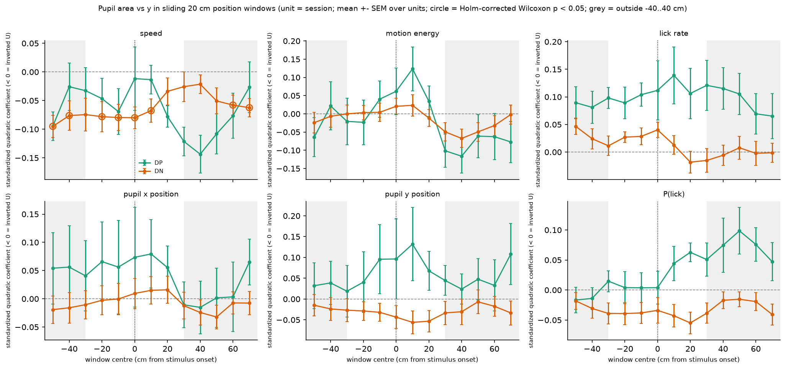

### 10b pupil effect by position linear

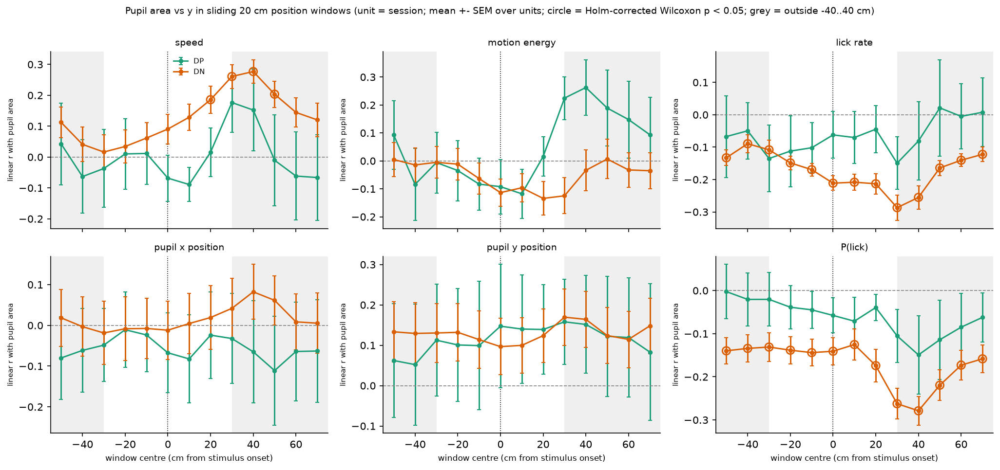

### 10c pupil inverted u by position

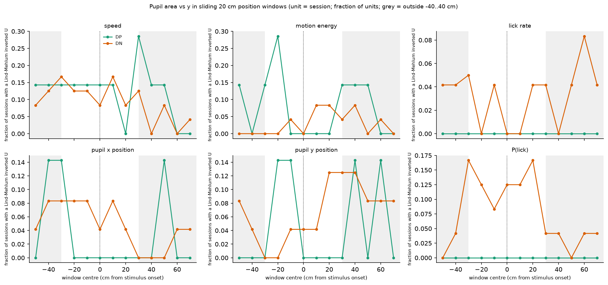

### 10d pupil performance by position

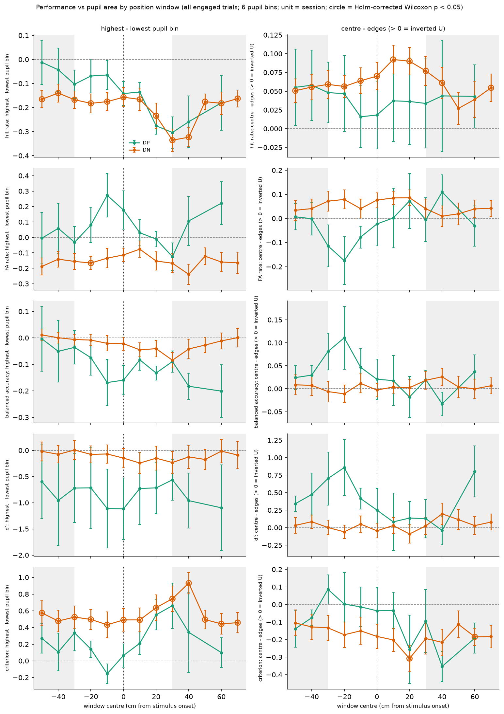

### 1a pupil curves cur pupil area

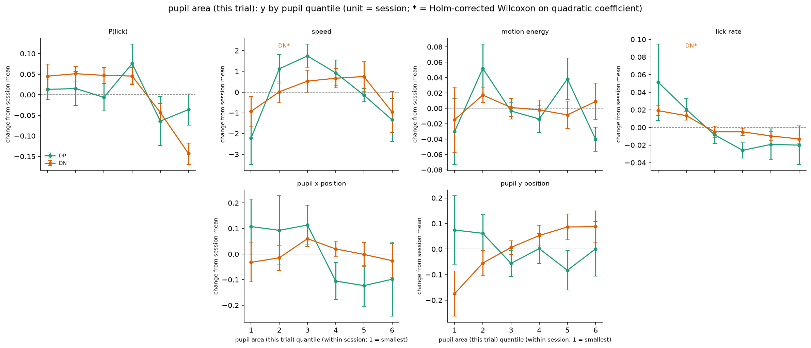

### 1b pupil curves prev pupil area

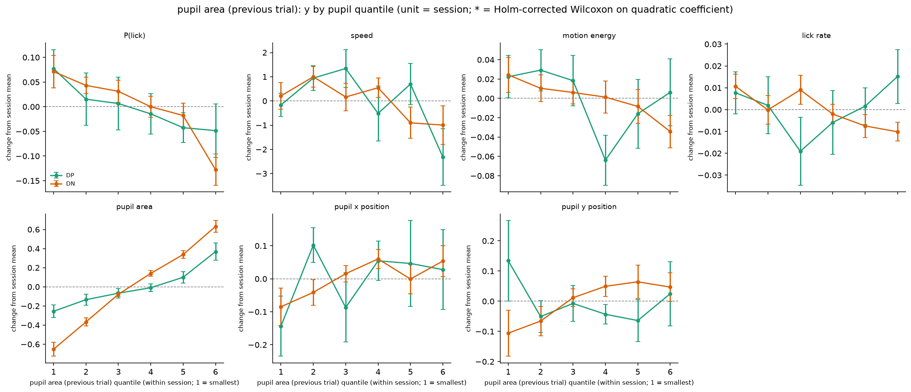

### 1c pupil curves cur pupil xpos

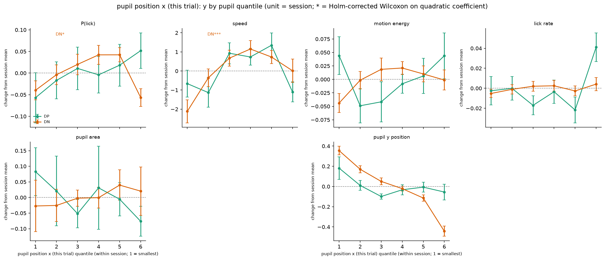

### 1d pupil curves cur pupil ypos

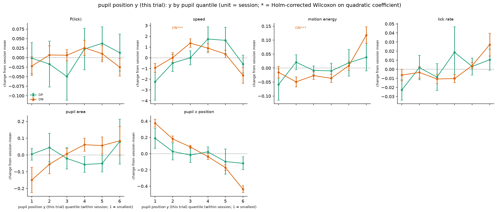

### Pupil performance windows

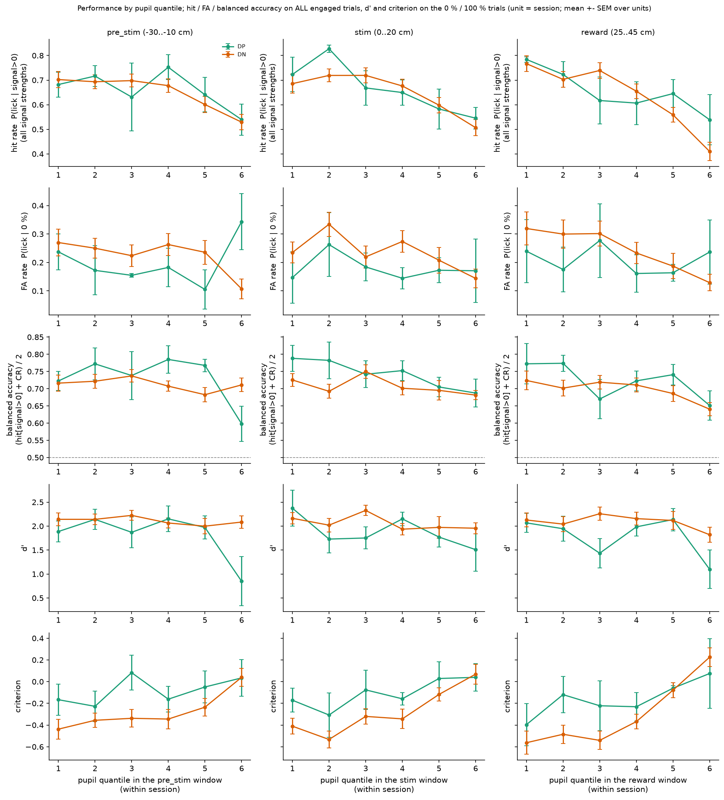

### 3a pupil quadratic cur pupil area

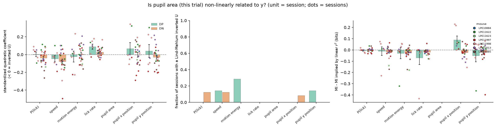

### 3b pupil quadratic prev pupil area

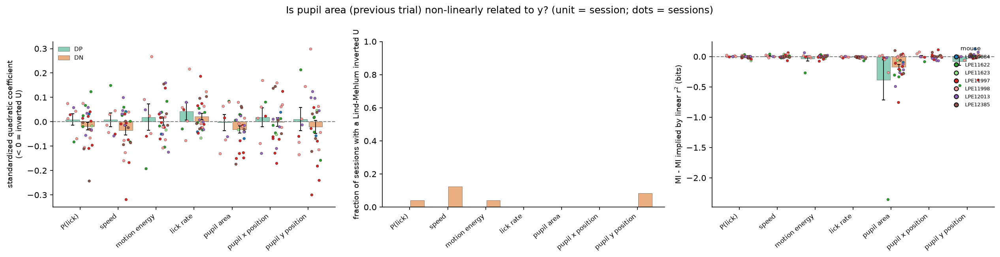

### 3c pupil quadratic cur pupil xpos

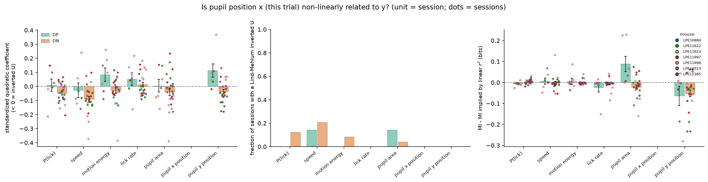

### 3d pupil quadratic cur pupil ypos

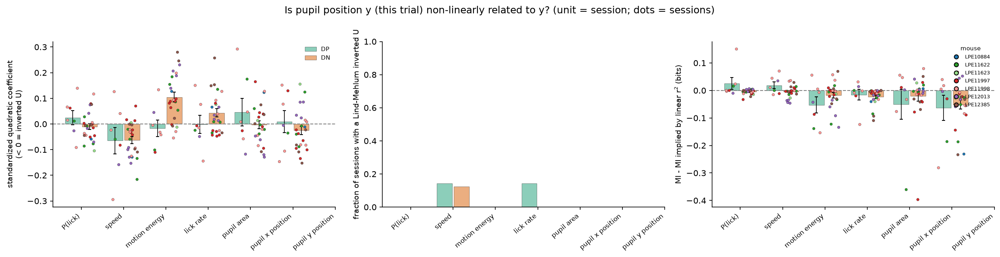

### 4a pupil two halves cur pupil area

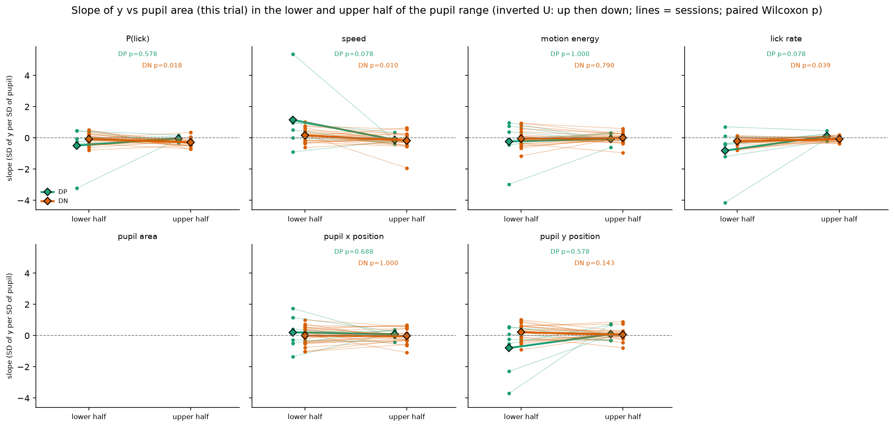

### 4b pupil two halves prev pupil area

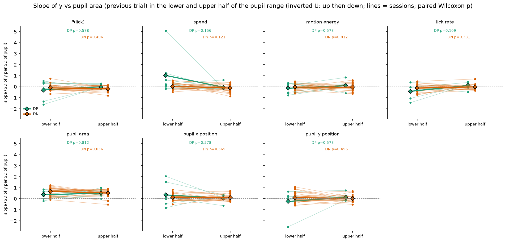

### 4c pupil two halves cur pupil xpos

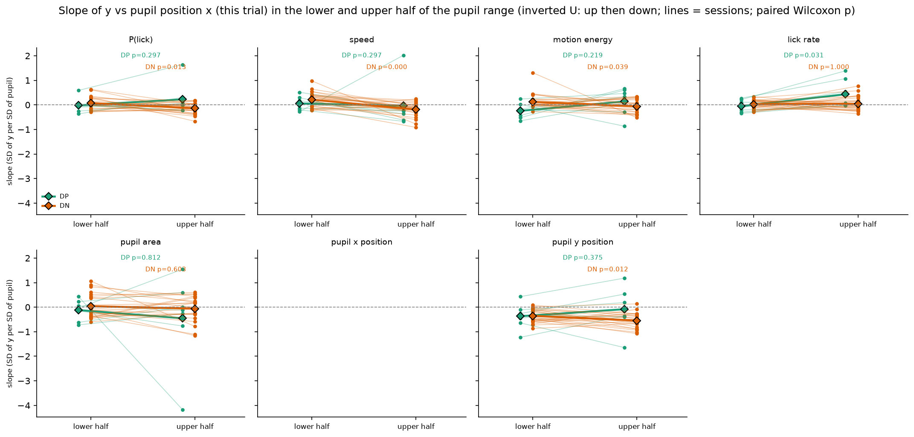

### 4d pupil two halves cur pupil ypos

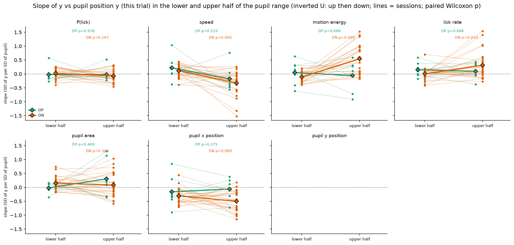

### Pupil peak location

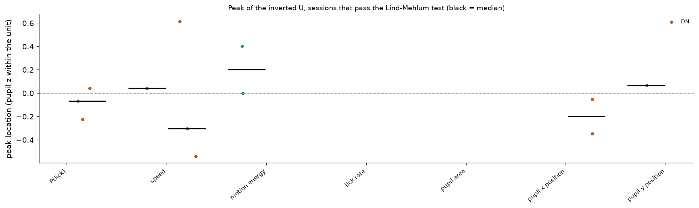

### 9a behavior pca variance loadings

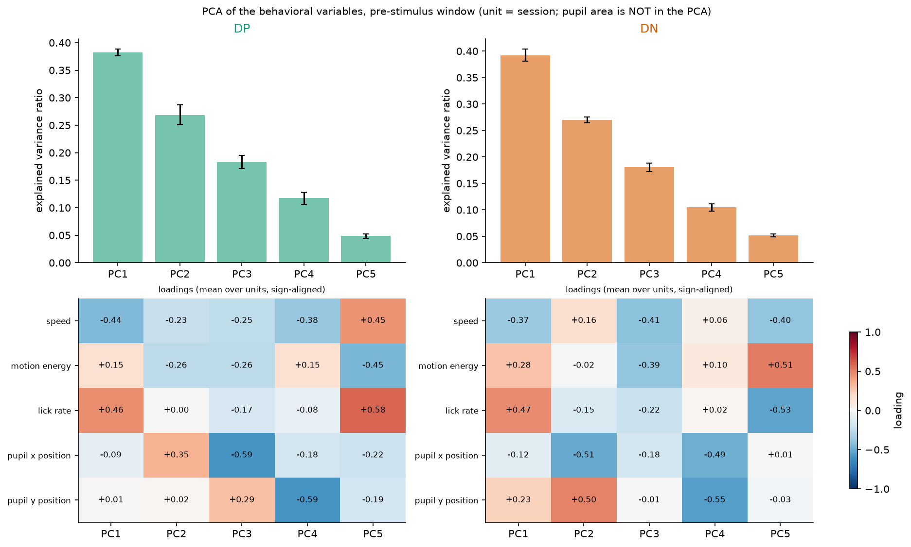

### 9b behavior pca vs pupil curves

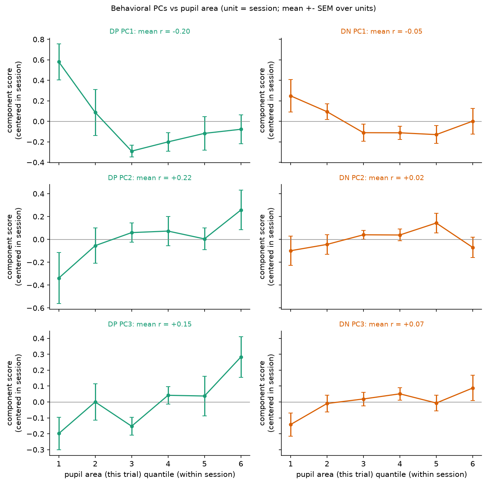

### 9c behavior pca pupil correlation

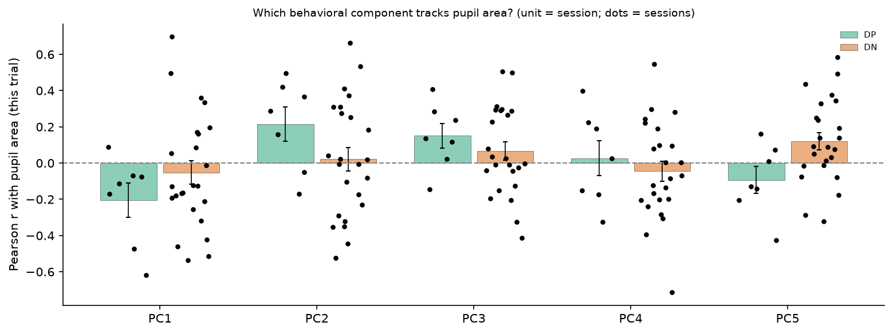

## Tables

### Pupil dprime by quantile  session

| protocol | pupil_bin | dprime | criterion | n_trials_0_100 | animal_id | session_id |
| --- | --- | --- | --- | --- | --- | --- |
| DM | 1 | -0.2203 | -0.3206 | 15 | LPE11623 | LPE11623_2024_03_27 |
| DM | 2 | 1.035 | -0.08693 | 14 | LPE11623 | LPE11623_2024_03_27 |
| DM | 3 | 1.814 | -0.4761 | 15 | LPE11623 | LPE11623_2024_03_27 |
| DM | 4 | 2.057 | -0.3543 | 14 | LPE11623 | LPE11623_2024_03_27 |
| DM | 5 | 1.956 | -0.3035 | 14 | LPE11623 | LPE11623_2024_03_27 |
| DM | 6 | 0.9679 | 0.1906 | 15 | LPE11623 | LPE11623_2024_03_27 |
| DM | 1 | 0.5563 | -0.4582 | 20 | LPE11623 | LPE11623_2024_03_29 |
| DM | 2 | 2.118 | -0.09146 | 19 | LPE11623 | LPE11623_2024_03_29 |
| DM | 3 | 1.534 | -0.7671 | 20 | LPE11623 | LPE11623_2024_03_29 |
| DM | 4 | 2.176 | -0.4133 | 19 | LPE11623 | LPE11623_2024_03_29 |
| DM | 5 | 1.321 | -0.4071 | 19 | LPE11623 | LPE11623_2024_03_29 |
| DM | 6 | 1.938 | -0.969 | 20 | LPE11623 | LPE11623_2024_03_29 |
| DM | 1 | 3.074 | 0.1538 | 35 | LPE11997 | LPE11997_2024_04_07 |
| DM | 2 | 2.572 | -0.8552 | 34 | LPE11997 | LPE11997_2024_04_07 |
| DM | 3 | 2.545 | -0.8418 | 35 | LPE11997 | LPE11997_2024_04_07 |
| DM | 4 | 2.531 | -0.8347 | 34 | LPE11997 | LPE11997_2024_04_07 |
| DM | 5 | 2.531 | -0.8347 | 34 | LPE11997 | LPE11997_2024_04_07 |
| DM | 6 | 2.247 | -0.2817 | 35 | LPE11997 | LPE11997_2024_04_07 |
| DM | 1 | 1.581 | 0.3598 | 25 | LPE11998 | LPE11998_2024_04_11 |
| DM | 2 | 3.058 | -0.06399 | 25 | LPE11998 | LPE11998_2024_04_11 |
| DM | 3 | 3.058 | -0.06399 | 25 | LPE11998 | LPE11998_2024_04_11 |
| DM | 4 | 2.948 | -0.5067 | 24 | LPE11998 | LPE11998_2024_04_11 |
| DM | 5 | 3.131 | -0.4152 | 25 | LPE11998 | LPE11998_2024_04_11 |
| DM | 6 | 2.213 | -0.8533 | 25 | LPE11998 | LPE11998_2024_04_11 |
| DM | 1 | 2.787 | 0.2969 | 33 | LPE11998 | LPE11998_2024_04_12 |
| DM | 2 | 2.339 | -0.916 | 32 | LPE11998 | LPE11998_2024_04_12 |
| DM | 3 | 3.367 | -0.4019 | 32 | LPE11998 | LPE11998_2024_04_12 |
| DM | 4 | 2.473 | -0.1688 | 32 | LPE11998 | LPE11998_2024_04_12 |
| DM | 5 | 2.2 | -0.669 | 32 | LPE11998 | LPE11998_2024_04_12 |
| DM | 6 | 2.349 | 0.107 | 33 | LPE11998 | LPE11998_2024_04_12 |

*(showing first 30 of 228 rows -- see the linked CSV for the rest)*

[pupil_dprime_by_quantile__session.csv](../2_pipeline/1f_pupil_nonlinearity/out/pupil_dprime_by_quantile__session.csv)

### Pupil dprime by quantile windows  session

| protocol | window | pupil_bin | dprime | criterion | n_trials_0 | n_trials_100 | animal_id | session_id |
| --- | --- | --- | --- | --- | --- | --- | --- | --- |
| DP | pre_stim | 1 | 2.761 | -0.04545 | 11 | 13 | LPE11622 | LPE11622_2024_02_19 |
| DP | pre_stim | 2 | 2.335 | -0.2588 | 11 | 13 | LPE11622 | LPE11622_2024_02_19 |
| DP | pre_stim | 3 | 2.355 | 0.1576 | 11 | 13 | LPE11622 | LPE11622_2024_02_19 |
| DP | pre_stim | 4 | -0.2203 | -0.3206 | 12 | 12 | LPE11622 | LPE11622_2024_02_19 |
| DP | pre_stim | 1 | 1.987 | 0.02633 | 13 | 12 | LPE11997 | LPE11997_2024_04_15 |
| DP | pre_stim | 2 | 1.396 | 0.09353 | 14 | 11 | LPE11997 | LPE11997_2024_04_15 |
| DP | pre_stim | 3 | 2.652 | 0.1392 | 7 | 17 | LPE11997 | LPE11997_2024_04_15 |
| DP | pre_stim | 4 | 1.904 | 0.3293 | 10 | 15 | LPE11997 | LPE11997_2024_04_15 |
| DP | pre_stim | 1 | 1.915 | 0.1928 | 4 | 9 | LPE11998 | LPE11998_2024_04_15 |
| DP | pre_stim | 2 | 1.992 | 0.1544 | 8 | 5 | LPE11998 | LPE11998_2024_04_15 |
| DP | pre_stim | 3 | 1.408 | 0.1378 | 5 | 7 | LPE11998 | LPE11998_2024_04_15 |
| DP | pre_stim | 4 | 0.2438 | 0.5526 | 4 | 9 | LPE11998 | LPE11998_2024_04_15 |
| DP | pre_stim | 1 | 1.651 | -0.395 | 3 | 9 | LPE11998 | LPE11998_2024_04_16 |
| DP | pre_stim | 2 | 2.249 | 0.1571 | 5 | 6 | LPE11998 | LPE11998_2024_04_16 |
| DP | pre_stim | 3 | 2.502 | 0.2833 | 8 | 3 | LPE11998 | LPE11998_2024_04_16 |
| DP | pre_stim | 4 | 1.516 | -0.08357 | 2 | 10 | LPE11998 | LPE11998_2024_04_16 |
| DP | pre_stim | 1 | 1.339 | -0.3507 | 8 | 13 | LPE11998 | LPE11998_2024_04_18 |
| DP | pre_stim | 2 | 2.561 | -0.3129 | 12 | 9 | LPE11998 | LPE11998_2024_04_18 |
| DP | pre_stim | 3 | 1.831 | -0.5496 | 14 | 7 | LPE11998 | LPE11998_2024_04_18 |
| DP | pre_stim | 4 | 2.919 | -0.3092 | 8 | 13 | LPE11998 | LPE11998_2024_04_18 |
| DP | pre_stim | 1 | 2.148 | -0.3091 | 9 | 6 | LPE11998 | LPE11998_2024_04_22 |
| DP | pre_stim | 2 | 1.645 | -0.8224 | 4 | 10 | LPE11998 | LPE11998_2024_04_22 |
| DP | pre_stim | 3 | 2.406 | -0.5286 | 2 | 12 | LPE11998 | LPE11998_2024_04_22 |
| DP | pre_stim | 4 | 1.965 | -0.5517 | 6 | 8 | LPE11998 | LPE11998_2024_04_22 |
| DP | pre_stim | 1 | 2.403 | -0.1338 | 7 | 11 | LPE12013 | LPE12013_2024_04_22 |
| DP | pre_stim | 2 | 2.14 | -0.3954 | 4 | 14 | LPE12013 | LPE12013_2024_04_22 |
| DP | pre_stim | 3 | 3.11 | -0.08981 | 7 | 10 | LPE12013 | LPE12013_2024_04_22 |
| DP | pre_stim | 4 | 1.529 | -0 | 9 | 9 | LPE12013 | LPE12013_2024_04_22 |
| DN | pre_stim | 1 | 2.665 | 0.05072 | 6 | 10 | LPE10884 | LPE10884_2024_01_12 |
| DN | pre_stim | 2 | 2.249 | -0.1571 | 6 | 10 | LPE10884 | LPE10884_2024_01_12 |

*(showing first 30 of 384 rows -- see the linked CSV for the rest)*

[pupil_dprime_by_quantile_windows__session.csv](../2_pipeline/1f_pupil_nonlinearity/out/pupil_dprime_by_quantile_windows__session.csv)

### Pupil nonlinearity curves  session

| protocol | x | y | pupil_bin | mean_centered | sem |
| --- | --- | --- | --- | --- | --- |
| DP | cur_pupil_area | lick_any | 1 | 0.01304 | 0.02537 |
| DP | cur_pupil_area | lick_any | 2 | 0.01511 | 0.04143 |
| DP | cur_pupil_area | lick_any | 3 | -0.006368 | 0.03335 |
| DP | cur_pupil_area | lick_any | 4 | 0.07577 | 0.04775 |
| DP | cur_pupil_area | lick_any | 5 | -0.06407 | 0.05969 |
| DP | cur_pupil_area | lick_any | 6 | -0.03589 | 0.03815 |
| DN | cur_pupil_area | lick_any | 1 | 0.04518 | 0.02934 |
| DN | cur_pupil_area | lick_any | 2 | 0.05122 | 0.01771 |
| DN | cur_pupil_area | lick_any | 3 | 0.04708 | 0.01933 |
| DN | cur_pupil_area | lick_any | 4 | 0.04546 | 0.02041 |
| DN | cur_pupil_area | lick_any | 5 | -0.04312 | 0.02218 |
| DN | cur_pupil_area | lick_any | 6 | -0.1433 | 0.02599 |
| DP | cur_pupil_area | cur_runspeed | 1 | -2.216 | 1.272 |
| DP | cur_pupil_area | cur_runspeed | 2 | 1.125 | 0.6844 |
| DP | cur_pupil_area | cur_runspeed | 3 | 1.746 | 0.5786 |
| DP | cur_pupil_area | cur_runspeed | 4 | 0.9294 | 0.6264 |
| DP | cur_pupil_area | cur_runspeed | 5 | -0.1426 | 0.3182 |
| DP | cur_pupil_area | cur_runspeed | 6 | -1.338 | 1.04 |
| DN | cur_pupil_area | cur_runspeed | 1 | -0.9309 | 0.7147 |
| DN | cur_pupil_area | cur_runspeed | 2 | 0.01409 | 0.5265 |
| DN | cur_pupil_area | cur_runspeed | 3 | 0.531 | 0.5307 |
| DN | cur_pupil_area | cur_runspeed | 4 | 0.6692 | 0.4675 |
| DN | cur_pupil_area | cur_runspeed | 5 | 0.7519 | 0.7068 |
| DN | cur_pupil_area | cur_runspeed | 6 | -0.9619 | 0.986 |
| DP | cur_pupil_area | cur_motionenergy | 1 | -0.03017 | 0.04274 |
| DP | cur_pupil_area | cur_motionenergy | 2 | 0.05191 | 0.03187 |
| DP | cur_pupil_area | cur_motionenergy | 3 | -0.003461 | 0.01068 |
| DP | cur_pupil_area | cur_motionenergy | 4 | -0.01379 | 0.01793 |
| DP | cur_pupil_area | cur_motionenergy | 5 | 0.03825 | 0.02708 |
| DP | cur_pupil_area | cur_motionenergy | 6 | -0.04033 | 0.01574 |

*(showing first 30 of 300 rows -- see the linked CSV for the rest)*

[pupil_nonlinearity_curves__session.csv](../2_pipeline/1f_pupil_nonlinearity/out/pupil_nonlinearity_curves__session.csv)

### Pupil nonlinearity group tests  session

| protocol | x | y | statistic | alternative | n_units | mean | median | p | frac_inverted_U | p_holm |
| --- | --- | --- | --- | --- | --- | --- | --- | --- | --- | --- |
| DN | cur_pupil_area | cur_lick | beta_quadratic | two-sided | 24 | 0.02703 | 0.0223 | 0.006516 | 0 | 0.03258 |
| DN | cur_pupil_area | cur_motionenergy | beta_quadratic | two-sided | 24 | 0.003453 | -0.00553 | 0.9441 | 0 | 1 |
| DN | cur_pupil_area | cur_pupil_xpos | beta_quadratic | two-sided | 24 | -0.002658 | 0.02902 | 0.9441 | 0.08333 | 1 |
| DN | cur_pupil_area | cur_pupil_ypos | beta_quadratic | two-sided | 24 | -0.02876 | -0.03101 | 0.1974 | 0 | 0.5921 |
| DN | cur_pupil_area | cur_runspeed | beta_quadratic | two-sided | 24 | -0.0781 | -0.07129 | 0.003504 | 0.125 | 0.02103 |
| DN | cur_pupil_area | lick_any | beta_quadratic | two-sided | 24 | -0.03922 | -0.05247 | 0.0691 | 0.125 | 0.2764 |
| DN | cur_pupil_area | cur_lick | slope_lower_half | greater | 24 | -0.2144 | -0.1782 | 0.9999 | 0 | 1 |
| DN | cur_pupil_area | cur_motionenergy | slope_lower_half | greater | 24 | -0.03632 | -0.09296 | 0.7634 | 0 | 1 |
| DN | cur_pupil_area | cur_pupil_xpos | slope_lower_half | greater | 24 | 0.001211 | 0.1397 | 0.4944 | 0.08333 | 1 |
| DN | cur_pupil_area | cur_pupil_ypos | slope_lower_half | greater | 24 | 0.2135 | 0.2544 | 0.01974 | 0 | 0.1184 |
| DN | cur_pupil_area | cur_runspeed | slope_lower_half | greater | 24 | 0.1627 | 0.1558 | 0.03455 | 0.125 | 0.1728 |
| DN | cur_pupil_area | lick_any | slope_lower_half | greater | 24 | -0.05919 | -0.02426 | 0.7546 | 0.125 | 1 |
| DN | cur_pupil_area | cur_lick | slope_upper_half | less | 24 | -0.0711 | -0.05554 | 0.02821 | 0 | 0.1411 |
| DN | cur_pupil_area | cur_motionenergy | slope_upper_half | less | 24 | 0.00209 | 0.03222 | 0.6051 | 0 | 1 |
| DN | cur_pupil_area | cur_pupil_xpos | slope_upper_half | less | 24 | -0.02395 | -0.05835 | 0.3317 | 0.08333 | 0.9952 |
| DN | cur_pupil_area | cur_pupil_ypos | slope_upper_half | less | 24 | 0.05507 | 0.04098 | 0.8552 | 0 | 1 |
| DN | cur_pupil_area | cur_runspeed | slope_upper_half | less | 24 | -0.1643 | -0.1705 | 0.04755 | 0.125 | 0.1902 |
| DN | cur_pupil_area | lick_any | slope_upper_half | less | 24 | -0.2935 | -0.2869 | 1.234e-05 | 0.125 | 7.403e-05 |
| DN | cur_pupil_area | cur_lick | cv_gain | greater | 24 | -0.0148 | -0.005271 | 0.9995 | 0 | 1 |
| DN | cur_pupil_area | cur_motionenergy | cv_gain | greater | 24 | 0.0008943 | -0.0006146 | 0.6476 | 0 | 1 |
| DN | cur_pupil_area | cur_pupil_xpos | cv_gain | greater | 24 | -0.007826 | -0.001762 | 0.4498 | 0.08333 | 1 |
| DN | cur_pupil_area | cur_pupil_ypos | cv_gain | greater | 24 | 0.005725 | 0.001407 | 0.2823 | 0 | 1 |
| DN | cur_pupil_area | cur_runspeed | cv_gain | greater | 24 | -4.753e-05 | -0.006246 | 0.7272 | 0.125 | 1 |
| DN | cur_pupil_area | lick_any | cv_gain | greater | 24 | 0.002229 | -0.007418 | 0.8276 | 0.125 | 1 |
| DN | cur_pupil_area | cur_lick | mi_excess_bits | greater | 24 | -0.01947 | -0.01414 | 1 | 0 | 1 |
| DN | cur_pupil_area | cur_motionenergy | mi_excess_bits | greater | 24 | -0.02709 | -0.008054 | 0.998 | 0 | 1 |
| DN | cur_pupil_area | cur_pupil_xpos | mi_excess_bits | greater | 24 | -0.02266 | -0.01922 | 0.9865 | 0.08333 | 1 |
| DN | cur_pupil_area | cur_pupil_ypos | mi_excess_bits | greater | 24 | -0.02109 | -0.004093 | 0.8616 | 0 | 1 |
| DN | cur_pupil_area | cur_runspeed | mi_excess_bits | greater | 24 | -0.0184 | -0.00543 | 0.9718 | 0.125 | 1 |
| DN | cur_pupil_area | lick_any | mi_excess_bits | greater | 24 | -0.00176 | -0.0009524 | 0.7634 | 0.125 | 1 |

*(showing first 30 of 250 rows -- see the linked CSV for the rest)*

[pupil_nonlinearity_group_tests__session.csv](../2_pipeline/1f_pupil_nonlinearity/out/pupil_nonlinearity_group_tests__session.csv)

### Pupil nonlinearity per unit  session

| protocol | x | y | n_trials | beta_linear | beta_quadratic | p_quadratic | slope_low_end | slope_high_end | p_low_end_positive | p_high_end_negative | turning_point_z | range_low_z | range_high_z | inverted_U |
| --- | --- | --- | --- | --- | --- | --- | --- | --- | --- | --- | --- | --- | --- | --- |
| DP | cur_pupil_area | lick_any | 129 | 0.6814 | -0.09546 | 0.1042 | 0.7337 | 0.6561 | 0.04687 | 0.9519 | 3.569 | -0.2738 | 0.1326 | False |
| DP | cur_pupil_area | cur_runspeed | 129 | -0.9395 | 0.1005 | 0.1128 | -0.9946 | -0.9129 | 0.9756 | 0.02244 | 4.676 | -0.2738 | 0.1326 | False |
| DP | cur_pupil_area | cur_motionenergy | 129 | -0.6829 | 0.01104 | 0.8553 | -0.689 | -0.68 | 0.9151 | 0.0665 | 30.92 | -0.2738 | 0.1326 | False |
| DP | cur_pupil_area | cur_lick | 129 | -1.11 | 0.136 | 0.04598 | -1.184 | -1.074 | 0.9813 | 0.01825 | 4.081 | -0.2738 | 0.1326 | False |
| DP | cur_pupil_area | cur_pupil_xpos | 129 | -2.139 | 0.3218 | 0.01701 | -2.315 | -2.053 | 0.9809 | 0.02074 | 3.323 | -0.2738 | 0.1326 | False |
| DP | cur_pupil_area | cur_pupil_ypos | 129 | -1.596 | 0.3034 | 2.464e-07 | -1.763 | -1.516 | 0.9999 | 0.0002781 | 2.631 | -0.2738 | 0.1326 | False |
| DP | prev_pupil_area | lick_any | 129 | 0.5838 | -0.0828 | 0.129 | 0.6323 | 0.561 | 0.05773 | 0.9405 | 3.525 | -0.2926 | 0.1381 | False |
| DP | prev_pupil_area | cur_runspeed | 129 | -1.313 | 0.1488 | 0.05501 | -1.4 | -1.272 | 0.9869 | 0.01212 | 4.413 | -0.2926 | 0.1381 | False |
| DP | prev_pupil_area | cur_motionenergy | 129 | 0.8936 | -0.1926 | 0.001964 | 1.006 | 0.8404 | 0.02569 | 0.9653 | 2.32 | -0.2926 | 0.1381 | False |
| DP | prev_pupil_area | cur_lick | 129 | 0.1687 | -0.02954 | 0.6751 | 0.186 | 0.1605 | 0.3754 | 0.6201 | 2.855 | -0.2926 | 0.1381 | False |
| DP | prev_pupil_area | cur_pupil_area | 129 | 0.3489 | 0.08419 | 0.0004476 | 0.2996 | 0.3721 | 0.06594 | 0.9816 | -2.072 | -0.2926 | 0.1381 | False |
| DP | prev_pupil_area | cur_pupil_xpos | 129 | -0.2742 | 0.0806 | 0.2992 | -0.3213 | -0.2519 | 0.6906 | 0.3317 | 1.701 | -0.2926 | 0.1381 | False |
| DP | prev_pupil_area | cur_pupil_ypos | 129 | -0.8956 | 0.213 | 0.0009465 | -1.02 | -0.8368 | 0.9718 | 0.04046 | 2.103 | -0.2926 | 0.1381 | False |
| DP | cur_pupil_xpos | lick_any | 129 | -0.09847 | -0.008883 | 0.8675 | -0.07684 | -0.1218 | 0.6856 | 0.2657 | -5.543 | -1.218 | 1.314 | False |
| DP | cur_pupil_xpos | cur_runspeed | 129 | -0.001617 | -0.03388 | 0.7639 | 0.0809 | -0.09067 | 0.4058 | 0.3717 | -0.02386 | -1.218 | 1.314 | False |
| DP | cur_pupil_xpos | cur_motionenergy | 129 | -0.3476 | -0.09051 | 0.6354 | -0.1272 | -0.5854 | 0.5892 | 0.1206 | -1.92 | -1.218 | 1.314 | False |
| DP | cur_pupil_xpos | cur_lick | 129 | 0.04653 | -0.01413 | 0.7107 | 0.08095 | 0.009378 | 0.2426 | 0.5276 | 1.646 | -1.218 | 1.314 | False |
| DP | cur_pupil_xpos | cur_pupil_area | 129 | 0.4913 | 0.1465 | 0.6168 | 0.1346 | 0.8762 | 0.4373 | 0.8627 | -1.677 | -1.218 | 1.314 | False |
| DP | cur_pupil_xpos | cur_pupil_ypos | 129 | 0.5228 | 0.03357 | 0.9003 | 0.441 | 0.611 | 0.2888 | 0.8145 | -7.786 | -1.218 | 1.314 | False |
| DP | cur_pupil_ypos | lick_any | 129 | -0.1317 | 0.01132 | 0.7308 | -0.1548 | -0.1166 | 0.9472 | 0.1564 | 5.817 | -1.021 | 0.6659 | False |
| DP | cur_pupil_ypos | cur_runspeed | 129 | 0.1365 | -0.05948 | 0.1 | 0.2579 | 0.05729 | 0.1107 | 0.6682 | 1.147 | -1.021 | 0.6659 | False |
| DP | cur_pupil_ypos | cur_motionenergy | 129 | -0.1806 | -0.1013 | 0.002377 | 0.0262 | -0.3156 | 0.4554 | 0.006082 | -0.8914 | -1.021 | 0.6659 | False |
| DP | cur_pupil_ypos | cur_lick | 129 | 0.06631 | -0.02461 | 0.03059 | 0.1165 | 0.03354 | 0.1164 | 0.7077 | 1.347 | -1.021 | 0.6659 | False |
| DP | cur_pupil_ypos | cur_pupil_area | 129 | 0.2528 | 0.1748 | 7.794e-05 | -0.1041 | 0.4856 | 0.639 | 0.9991 | -0.7231 | -1.021 | 0.6659 | False |
| DP | cur_pupil_ypos | cur_pupil_xpos | 129 | 0.5659 | -0.03539 | 0.6459 | 0.6381 | 0.5188 | 0.1089 | 0.9722 | 7.995 | -1.021 | 0.6659 | False |
| DP | cur_pupil_area | lick_any | 120 | -0.0517 | 0.03515 | 0.6476 | -0.1666 | 0.07165 | 0.7224 | 0.6028 | 0.7356 | -1.635 | 1.755 | False |
| DP | cur_pupil_area | cur_runspeed | 120 | 0.01558 | -0.1898 | 0.03498 | 0.636 | -0.6505 | 0.02794 | 0.01827 | 0.04105 | -1.635 | 1.755 | True |
| DP | cur_pupil_area | cur_motionenergy | 120 | 0.1826 | -0.2257 | 0.02548 | 0.9204 | -0.6095 | 0.01692 | 0.01281 | 0.4045 | -1.635 | 1.755 | True |
| DP | cur_pupil_area | cur_lick | 120 | -0.01375 | -0.02756 | 0.6333 | 0.07636 | -0.1105 | 0.3705 | 0.2752 | -0.2494 | -1.635 | 1.755 | False |
| DP | cur_pupil_area | cur_pupil_xpos | 120 | -0.3381 | -0.03314 | 0.646 | -0.2297 | -0.4544 | 0.8089 | 0.04052 | -5.1 | -1.635 | 1.755 | False |

*(showing first 15 of 26 columns; showing first 30 of 775 rows -- see the linked CSV for the rest)*

[pupil_nonlinearity_per_unit__session.csv](../2_pipeline/1f_pupil_nonlinearity/out/pupil_nonlinearity_per_unit__session.csv)

### Pupil pca group tests  session

| protocol | pc | n_units | mean_r | frac_positive | p | mean_beta_quadratic | p_quadratic | p_holm |
| --- | --- | --- | --- | --- | --- | --- | --- | --- |
| DN | PC1 | 24 | -0.05225 | 0.375 | 0.3305 | 0.06396 | 0.00178 | 1 |
| DN | PC2 | 24 | 0.02122 | 0.5 | 0.8115 | -0.04165 | 0.114 | 1 |
| DN | PC3 | 24 | 0.06571 | 0.5 | 0.3165 | -0.008704 | 0.7048 | 1 |
| DN | PC4 | 24 | -0.04413 | 0.4583 | 0.4732 | 0.01885 | 0.7257 | 1 |
| DN | PC5 | 24 | 0.121 | 0.7083 | 0.01504 | 0.01783 | 0.4908 | 0.07522 |
| DP | PC1 | 7 | -0.2043 | 0.1429 | 0.07812 | 0.1309 | 0.07812 | 0.3906 |
| DP | PC2 | 7 | 0.2155 | 0.7143 | 0.1094 | 0.02083 | 0.9375 | 0.4375 |
| DP | PC3 | 7 | 0.1507 | 0.8571 | 0.1094 | -0.03609 | 0.4688 | 0.4375 |
| DP | PC4 | 7 | 0.02699 | 0.5714 | 0.6875 | -0.08187 | 0.1094 | 0.75 |
| DP | PC5 | 7 | -0.09396 | 0.4286 | 0.375 | 0.006605 | 1 | 0.75 |

[pupil_pca_group_tests__session.csv](../2_pipeline/1f_pupil_nonlinearity/out/pupil_pca_group_tests__session.csv)

### Pupil pca loadings  session

| protocol | unit | animal_id | pc | variable | loading |
| --- | --- | --- | --- | --- | --- |
| DP | LPE11622_2024_02_19 | LPE11622 | PC1 | cur_runspeed | -0.3887 |
| DP | LPE11622_2024_02_19 | LPE11622 | PC1 | cur_motionenergy | 0.5968 |
| DP | LPE11622_2024_02_19 | LPE11622 | PC1 | cur_lick | 0.5176 |
| DP | LPE11622_2024_02_19 | LPE11622 | PC1 | cur_pupil_xpos | -0.2871 |
| DP | LPE11622_2024_02_19 | LPE11622 | PC1 | cur_pupil_ypos | -0.3774 |
| DP | LPE11622_2024_02_19 | LPE11622 | PC2 | cur_runspeed | -0.4088 |
| DP | LPE11622_2024_02_19 | LPE11622 | PC2 | cur_motionenergy | -0.03359 |
| DP | LPE11622_2024_02_19 | LPE11622 | PC2 | cur_lick | 0.4514 |
| DP | LPE11622_2024_02_19 | LPE11622 | PC2 | cur_pupil_xpos | 0.5588 |
| DP | LPE11622_2024_02_19 | LPE11622 | PC2 | cur_pupil_ypos | 0.562 |
| DP | LPE11622_2024_02_19 | LPE11622 | PC3 | cur_runspeed | -0.6839 |
| DP | LPE11622_2024_02_19 | LPE11622 | PC3 | cur_motionenergy | -0.48 |
| DP | LPE11622_2024_02_19 | LPE11622 | PC3 | cur_lick | -0.1618 |
| DP | LPE11622_2024_02_19 | LPE11622 | PC3 | cur_pupil_xpos | -0.5126 |
| DP | LPE11622_2024_02_19 | LPE11622 | PC3 | cur_pupil_ypos | 0.1134 |
| DP | LPE11622_2024_02_19 | LPE11622 | PC4 | cur_runspeed | -0.3734 |
| DP | LPE11622_2024_02_19 | LPE11622 | PC4 | cur_motionenergy | -0.16 |
| DP | LPE11622_2024_02_19 | LPE11622 | PC4 | cur_lick | -0.2524 |
| DP | LPE11622_2024_02_19 | LPE11622 | PC4 | cur_pupil_xpos | 0.5823 |
| DP | LPE11622_2024_02_19 | LPE11622 | PC4 | cur_pupil_ypos | -0.6574 |
| DP | LPE11622_2024_02_19 | LPE11622 | PC5 | cur_runspeed | 0.273 |
| DP | LPE11622_2024_02_19 | LPE11622 | PC5 | cur_motionenergy | -0.6219 |
| DP | LPE11622_2024_02_19 | LPE11622 | PC5 | cur_lick | 0.6622 |
| DP | LPE11622_2024_02_19 | LPE11622 | PC5 | cur_pupil_xpos | -0.05982 |
| DP | LPE11622_2024_02_19 | LPE11622 | PC5 | cur_pupil_ypos | -0.3109 |
| DP | LPE11997_2024_04_15 | LPE11997 | PC1 | cur_runspeed | -0.5925 |
| DP | LPE11997_2024_04_15 | LPE11997 | PC1 | cur_motionenergy | -0.5895 |
| DP | LPE11997_2024_04_15 | LPE11997 | PC1 | cur_lick | 0.0709 |
| DP | LPE11997_2024_04_15 | LPE11997 | PC1 | cur_pupil_xpos | 0.2011 |
| DP | LPE11997_2024_04_15 | LPE11997 | PC1 | cur_pupil_ypos | -0.5059 |

*(showing first 30 of 775 rows -- see the linked CSV for the rest)*

[pupil_pca_loadings__session.csv](../2_pipeline/1f_pupil_nonlinearity/out/pupil_pca_loadings__session.csv)

### Pupil pca variance  session

| protocol | unit | animal_id | pc | explained_variance | n_trials |
| --- | --- | --- | --- | --- | --- |
| DP | LPE11622_2024_02_19 | LPE11622 | PC1 | 0.4065 | 129 |
| DP | LPE11622_2024_02_19 | LPE11622 | PC2 | 0.3026 | 129 |
| DP | LPE11622_2024_02_19 | LPE11622 | PC3 | 0.1533 | 129 |
| DP | LPE11622_2024_02_19 | LPE11622 | PC4 | 0.09314 | 129 |
| DP | LPE11622_2024_02_19 | LPE11622 | PC5 | 0.04446 | 129 |
| DP | LPE11997_2024_04_15 | LPE11997 | PC1 | 0.3943 | 120 |
| DP | LPE11997_2024_04_15 | LPE11997 | PC2 | 0.2562 | 120 |
| DP | LPE11997_2024_04_15 | LPE11997 | PC3 | 0.1992 | 120 |
| DP | LPE11997_2024_04_15 | LPE11997 | PC4 | 0.1152 | 120 |
| DP | LPE11997_2024_04_15 | LPE11997 | PC5 | 0.03516 | 120 |
| DP | LPE11998_2024_04_15 | LPE11998 | PC1 | 0.3848 | 61 |
| DP | LPE11998_2024_04_15 | LPE11998 | PC2 | 0.3551 | 61 |
| DP | LPE11998_2024_04_15 | LPE11998 | PC3 | 0.1293 | 61 |
| DP | LPE11998_2024_04_15 | LPE11998 | PC4 | 0.08063 | 61 |
| DP | LPE11998_2024_04_15 | LPE11998 | PC5 | 0.05019 | 61 |
| DP | LPE11998_2024_04_16 | LPE11998 | PC1 | 0.379 | 54 |
| DP | LPE11998_2024_04_16 | LPE11998 | PC2 | 0.2564 | 54 |
| DP | LPE11998_2024_04_16 | LPE11998 | PC3 | 0.1909 | 54 |
| DP | LPE11998_2024_04_16 | LPE11998 | PC4 | 0.1356 | 54 |
| DP | LPE11998_2024_04_16 | LPE11998 | PC5 | 0.03821 | 54 |
| DP | LPE11998_2024_04_18 | LPE11998 | PC1 | 0.3636 | 124 |
| DP | LPE11998_2024_04_18 | LPE11998 | PC2 | 0.2556 | 124 |
| DP | LPE11998_2024_04_18 | LPE11998 | PC3 | 0.2178 | 124 |
| DP | LPE11998_2024_04_18 | LPE11998 | PC4 | 0.1017 | 124 |
| DP | LPE11998_2024_04_18 | LPE11998 | PC5 | 0.06119 | 124 |
| DP | LPE11998_2024_04_22 | LPE11998 | PC1 | 0.3847 | 63 |
| DP | LPE11998_2024_04_22 | LPE11998 | PC2 | 0.2504 | 63 |
| DP | LPE11998_2024_04_22 | LPE11998 | PC3 | 0.1913 | 63 |
| DP | LPE11998_2024_04_22 | LPE11998 | PC4 | 0.1261 | 63 |
| DP | LPE11998_2024_04_22 | LPE11998 | PC5 | 0.04756 | 63 |

*(showing first 30 of 155 rows -- see the linked CSV for the rest)*

[pupil_pca_variance__session.csv](../2_pipeline/1f_pupil_nonlinearity/out/pupil_pca_variance__session.csv)

### Pupil pca vs pupil area  session

| protocol | pc | n_trials | beta_linear | beta_quadratic | p_quadratic | slope_low_end | slope_high_end | p_low_end_positive | p_high_end_negative | turning_point_z | range_low_z | range_high_z | inverted_U | U_shape |
| --- | --- | --- | --- | --- | --- | --- | --- | --- | --- | --- | --- | --- | --- | --- |
| DP | PC1 | 129 | 0.4206 | -0.1185 | 0.02677 | 0.4855 | 0.3891 | 0.1376 | 0.8338 | 1.774 | -0.2738 | 0.1326 | False | False |
| DP | PC2 | 129 | -1.777 | 0.301 | 0.0002964 | -1.942 | -1.697 | 0.9976 | 0.003147 | 2.952 | -0.2738 | 0.1326 | False | False |
| DP | PC3 | 129 | 2.359 | -0.2588 | 0.008639 | 2.501 | 2.29 | 0.0009803 | 0.9992 | 4.558 | -0.2738 | 0.1326 | False | False |
| DP | PC4 | 129 | 0.798 | -0.1256 | 0.2842 | 0.8668 | 0.7647 | 0.1848 | 0.81 | 3.177 | -0.2738 | 0.1326 | False | False |
| DP | PC5 | 129 | 0.122 | -0.006356 | 0.9614 | 0.1255 | 0.1203 | 0.4538 | 0.5491 | 9.601 | -0.2738 | 0.1326 | False | False |
| DP | PC1 | 120 | -0.1414 | 0.2371 | 0.003234 | -0.9167 | 0.6908 | 0.9963 | 0.9986 | 0.2983 | -1.635 | 1.755 | False | True |
| DP | PC2 | 120 | -0.05465 | 0.0408 | 0.5325 | -0.188 | 0.08856 | 0.7798 | 0.6489 | 0.6697 | -1.635 | 1.755 | False | False |
| DP | PC3 | 120 | 0.2716 | 0.1071 | 0.2167 | -0.07856 | 0.6476 | 0.5926 | 0.9888 | -1.268 | -1.635 | 1.755 | False | False |
| DP | PC4 | 120 | 0.2216 | 0.02525 | 0.7405 | 0.139 | 0.3102 | 0.3204 | 0.8901 | -4.387 | -1.635 | 1.755 | False | False |
| DP | PC5 | 120 | -0.1447 | 0.02329 | 0.8496 | -0.2209 | -0.06297 | 0.7023 | 0.4446 | 3.107 | -1.635 | 1.755 | False | False |
| DP | PC1 | 61 | -0.5014 | 0.2885 | 0.005145 | -1.205 | 0.4671 | 0.9999 | 0.9143 | 0.8689 | -1.219 | 1.678 | False | False |
| DP | PC2 | 61 | 0.4285 | -0.1213 | 0.07032 | 0.724 | 0.02141 | 0.004512 | 0.5558 | 1.767 | -1.219 | 1.678 | False | False |
| DP | PC3 | 61 | 0.396 | -0.1387 | 0.3162 | 0.734 | -0.06968 | 0.04468 | 0.4357 | 1.427 | -1.219 | 1.678 | False | False |
| DP | PC4 | 61 | 0.257 | -0.201 | 0.02548 | 0.7468 | -0.4176 | 0.01129 | 0.06108 | 0.6394 | -1.219 | 1.678 | False | False |
| DP | PC5 | 61 | -0.362 | -0.05619 | 0.4466 | -0.225 | -0.5506 | 0.7453 | 5.404e-06 | -3.221 | -1.219 | 1.678 | False | False |
| DP | PC1 | 54 | -0.1129 | 0.1285 | 0.2586 | -0.3822 | 0.3733 | 0.8418 | 0.8448 | 0.439 | -1.048 | 1.891 | False | False |
| DP | PC2 | 54 | 0.4254 | -0.03838 | 0.6487 | 0.5058 | 0.2802 | 0.09247 | 0.9757 | 5.541 | -1.048 | 1.891 | False | False |
| DP | PC3 | 54 | -0.08191 | 0.1383 | 0.1171 | -0.3716 | 0.441 | 0.8211 | 0.9976 | 0.2962 | -1.048 | 1.891 | False | False |
| DP | PC4 | 54 | -0.0771 | -0.1583 | 0.2813 | 0.2546 | -0.6757 | 0.3073 | 0.06961 | -0.2436 | -1.048 | 1.891 | False | False |
| DP | PC5 | 54 | -0.3354 | 0.08323 | 0.5821 | -0.5098 | -0.02062 | 0.8602 | 0.4832 | 2.015 | -1.048 | 1.891 | False | False |
| DP | PC1 | 124 | -0.2592 | 0.08949 | 0.6506 | -0.4887 | 0.04368 | 0.7719 | 0.5304 | 1.448 | -1.282 | 1.692 | False | False |
| DP | PC2 | 124 | 0.3008 | -0.06975 | 0.248 | 0.4796 | 0.06471 | 0.04248 | 0.6553 | 2.156 | -1.282 | 1.692 | False | False |
| DP | PC3 | 124 | 0.06139 | -0.01933 | 0.8906 | 0.1109 | -0.00403 | 0.4079 | 0.4961 | 1.588 | -1.282 | 1.692 | False | False |
| DP | PC4 | 124 | 0.637 | -0.1166 | 0.2263 | 0.936 | 0.2422 | 0.002757 | 0.8051 | 2.731 | -1.282 | 1.692 | False | False |
| DP | PC5 | 124 | 0.5144 | -0.1722 | 3.566e-10 | 0.9558 | -0.06837 | 3.419e-09 | 0.2332 | 1.494 | -1.282 | 1.692 | False | False |
| DP | PC1 | 63 | -0.3777 | 0.1936 | 0.03435 | -0.8605 | 0.07424 | 0.9987 | 0.6444 | 0.9755 | -1.247 | 1.167 | False | False |
| DP | PC2 | 63 | 0.5103 | 0.07144 | 0.3514 | 0.3321 | 0.6771 | 0.05919 | 0.9828 | -3.571 | -1.247 | 1.167 | False | False |
| DP | PC3 | 63 | 0.07792 | -0.03189 | 0.8263 | 0.1575 | 0.003465 | 0.3609 | 0.5044 | 1.222 | -1.247 | 1.167 | False | False |
| DP | PC4 | 63 | 0.09057 | -0.07899 | 0.1349 | 0.2876 | -0.09384 | 8.974e-06 | 0.3737 | 0.5733 | -1.247 | 1.167 | False | False |
| DP | PC5 | 63 | 0.1355 | 0.2136 | 0.1487 | -0.3973 | 0.6343 | 0.8214 | 0.9523 | -0.3173 | -1.247 | 1.167 | False | False |

*(showing first 15 of 25 columns; showing first 30 of 155 rows -- see the linked CSV for the rest)*

[pupil_pca_vs_pupil_area__session.csv](../2_pipeline/1f_pupil_nonlinearity/out/pupil_pca_vs_pupil_area__session.csv)

### Pupil performance by quantile windows  session

| protocol | pupil_bin | dprime | criterion | hit_rate | fa_rate | balanced_accuracy | n_trials_0 | n_trials_100 | n_trials_signal_pos | animal_id | session_id | window |
| --- | --- | --- | --- | --- | --- | --- | --- | --- | --- | --- | --- | --- |
| DP | 1 | 1.965 | -0.5517 | 0.7143 | 0.3333 | 0.6905 | 3 | 8 | 35 | LPE11622 | LPE11622_2024_02_19 | pre_stim |
| DP | 2 | 2.376 | 0.3462 | 0.6552 | 0 | 0.8276 | 8 | 5 | 29 | LPE11622 | LPE11622_2024_02_19 | pre_stim |
| DP | 3 | 2.403 | -0.1338 | 0.8065 | 0.1429 | 0.8318 | 7 | 11 | 31 | LPE11622 | LPE11622_2024_02_19 | pre_stim |
| DP | 4 | 1.742 | -0.1965 | 0.7931 | 0.25 | 0.7716 | 8 | 7 | 29 | LPE11622 | LPE11622_2024_02_19 | pre_stim |
| DP | 5 | 2.441 | 2.22e-16 | 0.7857 | 0.1111 | 0.8373 | 9 | 9 | 28 | LPE11622 | LPE11622_2024_02_19 | pre_stim |
| DP | 6 | -0.4102 | -0.3193 | 0.6786 | 0.7 | 0.4893 | 10 | 11 | 28 | LPE11622 | LPE11622_2024_02_19 | pre_stim |
| DP | 1 | 1.956 | 0.3035 | 0.4815 | 0.1 | 0.6907 | 10 | 8 | 27 | LPE11997 | LPE11997_2024_04_15 | pre_stim |
| DP | 2 | 1.896 | -0.5173 | 0.5455 | 0.3333 | 0.6061 | 3 | 7 | 33 | LPE11997 | LPE11997_2024_04_15 | pre_stim |
| DP | 3 | 1.147 | 0.3937 | 0.28 | 0.1667 | 0.5567 | 12 | 7 | 25 | LPE11997 | LPE11997_2024_04_15 | pre_stim |
| DP | 4 | 2.433 | -0.2489 | 0.5 | 0.1667 | 0.6667 | 6 | 7 | 30 | LPE11997 | LPE11997_2024_04_15 | pre_stim |
| DP | 5 | 1.876 | 0.02948 | 0.4242 | 0 | 0.7121 | 3 | 11 | 33 | LPE11997 | LPE11997_2024_04_15 | pre_stim |
| DP | 6 | 1.904 | 0.3293 | 0.5926 | 0.1 | 0.7463 | 10 | 15 | 27 | LPE11997 | LPE11997_2024_04_15 | pre_stim |
| DP | 1 |  |  |  |  |  | 2 | 6 | 17 | LPE11998 | LPE11998_2024_04_15 | pre_stim |
| DP | 2 |  |  |  |  |  | 2 | 5 | 17 | LPE11998 | LPE11998_2024_04_15 | pre_stim |
| DP | 3 | 1.498 | 0.3184 | 0.5455 | 0.1429 | 0.7013 | 7 | 3 | 11 | LPE11998 | LPE11998_2024_04_15 | pre_stim |
| DP | 4 |  |  | 0.8 | 0.25 | 0.775 | 4 | 2 | 15 | LPE11998 | LPE11998_2024_04_15 | pre_stim |
| DP | 5 | 0.9674 | 0.4837 | 0.4667 | 0 | 0.7333 | 3 | 6 | 15 | LPE11998 | LPE11998_2024_04_15 | pre_stim |
| DP | 6 | 0.1121 | 0.3747 | 0.3125 | 0.3333 | 0.4896 | 3 | 8 | 16 | LPE11998 | LPE11998_2024_04_15 | pre_stim |
| DP | 1 |  |  |  |  |  | 2 | 4 | 15 | LPE11998 | LPE11998_2024_04_16 | pre_stim |
| DP | 2 | 2.249 | -0.1571 | 0.7857 | 0 | 0.8929 | 3 | 5 | 14 | LPE11998 | LPE11998_2024_04_16 | pre_stim |
| DP | 3 |  |  |  |  |  | 2 | 3 | 14 | LPE11998 | LPE11998_2024_04_16 | pre_stim |
| DP | 4 | 2.433 | 0.2489 | 0.8 | 0 | 0.9 | 7 | 6 | 10 | LPE11998 | LPE11998_2024_04_16 | pre_stim |
| DP | 5 | 1.642 | 0.1465 | 0.5385 | 0 | 0.7692 | 3 | 4 | 13 | LPE11998 | LPE11998_2024_04_16 | pre_stim |
| DP | 6 |  |  |  |  |  | 1 | 6 | 16 | LPE11998 | LPE11998_2024_04_16 | pre_stim |
| DP | 1 | 1.088 | -0.3642 | 0.75 | 0.4286 | 0.6607 | 7 | 11 | 28 | LPE11998 | LPE11998_2024_04_18 | pre_stim |
| DP | 2 | 2.225 | -0.2707 | 0.8 | 0.2 | 0.8 | 10 | 6 | 25 | LPE11998 | LPE11998_2024_04_18 | pre_stim |
| DP | 3 | 2.433 | -0.2489 | 0.8929 | 0.1667 | 0.8631 | 6 | 7 | 28 | LPE11998 | LPE11998_2024_04_18 | pre_stim |
| DP | 4 | 1.33 | -0.4852 | 0.8214 | 0.4286 | 0.6964 | 7 | 4 | 28 | LPE11998 | LPE11998_2024_04_18 | pre_stim |
| DP | 5 | 2.533 | -0.1163 | 0.7308 | 0.125 | 0.8029 | 8 | 6 | 26 | LPE11998 | LPE11998_2024_04_18 | pre_stim |
| DP | 6 | 2.209 | -0.4298 | 0.6129 | 0.25 | 0.6815 | 4 | 8 | 31 | LPE11998 | LPE11998_2024_04_18 | pre_stim |

*(showing first 30 of 576 rows -- see the linked CSV for the rest)*

[pupil_performance_by_quantile_windows__session.csv](../2_pipeline/1f_pupil_nonlinearity/out/pupil_performance_by_quantile_windows__session.csv)

### Pupil position performance group  session

| protocol | measure | window_k | win_center | n_units | mean_top_minus_bottom | sem_top_minus_bottom | p_top_minus_bottom | mean_center_minus_edges | sem_center_minus_edges | p_center_minus_edges | p_top_minus_bottom_holm | p_center_minus_edges_holm |
| --- | --- | --- | --- | --- | --- | --- | --- | --- | --- | --- | --- | --- |
| DN | balanced_accuracy | 0 | -50 | 21 | 0.01108 | 0.02218 | 0.8382 | 0.008426 | 0.02157 | 0.8117 | 1 | 1 |
| DN | balanced_accuracy | 1 | -40 | 22 | 0.0005993 | 0.02077 | 0.8987 | 0.007386 | 0.02203 | 0.6327 | 1 | 1 |
| DN | balanced_accuracy | 2 | -30 | 20 | -0.006116 | 0.02038 | 0.7841 | -0.006239 | 0.02237 | 0.8695 | 1 | 1 |
| DN | balanced_accuracy | 3 | -20 | 20 | -0.008282 | 0.02185 | 0.6215 | -0.01122 | 0.01944 | 0.5706 | 1 | 1 |
| DN | balanced_accuracy | 4 | -10 | 19 | -0.02054 | 0.02899 | 0.3955 | 0.01161 | 0.02054 | 0.6794 | 1 | 1 |
| DN | balanced_accuracy | 5 | 0 | 21 | -0.0218 | 0.02459 | 0.412 | -0.002921 | 0.01447 | 0.7854 | 1 | 1 |
| DN | balanced_accuracy | 6 | 10 | 21 | -0.04506 | 0.02623 | 0.147 | 0.003657 | 0.01371 | 0.7335 | 1 | 1 |
| DN | balanced_accuracy | 7 | 20 | 19 | -0.04071 | 0.03072 | 0.02041 | 0.002063 | 0.01741 | 1 | 0.2449 | 1 |
| DN | balanced_accuracy | 8 | 30 | 17 | -0.08435 | 0.02899 | 0.01743 | 0.01844 | 0.01965 | 0.3289 | 0.2265 | 1 |
| DN | balanced_accuracy | 9 | 40 | 17 | -0.04193 | 0.03755 | 0.2842 | 0.02586 | 0.0184 | 0.306 | 1 | 1 |
| DN | balanced_accuracy | 10 | 50 | 19 | -0.02709 | 0.02892 | 0.418 | 0.003926 | 0.02347 | 0.8906 | 1 | 1 |
| DN | balanced_accuracy | 11 | 60 | 17 | -0.0114 | 0.03025 | 0.6112 | -0.0002452 | 0.02137 | 0.7119 | 1 | 1 |
| DN | balanced_accuracy | 12 | 70 | 17 | 0.0009739 | 0.03488 | 0.7467 | 0.006382 | 0.01753 | 0.3778 | 1 | 1 |
| DN | criterion | 0 | -50 | 18 | 0.5738 | 0.1468 | 0.001289 | -0.1051 | 0.07386 | 0.1674 | 0.009277 | 0.3591 |
| DN | criterion | 1 | -40 | 20 | 0.4774 | 0.1286 | 0.002712 | -0.1278 | 0.07269 | 0.06958 | 0.01627 | 0.3479 |
| DN | criterion | 2 | -30 | 18 | 0.5244 | 0.135 | 0.0005341 | -0.1331 | 0.07061 | 0.08977 | 0.004807 | 0.3591 |
| DN | criterion | 3 | -20 | 20 | 0.4961 | 0.1198 | 0.0002098 | -0.1726 | 0.0725 | 0.03623 | 0.002518 | 0.2536 |
| DN | criterion | 4 | -10 | 19 | 0.4322 | 0.1545 | 0.01407 | -0.15 | 0.07748 | 0.09551 | 0.01627 | 0.3591 |
| DN | criterion | 5 | 0 | 18 | 0.4901 | 0.1365 | 0.003365 | -0.1819 | 0.0685 | 0.01387 | 0.01627 | 0.1387 |
| DN | criterion | 6 | 10 | 18 | 0.4907 | 0.1428 | 0.003365 | -0.202 | 0.06613 | 0.006577 | 0.01627 | 0.07234 |
| DN | criterion | 7 | 20 | 15 | 0.6371 | 0.1524 | 0.00116 | -0.3079 | 0.07475 | 0.002014 | 0.009277 | 0.02618 |
| DN | criterion | 8 | 30 | 16 | 0.7445 | 0.1533 | 0.0003052 | -0.1939 | 0.0881 | 0.05066 | 0.003357 | 0.304 |
| DN | criterion | 9 | 40 | 16 | 0.9312 | 0.1277 | 3.052e-05 | -0.2159 | 0.07572 | 0.02899 | 0.0003967 | 0.2319 |
| DN | criterion | 10 | 50 | 19 | 0.4944 | 0.1109 | 0.0003357 | -0.1129 | 0.07637 | 0.09551 | 0.003357 | 0.3591 |
| DN | criterion | 11 | 60 | 17 | 0.4431 | 0.1223 | 0.003159 | -0.1843 | 0.04982 | 0.00209 | 0.01627 | 0.02618 |
| DN | criterion | 12 | 70 | 17 | 0.4577 | 0.1205 | 0.003845 | -0.1828 | 0.06382 | 0.01743 | 0.01627 | 0.1568 |
| DN | dprime | 0 | -50 | 18 | -0.01934 | 0.1814 | 0.865 | 0.03253 | 0.113 | 0.865 | 1 | 1 |
| DN | dprime | 1 | -40 | 20 | -0.0757 | 0.1657 | 0.658 | 0.08457 | 0.09656 | 0.3118 | 1 | 1 |
| DN | dprime | 2 | -30 | 18 | 0.005245 | 0.1819 | 0.9811 | 0.002491 | 0.1032 | 0.766 | 1 | 1 |
| DN | dprime | 3 | -20 | 20 | -0.07685 | 0.1634 | 0.6742 | -0.05975 | 0.09486 | 0.5459 | 1 | 1 |

*(showing first 30 of 130 rows -- see the linked CSV for the rest)*

[pupil_position_performance_group__session.csv](../2_pipeline/1f_pupil_nonlinearity/out/pupil_position_performance_group__session.csv)

### Pupil position performance per unit  session

| protocol | animal_id | session_id | window_k | measure | top_minus_bottom | center_minus_edges | win_center |
| --- | --- | --- | --- | --- | --- | --- | --- |
| DN | LPE10884 | LPE10884_2024_01_12 | 0 | hit_rate | -0.3226 | 0.136 | -50 |
| DN | LPE10884 | LPE10884_2024_01_12 | 0 | fa_rate | 0 | 0.3556 | -50 |
| DN | LPE10884 | LPE10884_2024_01_12 | 0 | balanced_accuracy | -0.1613 | -0.1098 | -50 |
| DN | LPE10884 | LPE10884_2024_01_12 | 0 | dprime | -1.282 | -0.2223 | -50 |
| DN | LPE10884 | LPE10884_2024_01_12 | 0 | criterion | 0.6408 | -0.7149 | -50 |
| DN | LPE10884 | LPE10884_2024_01_12 | 1 | hit_rate | -0.2812 | 0.09112 | -40 |
| DN | LPE10884 | LPE10884_2024_01_12 | 1 | fa_rate | 0 | 0.2444 | -40 |
| DN | LPE10884 | LPE10884_2024_01_12 | 1 | balanced_accuracy | -0.1406 | -0.07666 | -40 |
| DN | LPE10884 | LPE10884_2024_01_12 | 1 | dprime | -1.064 | 0.2701 | -40 |
| DN | LPE10884 | LPE10884_2024_01_12 | 1 | criterion | 0.5322 | -0.3978 | -40 |
| DN | LPE10884 | LPE10884_2024_01_12 | 3 | hit_rate | -0.2188 | 0.03905 | -20 |
| DN | LPE10884 | LPE10884_2024_01_12 | 3 | fa_rate | 0 | 0.2421 | -20 |
| DN | LPE10884 | LPE10884_2024_01_12 | 3 | balanced_accuracy | -0.1094 | -0.1015 | -20 |
| DN | LPE10884 | LPE10884_2024_01_12 | 3 | dprime | -0.7156 | -0.09445 | -20 |
| DN | LPE10884 | LPE10884_2024_01_12 | 3 | criterion | 0.3578 | -0.1959 | -20 |
| DN | LPE10884 | LPE10884_2024_01_12 | 5 | hit_rate | -0.3707 | 0.07022 | 0 |
| DN | LPE10884 | LPE10884_2024_01_12 | 5 | fa_rate | 0.1667 | 0.1389 | 0 |
| DN | LPE10884 | LPE10884_2024_01_12 | 5 | balanced_accuracy | -0.2687 | -0.03433 | 0 |
| DN | LPE10884 | LPE10884_2024_01_12 | 5 | dprime | -1.34 | 0.0004724 | 0 |
| DN | LPE10884 | LPE10884_2024_01_12 | 5 | criterion | 0.6699 | -0.2533 | 0 |
| DN | LPE10884 | LPE10884_2024_01_12 | 9 | hit_rate | -0.3542 | 0.1204 | 40 |
| DN | LPE10884 | LPE10884_2024_01_12 | 9 | fa_rate | 0.2 | 0.1167 | 40 |
| DN | LPE10884 | LPE10884_2024_01_12 | 9 | balanced_accuracy | -0.2771 | 0.001871 | 40 |
| DN | LPE10884 | LPE10884_2024_01_12 | 9 | dprime | -1.844 | 0.6092 | 40 |
| DN | LPE10884 | LPE10884_2024_01_12 | 9 | criterion | 0.7964 | -0.5164 | 40 |
| DN | LPE10884 | LPE10884_2024_01_12 | 10 | hit_rate | -0.2575 | 0.0296 | 50 |
| DN | LPE10884 | LPE10884_2024_01_12 | 10 | fa_rate | 0.25 | 0.1667 | 50 |
| DN | LPE10884 | LPE10884_2024_01_12 | 10 | balanced_accuracy | -0.2537 | -0.06853 | 50 |
| DN | LPE10884 | LPE10884_2024_01_12 | 10 | dprime | -2.072 | 0.1498 | 50 |
| DN | LPE10884 | LPE10884_2024_01_12 | 10 | criterion | 0.4291 | -0.5003 | 50 |

*(showing first 30 of 1476 rows -- see the linked CSV for the rest)*

[pupil_position_performance_per_unit__session.csv](../2_pipeline/1f_pupil_nonlinearity/out/pupil_position_performance_per_unit__session.csv)

### Pupil position windows group  session

| protocol | y | window_k | win_center | n_units | mean_beta_quadratic | sem_beta_quadratic | mean_r | sem_r | frac_inverted_U | mean_cv_gain | p_beta_quadratic | p_r | p_beta_quadratic_holm | p_r_holm |
| --- | --- | --- | --- | --- | --- | --- | --- | --- | --- | --- | --- | --- | --- | --- |
| DN | cur_lick | 0 | -50 | 24 | 0.04664 | 0.01495 | -0.1328 | 0.0241 | 0.04167 | -0.01714 | 0.003901 | 0.0001271 | 0.05071 | 0.0003812 |
| DN | cur_lick | 1 | -40 | 24 | 0.02419 | 0.01832 | -0.08937 | 0.02782 | 0.04167 | -0.006246 | 0.1875 | 0.002516 | 1 | 0.00465 |
| DN | cur_lick | 2 | -30 | 20 | 0.01129 | 0.01759 | -0.1082 | 0.03049 | 0.05 | -0.0004291 | 0.7012 | 0.002325 | 1 | 0.00465 |
| DN | cur_lick | 3 | -20 | 24 | 0.02703 | 0.009691 | -0.1486 | 0.02099 | 0 | -0.01854 | 0.006516 | 5.126e-06 | 0.07819 | 3.076e-05 |
| DN | cur_lick | 4 | -10 | 24 | 0.02836 | 0.01498 | -0.1695 | 0.01959 | 0.04167 | -0.01069 | 0.1074 | 1.192e-07 | 1 | 1.55e-06 |
| DN | cur_lick | 5 | 0 | 24 | 0.04023 | 0.0141 | -0.2112 | 0.02254 | 0 | -0.01295 | 0.01504 | 1.192e-07 | 0.1655 | 1.55e-06 |
| DN | cur_lick | 6 | 10 | 24 | 0.01277 | 0.01718 | -0.2082 | 0.02413 | 0 | -0.01137 | 0.5838 | 2.384e-07 | 1 | 2.623e-06 |
| DN | cur_lick | 7 | 20 | 24 | -0.01832 | 0.01974 | -0.213 | 0.03177 | 0.04167 | 0.006429 | 0.4223 | 6.557e-06 | 1 | 3.278e-05 |
| DN | cur_lick | 8 | 30 | 24 | -0.01521 | 0.02174 | -0.2869 | 0.03934 | 0.04167 | -0.006071 | 0.6033 | 2.265e-06 | 1 | 1.812e-05 |
| DN | cur_lick | 9 | 40 | 24 | -0.005822 | 0.01817 | -0.2551 | 0.03625 | 0 | 0.008936 | 0.3449 | 1.192e-06 | 1 | 1.073e-05 |
| DN | cur_lick | 10 | 50 | 24 | 0.00774 | 0.02091 | -0.1642 | 0.0231 | 0.04167 | -0.01031 | 0.5838 | 2.98e-06 | 1 | 2.086e-05 |
| DN | cur_lick | 11 | 60 | 24 | -0.002248 | 0.02172 | -0.1403 | 0.01953 | 0.08333 | -0.01185 | 0.7898 | 8.345e-07 | 1 | 8.345e-06 |
| DN | cur_lick | 12 | 70 | 24 | -0.001287 | 0.0174 | -0.1222 | 0.02279 | 0.04167 | -0.01289 | 0.3029 | 5.329e-05 | 1 | 0.0002131 |
| DN | cur_motionenergy | 0 | -50 | 24 | -0.02419 | 0.02852 | 0.00484 | 0.06138 | 0 | 0.005057 | 0.2522 | 0.7898 | 1 | 1 |
| DN | cur_motionenergy | 1 | -40 | 24 | -0.006756 | 0.02971 | -0.01452 | 0.06075 | 0 | 0.001508 | 0.7257 | 0.5646 | 1 | 1 |
| DN | cur_motionenergy | 2 | -30 | 24 | -0.0001169 | 0.02465 | -0.005099 | 0.05651 | 0 | -0.001688 | 0.8774 | 0.7469 | 1 | 1 |
| DN | cur_motionenergy | 3 | -20 | 24 | 0.003453 | 0.01968 | -0.01169 | 0.05617 | 0 | -0.001235 | 0.9441 | 0.4223 | 1 | 1 |
| DN | cur_motionenergy | 4 | -10 | 24 | 0.004227 | 0.0252 | -0.0633 | 0.05554 | 0.04167 | 0.01525 | 0.8774 | 0.1515 | 1 | 1 |
| DN | cur_motionenergy | 5 | 0 | 24 | 0.02069 | 0.0219 | -0.1135 | 0.04861 | 0 | -0.01827 | 0.3748 | 0.01504 | 1 | 0.1956 |
| DN | cur_motionenergy | 6 | 10 | 24 | 0.02339 | 0.02915 | -0.09621 | 0.05001 | 0.08333 | 0.01822 | 0.4908 | 0.05264 | 1 | 0.5264 |
| DN | cur_motionenergy | 7 | 20 | 24 | -0.01157 | 0.02327 | -0.1342 | 0.05981 | 0.08333 | -0.0101 | 0.8553 | 0.01944 | 1 | 0.2333 |
| DN | cur_motionenergy | 8 | 30 | 24 | -0.04949 | 0.02532 | -0.1249 | 0.06444 | 0.04167 | 0.01236 | 0.05264 | 0.03148 | 0.6317 | 0.3463 |
| DN | cur_motionenergy | 9 | 40 | 24 | -0.06738 | 0.02517 | -0.03377 | 0.07381 | 0.08333 | 0.02795 | 0.01152 | 0.6033 | 0.1497 | 1 |
| DN | cur_motionenergy | 10 | 50 | 24 | -0.04946 | 0.02569 | 0.006647 | 0.07039 | 0 | 0.01055 | 0.1011 | 0.8553 | 1 | 1 |
| DN | cur_motionenergy | 11 | 60 | 24 | -0.03213 | 0.02723 | -0.03237 | 0.0616 | 0.04167 | 0.01021 | 0.3029 | 0.1875 | 1 | 1 |
| DN | cur_motionenergy | 12 | 70 | 24 | -0.001917 | 0.02627 | -0.03523 | 0.06372 | 0 | 0.00117 | 0.9664 | 0.2643 | 1 | 1 |
| DN | cur_pupil_xpos | 0 | -50 | 24 | -0.01921 | 0.02431 | 0.01855 | 0.06978 | 0.04167 | -0.03883 | 0.4732 | 0.9888 | 1 | 1 |
| DN | cur_pupil_xpos | 1 | -40 | 24 | -0.01588 | 0.02696 | -0.003153 | 0.07283 | 0.08333 | 0.0022 | 0.684 | 0.7898 | 1 | 1 |
| DN | cur_pupil_xpos | 2 | -30 | 24 | -0.01042 | 0.02501 | -0.01863 | 0.07754 | 0.08333 | -0.008099 | 0.8334 | 0.7257 | 1 | 1 |
| DN | cur_pupil_xpos | 3 | -20 | 24 | -0.002658 | 0.02573 | -0.008306 | 0.07809 | 0.08333 | -0.004331 | 0.9441 | 0.9664 | 1 | 1 |

*(showing first 30 of 156 rows -- see the linked CSV for the rest)*

[pupil_position_windows_group__session.csv](../2_pipeline/1f_pupil_nonlinearity/out/pupil_position_windows_group__session.csv)

### Pupil position windows per unit  session

| protocol | x | y | n_trials | beta_linear | beta_quadratic | p_quadratic | slope_low_end | slope_high_end | p_low_end_positive | p_high_end_negative | turning_point_z | range_low_z | range_high_z | inverted_U |
| --- | --- | --- | --- | --- | --- | --- | --- | --- | --- | --- | --- | --- | --- | --- |
| DP | cur_pupil_area | cur_runspeed | 129 | -0.3987 | 0.01189 | 0.8483 | -0.4059 | -0.395 | 0.7833 | 0.1958 | 16.76 | -0.3026 | 0.1575 | False |
| DP | cur_pupil_area | cur_motionenergy | 129 | -1.089 | 0.07434 | 0.382 | -1.134 | -1.066 | 0.9507 | 0.04035 | 7.324 | -0.3026 | 0.1575 | False |
| DP | cur_pupil_area | cur_lick | 129 | -0.3139 | 0.08534 | 0.4383 | -0.3655 | -0.287 | 0.7346 | 0.287 | 1.839 | -0.3026 | 0.1575 | False |
| DP | cur_pupil_area | cur_pupil_xpos | 129 | -1.81 | 0.2863 | 0.0109 | -1.984 | -1.72 | 0.9836 | 0.01874 | 3.162 | -0.3026 | 0.1575 | False |
| DP | cur_pupil_area | cur_pupil_ypos | 129 | -0.1854 | 0.1169 | 0.19 | -0.2562 | -0.1486 | 0.6349 | 0.411 | 0.7932 | -0.3026 | 0.1575 | False |
| DP | cur_pupil_area | lick_any | 129 | 0.04168 | -0.01331 | 0.8486 | 0.04973 | 0.03749 | 0.4628 | 0.5316 | 1.566 | -0.3026 | 0.1575 | False |
| DP | cur_pupil_area | cur_runspeed | 120 | 0.1756 | -0.1764 | 0.001513 | 0.7159 | -0.4323 | 0.0003779 | 0.01343 | 0.4978 | -1.531 | 1.723 | True |
| DP | cur_pupil_area | cur_motionenergy | 120 | 0.1605 | -0.1464 | 0.1916 | 0.6089 | -0.344 | 0.1057 | 0.09456 | 0.5481 | -1.531 | 1.723 | False |
| DP | cur_pupil_area | cur_lick | 120 | -0.3662 | 0.1813 | 0.06469 | -0.9216 | 0.2587 | 0.9839 | 0.8742 | 1.01 | -1.531 | 1.723 | False |
| DP | cur_pupil_area | cur_pupil_xpos | 120 | -0.2429 | -0.1514 | 0.005997 | 0.2208 | -0.7647 | 0.117 | 0.0002149 | -0.8021 | -1.531 | 1.723 | False |
| DP | cur_pupil_area | cur_pupil_ypos | 120 | -0.0716 | -0.002139 | 0.9775 | -0.06504 | -0.07897 | 0.5933 | 0.3807 | -16.73 | -1.531 | 1.723 | False |
| DP | cur_pupil_area | lick_any | 120 | 0.1975 | 0.05635 | 0.3543 | 0.02494 | 0.3916 | 0.4568 | 0.9706 | -1.752 | -1.531 | 1.723 | False |
| DP | cur_pupil_area | cur_runspeed | 61 | 0.09305 | -0.1354 | 0.1944 | 0.4186 | -0.5284 | 0.1952 | 0.02597 | 0.3437 | -1.202 | 2.296 | False |
| DP | cur_pupil_area | cur_motionenergy | 61 | -0.1041 | 0.02073 | 0.9297 | -0.154 | -0.008961 | 0.5619 | 0.4952 | 2.512 | -1.202 | 2.296 | False |
| DP | cur_pupil_area | cur_lick | 61 | -0.3052 | 0.06613 | 0.132 | -0.4642 | -0.001534 | 0.9877 | 0.4953 | 2.307 | -1.202 | 2.296 | False |
| DP | cur_pupil_area | cur_pupil_xpos | 61 | -0.6 | 0.227 | 0.008173 | -1.146 | 0.4421 | 0.9992 | 0.9204 | 1.322 | -1.202 | 2.296 | False |
| DP | cur_pupil_area | cur_pupil_ypos | 61 | 0.4408 | -0.05383 | 0.2379 | 0.5703 | 0.1937 | 0.00316 | 0.8828 | 4.095 | -1.202 | 2.296 | False |
| DP | cur_pupil_area | lick_any | 61 | 0.02992 | -0.0763 | 0.2932 | 0.2134 | -0.3204 | 0.2442 | 0.1189 | 0.1961 | -1.202 | 2.296 | False |
| DP | cur_pupil_area | cur_runspeed | 54 | -0.2759 | -0.03753 | 0.7312 | -0.2024 | -0.4433 | 0.6684 | 0.07739 | -3.676 | -0.9793 | 2.229 | False |
| DP | cur_pupil_area | cur_motionenergy | 54 | 0.1442 | 0.07401 | 0.6212 | -0.0007708 | 0.4741 | 0.5006 | 0.8179 | -0.9741 | -0.9793 | 2.229 | False |
| DP | cur_pupil_area | cur_lick | 54 | 0.4587 | -0.0132 | 0.9192 | 0.4846 | 0.3999 | 0.1741 | 0.8305 | 17.38 | -0.9793 | 2.229 | False |
| DP | cur_pupil_area | cur_pupil_xpos | 54 | 0.4271 | -0.1417 | 0.06373 | 0.7046 | -0.2046 | 0.011 | 0.1709 | 1.507 | -0.9793 | 2.229 | False |
| DP | cur_pupil_area | cur_pupil_ypos | 54 | -0.2911 | 0.2149 | 0.2989 | -0.712 | 0.667 | 0.8661 | 0.8137 | 0.6773 | -0.9793 | 2.229 | False |
| DP | cur_pupil_area | lick_any | 54 | 0.06929 | -0.09763 | 0.2788 | 0.2605 | -0.366 | 0.2764 | 0.01605 | 0.3549 | -0.9793 | 2.229 | False |
| DP | cur_pupil_area | cur_runspeed | 124 | 0.08937 | -0.06981 | 0.04698 | 0.2481 | -0.1273 | 0.1107 | 0.03519 | 0.6401 | -1.137 | 1.552 | False |
| DP | cur_pupil_area | cur_motionenergy | 124 | 0.07363 | 0.009111 | 0.8317 | 0.05292 | 0.1019 | 0.4266 | 0.941 | -4.041 | -1.137 | 1.552 | False |
| DP | cur_pupil_area | cur_lick | 124 | -0.08946 | 0.04201 | 0.2376 | -0.1849 | 0.0409 | 0.7901 | 0.744 | 1.065 | -1.137 | 1.552 | False |
| DP | cur_pupil_area | cur_pupil_xpos | 124 | 0.06098 | 0.01306 | 0.8447 | 0.03129 | 0.1015 | 0.4656 | 0.7726 | -2.334 | -1.137 | 1.552 | False |
| DP | cur_pupil_area | cur_pupil_ypos | 124 | -0.7887 | 0.1986 | 0.04724 | -1.24 | -0.1722 | 0.9994 | 0.2337 | 1.985 | -1.137 | 1.552 | False |
| DP | cur_pupil_area | lick_any | 124 | -0.3036 | 0.03579 | 0.6803 | -0.3849 | -0.1925 | 0.8977 | 0.1897 | 4.241 | -1.137 | 1.552 | False |

*(showing first 15 of 30 columns; showing first 30 of 2414 rows -- see the linked CSV for the rest)*

[pupil_position_windows_per_unit__session.csv](../2_pipeline/1f_pupil_nonlinearity/out/pupil_position_windows_per_unit__session.csv)
