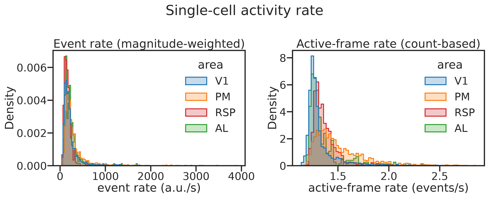
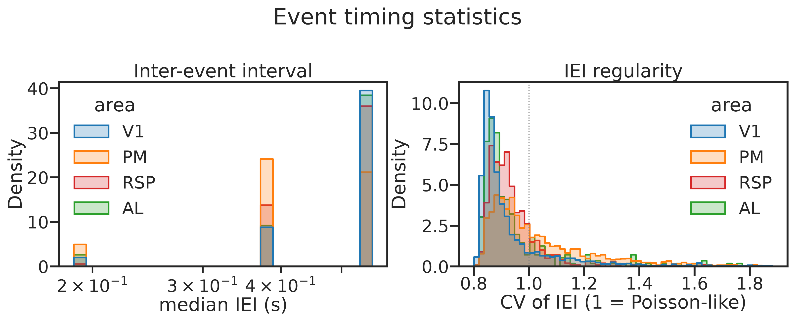
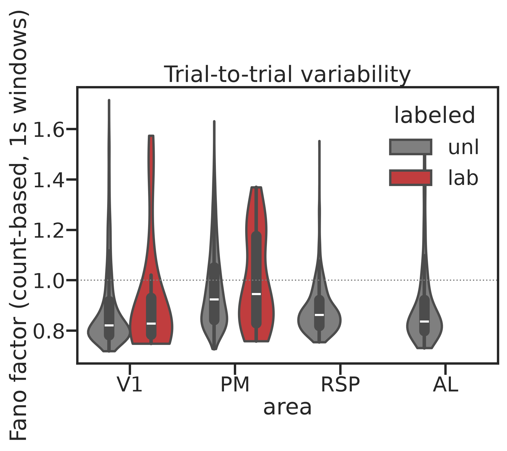
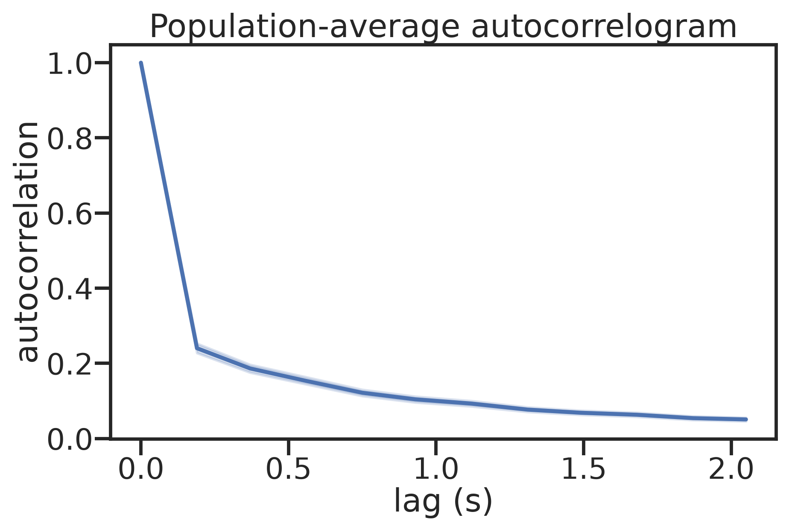
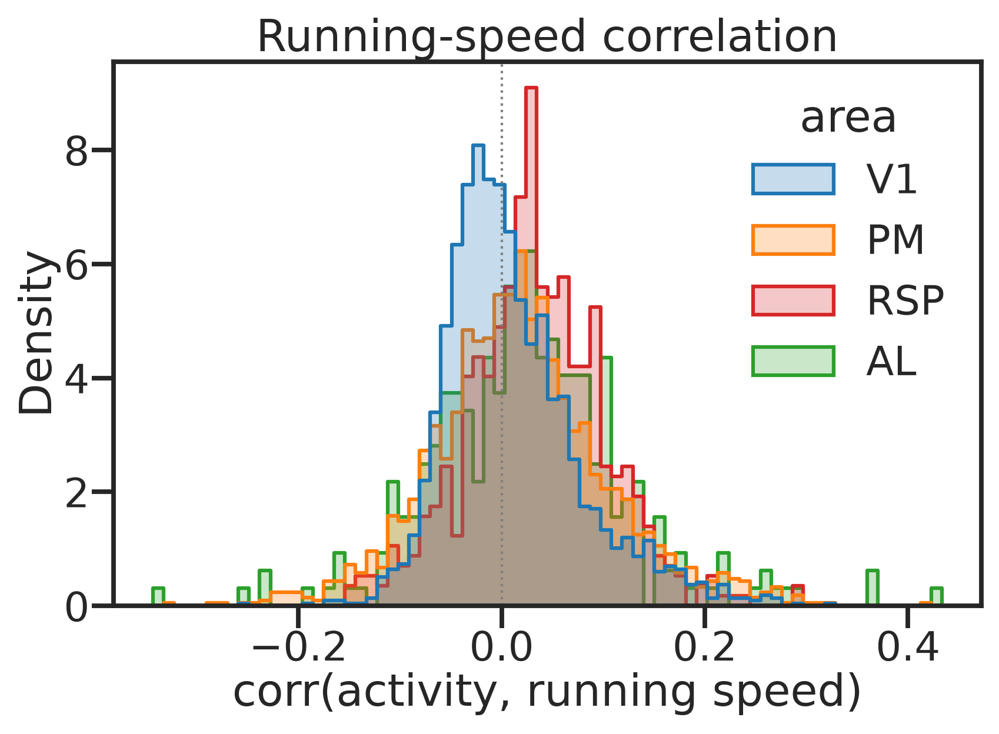
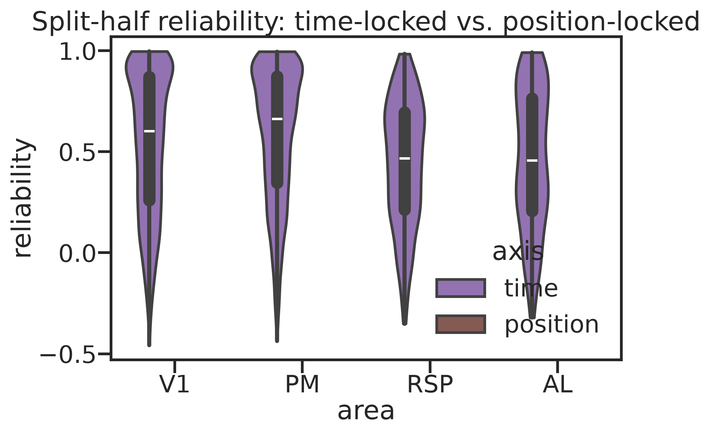
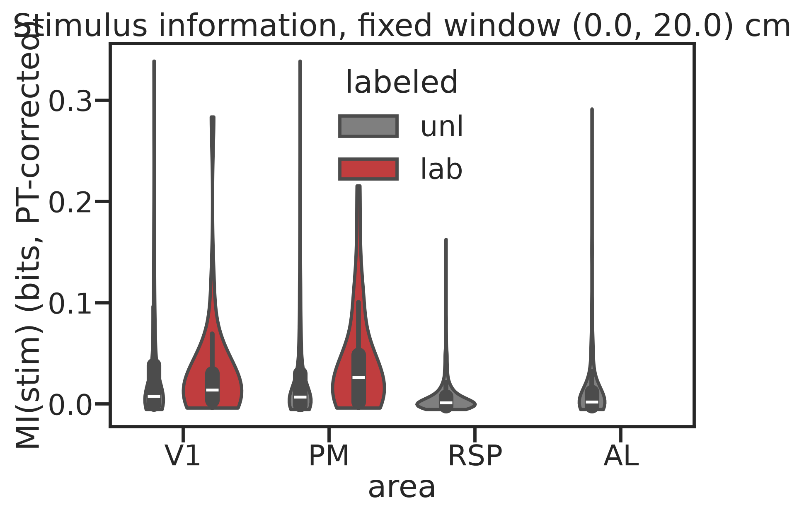
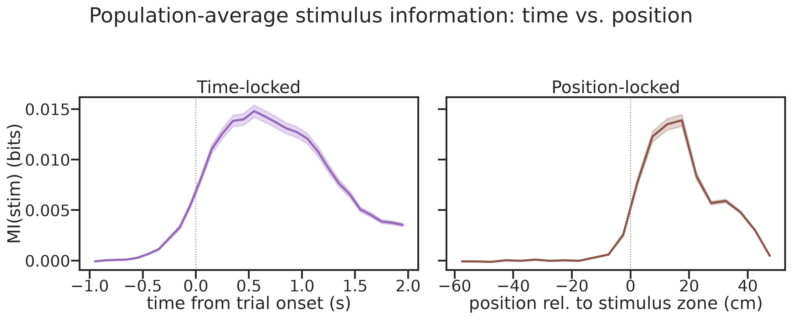
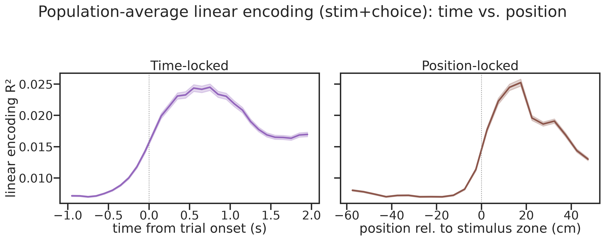
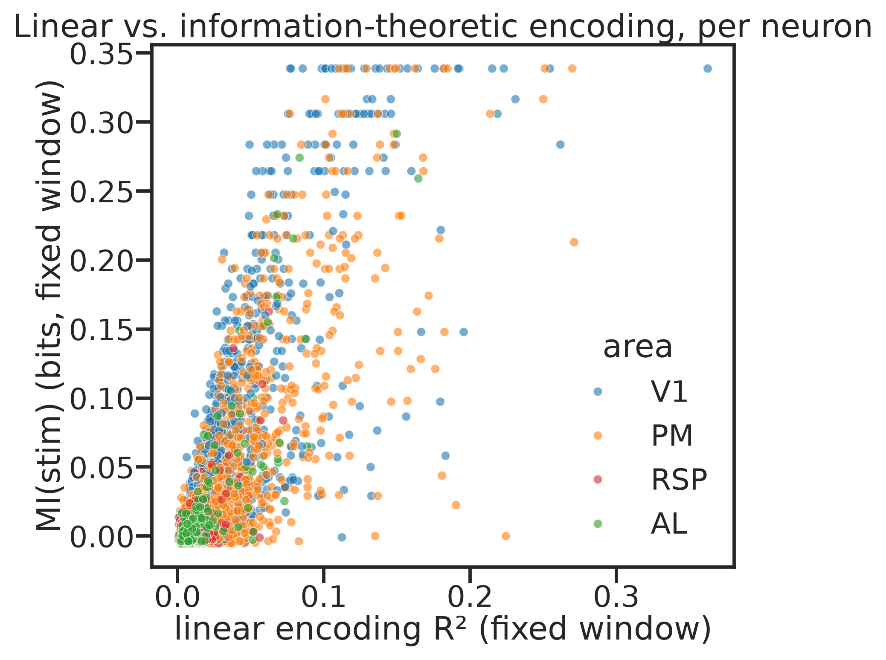

# 2_single

*Auto-generated from `2_pipeline/2_single/out/` on 2026-09-14 16:47. Re-run `make_progress_md.py` after the script's output changes -- don't hand-edit this file.*

## Figures

### Event rate

### Iei stats

### Fano factor

### Autocorrelogram

### Runspeed correlation

### Reliability time vs position

### Mi stim fixed window

### Mi stim time vs position

### Encoding r2 time vs position

### Encoding r2 vs mi scatter

