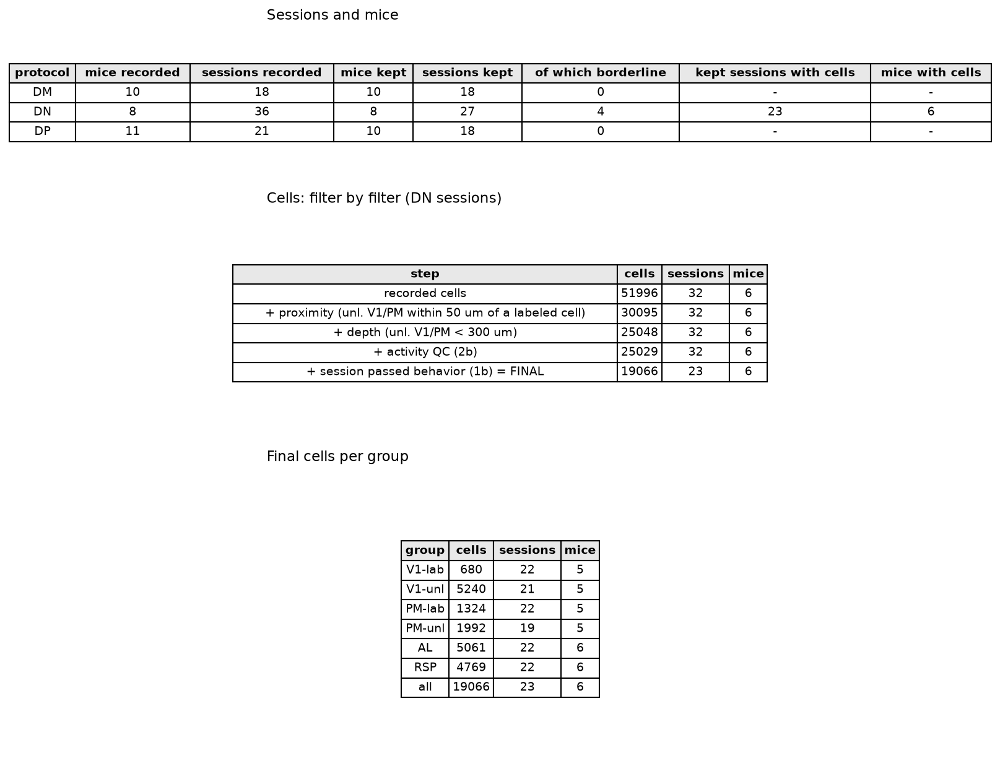

# 2a_cell_distribution

*Auto-generated from `2_pipeline/2a_cell_distribution/out/` on 2026-10-30 11:38. Re-run `make_progress_md.py` after the script's output changes -- don't hand-edit this file.*

## Tables

### Cell counts summary

| animal_id | session_id | roi_name | n_cells |
| --- | --- | --- | --- |
| LPE10884 | LPE10884_2024_01_12 | AL | 320 |
| LPE10884 | LPE10884_2024_01_12 | PM | 408 |
| LPE10884 | LPE10884_2024_01_12 | RSP | 63 |
| LPE10884 | LPE10884_2024_01_12 | V1 | 302 |
| LPE10884 | LPE10884_2024_01_17 | AL | 417 |
| LPE10884 | LPE10884_2024_01_17 | PM | 562 |
| LPE10884 | LPE10884_2024_01_17 | RSP | 159 |
| LPE10884 | LPE10884_2024_01_17 | V1 | 427 |
| LPE10884 | LPE10884_2024_01_18 | AL | 164 |
| LPE10884 | LPE10884_2024_01_18 | PM | 365 |
| LPE10884 | LPE10884_2024_01_18 | RSP | 101 |
| LPE10884 | LPE10884_2024_01_18 | V1 | 308 |
| LPE11622 | LPE11622_2024_02_20 | PM | 1019 |
| LPE11622 | LPE11622_2024_02_20 | V1 | 811 |
| LPE11622 | LPE11622_2024_02_21 | AL | 179 |
| LPE11622 | LPE11622_2024_02_21 | PM | 566 |
| LPE11622 | LPE11622_2024_02_21 | RSP | 386 |
| LPE11622 | LPE11622_2024_02_21 | V1 | 768 |
| LPE11622 | LPE11622_2024_02_22 | AL | 105 |
| LPE11622 | LPE11622_2024_02_22 | PM | 785 |
| LPE11622 | LPE11622_2024_02_22 | RSP | 554 |
| LPE11622 | LPE11622_2024_02_22 | V1 | 741 |
| LPE11622 | LPE11622_2024_02_23 | AL | 264 |
| LPE11622 | LPE11622_2024_02_23 | PM | 639 |
| LPE11622 | LPE11622_2024_02_23 | RSP | 394 |
| LPE11622 | LPE11622_2024_02_23 | V1 | 846 |
| LPE11622 | LPE11622_2024_02_26 | AL | 139 |
| LPE11622 | LPE11622_2024_02_26 | PM | 1104 |
| LPE11622 | LPE11622_2024_02_26 | RSP | 575 |
| LPE11622 | LPE11622_2024_02_26 | V1 | 1149 |

*(showing first 30 of 126 rows -- see the linked CSV for the rest)*

[cell_counts_summary.csv](../2_pipeline/2a_cell_distribution/out/cell_counts_summary.csv)

### Cell properties by unit  session

| group | unit | animal_id | n_cells | depth | radius | npix | npix_soma | skew | iscell_prob |
| --- | --- | --- | --- | --- | --- | --- | --- | --- | --- |
| AL_unl | LPE10884_2024_01_12 | LPE10884 | 320 | 152 | 5.411 | 116.3 | 90.84 | 2.904 | 0.8752 |
| AL_unl | LPE10884_2024_01_17 | LPE10884 | 417 | 166 | 5.534 | 113.5 | 90.98 | 3.343 | 0.8991 |
| AL_unl | LPE10884_2024_01_18 | LPE10884 | 164 | 143 | 5.654 | 112.9 | 91.25 | 3.499 | 0.8995 |
| AL_unl | LPE11622_2024_02_21 | LPE11622 | 179 | 155 | 5.418 | 110.3 | 88.01 | 3.923 | 0.9161 |
| AL_unl | LPE11622_2024_02_22 | LPE11622 | 105 | 150 | 5.605 | 123.4 | 94.03 | 2.795 | 0.8709 |
| AL_unl | LPE11622_2024_02_23 | LPE11622 | 264 | 130 | 5.374 | 115.3 | 86.77 | 4.034 | 0.9049 |
| AL_unl | LPE11622_2024_02_26 | LPE11622 | 139 | 126 | 5.739 | 135.3 | 99.58 | 3.003 | 0.8679 |
| AL_unl | LPE11622_2024_02_27 | LPE11622 | 86 | 190 | 5.321 | 118.4 | 92.24 | 2.073 | 0.857 |
| AL_unl | LPE11997_2024_04_10 | LPE11997 | 151 | 103 | 5.839 | 136 | 102.7 | 6.776 | 0.9501 |
| AL_unl | LPE11997_2024_04_12 | LPE11997 | 110 | 94 | 5.88 | 149.7 | 104.7 | 2.851 | 0.8921 |
| AL_unl | LPE11997_2024_04_16 | LPE11997 | 76 | 71 | 6.394 | 168.8 | 109 | 3.413 | 0.8532 |
| AL_unl | LPE11997_2024_04_17 | LPE11997 | 147 | 95 | 6.294 | 160.9 | 110.1 | 4.441 | 0.8975 |
| AL_unl | LPE11997_2024_04_18 | LPE11997 | 10 | 119 | 5.902 | 135 | 114.2 | 1.919 | 0.9082 |
| AL_unl | LPE11998_2024_04_23 | LPE11998 | 322 | 160 | 5.286 | 103.7 | 80.45 | 3.694 | 0.8858 |
| AL_unl | LPE11998_2024_04_24 | LPE11998 | 148 | 125 | 5.404 | 111 | 83.93 | 3.135 | 0.8934 |
| AL_unl | LPE11998_2024_04_25 | LPE11998 | 138 | 190 | 5.305 | 100.3 | 82.7 | 2.7 | 0.8806 |
| AL_unl | LPE11998_2024_04_26 | LPE11998 | 190 | 182 | 5.504 | 114.2 | 88.58 | 3.055 | 0.9054 |
| AL_unl | LPE11998_2024_04_29 | LPE11998 | 419 | 333 | 5.735 | 128 | 99.68 | 3.096 | 0.9027 |
| AL_unl | LPE11998_2024_04_30 | LPE11998 | 354 | 333 | 5.566 | 119 | 94.51 | 2.839 | 0.9055 |
| AL_unl | LPE11998_2024_05_01 | LPE11998 | 226 | 393 | 6.534 | 173 | 130.6 | 2.866 | 0.8941 |
| AL_unl | LPE12013_2024_04_23 | LPE12013 | 196 | 146 | 5.545 | 106.2 | 81.81 | 2.941 | 0.9176 |
| AL_unl | LPE12013_2024_04_24 | LPE12013 | 273 | 114 | 5.941 | 120 | 90.37 | 3.573 | 0.8831 |
| AL_unl | LPE12013_2024_04_25 | LPE12013 | 227 | 156 | 5.799 | 116.7 | 88.96 | 3.379 | 0.9102 |
| AL_unl | LPE12013_2024_04_26 | LPE12013 | 313 | 176 | 5.257 | 95.81 | 75.19 | 3.451 | 0.9173 |
| AL_unl | LPE12013_2024_04_29 | LPE12013 | 442 | 247 | 5.667 | 114 | 90.99 | 3.022 | 0.8921 |
| AL_unl | LPE12013_2024_04_30 | LPE12013 | 465 | 565 | 5.627 | 115 | 90.55 | 3.003 | 0.895 |
| AL_unl | LPE12385_2024_06_15 | LPE12385 | 302 | 215 | 4.938 | 103.4 | 79.74 | 3.172 | 0.8885 |
| AL_unl | LPE12385_2024_06_16 | LPE12385 | 111 | 159 | 5.611 | 114.8 | 88.45 | 3.427 | 0.8954 |
| AL_unl | LPE12385_2024_06_17 | LPE12385 | 195 | 198 | 5.322 | 116.3 | 93.2 | 2.066 | 0.873 |
| AL_unl | LPE12385_2024_06_26 | LPE12385 | 318 | 170 | 5.476 | 115.9 | 89.93 | 3.938 | 0.9133 |

*(showing first 30 of 178 rows -- see the linked CSV for the rest)*

[cell_properties_by_unit__session.csv](../2_pipeline/2a_cell_distribution/out/cell_properties_by_unit__session.csv)

### Celldata combined

| iscell | iscell_prob | skew | radius | npix_soma | npix | xloc | yloc | redcell | frac_of_ROI_red | frac_red_in_ROI | chan2_prob | nredcells | plane_idx | roi_idx |
| --- | --- | --- | --- | --- | --- | --- | --- | --- | --- | --- | --- | --- | --- | --- |
| 1 | 0.7305 | 3.132 | 6.973 | 134 | 206 | 521.5 | 25.78 | 0 | 0 | 0 | 0.5053 | 3 | 0 | 1 |
| 1 | 0.9299 | 2.812 | 5.548 | 119 | 154 | 329.3 | 39.84 | 0 | 0 | 0 | 0.5181 | 3 | 0 | 1 |
| 1 | 0.6973 | 2.087 | 7.001 | 117 | 144 | 319.9 | 138.3 | 0 | 0 | 0 | 0.5185 | 3 | 0 | 1 |
| 1 | 0.7319 | 2.702 | 6.101 | 120 | 154 | 474.6 | 428.9 | 0 | 0 | 0 | 0.5044 | 3 | 0 | 1 |
| 1 | 0.988 | 5.232 | 5.689 | 99 | 133 | 268.4 | 180.5 | 0 | 0 | 0 | 0.5213 | 3 | 0 | 1 |
| 1 | 0.9694 | 3.791 | 5.988 | 137 | 162 | 432.4 | 82.03 | 0 | 0 | 0 | 0.5087 | 3 | 0 | 1 |
| 1 | 0.9725 | 4.162 | 6.516 | 141 | 142 | 202.7 | 96.09 | 0 | 0 | 0 | 0.5072 | 3 | 0 | 1 |
| 1 | 0.9964 | 5.501 | 6.544 | 99 | 114 | 380.9 | 72.66 | 0 | 0 | 0 | 0.5189 | 3 | 0 | 1 |
| 1 | 0.9799 | 4.142 | 6.119 | 111 | 122 | 315.2 | 35.16 | 0 | 0 | 0 | 0.5041 | 3 | 0 | 1 |
| 1 | 0.7744 | 1.291 | 6.982 | 163 | 233 | 530.9 | 77.34 | 0 | 0 | 0 | 0.5053 | 3 | 0 | 1 |
| 1 | 0.6725 | 4.541 | 9.37 | 164 | 253 | 338.7 | 147.7 | 0 | 0 | 0 | 0.5141 | 3 | 0 | 1 |
| 1 | 0.3076 | 3.603 | 7.687 | 206 | 225 | 160.5 | 63.28 | 0 | 0 | 0 | 0.504 | 3 | 0 | 1 |
| 1 | 0.9384 | 3.967 | 5.82 | 96 | 174 | 371.5 | 236.7 | 0 | 0 | 0 | 0.5212 | 3 | 0 | 1 |
| 1 | 0.9931 | 3.802 | 5.563 | 90 | 112 | 329.3 | 67.97 | 0 | 0 | 0 | 0.5126 | 3 | 0 | 1 |
| 1 | 0.6918 | 1.982 | 7.242 | 161 | 241 | 66.8 | 53.91 | 0 | 0 | 0 | 0.5104 | 3 | 0 | 1 |
| 1 | 0.9927 | 4.61 | 5.464 | 106 | 119 | 305.9 | 63.28 | 0 | 0 | 0 | 0.4994 | 3 | 0 | 1 |
| 1 | 0.7295 | 2.886 | 7.087 | 128 | 180 | 76.17 | 278.9 | 0 | 0 | 0 | 0.5101 | 3 | 0 | 1 |
| 1 | 0.9341 | 2.821 | 4.777 | 90 | 109 | 348 | 105.5 | 0 | 0 | 0 | 0.5104 | 3 | 0 | 1 |
| 1 | 0.9057 | 1.961 | 7.213 | 155 | 169 | 568.4 | 518 | 0 | 0 | 0 | 0.5061 | 3 | 0 | 1 |
| 1 | 0.4987 | 1.502 | 6.442 | 172 | 220 | 305.9 | 86.72 | 0 | 0 | 0 | 0.5094 | 3 | 0 | 1 |
| 1 | 0.9823 | 4.534 | 6.326 | 94 | 209 | 427.7 | 278.9 | 0 | 0 | 0 | 0.4983 | 3 | 0 | 1 |
| 1 | 0.9252 | 3.401 | 5.286 | 94 | 107 | 450 | 85.55 | 0 | 0 | 0 | 0.5058 | 3 | 0 | 1 |
| 1 | 0.7213 | 2.347 | 6.825 | 125 | 153 | 329.3 | 100.8 | 0 | 0 | 0 | 0.5072 | 3 | 0 | 1 |
| 1 | 0.8124 | 2.132 | 5.443 | 102 | 182 | 526.2 | 124.2 | 0 | 0 | 0 | 0.5195 | 3 | 0 | 1 |
| 1 | 0.9531 | 1.968 | 4.745 | 130 | 154 | 296.5 | 100.8 | 0 | 0 | 0 | 0.5015 | 3 | 0 | 1 |
| 1 | 0.9688 | 3.333 | 6.928 | 131 | 148 | 212.1 | 349.2 | 0 | 0 | 0 | 0.5018 | 3 | 0 | 1 |
| 1 | 0.9754 | 4.696 | 6.641 | 111 | 120 | 437.1 | 199.2 | 0 | 0 | 0 | 0.5126 | 3 | 0 | 1 |
| 1 | 0.587 | 1.873 | 6.377 | 126 | 205 | 62.11 | 157 | 0 | 0 | 0 | 0.5147 | 3 | 0 | 1 |
| 1 | 0.7843 | 2.609 | 5.848 | 107 | 146 | 334 | 218 | 0 | 0 | 0 | 0.4969 | 3 | 0 | 1 |
| 1 | 0.958 | 2.601 | 5.268 | 86 | 91 | 412.5 | 141.8 | 0 | 0 | 0 | 0.506 | 3 | 0 | 1 |

*(showing first 15 of 45 columns; showing first 30 of 51996 rows -- see the linked CSV for the rest)*

[celldata_combined.csv](../2_pipeline/2a_cell_distribution/out/celldata_combined.csv)

### Depth session summary

| animal_id | session_id | n_cells | median_depth | min_depth | max_depth | n_unl_V1PM | n_unl_V1PM_fail_depth | frac_unl_V1PM_fail_depth | group_median_depth | depth_z | depth_suspect | flag_reason |
| --- | --- | --- | --- | --- | --- | --- | --- | --- | --- | --- | --- | --- |
| LPE10884 | LPE10884_2024_01_12 | 1093 | 152 | 103 | 240 | 710 | 0 | 0 | 185.5 | -0.4128 | False |  |
| LPE10884 | LPE10884_2024_01_17 | 1565 | 166 | 111 | 200 | 989 | 0 | 0 | 185.5 | -0.2403 | False |  |
| LPE10884 | LPE10884_2024_01_18 | 938 | 173 | 105 | 263 | 673 | 0 | 0 | 185.5 | -0.154 | False |  |
| LPE11622 | LPE11622_2024_02_20 | 1830 | 266 | 106 | 425 | 1511 | 636 | 0.4209 | 185.5 | 0.9921 | False |  |
| LPE11622 | LPE11622_2024_02_21 | 1899 | 230 | 148 | 370 | 1150 | 166 | 0.1443 | 185.5 | 0.5484 | False |  |
| LPE11622 | LPE11622_2024_02_22 | 2185 | 190 | 140 | 370 | 1367 | 222 | 0.1624 | 185.5 | 0.05546 | False |  |
| LPE11622 | LPE11622_2024_02_23 | 2143 | 170 | 130 | 324 | 1333 | 215 | 0.1613 | 185.5 | -0.191 | False |  |
| LPE11622 | LPE11622_2024_02_26 | 2967 | 150 | 0 | 340 | 2008 | 405 | 0.2017 | 185.5 | -0.4375 | False |  |
| LPE11622 | LPE11622_2024_02_27 | 1582 | 220 | 145 | 410 | 960 | 289 | 0.301 | 185.5 | 0.4252 | False |  |
| LPE11997 | LPE11997_2024_04_10 | 2548 | 145 | 103 | 387 | 1742 | 693 | 0.3978 | 185.5 | -0.4991 | False |  |
| LPE11997 | LPE11997_2024_04_12 | 1817 | 181 | 94 | 381 | 1208 | 516 | 0.4272 | 185.5 | -0.05546 | False |  |
| LPE11997 | LPE11997_2024_04_16 | 1238 | 166 | 71 | 366 | 845 | 296 | 0.3503 | 185.5 | -0.2403 | False |  |
| LPE11997 | LPE11997_2024_04_17 | 1509 | 163 | 95 | 387 | 921 | 355 | 0.3855 | 185.5 | -0.2773 | False |  |
| LPE11997 | LPE11997_2024_04_18 | 479 | 210 | 119 | 350 | 408 | 125 | 0.3064 | 185.5 | 0.3019 | False |  |
| LPE11998 | LPE11998_2024_04_23 | 1254 | 160 | 110 | 445 | 814 | 158 | 0.1941 | 185.5 | -0.3143 | False |  |
| LPE11998 | LPE11998_2024_04_24 | 952 | 140 | 100 | 445 | 665 | 156 | 0.2346 | 185.5 | -0.5607 | False |  |
| LPE11998 | LPE11998_2024_04_25 | 951 | 190 | 100 | 385 | 712 | 79 | 0.111 | 185.5 | 0.05546 | False |  |
| LPE11998 | LPE11998_2024_04_26 | 1261 | 147 | 90 | 395 | 935 | 216 | 0.231 | 185.5 | -0.4745 | False |  |
| LPE11998 | LPE11998_2024_04_29 | 1183 | 333 | 120 | 468 | 658 | 384 | 0.5836 | 185.5 | 1.818 | False |  |
| LPE11998 | LPE11998_2024_04_30 | 1197 | 333 | 120 | 468 | 720 | 372 | 0.5167 | 185.5 | 1.818 | False |  |
| LPE11998 | LPE11998_2024_05_01 | 991 | 165 | 80 | 431 | 631 | 177 | 0.2805 | 185.5 | -0.2526 | False |  |
| LPE12013 | LPE12013_2024_04_23 | 1187 | 186 | 116 | 326 | 812 | 102 | 0.1256 | 185.5 | 0.006162 | False |  |
| LPE12013 | LPE12013_2024_04_24 | 1615 | 143 | 100 | 325 | 973 | 135 | 0.1387 | 185.5 | -0.5238 | False |  |
| LPE12013 | LPE12013_2024_04_25 | 1353 | 171 | 130 | 365 | 858 | 246 | 0.2867 | 185.5 | -0.1787 | False |  |
| LPE12013 | LPE12013_2024_04_26 | 1576 | 225 | 85 | 330 | 1012 | 331 | 0.3271 | 185.5 | 0.4868 | False |  |
| LPE12013 | LPE12013_2024_04_29 | 1227 | 247 | 96 | 331 | 578 | 145 | 0.2509 | 185.5 | 0.7579 | False |  |
| LPE12013 | LPE12013_2024_04_30 | 2082 | 565 | 420 | 650 | 1358 | 1358 | 1 | 185.5 | 4.677 | True | median depth 565.0 um is 4.7 SD from the group median (186.0 um): depth probably badly measured |
| LPE12385 | LPE12385_2024_06_15 | 2353 | 214 | 125 | 450 | 1850 | 571 | 0.3086 | 185.5 | 0.3512 | False |  |
| LPE12385 | LPE12385_2024_06_16 | 2551 | 210 | 121 | 408 | 2159 | 727 | 0.3367 | 185.5 | 0.3019 | False |  |
| LPE12385 | LPE12385_2024_06_17 | 2366 | 228 | 145 | 377 | 1846 | 1009 | 0.5466 | 185.5 | 0.5238 | False |  |

*(showing first 30 of 32 rows -- see the linked CSV for the rest)*

[depth_session_summary.csv](../2_pipeline/2a_cell_distribution/out/depth_session_summary.csv)

### Final cells ours

| session_id | roi_name | labeled | n_cells |
| --- | --- | --- | --- |
| LPE10884_2024_01_12 | AL | unl | 320 |
| LPE10884_2024_01_12 | RSP | unl | 63 |
| LPE11622_2024_02_20 | PM | lab | 220 |
| LPE11622_2024_02_20 | PM | unl | 149 |
| LPE11622_2024_02_20 | V1 | lab | 99 |
| LPE11622_2024_02_20 | V1 | unl | 495 |
| LPE11622_2024_02_22 | AL | unl | 105 |
| LPE11622_2024_02_22 | PM | lab | 120 |
| LPE11622_2024_02_22 | PM | unl | 392 |
| LPE11622_2024_02_22 | RSP | unl | 554 |
| LPE11622_2024_02_22 | V1 | lab | 39 |
| LPE11622_2024_02_22 | V1 | unl | 312 |
| LPE11622_2024_02_23 | AL | unl | 264 |
| LPE11622_2024_02_23 | PM | lab | 76 |
| LPE11622_2024_02_23 | PM | unl | 268 |
| LPE11622_2024_02_23 | RSP | unl | 394 |
| LPE11622_2024_02_23 | V1 | lab | 76 |
| LPE11622_2024_02_23 | V1 | unl | 373 |
| LPE11622_2024_02_26 | AL | unl | 139 |
| LPE11622_2024_02_26 | PM | lab | 164 |
| LPE11622_2024_02_26 | PM | unl | 380 |
| LPE11622_2024_02_26 | RSP | unl | 575 |
| LPE11622_2024_02_26 | V1 | lab | 81 |
| LPE11622_2024_02_26 | V1 | unl | 516 |
| LPE11997_2024_04_10 | AL | unl | 151 |
| LPE11997_2024_04_10 | PM | lab | 175 |
| LPE11997_2024_04_10 | RSP | unl | 426 |
| LPE11997_2024_04_10 | V1 | lab | 53 |
| LPE11997_2024_04_10 | V1 | unl | 611 |
| LPE11997_2024_04_16 | AL | unl | 75 |

*(showing first 30 of 129 rows -- see the linked CSV for the rest)*

[final_cells_ours.csv](../2_pipeline/2a_cell_distribution/out/final_cells_ours.csv)

### Final selection cells funnel

| step | cells | sessions | mice |
| --- | --- | --- | --- |
| recorded cells | 51996 | 32 | 6 |
| + proximity (unl. V1/PM within 50 um of a labeled cell) | 30095 | 32 | 6 |
| + depth (unl. V1/PM < 300 um) | 25048 | 32 | 6 |
| + activity QC (2b) | 25029 | 32 | 6 |
| + session passed behavior (1b) = FINAL | 19066 | 23 | 6 |

[final_selection_cells_funnel.csv](../2_pipeline/2a_cell_distribution/out/final_selection_cells_funnel.csv)

### Final selection groups

| group | cells | sessions | mice |
| --- | --- | --- | --- |
| V1-lab | 680 | 22 | 5 |
| V1-unl | 5240 | 21 | 5 |
| PM-lab | 1324 | 22 | 5 |
| PM-unl | 1992 | 19 | 5 |
| AL | 5061 | 22 | 6 |
| RSP | 4769 | 22 | 6 |
| all | 19066 | 23 | 6 |

[final_selection_groups.csv](../2_pipeline/2a_cell_distribution/out/final_selection_groups.csv)

### Final selection sessions

| protocol | mice recorded | sessions recorded | mice kept | sessions kept | of which borderline | kept sessions with cells | mice with cells |
| --- | --- | --- | --- | --- | --- | --- | --- |
| DM | 10 | 18 | 10 | 18 | 0 |  |  |
| DN | 8 | 36 | 8 | 27 | 4 | 23 | 6 |
| DP | 11 | 21 | 10 | 18 | 0 |  |  |

[final_selection_sessions.csv](../2_pipeline/2a_cell_distribution/out/final_selection_sessions.csv)

### Final sessions ours

| session_id | animal_id | protocol | kept | borderline | borderline_reasons | reason | dprime_engaged | fa_rate_engaged | frac_engaged | mu | sigma | guess_rate |
| --- | --- | --- | --- | --- | --- | --- | --- | --- | --- | --- | --- | --- |
| LPE10884_2023_11_30 | LPE10884 | DM | True | False |  |  | 2.644 | 0.4211 | 1 |  |  |  |
| LPE10884_2023_12_10 | LPE10884 | DM | True | False |  |  | 1.086 | 0.4583 | 1 |  |  |  |
| LPE11081_2023_12_11 | LPE11081 | DM | True | False |  |  | 2.363 | 0.2857 | 1 |  |  |  |
| LPE11081_2023_12_12 | LPE11081 | DM | True | False |  |  | 2.759 | 0.2105 | 1 |  |  |  |
| LPE11495_2024_02_14 | LPE11495 | DM | True | False |  |  | 3.211 | 0.1379 | 1 |  |  |  |
| LPE11495_2024_02_16 | LPE11495 | DM | True | False |  |  | 2.853 | 0.08824 | 1 |  |  |  |
| LPE11622_2024_02_16 | LPE11622 | DM | True | False |  |  | 2.941 | 0.1286 | 0.9833 |  |  |  |
| LPE11623_2024_03_27 | LPE11623 | DM | True | False |  |  | 1.285 | 0.2941 | 1 |  |  |  |
| LPE11623_2024_03_29 | LPE11623 | DM | True | False |  |  | 1.625 | 0.375 | 1 |  |  |  |
| LPE11997_2024_04_05 | LPE11997 | DM | True | False |  |  | 2.197 | 0.1944 | 1 |  |  |  |
| LPE11997_2024_04_07 | LPE11997 | DM | True | False |  |  | 2.673 | 0.2143 | 1 |  |  |  |
| LPE11998_2024_04_11 | LPE11998 | DM | True | False |  |  | 2.936 | 0.06667 | 0.8187 |  |  |  |
| LPE11998_2024_04_12 | LPE11998 | DM | True | False |  |  | 2.653 | 0.1282 | 0.8858 |  |  |  |
| LPE12013_2024_04_11 | LPE12013 | DM | True | False |  |  | 2.597 | 0.1522 | 0.9833 |  |  |  |
| LPE12013_2024_04_12 | LPE12013 | DM | True | False |  |  | 2.442 | 0.1143 | 0.8246 |  |  |  |
| LPE12223_2024_05_29 | LPE12223 | DM | True | False |  |  | 2.066 | 0.1944 | 0.9362 |  |  |  |
| LPE12223_2024_05_30 | LPE12223 | DM | True | False |  |  | 3.446 | 0.02381 | 0.9633 |  |  |  |
| LPE12385_2024_05_30 | LPE12385 | DM | True | False |  |  | 2.222 | 0.1875 | 1 |  |  |  |
| LPE10884_2024_01_12 | LPE10884 | DN | True | False |  |  | 2.056 | 0.1905 | 0.7207 | 10.84 | 2.551 | 0.2286 |
| LPE10884_2024_01_17 | LPE10884 | DN | False | False |  | guess rate = 0.46 > 0.4 | 2.175 | 0.4583 | 0.7914 | 10.81 | 4.617 | 0.456 |
| LPE10884_2024_01_18 | LPE10884 | DN | False | False |  | FA rate (engaged) = 57% > 50%; guess rate = 0.49 > 0.4 | 1.948 | 0.5714 | 0.7157 | 12.26 | 4.301 | 0.4947 |
| LPE11495_2024_02_22 | LPE11495 | DN | True | False |  |  | 2.487 | 0.4286 | 1 | 6.671 | 6.465 | 0.3329 |
| LPE11622_2024_02_20 | LPE11622 | DN | True | False |  |  | 1.908 | 0.2889 | 0.6092 | 11.89 | 8.571 | 0.2211 |
| LPE11622_2024_02_21 | LPE11622 | DN | False | False |  | threshold (mu=21%) outside tested stimulus range (z-range [-1.96, -0.71] doesn't bracket 0) | 2.233 | 0.2245 | 0.5516 | 20.71 | 8.005 | 0.1838 |
| LPE11622_2024_02_22 | LPE11622 | DN | True | False |  |  | 2.085 | 0.2353 | 0.6596 | 13.5 | 2 | 0.1866 |
| LPE11622_2024_02_23 | LPE11622 | DN | True | False |  |  | 2.385 | 0.2222 | 0.4409 | 9.489 | 3.607 | 0.2019 |
| LPE11622_2024_02_26 | LPE11622 | DN | True | False |  |  | 2.129 | 0.2895 | 0.5852 | 14.01 | 6.169 | 0.2587 |
| LPE11622_2024_02_27 | LPE11622 | DN | False | False |  | threshold (mu=19%) outside tested stimulus range (z-range [-2.44, -0.69] doesn't bracket 0) | 2.3 | 0.1111 | 0.5185 | 18.98 | 5.739 | 0.1191 |
| LPE11623_2024_04_02 | LPE11623 | DN | True | False |  |  | 2.078 | 0.1875 | 1 | 15.72 | 5.037 | 0.1609 |
| LPE11997_2024_04_09 | LPE11997 | DN | True | False |  |  | 1.267 | 0.4 | 0.6925 | 9.628 | 6.885 | 0.31 |

*(showing first 30 of 75 rows -- see the linked CSV for the rest)*

[final_sessions_ours.csv](../2_pipeline/2a_cell_distribution/out/final_sessions_ours.csv)

## Figures

### Cell counts

### Depth laminar distribution

### Xy positions page1

### Xy positions page2

### Xy positions page3

### Xy positions page4

### Xy positions page5

### Xy positions page6

### 3b xy density page1

### 3b xy density page2

### 3b xy density page3

### 3b xy density page4

### 3b xy density page5

### 3b xy density page6

### Cell size properties

### Proximity filter pass rate

### 5a labeled cells per session

### 5b distance to labeled distribution

### Final selection summary

