# 2c_information

*Auto-generated from `2_pipeline/2c_information/out/` on 2026-11-11 15:40. Re-run `make_progress_md.py` after the script's output changes -- don't hand-edit this file.*

## Figures

### Between area mi bars pre stim

### Between area mi bars reward

### Between area mi bars stim

### Between group mi heatmap

### Labeled vs unlabeled mi pre stim

### Labeled vs unlabeled mi reward

### Labeled vs unlabeled mi stim

### Labeled vs unlabeled frac sig pre stim

### Labeled vs unlabeled frac sig reward

### Labeled vs unlabeled frac sig stim

### Labeled vs unlabeled between area mi pre stim

### Labeled vs unlabeled between area mi reward

### Labeled vs unlabeled between area mi stim

### 1a mi by predictor and window

### 1b mi by predictor and window frames

### 2a frac significant by predictor and window

### 2b frac significant by predictor and window frames

### Frac significant heatmap

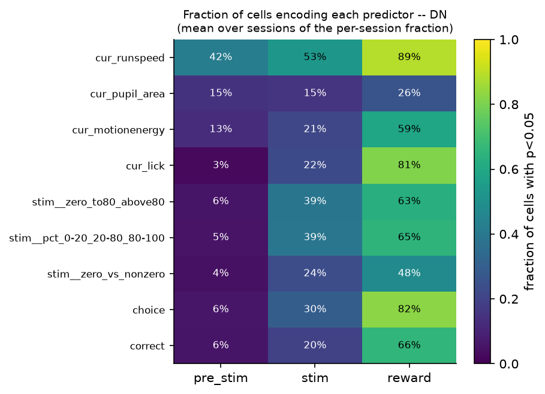

### Tail trials

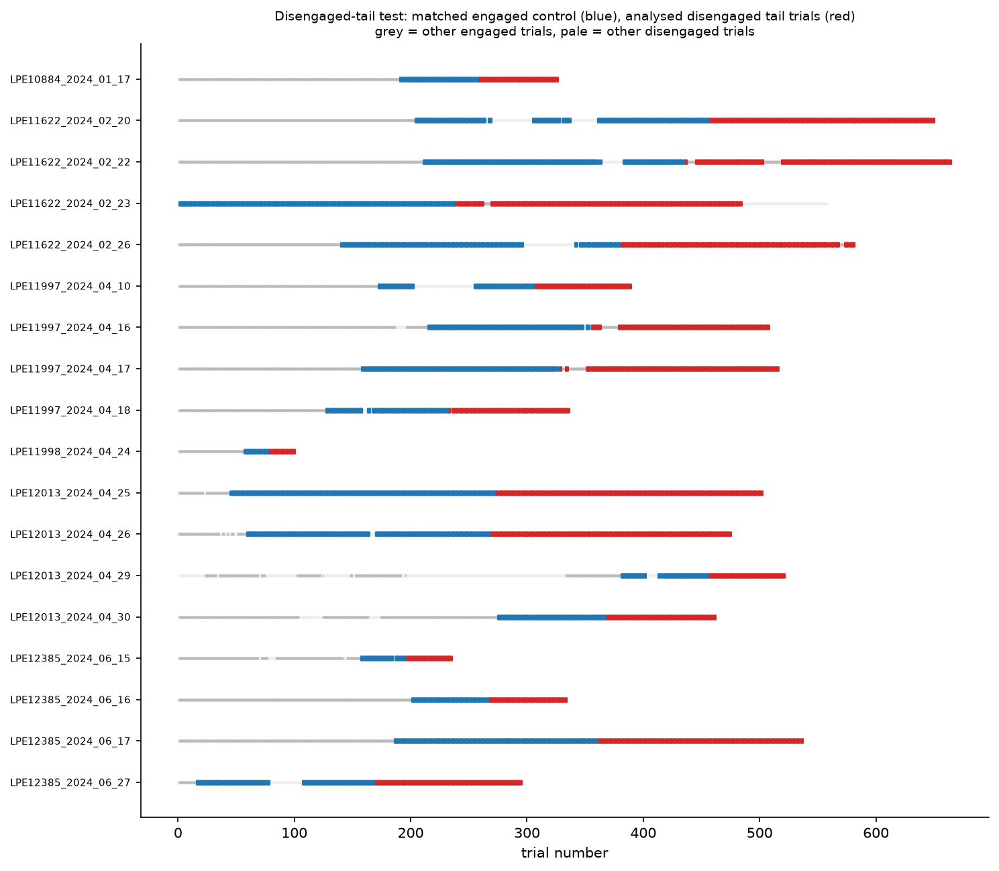

### Tail mi pre stim

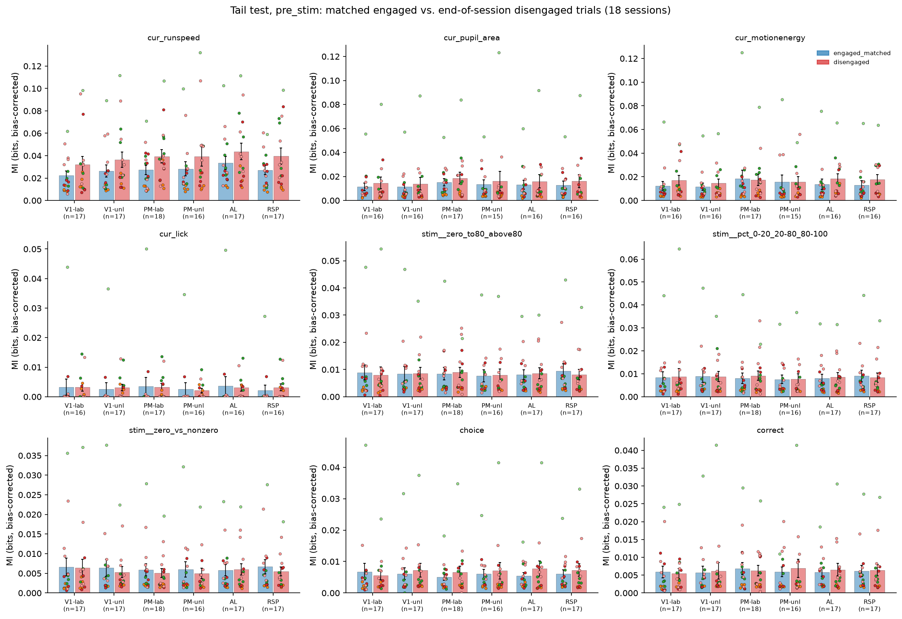

### Tail mi reward

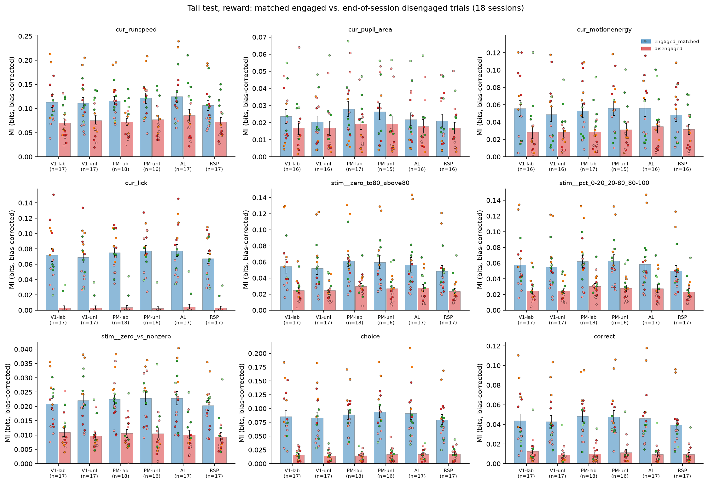

### Tail mi stim

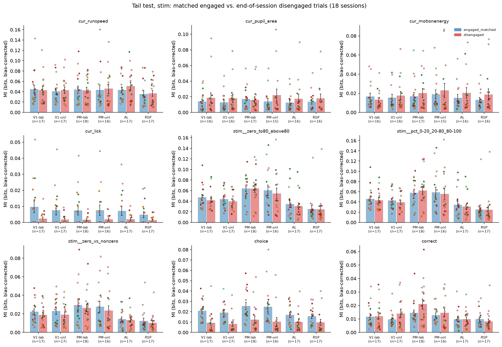

### Tail frac significant pre stim

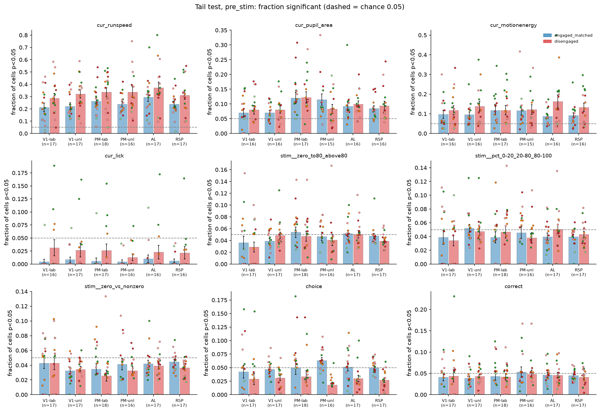

### Tail frac significant reward

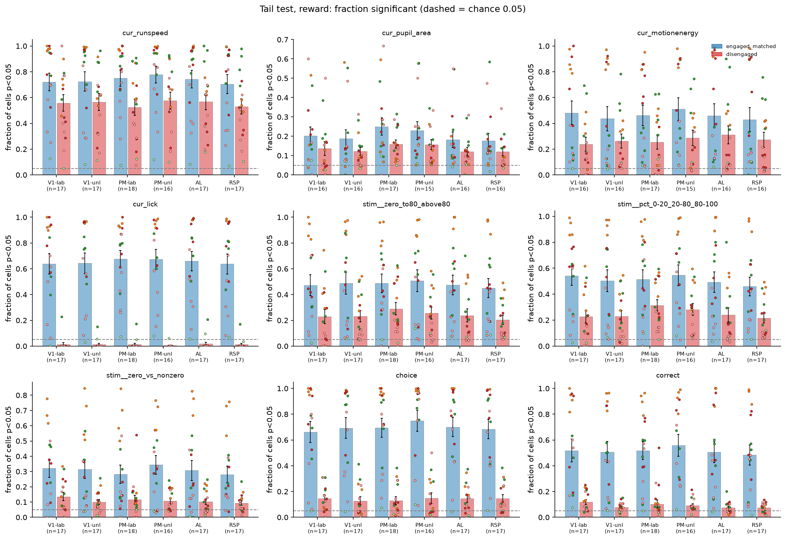

### Tail frac significant stim

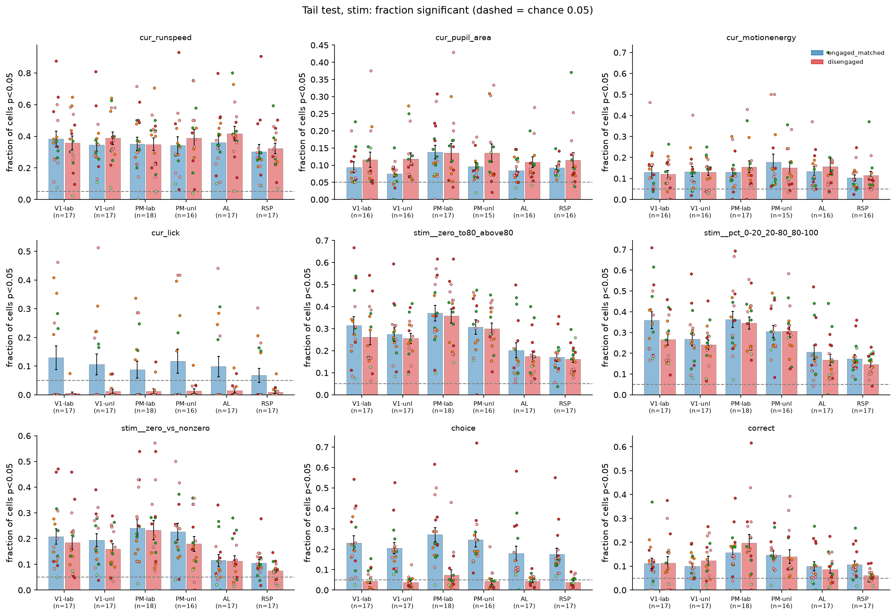

### Mi given runspeed pre stim

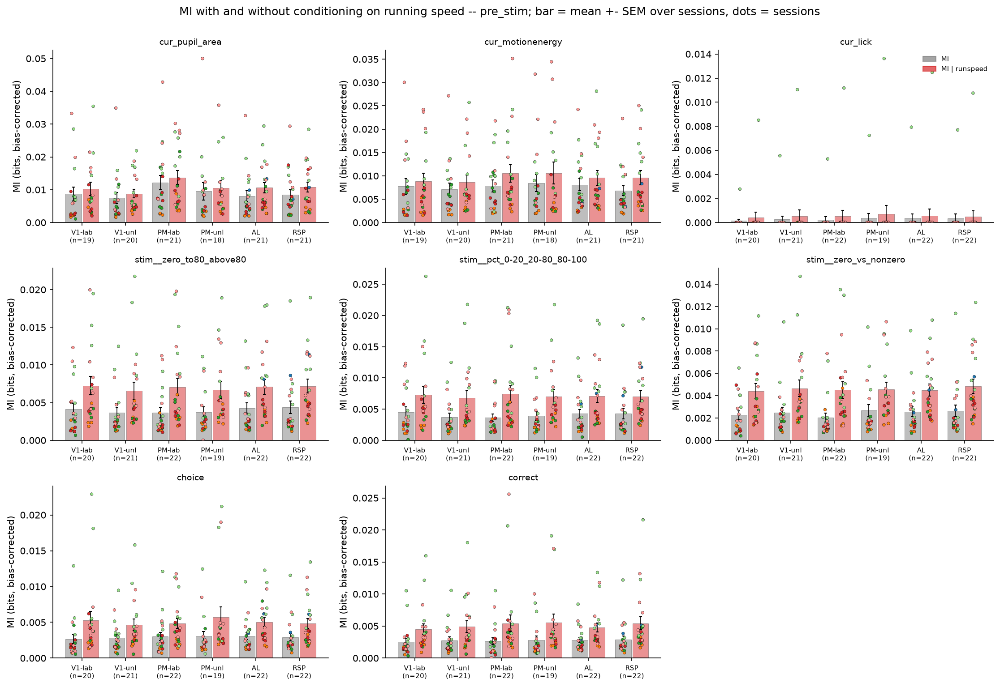

### Mi given runspeed reward

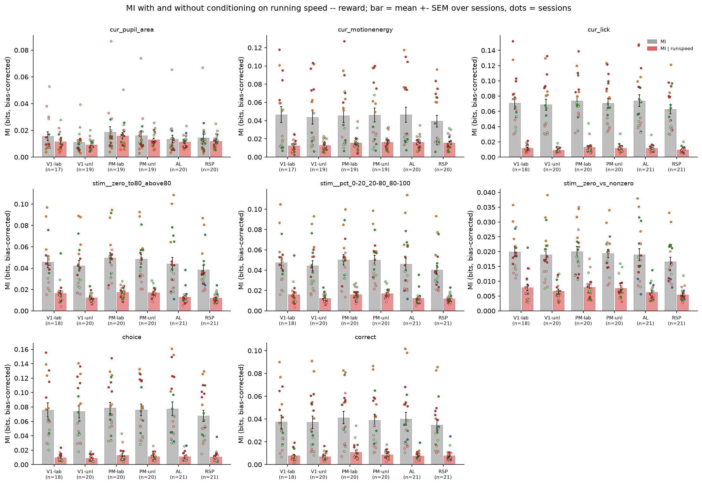

### Mi given runspeed stim

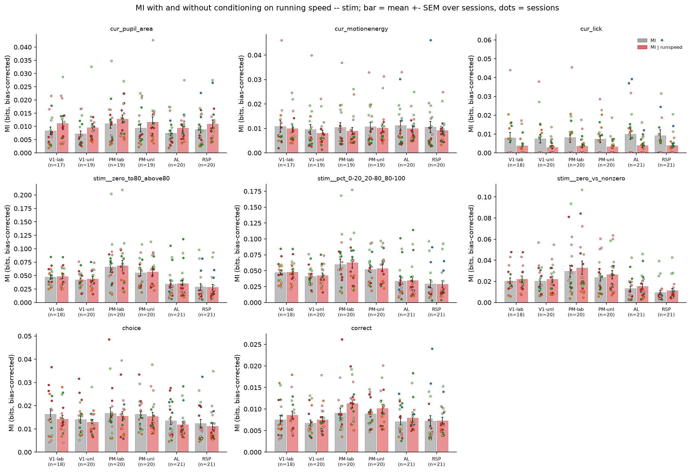

### Frac sig given runspeed pre stim

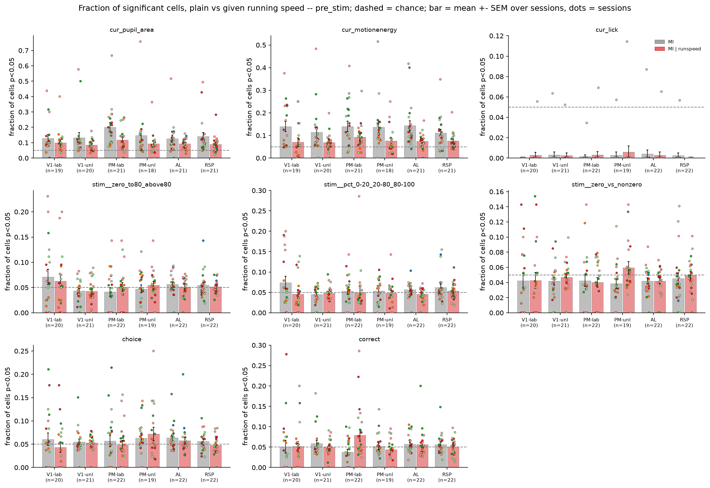

### Frac sig given runspeed reward

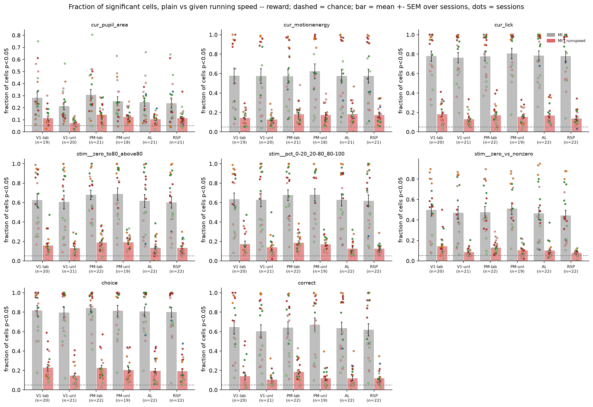

### Frac sig given runspeed stim

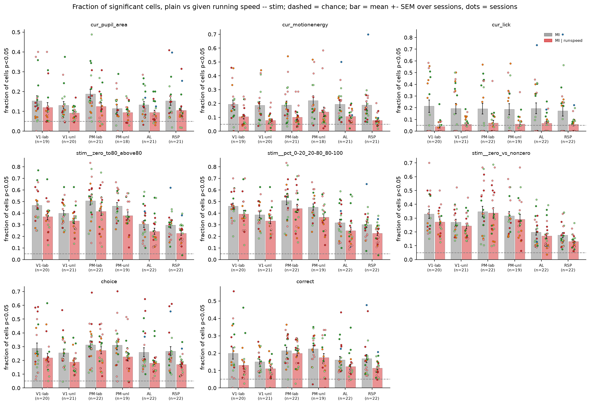

### Between area mi heatmap

## Tables

### Between area mi by area pair  session

| area_a | area_b | window | measure | session_id | n_pairs | mi_corrected | mi_raw | frac_sig | unit | animal_id | area_pair |
| --- | --- | --- | --- | --- | --- | --- | --- | --- | --- | --- | --- |
| AL | AL | pre_stim | mi | LPE10884_2024_01_12 | 51040 | 0.006306 | 0.01506 | 0.1035 | LPE10884_2024_01_12 | LPE10884 | AL x AL |
| AL | AL | pre_stim | mi | LPE11622_2024_02_22 | 5460 | 0.001892 | 0.002904 | 0.1049 | LPE11622_2024_02_22 | LPE11622 | AL x AL |
| AL | AL | pre_stim | mi | LPE11622_2024_02_23 | 34716 | 0.002655 | 0.004172 | 0.08956 | LPE11622_2024_02_23 | LPE11622 | AL x AL |
| AL | AL | pre_stim | mi | LPE11622_2024_02_26 | 9591 | 0.001781 | 0.002841 | 0.07809 | LPE11622_2024_02_26 | LPE11622 | AL x AL |
| AL | AL | pre_stim | mi | LPE11997_2024_04_10 | 11325 | 0.004083 | 0.007756 | 0.09907 | LPE11997_2024_04_10 | LPE11997 | AL x AL |
| AL | AL | pre_stim | mi | LPE11997_2024_04_16 | 2775 | 0.002802 | 0.004267 | 0.1214 | LPE11997_2024_04_16 | LPE11997 | AL x AL |
| AL | AL | pre_stim | mi | LPE11997_2024_04_17 | 10585 | 0.002163 | 0.003524 | 0.08786 | LPE11997_2024_04_17 | LPE11997 | AL x AL |
| AL | AL | pre_stim | mi | LPE11997_2024_04_18 | 45 | 0.003786 | 0.006487 | 0.1556 | LPE11997_2024_04_18 | LPE11997 | AL x AL |
| AL | AL | pre_stim | mi | LPE11998_2024_04_23 | 51681 | 0.00896 | 0.02962 | 0.0571 | LPE11998_2024_04_23 | LPE11998 | AL x AL |
| AL | AL | pre_stim | mi | LPE11998_2024_04_24 | 10878 | 0.01635 | 0.04572 | 0.08274 | LPE11998_2024_04_24 | LPE11998 | AL x AL |
| AL | AL | pre_stim | mi | LPE11998_2024_04_25 | 9453 | 0.006439 | 0.01712 | 0.09341 | LPE11998_2024_04_25 | LPE11998 | AL x AL |
| AL | AL | pre_stim | mi | LPE12013_2024_04_25 | 25651 | 0.003279 | 0.005941 | 0.09208 | LPE12013_2024_04_25 | LPE12013 | AL x AL |
| AL | AL | pre_stim | mi | LPE12013_2024_04_26 | 48516 | 0.002547 | 0.004766 | 0.07262 | LPE12013_2024_04_26 | LPE12013 | AL x AL |
| AL | AL | pre_stim | mi | LPE12013_2024_04_29 | 97461 | 0.00212 | 0.004207 | 0.05459 | LPE12013_2024_04_29 | LPE12013 | AL x AL |
| AL | AL | pre_stim | mi | LPE12385_2024_06_15 | 45451 | 0.01697 | 0.03131 | 0.2679 | LPE12385_2024_06_15 | LPE12385 | AL x AL |
| AL | AL | pre_stim | mi | LPE12385_2024_06_16 | 6105 | 0.004798 | 0.01308 | 0.09091 | LPE12385_2024_06_16 | LPE12385 | AL x AL |
| AL | AL | pre_stim | mi | LPE12385_2024_06_17 | 18915 | 0.003614 | 0.009442 | 0.09374 | LPE12385_2024_06_17 | LPE12385 | AL x AL |
| AL | AL | pre_stim | mi | LPE12385_2024_06_26 | 50086 | 0.01156 | 0.02987 | 0.1068 | LPE12385_2024_06_26 | LPE12385 | AL x AL |
| AL | AL | pre_stim | mi | LPE12385_2024_06_27 | 25651 | 0.007717 | 0.02355 | 0.07064 | LPE12385_2024_06_27 | LPE12385 | AL x AL |
| AL | AL | reward | mi | LPE10884_2024_01_12 | 51040 | 0.01322 | 0.02557 | 0.2271 | LPE10884_2024_01_12 | LPE10884 | AL x AL |
| AL | AL | reward | mi | LPE11622_2024_02_22 | 5460 | 0.05645 | 0.06313 | 0.9802 | LPE11622_2024_02_22 | LPE11622 | AL x AL |
| AL | AL | reward | mi | LPE11622_2024_02_23 | 34716 | 0.02935 | 0.04084 | 0.5683 | LPE11622_2024_02_23 | LPE11622 | AL x AL |
| AL | AL | reward | mi | LPE11622_2024_02_26 | 9591 | 0.05518 | 0.06366 | 0.9277 | LPE11622_2024_02_26 | LPE11622 | AL x AL |
| AL | AL | reward | mi | LPE11997_2024_04_10 | 11325 | 0.02164 | 0.03271 | 0.471 | LPE11997_2024_04_10 | LPE11997 | AL x AL |
| AL | AL | reward | mi | LPE11997_2024_04_16 | 2775 | 0.02585 | 0.03375 | 0.6555 | LPE11997_2024_04_16 | LPE11997 | AL x AL |
| AL | AL | reward | mi | LPE11997_2024_04_17 | 10585 | 0.01856 | 0.02661 | 0.509 | LPE11997_2024_04_17 | LPE11997 | AL x AL |
| AL | AL | reward | mi | LPE11997_2024_04_18 | 45 | 0.02721 | 0.03949 | 0.4889 | LPE11997_2024_04_18 | LPE11997 | AL x AL |
| AL | AL | reward | mi | LPE11998_2024_04_23 | 51681 | 0.02119 | 0.04533 | 0.1741 | LPE11998_2024_04_23 | LPE11998 | AL x AL |
| AL | AL | reward | mi | LPE11998_2024_04_24 | 10878 | 0.01899 | 0.04904 | 0.1025 | LPE11998_2024_04_24 | LPE11998 | AL x AL |
| AL | AL | reward | mi | LPE11998_2024_04_25 | 9453 | 0.01336 | 0.0259 | 0.2191 | LPE11998_2024_04_25 | LPE11998 | AL x AL |

*(showing first 30 of 840 rows -- see the linked CSV for the rest)*

[between_area_mi_by_area_pair__session.csv](../2_pipeline/2c_information/out/between_area_mi_by_area_pair__session.csv)

### Between area mi by group pair  session

| group_a | group_b | window | measure | session_id | n_pairs | mi_corrected | mi_raw | frac_sig | unit | animal_id |
| --- | --- | --- | --- | --- | --- | --- | --- | --- | --- | --- |
| AL_unl | AL_unl | pre_stim | mi | LPE10884_2024_01_12 | 51040 | 0.006306 | 0.01506 | 0.1035 | LPE10884_2024_01_12 | LPE10884 |
| AL_unl | AL_unl | pre_stim | mi | LPE11622_2024_02_22 | 5460 | 0.001892 | 0.002904 | 0.1049 | LPE11622_2024_02_22 | LPE11622 |
| AL_unl | AL_unl | pre_stim | mi | LPE11622_2024_02_23 | 34716 | 0.002655 | 0.004172 | 0.08956 | LPE11622_2024_02_23 | LPE11622 |
| AL_unl | AL_unl | pre_stim | mi | LPE11622_2024_02_26 | 9591 | 0.001781 | 0.002841 | 0.07809 | LPE11622_2024_02_26 | LPE11622 |
| AL_unl | AL_unl | pre_stim | mi | LPE11997_2024_04_10 | 11325 | 0.004083 | 0.007756 | 0.09907 | LPE11997_2024_04_10 | LPE11997 |
| AL_unl | AL_unl | pre_stim | mi | LPE11997_2024_04_16 | 2775 | 0.002802 | 0.004267 | 0.1214 | LPE11997_2024_04_16 | LPE11997 |
| AL_unl | AL_unl | pre_stim | mi | LPE11997_2024_04_17 | 10585 | 0.002163 | 0.003524 | 0.08786 | LPE11997_2024_04_17 | LPE11997 |
| AL_unl | AL_unl | pre_stim | mi | LPE11997_2024_04_18 | 45 | 0.003786 | 0.006487 | 0.1556 | LPE11997_2024_04_18 | LPE11997 |
| AL_unl | AL_unl | pre_stim | mi | LPE11998_2024_04_23 | 51681 | 0.00896 | 0.02962 | 0.0571 | LPE11998_2024_04_23 | LPE11998 |
| AL_unl | AL_unl | pre_stim | mi | LPE11998_2024_04_24 | 10878 | 0.01635 | 0.04572 | 0.08274 | LPE11998_2024_04_24 | LPE11998 |
| AL_unl | AL_unl | pre_stim | mi | LPE11998_2024_04_25 | 9453 | 0.006439 | 0.01712 | 0.09341 | LPE11998_2024_04_25 | LPE11998 |
| AL_unl | AL_unl | pre_stim | mi | LPE12013_2024_04_25 | 25651 | 0.003279 | 0.005941 | 0.09208 | LPE12013_2024_04_25 | LPE12013 |
| AL_unl | AL_unl | pre_stim | mi | LPE12013_2024_04_26 | 48516 | 0.002547 | 0.004766 | 0.07262 | LPE12013_2024_04_26 | LPE12013 |
| AL_unl | AL_unl | pre_stim | mi | LPE12013_2024_04_29 | 97461 | 0.00212 | 0.004207 | 0.05459 | LPE12013_2024_04_29 | LPE12013 |
| AL_unl | AL_unl | pre_stim | mi | LPE12385_2024_06_15 | 45451 | 0.01697 | 0.03131 | 0.2679 | LPE12385_2024_06_15 | LPE12385 |
| AL_unl | AL_unl | pre_stim | mi | LPE12385_2024_06_16 | 6105 | 0.004798 | 0.01308 | 0.09091 | LPE12385_2024_06_16 | LPE12385 |
| AL_unl | AL_unl | pre_stim | mi | LPE12385_2024_06_17 | 18915 | 0.003614 | 0.009442 | 0.09374 | LPE12385_2024_06_17 | LPE12385 |
| AL_unl | AL_unl | pre_stim | mi | LPE12385_2024_06_26 | 50086 | 0.01156 | 0.02987 | 0.1068 | LPE12385_2024_06_26 | LPE12385 |
| AL_unl | AL_unl | pre_stim | mi | LPE12385_2024_06_27 | 25651 | 0.007717 | 0.02355 | 0.07064 | LPE12385_2024_06_27 | LPE12385 |
| AL_unl | AL_unl | reward | mi | LPE10884_2024_01_12 | 51040 | 0.01322 | 0.02557 | 0.2271 | LPE10884_2024_01_12 | LPE10884 |
| AL_unl | AL_unl | reward | mi | LPE11622_2024_02_22 | 5460 | 0.05645 | 0.06313 | 0.9802 | LPE11622_2024_02_22 | LPE11622 |
| AL_unl | AL_unl | reward | mi | LPE11622_2024_02_23 | 34716 | 0.02935 | 0.04084 | 0.5683 | LPE11622_2024_02_23 | LPE11622 |
| AL_unl | AL_unl | reward | mi | LPE11622_2024_02_26 | 9591 | 0.05518 | 0.06366 | 0.9277 | LPE11622_2024_02_26 | LPE11622 |
| AL_unl | AL_unl | reward | mi | LPE11997_2024_04_10 | 11325 | 0.02164 | 0.03271 | 0.471 | LPE11997_2024_04_10 | LPE11997 |
| AL_unl | AL_unl | reward | mi | LPE11997_2024_04_16 | 2775 | 0.02585 | 0.03375 | 0.6555 | LPE11997_2024_04_16 | LPE11997 |
| AL_unl | AL_unl | reward | mi | LPE11997_2024_04_17 | 10585 | 0.01856 | 0.02661 | 0.509 | LPE11997_2024_04_17 | LPE11997 |
| AL_unl | AL_unl | reward | mi | LPE11997_2024_04_18 | 45 | 0.02721 | 0.03949 | 0.4889 | LPE11997_2024_04_18 | LPE11997 |
| AL_unl | AL_unl | reward | mi | LPE11998_2024_04_23 | 51681 | 0.02119 | 0.04533 | 0.1741 | LPE11998_2024_04_23 | LPE11998 |
| AL_unl | AL_unl | reward | mi | LPE11998_2024_04_24 | 10878 | 0.01899 | 0.04904 | 0.1025 | LPE11998_2024_04_24 | LPE11998 |
| AL_unl | AL_unl | reward | mi | LPE11998_2024_04_25 | 9453 | 0.01336 | 0.0259 | 0.2191 | LPE11998_2024_04_25 | LPE11998 |

*(showing first 30 of 1911 rows -- see the linked CSV for the rest)*

[between_area_mi_by_group_pair__session.csv](../2_pipeline/2c_information/out/between_area_mi_by_group_pair__session.csv)

### Between area mi per session

| session_id | animal_id | window | measure | group_a | group_b | n_pairs | n_sig | mean_mi_raw | mean_mi_corrected | frac_sig |
| --- | --- | --- | --- | --- | --- | --- | --- | --- | --- | --- |
| LPE10884_2024_01_12 | LPE10884 | pre_stim | mi | AL_unl | AL_unl | 51040 | 5283 | 0.01506 | 0.006306 | 0.1035 |
| LPE10884_2024_01_12 | LPE10884 | pre_stim | mi | AL_unl | RSP_unl | 20160 | 1699 | 0.01424 | 0.005449 | 0.08428 |
| LPE10884_2024_01_12 | LPE10884 | pre_stim | mi | RSP_unl | RSP_unl | 1953 | 184 | 0.01533 | 0.006334 | 0.09421 |
| LPE10884_2024_01_12 | LPE10884 | reward | mi | AL_unl | AL_unl | 51040 | 1.159e+04 | 0.02557 | 0.01322 | 0.2271 |
| LPE10884_2024_01_12 | LPE10884 | reward | mi | AL_unl | RSP_unl | 20160 | 4314 | 0.02513 | 0.01277 | 0.214 |
| LPE10884_2024_01_12 | LPE10884 | reward | mi | RSP_unl | RSP_unl | 1953 | 526 | 0.02861 | 0.01599 | 0.2693 |
| LPE10884_2024_01_12 | LPE10884 | stim | mi | AL_unl | AL_unl | 51040 | 8385 | 0.02174 | 0.01009 | 0.1643 |
| LPE10884_2024_01_12 | LPE10884 | stim | mi | AL_unl | RSP_unl | 20160 | 3755 | 0.0231 | 0.01128 | 0.1863 |
| LPE10884_2024_01_12 | LPE10884 | stim | mi | RSP_unl | RSP_unl | 1953 | 625 | 0.03595 | 0.02359 | 0.32 |
| LPE11622_2024_02_20 | LPE11622 | pre_stim | mi | PM_lab | PM_lab | 231 | 16 | 0.003376 | 0.001879 | 0.06926 |
| LPE11622_2024_02_20 | LPE11622 | pre_stim | mi | PM_lab | PM_unl | 3278 | 254 | 0.003678 | 0.0022 | 0.07749 |
| LPE11622_2024_02_20 | LPE11622 | pre_stim | mi | PM_lab | PMdeep_lab | 4356 | 403 | 0.003797 | 0.002193 | 0.09252 |
| LPE11622_2024_02_20 | LPE11622 | pre_stim | mi | PM_lab | PMdeep_unl | 13002 | 1027 | 0.003328 | 0.001831 | 0.07899 |
| LPE11622_2024_02_20 | LPE11622 | pre_stim | mi | PM_lab | V1_lab | 2178 | 181 | 0.003439 | 0.001968 | 0.0831 |
| LPE11622_2024_02_20 | LPE11622 | pre_stim | mi | PM_lab | V1_unl | 10890 | 808 | 0.003386 | 0.001891 | 0.0742 |
| LPE11622_2024_02_20 | LPE11622 | pre_stim | mi | PM_unl | PM_unl | 11026 | 887 | 0.003466 | 0.002115 | 0.08045 |
| LPE11622_2024_02_20 | LPE11622 | pre_stim | mi | PM_unl | PMdeep_lab | 29502 | 2746 | 0.00396 | 0.002488 | 0.09308 |
| LPE11622_2024_02_20 | LPE11622 | pre_stim | mi | PM_unl | PMdeep_unl | 88059 | 6886 | 0.003237 | 0.001857 | 0.0782 |
| LPE11622_2024_02_20 | LPE11622 | pre_stim | mi | PM_unl | V1_lab | 14751 | 1137 | 0.003154 | 0.001782 | 0.07708 |
| LPE11622_2024_02_20 | LPE11622 | pre_stim | mi | PM_unl | V1_unl | 73755 | 5293 | 0.003068 | 0.001709 | 0.07176 |
| LPE11622_2024_02_20 | LPE11622 | pre_stim | mi | PMdeep_lab | PMdeep_lab | 19503 | 2225 | 0.004508 | 0.0029 | 0.1141 |
| LPE11622_2024_02_20 | LPE11622 | pre_stim | mi | PMdeep_lab | PMdeep_unl | 117018 | 1.088e+04 | 0.003674 | 0.002164 | 0.09299 |
| LPE11622_2024_02_20 | LPE11622 | pre_stim | mi | PMdeep_lab | V1_lab | 19602 | 1610 | 0.003423 | 0.001929 | 0.08213 |
| LPE11622_2024_02_20 | LPE11622 | pre_stim | mi | PMdeep_lab | V1_unl | 98010 | 7798 | 0.003297 | 0.001825 | 0.07956 |
| LPE11622_2024_02_20 | LPE11622 | pre_stim | mi | PMdeep_unl | PMdeep_unl | 174345 | 1.355e+04 | 0.00318 | 0.001764 | 0.07772 |
| LPE11622_2024_02_20 | LPE11622 | pre_stim | mi | PMdeep_unl | V1_lab | 58509 | 4183 | 0.003006 | 0.001608 | 0.07149 |
| LPE11622_2024_02_20 | LPE11622 | pre_stim | mi | PMdeep_unl | V1_unl | 292545 | 1.958e+04 | 0.002903 | 0.001523 | 0.06693 |
| LPE11622_2024_02_20 | LPE11622 | pre_stim | mi | V1_lab | V1_lab | 4851 | 400 | 0.003555 | 0.002139 | 0.08246 |
| LPE11622_2024_02_20 | LPE11622 | pre_stim | mi | V1_lab | V1_unl | 49005 | 3814 | 0.0033 | 0.001905 | 0.07783 |
| LPE11622_2024_02_20 | LPE11622 | pre_stim | mi | V1_unl | V1_unl | 122265 | 8952 | 0.003147 | 0.001757 | 0.07322 |

*(showing first 30 of 1929 rows -- see the linked CSV for the rest)*

[between_area_mi_per_session.csv](../2_pipeline/2c_information/out/between_area_mi_per_session.csv)

### Cell predictor mi

| session_id | window | cell_id | predictor | n_trials | mi_bits_raw | mi_bits_shuffle_mean | mi_bits_corrected | mi_p_value | roi_name | labeled | depth_class | area | label | group |
| --- | --- | --- | --- | --- | --- | --- | --- | --- | --- | --- | --- | --- | --- | --- |
| LPE10884_2024_01_12 | pre_stim | LPE10884_2024_01_12_6_0000 | cur_runspeed | 209 | 0.02211 | 0.01675 | 0.005362 | 0.2 | RSP | unl | shallow | RSP | unl | RSP_unl |
| LPE10884_2024_01_12 | pre_stim | LPE10884_2024_01_12_6_0000 | cur_pupil_area | 209 | 0.01245 | 0.01814 | 0 | 0.65 | RSP | unl | shallow | RSP | unl | RSP_unl |
| LPE10884_2024_01_12 | pre_stim | LPE10884_2024_01_12_6_0000 | cur_motionenergy | 209 | 0.002253 | 0.01484 | 0 | 0.95 | RSP | unl | shallow | RSP | unl | RSP_unl |
| LPE10884_2024_01_12 | pre_stim | LPE10884_2024_01_12_6_0000 | cur_lick | 209 | 0 | 0 | 0 | 1 | RSP | unl | shallow | RSP | unl | RSP_unl |
| LPE10884_2024_01_12 | pre_stim | LPE10884_2024_01_12_6_0000 | stim__pct_0-25_25-50_50-75_75-100 | 209 | 0 | 0 | 0 | 1 | RSP | unl | shallow | RSP | unl | RSP_unl |
| LPE10884_2024_01_12 | pre_stim | LPE10884_2024_01_12_6_0000 | choice | 209 | 0.01231 | 0.008807 | 0.003499 | 0.2 | RSP | unl | shallow | RSP | unl | RSP_unl |
| LPE10884_2024_01_12 | pre_stim | LPE10884_2024_01_12_6_0000 | correct | 209 | 0.02116 | 0.006888 | 0.01427 | 0.05 | RSP | unl | shallow | RSP | unl | RSP_unl |
| LPE10884_2024_01_12 | pre_stim | LPE10884_2024_01_12_6_0001 | cur_runspeed | 209 | 0.009986 | 0.01254 | 0 | 0.4 | RSP | unl | shallow | RSP | unl | RSP_unl |
| LPE10884_2024_01_12 | pre_stim | LPE10884_2024_01_12_6_0001 | cur_pupil_area | 209 | 0.00871 | 0.01403 | 0 | 0.7 | RSP | unl | shallow | RSP | unl | RSP_unl |
| LPE10884_2024_01_12 | pre_stim | LPE10884_2024_01_12_6_0001 | cur_motionenergy | 209 | 0.03465 | 0.01528 | 0.01937 | 0.05 | RSP | unl | shallow | RSP | unl | RSP_unl |
| LPE10884_2024_01_12 | pre_stim | LPE10884_2024_01_12_6_0001 | cur_lick | 209 | 0 | 0 | 0 | 1 | RSP | unl | shallow | RSP | unl | RSP_unl |
| LPE10884_2024_01_12 | pre_stim | LPE10884_2024_01_12_6_0001 | stim__pct_0-25_25-50_50-75_75-100 | 209 | 0 | 0 | 0 | 1 | RSP | unl | shallow | RSP | unl | RSP_unl |
| LPE10884_2024_01_12 | pre_stim | LPE10884_2024_01_12_6_0001 | choice | 209 | 0.01168 | 0.006757 | 0.004925 | 0.2 | RSP | unl | shallow | RSP | unl | RSP_unl |
| LPE10884_2024_01_12 | pre_stim | LPE10884_2024_01_12_6_0001 | correct | 209 | 0.01997 | 0.005511 | 0.01446 | 0.05 | RSP | unl | shallow | RSP | unl | RSP_unl |
| LPE10884_2024_01_12 | pre_stim | LPE10884_2024_01_12_6_0002 | cur_runspeed | 209 | 0.03256 | 0.01387 | 0.01868 | 0.1 | RSP | unl | shallow | RSP | unl | RSP_unl |
| LPE10884_2024_01_12 | pre_stim | LPE10884_2024_01_12_6_0002 | cur_pupil_area | 209 | 0.004638 | 0.01287 | 0 | 0.75 | RSP | unl | shallow | RSP | unl | RSP_unl |
| LPE10884_2024_01_12 | pre_stim | LPE10884_2024_01_12_6_0002 | cur_motionenergy | 209 | 0.01291 | 0.01351 | 0 | 0.4 | RSP | unl | shallow | RSP | unl | RSP_unl |
| LPE10884_2024_01_12 | pre_stim | LPE10884_2024_01_12_6_0002 | cur_lick | 209 | 0 | 0 | 0 | 1 | RSP | unl | shallow | RSP | unl | RSP_unl |
| LPE10884_2024_01_12 | pre_stim | LPE10884_2024_01_12_6_0002 | stim__pct_0-25_25-50_50-75_75-100 | 209 | 0 | 0 | 0 | 1 | RSP | unl | shallow | RSP | unl | RSP_unl |
| LPE10884_2024_01_12 | pre_stim | LPE10884_2024_01_12_6_0002 | choice | 209 | 0.002187 | 0.006504 | 0 | 0.55 | RSP | unl | shallow | RSP | unl | RSP_unl |
| LPE10884_2024_01_12 | pre_stim | LPE10884_2024_01_12_6_0002 | correct | 209 | 0.01016 | 0.008099 | 0.002063 | 0.35 | RSP | unl | shallow | RSP | unl | RSP_unl |
| LPE10884_2024_01_12 | pre_stim | LPE10884_2024_01_12_6_0003 | cur_runspeed | 209 | 0.03684 | 0.01314 | 0.02371 | 0 | RSP | unl | shallow | RSP | unl | RSP_unl |
| LPE10884_2024_01_12 | pre_stim | LPE10884_2024_01_12_6_0003 | cur_pupil_area | 209 | 0.04178 | 0.01446 | 0.02732 | 0.05 | RSP | unl | shallow | RSP | unl | RSP_unl |
| LPE10884_2024_01_12 | pre_stim | LPE10884_2024_01_12_6_0003 | cur_motionenergy | 209 | 0.01321 | 0.01412 | 0 | 0.5 | RSP | unl | shallow | RSP | unl | RSP_unl |
| LPE10884_2024_01_12 | pre_stim | LPE10884_2024_01_12_6_0003 | cur_lick | 209 | 0 | 0 | 0 | 1 | RSP | unl | shallow | RSP | unl | RSP_unl |
| LPE10884_2024_01_12 | pre_stim | LPE10884_2024_01_12_6_0003 | stim__pct_0-25_25-50_50-75_75-100 | 209 | 0 | 0 | 0 | 1 | RSP | unl | shallow | RSP | unl | RSP_unl |
| LPE10884_2024_01_12 | pre_stim | LPE10884_2024_01_12_6_0003 | choice | 209 | 0.01368 | 0.007164 | 0.00652 | 0.2 | RSP | unl | shallow | RSP | unl | RSP_unl |
| LPE10884_2024_01_12 | pre_stim | LPE10884_2024_01_12_6_0003 | correct | 209 | 0.02631 | 0.006405 | 0.0199 | 0 | RSP | unl | shallow | RSP | unl | RSP_unl |
| LPE10884_2024_01_12 | pre_stim | LPE10884_2024_01_12_6_0004 | cur_runspeed | 209 | 0.01069 | 0.01377 | 0 | 0.55 | RSP | unl | shallow | RSP | unl | RSP_unl |
| LPE10884_2024_01_12 | pre_stim | LPE10884_2024_01_12_6_0004 | cur_pupil_area | 209 | 0.1483 | 0.01378 | 0.1345 | 0 | RSP | unl | shallow | RSP | unl | RSP_unl |

*(showing first 15 of 19 columns; showing first 30 of 469497 rows -- see the linked CSV for the rest)*

[cell_predictor_mi.csv](../2_pipeline/2c_information/out/cell_predictor_mi.csv)

### Cell predictor mi frames

| session_id | window | cell_id | predictor | n_trials | mi_bits_raw | mi_bits_shuffle_mean | mi_bits_corrected | mi_p_value | roi_name | labeled | depth_class | area | label | group |
| --- | --- | --- | --- | --- | --- | --- | --- | --- | --- | --- | --- | --- | --- | --- |
| LPE10884_2024_01_12 | pre_stim | LPE10884_2024_01_12_6_0000 | cur_runspeed__frames | 1289 | 0.04451 | 0.03726 | 0.007245 | 0.15 | RSP | unl | shallow | RSP | unl | RSP_unl |
| LPE10884_2024_01_12 | pre_stim | LPE10884_2024_01_12_6_0001 | cur_runspeed__frames | 1289 | 0.05577 | 0.0356 | 0.02017 | 0 | RSP | unl | shallow | RSP | unl | RSP_unl |
| LPE10884_2024_01_12 | pre_stim | LPE10884_2024_01_12_6_0002 | cur_runspeed__frames | 1289 | 0.06011 | 0.03511 | 0.025 | 0 | RSP | unl | shallow | RSP | unl | RSP_unl |
| LPE10884_2024_01_12 | pre_stim | LPE10884_2024_01_12_6_0003 | cur_runspeed__frames | 1289 | 0.1878 | 0.0627 | 0.1251 | 0 | RSP | unl | shallow | RSP | unl | RSP_unl |
| LPE10884_2024_01_12 | pre_stim | LPE10884_2024_01_12_6_0004 | cur_runspeed__frames | 1289 | 0.1178 | 0.05939 | 0.05845 | 0.05 | RSP | unl | shallow | RSP | unl | RSP_unl |
| LPE10884_2024_01_12 | pre_stim | LPE10884_2024_01_12_6_0005 | cur_runspeed__frames | 1289 | 0.05335 | 0.02875 | 0.0246 | 0 | RSP | unl | shallow | RSP | unl | RSP_unl |
| LPE10884_2024_01_12 | pre_stim | LPE10884_2024_01_12_6_0006 | cur_runspeed__frames | 1289 | 0.02674 | 0.02826 | 0 | 0.55 | RSP | unl | shallow | RSP | unl | RSP_unl |
| LPE10884_2024_01_12 | pre_stim | LPE10884_2024_01_12_6_0007 | cur_runspeed__frames | 1289 | 0.04741 | 0.03135 | 0.01606 | 0 | RSP | unl | shallow | RSP | unl | RSP_unl |
| LPE10884_2024_01_12 | pre_stim | LPE10884_2024_01_12_6_0008 | cur_runspeed__frames | 1289 | 0.04923 | 0.03038 | 0.01885 | 0.05 | RSP | unl | shallow | RSP | unl | RSP_unl |
| LPE10884_2024_01_12 | pre_stim | LPE10884_2024_01_12_6_0009 | cur_runspeed__frames | 1289 | 0.0302 | 0.03453 | 0 | 0.65 | RSP | unl | shallow | RSP | unl | RSP_unl |
| LPE10884_2024_01_12 | pre_stim | LPE10884_2024_01_12_6_0010 | cur_runspeed__frames | 1289 | 0.07399 | 0.03104 | 0.04294 | 0 | RSP | unl | shallow | RSP | unl | RSP_unl |
| LPE10884_2024_01_12 | pre_stim | LPE10884_2024_01_12_6_0011 | cur_runspeed__frames | 1289 | 0.05607 | 0.03684 | 0.01922 | 0 | RSP | unl | shallow | RSP | unl | RSP_unl |
| LPE10884_2024_01_12 | pre_stim | LPE10884_2024_01_12_6_0012 | cur_runspeed__frames | 1289 | 0.1313 | 0.04202 | 0.08928 | 0 | RSP | unl | shallow | RSP | unl | RSP_unl |
| LPE10884_2024_01_12 | pre_stim | LPE10884_2024_01_12_6_0013 | cur_runspeed__frames | 1289 | 0.025 | 0.02834 | 0 | 0.85 | RSP | unl | shallow | RSP | unl | RSP_unl |
| LPE10884_2024_01_12 | pre_stim | LPE10884_2024_01_12_6_0014 | cur_runspeed__frames | 1289 | 0.05656 | 0.0336 | 0.02295 | 0 | RSP | unl | shallow | RSP | unl | RSP_unl |
| LPE10884_2024_01_12 | pre_stim | LPE10884_2024_01_12_6_0015 | cur_runspeed__frames | 1289 | 0.03072 | 0.0285 | 0.002215 | 0.3 | RSP | unl | shallow | RSP | unl | RSP_unl |
| LPE10884_2024_01_12 | pre_stim | LPE10884_2024_01_12_6_0016 | cur_runspeed__frames | 1289 | 0.02726 | 0.03269 | 0 | 0.8 | RSP | unl | shallow | RSP | unl | RSP_unl |
| LPE10884_2024_01_12 | pre_stim | LPE10884_2024_01_12_6_0017 | cur_runspeed__frames | 1289 | 0.04164 | 0.03073 | 0.01091 | 0.05 | RSP | unl | shallow | RSP | unl | RSP_unl |
| LPE10884_2024_01_12 | pre_stim | LPE10884_2024_01_12_6_0018 | cur_runspeed__frames | 1289 | 0.02974 | 0.02935 | 0.0003858 | 0.4 | RSP | unl | shallow | RSP | unl | RSP_unl |
| LPE10884_2024_01_12 | pre_stim | LPE10884_2024_01_12_6_0019 | cur_runspeed__frames | 1289 | 0.03856 | 0.02889 | 0.00967 | 0.05 | RSP | unl | shallow | RSP | unl | RSP_unl |
| LPE10884_2024_01_12 | pre_stim | LPE10884_2024_01_12_6_0020 | cur_runspeed__frames | 1289 | 0.02541 | 0.03145 | 0 | 0.75 | RSP | unl | shallow | RSP | unl | RSP_unl |
| LPE10884_2024_01_12 | pre_stim | LPE10884_2024_01_12_6_0021 | cur_runspeed__frames | 1289 | 0.02769 | 0.02935 | 0 | 0.55 | RSP | unl | shallow | RSP | unl | RSP_unl |
| LPE10884_2024_01_12 | pre_stim | LPE10884_2024_01_12_6_0022 | cur_runspeed__frames | 1289 | 0.1205 | 0.03662 | 0.08389 | 0 | RSP | unl | shallow | RSP | unl | RSP_unl |
| LPE10884_2024_01_12 | pre_stim | LPE10884_2024_01_12_6_0023 | cur_runspeed__frames | 1289 | 0.03083 | 0.03102 | 0 | 0.5 | RSP | unl | shallow | RSP | unl | RSP_unl |
| LPE10884_2024_01_12 | pre_stim | LPE10884_2024_01_12_6_0024 | cur_runspeed__frames | 1289 | 0.07518 | 0.03589 | 0.03929 | 0 | RSP | unl | shallow | RSP | unl | RSP_unl |
| LPE10884_2024_01_12 | pre_stim | LPE10884_2024_01_12_6_0025 | cur_runspeed__frames | 1289 | 0.0713 | 0.03554 | 0.03577 | 0 | RSP | unl | shallow | RSP | unl | RSP_unl |
| LPE10884_2024_01_12 | pre_stim | LPE10884_2024_01_12_6_0026 | cur_runspeed__frames | 1289 | 0.04948 | 0.03041 | 0.01907 | 0 | RSP | unl | shallow | RSP | unl | RSP_unl |
| LPE10884_2024_01_12 | pre_stim | LPE10884_2024_01_12_6_0027 | cur_runspeed__frames | 1289 | 0.08723 | 0.03271 | 0.05452 | 0 | RSP | unl | shallow | RSP | unl | RSP_unl |
| LPE10884_2024_01_12 | pre_stim | LPE10884_2024_01_12_6_0028 | cur_runspeed__frames | 1289 | 0.03473 | 0.02863 | 0.006106 | 0.15 | RSP | unl | shallow | RSP | unl | RSP_unl |
| LPE10884_2024_01_12 | pre_stim | LPE10884_2024_01_12_6_0029 | cur_runspeed__frames | 1289 | 0.0375 | 0.02883 | 0.008664 | 0.05 | RSP | unl | shallow | RSP | unl | RSP_unl |

*(showing first 15 of 19 columns; showing first 30 of 265926 rows -- see the linked CSV for the rest)*

[cell_predictor_mi_frames.csv](../2_pipeline/2c_information/out/cell_predictor_mi_frames.csv)

### Cell predictor mi given runspeed

| session_id | window | cell_id | predictor | n_trials | mi_bits_raw | mi_bits_corrected | mi_p_value | cmi_bits_raw | cmi_bits_corrected | cmi_p_value | roi_name | labeled | depth_class | area |
| --- | --- | --- | --- | --- | --- | --- | --- | --- | --- | --- | --- | --- | --- | --- |
| LPE10884_2024_01_12 | pre_stim | LPE10884_2024_01_12_6_0000 | cur_pupil_area | 209 | 0.01245 | 0 | 0.6 | 0.03729 | 0 | 0.6 | RSP | unl | shallow | RSP |
| LPE10884_2024_01_12 | pre_stim | LPE10884_2024_01_12_6_0000 | cur_motionenergy | 209 | 0.002253 | 0 | 0.95 | 0.02305 | 0 | 0.8 | RSP | unl | shallow | RSP |
| LPE10884_2024_01_12 | pre_stim | LPE10884_2024_01_12_6_0000 | cur_lick | 209 | 0 | 0 | 1 | 0 | 0 | 1 | RSP | unl | shallow | RSP |
| LPE10884_2024_01_12 | pre_stim | LPE10884_2024_01_12_6_0000 | stim__pct_0-25_25-50_50-75_75-100 | 209 | 0 | 0 | 1 | 0 | 0 | 1 | RSP | unl | shallow | RSP |
| LPE10884_2024_01_12 | pre_stim | LPE10884_2024_01_12_6_0000 | choice | 209 | 0.01231 | 0.002086 | 0.3 | 0.03454 | 0.01307 | 0.15 | RSP | unl | shallow | RSP |
| LPE10884_2024_01_12 | pre_stim | LPE10884_2024_01_12_6_0000 | correct | 209 | 0.02116 | 0.01495 | 0.05 | 0.03235 | 0.01283 | 0.1 | RSP | unl | shallow | RSP |
| LPE10884_2024_01_12 | pre_stim | LPE10884_2024_01_12_6_0001 | cur_pupil_area | 209 | 0.00871 | 0 | 0.6 | 0.03978 | 0.0006853 | 0.4 | RSP | unl | shallow | RSP |
| LPE10884_2024_01_12 | pre_stim | LPE10884_2024_01_12_6_0001 | cur_motionenergy | 209 | 0.03465 | 0.02431 | 0 | 0.07092 | 0.03058 | 0.05 | RSP | unl | shallow | RSP |
| LPE10884_2024_01_12 | pre_stim | LPE10884_2024_01_12_6_0001 | cur_lick | 209 | 0 | 0 | 1 | 0 | 0 | 1 | RSP | unl | shallow | RSP |
| LPE10884_2024_01_12 | pre_stim | LPE10884_2024_01_12_6_0001 | stim__pct_0-25_25-50_50-75_75-100 | 209 | 0 | 0 | 1 | 0 | 0 | 1 | RSP | unl | shallow | RSP |
| LPE10884_2024_01_12 | pre_stim | LPE10884_2024_01_12_6_0001 | choice | 209 | 0.01168 | 0.00433 | 0.25 | 0.03565 | 0.01465 | 0.1 | RSP | unl | shallow | RSP |
| LPE10884_2024_01_12 | pre_stim | LPE10884_2024_01_12_6_0001 | correct | 209 | 0.01997 | 0.01478 | 0.05 | 0.05043 | 0.02357 | 0.1 | RSP | unl | shallow | RSP |
| LPE10884_2024_01_12 | pre_stim | LPE10884_2024_01_12_6_0002 | cur_pupil_area | 209 | 0.004638 | 0 | 0.9 | 0.04972 | 0.002725 | 0.4 | RSP | unl | shallow | RSP |
| LPE10884_2024_01_12 | pre_stim | LPE10884_2024_01_12_6_0002 | cur_motionenergy | 209 | 0.01291 | 0 | 0.45 | 0.07727 | 0.02795 | 0 | RSP | unl | shallow | RSP |
| LPE10884_2024_01_12 | pre_stim | LPE10884_2024_01_12_6_0002 | cur_lick | 209 | 0 | 0 | 1 | 0 | 0 | 1 | RSP | unl | shallow | RSP |
| LPE10884_2024_01_12 | pre_stim | LPE10884_2024_01_12_6_0002 | stim__pct_0-25_25-50_50-75_75-100 | 209 | 0 | 0 | 1 | 0 | 0 | 1 | RSP | unl | shallow | RSP |
| LPE10884_2024_01_12 | pre_stim | LPE10884_2024_01_12_6_0002 | choice | 209 | 0.002187 | 0 | 0.7 | 0.02545 | 0.007175 | 0.2 | RSP | unl | shallow | RSP |
| LPE10884_2024_01_12 | pre_stim | LPE10884_2024_01_12_6_0002 | correct | 209 | 0.01016 | 0.00453 | 0.1 | 0.01577 | 0 | 0.55 | RSP | unl | shallow | RSP |
| LPE10884_2024_01_12 | pre_stim | LPE10884_2024_01_12_6_0003 | cur_pupil_area | 209 | 0.04178 | 0.0275 | 0 | 0.08569 | 0.04124 | 0 | RSP | unl | shallow | RSP |
| LPE10884_2024_01_12 | pre_stim | LPE10884_2024_01_12_6_0003 | cur_motionenergy | 209 | 0.01321 | 0.0003516 | 0.4 | 0.04826 | 0.01121 | 0.2 | RSP | unl | shallow | RSP |
| LPE10884_2024_01_12 | pre_stim | LPE10884_2024_01_12_6_0003 | cur_lick | 209 | 0 | 0 | 1 | 0 | 0 | 1 | RSP | unl | shallow | RSP |
| LPE10884_2024_01_12 | pre_stim | LPE10884_2024_01_12_6_0003 | stim__pct_0-25_25-50_50-75_75-100 | 209 | 0 | 0 | 1 | 0 | 0 | 1 | RSP | unl | shallow | RSP |
| LPE10884_2024_01_12 | pre_stim | LPE10884_2024_01_12_6_0003 | choice | 209 | 0.01368 | 0.006877 | 0.2 | 0.02029 | 0.00424 | 0.25 | RSP | unl | shallow | RSP |
| LPE10884_2024_01_12 | pre_stim | LPE10884_2024_01_12_6_0003 | correct | 209 | 0.02631 | 0.02029 | 0 | 0.05425 | 0.03422 | 0 | RSP | unl | shallow | RSP |
| LPE10884_2024_01_12 | pre_stim | LPE10884_2024_01_12_6_0004 | cur_pupil_area | 209 | 0.1483 | 0.1336 | 0 | 0.1704 | 0.1325 | 0 | RSP | unl | shallow | RSP |
| LPE10884_2024_01_12 | pre_stim | LPE10884_2024_01_12_6_0004 | cur_motionenergy | 209 | 0.01235 | 0 | 0.5 | 0.05552 | 0.005621 | 0.35 | RSP | unl | shallow | RSP |
| LPE10884_2024_01_12 | pre_stim | LPE10884_2024_01_12_6_0004 | cur_lick | 209 | 0 | 0 | 1 | 0 | 0 | 1 | RSP | unl | shallow | RSP |
| LPE10884_2024_01_12 | pre_stim | LPE10884_2024_01_12_6_0004 | stim__pct_0-25_25-50_50-75_75-100 | 209 | 0 | 0 | 1 | 0 | 0 | 1 | RSP | unl | shallow | RSP |
| LPE10884_2024_01_12 | pre_stim | LPE10884_2024_01_12_6_0004 | choice | 209 | 0.01551 | 0.004117 | 0.3 | 0.04044 | 0.01472 | 0.15 | RSP | unl | shallow | RSP |
| LPE10884_2024_01_12 | pre_stim | LPE10884_2024_01_12_6_0004 | correct | 209 | 0.008745 | 0.002396 | 0.25 | 0.02433 | 0.00378 | 0.45 | RSP | unl | shallow | RSP |

*(showing first 15 of 21 columns; showing first 30 of 401640 rows -- see the linked CSV for the rest)*

[cell_predictor_mi_given_runspeed.csv](../2_pipeline/2c_information/out/cell_predictor_mi_given_runspeed.csv)

### Cell yield by group

| area_label | stage | n_cells | n_sessions_any | n_sessions_ge_min | median_cells_per_session |
| --- | --- | --- | --- | --- | --- |
| AL_unl | 1_recorded | 5065 | 22 | 22 | 226.5 |
| AL_unl | 2_proximity | 5065 | 22 | 22 | 226.5 |
| AL_unl | 3_depth_rule | 4420 | 20 | 20 | 211 |
| AL_unl | 4_qc_pass_(analysed) | 4416 | 20 | 20 | 211 |
| PM_lab | 1_recorded | 1324 | 22 | 22 | 32 |
| PM_lab | 2_proximity | 1324 | 22 | 22 | 32 |
| PM_lab | 3_depth_rule | 1292 | 21 | 21 | 32 |
| PM_lab | 4_qc_pass_(analysed) | 1292 | 21 | 21 | 32 |
| PM_unl | 1_recorded | 12360 | 23 | 23 | 516 |
| PM_unl | 2_proximity | 6265 | 22 | 22 | 193.5 |
| PM_unl | 3_depth_rule | 6173 | 21 | 21 | 201 |
| PM_unl | 4_qc_pass_(analysed) | 6169 | 21 | 21 | 201 |
| RSP_unl | 1_recorded | 4770 | 22 | 22 | 206 |
| RSP_unl | 2_proximity | 4770 | 22 | 22 | 206 |
| RSP_unl | 3_depth_rule | 4699 | 21 | 21 | 213 |
| RSP_unl | 4_qc_pass_(analysed) | 4698 | 21 | 21 | 213 |
| V1_lab | 1_recorded | 681 | 22 | 20 | 20 |
| V1_lab | 2_proximity | 681 | 22 | 20 | 20 |
| V1_lab | 3_depth_rule | 676 | 21 | 20 | 21 |
| V1_lab | 4_qc_pass_(analysed) | 675 | 21 | 20 | 21 |
| V1_unl | 1_recorded | 14735 | 23 | 23 | 509 |
| V1_unl | 2_proximity | 5454 | 22 | 22 | 228.5 |
| V1_unl | 3_depth_rule | 5379 | 21 | 21 | 233 |
| V1_unl | 4_qc_pass_(analysed) | 5369 | 21 | 21 | 233 |

[cell_yield_by_group.csv](../2_pipeline/2c_information/out/cell_yield_by_group.csv)

### Cell yield lost by depth

| area_label | depth_class | n_cells |
| --- | --- | --- |
| AL_unl | excluded | 645 |
| PM_lab | excluded | 32 |
| PM_unl | excluded | 92 |
| RSP_unl | excluded | 71 |
| V1_lab | excluded | 5 |
| V1_unl | excluded | 75 |

[cell_yield_lost_by_depth.csv](../2_pipeline/2c_information/out/cell_yield_lost_by_depth.csv)

### Cell yield lost by qc

| area_label | qc_fail_reason | n_cells |
| --- | --- | --- |
| AL_unl | lowrate | 4 |
| PM_unl | lowrate | 4 |
| RSP_unl | lowrate | 1 |
| V1_lab | noisy | 1 |
| V1_unl | lowrate | 2 |
| V1_unl | noisy | 8 |

[cell_yield_lost_by_qc.csv](../2_pipeline/2c_information/out/cell_yield_lost_by_qc.csv)

### Cell yield per session

| session_id | area_label | 1_recorded | 2_proximity | 3_depth_rule | 4_qc_pass_(analysed) |
| --- | --- | --- | --- | --- | --- |
| LPE10884_2024_01_12 | AL_unl | 320 | 320 | 320 | 320 |
| LPE10884_2024_01_12 | PM_unl | 408 | 0 | 0 | 0 |
| LPE10884_2024_01_12 | RSP_unl | 63 | 63 | 63 | 63 |
| LPE10884_2024_01_12 | V1_unl | 302 | 0 | 0 | 0 |
| LPE11622_2024_02_20 | PM_lab | 220 | 220 | 220 | 220 |
| LPE11622_2024_02_20 | PM_unl | 799 | 740 | 740 | 740 |
| LPE11622_2024_02_20 | V1_lab | 99 | 99 | 99 | 99 |
| LPE11622_2024_02_20 | V1_unl | 712 | 495 | 495 | 495 |
| LPE11622_2024_02_22 | AL_unl | 105 | 105 | 105 | 105 |
| LPE11622_2024_02_22 | PM_lab | 120 | 120 | 120 | 120 |
| LPE11622_2024_02_22 | PM_unl | 665 | 582 | 582 | 582 |
| LPE11622_2024_02_22 | RSP_unl | 554 | 554 | 554 | 554 |
| LPE11622_2024_02_22 | V1_lab | 39 | 39 | 39 | 39 |
| LPE11622_2024_02_22 | V1_unl | 702 | 312 | 312 | 312 |
| LPE11622_2024_02_23 | AL_unl | 264 | 264 | 264 | 264 |
| LPE11622_2024_02_23 | PM_lab | 76 | 76 | 76 | 76 |
| LPE11622_2024_02_23 | PM_unl | 563 | 457 | 457 | 456 |
| LPE11622_2024_02_23 | RSP_unl | 394 | 394 | 394 | 394 |
| LPE11622_2024_02_23 | V1_lab | 76 | 76 | 76 | 76 |
| LPE11622_2024_02_23 | V1_unl | 770 | 374 | 374 | 373 |
| LPE11622_2024_02_26 | AL_unl | 139 | 139 | 139 | 139 |
| LPE11622_2024_02_26 | PM_lab | 164 | 164 | 164 | 164 |
| LPE11622_2024_02_26 | PM_unl | 940 | 702 | 702 | 700 |
| LPE11622_2024_02_26 | RSP_unl | 575 | 575 | 575 | 575 |
| LPE11622_2024_02_26 | V1_lab | 81 | 81 | 81 | 81 |
| LPE11622_2024_02_26 | V1_unl | 1068 | 516 | 516 | 516 |
| LPE11997_2024_04_10 | AL_unl | 151 | 151 | 151 | 151 |
| LPE11997_2024_04_10 | PM_lab | 175 | 175 | 175 | 175 |
| LPE11997_2024_04_10 | PM_unl | 693 | 667 | 667 | 667 |
| LPE11997_2024_04_10 | RSP_unl | 426 | 426 | 426 | 426 |

*(showing first 30 of 134 rows -- see the linked CSV for the rest)*

[cell_yield_per_session.csv](../2_pipeline/2c_information/out/cell_yield_per_session.csv)

### Confound check  session

| window | cur_runspeed | choice | correct |
| --- | --- | --- | --- |
| pre_stim | 0.4019 | 0.05818 | 0.051 |
| reward | 0.8615 | 0.8098 | 0.6427 |
| stim | 0.4927 | 0.2852 | 0.1854 |

[confound_check__session.csv](../2_pipeline/2c_information/out/confound_check__session.csv)

### Labeled vs unlabeled paired

| n_units | mean_lab | mean_unl | mean_diff_lab_minus_unl | n_lab_higher | p_wilcoxon | p_ttest | family | window | comparison | area | p_holm |
| --- | --- | --- | --- | --- | --- | --- | --- | --- | --- | --- | --- |
| 20 | 0.02142 | 0.02216 | -0.0007402 | 9 | 0.6477 | 0.6559 | cell_mi | pre_stim | cur_runspeed | V1 | 1 |
| 9 | 0.01551 | 0.01217 | 0.00334 | 7 | 0.2031 | 0.1397 | cell_mi | pre_stim | cur_runspeed | PM | 1 |
| 21 | 0.0258 | 0.02377 | 0.002034 | 13 | 0.1111 | 0.1037 | cell_mi | pre_stim | cur_runspeed | PMdeep | 1 |
| 19 | 0.008468 | 0.007351 | 0.001117 | 8 | 0.9217 | 0.3289 | cell_mi | pre_stim | cur_pupil_area | V1 | 1 |
| 9 | 0.004678 | 0.004664 | 1.392e-05 | 5 | 1 | 0.9757 | cell_mi | pre_stim | cur_pupil_area | PM | 1 |
| 20 | 0.0116 | 0.009929 | 0.001672 | 12 | 0.2162 | 0.08093 | cell_mi | pre_stim | cur_pupil_area | PMdeep | 1 |
| 19 | 0.007686 | 0.007029 | 0.0006572 | 12 | 0.1564 | 0.1966 | cell_mi | pre_stim | cur_motionenergy | V1 | 1 |
| 9 | 0.00479 | 0.003782 | 0.001008 | 4 | 1 | 0.5356 | cell_mi | pre_stim | cur_motionenergy | PM | 1 |
| 20 | 0.008109 | 0.00858 | -0.0004713 | 9 | 0.8408 | 0.6046 | cell_mi | pre_stim | cur_motionenergy | PMdeep | 1 |
| 20 | 0.0001454 | 0.0002739 | -0.0001285 | 0 | 0.3173 | 0.3299 | cell_mi | pre_stim | cur_lick | V1 | 1 |
| 9 | 0 | 0 | 0 | 0 |  |  | cell_mi | pre_stim | cur_lick | PM |  |
| 21 | 0.0002439 | 0.000433 | -0.0001892 | 0 | 0.3173 | 0.3293 | cell_mi | pre_stim | cur_lick | PMdeep | 1 |
| 20 | 0.00264 | 0.002586 | 5.432e-05 | 9 | 0.6791 | 0.8424 | cell_mi | pre_stim | stim__pct_0-25_25-50_50-75_75-100 | V1 | 1 |
| 9 | 0.001125 | 0.001204 | -7.89e-05 | 3 | 0.3828 | 0.8429 | cell_mi | pre_stim | stim__pct_0-25_25-50_50-75_75-100 | PM | 1 |
| 21 | 0.0027 | 0.002547 | 0.0001525 | 10 | 0.658 | 0.5273 | cell_mi | pre_stim | stim__pct_0-25_25-50_50-75_75-100 | PMdeep | 1 |
| 20 | 0.00274 | 0.00283 | -8.93e-05 | 9 | 0.5706 | 0.7925 | cell_mi | pre_stim | choice | V1 | 1 |
| 9 | 0.001521 | 0.001698 | -0.0001769 | 3 | 0.5703 | 0.5825 | cell_mi | pre_stim | choice | PM | 1 |
| 21 | 0.002773 | 0.003204 | -0.0004309 | 10 | 0.2722 | 0.2875 | cell_mi | pre_stim | choice | PMdeep | 1 |
| 20 | 0.002526 | 0.002541 | -1.516e-05 | 10 | 0.7562 | 0.9565 | cell_mi | pre_stim | correct | V1 | 1 |
| 9 | 0.001788 | 0.001598 | 0.0001897 | 3 | 0.8203 | 0.6736 | cell_mi | pre_stim | correct | PM | 1 |
| 21 | 0.002513 | 0.00249 | 2.342e-05 | 9 | 0.3737 | 0.9352 | cell_mi | pre_stim | correct | PMdeep | 1 |
| 20 | 0.0108 | 0.007413 | 0.00339 | 16 | 0.0004826 | 0.001242 | cell_mi | pre_stim | cur_runspeed__frames | V1 | 0.01496 |
| 9 | 0.01208 | 0.008454 | 0.00363 | 6 | 0.09766 | 0.1071 | cell_mi | pre_stim | cur_runspeed__frames | PM | 1 |
| 21 | 0.01659 | 0.01313 | 0.003465 | 13 | 0.05019 | 0.08831 | cell_mi | pre_stim | cur_runspeed__frames | PMdeep | 1 |
| 19 | 0.005272 | 0.004214 | 0.001058 | 10 | 0.1688 | 0.05179 | cell_mi | pre_stim | cur_pupil_area__frames | V1 | 1 |
| 9 | 0.004768 | 0.005139 | -0.0003707 | 5 | 0.7344 | 0.5109 | cell_mi | pre_stim | cur_pupil_area__frames | PM | 1 |
| 20 | 0.0075 | 0.006591 | 0.0009093 | 13 | 0.2774 | 0.3625 | cell_mi | pre_stim | cur_pupil_area__frames | PMdeep | 1 |
| 19 | 0.008381 | 0.005569 | 0.002812 | 17 | 0.000267 | 0.0007746 | cell_mi | pre_stim | cur_motionenergy__frames | V1 | 0.008545 |
| 9 | 0.006892 | 0.005753 | 0.001139 | 6 | 0.1289 | 0.08856 | cell_mi | pre_stim | cur_motionenergy__frames | PM | 1 |
| 20 | 0.01281 | 0.009508 | 0.003297 | 13 | 0.06372 | 0.08401 | cell_mi | pre_stim | cur_motionenergy__frames | PMdeep | 1 |

*(showing first 30 of 243 rows -- see the linked CSV for the rest)*

[labeled_vs_unlabeled_paired.csv](../2_pipeline/2c_information/out/labeled_vs_unlabeled_paired.csv)

### Labeled vs unlabeled units

| family | window | comparison | area | unit | animal_id | lab | unl |
| --- | --- | --- | --- | --- | --- | --- | --- |
| cell_mi | pre_stim | cur_runspeed | V1 | LPE11622_2024_02_20 | LPE11622 | 0.007002 | 0.007191 |
| cell_mi | pre_stim | cur_runspeed | V1 | LPE11622_2024_02_22 | LPE11622 | 0.01018 | 0.01055 |
| cell_mi | pre_stim | cur_runspeed | V1 | LPE11622_2024_02_23 | LPE11622 | 0.008388 | 0.008302 |
| cell_mi | pre_stim | cur_runspeed | V1 | LPE11622_2024_02_26 | LPE11622 | 0.007796 | 0.008653 |
| cell_mi | pre_stim | cur_runspeed | V1 | LPE11997_2024_04_10 | LPE11997 | 0.02556 | 0.02352 |
| cell_mi | pre_stim | cur_runspeed | V1 | LPE11997_2024_04_16 | LPE11997 | 0.007273 | 0.009171 |
| cell_mi | pre_stim | cur_runspeed | V1 | LPE11997_2024_04_17 | LPE11997 | 0.01285 | 0.01261 |
| cell_mi | pre_stim | cur_runspeed | V1 | LPE11998_2024_04_23 | LPE11998 | 0.01278 | 0.01527 |
| cell_mi | pre_stim | cur_runspeed | V1 | LPE11998_2024_04_24 | LPE11998 | 0.03228 | 0.03329 |
| cell_mi | pre_stim | cur_runspeed | V1 | LPE11998_2024_04_25 | LPE11998 | 0.03284 | 0.02832 |
| cell_mi | pre_stim | cur_runspeed | V1 | LPE11998_2024_05_01 | LPE11998 | 0.01582 | 0.01734 |
| cell_mi | pre_stim | cur_runspeed | V1 | LPE12013_2024_04_25 | LPE12013 | 0.01643 | 0.01753 |
| cell_mi | pre_stim | cur_runspeed | V1 | LPE12013_2024_04_26 | LPE12013 | 0.01629 | 0.01567 |
| cell_mi | pre_stim | cur_runspeed | V1 | LPE12013_2024_04_29 | LPE12013 | 0.01079 | 0.01031 |
| cell_mi | pre_stim | cur_runspeed | V1 | LPE12013_2024_04_30 | LPE12013 | 0.01052 | 0.01522 |
| cell_mi | pre_stim | cur_runspeed | V1 | LPE12385_2024_06_15 | LPE12385 | 0.1036 | 0.08855 |
| cell_mi | pre_stim | cur_runspeed | V1 | LPE12385_2024_06_16 | LPE12385 | 0.01716 | 0.02105 |
| cell_mi | pre_stim | cur_runspeed | V1 | LPE12385_2024_06_17 | LPE12385 | 0.02145 | 0.01725 |
| cell_mi | pre_stim | cur_runspeed | V1 | LPE12385_2024_06_26 | LPE12385 | 0.02521 | 0.05164 |
| cell_mi | pre_stim | cur_runspeed | V1 | LPE12385_2024_06_27 | LPE12385 | 0.03422 | 0.03181 |
| cell_mi | pre_stim | cur_runspeed | PM | LPE11622_2024_02_20 | LPE11622 | 0.01102 | 0.008499 |
| cell_mi | pre_stim | cur_runspeed | PM | LPE11622_2024_02_22 | LPE11622 | 0.01169 | 0.01052 |
| cell_mi | pre_stim | cur_runspeed | PM | LPE11622_2024_02_23 | LPE11622 | 0.008691 | 0.007321 |
| cell_mi | pre_stim | cur_runspeed | PM | LPE11622_2024_02_26 | LPE11622 | 0.00939 | 0.008063 |
| cell_mi | pre_stim | cur_runspeed | PM | LPE11997_2024_04_17 | LPE11997 | 0.007633 | 0.009525 |
| cell_mi | pre_stim | cur_runspeed | PM | LPE11998_2024_04_25 | LPE11998 | 0.02232 | 0.02457 |
| cell_mi | pre_stim | cur_runspeed | PM | LPE12013_2024_04_26 | LPE12013 | 0.02468 | 0.01362 |
| cell_mi | pre_stim | cur_runspeed | PM | LPE12013_2024_04_29 | LPE12013 | 0.01062 | 0.009882 |
| cell_mi | pre_stim | cur_runspeed | PM | LPE12013_2024_04_30 | LPE12013 | 0.03359 | 0.01758 |
| cell_mi | pre_stim | cur_runspeed | PMdeep | LPE11622_2024_02_20 | LPE11622 | 0.0101 | 0.009263 |

*(showing first 30 of 4017 rows -- see the linked CSV for the rest)*

[labeled_vs_unlabeled_units.csv](../2_pipeline/2c_information/out/labeled_vs_unlabeled_units.csv)

### Mi by group  session

| group | unit | animal_id | window | predictor | n_cells | mi_bits_corrected | mi_bits_raw | n_sig | frac_sig |
| --- | --- | --- | --- | --- | --- | --- | --- | --- | --- |
| AL_unl | LPE10884_2024_01_12 | LPE10884 | pre_stim | choice | 320 | 0.003537 | 0.007574 | 18 | 0.05625 |
| AL_unl | LPE11622_2024_02_22 | LPE11622 | pre_stim | choice | 105 | 0.001224 | 0.002083 | 9 | 0.08571 |
| AL_unl | LPE11622_2024_02_23 | LPE11622 | pre_stim | choice | 264 | 0.001505 | 0.00288 | 9 | 0.03409 |
| AL_unl | LPE11622_2024_02_26 | LPE11622 | pre_stim | choice | 139 | 0.001178 | 0.002263 | 6 | 0.04317 |
| AL_unl | LPE11997_2024_04_10 | LPE11997 | pre_stim | choice | 151 | 0.001915 | 0.004189 | 7 | 0.04636 |
| AL_unl | LPE11997_2024_04_16 | LPE11997 | pre_stim | choice | 75 | 0.001788 | 0.003251 | 7 | 0.09333 |
| AL_unl | LPE11997_2024_04_17 | LPE11997 | pre_stim | choice | 146 | 0.003103 | 0.004509 | 23 | 0.1575 |
| AL_unl | LPE11997_2024_04_18 | LPE11997 | pre_stim | choice | 10 | 0.004051 | 0.006876 | 1 | 0.1 |
| AL_unl | LPE11998_2024_04_23 | LPE11998 | pre_stim | choice | 322 | 0.005385 | 0.01376 | 15 | 0.04658 |
| AL_unl | LPE11998_2024_04_24 | LPE11998 | pre_stim | choice | 148 | 0.01017 | 0.02381 | 10 | 0.06757 |
| AL_unl | LPE11998_2024_04_25 | LPE11998 | pre_stim | choice | 138 | 0.002183 | 0.006471 | 4 | 0.02899 |
| AL_unl | LPE12013_2024_04_25 | LPE12013 | pre_stim | choice | 227 | 0.002008 | 0.003843 | 18 | 0.0793 |
| AL_unl | LPE12013_2024_04_26 | LPE12013 | pre_stim | choice | 312 | 0.001272 | 0.00293 | 9 | 0.02885 |
| AL_unl | LPE12013_2024_04_29 | LPE12013 | pre_stim | choice | 442 | 0.001645 | 0.003552 | 17 | 0.03846 |
| AL_unl | LPE12013_2024_04_30 | LPE12013 | pre_stim | choice | 465 | 0.001709 | 0.003146 | 27 | 0.05806 |
| AL_unl | LPE12385_2024_06_15 | LPE12385 | pre_stim | choice | 302 | 0.002644 | 0.007339 | 12 | 0.03974 |
| AL_unl | LPE12385_2024_06_16 | LPE12385 | pre_stim | choice | 111 | 0.002347 | 0.00574 | 3 | 0.02703 |
| AL_unl | LPE12385_2024_06_17 | LPE12385 | pre_stim | choice | 195 | 0.00135 | 0.003932 | 7 | 0.0359 |
| AL_unl | LPE12385_2024_06_26 | LPE12385 | pre_stim | choice | 317 | 0.006244 | 0.01437 | 18 | 0.05678 |
| AL_unl | LPE12385_2024_06_27 | LPE12385 | pre_stim | choice | 227 | 0.004385 | 0.01131 | 7 | 0.03084 |
| AL_unl | LPE10884_2024_01_12 | LPE10884 | pre_stim | correct | 320 | 0.002963 | 0.006939 | 16 | 0.05 |
| AL_unl | LPE11622_2024_02_22 | LPE11622 | pre_stim | correct | 105 | 0.001352 | 0.002412 | 10 | 0.09524 |
| AL_unl | LPE11622_2024_02_23 | LPE11622 | pre_stim | correct | 264 | 0.001506 | 0.002897 | 11 | 0.04167 |
| AL_unl | LPE11622_2024_02_26 | LPE11622 | pre_stim | correct | 139 | 0.001133 | 0.0021 | 7 | 0.05036 |
| AL_unl | LPE11997_2024_04_10 | LPE11997 | pre_stim | correct | 151 | 0.002425 | 0.004965 | 7 | 0.04636 |
| AL_unl | LPE11997_2024_04_16 | LPE11997 | pre_stim | correct | 75 | 0.001691 | 0.002807 | 7 | 0.09333 |
| AL_unl | LPE11997_2024_04_17 | LPE11997 | pre_stim | correct | 146 | 0.001928 | 0.003189 | 16 | 0.1096 |
| AL_unl | LPE11997_2024_04_18 | LPE11997 | pre_stim | correct | 10 | 0.002372 | 0.00399 | 1 | 0.1 |
| AL_unl | LPE11998_2024_04_23 | LPE11998 | pre_stim | correct | 322 | 0.005309 | 0.01415 | 13 | 0.04037 |
| AL_unl | LPE11998_2024_04_24 | LPE11998 | pre_stim | correct | 148 | 0.007867 | 0.0211 | 8 | 0.05405 |

*(showing first 30 of 5184 rows -- see the linked CSV for the rest)*

[mi_by_group__session.csv](../2_pipeline/2c_information/out/mi_by_group__session.csv)

### Mi given runspeed by group  session

| group | unit | animal_id | window | predictor | n_cells | mi_bits_corrected | cmi_bits_corrected | n_sig_plain | frac_sig_plain | frac_sig_given_runspeed |
| --- | --- | --- | --- | --- | --- | --- | --- | --- | --- | --- |
| AL_unl | LPE10884_2024_01_12 | LPE10884 | pre_stim | choice | 320 | 0.003503 | 0.006014 | 26 | 0.08125 | 0.07187 |
| AL_unl | LPE11622_2024_02_22 | LPE11622 | pre_stim | choice | 105 | 0.001179 | 0.001766 | 6 | 0.05714 | 0.06667 |
| AL_unl | LPE11622_2024_02_23 | LPE11622 | pre_stim | choice | 264 | 0.001464 | 0.002411 | 12 | 0.04545 | 0.03409 |
| AL_unl | LPE11622_2024_02_26 | LPE11622 | pre_stim | choice | 139 | 0.001208 | 0.001677 | 8 | 0.05755 | 0.02158 |
| AL_unl | LPE11997_2024_04_10 | LPE11997 | pre_stim | choice | 151 | 0.001908 | 0.003308 | 7 | 0.04636 | 0.07285 |
| AL_unl | LPE11997_2024_04_16 | LPE11997 | pre_stim | choice | 75 | 0.001892 | 0.002648 | 7 | 0.09333 | 0.02667 |
| AL_unl | LPE11997_2024_04_17 | LPE11997 | pre_stim | choice | 146 | 0.003083 | 0.003075 | 24 | 0.1644 | 0.09589 |
| AL_unl | LPE11997_2024_04_18 | LPE11997 | pre_stim | choice | 10 | 0.004321 | 0.007464 | 3 | 0.3 | 0.2 |
| AL_unl | LPE11998_2024_04_23 | LPE11998 | pre_stim | choice | 322 | 0.005303 | 0.01022 | 14 | 0.04348 | 0.04969 |
| AL_unl | LPE11998_2024_04_24 | LPE11998 | pre_stim | choice | 148 | 0.01037 | 0.01156 | 14 | 0.09459 | 0.02027 |
| AL_unl | LPE11998_2024_04_25 | LPE11998 | pre_stim | choice | 138 | 0.00222 | 0.005811 | 6 | 0.04348 | 0.05797 |
| AL_unl | LPE12013_2024_04_25 | LPE12013 | pre_stim | choice | 227 | 0.001997 | 0.003405 | 13 | 0.05727 | 0.07048 |
| AL_unl | LPE12013_2024_04_26 | LPE12013 | pre_stim | choice | 312 | 0.001284 | 0.002677 | 7 | 0.02244 | 0.04487 |
| AL_unl | LPE12013_2024_04_29 | LPE12013 | pre_stim | choice | 442 | 0.001642 | 0.003208 | 18 | 0.04072 | 0.0543 |
| AL_unl | LPE12013_2024_04_30 | LPE12013 | pre_stim | choice | 465 | 0.001733 | 0.002499 | 38 | 0.08172 | 0.06667 |
| AL_unl | LPE12385_2024_06_15 | LPE12385 | pre_stim | choice | 302 | 0.002779 | 0.005138 | 16 | 0.05298 | 0.04636 |
| AL_unl | LPE12385_2024_06_16 | LPE12385 | pre_stim | choice | 111 | 0.002459 | 0.004249 | 7 | 0.06306 | 0.08108 |
| AL_unl | LPE12385_2024_06_17 | LPE12385 | pre_stim | choice | 195 | 0.00144 | 0.003124 | 10 | 0.05128 | 0.08718 |
| AL_unl | LPE12385_2024_06_26 | LPE12385 | pre_stim | choice | 317 | 0.006318 | 0.009661 | 21 | 0.06625 | 0.05047 |
| AL_unl | LPE12385_2024_06_27 | LPE12385 | pre_stim | choice | 227 | 0.00457 | 0.006895 | 16 | 0.07048 | 0.04846 |
| AL_unl | LPE10884_2024_01_12 | LPE10884 | pre_stim | correct | 320 | 0.003 | 0.0054 | 16 | 0.05 | 0.06875 |
| AL_unl | LPE11622_2024_02_22 | LPE11622 | pre_stim | correct | 105 | 0.00136 | 0.001735 | 9 | 0.08571 | 0.0381 |
| AL_unl | LPE11622_2024_02_23 | LPE11622 | pre_stim | correct | 264 | 0.001499 | 0.002791 | 14 | 0.05303 | 0.05682 |
| AL_unl | LPE11622_2024_02_26 | LPE11622 | pre_stim | correct | 139 | 0.001134 | 0.001792 | 9 | 0.06475 | 0.03597 |
| AL_unl | LPE11997_2024_04_10 | LPE11997 | pre_stim | correct | 151 | 0.002424 | 0.002937 | 14 | 0.09272 | 0.03311 |
| AL_unl | LPE11997_2024_04_16 | LPE11997 | pre_stim | correct | 75 | 0.001614 | 0.002851 | 8 | 0.1067 | 0.1067 |
| AL_unl | LPE11997_2024_04_17 | LPE11997 | pre_stim | correct | 146 | 0.001813 | 0.003256 | 15 | 0.1027 | 0.08904 |
| AL_unl | LPE11997_2024_04_18 | LPE11997 | pre_stim | correct | 10 | 0.002098 | 0.002417 | 0 | 0 | 0 |
| AL_unl | LPE11998_2024_04_23 | LPE11998 | pre_stim | correct | 322 | 0.005533 | 0.01112 | 15 | 0.04658 | 0.04348 |
| AL_unl | LPE11998_2024_04_24 | LPE11998 | pre_stim | correct | 148 | 0.008217 | 0.01346 | 6 | 0.04054 | 0.0473 |

*(showing first 30 of 2832 rows -- see the linked CSV for the rest)*

[mi_given_runspeed_by_group__session.csv](../2_pipeline/2c_information/out/mi_given_runspeed_by_group__session.csv)

### Tail cell predictor mi

| session_id | condition | window | cell_id | predictor | n_trials | mi_bits_raw | mi_bits_shuffle_mean | mi_bits_corrected | mi_p_value | roi_name | labeled | depth_class | area | label |
| --- | --- | --- | --- | --- | --- | --- | --- | --- | --- | --- | --- | --- | --- | --- |
| LPE11622_2024_02_20 | engaged_matched | pre_stim | LPE11622_2024_02_20_0_0000 | cur_runspeed | 193 | 0.007861 | 0.007232 | 0.000629 | 0.3 | V1 | lab | shallow | V1 | lab |
| LPE11622_2024_02_20 | engaged_matched | pre_stim | LPE11622_2024_02_20_0_0000 | cur_pupil_area | 193 | 0.008622 | 0.007631 | 0.0009911 | 0.4 | V1 | lab | shallow | V1 | lab |
| LPE11622_2024_02_20 | engaged_matched | pre_stim | LPE11622_2024_02_20_0_0000 | cur_motionenergy | 193 | 0.003792 | 0.009522 | 0 | 0.65 | V1 | lab | shallow | V1 | lab |
| LPE11622_2024_02_20 | engaged_matched | pre_stim | LPE11622_2024_02_20_0_0000 | cur_lick | 193 | 0 | 0 | 0 | 1 | V1 | lab | shallow | V1 | lab |
| LPE11622_2024_02_20 | engaged_matched | pre_stim | LPE11622_2024_02_20_0_0000 | stim__pct_0-25_25-50_50-75_75-100 | 193 | 0.001842 | 0.003255 | 0 | 0.6 | V1 | lab | shallow | V1 | lab |
| LPE11622_2024_02_20 | engaged_matched | pre_stim | LPE11622_2024_02_20_0_0000 | choice | 193 | 3.584e-05 | 0.006263 | 0 | 1 | V1 | lab | shallow | V1 | lab |
| LPE11622_2024_02_20 | engaged_matched | pre_stim | LPE11622_2024_02_20_0_0000 | correct | 193 | 0.002464 | 0.002391 | 7.359e-05 | 0.4 | V1 | lab | shallow | V1 | lab |
| LPE11622_2024_02_20 | engaged_matched | pre_stim | LPE11622_2024_02_20_0_0001 | cur_runspeed | 193 | 0.004166 | 0.01686 | 0 | 0.9 | V1 | unl | shallow | V1 | unl |
| LPE11622_2024_02_20 | engaged_matched | pre_stim | LPE11622_2024_02_20_0_0001 | cur_pupil_area | 193 | 0.01554 | 0.01256 | 0.002987 | 0.25 | V1 | unl | shallow | V1 | unl |
| LPE11622_2024_02_20 | engaged_matched | pre_stim | LPE11622_2024_02_20_0_0001 | cur_motionenergy | 193 | 0.008931 | 0.01237 | 0 | 0.5 | V1 | unl | shallow | V1 | unl |
| LPE11622_2024_02_20 | engaged_matched | pre_stim | LPE11622_2024_02_20_0_0001 | cur_lick | 193 | 0 | 0 | 0 | 1 | V1 | unl | shallow | V1 | unl |
| LPE11622_2024_02_20 | engaged_matched | pre_stim | LPE11622_2024_02_20_0_0001 | stim__pct_0-25_25-50_50-75_75-100 | 193 | 0.002075 | 0.008847 | 0 | 0.8 | V1 | unl | shallow | V1 | unl |
| LPE11622_2024_02_20 | engaged_matched | pre_stim | LPE11622_2024_02_20_0_0001 | choice | 193 | 0.007727 | 0.005618 | 0.002108 | 0.25 | V1 | unl | shallow | V1 | unl |
| LPE11622_2024_02_20 | engaged_matched | pre_stim | LPE11622_2024_02_20_0_0001 | correct | 193 | 0.01036 | 0.01126 | 0 | 0.4 | V1 | unl | shallow | V1 | unl |
| LPE11622_2024_02_20 | engaged_matched | pre_stim | LPE11622_2024_02_20_0_0002 | cur_runspeed | 193 | 0.01959 | 0.007084 | 0.01251 | 0.05 | V1 | unl | shallow | V1 | unl |
| LPE11622_2024_02_20 | engaged_matched | pre_stim | LPE11622_2024_02_20_0_0002 | cur_pupil_area | 193 | 0.001005 | 0.004985 | 0 | 0.8 | V1 | unl | shallow | V1 | unl |
| LPE11622_2024_02_20 | engaged_matched | pre_stim | LPE11622_2024_02_20_0_0002 | cur_motionenergy | 193 | 0.01959 | 0.006662 | 0.01293 | 0 | V1 | unl | shallow | V1 | unl |
| LPE11622_2024_02_20 | engaged_matched | pre_stim | LPE11622_2024_02_20_0_0002 | cur_lick | 193 | 0 | 0 | 0 | 1 | V1 | unl | shallow | V1 | unl |
| LPE11622_2024_02_20 | engaged_matched | pre_stim | LPE11622_2024_02_20_0_0002 | stim__pct_0-25_25-50_50-75_75-100 | 193 | 0.004316 | 0.006245 | 0 | 0.45 | V1 | unl | shallow | V1 | unl |
| LPE11622_2024_02_20 | engaged_matched | pre_stim | LPE11622_2024_02_20_0_0002 | choice | 193 | 0.00384 | 0.003224 | 0.0006165 | 0.25 | V1 | unl | shallow | V1 | unl |
| LPE11622_2024_02_20 | engaged_matched | pre_stim | LPE11622_2024_02_20_0_0002 | correct | 193 | 0.0001291 | 0.003307 | 0 | 0.8 | V1 | unl | shallow | V1 | unl |
| LPE11622_2024_02_20 | engaged_matched | pre_stim | LPE11622_2024_02_20_0_0003 | cur_runspeed | 193 | 0.02332 | 0.006866 | 0.01646 | 0 | V1 | unl | shallow | V1 | unl |
| LPE11622_2024_02_20 | engaged_matched | pre_stim | LPE11622_2024_02_20_0_0003 | cur_pupil_area | 193 | 0.001527 | 0.009346 | 0 | 0.95 | V1 | unl | shallow | V1 | unl |
| LPE11622_2024_02_20 | engaged_matched | pre_stim | LPE11622_2024_02_20_0_0003 | cur_motionenergy | 193 | 0.002552 | 0.004676 | 0 | 0.6 | V1 | unl | shallow | V1 | unl |
| LPE11622_2024_02_20 | engaged_matched | pre_stim | LPE11622_2024_02_20_0_0003 | cur_lick | 193 | 0 | 0 | 0 | 1 | V1 | unl | shallow | V1 | unl |
| LPE11622_2024_02_20 | engaged_matched | pre_stim | LPE11622_2024_02_20_0_0003 | stim__pct_0-25_25-50_50-75_75-100 | 193 | 0.0003995 | 0.003113 | 0 | 0.6 | V1 | unl | shallow | V1 | unl |
| LPE11622_2024_02_20 | engaged_matched | pre_stim | LPE11622_2024_02_20_0_0003 | choice | 193 | 0.002492 | 0.003827 | 0 | 0.45 | V1 | unl | shallow | V1 | unl |
| LPE11622_2024_02_20 | engaged_matched | pre_stim | LPE11622_2024_02_20_0_0003 | correct | 193 | 0.004183 | 0.004576 | 0 | 0.4 | V1 | unl | shallow | V1 | unl |
| LPE11622_2024_02_20 | engaged_matched | pre_stim | LPE11622_2024_02_20_0_0004 | cur_runspeed | 193 | 0.004606 | 0.00885 | 0 | 0.45 | V1 | unl | shallow | V1 | unl |
| LPE11622_2024_02_20 | engaged_matched | pre_stim | LPE11622_2024_02_20_0_0004 | cur_pupil_area | 193 | 0.0003093 | 0.01012 | 0 | 0.95 | V1 | unl | shallow | V1 | unl |

*(showing first 15 of 20 columns; showing first 30 of 829107 rows -- see the linked CSV for the rest)*

[tail_cell_predictor_mi.csv](../2_pipeline/2c_information/out/tail_cell_predictor_mi.csv)

### Tail mi by group  session

| group | unit | animal_id | condition | window | predictor | n_cells | mi_bits_corrected | mi_bits_raw | n_sig | frac_sig |
| --- | --- | --- | --- | --- | --- | --- | --- | --- | --- | --- |
| AL_unl | LPE11622_2024_02_22 | LPE11622 | disengaged | pre_stim | choice | 105 | 0.001598 | 0.003458 | 2 | 0.01905 |
| AL_unl | LPE11622_2024_02_23 | LPE11622 | disengaged | pre_stim | choice | 264 | 0.001433 | 0.003127 | 10 | 0.03788 |
| AL_unl | LPE11622_2024_02_26 | LPE11622 | disengaged | pre_stim | choice | 139 | 0.001921 | 0.003884 | 4 | 0.02878 |
| AL_unl | LPE11997_2024_04_10 | LPE11997 | disengaged | pre_stim | choice | 151 | 0.005016 | 0.01253 | 3 | 0.01987 |
| AL_unl | LPE11997_2024_04_16 | LPE11997 | disengaged | pre_stim | choice | 75 | 0.00212 | 0.005321 | 1 | 0.01333 |
| AL_unl | LPE11997_2024_04_17 | LPE11997 | disengaged | pre_stim | choice | 146 | 0.003558 | 0.006633 | 7 | 0.04795 |
| AL_unl | LPE11997_2024_04_18 | LPE11997 | disengaged | pre_stim | choice | 10 | 0.008667 | 0.01673 | 1 | 0.1 |
| AL_unl | LPE11998_2024_04_24 | LPE11998 | disengaged | pre_stim | choice | 148 | 0.04092 | 0.09722 | 7 | 0.0473 |
| AL_unl | LPE12013_2024_04_25 | LPE12013 | disengaged | pre_stim | choice | 227 | 0.001572 | 0.00426 | 3 | 0.01322 |
| AL_unl | LPE12013_2024_04_26 | LPE12013 | disengaged | pre_stim | choice | 312 | 0.002444 | 0.004682 | 5 | 0.01603 |
| AL_unl | LPE12013_2024_04_29 | LPE12013 | disengaged | pre_stim | choice | 442 | 0.00824 | 0.01572 | 9 | 0.02036 |
| AL_unl | LPE12013_2024_04_30 | LPE12013 | disengaged | pre_stim | choice | 465 | 0.008203 | 0.01824 | 22 | 0.04731 |
| AL_unl | LPE12385_2024_06_15 | LPE12385 | disengaged | pre_stim | choice | 302 | 0.01645 | 0.0377 | 9 | 0.0298 |
| AL_unl | LPE12385_2024_06_26 | LPE12385 | disengaged | pre_stim | choice | 317 | 0.008544 | 0.02142 | 6 | 0.01893 |
| AL_unl | LPE12385_2024_06_27 | LPE12385 | disengaged | pre_stim | choice | 227 | 0.005008 | 0.01315 | 9 | 0.03965 |
| AL_unl | LPE11622_2024_02_22 | LPE11622 | disengaged | pre_stim | correct | 105 | 0.00138 | 0.002618 | 2 | 0.01905 |
| AL_unl | LPE11622_2024_02_23 | LPE11622 | disengaged | pre_stim | correct | 264 | 0.002401 | 0.004064 | 24 | 0.09091 |
| AL_unl | LPE11622_2024_02_26 | LPE11622 | disengaged | pre_stim | correct | 139 | 0.001561 | 0.003561 | 4 | 0.02878 |
| AL_unl | LPE11997_2024_04_10 | LPE11997 | disengaged | pre_stim | correct | 151 | 0.004278 | 0.01107 | 5 | 0.03311 |
| AL_unl | LPE11997_2024_04_16 | LPE11997 | disengaged | pre_stim | correct | 75 | 0.00309 | 0.006389 | 2 | 0.02667 |
| AL_unl | LPE11997_2024_04_17 | LPE11997 | disengaged | pre_stim | correct | 146 | 0.003401 | 0.006457 | 11 | 0.07534 |
| AL_unl | LPE11997_2024_04_18 | LPE11997 | disengaged | pre_stim | correct | 10 | 0.003478 | 0.01085 | 0 | 0 |
| AL_unl | LPE11998_2024_04_24 | LPE11998 | disengaged | pre_stim | correct | 148 | 0.03058 | 0.08076 | 5 | 0.03378 |
| AL_unl | LPE12013_2024_04_25 | LPE12013 | disengaged | pre_stim | correct | 227 | 0.001735 | 0.003646 | 11 | 0.04846 |
| AL_unl | LPE12013_2024_04_26 | LPE12013 | disengaged | pre_stim | correct | 312 | 0.001891 | 0.003843 | 15 | 0.04808 |
| AL_unl | LPE12013_2024_04_29 | LPE12013 | disengaged | pre_stim | correct | 442 | 0.006167 | 0.01284 | 15 | 0.03394 |
| AL_unl | LPE12013_2024_04_30 | LPE12013 | disengaged | pre_stim | correct | 465 | 0.006936 | 0.0157 | 29 | 0.06237 |
| AL_unl | LPE12385_2024_06_15 | LPE12385 | disengaged | pre_stim | correct | 302 | 0.01405 | 0.03486 | 12 | 0.03974 |
| AL_unl | LPE12385_2024_06_16 | LPE12385 | disengaged | pre_stim | correct | 111 | 0.01521 | 0.03075 | 11 | 0.0991 |
| AL_unl | LPE12385_2024_06_17 | LPE12385 | disengaged | pre_stim | correct | 195 | 0.004786 | 0.009863 | 17 | 0.08718 |

*(showing first 30 of 5570 rows -- see the linked CSV for the rest)*

[tail_mi_by_group__session.csv](../2_pipeline/2c_information/out/tail_mi_by_group__session.csv)

### Tail trials

| session_id | animal_id | has_tail | start_trial | n_tail | frac_disengaged | n_engaged_in_tail | n_used | control_first_trial | control_last_trial |
| --- | --- | --- | --- | --- | --- | --- | --- | --- | --- |
| LPE10884_2024_01_12 | LPE10884 | False |  |  |  |  |  |  |  |
| LPE11622_2024_02_20 | LPE11622 | True | 458 | 193 | 1 | 0 | 193 | 204 | 457 |
| LPE11622_2024_02_22 | LPE11622 | True | 437 | 228 | 0.9035 | 22 | 206 | 211 | 436 |
| LPE11622_2024_02_23 | LPE11622 | True | 239 | 320 | 0.975 | 8 | 238 | 1 | 238 |
| LPE11622_2024_02_26 | LPE11622 | True | 381 | 201 | 0.9751 | 5 | 196 | 140 | 380 |
| LPE11997_2024_04_10 | LPE11997 | True | 307 | 83 | 1 | 0 | 83 | 172 | 306 |
| LPE11997_2024_04_16 | LPE11997 | True | 356 | 153 | 0.902 | 15 | 138 | 215 | 355 |
| LPE11997_2024_04_17 | LPE11997 | True | 329 | 188 | 0.9043 | 18 | 170 | 158 | 328 |
| LPE11997_2024_04_18 | LPE11997 | True | 234 | 103 | 0.9903 | 1 | 102 | 127 | 233 |
| LPE11998_2024_04_23 | LPE11998 | False |  |  |  |  |  |  |  |
| LPE11998_2024_04_24 | LPE11998 | True | 79 | 22 | 1 | 0 | 22 | 57 | 78 |
| LPE11998_2024_04_25 | LPE11998 | False |  |  |  |  |  |  |  |
| LPE11998_2024_05_01 | LPE11998 | False |  |  |  |  |  |  |  |
| LPE12013_2024_04_25 | LPE12013 | True | 274 | 229 | 1 | 0 | 229 | 45 | 273 |
| LPE12013_2024_04_26 | LPE12013 | True | 270 | 206 | 1 | 0 | 206 | 59 | 269 |
| LPE12013_2024_04_29 | LPE12013 | True | 457 | 65 | 1 | 0 | 65 | 381 | 456 |
| LPE12013_2024_04_30 | LPE12013 | True | 369 | 94 | 1 | 0 | 94 | 275 | 368 |
| LPE12385_2024_06_15 | LPE12385 | True | 197 | 39 | 1 | 0 | 39 | 157 | 196 |
| LPE12385_2024_06_16 | LPE12385 | True | 268 | 67 | 1 | 0 | 67 | 201 | 267 |
| LPE12385_2024_06_17 | LPE12385 | True | 362 | 176 | 1 | 0 | 176 | 186 | 361 |
| LPE12385_2024_06_26 | LPE12385 | True | 130 | 79 | 1 | 0 | 79 | 51 | 129 |
| LPE12385_2024_06_27 | LPE12385 | True | 170 | 126 | 1 | 0 | 126 | 16 | 169 |

[tail_trials.csv](../2_pipeline/2c_information/out/tail_trials.csv)
