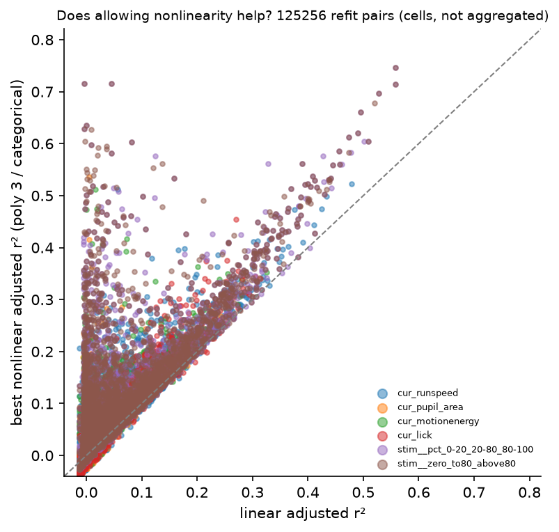
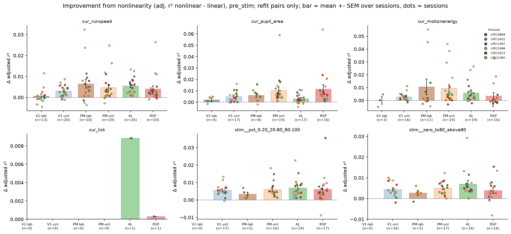
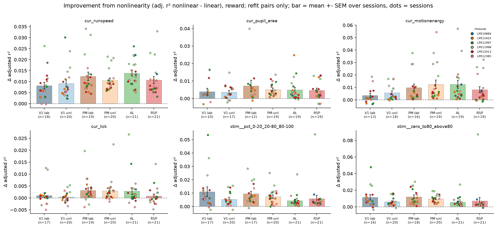
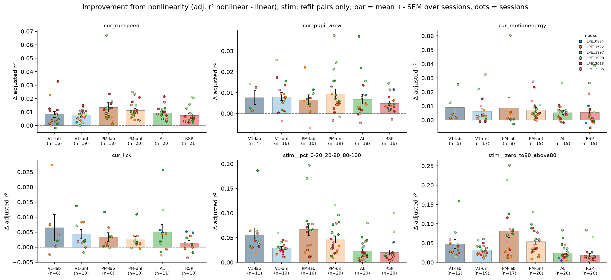
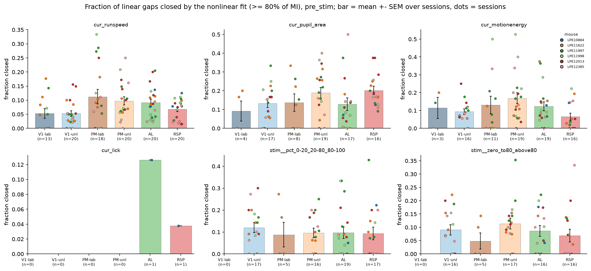
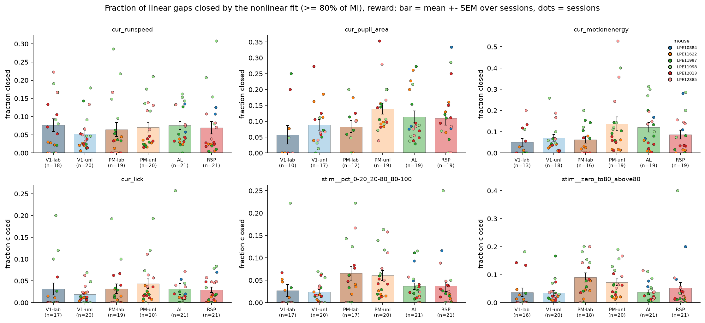
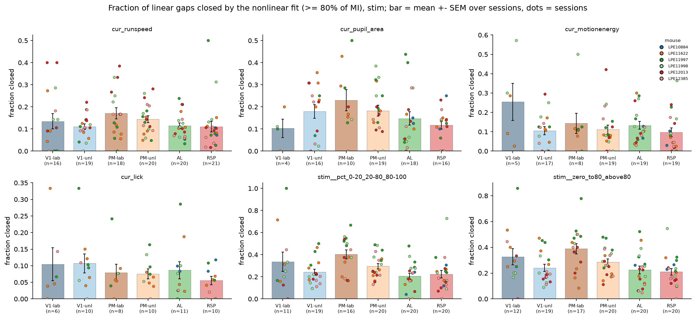

# 2e_nonlinear_encod

*Auto-generated from `2_pipeline/2e_nonlinear_encod/out/` on 2026-10-30 11:38. Re-run `make_progress_md.py` after the script's output changes -- don't hand-edit this file.*

## Tables

### Nonlinear by group  session

| group | unit | animal_id | window | predictor | n_refit | poly_improvement | r2_linear_adj | r2_best_nonlinear_adj | frac_explained_nonlinear | n_gap_closed | frac_gap_closed |
| --- | --- | --- | --- | --- | --- | --- | --- | --- | --- | --- | --- |
| AL_unl | LPE10884_2024_01_17 | LPE10884 | pre_stim | cur_lick | 214 | 0.008845 | 0.01093 | 0.01978 | 0.2842 | 27 | 0.1262 |
| AL_unl | LPE10884_2024_01_12 | LPE10884 | pre_stim | cur_motionenergy | 15 | 0.001901 | 0.001664 | 0.003566 | 0.1419 | 1 | 0.06667 |
| AL_unl | LPE10884_2024_01_17 | LPE10884 | pre_stim | cur_motionenergy | 31 | 0.005628 | 0.005414 | 0.01104 | 0.2481 | 4 | 0.129 |
| AL_unl | LPE11622_2024_02_22 | LPE11622 | pre_stim | cur_motionenergy | 7 | 0.0007516 | 0.002388 | 0.00314 | 0.2262 | 1 | 0.1429 |
| AL_unl | LPE11622_2024_02_23 | LPE11622 | pre_stim | cur_motionenergy | 13 | 0.002867 | -0.0003362 | 0.002531 | 0.2384 | 2 | 0.1538 |
| AL_unl | LPE11622_2024_02_26 | LPE11622 | pre_stim | cur_motionenergy | 8 | 0.01608 | 0.001207 | 0.01729 | 0.4051 | 3 | 0.375 |
| AL_unl | LPE11997_2024_04_10 | LPE11997 | pre_stim | cur_motionenergy | 19 | 0.0002726 | 0.0002835 | 0.0005561 | 0.1009 | 0 | 0 |
| AL_unl | LPE11997_2024_04_16 | LPE11997 | pre_stim | cur_motionenergy | 11 | 0.006584 | 0.00829 | 0.01487 | 0.3847 | 4 | 0.3636 |
| AL_unl | LPE11997_2024_04_17 | LPE11997 | pre_stim | cur_motionenergy | 18 | 0.007739 | 0.00201 | 0.009749 | 0.286 | 3 | 0.1667 |
| AL_unl | LPE11998_2024_04_24 | LPE11998 | pre_stim | cur_motionenergy | 11 | 0.02648 | 0.02405 | 0.05053 | 0.3604 | 1 | 0.09091 |
| AL_unl | LPE11998_2024_04_25 | LPE11998 | pre_stim | cur_motionenergy | 20 | 0.0001957 | 0.002388 | 0.002583 | 0.192 | 2 | 0.1 |
| AL_unl | LPE11998_2024_04_29 | LPE11998 | pre_stim | cur_motionenergy | 22 | -0.0005587 | 0.00824 | 0.007682 | 0.179 | 1 | 0.04545 |
| AL_unl | LPE11998_2024_05_01 | LPE11998 | pre_stim | cur_motionenergy | 42 | 0.02374 | 0.01705 | 0.04079 | 0.5058 | 12 | 0.2857 |
| AL_unl | LPE12013_2024_04_25 | LPE12013 | pre_stim | cur_motionenergy | 20 | 0.01117 | 0.003039 | 0.01421 | 0.2722 | 3 | 0.15 |
| AL_unl | LPE12013_2024_04_26 | LPE12013 | pre_stim | cur_motionenergy | 28 | 0.001422 | 0.0019 | 0.003321 | 0.2168 | 2 | 0.07143 |
| AL_unl | LPE12013_2024_04_29 | LPE12013 | pre_stim | cur_motionenergy | 31 | -0.002243 | 0.003037 | 0.0007942 | 0.1669 | 0 | 0 |
| AL_unl | LPE12013_2024_04_30 | LPE12013 | pre_stim | cur_motionenergy | 34 | 0.003467 | 0.0008138 | 0.004281 | 0.1799 | 2 | 0.05882 |
| AL_unl | LPE12385_2024_06_15 | LPE12385 | pre_stim | cur_motionenergy | 110 | 0.005391 | 0.004272 | 0.009663 | 0.2169 | 7 | 0.06364 |
| AL_unl | LPE12385_2024_06_17 | LPE12385 | pre_stim | cur_motionenergy | 12 | -0.000277 | 0.004207 | 0.00393 | 0.1716 | 1 | 0.08333 |
| AL_unl | LPE12385_2024_06_27 | LPE12385 | pre_stim | cur_motionenergy | 25 | 0.0008575 | 0.0002554 | 0.001113 | 0.09835 | 0 | 0 |
| AL_unl | LPE10884_2024_01_12 | LPE10884 | pre_stim | cur_pupil_area | 28 | 0.001496 | 0.009373 | 0.01087 | 0.2841 | 2 | 0.07143 |
| AL_unl | LPE10884_2024_01_17 | LPE10884 | pre_stim | cur_pupil_area | 22 | 0.003934 | 0.001697 | 0.005631 | 0.2386 | 3 | 0.1364 |
| AL_unl | LPE11622_2024_02_22 | LPE11622 | pre_stim | cur_pupil_area | 6 | -0.001208 | 0.0006751 | -0.0005326 | 0.09198 | 0 | 0 |
| AL_unl | LPE11622_2024_02_23 | LPE11622 | pre_stim | cur_pupil_area | 11 | -0.0009855 | 0.001064 | 7.864e-05 | 0.1686 | 2 | 0.1818 |
| AL_unl | LPE11622_2024_02_26 | LPE11622 | pre_stim | cur_pupil_area | 14 | 0.001773 | 0.002361 | 0.004134 | 0.2723 | 2 | 0.1429 |
| AL_unl | LPE11997_2024_04_10 | LPE11997 | pre_stim | cur_pupil_area | 4 | 0.006834 | 0.01027 | 0.01711 | 0.4254 | 1 | 0.25 |
| AL_unl | LPE11997_2024_04_16 | LPE11997 | pre_stim | cur_pupil_area | 3 | -0.003406 | 0.001693 | -0.001713 | 0.04593 | 0 | 0 |
| AL_unl | LPE11997_2024_04_17 | LPE11997 | pre_stim | cur_pupil_area | 8 | 0.005545 | 0.005053 | 0.0106 | 0.4726 | 3 | 0.375 |
| AL_unl | LPE11998_2024_04_24 | LPE11998 | pre_stim | cur_pupil_area | 12 | 0.0108 | 0.007303 | 0.0181 | 0.2289 | 1 | 0.08333 |
| AL_unl | LPE11998_2024_04_25 | LPE11998 | pre_stim | cur_pupil_area | 9 | -0.00425 | 0.0141 | 0.009853 | 0.1733 | 0 | 0 |

*(showing first 30 of 1908 rows -- see the linked CSV for the rest)*

[nonlinear_by_group__session.csv](../2_pipeline/2e_nonlinear_encod/out/nonlinear_by_group__session.csv)

### Nonlinear candidates by group  session

| group | unit | animal_id | window | predictor | n_significant_pairs | n_candidates | frac_candidates |
| --- | --- | --- | --- | --- | --- | --- | --- |
| AL_unl | LPE10884_2024_01_17 | LPE10884 | pre_stim | cur_lick | 259 | 214 | 0.8263 |
| AL_unl | LPE10884_2024_01_12 | LPE10884 | pre_stim | cur_motionenergy | 21 | 15 | 0.7143 |
| AL_unl | LPE10884_2024_01_17 | LPE10884 | pre_stim | cur_motionenergy | 37 | 31 | 0.8378 |
| AL_unl | LPE11622_2024_02_22 | LPE11622 | pre_stim | cur_motionenergy | 10 | 7 | 0.7 |
| AL_unl | LPE11622_2024_02_23 | LPE11622 | pre_stim | cur_motionenergy | 19 | 13 | 0.6842 |
| AL_unl | LPE11622_2024_02_26 | LPE11622 | pre_stim | cur_motionenergy | 12 | 8 | 0.6667 |
| AL_unl | LPE11997_2024_04_10 | LPE11997 | pre_stim | cur_motionenergy | 25 | 19 | 0.76 |
| AL_unl | LPE11997_2024_04_16 | LPE11997 | pre_stim | cur_motionenergy | 23 | 11 | 0.4783 |
| AL_unl | LPE11997_2024_04_17 | LPE11997 | pre_stim | cur_motionenergy | 28 | 18 | 0.6429 |
| AL_unl | LPE11997_2024_04_18 | LPE11997 | pre_stim | cur_motionenergy | 1 | 0 | 0 |
| AL_unl | LPE11998_2024_04_24 | LPE11998 | pre_stim | cur_motionenergy | 13 | 11 | 0.8462 |
| AL_unl | LPE11998_2024_04_25 | LPE11998 | pre_stim | cur_motionenergy | 30 | 20 | 0.6667 |
| AL_unl | LPE11998_2024_04_29 | LPE11998 | pre_stim | cur_motionenergy | 28 | 22 | 0.7857 |
| AL_unl | LPE11998_2024_05_01 | LPE11998 | pre_stim | cur_motionenergy | 46 | 42 | 0.913 |
| AL_unl | LPE12013_2024_04_25 | LPE12013 | pre_stim | cur_motionenergy | 23 | 20 | 0.8696 |
| AL_unl | LPE12013_2024_04_26 | LPE12013 | pre_stim | cur_motionenergy | 37 | 28 | 0.7568 |
| AL_unl | LPE12013_2024_04_29 | LPE12013 | pre_stim | cur_motionenergy | 39 | 31 | 0.7949 |
| AL_unl | LPE12013_2024_04_30 | LPE12013 | pre_stim | cur_motionenergy | 42 | 34 | 0.8095 |
| AL_unl | LPE12385_2024_06_15 | LPE12385 | pre_stim | cur_motionenergy | 123 | 110 | 0.8943 |
| AL_unl | LPE12385_2024_06_17 | LPE12385 | pre_stim | cur_motionenergy | 16 | 12 | 0.75 |
| AL_unl | LPE12385_2024_06_27 | LPE12385 | pre_stim | cur_motionenergy | 27 | 25 | 0.9259 |
| AL_unl | LPE10884_2024_01_12 | LPE10884 | pre_stim | cur_pupil_area | 56 | 28 | 0.5 |
| AL_unl | LPE10884_2024_01_17 | LPE10884 | pre_stim | cur_pupil_area | 25 | 22 | 0.88 |
| AL_unl | LPE11622_2024_02_22 | LPE11622 | pre_stim | cur_pupil_area | 9 | 6 | 0.6667 |
| AL_unl | LPE11622_2024_02_23 | LPE11622 | pre_stim | cur_pupil_area | 14 | 11 | 0.7857 |
| AL_unl | LPE11622_2024_02_26 | LPE11622 | pre_stim | cur_pupil_area | 15 | 14 | 0.9333 |
| AL_unl | LPE11997_2024_04_10 | LPE11997 | pre_stim | cur_pupil_area | 16 | 4 | 0.25 |
| AL_unl | LPE11997_2024_04_16 | LPE11997 | pre_stim | cur_pupil_area | 8 | 3 | 0.375 |
| AL_unl | LPE11997_2024_04_17 | LPE11997 | pre_stim | cur_pupil_area | 22 | 8 | 0.3636 |
| AL_unl | LPE11997_2024_04_18 | LPE11997 | pre_stim | cur_pupil_area | 1 | 0 | 0 |

*(showing first 30 of 1934 rows -- see the linked CSV for the rest)*

[nonlinear_candidates_by_group__session.csv](../2_pipeline/2e_nonlinear_encod/out/nonlinear_candidates_by_group__session.csv)

### Nonlinear refits

| session_id | window | cell_id | predictor | family | n_trials | n_trials_2d | r2_linear | mi_reference_bits | mi_p_value | frac_explained_linearly | r2_linear_adj | r2_poly2 | r2_poly3 | r2_best_nonlinear_adj |
| --- | --- | --- | --- | --- | --- | --- | --- | --- | --- | --- | --- | --- | --- | --- |
| LPE10884_2024_01_12 | pre_stim | LPE10884_2024_01_12_6_0004 | cur_pupil_area | poly | 209 | 209 | 0.1031 | 0.1351 | 0 | 0.5807 | 0.09875 | 0.1345 | 0.1483 | 0.1483 |
| LPE10884_2024_01_12 | pre_stim | LPE10884_2024_01_12_6_0004 | stim__zero_to80_above80 | categorical | 209 | 209 | 0.0001515 | 0.01827 | 0 | 0.005979 | -0.004679 |  |  | 0.01156 |
| LPE10884_2024_01_12 | pre_stim | LPE10884_2024_01_12_6_0006 | cur_runspeed | poly | 209 | 209 | 0.007044 | 0.03299 | 0 | 0.1546 | 0.002247 | 0.002063 | -0.002805 | -0.002805 |
| LPE10884_2024_01_12 | pre_stim | LPE10884_2024_01_12_6_0007 | cur_runspeed | poly | 209 | 209 | 0.003148 | 0.03513 | 0 | 0.06473 | -0.001668 | 0.04626 | 0.04869 | 0.04869 |
| LPE10884_2024_01_12 | pre_stim | LPE10884_2024_01_12_6_0008 | cur_runspeed | poly | 209 | 209 | 0.005614 | 0.02641 | 0 | 0.1538 | 0.0008104 | -0.001452 | -0.0002346 | -0.0002346 |
| LPE10884_2024_01_12 | pre_stim | LPE10884_2024_01_12_6_0014 | cur_runspeed | poly | 209 | 209 | 0.004342 | 0.04911 | 0 | 0.06391 | -0.0004679 | -0.00391 | -0.003948 | -0.003948 |
| LPE10884_2024_01_12 | pre_stim | LPE10884_2024_01_12_6_0017 | stim__zero_to80_above80 | categorical | 209 | 209 | 0.0001808 | 0.01776 | 0 | 0.007346 | -0.004649 |  |  | -0.00748 |
| LPE10884_2024_01_12 | pre_stim | LPE10884_2024_01_12_6_0020 | cur_motionenergy | poly | 209 | 209 | 7.109e-05 | 0.02309 | 0 | 0.002221 | -0.004759 | -0.007056 | -0.01194 | -0.01194 |
| LPE10884_2024_01_12 | pre_stim | LPE10884_2024_01_12_6_0022 | cur_pupil_area | poly | 209 | 209 | 0.001027 | 0.02137 | 0 | 0.03469 | -0.003799 | 0.007319 | 0.003543 | 0.003543 |
| LPE10884_2024_01_12 | pre_stim | LPE10884_2024_01_12_6_0025 | cur_runspeed | poly | 209 | 209 | 0.09976 | 0.09893 | 0 | 0.7663 | 0.09541 | 0.09216 | 0.144 | 0.144 |
| LPE10884_2024_01_12 | pre_stim | LPE10884_2024_01_12_6_0027 | stim__zero_to80_above80 | categorical | 209 | 209 | 0.007151 | 0.02108 | 0 | 0.2455 | 0.002354 |  |  | 0.01852 |
| LPE10884_2024_01_12 | pre_stim | LPE10884_2024_01_12_6_0032 | cur_runspeed | poly | 209 | 209 | 0.01569 | 0.05354 | 0 | 0.213 | 0.01093 | 0.01019 | 0.0132 | 0.0132 |
| LPE10884_2024_01_12 | pre_stim | LPE10884_2024_01_12_6_0033 | cur_motionenergy | poly | 209 | 209 | 0.002043 | 0.02686 | 0 | 0.05492 | -0.002778 | 0.05868 | 0.06067 | 0.06067 |
| LPE10884_2024_01_12 | pre_stim | LPE10884_2024_01_12_6_0034 | cur_runspeed | poly | 209 | 209 | 0.003818 | 0.04788 | 0 | 0.05763 | -0.0009949 | -0.005749 | -0.006186 | -0.006186 |
| LPE10884_2024_01_12 | pre_stim | LPE10884_2024_01_12_6_0038 | cur_runspeed | poly | 209 | 209 | 0.0007657 | 0.01336 | 0 | 0.04135 | -0.004061 | 0.01672 | 0.01194 | 0.01194 |
| LPE10884_2024_01_12 | pre_stim | LPE10884_2024_01_12_6_0042 | cur_runspeed | poly | 209 | 209 | 0.004003 | 0.06494 | 0 | 0.04456 | -0.0008088 | -0.004731 | -0.007637 | -0.007637 |
| LPE10884_2024_01_12 | pre_stim | LPE10884_2024_01_12_6_0044 | cur_runspeed | poly | 209 | 209 | 0.0005313 | 0.02758 | 0 | 0.0139 | -0.004297 | 0.002337 | -0.002332 | -0.002332 |
| LPE10884_2024_01_12 | pre_stim | LPE10884_2024_01_12_6_0050 | cur_runspeed | poly | 209 | 209 | 0.03034 | 0.03885 | 0 | 0.5719 | 0.02565 | 0.02129 | 0.01664 | 0.01664 |
| LPE10884_2024_01_12 | pre_stim | LPE10884_2024_01_12_6_0053 | cur_runspeed | poly | 209 | 209 | 0.0001314 | 0.05569 | 0 | 0.001701 | -0.004699 | -0.009562 | -0.01447 | -0.01447 |
| LPE10884_2024_01_12 | pre_stim | LPE10884_2024_01_12_6_0056 | cur_runspeed | poly | 209 | 209 | 0.004582 | 0.07678 | 0 | 0.04315 | -0.0002269 | -0.0001333 | 0.02702 | 0.02702 |
| LPE10884_2024_01_12 | pre_stim | LPE10884_2024_01_12_6_0058 | cur_runspeed | poly | 209 | 209 | 0.001935 | 0.03403 | 0 | 0.04105 | -0.002887 | -0.006334 | -0.0107 | -0.0107 |
| LPE10884_2024_01_12 | pre_stim | LPE10884_2024_01_12_6_0059 | cur_pupil_area | poly | 209 | 209 | 0.01661 | 0.0217 | 0 | 0.5567 | 0.01186 | 0.01671 | 0.01518 | 0.01518 |
| LPE10884_2024_01_12 | pre_stim | LPE10884_2024_01_12_6_0060 | cur_runspeed | poly | 209 | 209 | 0.003288 | 0.03456 | 0 | 0.06874 | -0.001527 | -0.006327 | -0.009551 | -0.009551 |
| LPE10884_2024_01_12 | pre_stim | LPE10884_2024_01_12_6_0062 | cur_pupil_area | poly | 209 | 209 | 0.003061 | 0.03181 | 0 | 0.06952 | -0.001755 | 0.0007815 | -0.002065 | -0.002065 |
| LPE10884_2024_01_12 | pre_stim | LPE10884_2024_01_12_6_0064 | cur_runspeed | poly | 209 | 209 | 0.004021 | 0.05584 | 0 | 0.05204 | -0.0007909 | -0.004041 | -0.00857 | -0.00857 |
| LPE10884_2024_01_12 | pre_stim | LPE10884_2024_01_12_7_0001 | cur_runspeed | poly | 209 | 209 | 0.01203 | 0.02806 | 0 | 0.3112 | 0.007259 | 0.002535 | 0.03852 | 0.03852 |
| LPE10884_2024_01_12 | pre_stim | LPE10884_2024_01_12_7_0004 | cur_runspeed | poly | 209 | 209 | 0.04931 | 0.05189 | 0 | 0.7029 | 0.04471 | 0.04223 | 0.04158 | 0.04158 |
| LPE10884_2024_01_12 | pre_stim | LPE10884_2024_01_12_7_0005 | stim__zero_to80_above80 | categorical | 209 | 209 | 0.00146 | 0.03912 | 0 | 0.02695 | -0.003364 |  |  | 0.03003 |
| LPE10884_2024_01_12 | pre_stim | LPE10884_2024_01_12_7_0011 | cur_runspeed | poly | 209 | 209 | 0.006716 | 0.04252 | 0 | 0.1143 | 0.001918 | -0.0008758 | -0.001646 | -0.001646 |
| LPE10884_2024_01_12 | pre_stim | LPE10884_2024_01_12_7_0013 | cur_pupil_area | poly | 209 | 209 | 0.001497 | 0.02347 | 0 | 0.04607 | -0.003326 | -0.008091 | -0.0127 | -0.0127 |

*(showing first 15 of 28 columns; showing first 30 of 125256 rows -- see the linked CSV for the rest)*

[nonlinear_refits.csv](../2_pipeline/2e_nonlinear_encod/out/nonlinear_refits.csv)

## Figures

### Linear vs nonlinear r2

### Improvement by group pre stim

### Improvement by group reward

### Improvement by group stim

### Gap closed by group pre stim

### Gap closed by group reward

### Gap closed by group stim

