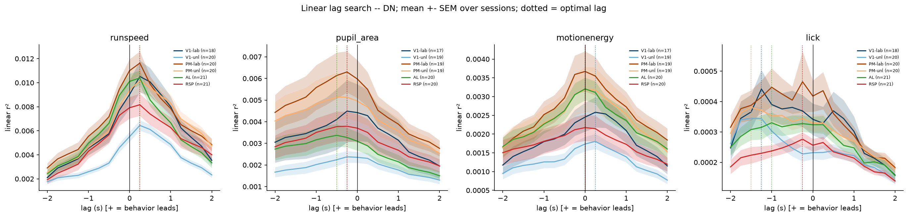

# 2f_lag_information

*Auto-generated from `2_pipeline/2f_lag_information/out/` on 2026-10-16 17:39. Re-run `make_progress_md.py` after the script's output changes -- don't hand-edit this file.*

## Tables

### Granger causality

| session_id | cell_id | roi_name | predictor | lag_s | r2_restricted | r2_unrestricted | p_value |
| --- | --- | --- | --- | --- | --- | --- | --- |
| LPE10884_2024_01_12 | LPE10884_2024_01_12_6_0000 | RSP | runspeed | 0.25 | 0.3225 | 0.323 | 0.0005019 |
| LPE10884_2024_01_12 | LPE10884_2024_01_12_6_0001 | RSP | runspeed | 0.25 | 0.189 | 0.1934 | 0 |
| LPE10884_2024_01_12 | LPE10884_2024_01_12_6_0002 | RSP | runspeed | 0.25 | 0.2968 | 0.2968 | 0.6007 |
| LPE10884_2024_01_12 | LPE10884_2024_01_12_6_0003 | RSP | runspeed | 0.25 | 0.4223 | 0.4251 | 0 |
| LPE10884_2024_01_12 | LPE10884_2024_01_12_6_0004 | RSP | runspeed | 0.25 | 0.2434 | 0.2569 | 0 |
| LPE10884_2024_01_12 | LPE10884_2024_01_12_6_0005 | RSP | runspeed | 0.25 | 0.1225 | 0.127 | 0 |
| LPE10884_2024_01_12 | LPE10884_2024_01_12_6_0006 | RSP | runspeed | 0.25 | 0.2898 | 0.2905 | 6.151e-05 |
| LPE10884_2024_01_12 | LPE10884_2024_01_12_6_0007 | RSP | runspeed | 0.25 | 0.2502 | 0.251 | 1.331e-05 |
| LPE10884_2024_01_12 | LPE10884_2024_01_12_6_0008 | RSP | runspeed | 0.25 | 0.2024 | 0.2034 | 7.094e-06 |
| LPE10884_2024_01_12 | LPE10884_2024_01_12_6_0009 | RSP | runspeed | 0.25 | 0.1389 | 0.1405 | 1.319e-08 |
| LPE10884_2024_01_12 | LPE10884_2024_01_12_6_0010 | RSP | runspeed | 0.25 | 0.2802 | 0.285 | 0 |
| LPE10884_2024_01_12 | LPE10884_2024_01_12_6_0011 | RSP | runspeed | 0.25 | 0.1371 | 0.143 | 0 |
| LPE10884_2024_01_12 | LPE10884_2024_01_12_6_0012 | RSP | runspeed | 0.25 | 0.2689 | 0.2837 | 0 |
| LPE10884_2024_01_12 | LPE10884_2024_01_12_6_0013 | RSP | runspeed | 0.25 | 0.09956 | 0.09968 | 0.1259 |
| LPE10884_2024_01_12 | LPE10884_2024_01_12_6_0014 | RSP | runspeed | 0.25 | 0.1918 | 0.194 | 2.731e-11 |
| LPE10884_2024_01_12 | LPE10884_2024_01_12_6_0015 | RSP | runspeed | 0.25 | 0.1713 | 0.1718 | 0.001557 |
| LPE10884_2024_01_12 | LPE10884_2024_01_12_6_0016 | RSP | runspeed | 0.25 | 0.1009 | 0.1014 | 0.001631 |
| LPE10884_2024_01_12 | LPE10884_2024_01_12_6_0017 | RSP | runspeed | 0.25 | 0.1179 | 0.1185 | 0.0005971 |
| LPE10884_2024_01_12 | LPE10884_2024_01_12_6_0018 | RSP | runspeed | 0.25 | 0.1148 | 0.1148 | 0.8133 |
| LPE10884_2024_01_12 | LPE10884_2024_01_12_6_0019 | RSP | runspeed | 0.25 | 0.2317 | 0.2331 | 4.797e-08 |
| LPE10884_2024_01_12 | LPE10884_2024_01_12_6_0020 | RSP | runspeed | 0.25 | 0.06566 | 0.06566 | 0.9883 |
| LPE10884_2024_01_12 | LPE10884_2024_01_12_6_0021 | RSP | runspeed | 0.25 | 0.1689 | 0.1691 | 0.02757 |
| LPE10884_2024_01_12 | LPE10884_2024_01_12_6_0022 | RSP | runspeed | 0.25 | 0.08905 | 0.1438 | 0 |
| LPE10884_2024_01_12 | LPE10884_2024_01_12_6_0023 | RSP | runspeed | 0.25 | 0.1897 | 0.1899 | 0.1017 |
| LPE10884_2024_01_12 | LPE10884_2024_01_12_6_0024 | RSP | runspeed | 0.25 | 0.1491 | 0.1536 | 0 |
| LPE10884_2024_01_12 | LPE10884_2024_01_12_6_0025 | RSP | runspeed | 0.25 | 0.05049 | 0.05073 | 0.04046 |
| LPE10884_2024_01_12 | LPE10884_2024_01_12_6_0026 | RSP | runspeed | 0.25 | 0.05751 | 0.06476 | 0 |
| LPE10884_2024_01_12 | LPE10884_2024_01_12_6_0027 | RSP | runspeed | 0.25 | 0.1363 | 0.1527 | 0 |
| LPE10884_2024_01_12 | LPE10884_2024_01_12_6_0028 | RSP | runspeed | 0.25 | 0.09227 | 0.09239 | 0.1407 |
| LPE10884_2024_01_12 | LPE10884_2024_01_12_6_0029 | RSP | runspeed | 0.25 | 0.1137 | 0.1137 | 0.4181 |

*(showing first 30 of 85286 rows -- see the linked CSV for the rest)*

[granger_causality.csv](../2_pipeline/2f_lag_information/out/granger_causality.csv)

### Granger causality summary

| predictor | roi_name | frac_significant | median_r2_improvement | n_cells |
| --- | --- | --- | --- | --- |
| lick | AL | 0.1758 | 6.698e-05 | 4420 |
| lick | PM | 0.1707 | 6.255e-05 | 7225 |
| lick | RSP | 0.1741 | 7.761e-05 | 4588 |
| lick | V1 | 0.1471 | 5.355e-05 | 5547 |
| motionenergy | AL | 0.6085 | 0.0004822 | 4309 |
| motionenergy | PM | 0.5395 | 0.0003613 | 7021 |
| motionenergy | RSP | 0.5017 | 0.0003025 | 4343 |
| motionenergy | V1 | 0.4911 | 0.000281 | 5190 |
| pupil_area | AL | 0.5493 | 0.0003643 | 4309 |
| pupil_area | PM | 0.558 | 0.0004006 | 7021 |
| pupil_area | RSP | 0.5261 | 0.0003513 | 4343 |
| pupil_area | V1 | 0.4599 | 0.0002493 | 5190 |
| runspeed | AL | 0.7495 | 0.001273 | 4420 |
| runspeed | PM | 0.7448 | 0.001321 | 7225 |
| runspeed | RSP | 0.7201 | 0.001058 | 4588 |
| runspeed | V1 | 0.7162 | 0.0009467 | 5547 |

[granger_causality_summary.csv](../2_pipeline/2f_lag_information/out/granger_causality_summary.csv)

### Lag curve by area

| predictor | roi_name | lag_s | r2 |
| --- | --- | --- | --- |
| lick | AL | -2 | 0.0002392 |
| lick | AL | -1.75 | 0.0002723 |
| lick | AL | -1.5 | 0.0002924 |
| lick | AL | -1.25 | 0.0003046 |
| lick | AL | -1 | 0.0003128 |
| lick | AL | -0.75 | 0.0003153 |
| lick | AL | -0.5 | 0.0003221 |
| lick | AL | -0.25 | 0.0003422 |
| lick | AL | 0 | 0.0003376 |
| lick | AL | 0.25 | 0.0003396 |
| lick | AL | 0.5 | 0.0002867 |
| lick | AL | 0.75 | 0.0002579 |
| lick | AL | 1 | 0.0002438 |
| lick | AL | 1.25 | 0.0001982 |
| lick | AL | 1.5 | 0.0001965 |
| lick | AL | 1.75 | 0.0001842 |
| lick | AL | 2 | 0.0001498 |
| lick | PM | -2 | 0.0002413 |
| lick | PM | -1.75 | 0.0003102 |
| lick | PM | -1.5 | 0.0003289 |
| lick | PM | -1.25 | 0.0003385 |
| lick | PM | -1 | 0.0003358 |
| lick | PM | -0.75 | 0.0003327 |
| lick | PM | -0.5 | 0.0003293 |
| lick | PM | -0.25 | 0.0003239 |
| lick | PM | 0 | 0.0003251 |
| lick | PM | 0.25 | 0.0003249 |
| lick | PM | 0.5 | 0.0003002 |
| lick | PM | 0.75 | 0.0002774 |
| lick | PM | 1 | 0.0002625 |

*(showing first 30 of 272 rows -- see the linked CSV for the rest)*

[lag_curve_by_area.csv](../2_pipeline/2f_lag_information/out/lag_curve_by_area.csv)

### Lag curve by group  session

| predictor | group | lag_s | mean | sem | n_units |
| --- | --- | --- | --- | --- | --- |
| lick | AL_unl | -2 | 0.0002496 | 2.659e-05 | 21 |
| lick | AL_unl | -1.75 | 0.0002853 | 3.047e-05 | 21 |
| lick | AL_unl | -1.5 | 0.0003078 | 3.458e-05 | 21 |
| lick | AL_unl | -1.25 | 0.0003149 | 3.985e-05 | 21 |
| lick | AL_unl | -1 | 0.00033 | 3.495e-05 | 21 |
| lick | AL_unl | -0.75 | 0.0003168 | 2.996e-05 | 21 |
| lick | AL_unl | -0.5 | 0.0003235 | 3.104e-05 | 21 |
| lick | AL_unl | -0.25 | 0.0003273 | 2.709e-05 | 21 |
| lick | AL_unl | 0 | 0.0003237 | 2.666e-05 | 21 |
| lick | AL_unl | 0.25 | 0.0003239 | 2.955e-05 | 21 |
| lick | AL_unl | 0.5 | 0.0002883 | 2.394e-05 | 21 |
| lick | AL_unl | 0.75 | 0.0002556 | 2.012e-05 | 21 |
| lick | AL_unl | 1 | 0.0002474 | 1.989e-05 | 21 |
| lick | AL_unl | 1.25 | 0.0001978 | 1.566e-05 | 21 |
| lick | AL_unl | 1.5 | 0.0002016 | 1.584e-05 | 21 |
| lick | AL_unl | 1.75 | 0.0001909 | 1.592e-05 | 21 |
| lick | AL_unl | 2 | 0.0001563 | 1.186e-05 | 21 |
| lick | PM_lab | -2 | 0.0003152 | 3.905e-05 | 20 |
| lick | PM_lab | -1.75 | 0.0003765 | 4.404e-05 | 20 |
| lick | PM_lab | -1.5 | 0.0003876 | 4.937e-05 | 20 |
| lick | PM_lab | -1.25 | 0.0004147 | 5.441e-05 | 20 |
| lick | PM_lab | -1 | 0.0004469 | 6.229e-05 | 20 |
| lick | PM_lab | -0.75 | 0.000425 | 5.167e-05 | 20 |
| lick | PM_lab | -0.5 | 0.0004046 | 4.496e-05 | 20 |
| lick | PM_lab | -0.25 | 0.0004653 | 0.0001 | 20 |
| lick | PM_lab | 0 | 0.000418 | 5.159e-05 | 20 |
| lick | PM_lab | 0.25 | 0.0004357 | 6.139e-05 | 20 |
| lick | PM_lab | 0.5 | 0.0003606 | 4.055e-05 | 20 |
| lick | PM_lab | 0.75 | 0.0003228 | 3.91e-05 | 20 |
| lick | PM_lab | 1 | 0.0002885 | 2.889e-05 | 20 |

*(showing first 30 of 408 rows -- see the linked CSV for the rest)*

[lag_curve_by_group__session.csv](../2_pipeline/2f_lag_information/out/lag_curve_by_group__session.csv)

### Lag search per cell

| session_id | animal_id | cell_id | group | predictor | lag_s | r2 |
| --- | --- | --- | --- | --- | --- | --- |
| LPE10884_2024_01_12 | LPE10884 | LPE10884_2024_01_12_6_0000 | RSP_unl | runspeed | -2 | 0.002932 |
| LPE10884_2024_01_12 | LPE10884 | LPE10884_2024_01_12_6_0001 | RSP_unl | runspeed | -2 | 0.01378 |
| LPE10884_2024_01_12 | LPE10884 | LPE10884_2024_01_12_6_0002 | RSP_unl | runspeed | -2 | 0.001466 |
| LPE10884_2024_01_12 | LPE10884 | LPE10884_2024_01_12_6_0003 | RSP_unl | runspeed | -2 | 0.05768 |
| LPE10884_2024_01_12 | LPE10884 | LPE10884_2024_01_12_6_0004 | RSP_unl | runspeed | -2 | 0.002955 |
| LPE10884_2024_01_12 | LPE10884 | LPE10884_2024_01_12_6_0005 | RSP_unl | runspeed | -2 | 0.002282 |
| LPE10884_2024_01_12 | LPE10884 | LPE10884_2024_01_12_6_0006 | RSP_unl | runspeed | -2 | 0.005743 |
| LPE10884_2024_01_12 | LPE10884 | LPE10884_2024_01_12_6_0007 | RSP_unl | runspeed | -2 | 0.002175 |
| LPE10884_2024_01_12 | LPE10884 | LPE10884_2024_01_12_6_0008 | RSP_unl | runspeed | -2 | 0.0001301 |
| LPE10884_2024_01_12 | LPE10884 | LPE10884_2024_01_12_6_0009 | RSP_unl | runspeed | -2 | 0.005471 |
| LPE10884_2024_01_12 | LPE10884 | LPE10884_2024_01_12_6_0010 | RSP_unl | runspeed | -2 | 0.0133 |
| LPE10884_2024_01_12 | LPE10884 | LPE10884_2024_01_12_6_0011 | RSP_unl | runspeed | -2 | 0.0008739 |
| LPE10884_2024_01_12 | LPE10884 | LPE10884_2024_01_12_6_0012 | RSP_unl | runspeed | -2 | 0.01785 |
| LPE10884_2024_01_12 | LPE10884 | LPE10884_2024_01_12_6_0013 | RSP_unl | runspeed | -2 | 0.001454 |
| LPE10884_2024_01_12 | LPE10884 | LPE10884_2024_01_12_6_0014 | RSP_unl | runspeed | -2 | 0.005989 |
| LPE10884_2024_01_12 | LPE10884 | LPE10884_2024_01_12_6_0015 | RSP_unl | runspeed | -2 | 0.004535 |
| LPE10884_2024_01_12 | LPE10884 | LPE10884_2024_01_12_6_0016 | RSP_unl | runspeed | -2 | 0.001299 |
| LPE10884_2024_01_12 | LPE10884 | LPE10884_2024_01_12_6_0017 | RSP_unl | runspeed | -2 | 0.0003689 |
| LPE10884_2024_01_12 | LPE10884 | LPE10884_2024_01_12_6_0018 | RSP_unl | runspeed | -2 | 7.102e-06 |
| LPE10884_2024_01_12 | LPE10884 | LPE10884_2024_01_12_6_0019 | RSP_unl | runspeed | -2 | 0.0002129 |
| LPE10884_2024_01_12 | LPE10884 | LPE10884_2024_01_12_6_0020 | RSP_unl | runspeed | -2 | 0.0004581 |
| LPE10884_2024_01_12 | LPE10884 | LPE10884_2024_01_12_6_0021 | RSP_unl | runspeed | -2 | 0.002967 |
| LPE10884_2024_01_12 | LPE10884 | LPE10884_2024_01_12_6_0022 | RSP_unl | runspeed | -2 | 0.03395 |
| LPE10884_2024_01_12 | LPE10884 | LPE10884_2024_01_12_6_0023 | RSP_unl | runspeed | -2 | 0.001927 |
| LPE10884_2024_01_12 | LPE10884 | LPE10884_2024_01_12_6_0024 | RSP_unl | runspeed | -2 | 0.005458 |
| LPE10884_2024_01_12 | LPE10884 | LPE10884_2024_01_12_6_0025 | RSP_unl | runspeed | -2 | 0.008217 |
| LPE10884_2024_01_12 | LPE10884 | LPE10884_2024_01_12_6_0026 | RSP_unl | runspeed | -2 | 0.0002184 |
| LPE10884_2024_01_12 | LPE10884 | LPE10884_2024_01_12_6_0027 | RSP_unl | runspeed | -2 | 0.01587 |
| LPE10884_2024_01_12 | LPE10884 | LPE10884_2024_01_12_6_0028 | RSP_unl | runspeed | -2 | 0.001151 |
| LPE10884_2024_01_12 | LPE10884 | LPE10884_2024_01_12_6_0029 | RSP_unl | runspeed | -2 | 0.001604 |

*(showing first 30 of 1493518 rows -- see the linked CSV for the rest)*

[lag_search_per_cell.csv](../2_pipeline/2f_lag_information/out/lag_search_per_cell.csv)

### Optimal lags

| predictor | roi_name | optimal_lag_s | r2_at_optimum |
| --- | --- | --- | --- |
| lick | AL | -0.25 | 0.0003422 |
| lick | PM | -1.25 | 0.0003385 |
| lick | RSP | -0.25 | 0.0002766 |
| lick | V1 | -1.25 | 0.0003326 |
| motionenergy | AL | 0 | 0.003326 |
| motionenergy | PM | 0.25 | 0.002867 |
| motionenergy | RSP | 0.25 | 0.001737 |
| motionenergy | V1 | 0.25 | 0.001892 |
| pupil_area | AL | -0.25 | 0.003408 |
| pupil_area | PM | -0.25 | 0.004104 |
| pupil_area | RSP | -0.25 | 0.002742 |
| pupil_area | V1 | -0.25 | 0.002275 |
| runspeed | AL | 0.25 | 0.01035 |
| runspeed | PM | 0.25 | 0.009285 |
| runspeed | RSP | 0.25 | 0.006379 |
| runspeed | V1 | 0.25 | 0.006311 |

[optimal_lags.csv](../2_pipeline/2f_lag_information/out/optimal_lags.csv)

### Optimal lags  session

| predictor | group | optimal_lag_s | r2_at_optimum | n_units |
| --- | --- | --- | --- | --- |
| lick | AL_unl | -1 | 0.00033 | 21 |
| lick | PM_lab | -0.25 | 0.0004653 | 20 |
| lick | PM_unl | -1.5 | 0.0003804 | 20 |
| lick | RSP_unl | -0.25 | 0.0002762 | 21 |
| lick | V1_lab | -1.25 | 0.0004411 | 18 |
| lick | V1_unl | -1.5 | 0.0003445 | 20 |
| motionenergy | AL_unl | 0 | 0.003206 | 20 |
| motionenergy | PM_lab | 0 | 0.003671 | 19 |
| motionenergy | PM_unl | 0 | 0.003188 | 19 |
| motionenergy | RSP_unl | 0 | 0.002173 | 20 |
| motionenergy | V1_lab | 0.25 | 0.002581 | 17 |
| motionenergy | V1_unl | 0.25 | 0.001805 | 19 |
| pupil_area | AL_unl | -0.5 | 0.003372 | 20 |
| pupil_area | PM_lab | -0.25 | 0.006301 | 19 |
| pupil_area | PM_unl | -0.5 | 0.005142 | 19 |
| pupil_area | RSP_unl | -0.25 | 0.00379 | 20 |
| pupil_area | V1_lab | -0.25 | 0.004491 | 17 |
| pupil_area | V1_unl | -0.25 | 0.002378 | 19 |
| runspeed | AL_unl | 0.25 | 0.0104 | 21 |
| runspeed | PM_lab | 0.25 | 0.01163 | 20 |
| runspeed | PM_unl | 0.25 | 0.01019 | 20 |
| runspeed | RSP_unl | 0.25 | 0.008167 | 21 |
| runspeed | V1_lab | 0.25 | 0.01052 | 18 |
| runspeed | V1_unl | 0.25 | 0.006448 | 20 |

[optimal_lags__session.csv](../2_pipeline/2f_lag_information/out/optimal_lags__session.csv)

### Position information

| predictor | roi_name | s_rel | mi_bits | n_cells |
| --- | --- | --- | --- | --- |
| lick | AL | -76 | 0 | 4272 |
| lick | AL | -68 | 0.0003359 | 4272 |
| lick | AL | -60 | 0.0005242 | 3978 |
| lick | AL | -52 | 0.0007 | 3820 |
| lick | AL | -44 | 0.001228 | 3704 |
| lick | AL | -36 | 0.001018 | 3253 |
| lick | AL | -28 | 0.001163 | 3245 |
| lick | AL | -20 | 0.001286 | 3547 |
| lick | AL | -12 | 0.001154 | 3565 |
| lick | AL | -4 | 0.0004843 | 3417 |
| lick | AL | 4 | 0.0006959 | 3244 |
| lick | AL | 12 | 8.748e-05 | 3556 |
| lick | AL | 20 | 0.0003933 | 4272 |
| lick | AL | 28 | 0 | 4272 |
| lick | AL | 36 | 0.0002216 | 4420 |
| lick | AL | 44 | 0.0002631 | 4017 |
| lick | AL | 52 | 0.001219 | 4007 |
| lick | AL | 60 | 0.002206 | 834 |
| lick | PM | -76 | 0.0002717 | 7029 |
| lick | PM | -68 | 0.0002679 | 7029 |
| lick | PM | -60 | 0.0002539 | 7109 |
| lick | PM | -52 | 0.0002131 | 6758 |
| lick | PM | -44 | 0.0008017 | 6422 |
| lick | PM | -36 | 0.0004914 | 5251 |
| lick | PM | -28 | 0.0004766 | 5558 |
| lick | PM | -20 | 0.0003399 | 5171 |
| lick | PM | -12 | 0.0005458 | 5558 |
| lick | PM | -4 | 8.637e-05 | 5362 |
| lick | PM | 4 | 0 | 5919 |
| lick | PM | 12 | 0.0003293 | 6226 |

*(showing first 30 of 288 rows -- see the linked CSV for the rest)*

[position_information.csv](../2_pipeline/2f_lag_information/out/position_information.csv)

### Position information per cell

| session_id | cell_id | roi_name | predictor | s_rel | n_samples | mi_bits |
| --- | --- | --- | --- | --- | --- | --- |
| LPE10884_2024_01_12 | LPE10884_2024_01_12_6_0000 | RSP | runspeed | -76 | 1739 | 0.01209 |
| LPE10884_2024_01_12 | LPE10884_2024_01_12_6_0000 | RSP | runspeed | -68 | 593 | 0.008516 |
| LPE10884_2024_01_12 | LPE10884_2024_01_12_6_0000 | RSP | runspeed | -60 | 593 | 0.01877 |
| LPE10884_2024_01_12 | LPE10884_2024_01_12_6_0000 | RSP | runspeed | -52 | 958 | 0.02833 |
| LPE10884_2024_01_12 | LPE10884_2024_01_12_6_0000 | RSP | runspeed | -44 | 447 | 0.0488 |
| LPE10884_2024_01_12 | LPE10884_2024_01_12_6_0000 | RSP | runspeed | -36 | 478 | 0.0336 |
| LPE10884_2024_01_12 | LPE10884_2024_01_12_6_0000 | RSP | runspeed | -20 | 557 | 0.01366 |
| LPE10884_2024_01_12 | LPE10884_2024_01_12_6_0000 | RSP | runspeed | -12 | 824 | 0.009646 |
| LPE10884_2024_01_12 | LPE10884_2024_01_12_6_0000 | RSP | runspeed | -4 | 667 | 0.02787 |
| LPE10884_2024_01_12 | LPE10884_2024_01_12_6_0000 | RSP | runspeed | 4 | 515 | 0.02541 |
| LPE10884_2024_01_12 | LPE10884_2024_01_12_6_0000 | RSP | runspeed | 12 | 773 | 0.05346 |
| LPE10884_2024_01_12 | LPE10884_2024_01_12_6_0000 | RSP | runspeed | 20 | 2421 | 0.007246 |
| LPE10884_2024_01_12 | LPE10884_2024_01_12_6_0000 | RSP | runspeed | 28 | 1684 | 0.01324 |
| LPE10884_2024_01_12 | LPE10884_2024_01_12_6_0000 | RSP | runspeed | 36 | 500 | 0.01873 |
| LPE10884_2024_01_12 | LPE10884_2024_01_12_6_0000 | RSP | runspeed | 44 | 456 | 0.02042 |
| LPE10884_2024_01_12 | LPE10884_2024_01_12_6_0000 | RSP | runspeed | 52 | 424 | 0.007465 |
| LPE10884_2024_01_12 | LPE10884_2024_01_12_6_0001 | RSP | runspeed | -76 | 1739 | 0.03852 |
| LPE10884_2024_01_12 | LPE10884_2024_01_12_6_0001 | RSP | runspeed | -68 | 593 | 0.01162 |
| LPE10884_2024_01_12 | LPE10884_2024_01_12_6_0001 | RSP | runspeed | -60 | 593 | 0.06261 |
| LPE10884_2024_01_12 | LPE10884_2024_01_12_6_0001 | RSP | runspeed | -52 | 958 | 0.04974 |
| LPE10884_2024_01_12 | LPE10884_2024_01_12_6_0001 | RSP | runspeed | -44 | 447 | 0.02072 |
| LPE10884_2024_01_12 | LPE10884_2024_01_12_6_0001 | RSP | runspeed | -36 | 478 | 0.03325 |
| LPE10884_2024_01_12 | LPE10884_2024_01_12_6_0001 | RSP | runspeed | -20 | 557 | 0.03755 |
| LPE10884_2024_01_12 | LPE10884_2024_01_12_6_0001 | RSP | runspeed | -12 | 824 | 0.05155 |
| LPE10884_2024_01_12 | LPE10884_2024_01_12_6_0001 | RSP | runspeed | -4 | 667 | 0.03833 |
| LPE10884_2024_01_12 | LPE10884_2024_01_12_6_0001 | RSP | runspeed | 4 | 515 | 0.01603 |
| LPE10884_2024_01_12 | LPE10884_2024_01_12_6_0001 | RSP | runspeed | 12 | 773 | 0.02762 |
| LPE10884_2024_01_12 | LPE10884_2024_01_12_6_0001 | RSP | runspeed | 20 | 2421 | 0.01955 |
| LPE10884_2024_01_12 | LPE10884_2024_01_12_6_0001 | RSP | runspeed | 28 | 1684 | 0.05011 |
| LPE10884_2024_01_12 | LPE10884_2024_01_12_6_0001 | RSP | runspeed | 36 | 500 | 0.03924 |

*(showing first 30 of 1263788 rows -- see the linked CSV for the rest)*

[position_information_per_cell.csv](../2_pipeline/2f_lag_information/out/position_information_per_cell.csv)

### Position te per cell

| session_id | cell_id | roi_name | predictor | s_rel | n_samples | te_bits |
| --- | --- | --- | --- | --- | --- | --- |
| LPE10884_2024_01_12 | LPE10884_2024_01_12_6_0039 | RSP | runspeed | -76 | 960 | 0.005142 |
| LPE10884_2024_01_12 | LPE10884_2024_01_12_6_0039 | RSP | runspeed | -20 | 516 | 0.02951 |
| LPE10884_2024_01_12 | LPE10884_2024_01_12_6_0039 | RSP | runspeed | -12 | 821 | 0.02693 |
| LPE10884_2024_01_12 | LPE10884_2024_01_12_6_0039 | RSP | runspeed | -4 | 667 | 0.009237 |
| LPE10884_2024_01_12 | LPE10884_2024_01_12_6_0039 | RSP | runspeed | 4 | 515 | 0 |
| LPE10884_2024_01_12 | LPE10884_2024_01_12_6_0039 | RSP | runspeed | 12 | 773 | 0.02461 |
| LPE10884_2024_01_12 | LPE10884_2024_01_12_6_0039 | RSP | runspeed | 20 | 2421 | 0.009539 |
| LPE10884_2024_01_12 | LPE10884_2024_01_12_6_0039 | RSP | runspeed | 28 | 1683 | 0.01719 |
| LPE10884_2024_01_12 | LPE10884_2024_01_12_6_0039 | RSP | runspeed | 36 | 500 | 0.01513 |
| LPE10884_2024_01_12 | LPE10884_2024_01_12_6_0039 | RSP | runspeed | 44 | 456 | 0.01074 |
| LPE10884_2024_01_12 | LPE10884_2024_01_12_6_0039 | RSP | runspeed | 52 | 424 | 0 |
| LPE10884_2024_01_12 | LPE10884_2024_01_12_6_0061 | RSP | runspeed | -76 | 960 | 0.001108 |
| LPE10884_2024_01_12 | LPE10884_2024_01_12_6_0061 | RSP | runspeed | -20 | 516 | 0 |
| LPE10884_2024_01_12 | LPE10884_2024_01_12_6_0061 | RSP | runspeed | -12 | 821 | 0.0003039 |
| LPE10884_2024_01_12 | LPE10884_2024_01_12_6_0061 | RSP | runspeed | -4 | 667 | 0.01391 |
| LPE10884_2024_01_12 | LPE10884_2024_01_12_6_0061 | RSP | runspeed | 4 | 515 | 0 |
| LPE10884_2024_01_12 | LPE10884_2024_01_12_6_0061 | RSP | runspeed | 12 | 773 | 0 |
| LPE10884_2024_01_12 | LPE10884_2024_01_12_6_0061 | RSP | runspeed | 20 | 2421 | 0 |
| LPE10884_2024_01_12 | LPE10884_2024_01_12_6_0061 | RSP | runspeed | 28 | 1683 | 0 |
| LPE10884_2024_01_12 | LPE10884_2024_01_12_6_0061 | RSP | runspeed | 36 | 500 | 0 |
| LPE10884_2024_01_12 | LPE10884_2024_01_12_6_0061 | RSP | runspeed | 44 | 456 | 0 |
| LPE10884_2024_01_12 | LPE10884_2024_01_12_6_0061 | RSP | runspeed | 52 | 424 | 0 |
| LPE10884_2024_01_12 | LPE10884_2024_01_12_6_0027 | RSP | runspeed | -76 | 960 | 0.04792 |
| LPE10884_2024_01_12 | LPE10884_2024_01_12_6_0027 | RSP | runspeed | -20 | 516 | 0.04638 |
| LPE10884_2024_01_12 | LPE10884_2024_01_12_6_0027 | RSP | runspeed | -12 | 821 | 0.03448 |
| LPE10884_2024_01_12 | LPE10884_2024_01_12_6_0027 | RSP | runspeed | -4 | 667 | 0.06166 |
| LPE10884_2024_01_12 | LPE10884_2024_01_12_6_0027 | RSP | runspeed | 4 | 515 | 0.01917 |
| LPE10884_2024_01_12 | LPE10884_2024_01_12_6_0027 | RSP | runspeed | 12 | 773 | 0.04841 |
| LPE10884_2024_01_12 | LPE10884_2024_01_12_6_0027 | RSP | runspeed | 20 | 2421 | 0.02339 |
| LPE10884_2024_01_12 | LPE10884_2024_01_12_6_0027 | RSP | runspeed | 28 | 1683 | 0.02106 |

*(showing first 30 of 141232 rows -- see the linked CSV for the rest)*

[position_te_per_cell.csv](../2_pipeline/2f_lag_information/out/position_te_per_cell.csv)

### Position transfer entropy

| predictor | roi_name | s_rel | te_bits | n_cells |
| --- | --- | --- | --- | --- |
| lick | AL | -76 | 9.242e-05 | 240 |
| lick | AL | -68 | 0.0004782 | 240 |
| lick | AL | -60 | 0.000593 | 320 |
| lick | AL | -52 | 0.0008962 | 280 |
| lick | AL | -44 | 0.0004912 | 480 |
| lick | AL | -36 | 0.0003903 | 440 |
| lick | AL | -28 | 0.0002388 | 480 |
| lick | AL | -20 | 0.0004733 | 600 |
| lick | AL | -12 | 0.0003122 | 640 |
| lick | AL | -4 | 0.0001872 | 600 |
| lick | AL | 4 | 0.000274 | 600 |
| lick | AL | 12 | 0 | 640 |
| lick | AL | 20 | 0 | 730 |
| lick | AL | 28 | 0 | 730 |
| lick | AL | 36 | 0 | 770 |
| lick | AL | 44 | 8.672e-05 | 690 |
| lick | AL | 52 | 0 | 680 |
| lick | AL | 60 | 0.0006004 | 160 |
| lick | PM | -76 | 0.0002737 | 160 |
| lick | PM | -68 | 0.0004649 | 240 |
| lick | PM | -60 | 0.001268 | 320 |
| lick | PM | -52 | 0.0009112 | 280 |
| lick | PM | -44 | 0.0006642 | 480 |
| lick | PM | -36 | 0.0004911 | 440 |
| lick | PM | -28 | 8.236e-05 | 520 |
| lick | PM | -20 | 0.0002994 | 560 |
| lick | PM | -12 | 0.0001195 | 600 |
| lick | PM | -4 | 0 | 560 |
| lick | PM | 4 | 0 | 560 |
| lick | PM | 12 | 0 | 600 |

*(showing first 30 of 288 rows -- see the linked CSV for the rest)*

[position_transfer_entropy.csv](../2_pipeline/2f_lag_information/out/position_transfer_entropy.csv)

## Figures

### Lag search

