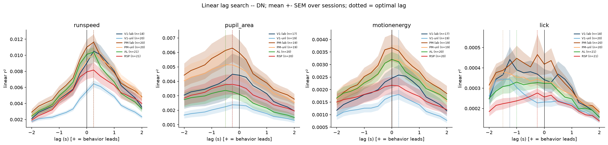
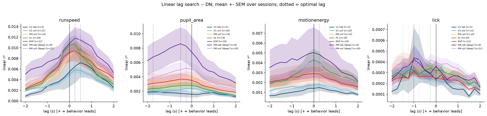
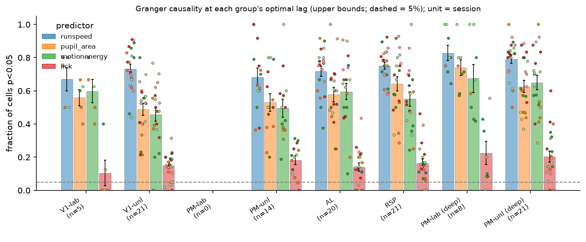
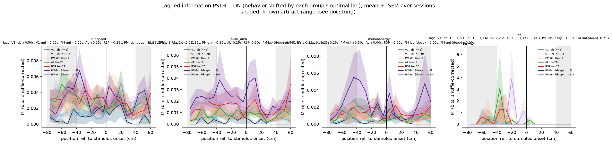
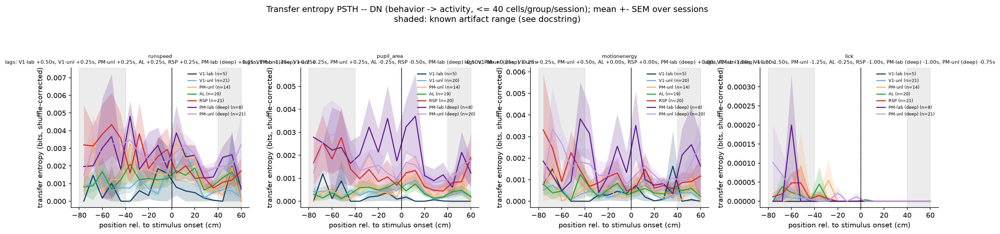

# 2f_lag_information

*Auto-generated from `2_pipeline/2f_lag_information/out/` on 2026-11-10 17:48. Re-run `make_progress_md.py` after the script's output changes -- don't hand-edit this file.*

## Figures

### Lag search

### Lag search

### Granger causality

### Lagged information psth

### Transfer entropy psth

## Tables

### Granger causality

| session_id | cell_id | roi_name | predictor | lag_s | r2_restricted | r2_unrestricted | p_value |
| --- | --- | --- | --- | --- | --- | --- | --- |
| LPE10884_2024_01_12 | LPE10884_2024_01_12_6_0000 | RSP | runspeed | 0.25 | 0.3225 | 0.323 | 0.0005019 |
| LPE10884_2024_01_12 | LPE10884_2024_01_12_6_0001 | RSP | runspeed | 0.25 | 0.189 | 0.1934 | 0 |
| LPE10884_2024_01_12 | LPE10884_2024_01_12_6_0002 | RSP | runspeed | 0.25 | 0.2968 | 0.2968 | 0.6007 |
| LPE10884_2024_01_12 | LPE10884_2024_01_12_6_0003 | RSP | runspeed | 0.25 | 0.4223 | 0.4251 | 0 |
| LPE10884_2024_01_12 | LPE10884_2024_01_12_6_0004 | RSP | runspeed | 0.25 | 0.2434 | 0.2569 | 0 |
| LPE10884_2024_01_12 | LPE10884_2024_01_12_6_0005 | RSP | runspeed | 0.25 | 0.1225 | 0.127 | 0 |
| LPE10884_2024_01_12 | LPE10884_2024_01_12_6_0006 | RSP | runspeed | 0.25 | 0.2898 | 0.2905 | 6.151e-05 |
| LPE10884_2024_01_12 | LPE10884_2024_01_12_6_0007 | RSP | runspeed | 0.25 | 0.2502 | 0.251 | 1.331e-05 |
| LPE10884_2024_01_12 | LPE10884_2024_01_12_6_0008 | RSP | runspeed | 0.25 | 0.2024 | 0.2034 | 7.094e-06 |
| LPE10884_2024_01_12 | LPE10884_2024_01_12_6_0009 | RSP | runspeed | 0.25 | 0.1389 | 0.1405 | 1.319e-08 |
| LPE10884_2024_01_12 | LPE10884_2024_01_12_6_0010 | RSP | runspeed | 0.25 | 0.2802 | 0.285 | 0 |
| LPE10884_2024_01_12 | LPE10884_2024_01_12_6_0011 | RSP | runspeed | 0.25 | 0.1371 | 0.143 | 0 |
| LPE10884_2024_01_12 | LPE10884_2024_01_12_6_0012 | RSP | runspeed | 0.25 | 0.2689 | 0.2837 | 0 |
| LPE10884_2024_01_12 | LPE10884_2024_01_12_6_0013 | RSP | runspeed | 0.25 | 0.09956 | 0.09968 | 0.1259 |
| LPE10884_2024_01_12 | LPE10884_2024_01_12_6_0014 | RSP | runspeed | 0.25 | 0.1918 | 0.194 | 2.731e-11 |
| LPE10884_2024_01_12 | LPE10884_2024_01_12_6_0015 | RSP | runspeed | 0.25 | 0.1713 | 0.1718 | 0.001557 |
| LPE10884_2024_01_12 | LPE10884_2024_01_12_6_0016 | RSP | runspeed | 0.25 | 0.1009 | 0.1014 | 0.001631 |
| LPE10884_2024_01_12 | LPE10884_2024_01_12_6_0017 | RSP | runspeed | 0.25 | 0.1179 | 0.1185 | 0.0005971 |
| LPE10884_2024_01_12 | LPE10884_2024_01_12_6_0018 | RSP | runspeed | 0.25 | 0.1148 | 0.1148 | 0.8133 |
| LPE10884_2024_01_12 | LPE10884_2024_01_12_6_0019 | RSP | runspeed | 0.25 | 0.2317 | 0.2331 | 4.797e-08 |
| LPE10884_2024_01_12 | LPE10884_2024_01_12_6_0020 | RSP | runspeed | 0.25 | 0.06566 | 0.06566 | 0.9883 |
| LPE10884_2024_01_12 | LPE10884_2024_01_12_6_0021 | RSP | runspeed | 0.25 | 0.1689 | 0.1691 | 0.02757 |
| LPE10884_2024_01_12 | LPE10884_2024_01_12_6_0022 | RSP | runspeed | 0.25 | 0.08905 | 0.1438 | 0 |
| LPE10884_2024_01_12 | LPE10884_2024_01_12_6_0023 | RSP | runspeed | 0.25 | 0.1897 | 0.1899 | 0.1017 |
| LPE10884_2024_01_12 | LPE10884_2024_01_12_6_0024 | RSP | runspeed | 0.25 | 0.1491 | 0.1536 | 0 |
| LPE10884_2024_01_12 | LPE10884_2024_01_12_6_0025 | RSP | runspeed | 0.25 | 0.05049 | 0.05073 | 0.04046 |
| LPE10884_2024_01_12 | LPE10884_2024_01_12_6_0026 | RSP | runspeed | 0.25 | 0.05751 | 0.06476 | 0 |
| LPE10884_2024_01_12 | LPE10884_2024_01_12_6_0027 | RSP | runspeed | 0.25 | 0.1363 | 0.1527 | 0 |
| LPE10884_2024_01_12 | LPE10884_2024_01_12_6_0028 | RSP | runspeed | 0.25 | 0.09227 | 0.09239 | 0.1407 |
| LPE10884_2024_01_12 | LPE10884_2024_01_12_6_0029 | RSP | runspeed | 0.25 | 0.1137 | 0.1137 | 0.4181 |

*(showing first 30 of 85286 rows -- see the linked CSV for the rest)*

[granger_causality.csv](../2_pipeline/2f_lag_information/out/granger_causality.csv)

### Granger causality summary

| predictor | roi_name | frac_significant | median_r2_improvement | n_cells |
| --- | --- | --- | --- | --- |
| lick | AL | 0.1758 | 6.698e-05 | 4420 |
| lick | PM | 0.1707 | 6.255e-05 | 7225 |
| lick | RSP | 0.1741 | 7.761e-05 | 4588 |
| lick | V1 | 0.1471 | 5.355e-05 | 5547 |
| motionenergy | AL | 0.6085 | 0.0004822 | 4309 |
| motionenergy | PM | 0.5395 | 0.0003613 | 7021 |
| motionenergy | RSP | 0.5017 | 0.0003025 | 4343 |
| motionenergy | V1 | 0.4911 | 0.000281 | 5190 |
| pupil_area | AL | 0.5493 | 0.0003643 | 4309 |
| pupil_area | PM | 0.558 | 0.0004006 | 7021 |
| pupil_area | RSP | 0.5261 | 0.0003513 | 4343 |
| pupil_area | V1 | 0.4599 | 0.0002493 | 5190 |
| runspeed | AL | 0.7495 | 0.001273 | 4420 |
| runspeed | PM | 0.7448 | 0.001321 | 7225 |
| runspeed | RSP | 0.7201 | 0.001058 | 4588 |
| runspeed | V1 | 0.7162 | 0.0009467 | 5547 |

[granger_causality_summary.csv](../2_pipeline/2f_lag_information/out/granger_causality_summary.csv)

### Lag curve by area

| predictor | roi_name | lag_s | r2 |
| --- | --- | --- | --- |
| lick | AL | -2 | 0.0002392 |
| lick | AL | -1.75 | 0.0002723 |
| lick | AL | -1.5 | 0.0002924 |
| lick | AL | -1.25 | 0.0003046 |
| lick | AL | -1 | 0.0003128 |
| lick | AL | -0.75 | 0.0003153 |
| lick | AL | -0.5 | 0.0003221 |
| lick | AL | -0.25 | 0.0003422 |
| lick | AL | 0 | 0.0003376 |
| lick | AL | 0.25 | 0.0003396 |
| lick | AL | 0.5 | 0.0002867 |
| lick | AL | 0.75 | 0.0002579 |
| lick | AL | 1 | 0.0002438 |
| lick | AL | 1.25 | 0.0001982 |
| lick | AL | 1.5 | 0.0001965 |
| lick | AL | 1.75 | 0.0001842 |
| lick | AL | 2 | 0.0001498 |
| lick | PM | -2 | 0.0002413 |
| lick | PM | -1.75 | 0.0003102 |
| lick | PM | -1.5 | 0.0003289 |
| lick | PM | -1.25 | 0.0003385 |
| lick | PM | -1 | 0.0003358 |
| lick | PM | -0.75 | 0.0003327 |
| lick | PM | -0.5 | 0.0003293 |
| lick | PM | -0.25 | 0.0003239 |
| lick | PM | 0 | 0.0003251 |
| lick | PM | 0.25 | 0.0003249 |
| lick | PM | 0.5 | 0.0003002 |
| lick | PM | 0.75 | 0.0002774 |
| lick | PM | 1 | 0.0002625 |

*(showing first 30 of 272 rows -- see the linked CSV for the rest)*

[lag_curve_by_area.csv](../2_pipeline/2f_lag_information/out/lag_curve_by_area.csv)

### Lag curve by group  session

| predictor | group | lag_s | mean | sem | n_units |
| --- | --- | --- | --- | --- | --- |
| lick | AL_unl | -2 | 0.0002496 | 2.659e-05 | 21 |
| lick | AL_unl | -1.75 | 0.0002853 | 3.047e-05 | 21 |
| lick | AL_unl | -1.5 | 0.0003078 | 3.458e-05 | 21 |
| lick | AL_unl | -1.25 | 0.0003149 | 3.985e-05 | 21 |
| lick | AL_unl | -1 | 0.00033 | 3.495e-05 | 21 |
| lick | AL_unl | -0.75 | 0.0003168 | 2.996e-05 | 21 |
| lick | AL_unl | -0.5 | 0.0003235 | 3.104e-05 | 21 |
| lick | AL_unl | -0.25 | 0.0003273 | 2.709e-05 | 21 |
| lick | AL_unl | 0 | 0.0003237 | 2.666e-05 | 21 |
| lick | AL_unl | 0.25 | 0.0003239 | 2.955e-05 | 21 |
| lick | AL_unl | 0.5 | 0.0002883 | 2.394e-05 | 21 |
| lick | AL_unl | 0.75 | 0.0002556 | 2.012e-05 | 21 |
| lick | AL_unl | 1 | 0.0002474 | 1.989e-05 | 21 |
| lick | AL_unl | 1.25 | 0.0001978 | 1.566e-05 | 21 |
| lick | AL_unl | 1.5 | 0.0002016 | 1.584e-05 | 21 |
| lick | AL_unl | 1.75 | 0.0001909 | 1.592e-05 | 21 |
| lick | AL_unl | 2 | 0.0001563 | 1.186e-05 | 21 |
| lick | PM_lab | -2 | 0.0003152 | 3.905e-05 | 20 |
| lick | PM_lab | -1.75 | 0.0003765 | 4.404e-05 | 20 |
| lick | PM_lab | -1.5 | 0.0003876 | 4.937e-05 | 20 |
| lick | PM_lab | -1.25 | 0.0004147 | 5.441e-05 | 20 |
| lick | PM_lab | -1 | 0.0004469 | 6.229e-05 | 20 |
| lick | PM_lab | -0.75 | 0.000425 | 5.167e-05 | 20 |
| lick | PM_lab | -0.5 | 0.0004046 | 4.496e-05 | 20 |
| lick | PM_lab | -0.25 | 0.0004653 | 0.0001 | 20 |
| lick | PM_lab | 0 | 0.000418 | 5.159e-05 | 20 |
| lick | PM_lab | 0.25 | 0.0004357 | 6.139e-05 | 20 |
| lick | PM_lab | 0.5 | 0.0003606 | 4.055e-05 | 20 |
| lick | PM_lab | 0.75 | 0.0003228 | 3.91e-05 | 20 |
| lick | PM_lab | 1 | 0.0002885 | 2.889e-05 | 20 |

*(showing first 30 of 408 rows -- see the linked CSV for the rest)*

[lag_curve_by_group__session.csv](../2_pipeline/2f_lag_information/out/lag_curve_by_group__session.csv)

### Lag search per cell

| session_id | animal_id | cell_id | group | predictor | lag_s | r2 |
| --- | --- | --- | --- | --- | --- | --- |
| LPE10884_2024_01_12 | LPE10884 | LPE10884_2024_01_12_6_0000 | RSP_unl | runspeed | -2 | 0.002932 |
| LPE10884_2024_01_12 | LPE10884 | LPE10884_2024_01_12_6_0001 | RSP_unl | runspeed | -2 | 0.01378 |
| LPE10884_2024_01_12 | LPE10884 | LPE10884_2024_01_12_6_0002 | RSP_unl | runspeed | -2 | 0.001466 |
| LPE10884_2024_01_12 | LPE10884 | LPE10884_2024_01_12_6_0003 | RSP_unl | runspeed | -2 | 0.05768 |
| LPE10884_2024_01_12 | LPE10884 | LPE10884_2024_01_12_6_0004 | RSP_unl | runspeed | -2 | 0.002955 |
| LPE10884_2024_01_12 | LPE10884 | LPE10884_2024_01_12_6_0005 | RSP_unl | runspeed | -2 | 0.002282 |
| LPE10884_2024_01_12 | LPE10884 | LPE10884_2024_01_12_6_0006 | RSP_unl | runspeed | -2 | 0.005743 |
| LPE10884_2024_01_12 | LPE10884 | LPE10884_2024_01_12_6_0007 | RSP_unl | runspeed | -2 | 0.002175 |
| LPE10884_2024_01_12 | LPE10884 | LPE10884_2024_01_12_6_0008 | RSP_unl | runspeed | -2 | 0.0001301 |
| LPE10884_2024_01_12 | LPE10884 | LPE10884_2024_01_12_6_0009 | RSP_unl | runspeed | -2 | 0.005471 |
| LPE10884_2024_01_12 | LPE10884 | LPE10884_2024_01_12_6_0010 | RSP_unl | runspeed | -2 | 0.0133 |
| LPE10884_2024_01_12 | LPE10884 | LPE10884_2024_01_12_6_0011 | RSP_unl | runspeed | -2 | 0.0008739 |
| LPE10884_2024_01_12 | LPE10884 | LPE10884_2024_01_12_6_0012 | RSP_unl | runspeed | -2 | 0.01785 |
| LPE10884_2024_01_12 | LPE10884 | LPE10884_2024_01_12_6_0013 | RSP_unl | runspeed | -2 | 0.001454 |
| LPE10884_2024_01_12 | LPE10884 | LPE10884_2024_01_12_6_0014 | RSP_unl | runspeed | -2 | 0.005989 |
| LPE10884_2024_01_12 | LPE10884 | LPE10884_2024_01_12_6_0015 | RSP_unl | runspeed | -2 | 0.004535 |
| LPE10884_2024_01_12 | LPE10884 | LPE10884_2024_01_12_6_0016 | RSP_unl | runspeed | -2 | 0.001299 |
| LPE10884_2024_01_12 | LPE10884 | LPE10884_2024_01_12_6_0017 | RSP_unl | runspeed | -2 | 0.0003689 |
| LPE10884_2024_01_12 | LPE10884 | LPE10884_2024_01_12_6_0018 | RSP_unl | runspeed | -2 | 7.102e-06 |
| LPE10884_2024_01_12 | LPE10884 | LPE10884_2024_01_12_6_0019 | RSP_unl | runspeed | -2 | 0.0002129 |
| LPE10884_2024_01_12 | LPE10884 | LPE10884_2024_01_12_6_0020 | RSP_unl | runspeed | -2 | 0.0004581 |
| LPE10884_2024_01_12 | LPE10884 | LPE10884_2024_01_12_6_0021 | RSP_unl | runspeed | -2 | 0.002967 |
| LPE10884_2024_01_12 | LPE10884 | LPE10884_2024_01_12_6_0022 | RSP_unl | runspeed | -2 | 0.03395 |
| LPE10884_2024_01_12 | LPE10884 | LPE10884_2024_01_12_6_0023 | RSP_unl | runspeed | -2 | 0.001927 |
| LPE10884_2024_01_12 | LPE10884 | LPE10884_2024_01_12_6_0024 | RSP_unl | runspeed | -2 | 0.005458 |
| LPE10884_2024_01_12 | LPE10884 | LPE10884_2024_01_12_6_0025 | RSP_unl | runspeed | -2 | 0.008217 |
| LPE10884_2024_01_12 | LPE10884 | LPE10884_2024_01_12_6_0026 | RSP_unl | runspeed | -2 | 0.0002184 |
| LPE10884_2024_01_12 | LPE10884 | LPE10884_2024_01_12_6_0027 | RSP_unl | runspeed | -2 | 0.01587 |
| LPE10884_2024_01_12 | LPE10884 | LPE10884_2024_01_12_6_0028 | RSP_unl | runspeed | -2 | 0.001151 |
| LPE10884_2024_01_12 | LPE10884 | LPE10884_2024_01_12_6_0029 | RSP_unl | runspeed | -2 | 0.001604 |

*(showing first 30 of 1493518 rows -- see the linked CSV for the rest)*

[lag_search_per_cell.csv](../2_pipeline/2f_lag_information/out/lag_search_per_cell.csv)

### Optimal lags

| predictor | roi_name | optimal_lag_s | r2_at_optimum |
| --- | --- | --- | --- |
| lick | AL | -0.25 | 0.0003422 |
| lick | PM | -1.25 | 0.0003385 |
| lick | RSP | -0.25 | 0.0002766 |
| lick | V1 | -1.25 | 0.0003326 |
| motionenergy | AL | 0 | 0.003326 |
| motionenergy | PM | 0.25 | 0.002867 |
| motionenergy | RSP | 0.25 | 0.001737 |
| motionenergy | V1 | 0.25 | 0.001892 |
| pupil_area | AL | -0.25 | 0.003408 |
| pupil_area | PM | -0.25 | 0.004104 |
| pupil_area | RSP | -0.25 | 0.002742 |
| pupil_area | V1 | -0.25 | 0.002275 |
| runspeed | AL | 0.25 | 0.01035 |
| runspeed | PM | 0.25 | 0.009285 |
| runspeed | RSP | 0.25 | 0.006379 |
| runspeed | V1 | 0.25 | 0.006311 |

[optimal_lags.csv](../2_pipeline/2f_lag_information/out/optimal_lags.csv)

### Optimal lags  session

| predictor | group | optimal_lag_s | r2_at_optimum | n_units |
| --- | --- | --- | --- | --- |
| lick | AL_unl | -1 | 0.00033 | 21 |
| lick | PM_lab | -0.25 | 0.0004653 | 20 |
| lick | PM_unl | -1.5 | 0.0003804 | 20 |
| lick | RSP_unl | -0.25 | 0.0002762 | 21 |
| lick | V1_lab | -1.25 | 0.0004411 | 18 |
| lick | V1_unl | -1.5 | 0.0003445 | 20 |
| motionenergy | AL_unl | 0 | 0.003206 | 20 |
| motionenergy | PM_lab | 0 | 0.003671 | 19 |
| motionenergy | PM_unl | 0 | 0.003188 | 19 |
| motionenergy | RSP_unl | 0 | 0.002173 | 20 |
| motionenergy | V1_lab | 0.25 | 0.002581 | 17 |
| motionenergy | V1_unl | 0.25 | 0.001805 | 19 |
| pupil_area | AL_unl | -0.5 | 0.003372 | 20 |
| pupil_area | PM_lab | -0.25 | 0.006301 | 19 |
| pupil_area | PM_unl | -0.5 | 0.005142 | 19 |
| pupil_area | RSP_unl | -0.25 | 0.00379 | 20 |
| pupil_area | V1_lab | -0.25 | 0.004491 | 17 |
| pupil_area | V1_unl | -0.25 | 0.002378 | 19 |
| runspeed | AL_unl | 0.25 | 0.0104 | 21 |
| runspeed | PM_lab | 0.25 | 0.01163 | 20 |
| runspeed | PM_unl | 0.25 | 0.01019 | 20 |
| runspeed | RSP_unl | 0.25 | 0.008167 | 21 |
| runspeed | V1_lab | 0.25 | 0.01052 | 18 |
| runspeed | V1_unl | 0.25 | 0.006448 | 20 |

[optimal_lags__session.csv](../2_pipeline/2f_lag_information/out/optimal_lags__session.csv)

### Position information

| predictor | roi_name | s_rel | mi_bits | n_cells |
| --- | --- | --- | --- | --- |
| lick | AL | -76 | 0 | 4272 |
| lick | AL | -68 | 0.0003359 | 4272 |
| lick | AL | -60 | 0.0005242 | 3978 |
| lick | AL | -52 | 0.0007 | 3820 |
| lick | AL | -44 | 0.001228 | 3704 |
| lick | AL | -36 | 0.001018 | 3253 |
| lick | AL | -28 | 0.001163 | 3245 |
| lick | AL | -20 | 0.001286 | 3547 |
| lick | AL | -12 | 0.001154 | 3565 |
| lick | AL | -4 | 0.0004843 | 3417 |
| lick | AL | 4 | 0.0006959 | 3244 |
| lick | AL | 12 | 8.748e-05 | 3556 |
| lick | AL | 20 | 0.0003933 | 4272 |
| lick | AL | 28 | 0 | 4272 |
| lick | AL | 36 | 0.0002216 | 4420 |
| lick | AL | 44 | 0.0002631 | 4017 |
| lick | AL | 52 | 0.001219 | 4007 |
| lick | AL | 60 | 0.002206 | 834 |
| lick | PM | -76 | 0.0002717 | 7029 |
| lick | PM | -68 | 0.0002679 | 7029 |
| lick | PM | -60 | 0.0002539 | 7109 |
| lick | PM | -52 | 0.0002131 | 6758 |
| lick | PM | -44 | 0.0008017 | 6422 |
| lick | PM | -36 | 0.0004914 | 5251 |
| lick | PM | -28 | 0.0004766 | 5558 |
| lick | PM | -20 | 0.0003399 | 5171 |
| lick | PM | -12 | 0.0005458 | 5558 |
| lick | PM | -4 | 8.637e-05 | 5362 |
| lick | PM | 4 | 0 | 5919 |
| lick | PM | 12 | 0.0003293 | 6226 |

*(showing first 30 of 288 rows -- see the linked CSV for the rest)*

[position_information.csv](../2_pipeline/2f_lag_information/out/position_information.csv)

### Position information per cell

| session_id | cell_id | roi_name | predictor | s_rel | n_samples | mi_bits |
| --- | --- | --- | --- | --- | --- | --- |
| LPE10884_2024_01_12 | LPE10884_2024_01_12_6_0000 | RSP | runspeed | -76 | 1739 | 0.01209 |
| LPE10884_2024_01_12 | LPE10884_2024_01_12_6_0000 | RSP | runspeed | -68 | 593 | 0.008516 |
| LPE10884_2024_01_12 | LPE10884_2024_01_12_6_0000 | RSP | runspeed | -60 | 593 | 0.01877 |
| LPE10884_2024_01_12 | LPE10884_2024_01_12_6_0000 | RSP | runspeed | -52 | 958 | 0.02833 |
| LPE10884_2024_01_12 | LPE10884_2024_01_12_6_0000 | RSP | runspeed | -44 | 447 | 0.0488 |
| LPE10884_2024_01_12 | LPE10884_2024_01_12_6_0000 | RSP | runspeed | -36 | 478 | 0.0336 |
| LPE10884_2024_01_12 | LPE10884_2024_01_12_6_0000 | RSP | runspeed | -20 | 557 | 0.01366 |
| LPE10884_2024_01_12 | LPE10884_2024_01_12_6_0000 | RSP | runspeed | -12 | 824 | 0.009646 |
| LPE10884_2024_01_12 | LPE10884_2024_01_12_6_0000 | RSP | runspeed | -4 | 667 | 0.02787 |
| LPE10884_2024_01_12 | LPE10884_2024_01_12_6_0000 | RSP | runspeed | 4 | 515 | 0.02541 |
| LPE10884_2024_01_12 | LPE10884_2024_01_12_6_0000 | RSP | runspeed | 12 | 773 | 0.05346 |
| LPE10884_2024_01_12 | LPE10884_2024_01_12_6_0000 | RSP | runspeed | 20 | 2421 | 0.007246 |
| LPE10884_2024_01_12 | LPE10884_2024_01_12_6_0000 | RSP | runspeed | 28 | 1684 | 0.01324 |
| LPE10884_2024_01_12 | LPE10884_2024_01_12_6_0000 | RSP | runspeed | 36 | 500 | 0.01873 |
| LPE10884_2024_01_12 | LPE10884_2024_01_12_6_0000 | RSP | runspeed | 44 | 456 | 0.02042 |
| LPE10884_2024_01_12 | LPE10884_2024_01_12_6_0000 | RSP | runspeed | 52 | 424 | 0.007465 |
| LPE10884_2024_01_12 | LPE10884_2024_01_12_6_0001 | RSP | runspeed | -76 | 1739 | 0.03852 |
| LPE10884_2024_01_12 | LPE10884_2024_01_12_6_0001 | RSP | runspeed | -68 | 593 | 0.01162 |
| LPE10884_2024_01_12 | LPE10884_2024_01_12_6_0001 | RSP | runspeed | -60 | 593 | 0.06261 |
| LPE10884_2024_01_12 | LPE10884_2024_01_12_6_0001 | RSP | runspeed | -52 | 958 | 0.04974 |
| LPE10884_2024_01_12 | LPE10884_2024_01_12_6_0001 | RSP | runspeed | -44 | 447 | 0.02072 |
| LPE10884_2024_01_12 | LPE10884_2024_01_12_6_0001 | RSP | runspeed | -36 | 478 | 0.03325 |
| LPE10884_2024_01_12 | LPE10884_2024_01_12_6_0001 | RSP | runspeed | -20 | 557 | 0.03755 |
| LPE10884_2024_01_12 | LPE10884_2024_01_12_6_0001 | RSP | runspeed | -12 | 824 | 0.05155 |
| LPE10884_2024_01_12 | LPE10884_2024_01_12_6_0001 | RSP | runspeed | -4 | 667 | 0.03833 |
| LPE10884_2024_01_12 | LPE10884_2024_01_12_6_0001 | RSP | runspeed | 4 | 515 | 0.01603 |
| LPE10884_2024_01_12 | LPE10884_2024_01_12_6_0001 | RSP | runspeed | 12 | 773 | 0.02762 |
| LPE10884_2024_01_12 | LPE10884_2024_01_12_6_0001 | RSP | runspeed | 20 | 2421 | 0.01955 |
| LPE10884_2024_01_12 | LPE10884_2024_01_12_6_0001 | RSP | runspeed | 28 | 1684 | 0.05011 |
| LPE10884_2024_01_12 | LPE10884_2024_01_12_6_0001 | RSP | runspeed | 36 | 500 | 0.03924 |

*(showing first 30 of 1263788 rows -- see the linked CSV for the rest)*

[position_information_per_cell.csv](../2_pipeline/2f_lag_information/out/position_information_per_cell.csv)

### Position te per cell

| session_id | cell_id | roi_name | predictor | s_rel | n_samples | te_bits |
| --- | --- | --- | --- | --- | --- | --- |
| LPE10884_2024_01_12 | LPE10884_2024_01_12_6_0039 | RSP | runspeed | -76 | 960 | 0.005142 |
| LPE10884_2024_01_12 | LPE10884_2024_01_12_6_0039 | RSP | runspeed | -20 | 516 | 0.02951 |
| LPE10884_2024_01_12 | LPE10884_2024_01_12_6_0039 | RSP | runspeed | -12 | 821 | 0.02693 |
| LPE10884_2024_01_12 | LPE10884_2024_01_12_6_0039 | RSP | runspeed | -4 | 667 | 0.009237 |
| LPE10884_2024_01_12 | LPE10884_2024_01_12_6_0039 | RSP | runspeed | 4 | 515 | 0 |
| LPE10884_2024_01_12 | LPE10884_2024_01_12_6_0039 | RSP | runspeed | 12 | 773 | 0.02461 |
| LPE10884_2024_01_12 | LPE10884_2024_01_12_6_0039 | RSP | runspeed | 20 | 2421 | 0.009539 |
| LPE10884_2024_01_12 | LPE10884_2024_01_12_6_0039 | RSP | runspeed | 28 | 1683 | 0.01719 |
| LPE10884_2024_01_12 | LPE10884_2024_01_12_6_0039 | RSP | runspeed | 36 | 500 | 0.01513 |
| LPE10884_2024_01_12 | LPE10884_2024_01_12_6_0039 | RSP | runspeed | 44 | 456 | 0.01074 |
| LPE10884_2024_01_12 | LPE10884_2024_01_12_6_0039 | RSP | runspeed | 52 | 424 | 0 |
| LPE10884_2024_01_12 | LPE10884_2024_01_12_6_0061 | RSP | runspeed | -76 | 960 | 0.001108 |
| LPE10884_2024_01_12 | LPE10884_2024_01_12_6_0061 | RSP | runspeed | -20 | 516 | 0 |
| LPE10884_2024_01_12 | LPE10884_2024_01_12_6_0061 | RSP | runspeed | -12 | 821 | 0.0003039 |
| LPE10884_2024_01_12 | LPE10884_2024_01_12_6_0061 | RSP | runspeed | -4 | 667 | 0.01391 |
| LPE10884_2024_01_12 | LPE10884_2024_01_12_6_0061 | RSP | runspeed | 4 | 515 | 0 |
| LPE10884_2024_01_12 | LPE10884_2024_01_12_6_0061 | RSP | runspeed | 12 | 773 | 0 |
| LPE10884_2024_01_12 | LPE10884_2024_01_12_6_0061 | RSP | runspeed | 20 | 2421 | 0 |
| LPE10884_2024_01_12 | LPE10884_2024_01_12_6_0061 | RSP | runspeed | 28 | 1683 | 0 |
| LPE10884_2024_01_12 | LPE10884_2024_01_12_6_0061 | RSP | runspeed | 36 | 500 | 0 |
| LPE10884_2024_01_12 | LPE10884_2024_01_12_6_0061 | RSP | runspeed | 44 | 456 | 0 |
| LPE10884_2024_01_12 | LPE10884_2024_01_12_6_0061 | RSP | runspeed | 52 | 424 | 0 |
| LPE10884_2024_01_12 | LPE10884_2024_01_12_6_0027 | RSP | runspeed | -76 | 960 | 0.04792 |
| LPE10884_2024_01_12 | LPE10884_2024_01_12_6_0027 | RSP | runspeed | -20 | 516 | 0.04638 |
| LPE10884_2024_01_12 | LPE10884_2024_01_12_6_0027 | RSP | runspeed | -12 | 821 | 0.03448 |
| LPE10884_2024_01_12 | LPE10884_2024_01_12_6_0027 | RSP | runspeed | -4 | 667 | 0.06166 |
| LPE10884_2024_01_12 | LPE10884_2024_01_12_6_0027 | RSP | runspeed | 4 | 515 | 0.01917 |
| LPE10884_2024_01_12 | LPE10884_2024_01_12_6_0027 | RSP | runspeed | 12 | 773 | 0.04841 |
| LPE10884_2024_01_12 | LPE10884_2024_01_12_6_0027 | RSP | runspeed | 20 | 2421 | 0.02339 |
| LPE10884_2024_01_12 | LPE10884_2024_01_12_6_0027 | RSP | runspeed | 28 | 1683 | 0.02106 |

*(showing first 30 of 141232 rows -- see the linked CSV for the rest)*

[position_te_per_cell.csv](../2_pipeline/2f_lag_information/out/position_te_per_cell.csv)

### Position transfer entropy

| predictor | roi_name | s_rel | te_bits | n_cells |
| --- | --- | --- | --- | --- |
| lick | AL | -76 | 9.242e-05 | 240 |
| lick | AL | -68 | 0.0004782 | 240 |
| lick | AL | -60 | 0.000593 | 320 |
| lick | AL | -52 | 0.0008962 | 280 |
| lick | AL | -44 | 0.0004912 | 480 |
| lick | AL | -36 | 0.0003903 | 440 |
| lick | AL | -28 | 0.0002388 | 480 |
| lick | AL | -20 | 0.0004733 | 600 |
| lick | AL | -12 | 0.0003122 | 640 |
| lick | AL | -4 | 0.0001872 | 600 |
| lick | AL | 4 | 0.000274 | 600 |
| lick | AL | 12 | 0 | 640 |
| lick | AL | 20 | 0 | 730 |
| lick | AL | 28 | 0 | 730 |
| lick | AL | 36 | 0 | 770 |
| lick | AL | 44 | 8.672e-05 | 690 |
| lick | AL | 52 | 0 | 680 |
| lick | AL | 60 | 0.0006004 | 160 |
| lick | PM | -76 | 0.0002737 | 160 |
| lick | PM | -68 | 0.0004649 | 240 |
| lick | PM | -60 | 0.001268 | 320 |
| lick | PM | -52 | 0.0009112 | 280 |
| lick | PM | -44 | 0.0006642 | 480 |
| lick | PM | -36 | 0.0004911 | 440 |
| lick | PM | -28 | 8.236e-05 | 520 |
| lick | PM | -20 | 0.0002994 | 560 |
| lick | PM | -12 | 0.0001195 | 600 |
| lick | PM | -4 | 0 | 560 |
| lick | PM | 4 | 0 | 560 |
| lick | PM | 12 | 0 | 600 |

*(showing first 30 of 288 rows -- see the linked CSV for the rest)*

[position_transfer_entropy.csv](../2_pipeline/2f_lag_information/out/position_transfer_entropy.csv)

### Granger by group  session

| predictor | group | unit | frac_significant | n_cells | animal_id |
| --- | --- | --- | --- | --- | --- |
| lick | AL_unl | LPE10884_2024_01_12 | 0.1111 | 81 | LPE10884 |
| lick | AL_unl | LPE11622_2024_02_22 | 0.2 | 5 | LPE11622 |
| lick | AL_unl | LPE11622_2024_02_23 | 0.1667 | 12 | LPE11622 |
| lick | AL_unl | LPE11622_2024_02_26 | 0.2222 | 9 | LPE11622 |
| lick | AL_unl | LPE11997_2024_04_10 | 0 | 6 | LPE11997 |
| lick | AL_unl | LPE11997_2024_04_16 | 0 | 10 | LPE11997 |
| lick | AL_unl | LPE11997_2024_04_17 | 0.125 | 8 | LPE11997 |
| lick | AL_unl | LPE11997_2024_04_18 | 0 | 6 | LPE11997 |
| lick | AL_unl | LPE11998_2024_04_23 | 0.1333 | 30 | LPE11998 |
| lick | AL_unl | LPE11998_2024_04_24 | 0.2 | 15 | LPE11998 |
| lick | AL_unl | LPE11998_2024_04_25 | 0.1429 | 28 | LPE11998 |
| lick | AL_unl | LPE12013_2024_04_25 | 0.2593 | 27 | LPE12013 |
| lick | AL_unl | LPE12013_2024_04_26 | 0.2162 | 37 | LPE12013 |
| lick | AL_unl | LPE12013_2024_04_29 | 0.1282 | 39 | LPE12013 |
| lick | AL_unl | LPE12013_2024_04_30 | 0.07407 | 27 | LPE12013 |
| lick | AL_unl | LPE12385_2024_06_15 | 0.03125 | 32 | LPE12385 |
| lick | AL_unl | LPE12385_2024_06_16 | 0.2308 | 13 | LPE12385 |
| lick | AL_unl | LPE12385_2024_06_17 | 0.4348 | 23 | LPE12385 |
| lick | AL_unl | LPE12385_2024_06_26 | 0.1364 | 44 | LPE12385 |
| lick | AL_unl | LPE12385_2024_06_27 | 0 | 29 | LPE12385 |
| lick | PM_unl | LPE11622_2024_02_20 | 0.07692 | 13 | LPE11622 |
| lick | PM_unl | LPE11622_2024_02_22 | 0.2414 | 29 | LPE11622 |
| lick | PM_unl | LPE11622_2024_02_23 | 0.1818 | 11 | LPE11622 |
| lick | PM_unl | LPE11622_2024_02_26 | 0.04545 | 22 | LPE11622 |
| lick | PM_unl | LPE11997_2024_04_16 | 0.3125 | 16 | LPE11997 |
| lick | PM_unl | LPE11997_2024_04_17 | 0.3 | 10 | LPE11997 |
| lick | PM_unl | LPE11997_2024_04_18 | 0.2105 | 19 | LPE11997 |
| lick | PM_unl | LPE11998_2024_04_23 | 0.2 | 5 | LPE11998 |
| lick | PM_unl | LPE11998_2024_04_24 | 0.1 | 10 | LPE11998 |
| lick | PM_unl | LPE11998_2024_04_25 | 0.2143 | 14 | LPE11998 |

*(showing first 30 of 432 rows -- see the linked CSV for the rest)*

[granger_by_group__session.csv](../2_pipeline/2f_lag_information/out/selection/maxcells-100/granger_by_group__session.csv)

### Granger causality

| session_id | animal_id | cell_id | group | predictor | lag_s | r2_restricted | r2_unrestricted | p_value | r2_improvement | significant |
| --- | --- | --- | --- | --- | --- | --- | --- | --- | --- | --- |
| LPE10884_2024_01_12 | LPE10884 | LPE10884_2024_01_12_7_0042 | AL_unl | runspeed | 0.25 | 0.3768 | 0.377 | 0.04222 | 0.0001555 | True |
| LPE10884_2024_01_12 | LPE10884 | LPE10884_2024_01_12_7_0142 | AL_unl | runspeed | 0.25 | 0.08633 | 0.08643 | 0.1813 | 9.874e-05 | False |
| LPE10884_2024_01_12 | LPE10884 | LPE10884_2024_01_12_7_0342 | AL_unl | runspeed | 0.25 | 0.04647 | 0.0469 | 0.006311 | 0.00043 | True |
| LPE10884_2024_01_12 | LPE10884 | LPE10884_2024_01_12_7_0242 | AL_unl | runspeed | 0.25 | 0.06173 | 0.06175 | 0.6252 | 1.354e-05 | False |
| LPE10884_2024_01_12 | LPE10884 | LPE10884_2024_01_12_7_0246 | AL_unl | runspeed | 0.25 | 0.03653 | 0.03952 | 7.399e-13 | 0.002992 | True |
| LPE10884_2024_01_12 | LPE10884 | LPE10884_2024_01_12_7_0146 | AL_unl | runspeed | 0.25 | 0.07125 | 0.07763 | 0 | 0.006378 | True |
| LPE10884_2024_01_12 | LPE10884 | LPE10884_2024_01_12_7_0046 | AL_unl | runspeed | 0.25 | 0.1911 | 0.1921 | 8.779e-06 | 0.000966 | True |
| LPE10884_2024_01_12 | LPE10884 | LPE10884_2024_01_12_7_0213 | AL_unl | runspeed | 0.25 | 0.06813 | 0.06846 | 0.0145 | 0.0003367 | True |
| LPE10884_2024_01_12 | LPE10884 | LPE10884_2024_01_12_7_0013 | AL_unl | runspeed | 0.25 | 0.3097 | 0.3132 | 0 | 0.003504 | True |
| LPE10884_2024_01_12 | LPE10884 | LPE10884_2024_01_12_7_0113 | AL_unl | runspeed | 0.25 | 0.1102 | 0.1103 | 0.4184 | 3.524e-05 | False |
| LPE10884_2024_01_12 | LPE10884 | LPE10884_2024_01_12_7_0117 | AL_unl | runspeed | 0.25 | 0.09885 | 0.09934 | 0.002592 | 0.0004944 | True |
| LPE10884_2024_01_12 | LPE10884 | LPE10884_2024_01_12_7_0413 | AL_unl | runspeed | 0.25 | 0.01816 | 0.01833 | 0.09345 | 0.0001671 | False |
| LPE10884_2024_01_12 | LPE10884 | LPE10884_2024_01_12_7_0017 | AL_unl | runspeed | 0.25 | 0.3058 | 0.31 | 0 | 0.004191 | True |
| LPE10884_2024_01_12 | LPE10884 | LPE10884_2024_01_12_7_0217 | AL_unl | runspeed | 0.25 | 0.05962 | 0.06013 | 0.002857 | 0.0005058 | True |
| LPE10884_2024_01_12 | LPE10884 | LPE10884_2024_01_12_7_0203 | AL_unl | runspeed | 0.25 | 0.05991 | 0.05999 | 0.2288 | 8.234e-05 | False |
| LPE10884_2024_01_12 | LPE10884 | LPE10884_2024_01_12_7_0303 | AL_unl | runspeed | 0.25 | 0.02444 | 0.02722 | 6.461e-12 | 0.00278 | True |
| LPE10884_2024_01_12 | LPE10884 | LPE10884_2024_01_12_7_0103 | AL_unl | runspeed | 0.25 | 0.1726 | 0.1727 | 0.1394 | 0.0001093 | False |
| LPE10884_2024_01_12 | LPE10884 | LPE10884_2024_01_12_7_0003 | AL_unl | runspeed | 0.25 | 0.4006 | 0.4009 | 0.009672 | 0.0002426 | True |
| LPE10884_2024_01_12 | LPE10884 | LPE10884_2024_01_12_7_0007 | AL_unl | runspeed | 0.25 | 0.2108 | 0.2189 | 0 | 0.008102 | True |
| LPE10884_2024_01_12 | LPE10884 | LPE10884_2024_01_12_7_0107 | AL_unl | runspeed | 0.25 | 0.2306 | 0.2374 | 0 | 0.006745 | True |
| LPE10884_2024_01_12 | LPE10884 | LPE10884_2024_01_12_7_0207 | AL_unl | runspeed | 0.25 | 0.05198 | 0.06038 | 0 | 0.008394 | True |
| LPE10884_2024_01_12 | LPE10884 | LPE10884_2024_01_12_7_0152 | AL_unl | runspeed | 0.25 | 0.0624 | 0.06916 | 0 | 0.006762 | True |
| LPE10884_2024_01_12 | LPE10884 | LPE10884_2024_01_12_7_0052 | AL_unl | runspeed | 0.25 | 0.154 | 0.154 | 0.6295 | 1.191e-05 | False |
| LPE10884_2024_01_12 | LPE10884 | LPE10884_2024_01_12_7_0252 | AL_unl | runspeed | 0.25 | 0.06488 | 0.06605 | 5.471e-06 | 0.001168 | True |
| LPE10884_2024_01_12 | LPE10884 | LPE10884_2024_01_12_7_0356 | AL_unl | runspeed | 0.25 | 0.01106 | 0.01229 | 5.762e-06 | 0.001229 | True |
| LPE10884_2024_01_12 | LPE10884 | LPE10884_2024_01_12_7_0256 | AL_unl | runspeed | 0.25 | 0.06544 | 0.06923 | 2.22e-16 | 0.003784 | True |
| LPE10884_2024_01_12 | LPE10884 | LPE10884_2024_01_12_7_0056 | AL_unl | runspeed | 0.25 | 0.1718 | 0.1723 | 0.002218 | 0.0004686 | True |
| LPE10884_2024_01_12 | LPE10884 | LPE10884_2024_01_12_7_0156 | AL_unl | runspeed | 0.25 | 0.07873 | 0.08476 | 0 | 0.006038 | True |
| LPE10884_2024_01_12 | LPE10884 | LPE10884_2024_01_12_7_0399 | AL_unl | runspeed | 0.25 | 0.03042 | 0.04142 | 0 | 0.01099 | True |
| LPE10884_2024_01_12 | LPE10884 | LPE10884_2024_01_12_7_0123 | AL_unl | runspeed | 0.25 | 0.115 | 0.1177 | 1.512e-12 | 0.002673 | True |

*(showing first 30 of 8528 rows -- see the linked CSV for the rest)*

[granger_causality.csv](../2_pipeline/2f_lag_information/out/selection/maxcells-100/granger_causality.csv)

### Lag curve by group  session

| predictor | group | lag_s | mean | sem | n_units |
| --- | --- | --- | --- | --- | --- |
| lick | AL_unl | -2 | 0.0002664 | 3.811e-05 | 20 |
| lick | AL_unl | -1.75 | 0.0003021 | 4.338e-05 | 20 |
| lick | AL_unl | -1.5 | 0.0002786 | 3.374e-05 | 20 |
| lick | AL_unl | -1.25 | 0.0003227 | 4.989e-05 | 20 |
| lick | AL_unl | -1 | 0.000322 | 4.661e-05 | 20 |
| lick | AL_unl | -0.75 | 0.0002863 | 3.613e-05 | 20 |
| lick | AL_unl | -0.5 | 0.0003229 | 4.757e-05 | 20 |
| lick | AL_unl | -0.25 | 0.0003411 | 5.693e-05 | 20 |
| lick | AL_unl | 0 | 0.00032 | 5.069e-05 | 20 |
| lick | AL_unl | 0.25 | 0.000323 | 6.036e-05 | 20 |
| lick | AL_unl | 0.5 | 0.0002931 | 4.568e-05 | 20 |
| lick | AL_unl | 0.75 | 0.0002826 | 4.137e-05 | 20 |
| lick | AL_unl | 1 | 0.0002639 | 4.751e-05 | 20 |
| lick | AL_unl | 1.25 | 0.0002443 | 4.756e-05 | 20 |
| lick | AL_unl | 1.5 | 0.0001943 | 2.735e-05 | 20 |
| lick | AL_unl | 1.75 | 0.0002144 | 3.913e-05 | 20 |
| lick | AL_unl | 2 | 0.0001703 | 2.092e-05 | 20 |
| lick | PM_unl | -2 | 0.0003113 | 8.129e-05 | 14 |
| lick | PM_unl | -1.75 | 0.0003722 | 9.026e-05 | 14 |
| lick | PM_unl | -1.5 | 0.0003878 | 0.0001013 | 14 |
| lick | PM_unl | -1.25 | 0.0004077 | 7.164e-05 | 14 |
| lick | PM_unl | -1 | 0.000377 | 6.929e-05 | 14 |
| lick | PM_unl | -0.75 | 0.0003109 | 4.648e-05 | 14 |
| lick | PM_unl | -0.5 | 0.0003527 | 4.36e-05 | 14 |
| lick | PM_unl | -0.25 | 0.0003415 | 6.472e-05 | 14 |
| lick | PM_unl | 0 | 0.0003276 | 6.668e-05 | 14 |
| lick | PM_unl | 0.25 | 0.0002629 | 3.076e-05 | 14 |
| lick | PM_unl | 0.5 | 0.0003142 | 4.644e-05 | 14 |
| lick | PM_unl | 0.75 | 0.0002724 | 4.187e-05 | 14 |
| lick | PM_unl | 1 | 0.000309 | 4.139e-05 | 14 |

*(showing first 30 of 476 rows -- see the linked CSV for the rest)*

[lag_curve_by_group__session.csv](../2_pipeline/2f_lag_information/out/selection/maxcells-100/lag_curve_by_group__session.csv)

### Lag search per cell

| session_id | animal_id | cell_id | group | predictor | lag_s | r2 |
| --- | --- | --- | --- | --- | --- | --- |
| LPE10884_2024_01_12 | LPE10884 | LPE10884_2024_01_12_7_0042 | AL_unl | runspeed | -2 | 0.0007673 |
| LPE10884_2024_01_12 | LPE10884 | LPE10884_2024_01_12_7_0142 | AL_unl | runspeed | -2 | 0.001261 |
| LPE10884_2024_01_12 | LPE10884 | LPE10884_2024_01_12_7_0342 | AL_unl | runspeed | -2 | 0.0009921 |
| LPE10884_2024_01_12 | LPE10884 | LPE10884_2024_01_12_6_0025 | RSP_unl | runspeed | -2 | 0.008217 |
| LPE10884_2024_01_12 | LPE10884 | LPE10884_2024_01_12_7_0242 | AL_unl | runspeed | -2 | 0.0004226 |
| LPE10884_2024_01_12 | LPE10884 | LPE10884_2024_01_12_6_0021 | RSP_unl | runspeed | -2 | 0.002967 |
| LPE10884_2024_01_12 | LPE10884 | LPE10884_2024_01_12_7_0246 | AL_unl | runspeed | -2 | 0.0009706 |
| LPE10884_2024_01_12 | LPE10884 | LPE10884_2024_01_12_7_0146 | AL_unl | runspeed | -2 | 0.006239 |
| LPE10884_2024_01_12 | LPE10884 | LPE10884_2024_01_12_7_0046 | AL_unl | runspeed | -2 | 0.001698 |
| LPE10884_2024_01_12 | LPE10884 | LPE10884_2024_01_12_7_0213 | AL_unl | runspeed | -2 | 0.0001803 |
| LPE10884_2024_01_12 | LPE10884 | LPE10884_2024_01_12_7_0013 | AL_unl | runspeed | -2 | 0.0002631 |
| LPE10884_2024_01_12 | LPE10884 | LPE10884_2024_01_12_6_0029 | RSP_unl | runspeed | -2 | 0.001604 |
| LPE10884_2024_01_12 | LPE10884 | LPE10884_2024_01_12_7_0113 | AL_unl | runspeed | -2 | 1.215e-05 |
| LPE10884_2024_01_12 | LPE10884 | LPE10884_2024_01_12_7_0117 | AL_unl | runspeed | -2 | 0.0004261 |
| LPE10884_2024_01_12 | LPE10884 | LPE10884_2024_01_12_7_0413 | AL_unl | runspeed | -2 | 0.0001911 |
| LPE10884_2024_01_12 | LPE10884 | LPE10884_2024_01_12_7_0017 | AL_unl | runspeed | -2 | 0.0001449 |
| LPE10884_2024_01_12 | LPE10884 | LPE10884_2024_01_12_7_0217 | AL_unl | runspeed | -2 | 5.996e-06 |
| LPE10884_2024_01_12 | LPE10884 | LPE10884_2024_01_12_6_0064 | RSP_unl | runspeed | -2 | 0.0001504 |
| LPE10884_2024_01_12 | LPE10884 | LPE10884_2024_01_12_7_0203 | AL_unl | runspeed | -2 | 4.82e-07 |
| LPE10884_2024_01_12 | LPE10884 | LPE10884_2024_01_12_7_0303 | AL_unl | runspeed | -2 | 0.00102 |
| LPE10884_2024_01_12 | LPE10884 | LPE10884_2024_01_12_7_0103 | AL_unl | runspeed | -2 | 0.0004569 |
| LPE10884_2024_01_12 | LPE10884 | LPE10884_2024_01_12_7_0003 | AL_unl | runspeed | -2 | 0.005172 |
| LPE10884_2024_01_12 | LPE10884 | LPE10884_2024_01_12_6_0039 | RSP_unl | runspeed | -2 | 0.004322 |
| LPE10884_2024_01_12 | LPE10884 | LPE10884_2024_01_12_7_0007 | AL_unl | runspeed | -2 | 0.004447 |
| LPE10884_2024_01_12 | LPE10884 | LPE10884_2024_01_12_7_0107 | AL_unl | runspeed | -2 | 0.01434 |
| LPE10884_2024_01_12 | LPE10884 | LPE10884_2024_01_12_6_0060 | RSP_unl | runspeed | -2 | 0.0004564 |
| LPE10884_2024_01_12 | LPE10884 | LPE10884_2024_01_12_7_0207 | AL_unl | runspeed | -2 | 0.003507 |
| LPE10884_2024_01_12 | LPE10884 | LPE10884_2024_01_12_7_0152 | AL_unl | runspeed | -2 | 0.00634 |
| LPE10884_2024_01_12 | LPE10884 | LPE10884_2024_01_12_7_0052 | AL_unl | runspeed | -2 | 0.001301 |
| LPE10884_2024_01_12 | LPE10884 | LPE10884_2024_01_12_6_0035 | RSP_unl | runspeed | -2 | 0.005144 |

*(showing first 30 of 146200 rows -- see the linked CSV for the rest)*

[lag_search_per_cell.csv](../2_pipeline/2f_lag_information/out/selection/maxcells-100/lag_search_per_cell.csv)

### Optimal lags  session

| predictor | group | optimal_lag_s | r2_at_optimum | n_units |
| --- | --- | --- | --- | --- |
| lick | AL_unl | -0.25 | 0.0003411 | 20 |
| lick | PM_unl | -1.25 | 0.0004077 | 14 |
| lick | PMdeep_lab | -1 | 0.0004223 | 8 |
| lick | PMdeep_unl | -0.75 | 0.0004197 | 21 |
| lick | RSP_unl | -1 | 0.0003163 | 21 |
| lick | V1_lab | -1 | 0.0004386 | 5 |
| lick | V1_unl | -1.5 | 0.0003215 | 21 |
| motionenergy | AL_unl | 0 | 0.004293 | 19 |
| motionenergy | PM_unl | 0.5 | 0.00314 | 14 |
| motionenergy | PMdeep_lab | 0 | 0.00504 | 8 |
| motionenergy | PMdeep_unl | 0 | 0.004074 | 20 |
| motionenergy | RSP_unl | 0 | 0.00291 | 20 |
| motionenergy | V1_lab | 0.25 | 0.001487 | 5 |
| motionenergy | V1_unl | 0.25 | 0.001854 | 20 |
| pupil_area | AL_unl | -0.25 | 0.002818 | 19 |
| pupil_area | PM_unl | 0.25 | 0.003706 | 14 |
| pupil_area | PMdeep_lab | -0.5 | 0.008587 | 8 |
| pupil_area | PMdeep_unl | -0.25 | 0.005209 | 20 |
| pupil_area | RSP_unl | -0.5 | 0.003679 | 20 |
| pupil_area | V1_lab | -1.75 | 0.00192 | 5 |
| pupil_area | V1_unl | -0.25 | 0.002358 | 20 |
| runspeed | AL_unl | 0.25 | 0.01073 | 20 |
| runspeed | PM_unl | 0.25 | 0.009384 | 14 |
| runspeed | PMdeep_lab | 0.25 | 0.01179 | 8 |
| runspeed | PMdeep_unl | 0.25 | 0.01234 | 21 |
| runspeed | RSP_unl | 0.25 | 0.009454 | 21 |
| runspeed | V1_lab | 0.5 | 0.007181 | 5 |
| runspeed | V1_unl | 0.25 | 0.005854 | 21 |

[optimal_lags__session.csv](../2_pipeline/2f_lag_information/out/selection/maxcells-100/optimal_lags__session.csv)

### Position information  session

| predictor | s_rel | group | unit | mi_bits | n_cells | animal_id |
| --- | --- | --- | --- | --- | --- | --- |
| lick | -76 | AL_unl | LPE10884_2024_01_12 | 0 | 81 | LPE10884 |
| lick | -76 | AL_unl | LPE11622_2024_02_22 | 0 | 5 | LPE11622 |
| lick | -76 | AL_unl | LPE11622_2024_02_23 | 0 | 12 | LPE11622 |
| lick | -76 | AL_unl | LPE11622_2024_02_26 | 0 | 9 | LPE11622 |
| lick | -76 | AL_unl | LPE11997_2024_04_10 | 0 | 6 | LPE11997 |
| lick | -76 | AL_unl | LPE11997_2024_04_16 | 0 | 10 | LPE11997 |
| lick | -76 | AL_unl | LPE11997_2024_04_17 | 0 | 8 | LPE11997 |
| lick | -76 | AL_unl | LPE11997_2024_04_18 | 0 | 6 | LPE11997 |
| lick | -76 | AL_unl | LPE11998_2024_04_25 | 0 | 28 | LPE11998 |
| lick | -76 | AL_unl | LPE12013_2024_04_25 | 0 | 27 | LPE12013 |
| lick | -76 | AL_unl | LPE12013_2024_04_26 | 0 | 37 | LPE12013 |
| lick | -76 | AL_unl | LPE12013_2024_04_29 | 0 | 39 | LPE12013 |
| lick | -76 | AL_unl | LPE12013_2024_04_30 | 0 | 27 | LPE12013 |
| lick | -76 | AL_unl | LPE12385_2024_06_15 | 0 | 32 | LPE12385 |
| lick | -76 | AL_unl | LPE12385_2024_06_16 | 0 | 13 | LPE12385 |
| lick | -76 | AL_unl | LPE12385_2024_06_17 | 0 | 23 | LPE12385 |
| lick | -76 | AL_unl | LPE12385_2024_06_26 | 0 | 44 | LPE12385 |
| lick | -76 | AL_unl | LPE12385_2024_06_27 | 0 | 29 | LPE12385 |
| lick | -76 | PM_unl | LPE11622_2024_02_20 | 0 | 13 | LPE11622 |
| lick | -76 | PM_unl | LPE11622_2024_02_22 | 0 | 29 | LPE11622 |
| lick | -76 | PM_unl | LPE11622_2024_02_23 | 0 | 11 | LPE11622 |
| lick | -76 | PM_unl | LPE11622_2024_02_26 | 0 | 22 | LPE11622 |
| lick | -76 | PM_unl | LPE11997_2024_04_16 | 0 | 16 | LPE11997 |
| lick | -76 | PM_unl | LPE11997_2024_04_17 | 0 | 10 | LPE11997 |
| lick | -76 | PM_unl | LPE11997_2024_04_18 | 0 | 19 | LPE11997 |
| lick | -76 | PM_unl | LPE11998_2024_04_25 | 0 | 14 | LPE11998 |
| lick | -76 | PM_unl | LPE12013_2024_04_25 | 0 | 8 | LPE12013 |
| lick | -76 | PM_unl | LPE12013_2024_04_26 | 0 | 7 | LPE12013 |
| lick | -76 | PM_unl | LPE12013_2024_04_29 | 0 | 8 | LPE12013 |
| lick | -76 | PM_unl | LPE12013_2024_04_30 | 0 | 24 | LPE12013 |

*(showing first 30 of 6219 rows -- see the linked CSV for the rest)*

[position_information__session.csv](../2_pipeline/2f_lag_information/out/selection/maxcells-100/position_information__session.csv)

### Position information per cell

| session_id | animal_id | cell_id | group | predictor | s_rel | n_samples | mi_bits |
| --- | --- | --- | --- | --- | --- | --- | --- |
| LPE10884_2024_01_12 | LPE10884 | LPE10884_2024_01_12_7_0042 | AL_unl | runspeed | -76 | 1739 | 0 |
| LPE10884_2024_01_12 | LPE10884 | LPE10884_2024_01_12_7_0042 | AL_unl | runspeed | -68 | 593 | 0.01656 |
| LPE10884_2024_01_12 | LPE10884 | LPE10884_2024_01_12_7_0042 | AL_unl | runspeed | -60 | 593 | 0 |
| LPE10884_2024_01_12 | LPE10884 | LPE10884_2024_01_12_7_0042 | AL_unl | runspeed | -52 | 958 | 0 |
| LPE10884_2024_01_12 | LPE10884 | LPE10884_2024_01_12_7_0042 | AL_unl | runspeed | -44 | 447 | 0 |
| LPE10884_2024_01_12 | LPE10884 | LPE10884_2024_01_12_7_0042 | AL_unl | runspeed | -36 | 478 | 0 |
| LPE10884_2024_01_12 | LPE10884 | LPE10884_2024_01_12_7_0042 | AL_unl | runspeed | -20 | 557 | 0 |
| LPE10884_2024_01_12 | LPE10884 | LPE10884_2024_01_12_7_0042 | AL_unl | runspeed | -12 | 824 | 0.00111 |
| LPE10884_2024_01_12 | LPE10884 | LPE10884_2024_01_12_7_0042 | AL_unl | runspeed | -4 | 667 | 0.04128 |
| LPE10884_2024_01_12 | LPE10884 | LPE10884_2024_01_12_7_0042 | AL_unl | runspeed | 4 | 515 | 0.03675 |
| LPE10884_2024_01_12 | LPE10884 | LPE10884_2024_01_12_7_0042 | AL_unl | runspeed | 12 | 773 | 0.03459 |
| LPE10884_2024_01_12 | LPE10884 | LPE10884_2024_01_12_7_0042 | AL_unl | runspeed | 20 | 2421 | 0 |
| LPE10884_2024_01_12 | LPE10884 | LPE10884_2024_01_12_7_0042 | AL_unl | runspeed | 28 | 1684 | 0 |
| LPE10884_2024_01_12 | LPE10884 | LPE10884_2024_01_12_7_0042 | AL_unl | runspeed | 36 | 500 | 3.679e-05 |
| LPE10884_2024_01_12 | LPE10884 | LPE10884_2024_01_12_7_0042 | AL_unl | runspeed | 44 | 456 | 0.003223 |
| LPE10884_2024_01_12 | LPE10884 | LPE10884_2024_01_12_7_0042 | AL_unl | runspeed | 52 | 424 | 0.04348 |
| LPE10884_2024_01_12 | LPE10884 | LPE10884_2024_01_12_7_0142 | AL_unl | runspeed | -76 | 1739 | 0 |
| LPE10884_2024_01_12 | LPE10884 | LPE10884_2024_01_12_7_0142 | AL_unl | runspeed | -68 | 593 | 0 |
| LPE10884_2024_01_12 | LPE10884 | LPE10884_2024_01_12_7_0142 | AL_unl | runspeed | -60 | 593 | 0 |
| LPE10884_2024_01_12 | LPE10884 | LPE10884_2024_01_12_7_0142 | AL_unl | runspeed | -52 | 958 | 0 |
| LPE10884_2024_01_12 | LPE10884 | LPE10884_2024_01_12_7_0142 | AL_unl | runspeed | -44 | 447 | 0 |
| LPE10884_2024_01_12 | LPE10884 | LPE10884_2024_01_12_7_0142 | AL_unl | runspeed | -36 | 478 | 0 |
| LPE10884_2024_01_12 | LPE10884 | LPE10884_2024_01_12_7_0142 | AL_unl | runspeed | -20 | 557 | 0 |
| LPE10884_2024_01_12 | LPE10884 | LPE10884_2024_01_12_7_0142 | AL_unl | runspeed | -12 | 824 | 0 |
| LPE10884_2024_01_12 | LPE10884 | LPE10884_2024_01_12_7_0142 | AL_unl | runspeed | -4 | 667 | 0 |
| LPE10884_2024_01_12 | LPE10884 | LPE10884_2024_01_12_7_0142 | AL_unl | runspeed | 4 | 515 | 0 |
| LPE10884_2024_01_12 | LPE10884 | LPE10884_2024_01_12_7_0142 | AL_unl | runspeed | 12 | 773 | 0 |
| LPE10884_2024_01_12 | LPE10884 | LPE10884_2024_01_12_7_0142 | AL_unl | runspeed | 20 | 2421 | 0 |
| LPE10884_2024_01_12 | LPE10884 | LPE10884_2024_01_12_7_0142 | AL_unl | runspeed | 28 | 1684 | 0 |
| LPE10884_2024_01_12 | LPE10884 | LPE10884_2024_01_12_7_0142 | AL_unl | runspeed | 36 | 500 | 0 |

*(showing first 30 of 125453 rows -- see the linked CSV for the rest)*

[position_information_per_cell.csv](../2_pipeline/2f_lag_information/out/selection/maxcells-100/position_information_per_cell.csv)

### Position te per cell

| session_id | animal_id | cell_id | group | predictor | s_rel | n_samples | te_bits |
| --- | --- | --- | --- | --- | --- | --- | --- |
| LPE10884_2024_01_12 | LPE10884 | LPE10884_2024_01_12_7_0042 | AL_unl | runspeed | -76 | 960 | 0 |
| LPE10884_2024_01_12 | LPE10884 | LPE10884_2024_01_12_7_0042 | AL_unl | runspeed | -20 | 516 | 0 |
| LPE10884_2024_01_12 | LPE10884 | LPE10884_2024_01_12_7_0042 | AL_unl | runspeed | -12 | 821 | 0.008865 |
| LPE10884_2024_01_12 | LPE10884 | LPE10884_2024_01_12_7_0042 | AL_unl | runspeed | -4 | 667 | 0.00883 |
| LPE10884_2024_01_12 | LPE10884 | LPE10884_2024_01_12_7_0042 | AL_unl | runspeed | 4 | 515 | 0.01806 |
| LPE10884_2024_01_12 | LPE10884 | LPE10884_2024_01_12_7_0042 | AL_unl | runspeed | 12 | 773 | 0.01182 |
| LPE10884_2024_01_12 | LPE10884 | LPE10884_2024_01_12_7_0042 | AL_unl | runspeed | 20 | 2421 | 0 |
| LPE10884_2024_01_12 | LPE10884 | LPE10884_2024_01_12_7_0042 | AL_unl | runspeed | 28 | 1683 | 0 |
| LPE10884_2024_01_12 | LPE10884 | LPE10884_2024_01_12_7_0042 | AL_unl | runspeed | 36 | 500 | 0.004833 |
| LPE10884_2024_01_12 | LPE10884 | LPE10884_2024_01_12_7_0042 | AL_unl | runspeed | 44 | 456 | 0.01482 |
| LPE10884_2024_01_12 | LPE10884 | LPE10884_2024_01_12_7_0042 | AL_unl | runspeed | 52 | 424 | 0.01138 |
| LPE10884_2024_01_12 | LPE10884 | LPE10884_2024_01_12_7_0142 | AL_unl | runspeed | -76 | 960 | 0 |
| LPE10884_2024_01_12 | LPE10884 | LPE10884_2024_01_12_7_0142 | AL_unl | runspeed | -20 | 516 | 0 |
| LPE10884_2024_01_12 | LPE10884 | LPE10884_2024_01_12_7_0142 | AL_unl | runspeed | -12 | 821 | 0 |
| LPE10884_2024_01_12 | LPE10884 | LPE10884_2024_01_12_7_0142 | AL_unl | runspeed | -4 | 667 | 0 |
| LPE10884_2024_01_12 | LPE10884 | LPE10884_2024_01_12_7_0142 | AL_unl | runspeed | 4 | 515 | 0 |
| LPE10884_2024_01_12 | LPE10884 | LPE10884_2024_01_12_7_0142 | AL_unl | runspeed | 12 | 773 | 0 |
| LPE10884_2024_01_12 | LPE10884 | LPE10884_2024_01_12_7_0142 | AL_unl | runspeed | 20 | 2421 | 0 |
| LPE10884_2024_01_12 | LPE10884 | LPE10884_2024_01_12_7_0142 | AL_unl | runspeed | 28 | 1683 | 0 |
| LPE10884_2024_01_12 | LPE10884 | LPE10884_2024_01_12_7_0142 | AL_unl | runspeed | 36 | 500 | 0 |
| LPE10884_2024_01_12 | LPE10884 | LPE10884_2024_01_12_7_0142 | AL_unl | runspeed | 44 | 456 | 0 |
| LPE10884_2024_01_12 | LPE10884 | LPE10884_2024_01_12_7_0142 | AL_unl | runspeed | 52 | 424 | 0 |
| LPE10884_2024_01_12 | LPE10884 | LPE10884_2024_01_12_7_0342 | AL_unl | runspeed | -76 | 960 | 0 |
| LPE10884_2024_01_12 | LPE10884 | LPE10884_2024_01_12_7_0342 | AL_unl | runspeed | -20 | 516 | 0 |
| LPE10884_2024_01_12 | LPE10884 | LPE10884_2024_01_12_7_0342 | AL_unl | runspeed | -12 | 821 | 0 |
| LPE10884_2024_01_12 | LPE10884 | LPE10884_2024_01_12_7_0342 | AL_unl | runspeed | -4 | 667 | 0 |
| LPE10884_2024_01_12 | LPE10884 | LPE10884_2024_01_12_7_0342 | AL_unl | runspeed | 4 | 515 | 0 |
| LPE10884_2024_01_12 | LPE10884 | LPE10884_2024_01_12_7_0342 | AL_unl | runspeed | 12 | 773 | 0 |
| LPE10884_2024_01_12 | LPE10884 | LPE10884_2024_01_12_7_0342 | AL_unl | runspeed | 20 | 2421 | 0 |
| LPE10884_2024_01_12 | LPE10884 | LPE10884_2024_01_12_7_0342 | AL_unl | runspeed | 28 | 1683 | 0 |

*(showing first 30 of 97690 rows -- see the linked CSV for the rest)*

[position_te_per_cell.csv](../2_pipeline/2f_lag_information/out/selection/maxcells-100/position_te_per_cell.csv)

### Position transfer entropy  session

| predictor | s_rel | group | unit | te_bits | n_cells | animal_id |
| --- | --- | --- | --- | --- | --- | --- |
| lick | -76 | AL_unl | LPE10884_2024_01_12 | 0 | 40 | LPE10884 |
| lick | -76 | AL_unl | LPE11998_2024_04_25 | 0 | 28 | LPE11998 |
| lick | -76 | AL_unl | LPE12013_2024_04_30 | 0 | 27 | LPE12013 |
| lick | -76 | AL_unl | LPE12385_2024_06_17 | 0 | 23 | LPE12385 |
| lick | -76 | AL_unl | LPE12385_2024_06_26 | 0 | 40 | LPE12385 |
| lick | -76 | PM_unl | LPE11998_2024_04_25 | 0 | 14 | LPE11998 |
| lick | -76 | PM_unl | LPE12013_2024_04_30 | 0 | 24 | LPE12013 |
| lick | -76 | PMdeep_lab | LPE11998_2024_05_01 | 0 | 9 | LPE11998 |
| lick | -76 | PMdeep_unl | LPE11998_2024_04_25 | 0 | 7 | LPE11998 |
| lick | -76 | PMdeep_unl | LPE11998_2024_05_01 | 0 | 18 | LPE11998 |
| lick | -76 | PMdeep_unl | LPE12013_2024_04_30 | 0.0005069 | 5 | LPE12013 |
| lick | -76 | PMdeep_unl | LPE12385_2024_06_17 | 0 | 16 | LPE12385 |
| lick | -76 | PMdeep_unl | LPE12385_2024_06_26 | 0 | 7 | LPE12385 |
| lick | -76 | RSP_unl | LPE10884_2024_01_12 | 0 | 19 | LPE10884 |
| lick | -76 | RSP_unl | LPE11998_2024_04_25 | 0 | 6 | LPE11998 |
| lick | -76 | RSP_unl | LPE11998_2024_05_01 | 0 | 12 | LPE11998 |
| lick | -76 | RSP_unl | LPE12013_2024_04_30 | 7.033e-05 | 23 | LPE12013 |
| lick | -76 | RSP_unl | LPE12385_2024_06_17 | 0 | 36 | LPE12385 |
| lick | -76 | RSP_unl | LPE12385_2024_06_26 | 0 | 17 | LPE12385 |
| lick | -76 | V1_lab | LPE11998_2024_05_01 | 0 | 8 | LPE11998 |
| lick | -76 | V1_unl | LPE11998_2024_04_25 | 0 | 37 | LPE11998 |
| lick | -76 | V1_unl | LPE11998_2024_05_01 | 0 | 40 | LPE11998 |
| lick | -76 | V1_unl | LPE12013_2024_04_30 | 0 | 15 | LPE12013 |
| lick | -76 | V1_unl | LPE12385_2024_06_17 | 0 | 21 | LPE12385 |
| lick | -76 | V1_unl | LPE12385_2024_06_26 | 0 | 29 | LPE12385 |
| lick | -68 | AL_unl | LPE11998_2024_04_25 | 0 | 28 | LPE11998 |
| lick | -68 | AL_unl | LPE12013_2024_04_30 | 0.0002287 | 27 | LPE12013 |
| lick | -68 | AL_unl | LPE12385_2024_06_15 | 0 | 32 | LPE12385 |
| lick | -68 | AL_unl | LPE12385_2024_06_16 | 0 | 13 | LPE12385 |
| lick | -68 | AL_unl | LPE12385_2024_06_17 | 0 | 23 | LPE12385 |

*(showing first 30 of 4924 rows -- see the linked CSV for the rest)*

[position_transfer_entropy__session.csv](../2_pipeline/2f_lag_information/out/selection/maxcells-100/position_transfer_entropy__session.csv)
