# 2g_behavior_correlation

*Auto-generated from `2_pipeline/2g_behavior_correlation/out/` on 2026-10-30 11:38. Re-run `make_progress_md.py` after the script's output changes -- don't hand-edit this file.*

## Tables

### Behavior class

| session_id | cell_id | class | r_lick|position | r_pupil_area|position | r_runspeed|position | lag_s_lick|position | lag_s_pupil_area|position | lag_s_runspeed|position | roi_name | labeled | area | label | group | group_name |
| --- | --- | --- | --- | --- | --- | --- | --- | --- | --- | --- | --- | --- | --- | --- |
| LPE10884_2024_01_12 | LPE10884_2024_01_12_6_0000 | runspeed | -0.03966 | -0.03628 | 0.09906 | 0.1867 | 0.56 | 0 | RSP | unl | RSP | unl | RSP_unl | RSP |
| LPE10884_2024_01_12 | LPE10884_2024_01_12_6_0001 | mixed | -0.05041 | 0.1303 | 0.09475 | 0.3733 | 0 | 0 | RSP | unl | RSP | unl | RSP_unl | RSP |
| LPE10884_2024_01_12 | LPE10884_2024_01_12_6_0002 | lick | 0.09614 | 0.03611 | 0.02268 | 0 | 0 | 0 | RSP | unl | RSP | unl | RSP_unl | RSP |
| LPE10884_2024_01_12 | LPE10884_2024_01_12_6_0003 | runspeed | -0.1531 | 0.2084 | 0.3099 | 0.1867 | 0 | 0 | RSP | unl | RSP | unl | RSP_unl | RSP |
| LPE10884_2024_01_12 | LPE10884_2024_01_12_6_0004 | runspeed | -0.05206 | 0.131 | 0.1907 | 0.56 | 0 | 0.56 | RSP | unl | RSP | unl | RSP_unl | RSP |
| LPE10884_2024_01_12 | LPE10884_2024_01_12_6_0005 | mixed | -0.009462 | 0.1015 | -0.09142 | 0 | 0 | 0.3733 | RSP | unl | RSP | unl | RSP_unl | RSP |
| LPE10884_2024_01_12 | LPE10884_2024_01_12_6_0006 | pupil_area | 0.04638 | -0.08752 | -0.02969 | 0 | 0.1867 | 0 | RSP | unl | RSP | unl | RSP_unl | RSP |
| LPE10884_2024_01_12 | LPE10884_2024_01_12_6_0007 | runspeed | -0.04267 | 0.02404 | -0.09171 | 0 | 0 | 0 | RSP | unl | RSP | unl | RSP_unl | RSP |
| LPE10884_2024_01_12 | LPE10884_2024_01_12_6_0008 | runspeed | -0.007437 | 0.03856 | 0.0623 | 0.56 | 0 | 0.56 | RSP | unl | RSP | unl | RSP_unl | RSP |
| LPE10884_2024_01_12 | LPE10884_2024_01_12_6_0009 | runspeed | -0.04815 | 0.04326 | -0.07895 | 0 | 0 | 0.3733 | RSP | unl | RSP | unl | RSP_unl | RSP |
| LPE10884_2024_01_12 | LPE10884_2024_01_12_6_0010 | runspeed | -0.05777 | 0.0487 | -0.1466 | 0 | 0 | 0 | RSP | unl | RSP | unl | RSP_unl | RSP |
| LPE10884_2024_01_12 | LPE10884_2024_01_12_6_0011 | runspeed | -0.06176 | 0.01934 | -0.1221 | 0 | 0.56 | 0.3733 | RSP | unl | RSP | unl | RSP_unl | RSP |
| LPE10884_2024_01_12 | LPE10884_2024_01_12_6_0012 | runspeed | -0.04405 | 0.1481 | 0.2099 | 0.3733 | 0 | 0 | RSP | unl | RSP | unl | RSP_unl | RSP |
| LPE10884_2024_01_12 | LPE10884_2024_01_12_6_0013 | unclassified | -0.01278 | 0.03715 | -0.006337 | 0.56 | 0 | 0 | RSP | unl | RSP | unl | RSP_unl | RSP |
| LPE10884_2024_01_12 | LPE10884_2024_01_12_6_0014 | pupil_area | -0.03182 | 0.1316 | 0.07158 | 0.56 | 0 | 0 | RSP | unl | RSP | unl | RSP_unl | RSP |
| LPE10884_2024_01_12 | LPE10884_2024_01_12_6_0015 | mixed | 0.07018 | -0.06 | -0.0646 | 0 | 0.56 | 0.1867 | RSP | unl | RSP | unl | RSP_unl | RSP |
| LPE10884_2024_01_12 | LPE10884_2024_01_12_6_0016 | mixed | 0.003666 | -0.06587 | -0.06679 | 0 | 0 | 0 | RSP | unl | RSP | unl | RSP_unl | RSP |
| LPE10884_2024_01_12 | LPE10884_2024_01_12_6_0017 | runspeed | -0.0291 | 0.0159 | -0.08678 | 0 | 0 | 0.3733 | RSP | unl | RSP | unl | RSP_unl | RSP |
| LPE10884_2024_01_12 | LPE10884_2024_01_12_6_0018 | unclassified | -0.008143 | 0.06167 | -0.04564 | 0.56 | 0 | 0.1867 | RSP | unl | RSP | unl | RSP_unl | RSP |
| LPE10884_2024_01_12 | LPE10884_2024_01_12_6_0019 | mixed | -0.05936 | -0.04251 | -0.07775 | 0.1867 | 0.1867 | 0.56 | RSP | unl | RSP | unl | RSP_unl | RSP |
| LPE10884_2024_01_12 | LPE10884_2024_01_12_6_0020 | pupil_area | -0.04259 | 0.167 | -0.06084 | 0.1867 | 0 | 0.3733 | RSP | unl | RSP | unl | RSP_unl | RSP |
| LPE10884_2024_01_12 | LPE10884_2024_01_12_6_0021 | lick | 0.07924 | -0.04336 | -0.03691 | 0 | 0.56 | 0 | RSP | unl | RSP | unl | RSP_unl | RSP |
| LPE10884_2024_01_12 | LPE10884_2024_01_12_6_0022 | runspeed | -0.04829 | 0.1414 | 0.2516 | 0.56 | 0 | 0 | RSP | unl | RSP | unl | RSP_unl | RSP |
| LPE10884_2024_01_12 | LPE10884_2024_01_12_6_0023 | pupil_area | 0.01624 | -0.06533 | -0.0429 | 0 | 0 | 0 | RSP | unl | RSP | unl | RSP_unl | RSP |
| LPE10884_2024_01_12 | LPE10884_2024_01_12_6_0024 | mixed | -0.08044 | 0.1139 | 0.1095 | 0 | 0 | 0 | RSP | unl | RSP | unl | RSP_unl | RSP |
| LPE10884_2024_01_12 | LPE10884_2024_01_12_6_0025 | pupil_area | 0.04937 | 0.1201 | -0.04317 | 0 | 0 | 0.3733 | RSP | unl | RSP | unl | RSP_unl | RSP |
| LPE10884_2024_01_12 | LPE10884_2024_01_12_6_0026 | runspeed | -0.02591 | -0.01028 | -0.09459 | 0 | 0 | 0.56 | RSP | unl | RSP | unl | RSP_unl | RSP |
| LPE10884_2024_01_12 | LPE10884_2024_01_12_6_0027 | runspeed | -0.04051 | 0.09565 | 0.1893 | 0.56 | 0 | 0 | RSP | unl | RSP | unl | RSP_unl | RSP |
| LPE10884_2024_01_12 | LPE10884_2024_01_12_6_0028 | pupil_area | 0.01432 | -0.06222 | 0.0442 | 0 | 0.3733 | 0.56 | RSP | unl | RSP | unl | RSP_unl | RSP |
| LPE10884_2024_01_12 | LPE10884_2024_01_12_6_0029 | pupil_area | 0.02429 | -0.06203 | -0.03175 | 0 | 0.1867 | 0 | RSP | unl | RSP | unl | RSP_unl | RSP |

*(showing first 15 of 16 columns; showing first 30 of 22422 rows -- see the linked CSV for the rest)*

[behavior_class.csv](../2_pipeline/2g_behavior_correlation/out/behavior_class.csv)

### Behavior class by group  session

| group | unit | animal_id | n_cells | is_runspeed | is_pupil_area | is_lick | is_mixed | is_unclassified |
| --- | --- | --- | --- | --- | --- | --- | --- | --- |
| AL_unl | LPE10884_2024_01_12 | LPE10884 | 320 | 0.2188 | 0.1625 | 0.07812 | 0.3031 | 0.2375 |
| AL_unl | LPE10884_2024_01_17 | LPE10884 | 417 | 0.211 | 0.08393 | 0.1631 | 0.4053 | 0.1367 |
| AL_unl | LPE11622_2024_02_22 | LPE11622 | 105 | 0.3714 | 0.02857 | 0.1048 | 0.2381 | 0.2571 |
| AL_unl | LPE11622_2024_02_23 | LPE11622 | 264 | 0.1402 | 0.05682 | 0.1288 | 0.0947 | 0.5795 |
| AL_unl | LPE11622_2024_02_26 | LPE11622 | 139 | 0.2374 | 0.02878 | 0.08633 | 0.2014 | 0.446 |
| AL_unl | LPE11997_2024_04_10 | LPE11997 | 151 | 0.3709 | 0.05298 | 0.07947 | 0.1523 | 0.3444 |
| AL_unl | LPE11997_2024_04_16 | LPE11997 | 75 | 0.32 | 0 | 0.1467 | 0.3733 | 0.16 |
| AL_unl | LPE11997_2024_04_17 | LPE11997 | 146 | 0.3288 | 0.05479 | 0.1096 | 0.1918 | 0.3151 |
| AL_unl | LPE11997_2024_04_18 | LPE11997 | 10 | 0.5 | 0 | 0.1 | 0.1 | 0.3 |
| AL_unl | LPE11998_2024_04_24 | LPE11998 | 148 | 0.3581 | 0.05405 | 0.06081 | 0.06757 | 0.4595 |
| AL_unl | LPE11998_2024_04_25 | LPE11998 | 138 | 0.2609 | 0.04348 | 0.1449 | 0.3841 | 0.1667 |
| AL_unl | LPE11998_2024_04_29 | LPE11998 | 419 | 0.2124 | 0.1146 | 0.1766 | 0.3007 | 0.1957 |
| AL_unl | LPE11998_2024_05_01 | LPE11998 | 226 | 0.2611 | 0.05752 | 0.1062 | 0.5221 | 0.0531 |
| AL_unl | LPE12013_2024_04_25 | LPE12013 | 227 | 0.3084 | 0.05286 | 0.09692 | 0.3612 | 0.1806 |
| AL_unl | LPE12013_2024_04_26 | LPE12013 | 312 | 0.2308 | 0.02244 | 0.08974 | 0.4936 | 0.1635 |
| AL_unl | LPE12013_2024_04_29 | LPE12013 | 442 | 0.1855 | 0.02036 | 0.1176 | 0.1878 | 0.4887 |
| AL_unl | LPE12013_2024_04_30 | LPE12013 | 465 | 0.2301 | 0.04516 | 0.1613 | 0.3075 | 0.2559 |
| AL_unl | LPE12385_2024_06_15 | LPE12385 | 302 | 0.3311 | 0.04636 | 0.08609 | 0.4603 | 0.07616 |
| AL_unl | LPE12385_2024_06_16 | LPE12385 | 111 | 0.2252 | 0 | 0.1802 | 0.3604 | 0.2342 |
| AL_unl | LPE12385_2024_06_17 | LPE12385 | 195 | 0.1744 | 0.03077 | 0.06667 | 0.6 | 0.1282 |
| AL_unl | LPE12385_2024_06_27 | LPE12385 | 227 | 0.3612 | 0.03965 | 0.1189 | 0.2115 | 0.2687 |
| PM_lab | LPE11622_2024_02_20 | LPE11622 | 220 | 0.2727 | 0.04545 | 0.1318 | 0.3409 | 0.2091 |
| PM_lab | LPE11622_2024_02_22 | LPE11622 | 120 | 0.2333 | 0.025 | 0.1167 | 0.35 | 0.275 |
| PM_lab | LPE11622_2024_02_23 | LPE11622 | 76 | 0.1579 | 0.06579 | 0.1184 | 0.09211 | 0.5658 |
| PM_lab | LPE11622_2024_02_26 | LPE11622 | 164 | 0.2561 | 0.04878 | 0.122 | 0.1646 | 0.4085 |
| PM_lab | LPE11997_2024_04_10 | LPE11997 | 175 | 0.3657 | 0.1429 | 0.03429 | 0.2171 | 0.24 |
| PM_lab | LPE11997_2024_04_16 | LPE11997 | 89 | 0.3483 | 0.02247 | 0.1236 | 0.2697 | 0.236 |
| PM_lab | LPE11997_2024_04_17 | LPE11997 | 110 | 0.3182 | 0.05455 | 0.05455 | 0.3091 | 0.2636 |
| PM_lab | LPE11997_2024_04_18 | LPE11997 | 32 | 0.5312 | 0.03125 | 0.03125 | 0.25 | 0.1562 |
| PM_lab | LPE11998_2024_04_24 | LPE11998 | 41 | 0.1707 | 0 | 0.122 | 0.1463 | 0.561 |

*(showing first 30 of 122 rows -- see the linked CSV for the rest)*

[behavior_class_by_group__session.csv](../2_pipeline/2g_behavior_correlation/out/behavior_class_by_group__session.csv)

### Behavior correlation by group  session

| group | unit | animal_id | variable | n_cells | r | abs_r | sig_pos | sig_neg | n_sig | frac_sig |
| --- | --- | --- | --- | --- | --- | --- | --- | --- | --- | --- |
| AL_unl | LPE10884_2024_01_12 | LPE10884 | lick | 320 | -0.02296 | 0.04785 | 0.1406 | 0.4781 | 198 | 0.6188 |
| AL_unl | LPE10884_2024_01_17 | LPE10884 | lick | 417 | 0.01847 | 0.05926 | 0.3549 | 0.2782 | 264 | 0.6331 |
| AL_unl | LPE11622_2024_02_22 | LPE11622 | lick | 105 | -0.003911 | 0.06082 | 0.2286 | 0.4095 | 67 | 0.6381 |
| AL_unl | LPE11622_2024_02_23 | LPE11622 | lick | 264 | 0.003178 | 0.06645 | 0.178 | 0.1667 | 91 | 0.3447 |
| AL_unl | LPE11622_2024_02_26 | LPE11622 | lick | 139 | 0.004828 | 0.06293 | 0.259 | 0.2446 | 70 | 0.5036 |
| AL_unl | LPE11997_2024_04_10 | LPE11997 | lick | 151 | -0.002811 | 0.03669 | 0.1325 | 0.3179 | 68 | 0.4503 |
| AL_unl | LPE11997_2024_04_16 | LPE11997 | lick | 75 | -0.02028 | 0.06928 | 0.24 | 0.5067 | 56 | 0.7467 |
| AL_unl | LPE11997_2024_04_17 | LPE11997 | lick | 146 | -0.02419 | 0.05876 | 0.1301 | 0.3904 | 76 | 0.5205 |
| AL_unl | LPE11997_2024_04_18 | LPE11997 | lick | 10 | -0.01909 | 0.04615 | 0.1 | 0.3 | 4 | 0.4 |
| AL_unl | LPE11998_2024_04_24 | LPE11998 | lick | 148 | -0.0008866 | 0.04749 | 0.08108 | 0.1081 | 28 | 0.1892 |
| AL_unl | LPE11998_2024_04_25 | LPE11998 | lick | 138 | -0.005716 | 0.05312 | 0.2464 | 0.4565 | 97 | 0.7029 |
| AL_unl | LPE11998_2024_04_29 | LPE11998 | lick | 419 | 0.01176 | 0.0479 | 0.3484 | 0.284 | 265 | 0.6325 |
| AL_unl | LPE11998_2024_05_01 | LPE11998 | lick | 226 | -0.000807 | 0.04361 | 0.323 | 0.4071 | 165 | 0.7301 |
| AL_unl | LPE12013_2024_04_25 | LPE12013 | lick | 227 | -0.02576 | 0.07035 | 0.2026 | 0.4493 | 148 | 0.652 |
| AL_unl | LPE12013_2024_04_26 | LPE12013 | lick | 312 | -0.02812 | 0.08307 | 0.1955 | 0.5192 | 223 | 0.7147 |
| AL_unl | LPE12013_2024_04_29 | LPE12013 | lick | 442 | -0.006658 | 0.06766 | 0.1606 | 0.3122 | 209 | 0.4729 |
| AL_unl | LPE12013_2024_04_30 | LPE12013 | lick | 465 | -0.006961 | 0.05725 | 0.2301 | 0.4215 | 303 | 0.6516 |
| AL_unl | LPE12385_2024_06_15 | LPE12385 | lick | 302 | 2.525e-05 | 0.03011 | 0.1887 | 0.3013 | 148 | 0.4901 |
| AL_unl | LPE12385_2024_06_16 | LPE12385 | lick | 111 | -0.02657 | 0.06463 | 0.2162 | 0.5766 | 88 | 0.7928 |
| AL_unl | LPE12385_2024_06_17 | LPE12385 | lick | 195 | -0.02998 | 0.06941 | 0.2051 | 0.6462 | 166 | 0.8513 |
| AL_unl | LPE12385_2024_06_27 | LPE12385 | lick | 227 | -0.01535 | 0.04979 | 0.1278 | 0.37 | 113 | 0.4978 |
| AL_unl | LPE10884_2024_01_12 | LPE10884 | lick\|position | 320 | -0.016 | 0.03967 | 0.09688 | 0.2562 | 113 | 0.3531 |
| AL_unl | LPE10884_2024_01_17 | LPE10884 | lick\|position | 417 | 0.01865 | 0.05339 | 0.3453 | 0.1966 | 226 | 0.542 |
| AL_unl | LPE11622_2024_02_22 | LPE11622 | lick\|position | 105 | -0.01337 | 0.0476 | 0.1333 | 0.2952 | 45 | 0.4286 |
| AL_unl | LPE11622_2024_02_23 | LPE11622 | lick\|position | 264 | -0.01947 | 0.05956 | 0.07576 | 0.1591 | 62 | 0.2348 |
| AL_unl | LPE11622_2024_02_26 | LPE11622 | lick\|position | 139 | -0.005582 | 0.04962 | 0.1655 | 0.1583 | 45 | 0.3237 |
| AL_unl | LPE11997_2024_04_10 | LPE11997 | lick\|position | 151 | -0.005172 | 0.03415 | 0.07947 | 0.1523 | 35 | 0.2318 |
| AL_unl | LPE11997_2024_04_16 | LPE11997 | lick\|position | 75 | -0.03476 | 0.05763 | 0.12 | 0.4667 | 44 | 0.5867 |
| AL_unl | LPE11997_2024_04_17 | LPE11997 | lick\|position | 146 | -0.02378 | 0.04833 | 0.06849 | 0.2877 | 52 | 0.3562 |
| AL_unl | LPE11997_2024_04_18 | LPE11997 | lick\|position | 10 | -0.01802 | 0.04301 | 0.1 | 0.2 | 3 | 0.3 |

*(showing first 30 of 842 rows -- see the linked CSV for the rest)*

[behavior_correlation_by_group__session.csv](../2_pipeline/2g_behavior_correlation/out/behavior_correlation_by_group__session.csv)

### Behavior correlation per cell

| session_id | cell_id | variable | r | lag_s | null_lo | null_hi | p_value | significant | n_frames | roi_name | labeled | area | label | group |
| --- | --- | --- | --- | --- | --- | --- | --- | --- | --- | --- | --- | --- | --- | --- |
| LPE10884_2024_01_12 | LPE10884_2024_01_12_6_0000 | runspeed | 0.09218 | 0 | -0.06411 | 0.07679 | 0.01198 | True | 16530 | RSP | unl | RSP | unl | RSP_unl |
| LPE10884_2024_01_12 | LPE10884_2024_01_12_6_0001 | runspeed | 0.156 | 0 | -0.04238 | 0.03755 | 0.001996 | True | 16530 | RSP | unl | RSP | unl | RSP_unl |
| LPE10884_2024_01_12 | LPE10884_2024_01_12_6_0002 | runspeed | -0.04187 | 0 | -0.06548 | 0.06124 | 0.2954 | False | 16530 | RSP | unl | RSP | unl | RSP_unl |
| LPE10884_2024_01_12 | LPE10884_2024_01_12_6_0003 | runspeed | 0.3636 | 0 | -0.07108 | 0.06592 | 0.001996 | True | 16530 | RSP | unl | RSP | unl | RSP_unl |
| LPE10884_2024_01_12 | LPE10884_2024_01_12_6_0004 | runspeed | 0.2639 | 0.56 | -0.0927 | 0.09214 | 0.001996 | True | 16530 | RSP | unl | RSP | unl | RSP_unl |
| LPE10884_2024_01_12 | LPE10884_2024_01_12_6_0005 | runspeed | -0.08903 | 0.3733 | -0.03421 | 0.03458 | 0.001996 | True | 16530 | RSP | unl | RSP | unl | RSP_unl |
| LPE10884_2024_01_12 | LPE10884_2024_01_12_6_0006 | runspeed | 0.04422 | 0.56 | -0.03997 | 0.04495 | 0.04192 | False | 16530 | RSP | unl | RSP | unl | RSP_unl |
| LPE10884_2024_01_12 | LPE10884_2024_01_12_6_0007 | runspeed | -0.08052 | 0.56 | -0.07366 | 0.05912 | 0.02794 | True | 16530 | RSP | unl | RSP | unl | RSP_unl |
| LPE10884_2024_01_12 | LPE10884_2024_01_12_6_0008 | runspeed | 0.08103 | 0.56 | -0.04387 | 0.04089 | 0.001996 | True | 16530 | RSP | unl | RSP | unl | RSP_unl |
| LPE10884_2024_01_12 | LPE10884_2024_01_12_6_0009 | runspeed | -0.06422 | 0.56 | -0.04848 | 0.04621 | 0.001996 | True | 16530 | RSP | unl | RSP | unl | RSP_unl |
| LPE10884_2024_01_12 | LPE10884_2024_01_12_6_0010 | runspeed | -0.1766 | 0.56 | -0.1051 | 0.07518 | 0.001996 | True | 16530 | RSP | unl | RSP | unl | RSP_unl |
| LPE10884_2024_01_12 | LPE10884_2024_01_12_6_0011 | runspeed | -0.1381 | 0.3733 | -0.0487 | 0.04663 | 0.001996 | True | 16530 | RSP | unl | RSP | unl | RSP_unl |
| LPE10884_2024_01_12 | LPE10884_2024_01_12_6_0012 | runspeed | 0.2695 | 0.3733 | -0.0538 | 0.06523 | 0.001996 | True | 16530 | RSP | unl | RSP | unl | RSP_unl |
| LPE10884_2024_01_12 | LPE10884_2024_01_12_6_0013 | runspeed | -0.02644 | 0 | -0.03498 | 0.03485 | 0.1697 | False | 16530 | RSP | unl | RSP | unl | RSP_unl |
| LPE10884_2024_01_12 | LPE10884_2024_01_12_6_0014 | runspeed | 0.1165 | 0 | -0.03589 | 0.03753 | 0.001996 | True | 16530 | RSP | unl | RSP | unl | RSP_unl |
| LPE10884_2024_01_12 | LPE10884_2024_01_12_6_0015 | runspeed | -0.04133 | 0.1867 | -0.04585 | 0.04435 | 0.07784 | False | 16530 | RSP | unl | RSP | unl | RSP_unl |
| LPE10884_2024_01_12 | LPE10884_2024_01_12_6_0016 | runspeed | -0.04489 | 0 | -0.02488 | 0.02935 | 0.001996 | True | 16530 | RSP | unl | RSP | unl | RSP_unl |
| LPE10884_2024_01_12 | LPE10884_2024_01_12_6_0017 | runspeed | -0.04428 | 0.56 | -0.043 | 0.0368 | 0.01996 | True | 16530 | RSP | unl | RSP | unl | RSP_unl |
| LPE10884_2024_01_12 | LPE10884_2024_01_12_6_0018 | runspeed | 0.007095 | 0.56 | -0.04619 | 0.04659 | 0.8802 | False | 16530 | RSP | unl | RSP | unl | RSP_unl |
| LPE10884_2024_01_12 | LPE10884_2024_01_12_6_0019 | runspeed | -0.07112 | 0.56 | -0.04546 | 0.04848 | 0.001996 | True | 16530 | RSP | unl | RSP | unl | RSP_unl |
| LPE10884_2024_01_12 | LPE10884_2024_01_12_6_0020 | runspeed | -0.005621 | 0.3733 | -0.06041 | 0.04815 | 0.9122 | False | 16530 | RSP | unl | RSP | unl | RSP_unl |
| LPE10884_2024_01_12 | LPE10884_2024_01_12_6_0021 | runspeed | -0.06752 | 0 | -0.05185 | 0.04625 | 0.005988 | True | 16530 | RSP | unl | RSP | unl | RSP_unl |
| LPE10884_2024_01_12 | LPE10884_2024_01_12_6_0022 | runspeed | 0.351 | 0.3733 | -0.05073 | 0.06013 | 0.001996 | True | 16530 | RSP | unl | RSP | unl | RSP_unl |
| LPE10884_2024_01_12 | LPE10884_2024_01_12_6_0023 | runspeed | -0.04272 | 0 | -0.03181 | 0.0356 | 0.01397 | True | 16530 | RSP | unl | RSP | unl | RSP_unl |
| LPE10884_2024_01_12 | LPE10884_2024_01_12_6_0024 | runspeed | 0.1537 | 0 | -0.03881 | 0.04804 | 0.001996 | True | 16530 | RSP | unl | RSP | unl | RSP_unl |
| LPE10884_2024_01_12 | LPE10884_2024_01_12_6_0025 | runspeed | 0.06428 | 0.56 | -0.0417 | 0.03396 | 0.001996 | True | 16530 | RSP | unl | RSP | unl | RSP_unl |
| LPE10884_2024_01_12 | LPE10884_2024_01_12_6_0026 | runspeed | -0.1246 | 0.3733 | -0.03432 | 0.03811 | 0.001996 | True | 16530 | RSP | unl | RSP | unl | RSP_unl |
| LPE10884_2024_01_12 | LPE10884_2024_01_12_6_0027 | runspeed | 0.2497 | 0.56 | -0.0503 | 0.05183 | 0.001996 | True | 16530 | RSP | unl | RSP | unl | RSP_unl |
| LPE10884_2024_01_12 | LPE10884_2024_01_12_6_0028 | runspeed | 0.02518 | 0.56 | -0.03943 | 0.0405 | 0.2814 | False | 16530 | RSP | unl | RSP | unl | RSP_unl |
| LPE10884_2024_01_12 | LPE10884_2024_01_12_6_0029 | runspeed | 0.02164 | 0.56 | -0.02655 | 0.02848 | 0.1457 | False | 16530 | RSP | unl | RSP | unl | RSP_unl |

*(showing first 15 of 20 columns; showing first 30 of 155120 rows -- see the linked CSV for the rest)*

[behavior_correlation_per_cell.csv](../2_pipeline/2g_behavior_correlation/out/behavior_correlation_per_cell.csv)

## Figures

### R hist by variable

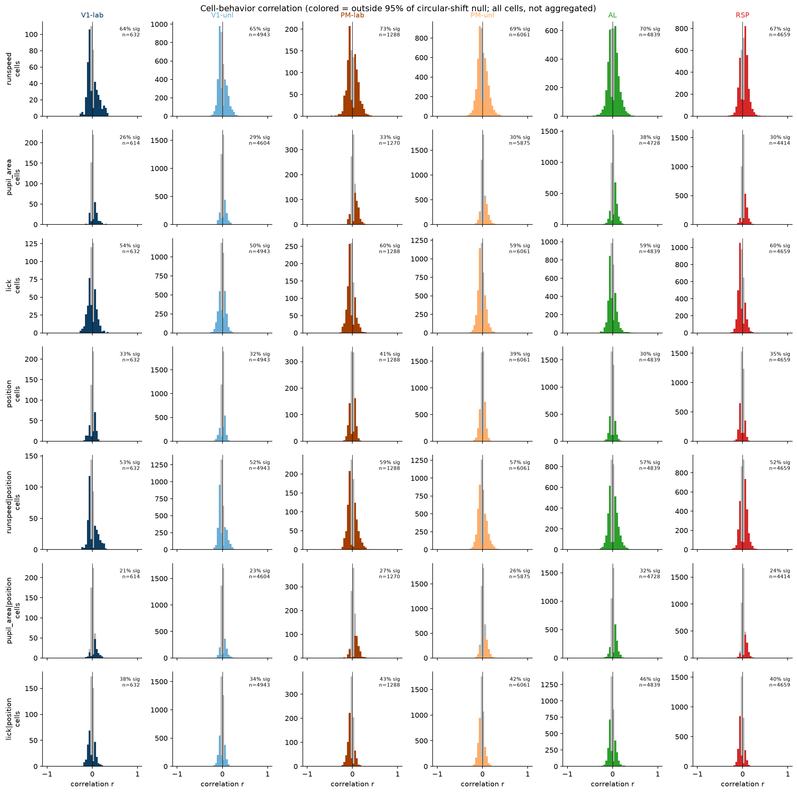

### Frac significant by group

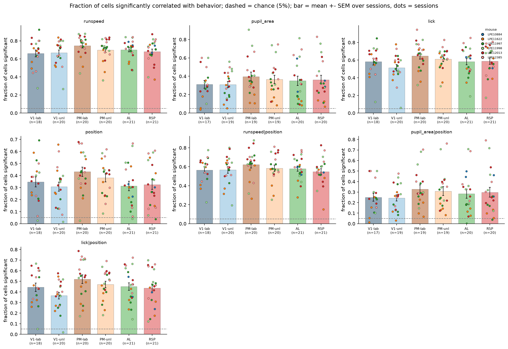

### 2b frac significant by sign

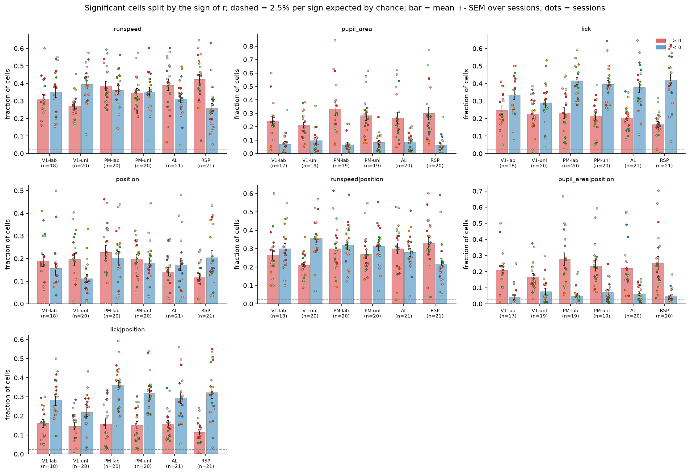

### R scatter lick given position vs pupil area given position

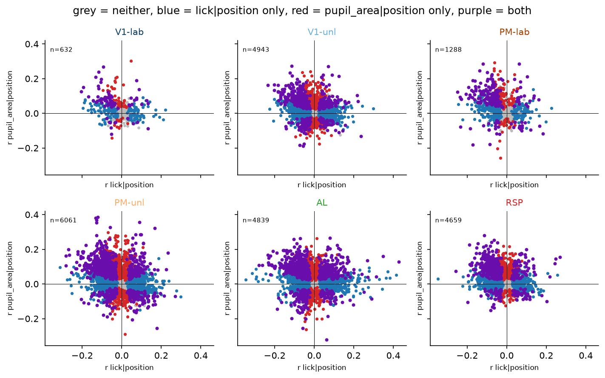

### R scatter lick vs pupil area

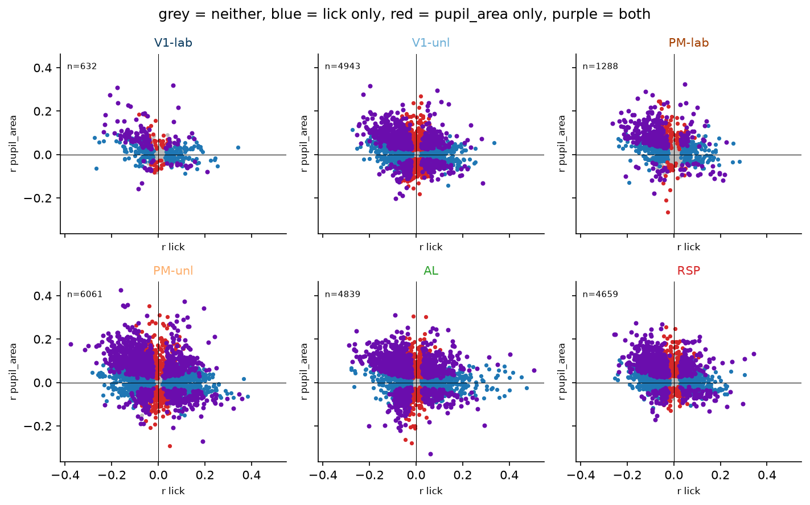

### R scatter runspeed given position vs lick given position

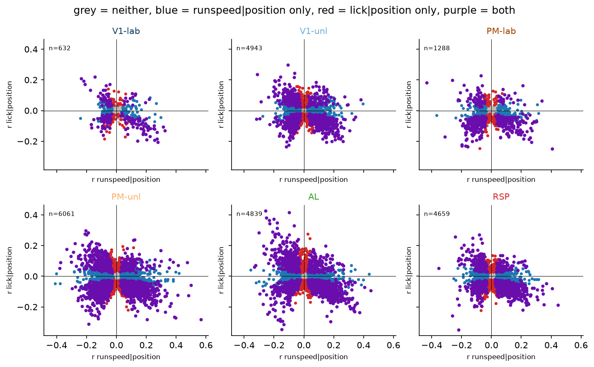

### R scatter runspeed given position vs pupil area given position

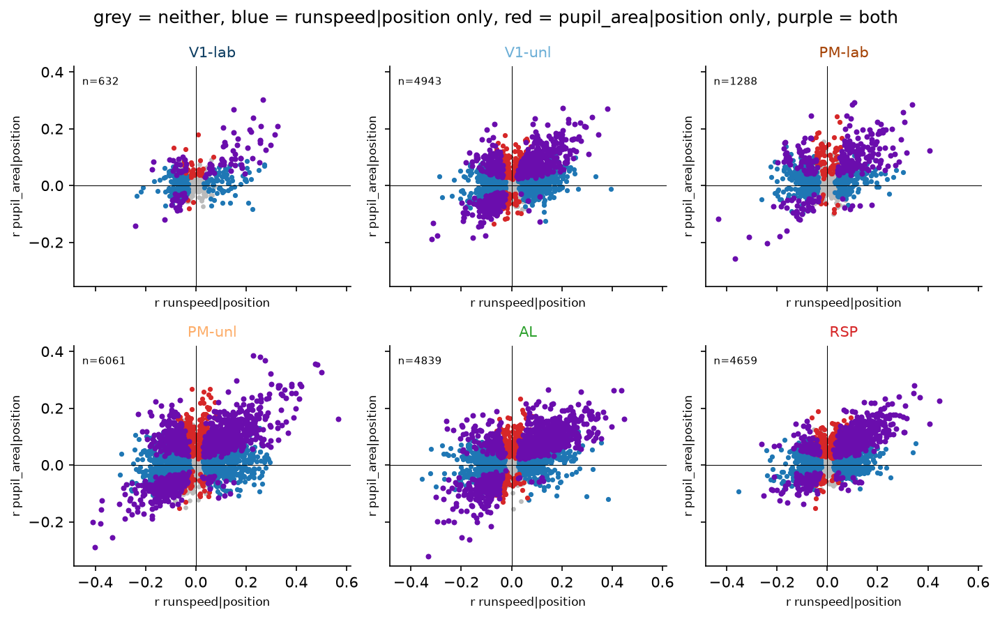

### R scatter runspeed vs lick

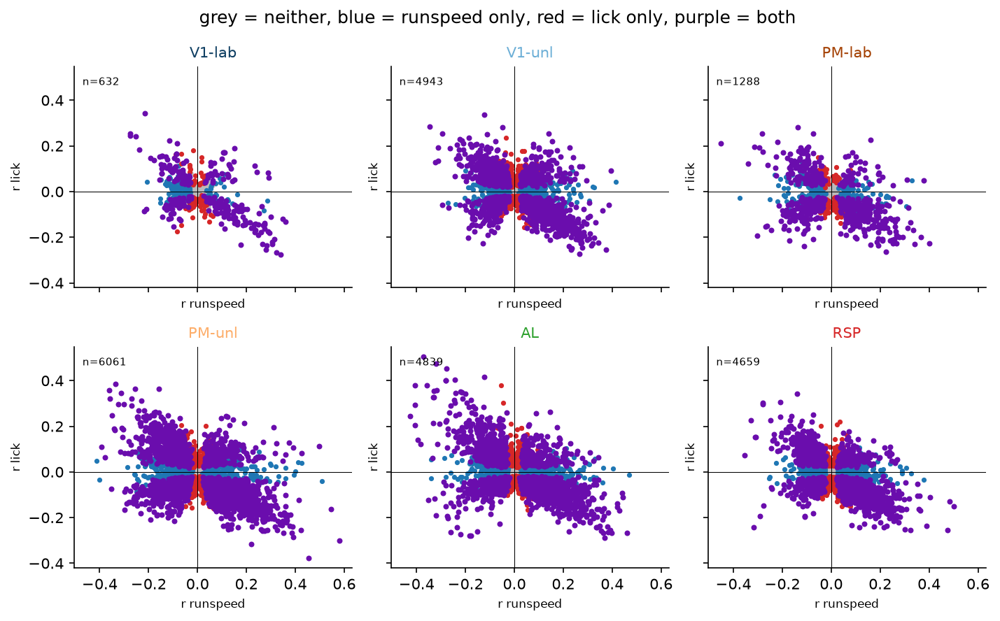

### R scatter runspeed vs pupil area

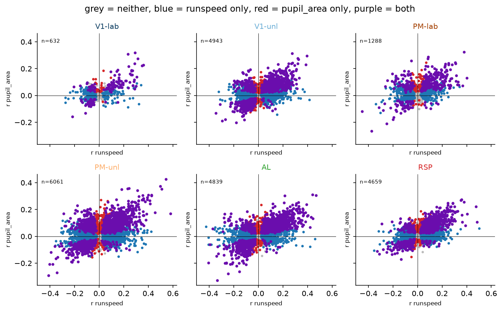

### Per unit heatmap

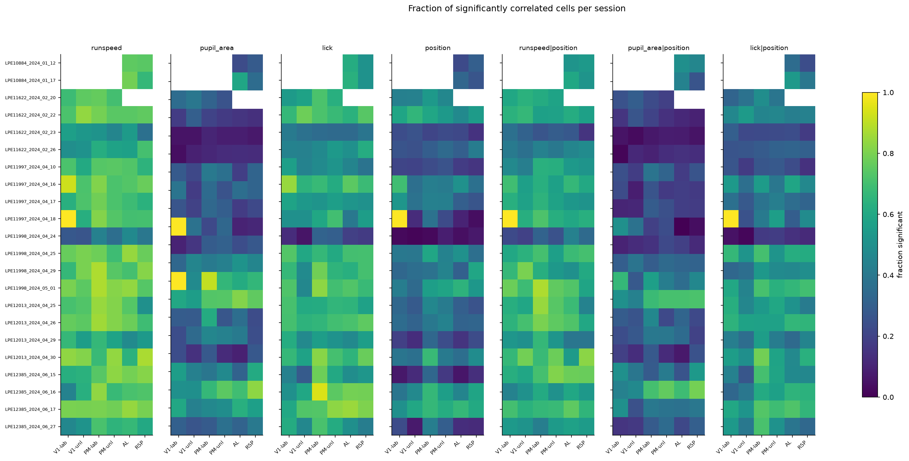

### Behavior class fractions

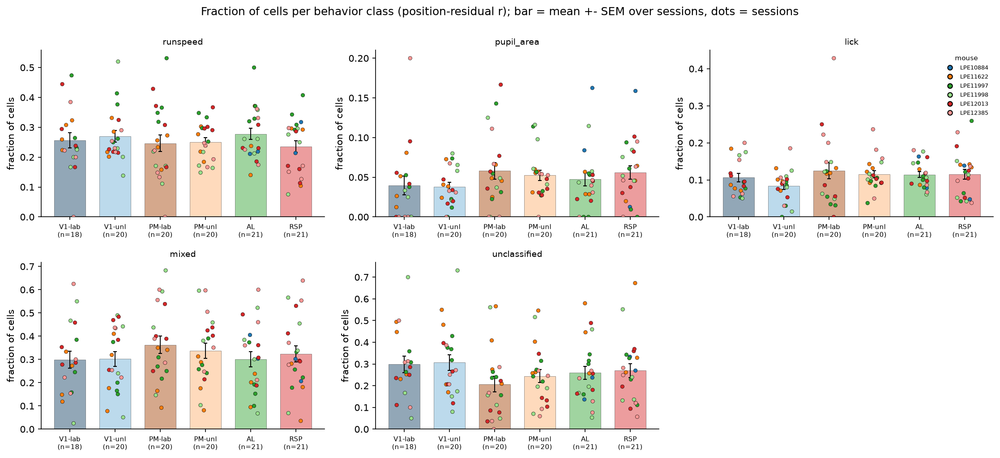

### Best lag hist

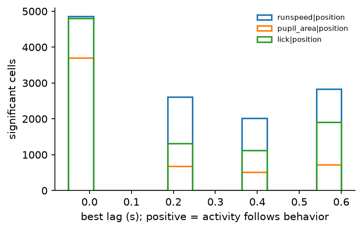
