# 2h_position_information

*Auto-generated from `2_pipeline/2h_position_information/out/` on 2026-10-30 11:38. Re-run `make_progress_md.py` after the script's output changes -- don't hand-edit this file.*

## Tables

### Informative cells

| session_id | group | method | variable | cell_id | n_sig_bins | n_bins | max_run | informative | animal_id |
| --- | --- | --- | --- | --- | --- | --- | --- | --- | --- |
| LPE10884_2024_01_12 | AL_unl | frame_pooled | choice | LPE10884_2024_01_12_7_0000 | 1 | 8 | 1 | False | LPE10884 |
| LPE10884_2024_01_12 | AL_unl | frame_pooled | choice | LPE10884_2024_01_12_7_0001 | 4 | 8 | 3 | True | LPE10884 |
| LPE10884_2024_01_12 | AL_unl | frame_pooled | choice | LPE10884_2024_01_12_7_0002 | 1 | 8 | 1 | False | LPE10884 |
| LPE10884_2024_01_12 | AL_unl | frame_pooled | choice | LPE10884_2024_01_12_7_0003 | 1 | 8 | 1 | False | LPE10884 |
| LPE10884_2024_01_12 | AL_unl | frame_pooled | choice | LPE10884_2024_01_12_7_0004 | 1 | 8 | 1 | False | LPE10884 |
| LPE10884_2024_01_12 | AL_unl | frame_pooled | choice | LPE10884_2024_01_12_7_0005 | 2 | 8 | 1 | False | LPE10884 |
| LPE10884_2024_01_12 | AL_unl | frame_pooled | choice | LPE10884_2024_01_12_7_0006 | 0 | 8 | 0 | False | LPE10884 |
| LPE10884_2024_01_12 | AL_unl | frame_pooled | choice | LPE10884_2024_01_12_7_0007 | 1 | 8 | 1 | False | LPE10884 |
| LPE10884_2024_01_12 | AL_unl | frame_pooled | choice | LPE10884_2024_01_12_7_0008 | 1 | 8 | 1 | False | LPE10884 |
| LPE10884_2024_01_12 | AL_unl | frame_pooled | choice | LPE10884_2024_01_12_7_0009 | 1 | 8 | 1 | False | LPE10884 |
| LPE10884_2024_01_12 | AL_unl | frame_pooled | choice | LPE10884_2024_01_12_7_0010 | 0 | 8 | 0 | False | LPE10884 |
| LPE10884_2024_01_12 | AL_unl | frame_pooled | choice | LPE10884_2024_01_12_7_0011 | 0 | 8 | 0 | False | LPE10884 |
| LPE10884_2024_01_12 | AL_unl | frame_pooled | choice | LPE10884_2024_01_12_7_0012 | 0 | 8 | 0 | False | LPE10884 |
| LPE10884_2024_01_12 | AL_unl | frame_pooled | choice | LPE10884_2024_01_12_7_0013 | 0 | 8 | 0 | False | LPE10884 |
| LPE10884_2024_01_12 | AL_unl | frame_pooled | choice | LPE10884_2024_01_12_7_0014 | 1 | 8 | 1 | False | LPE10884 |
| LPE10884_2024_01_12 | AL_unl | frame_pooled | choice | LPE10884_2024_01_12_7_0015 | 3 | 8 | 2 | True | LPE10884 |
| LPE10884_2024_01_12 | AL_unl | frame_pooled | choice | LPE10884_2024_01_12_7_0016 | 2 | 8 | 1 | False | LPE10884 |
| LPE10884_2024_01_12 | AL_unl | frame_pooled | choice | LPE10884_2024_01_12_7_0017 | 3 | 8 | 1 | False | LPE10884 |
| LPE10884_2024_01_12 | AL_unl | frame_pooled | choice | LPE10884_2024_01_12_7_0018 | 4 | 8 | 4 | True | LPE10884 |
| LPE10884_2024_01_12 | AL_unl | frame_pooled | choice | LPE10884_2024_01_12_7_0019 | 0 | 8 | 0 | False | LPE10884 |
| LPE10884_2024_01_12 | AL_unl | frame_pooled | choice | LPE10884_2024_01_12_7_0020 | 1 | 8 | 1 | False | LPE10884 |
| LPE10884_2024_01_12 | AL_unl | frame_pooled | choice | LPE10884_2024_01_12_7_0022 | 0 | 8 | 0 | False | LPE10884 |
| LPE10884_2024_01_12 | AL_unl | frame_pooled | choice | LPE10884_2024_01_12_7_0023 | 0 | 8 | 0 | False | LPE10884 |
| LPE10884_2024_01_12 | AL_unl | frame_pooled | choice | LPE10884_2024_01_12_7_0024 | 5 | 8 | 3 | True | LPE10884 |
| LPE10884_2024_01_12 | AL_unl | frame_pooled | choice | LPE10884_2024_01_12_7_0025 | 0 | 8 | 0 | False | LPE10884 |
| LPE10884_2024_01_12 | AL_unl | frame_pooled | choice | LPE10884_2024_01_12_7_0026 | 0 | 8 | 0 | False | LPE10884 |
| LPE10884_2024_01_12 | AL_unl | frame_pooled | choice | LPE10884_2024_01_12_7_0027 | 1 | 8 | 1 | False | LPE10884 |
| LPE10884_2024_01_12 | AL_unl | frame_pooled | choice | LPE10884_2024_01_12_7_0028 | 0 | 8 | 0 | False | LPE10884 |
| LPE10884_2024_01_12 | AL_unl | frame_pooled | choice | LPE10884_2024_01_12_7_0029 | 2 | 8 | 1 | False | LPE10884 |
| LPE10884_2024_01_12 | AL_unl | frame_pooled | choice | LPE10884_2024_01_12_7_0030 | 0 | 8 | 0 | False | LPE10884 |

*(showing first 30 of 355084 rows -- see the linked CSV for the rest)*

[informative_cells.csv](../2_pipeline/2h_position_information/out/informative_cells.csv)

### Informative fraction by group

| method | variable | group | frac_informative | sem | n_units |
| --- | --- | --- | --- | --- | --- |
| frame_pooled | choice | AL_unl | 0.06613 | 0 | 1 |
| frame_pooled | choice | PM_lab | 0.1102 | 0 | 1 |
| frame_pooled | choice | PM_unl | 0.1034 | 0 | 1 |
| frame_pooled | choice | RSP_unl | 0.03584 | 0 | 1 |
| frame_pooled | choice | V1_lab | 0.1028 | 0 | 1 |
| frame_pooled | choice | V1_unl | 0.06008 | 0 | 1 |
| frame_pooled | lick | AL_unl | 0 | 0 | 1 |
| frame_pooled | lick | PM_lab | 0 | 0 | 1 |
| frame_pooled | lick | PM_unl | 0 | 0 | 1 |
| frame_pooled | lick | RSP_unl | 0 | 0 | 1 |
| frame_pooled | lick | V1_lab | 0 | 0 | 1 |
| frame_pooled | lick | V1_unl | 0 | 0 | 1 |
| frame_pooled | motionenergy | AL_unl | 0.05118 | 0 | 1 |
| frame_pooled | motionenergy | PM_lab | 0.07795 | 0 | 1 |
| frame_pooled | motionenergy | PM_unl | 0.05787 | 0 | 1 |
| frame_pooled | motionenergy | RSP_unl | 0.02424 | 0 | 1 |
| frame_pooled | motionenergy | V1_lab | 0.05863 | 0 | 1 |
| frame_pooled | motionenergy | V1_unl | 0.02932 | 0 | 1 |
| frame_pooled | pupil_area | AL_unl | 0.05309 | 0 | 1 |
| frame_pooled | pupil_area | PM_lab | 0.0937 | 0 | 1 |
| frame_pooled | pupil_area | PM_unl | 0.0737 | 0 | 1 |
| frame_pooled | pupil_area | RSP_unl | 0.03738 | 0 | 1 |
| frame_pooled | pupil_area | V1_lab | 0.06026 | 0 | 1 |
| frame_pooled | pupil_area | V1_unl | 0.03649 | 0 | 1 |
| frame_pooled | runspeed | AL_unl | 0.1091 | 0 | 1 |
| frame_pooled | runspeed | PM_lab | 0.1778 | 0 | 1 |
| frame_pooled | runspeed | PM_unl | 0.1472 | 0 | 1 |
| frame_pooled | runspeed | RSP_unl | 0.0631 | 0 | 1 |
| frame_pooled | runspeed | V1_lab | 0.125 | 0 | 1 |
| frame_pooled | runspeed | V1_unl | 0.07829 | 0 | 1 |

*(showing first 30 of 96 rows -- see the linked CSV for the rest)*

[informative_fraction_by_group.csv](../2_pipeline/2h_position_information/out/informative_fraction_by_group.csv)

### Position information by group

| method | variable | group | s_rel | mi_bits | sem | n_units | frac_significant |
| --- | --- | --- | --- | --- | --- | --- | --- |
| frame_pooled | choice | AL_unl | -55 | 0.00019 | 2.677e-05 | 4839 | 0.01571 |
| frame_pooled | choice | AL_unl | -45 | 0.0001809 | 2.001e-05 | 4839 | 0.01715 |
| frame_pooled | choice | AL_unl | -35 | 0.0003077 | 3.037e-05 | 4839 | 0.02356 |
| frame_pooled | choice | AL_unl | -25 | 0.0002238 | 3.069e-05 | 4839 | 0.01385 |
| frame_pooled | choice | AL_unl | -15 | 0.0004412 | 4.851e-05 | 4839 | 0.02893 |
| frame_pooled | choice | AL_unl | -5 | 0.0006266 | 7.144e-05 | 4839 | 0.03141 |
| frame_pooled | choice | AL_unl | 5 | 0.001388 | 0.0001153 | 4839 | 0.05704 |
| frame_pooled | choice | AL_unl | 15 | 0.001774 | 0.0001245 | 4839 | 0.07812 |
| frame_pooled | choice | AL_unl | 25 | 0.0005487 | 6.68e-05 | 4839 | 0.04009 |
| frame_pooled | choice | AL_unl | 35 | 0.0006785 | 7.262e-05 | 4839 | 0.03823 |
| frame_pooled | choice | AL_unl | 45 | 0.0007681 | 7.276e-05 | 4839 | 0.03637 |
| frame_pooled | choice | AL_unl | 55 | 0.0007062 | 6.917e-05 | 4839 | 0.03513 |
| frame_pooled | choice | AL_unl | 65 | 0.0005948 | 6.197e-05 | 4839 | 0.03203 |
| frame_pooled | choice | AL_unl | 75 | 0.0004696 | 4.843e-05 | 4839 | 0.02976 |
| frame_pooled | choice | PM_lab | -55 | 0.0003666 | 5.954e-05 | 1288 | 0.03804 |
| frame_pooled | choice | PM_lab | -45 | 0.0002803 | 4.064e-05 | 1288 | 0.02019 |
| frame_pooled | choice | PM_lab | -35 | 0.0003054 | 4.677e-05 | 1288 | 0.02562 |
| frame_pooled | choice | PM_lab | -25 | 0.0003281 | 5.477e-05 | 1288 | 0.02407 |
| frame_pooled | choice | PM_lab | -15 | 0.0006324 | 9.422e-05 | 1288 | 0.04581 |
| frame_pooled | choice | PM_lab | -5 | 0.0008616 | 0.0001058 | 1288 | 0.06366 |
| frame_pooled | choice | PM_lab | 5 | 0.003053 | 0.0003367 | 1288 | 0.1102 |
| frame_pooled | choice | PM_lab | 15 | 0.002095 | 0.000215 | 1288 | 0.1203 |
| frame_pooled | choice | PM_lab | 25 | 0.0008358 | 0.0001617 | 1288 | 0.06677 |
| frame_pooled | choice | PM_lab | 35 | 0.000752 | 0.0001013 | 1288 | 0.07686 |
| frame_pooled | choice | PM_lab | 45 | 0.001747 | 0.000206 | 1288 | 0.09783 |
| frame_pooled | choice | PM_lab | 55 | 0.001981 | 0.000251 | 1288 | 0.08696 |
| frame_pooled | choice | PM_lab | 65 | 0.001546 | 0.0001746 | 1288 | 0.08696 |
| frame_pooled | choice | PM_lab | 75 | 0.001432 | 0.0001501 | 1288 | 0.08618 |
| frame_pooled | choice | PM_unl | -55 | 0.0003012 | 2.665e-05 | 6061 | 0.02838 |
| frame_pooled | choice | PM_unl | -45 | 0.0002138 | 1.725e-05 | 6061 | 0.0193 |

*(showing first 30 of 1344 rows -- see the linked CSV for the rest)*

[position_information_by_group.csv](../2_pipeline/2h_position_information/out/position_information_by_group.csv)

### Position information by group  session

| method | variable | group | s_rel | mi_bits | sem | n_units | frac_significant |
| --- | --- | --- | --- | --- | --- | --- | --- |
| frame_pooled | choice | AL_unl | -55 | 0.0001898 | 6.519e-05 | 21 | 0.016 |
| frame_pooled | choice | AL_unl | -45 | 0.0001749 | 3.325e-05 | 21 | 0.0176 |
| frame_pooled | choice | AL_unl | -35 | 0.000312 | 0.0001026 | 21 | 0.02383 |
| frame_pooled | choice | AL_unl | -25 | 0.0002578 | 0.000117 | 21 | 0.01482 |
| frame_pooled | choice | AL_unl | -15 | 0.0004475 | 0.0001348 | 21 | 0.02714 |
| frame_pooled | choice | AL_unl | -5 | 0.0007573 | 0.0002549 | 21 | 0.03237 |
| frame_pooled | choice | AL_unl | 5 | 0.001852 | 0.0005401 | 21 | 0.06447 |
| frame_pooled | choice | AL_unl | 15 | 0.001961 | 0.0003722 | 21 | 0.07627 |
| frame_pooled | choice | AL_unl | 25 | 0.0005523 | 0.0001155 | 21 | 0.04335 |
| frame_pooled | choice | AL_unl | 35 | 0.0006143 | 0.0001463 | 21 | 0.03567 |
| frame_pooled | choice | AL_unl | 45 | 0.0008154 | 0.0001976 | 21 | 0.03795 |
| frame_pooled | choice | AL_unl | 55 | 0.0008622 | 0.0001451 | 21 | 0.0422 |
| frame_pooled | choice | AL_unl | 65 | 0.0006812 | 0.0001368 | 21 | 0.04054 |
| frame_pooled | choice | AL_unl | 75 | 0.0005226 | 9.674e-05 | 21 | 0.03119 |
| frame_pooled | choice | PM_lab | -55 | 0.0007583 | 0.0003472 | 20 | 0.06209 |
| frame_pooled | choice | PM_lab | -45 | 0.0003721 | 0.0001347 | 20 | 0.03108 |
| frame_pooled | choice | PM_lab | -35 | 0.0004117 | 0.0001021 | 20 | 0.03244 |
| frame_pooled | choice | PM_lab | -25 | 0.0004707 | 0.0001416 | 20 | 0.04337 |
| frame_pooled | choice | PM_lab | -15 | 0.000612 | 0.000139 | 20 | 0.04851 |
| frame_pooled | choice | PM_lab | -5 | 0.0009336 | 0.0002606 | 20 | 0.07445 |
| frame_pooled | choice | PM_lab | 5 | 0.003013 | 0.0003558 | 20 | 0.1375 |
| frame_pooled | choice | PM_lab | 15 | 0.002944 | 0.0005092 | 20 | 0.1519 |
| frame_pooled | choice | PM_lab | 25 | 0.002038 | 0.0006478 | 20 | 0.1017 |
| frame_pooled | choice | PM_lab | 35 | 0.001319 | 0.0004216 | 20 | 0.1054 |
| frame_pooled | choice | PM_lab | 45 | 0.001723 | 0.0003385 | 20 | 0.1056 |
| frame_pooled | choice | PM_lab | 55 | 0.001572 | 0.0002422 | 20 | 0.09524 |
| frame_pooled | choice | PM_lab | 65 | 0.001284 | 0.0001896 | 20 | 0.08566 |
| frame_pooled | choice | PM_lab | 75 | 0.001235 | 0.0002123 | 20 | 0.07978 |
| frame_pooled | choice | PM_unl | -55 | 0.0005214 | 0.0001868 | 20 | 0.04196 |
| frame_pooled | choice | PM_unl | -45 | 0.0002519 | 5.102e-05 | 20 | 0.02362 |

*(showing first 30 of 1344 rows -- see the linked CSV for the rest)*

[position_information_by_group__session.csv](../2_pipeline/2h_position_information/out/position_information_by_group__session.csv)

### Position information informative by group

| method | variable | group | s_rel | mean | sem | n_units |
| --- | --- | --- | --- | --- | --- | --- |
| frame_pooled | choice | AL_unl | -55 | 0.001478 | 0.0003144 | 320 |
| frame_pooled | choice | AL_unl | -45 | 0.0009538 | 0.0001975 | 320 |
| frame_pooled | choice | AL_unl | -35 | 0.002287 | 0.0003465 | 320 |
| frame_pooled | choice | AL_unl | -25 | 0.00177 | 0.0004067 | 320 |
| frame_pooled | choice | AL_unl | -15 | 0.003883 | 0.0005681 | 320 |
| frame_pooled | choice | AL_unl | -5 | 0.006894 | 0.0009272 | 320 |
| frame_pooled | choice | AL_unl | 5 | 0.01657 | 0.001433 | 320 |
| frame_pooled | choice | AL_unl | 15 | 0.01896 | 0.001445 | 320 |
| frame_pooled | choice | AL_unl | 25 | 0.006572 | 0.0009084 | 320 |
| frame_pooled | choice | AL_unl | 35 | 0.005897 | 0.0008635 | 320 |
| frame_pooled | choice | AL_unl | 45 | 0.003503 | 0.0005537 | 320 |
| frame_pooled | choice | AL_unl | 55 | 0.002701 | 0.0004734 | 320 |
| frame_pooled | choice | AL_unl | 65 | 0.003663 | 0.0006704 | 320 |
| frame_pooled | choice | AL_unl | 75 | 0.002088 | 0.0003848 | 320 |
| frame_pooled | choice | PM_lab | -55 | 0.001578 | 0.0004473 | 142 |
| frame_pooled | choice | PM_lab | -45 | 0.0008205 | 0.0002285 | 142 |
| frame_pooled | choice | PM_lab | -35 | 0.0007244 | 0.0001844 | 142 |
| frame_pooled | choice | PM_lab | -25 | 0.001171 | 0.0003857 | 142 |
| frame_pooled | choice | PM_lab | -15 | 0.002296 | 0.0004463 | 142 |
| frame_pooled | choice | PM_lab | -5 | 0.005457 | 0.0007928 | 142 |
| frame_pooled | choice | PM_lab | 5 | 0.02223 | 0.002337 | 142 |
| frame_pooled | choice | PM_lab | 15 | 0.01344 | 0.001474 | 142 |
| frame_pooled | choice | PM_lab | 25 | 0.00549 | 0.001325 | 142 |
| frame_pooled | choice | PM_lab | 35 | 0.002908 | 0.0005822 | 142 |
| frame_pooled | choice | PM_lab | 45 | 0.004075 | 0.0009445 | 142 |
| frame_pooled | choice | PM_lab | 55 | 0.003941 | 0.00121 | 142 |
| frame_pooled | choice | PM_lab | 65 | 0.004316 | 0.0009523 | 142 |
| frame_pooled | choice | PM_lab | 75 | 0.003103 | 0.0006142 | 142 |
| frame_pooled | choice | PM_unl | -55 | 0.001453 | 0.0001986 | 627 |
| frame_pooled | choice | PM_unl | -45 | 0.0006096 | 7.917e-05 | 627 |

*(showing first 30 of 1176 rows -- see the linked CSV for the rest)*

[position_information_informative_by_group.csv](../2_pipeline/2h_position_information/out/position_information_informative_by_group.csv)

### Position information per cell

| session_id | cell_id | method | variable | s_rel | n_samples | n_trials | mi_bits | p_value | animal_id | group | significant |
| --- | --- | --- | --- | --- | --- | --- | --- | --- | --- | --- | --- |
| LPE10884_2024_01_12 | LPE10884_2024_01_12_6_0000 | trial_mean | stim__zero_to80_above80 | -55 | 209 | 209 | 8.366e-05 | 0.45 | LPE10884 | RSP_unl | 0 |
| LPE10884_2024_01_12 | LPE10884_2024_01_12_6_0000 | frame_pooled | stim__zero_to80_above80 | -55 | 1149 | 209 | 0 | 1 | LPE10884 | RSP_unl | 0 |
| LPE10884_2024_01_12 | LPE10884_2024_01_12_6_0001 | trial_mean | stim__zero_to80_above80 | -55 | 209 | 209 | 0 | 0.55 | LPE10884 | RSP_unl | 0 |
| LPE10884_2024_01_12 | LPE10884_2024_01_12_6_0001 | frame_pooled | stim__zero_to80_above80 | -55 | 1149 | 209 | 0 | 1 | LPE10884 | RSP_unl | 0 |
| LPE10884_2024_01_12 | LPE10884_2024_01_12_6_0002 | trial_mean | stim__zero_to80_above80 | -55 | 209 | 209 | 0.003172 | 0.15 | LPE10884 | RSP_unl | 0 |
| LPE10884_2024_01_12 | LPE10884_2024_01_12_6_0002 | frame_pooled | stim__zero_to80_above80 | -55 | 1149 | 209 | 0.04379 | 0 | LPE10884 | RSP_unl | 1 |
| LPE10884_2024_01_12 | LPE10884_2024_01_12_6_0003 | trial_mean | stim__zero_to80_above80 | -55 | 209 | 209 | 0 | 0.7 | LPE10884 | RSP_unl | 0 |
| LPE10884_2024_01_12 | LPE10884_2024_01_12_6_0003 | frame_pooled | stim__zero_to80_above80 | -55 | 1149 | 209 | 0 | 0.9 | LPE10884 | RSP_unl | 0 |
| LPE10884_2024_01_12 | LPE10884_2024_01_12_6_0004 | trial_mean | stim__zero_to80_above80 | -55 | 209 | 209 | 0 | 0.8 | LPE10884 | RSP_unl | 0 |
| LPE10884_2024_01_12 | LPE10884_2024_01_12_6_0004 | frame_pooled | stim__zero_to80_above80 | -55 | 1149 | 209 | 0 | 1 | LPE10884 | RSP_unl | 0 |
| LPE10884_2024_01_12 | LPE10884_2024_01_12_6_0005 | trial_mean | stim__zero_to80_above80 | -55 | 209 | 209 | 0 | 1 | LPE10884 | RSP_unl | 0 |
| LPE10884_2024_01_12 | LPE10884_2024_01_12_6_0005 | frame_pooled | stim__zero_to80_above80 | -55 | 1149 | 209 | 0 | 1 | LPE10884 | RSP_unl | 0 |
| LPE10884_2024_01_12 | LPE10884_2024_01_12_6_0006 | trial_mean | stim__zero_to80_above80 | -55 | 209 | 209 | 0 | 0.65 | LPE10884 | RSP_unl | 0 |
| LPE10884_2024_01_12 | LPE10884_2024_01_12_6_0006 | frame_pooled | stim__zero_to80_above80 | -55 | 1149 | 209 | 0 | 1 | LPE10884 | RSP_unl | 0 |
| LPE10884_2024_01_12 | LPE10884_2024_01_12_6_0007 | trial_mean | stim__zero_to80_above80 | -55 | 209 | 209 | 0 | 0.8 | LPE10884 | RSP_unl | 0 |
| LPE10884_2024_01_12 | LPE10884_2024_01_12_6_0007 | frame_pooled | stim__zero_to80_above80 | -55 | 1149 | 209 | 0 | 1 | LPE10884 | RSP_unl | 0 |
| LPE10884_2024_01_12 | LPE10884_2024_01_12_6_0008 | trial_mean | stim__zero_to80_above80 | -55 | 209 | 209 | 0.01555 | 0 | LPE10884 | RSP_unl | 1 |
| LPE10884_2024_01_12 | LPE10884_2024_01_12_6_0008 | frame_pooled | stim__zero_to80_above80 | -55 | 1149 | 209 | 0 | 1 | LPE10884 | RSP_unl | 0 |
| LPE10884_2024_01_12 | LPE10884_2024_01_12_6_0009 | trial_mean | stim__zero_to80_above80 | -55 | 209 | 209 | 0 | 0.4 | LPE10884 | RSP_unl | 0 |
| LPE10884_2024_01_12 | LPE10884_2024_01_12_6_0009 | frame_pooled | stim__zero_to80_above80 | -55 | 1149 | 209 | 0 | 1 | LPE10884 | RSP_unl | 0 |
| LPE10884_2024_01_12 | LPE10884_2024_01_12_6_0010 | trial_mean | stim__zero_to80_above80 | -55 | 209 | 209 | 0.002304 | 0.2 | LPE10884 | RSP_unl | 0 |
| LPE10884_2024_01_12 | LPE10884_2024_01_12_6_0010 | frame_pooled | stim__zero_to80_above80 | -55 | 1149 | 209 | 0 | 1 | LPE10884 | RSP_unl | 0 |
| LPE10884_2024_01_12 | LPE10884_2024_01_12_6_0011 | trial_mean | stim__zero_to80_above80 | -55 | 209 | 209 | 0 | 0.9 | LPE10884 | RSP_unl | 0 |
| LPE10884_2024_01_12 | LPE10884_2024_01_12_6_0011 | frame_pooled | stim__zero_to80_above80 | -55 | 1149 | 209 | 0 | 1 | LPE10884 | RSP_unl | 0 |
| LPE10884_2024_01_12 | LPE10884_2024_01_12_6_0012 | trial_mean | stim__zero_to80_above80 | -55 | 209 | 209 | 0 | 0.45 | LPE10884 | RSP_unl | 0 |
| LPE10884_2024_01_12 | LPE10884_2024_01_12_6_0012 | frame_pooled | stim__zero_to80_above80 | -55 | 1149 | 209 | 0.004352 | 0 | LPE10884 | RSP_unl | 1 |
| LPE10884_2024_01_12 | LPE10884_2024_01_12_6_0013 | trial_mean | stim__zero_to80_above80 | -55 | 209 | 209 | 0 | 0.7 | LPE10884 | RSP_unl | 0 |
| LPE10884_2024_01_12 | LPE10884_2024_01_12_6_0013 | frame_pooled | stim__zero_to80_above80 | -55 | 1149 | 209 | 0 | 1 | LPE10884 | RSP_unl | 0 |
| LPE10884_2024_01_12 | LPE10884_2024_01_12_6_0014 | trial_mean | stim__zero_to80_above80 | -55 | 209 | 209 | 0 | 1 | LPE10884 | RSP_unl | 0 |
| LPE10884_2024_01_12 | LPE10884_2024_01_12_6_0014 | frame_pooled | stim__zero_to80_above80 | -55 | 1149 | 209 | 0 | 1 | LPE10884 | RSP_unl | 0 |

*(showing first 30 of 4971176 rows -- see the linked CSV for the rest)*

[position_information_per_cell.csv](../2_pipeline/2h_position_information/out/position_information_per_cell.csv)

## Figures

### Method comparison

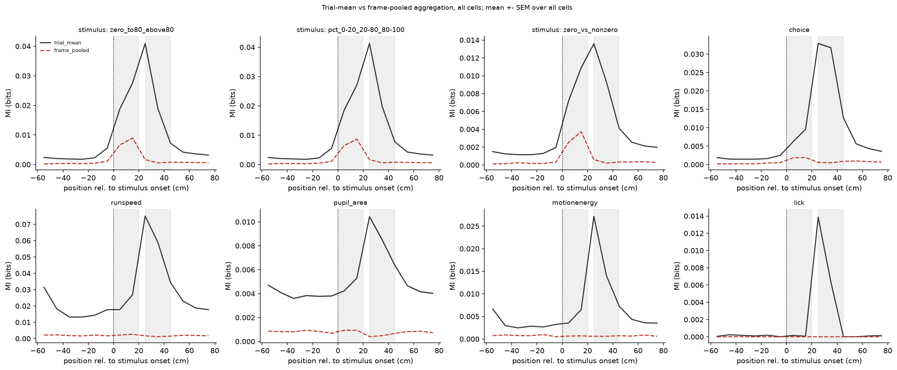

### Task variables

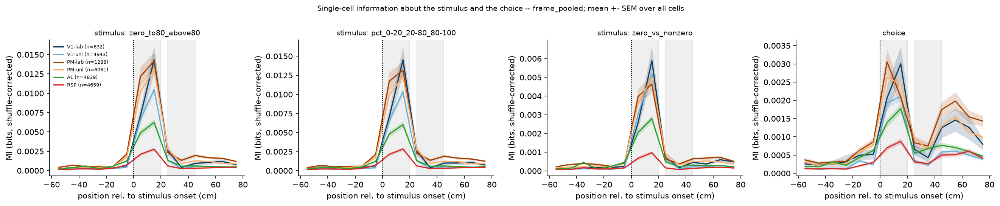

### Behavior variables

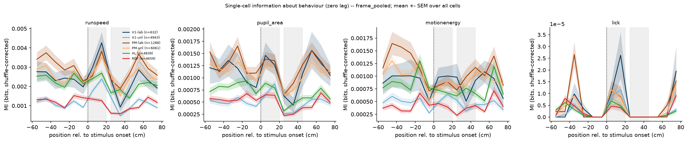

### Fraction significant

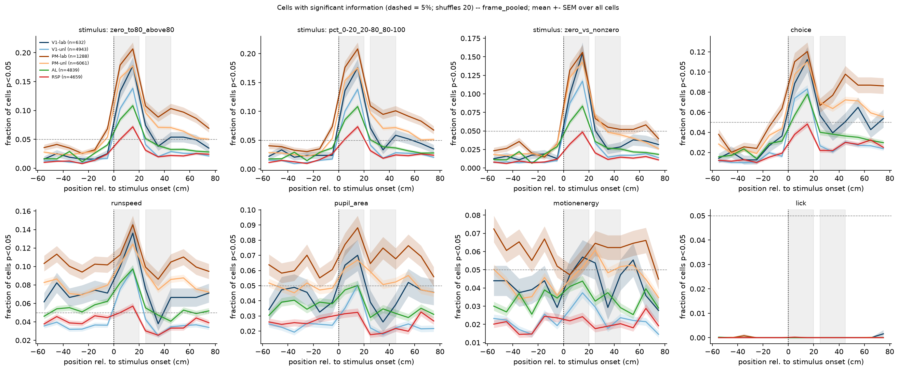

### Informative cells task variables

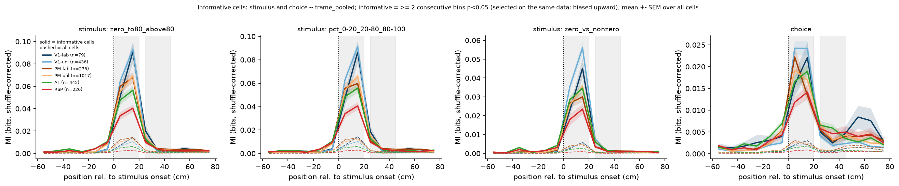

### Informative cells behavior variables

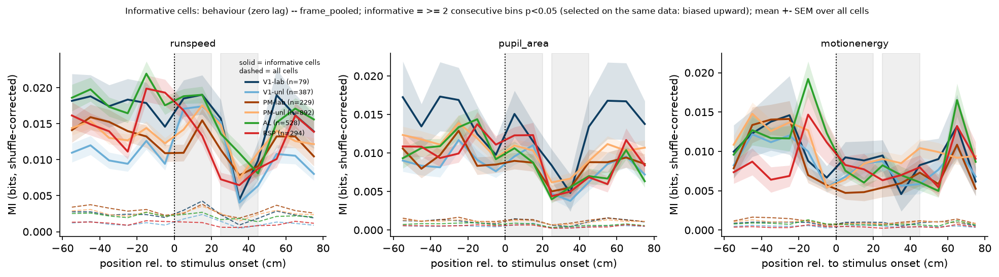

### Fraction informative

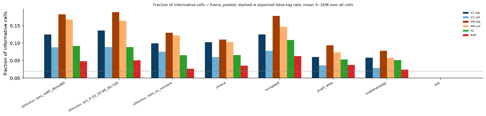

### Task variables

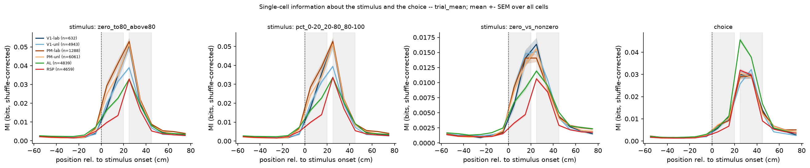

### Behavior variables

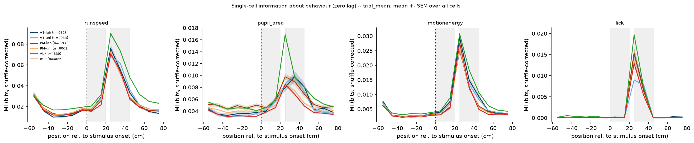

### Fraction significant

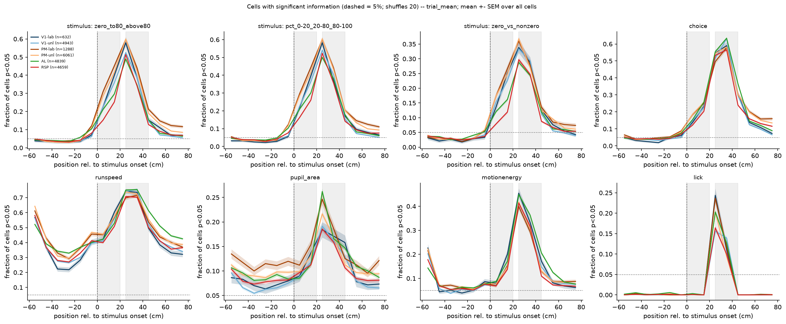

### Informative cells task variables

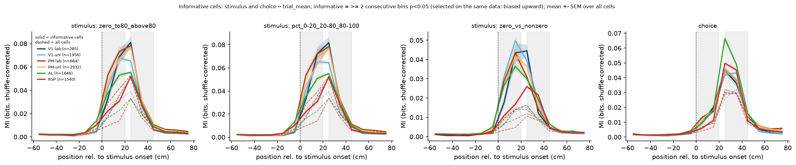

### Informative cells behavior variables

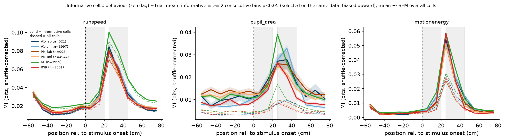

### Fraction informative

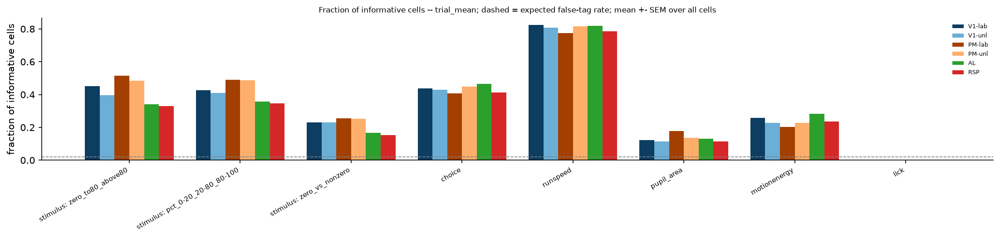
