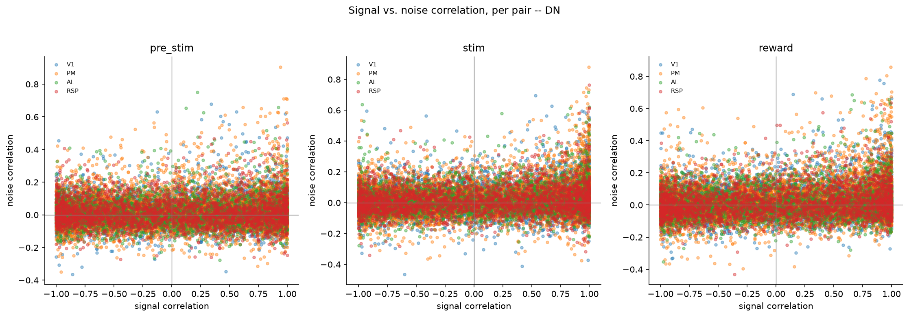
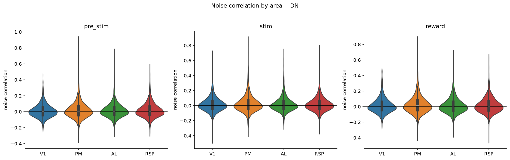
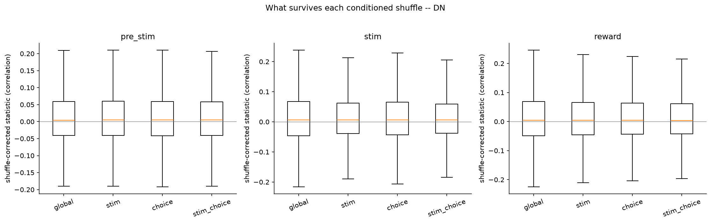

# 3a_pair_activity_statistics

*Auto-generated from `2_pipeline/3a_pair_activity_statistics/out/` on 2026-09-14 16:47. Re-run `make_progress_md.py` after the script's output changes -- don't hand-edit this file.*

## Tables

### Pair correlations

| session_id | window | roi_name | labeled_grouped | cell_i | cell_j | n_trials | signal_corr | noise_corr | raw_corr | shuffle_global_corrected | shuffle_global_p | shuffle_stim_corrected | shuffle_stim_p | shuffle_choice_corrected |
| --- | --- | --- | --- | --- | --- | --- | --- | --- | --- | --- | --- | --- | --- | --- |
| LPE10884_2024_01_12 | pre_stim | AL | unl | LPE10884_2024_01_12_7_0163 | LPE10884_2024_01_12_7_0223 | 209 | 0.7145 | -0.09395 | -0.08823 | -0.09629 | 0.18 | -0.08752 | 0.16 | -0.09848 |
| LPE10884_2024_01_12 | pre_stim | AL | unl | LPE10884_2024_01_12_7_0204 | LPE10884_2024_01_12_7_0275 | 209 | 0.961 | -0.02008 | -0.008542 | -0.000726 | 0.98 | -0.01233 | 0.82 | -0.01982 |
| LPE10884_2024_01_12 | pre_stim | AL | unl | LPE10884_2024_01_12_7_0201 | LPE10884_2024_01_12_7_0419 | 209 | -0.5202 | 0.1566 | 0.1421 | 0.1536 | 0.02 | 0.1609 | 0 | 0.158 |
| LPE10884_2024_01_12 | pre_stim | AL | unl | LPE10884_2024_01_12_7_0000 | LPE10884_2024_01_12_7_0302 | 209 | -0.1646 | 0.009153 | 0.007724 | 0.02772 | 0.74 | 0.008615 | 0.84 | 0.02327 |
| LPE10884_2024_01_12 | pre_stim | AL | unl | LPE10884_2024_01_12_7_0073 | LPE10884_2024_01_12_7_0361 | 209 | -0.7689 | 0.0663 | 0.05606 | 0.07072 | 0.32 | 0.0516 | 0.4 | 0.05332 |
| LPE10884_2024_01_12 | pre_stim | AL | unl | LPE10884_2024_01_12_7_0044 | LPE10884_2024_01_12_7_0215 | 209 | -0.6558 | 0.06144 | 0.05534 | 0.04967 | 0.44 | 0.04754 | 0.42 | 0.04944 |
| LPE10884_2024_01_12 | pre_stim | AL | unl | LPE10884_2024_01_12_7_0003 | LPE10884_2024_01_12_7_0177 | 209 | -0.01094 | 0.3932 | 0.3918 | 0.3908 | 0 | 0.388 | 0 | 0.3951 |
| LPE10884_2024_01_12 | pre_stim | AL | unl | LPE10884_2024_01_12_7_0052 | LPE10884_2024_01_12_7_0361 | 209 | 0.7876 | 0.02714 | 0.03333 | 0.0361 | 0.6 | 0.04101 | 0.64 | 0.0431 |
| LPE10884_2024_01_12 | pre_stim | AL | unl | LPE10884_2024_01_12_7_0034 | LPE10884_2024_01_12_7_0223 | 209 | 0.4118 | 0.02938 | 0.04571 | 0.04473 | 0.46 | 0.02487 | 0.76 | 0.03716 |
| LPE10884_2024_01_12 | pre_stim | AL | unl | LPE10884_2024_01_12_7_0065 | LPE10884_2024_01_12_7_0359 | 209 | -0.417 | -0.01314 | -0.02083 | -0.031 | 0.68 | -0.01229 | 0.84 | -0.0366 |
| LPE10884_2024_01_12 | pre_stim | AL | unl | LPE10884_2024_01_12_7_0000 | LPE10884_2024_01_12_7_0141 | 209 | -0.4051 | 0.04476 | 0.03719 | 0.04688 | 0.48 | 0.03856 | 0.36 | 0.0321 |
| LPE10884_2024_01_12 | pre_stim | AL | unl | LPE10884_2024_01_12_7_0025 | LPE10884_2024_01_12_7_0399 | 209 | 0.7201 | 0.02457 | 0.07762 | 0.07061 | 0.24 | 0.01318 | 0.84 | 0.07356 |
| LPE10884_2024_01_12 | pre_stim | AL | unl | LPE10884_2024_01_12_7_0247 | LPE10884_2024_01_12_7_0345 | 209 | -0.02226 | -0.1885 | -0.1869 | -0.1806 | 0 | -0.1823 | 0 | -0.175 |
| LPE10884_2024_01_12 | pre_stim | AL | unl | LPE10884_2024_01_12_7_0007 | LPE10884_2024_01_12_7_0308 | 209 | -0.2397 | 0.07924 | 0.07436 | 0.07892 | 0.12 | 0.0607 | 0.32 | 0.06668 |
| LPE10884_2024_01_12 | pre_stim | AL | unl | LPE10884_2024_01_12_7_0046 | LPE10884_2024_01_12_7_0137 | 209 | -0.8315 | -0.06105 | -0.07801 | -0.07646 | 0.2 | -0.07212 | 0.22 | -0.07321 |
| LPE10884_2024_01_12 | pre_stim | AL | unl | LPE10884_2024_01_12_7_0198 | LPE10884_2024_01_12_7_0427 | 209 | -0.4729 | 0.0457 | 0.02169 | 0.01501 | 0.88 | 0.04816 | 0.36 | 0.0388 |
| LPE10884_2024_01_12 | pre_stim | AL | unl | LPE10884_2024_01_12_7_0053 | LPE10884_2024_01_12_7_0055 | 209 | -0.888 | 0.04839 | 0.0305 | 0.04424 | 0.46 | 0.04287 | 0.54 | 0.04152 |
| LPE10884_2024_01_12 | pre_stim | AL | unl | LPE10884_2024_01_12_7_0194 | LPE10884_2024_01_12_7_0231 | 209 | -0.3673 | 0.1341 | 0.1288 | 0.1142 | 0.12 | 0.1337 | 0 | 0.1363 |
| LPE10884_2024_01_12 | pre_stim | AL | unl | LPE10884_2024_01_12_7_0001 | LPE10884_2024_01_12_7_0105 | 209 | 0.8328 | 0.01359 | 0.02228 | 0.03504 | 0.56 | 0.01254 | 0.82 | 0.02122 |
| LPE10884_2024_01_12 | pre_stim | AL | unl | LPE10884_2024_01_12_7_0077 | LPE10884_2024_01_12_7_0250 | 209 | -0.5291 | 0.01974 | 0.01162 | 0.007912 | 0.92 | 0.01315 | 0.86 | 0.01346 |
| LPE10884_2024_01_12 | pre_stim | AL | unl | LPE10884_2024_01_12_7_0127 | LPE10884_2024_01_12_7_0347 | 209 | -0.05564 | -0.06193 | -0.06329 | -0.06221 | 0.4 | -0.05414 | 0.46 | -0.06761 |
| LPE10884_2024_01_12 | pre_stim | AL | unl | LPE10884_2024_01_12_7_0033 | LPE10884_2024_01_12_7_0404 | 209 | 0.3094 | 0.1073 | 0.1092 | 0.1032 | 0.1 | 0.109 | 0.08 | 0.1001 |
| LPE10884_2024_01_12 | pre_stim | AL | unl | LPE10884_2024_01_12_7_0106 | LPE10884_2024_01_12_7_0359 | 209 | 0.6347 | -0.01839 | -0.006079 | -0.01821 | 0.8 | -0.01028 | 0.92 | -0.005416 |
| LPE10884_2024_01_12 | pre_stim | AL | unl | LPE10884_2024_01_12_7_0023 | LPE10884_2024_01_12_7_0120 | 209 | -0.351 | 0.04977 | 0.04556 | 0.04317 | 0.38 | 0.06063 | 0.16 | 0.05957 |
| LPE10884_2024_01_12 | pre_stim | AL | unl | LPE10884_2024_01_12_7_0012 | LPE10884_2024_01_12_7_0359 | 209 | 0.5266 | -0.03749 | -0.03088 | -0.02402 | 0.76 | -0.04959 | 0.46 | -0.02793 |
| LPE10884_2024_01_12 | pre_stim | AL | unl | LPE10884_2024_01_12_7_0183 | LPE10884_2024_01_12_7_0295 | 209 | -0.3867 | 0.02356 | 0.02286 | 0.02967 | 0.6 | 0.02555 | 0.76 | 0.01799 |
| LPE10884_2024_01_12 | pre_stim | AL | unl | LPE10884_2024_01_12_7_0151 | LPE10884_2024_01_12_7_0253 | 209 | -0.4462 | -0.000897 | -0.004256 | -0.006628 | 0.92 | -0.01338 | 0.86 | -0.006974 |
| LPE10884_2024_01_12 | pre_stim | AL | unl | LPE10884_2024_01_12_7_0085 | LPE10884_2024_01_12_7_0269 | 209 | 0.3084 | -0.05592 | -0.05164 | -0.05247 | 0.26 | -0.06081 | 0.28 | -0.04727 |
| LPE10884_2024_01_12 | pre_stim | AL | unl | LPE10884_2024_01_12_7_0073 | LPE10884_2024_01_12_7_0202 | 209 | -0.8352 | -0.03104 | -0.04704 | -0.03617 | 0.4 | -0.02467 | 0.68 | -0.04914 |
| LPE10884_2024_01_12 | pre_stim | AL | unl | LPE10884_2024_01_12_7_0122 | LPE10884_2024_01_12_7_0131 | 209 | -0.9992 | -0.02802 | -0.0449 | -0.06191 | 0.44 | -0.02897 | 0.66 | -0.04496 |

*(showing first 15 of 18 columns; showing first 30 of 49455 rows -- see the linked CSV for the rest)*

[pair_correlations.csv](../2_pipeline/3a_pair_activity_statistics/out/pair_correlations.csv)

## Figures

### Signal vs noise correlation

### Noise correlation by area

### Shuffle mode comparison

