# 3a_pair_activity_statistics

*Auto-generated from `2_pipeline/3a_pair_activity_statistics/out/` on 2026-11-10 17:48. Re-run `make_progress_md.py` after the script's output changes -- don't hand-edit this file.*

## Figures

### Signal vs noise correlation

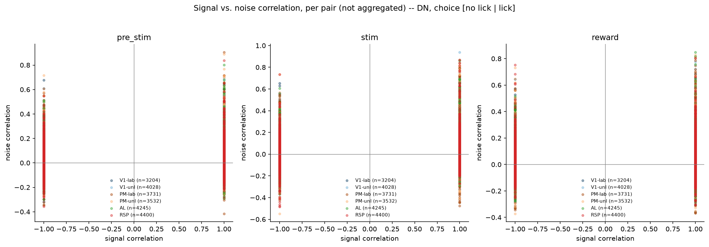

### Noise correlation by group

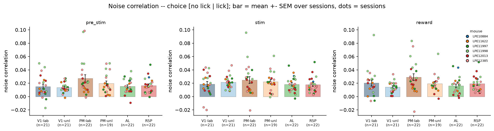

### 2b signal correlation by group

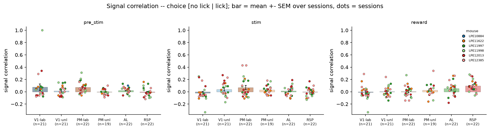

### 2c raw correlation by group

### Shuffle mode comparison

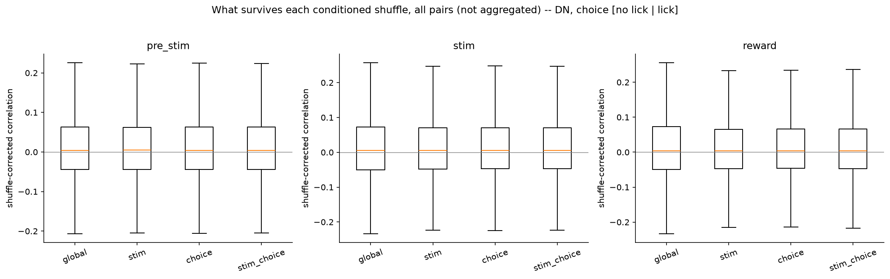

### 3b shuffle mode by group

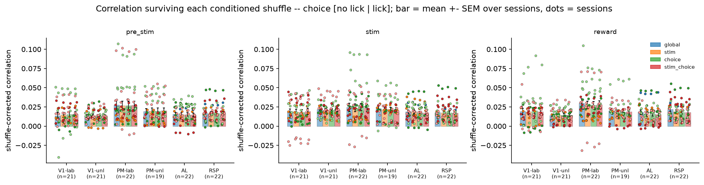

### Compare targets noise corr

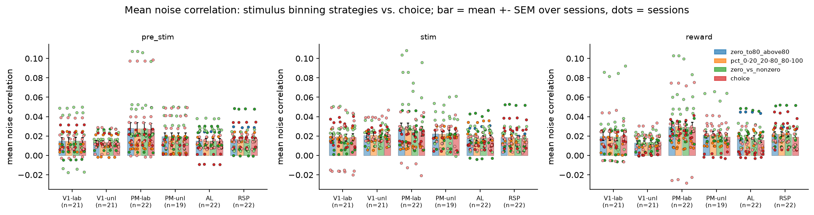

### Compare targets signal corr

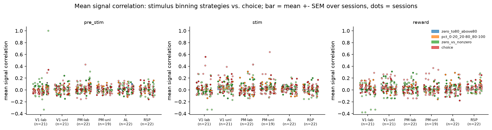

### Noise stim vs choice  pct 0-20 20-80 80-100

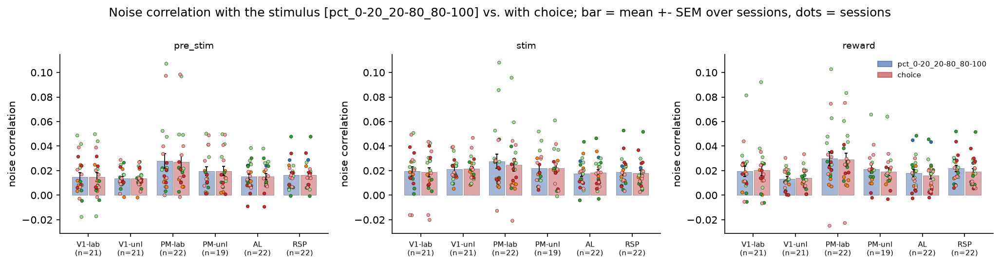

### Noise stim vs choice  zero to80 above80

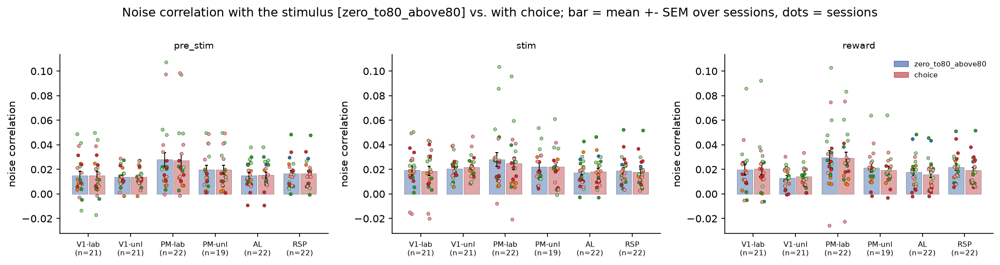

### Noise stim vs choice  zero vs nonzero

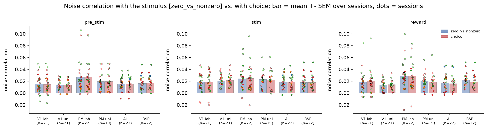

### Signal vs noise correlation

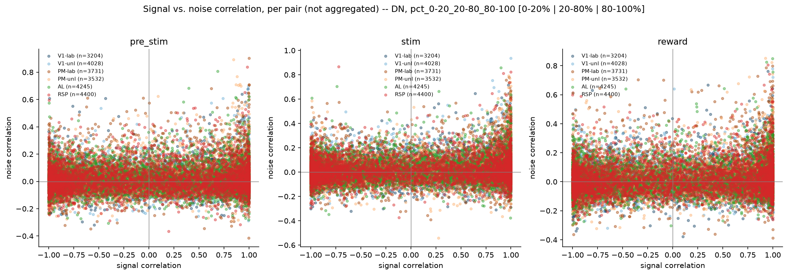

### Noise correlation by group

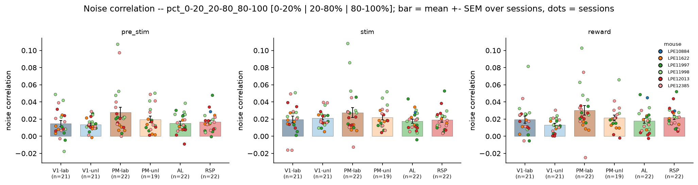

### 2b signal correlation by group

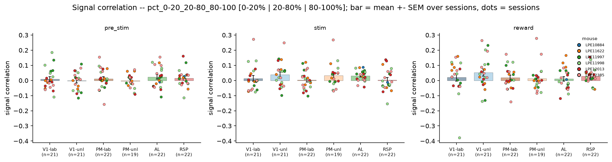

### 2c raw correlation by group

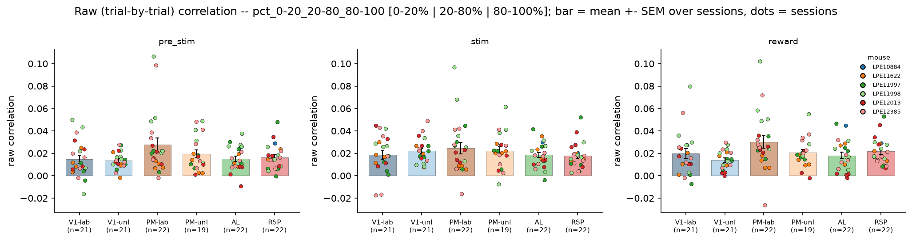

### Shuffle mode comparison

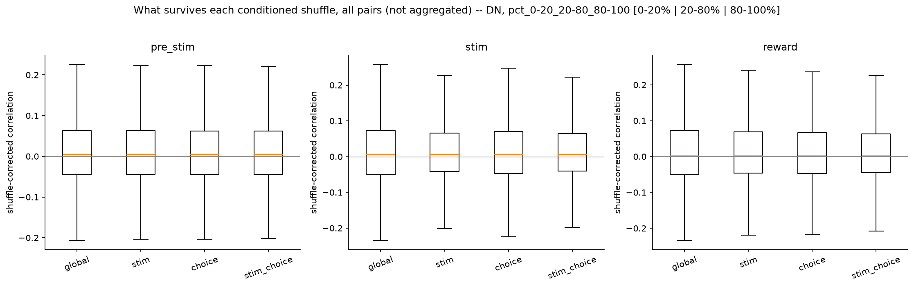

### 3b shuffle mode by group

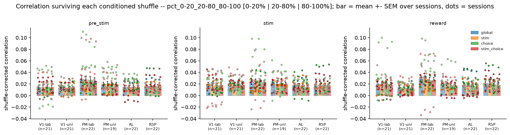

### Signal stim vs choice  pct 0-20 20-80 80-100

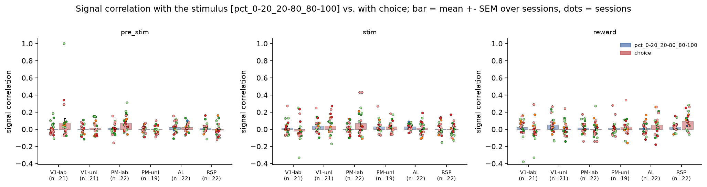

### Signal stim vs choice  zero to80 above80

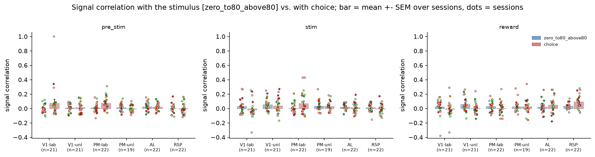

### Signal stim vs choice  zero vs nonzero

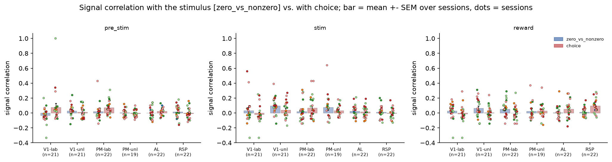

### Signal vs noise correlation

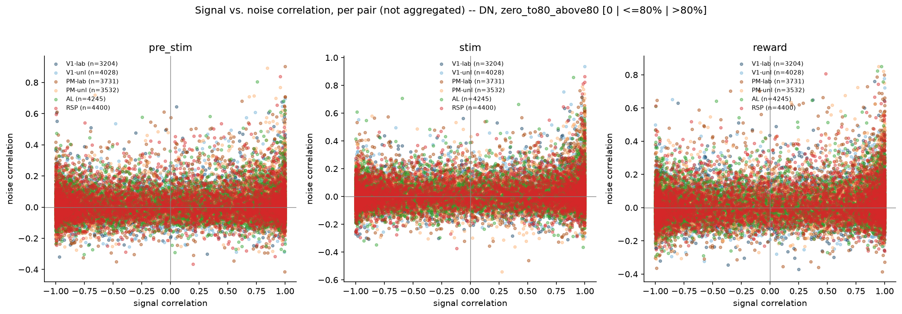

### Noise correlation by group

### 2b signal correlation by group

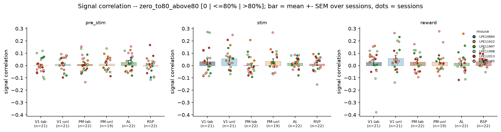

### 2c raw correlation by group

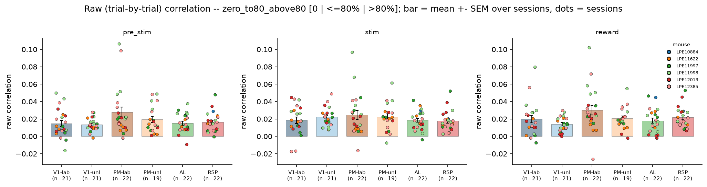

### Shuffle mode comparison

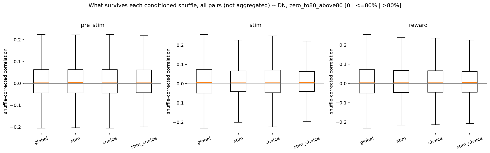

### 3b shuffle mode by group

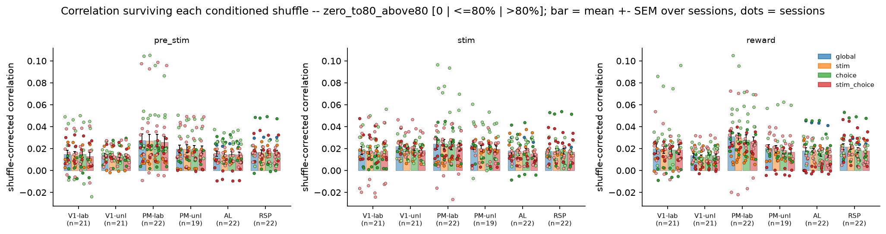

### Signal vs noise correlation

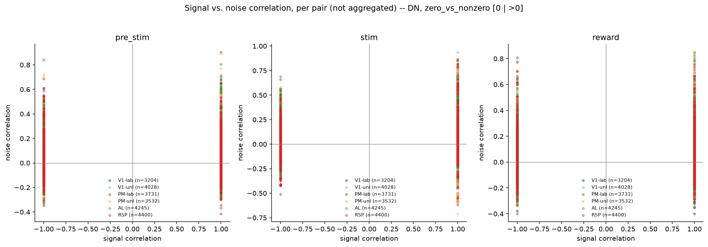

### Noise correlation by group

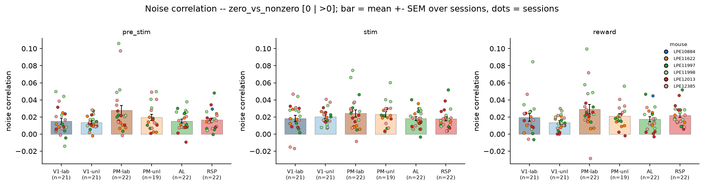

### 2b signal correlation by group

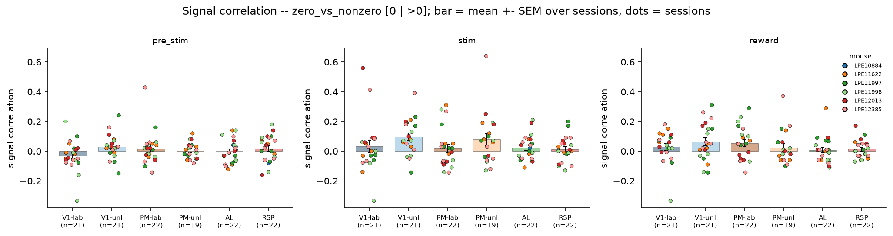

### 2c raw correlation by group

### Shuffle mode comparison

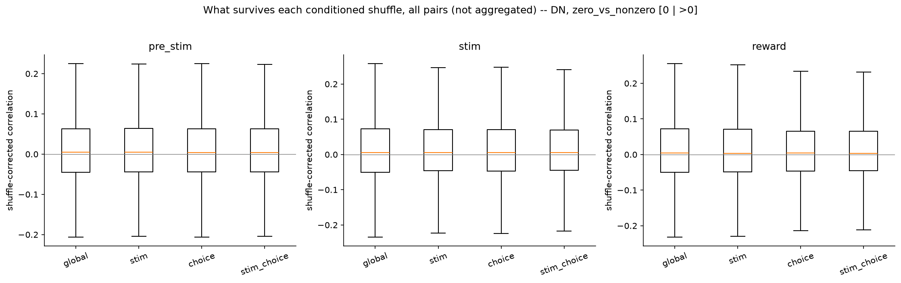

### 3b shuffle mode by group

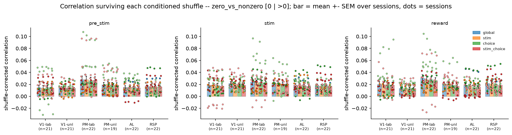

## Tables

### Pair correlations

| session_id | animal_id | window | target | roi_name | labeled_grouped | cell_i | cell_j | pair_rank | n_trials | n_bins | signal_corr | noise_corr | raw_corr | shuffle_global_corrected |
| --- | --- | --- | --- | --- | --- | --- | --- | --- | --- | --- | --- | --- | --- | --- |
| LPE10884_2024_01_12 | LPE10884 | pre_stim | zero_to80_above80 | AL | unl | LPE10884_2024_01_12_7_0042 | LPE10884_2024_01_12_7_0263 | 89 | 209 | 3 | 0.9998 | 0.06457 | 0.06617 | 0.05502 |
| LPE10884_2024_01_12 | LPE10884 | pre_stim | zero_to80_above80 | AL | unl | LPE10884_2024_01_12_7_0174 | LPE10884_2024_01_12_7_0267 | 7 | 209 | 3 | 0.8762 | -0.05672 | -0.04482 | -0.009082 |
| LPE10884_2024_01_12 | LPE10884 | pre_stim | zero_to80_above80 | AL | unl | LPE10884_2024_01_12_7_0073 | LPE10884_2024_01_12_7_0195 | 155 | 209 | 3 | 0.6443 | -0.02194 | -0.01882 | 0.03145 |
| LPE10884_2024_01_12 | LPE10884 | pre_stim | zero_to80_above80 | AL | unl | LPE10884_2024_01_12_7_0286 | LPE10884_2024_01_12_7_0334 | 185 | 209 | 3 | -0.9985 | -0.07449 | -0.07831 | -0.04438 |
| LPE10884_2024_01_12 | LPE10884 | pre_stim | zero_to80_above80 | AL | unl | LPE10884_2024_01_12_7_0120 | LPE10884_2024_01_12_7_0278 | 53 | 209 | 3 | 0.08105 | 0.06392 | 0.05955 | 0.0438 |
| LPE10884_2024_01_12 | LPE10884 | pre_stim | zero_to80_above80 | AL | unl | LPE10884_2024_01_12_7_0122 | LPE10884_2024_01_12_7_0369 | 173 | 209 | 3 | -0.2675 | 0.02143 | 0.02193 | 0.02355 |
| LPE10884_2024_01_12 | LPE10884 | pre_stim | zero_to80_above80 | AL | unl | LPE10884_2024_01_12_7_0144 | LPE10884_2024_01_12_7_0427 | 14 | 209 | 3 | -0.7467 | 0.03564 | 0.005035 | 0.01821 |
| LPE10884_2024_01_12 | LPE10884 | pre_stim | zero_to80_above80 | AL | unl | LPE10884_2024_01_12_7_0219 | LPE10884_2024_01_12_7_0247 | 38 | 209 | 3 | -0.8791 | -0.04486 | -0.05348 | -0.02095 |
| LPE10884_2024_01_12 | LPE10884 | pre_stim | zero_to80_above80 | AL | unl | LPE10884_2024_01_12_7_0074 | LPE10884_2024_01_12_7_0107 | 75 | 209 | 3 | -0.8812 | -0.1138 | -0.1215 | -0.1344 |
| LPE10884_2024_01_12 | LPE10884 | pre_stim | zero_to80_above80 | AL | unl | LPE10884_2024_01_12_7_0055 | LPE10884_2024_01_12_7_0273 | 40 | 209 | 3 | 0.9753 | -0.02229 | -0.01089 | -0.04164 |
| LPE10884_2024_01_12 | LPE10884 | pre_stim | zero_to80_above80 | AL | unl | LPE10884_2024_01_12_7_0233 | LPE10884_2024_01_12_7_0300 | 60 | 209 | 3 | 0.2594 | -0.09545 | -0.09544 | -0.09312 |
| LPE10884_2024_01_12 | LPE10884 | pre_stim | zero_to80_above80 | AL | unl | LPE10884_2024_01_12_7_0173 | LPE10884_2024_01_12_7_0376 | 26 | 209 | 3 | 1 | -0.0568 | -0.04854 | -0.0372 |
| LPE10884_2024_01_12 | LPE10884 | pre_stim | zero_to80_above80 | AL | unl | LPE10884_2024_01_12_7_0044 | LPE10884_2024_01_12_7_0376 | 141 | 209 | 3 | 0.6319 | 0.05566 | 0.06386 | 0.02075 |
| LPE10884_2024_01_12 | LPE10884 | pre_stim | zero_to80_above80 | AL | unl | LPE10884_2024_01_12_7_0168 | LPE10884_2024_01_12_7_0248 | 0 | 209 | 3 | -0.8742 | 0.1569 | 0.1459 | 0.172 |
| LPE10884_2024_01_12 | LPE10884 | pre_stim | zero_to80_above80 | AL | unl | LPE10884_2024_01_12_7_0371 | LPE10884_2024_01_12_7_0399 | 129 | 209 | 3 | 0.7028 | 0.191 | 0.2168 | 0.2517 |
| LPE10884_2024_01_12 | LPE10884 | pre_stim | zero_to80_above80 | AL | unl | LPE10884_2024_01_12_7_0014 | LPE10884_2024_01_12_7_0020 | 124 | 209 | 3 | 0.3183 | -0.0135 | -0.002965 | -0.0175 |
| LPE10884_2024_01_12 | LPE10884 | pre_stim | zero_to80_above80 | AL | unl | LPE10884_2024_01_12_7_0113 | LPE10884_2024_01_12_7_0250 | 143 | 209 | 3 | 0.1596 | -0.009829 | -0.01128 | 0.024 |
| LPE10884_2024_01_12 | LPE10884 | pre_stim | zero_to80_above80 | AL | unl | LPE10884_2024_01_12_7_0037 | LPE10884_2024_01_12_7_0283 | 42 | 209 | 3 | -0.1174 | 0.2 | 0.1928 | 0.1861 |
| LPE10884_2024_01_12 | LPE10884 | pre_stim | zero_to80_above80 | AL | unl | LPE10884_2024_01_12_7_0062 | LPE10884_2024_01_12_7_0254 | 98 | 209 | 3 | -0.5226 | -0.00265 | -0.002687 | -0.02019 |
| LPE10884_2024_01_12 | LPE10884 | pre_stim | zero_to80_above80 | AL | unl | LPE10884_2024_01_12_7_0160 | LPE10884_2024_01_12_7_0236 | 126 | 209 | 3 | -0.1216 | 0.07036 | 0.06452 | 0.06065 |
| LPE10884_2024_01_12 | LPE10884 | pre_stim | zero_to80_above80 | AL | unl | LPE10884_2024_01_12_7_0302 | LPE10884_2024_01_12_7_0303 | 55 | 209 | 3 | 0.9945 | -0.005022 | 0.003411 | 0.017 |
| LPE10884_2024_01_12 | LPE10884 | pre_stim | zero_to80_above80 | AL | unl | LPE10884_2024_01_12_7_0254 | LPE10884_2024_01_12_7_0359 | 30 | 209 | 3 | 0.6325 | 0.06209 | 0.06271 | 0.06282 |
| LPE10884_2024_01_12 | LPE10884 | pre_stim | zero_to80_above80 | AL | unl | LPE10884_2024_01_12_7_0100 | LPE10884_2024_01_12_7_0263 | 150 | 209 | 3 | -0.01372 | 0.04968 | 0.05019 | 0.02691 |
| LPE10884_2024_01_12 | LPE10884 | pre_stim | zero_to80_above80 | AL | unl | LPE10884_2024_01_12_7_0179 | LPE10884_2024_01_12_7_0214 | 136 | 209 | 3 | -0.7111 | 0.1777 | 0.1717 | 0.2107 |
| LPE10884_2024_01_12 | LPE10884 | pre_stim | zero_to80_above80 | AL | unl | LPE10884_2024_01_12_7_0159 | LPE10884_2024_01_12_7_0413 | 3 | 209 | 3 | -0.7033 | 0.08008 | 0.07814 | 0.07747 |
| LPE10884_2024_01_12 | LPE10884 | pre_stim | zero_to80_above80 | AL | unl | LPE10884_2024_01_12_7_0166 | LPE10884_2024_01_12_7_0216 | 84 | 209 | 3 | -0.003928 | 0.06462 | 0.05932 | 0.04731 |
| LPE10884_2024_01_12 | LPE10884 | pre_stim | zero_to80_above80 | AL | unl | LPE10884_2024_01_12_7_0141 | LPE10884_2024_01_12_7_0173 | 112 | 209 | 3 | -0.9985 | -0.01792 | -0.02623 | -0.009924 |
| LPE10884_2024_01_12 | LPE10884 | pre_stim | zero_to80_above80 | AL | unl | LPE10884_2024_01_12_7_0105 | LPE10884_2024_01_12_7_0251 | 151 | 209 | 3 | -0.951 | -0.1117 | -0.1119 | -0.1138 |
| LPE10884_2024_01_12 | LPE10884 | pre_stim | zero_to80_above80 | AL | unl | LPE10884_2024_01_12_7_0167 | LPE10884_2024_01_12_7_0204 | 115 | 209 | 3 | 0.7516 | -0.01602 | -0.01381 | -0.02233 |
| LPE10884_2024_01_12 | LPE10884 | pre_stim | zero_to80_above80 | AL | unl | LPE10884_2024_01_12_7_0022 | LPE10884_2024_01_12_7_0292 | 28 | 209 | 3 | -0.9348 | 0.04358 | 0.03725 | 0.04275 |

*(showing first 15 of 30 columns; showing first 30 of 277680 rows -- see the linked CSV for the rest)*

[pair_correlations.csv](../2_pipeline/3a_pair_activity_statistics/out/pair_correlations.csv)

### Pair correlations by group

| group | window | target | n_pairs | signal_corr | noise_corr | raw_corr | frac_p<0.05_global | frac_p<0.05_stim | frac_p<0.05_choice | frac_p<0.05_stim_choice |
| --- | --- | --- | --- | --- | --- | --- | --- | --- | --- | --- |
| AL_unl | pre_stim | choice | 168 | 0.04762 | 0.01118 | 0.01158 | 0.1607 | 0.1667 | 0.1786 | 0.1548 |
| AL_unl | pre_stim | pct_0-20_20-80_80-100 | 168 | 0.03338 | 0.01154 | 0.01158 | 0.1964 | 0.1845 | 0.1786 | 0.1369 |
| AL_unl | pre_stim | zero_to80_above80 | 168 | 0.003451 | 0.01152 | 0.01158 | 0.1548 | 0.1667 | 0.1548 | 0.1786 |
| AL_unl | pre_stim | zero_vs_nonzero | 168 | -0.02381 | 0.01164 | 0.01158 | 0.1548 | 0.1726 | 0.1131 | 0.1667 |
| AL_unl | reward | choice | 168 | 0.03571 | 0.003836 | 0.005419 | 0.2381 | 0.2143 | 0.2143 | 0.1905 |
| AL_unl | reward | pct_0-20_20-80_80-100 | 168 | 0.05837 | 0.004906 | 0.005419 | 0.244 | 0.1905 | 0.1964 | 0.1905 |
| AL_unl | reward | zero_to80_above80 | 168 | 0.04665 | 0.004524 | 0.005419 | 0.2262 | 0.2262 | 0.1786 | 0.1667 |
| AL_unl | reward | zero_vs_nonzero | 168 | 0.05952 | 0.004582 | 0.005419 | 0.2143 | 0.2679 | 0.2024 | 0.1964 |
| AL_unl | stim | choice | 168 | 0.0119 | 0.01139 | 0.01107 | 0.2202 | 0.1964 | 0.1905 | 0.2083 |
| AL_unl | stim | pct_0-20_20-80_80-100 | 168 | 0.04653 | 0.01446 | 0.01107 | 0.2202 | 0.2321 | 0.1964 | 0.1964 |
| AL_unl | stim | zero_to80_above80 | 168 | 0.01781 | 0.0149 | 0.01107 | 0.244 | 0.1964 | 0.2202 | 0.2321 |
| AL_unl | stim | zero_vs_nonzero | 168 | 0.03571 | 0.01066 | 0.01107 | 0.1845 | 0.2202 | 0.1845 | 0.1845 |
| PM_lab | pre_stim | choice | 160 | -0.025 | 0.02729 | 0.02821 | 0.2938 | 0.2938 | 0.2375 | 0.25 |
| PM_lab | pre_stim | pct_0-20_20-80_80-100 | 160 | 0.03095 | 0.02807 | 0.02821 | 0.2562 | 0.2625 | 0.2437 | 0.2313 |
| PM_lab | pre_stim | zero_to80_above80 | 160 | -0.02274 | 0.02816 | 0.02821 | 0.2687 | 0.25 | 0.225 | 0.2625 |
| PM_lab | pre_stim | zero_vs_nonzero | 160 | -0.0125 | 0.028 | 0.02821 | 0.225 | 0.2562 | 0.2562 | 0.2313 |
| PM_lab | reward | choice | 160 | 0.125 | 0.0263 | 0.03416 | 0.35 | 0.2125 | 0.2375 | 0.225 |
| PM_lab | reward | pct_0-20_20-80_80-100 | 160 | 0.1256 | 0.03241 | 0.03416 | 0.3063 | 0.2562 | 0.2125 | 0.2062 |
| PM_lab | reward | zero_to80_above80 | 160 | 0.1353 | 0.03295 | 0.03416 | 0.3375 | 0.275 | 0.2875 | 0.2062 |
| PM_lab | reward | zero_vs_nonzero | 160 | 0.1125 | 0.03336 | 0.03416 | 0.3125 | 0.3375 | 0.2313 | 0.2313 |
| PM_lab | stim | choice | 160 | 0.0875 | 0.01627 | 0.01628 | 0.2875 | 0.2687 | 0.275 | 0.2812 |
| PM_lab | stim | pct_0-20_20-80_80-100 | 160 | -0.02863 | 0.01294 | 0.01628 | 0.3312 | 0.2687 | 0.3063 | 0.2625 |
| PM_lab | stim | zero_to80_above80 | 160 | -0.07078 | 0.01366 | 0.01628 | 0.3688 | 0.2437 | 0.2938 | 0.2188 |
| PM_lab | stim | zero_vs_nonzero | 160 | -0.1375 | 0.01513 | 0.01628 | 0.2938 | 0.3375 | 0.3187 | 0.3125 |
| PM_unl | pre_stim | choice | 160 | 0.0625 | 0.007262 | 0.007763 | 0.2125 | 0.1875 | 0.175 | 0.2062 |
| PM_unl | pre_stim | pct_0-20_20-80_80-100 | 160 | 0.00925 | 0.007423 | 0.007763 | 0.1812 | 0.175 | 0.2188 | 0.1875 |
| PM_unl | pre_stim | zero_to80_above80 | 160 | 0.02594 | 0.007432 | 0.007763 | 0.2062 | 0.1688 | 0.1812 | 0.1812 |
| PM_unl | pre_stim | zero_vs_nonzero | 160 | 0.0125 | 0.007389 | 0.007763 | 0.1625 | 0.2062 | 0.2125 | 0.1938 |
| PM_unl | reward | choice | 160 | -0.025 | 0.02457 | 0.02569 | 0.2938 | 0.2625 | 0.2375 | 0.2062 |
| PM_unl | reward | pct_0-20_20-80_80-100 | 160 | 0.01256 | 0.02654 | 0.02569 | 0.3187 | 0.2313 | 0.25 | 0.2313 |

*(showing first 30 of 72 rows -- see the linked CSV for the rest)*

[pair_correlations_by_group.csv](../2_pipeline/3a_pair_activity_statistics/out/pair_correlations_by_group.csv)

### Pair correlations by group  session

| group | unit | animal_id | window | target | n_pairs | signal_corr | noise_corr | raw_corr | frac_p<0.05_global | frac_p<0.05_stim | frac_p<0.05_choice | frac_p<0.05_stim_choice |
| --- | --- | --- | --- | --- | --- | --- | --- | --- | --- | --- | --- | --- |
| AL_unl | LPE10884_2024_01_12 | LPE10884 | pre_stim | choice | 200 | 0.1 | 0.0239 | 0.02427 | 0.21 | 0.245 | 0.205 | 0.215 |
| AL_unl | LPE11622_2024_02_22 | LPE11622 | pre_stim | choice | 200 | 0.06 | 0.01096 | 0.01107 | 0.19 | 0.14 | 0.175 | 0.135 |
| AL_unl | LPE11622_2024_02_23 | LPE11622 | pre_stim | choice | 200 | 0.03 | 0.01935 | 0.0192 | 0.23 | 0.215 | 0.135 | 0.17 |
| AL_unl | LPE11622_2024_02_26 | LPE11622 | pre_stim | choice | 200 | -0.03 | 0.00767 | 0.007679 | 0.175 | 0.13 | 0.175 | 0.14 |
| AL_unl | LPE11997_2024_04_10 | LPE11997 | pre_stim | choice | 200 | 0.01 | 0.00982 | 0.00961 | 0.17 | 0.205 | 0.22 | 0.235 |
| AL_unl | LPE11997_2024_04_16 | LPE11997 | pre_stim | choice | 200 | 0.13 | 0.03009 | 0.03002 | 0.26 | 0.21 | 0.225 | 0.235 |
| AL_unl | LPE11997_2024_04_17 | LPE11997 | pre_stim | choice | 200 | -0.04 | 0.02364 | 0.02368 | 0.205 | 0.2 | 0.2 | 0.215 |
| AL_unl | LPE11997_2024_04_18 | LPE11997 | pre_stim | choice | 45 | 0.06667 | 0.01046 | 0.0108 | 0.1111 | 0.08889 | 0.1333 | 0.06667 |
| AL_unl | LPE11998_2024_04_23 | LPE11998 | pre_stim | choice | 200 | -0.07 | 0.038 | 0.03744 | 0.205 | 0.205 | 0.175 | 0.185 |
| AL_unl | LPE11998_2024_04_24 | LPE11998 | pre_stim | choice | 200 | 0.05 | 0.02625 | 0.02612 | 0.155 | 0.205 | 0.2 | 0.155 |
| AL_unl | LPE11998_2024_04_25 | LPE11998 | pre_stim | choice | 200 | 0.03 | 0.02731 | 0.02738 | 0.175 | 0.195 | 0.215 | 0.215 |
| AL_unl | LPE11998_2024_04_29 | LPE11998 | pre_stim | choice | 200 | 0.01 | 0.008534 | 0.008748 | 0.165 | 0.17 | 0.165 | 0.18 |
| AL_unl | LPE11998_2024_05_01 | LPE11998 | pre_stim | choice | 200 | 0.01 | 0.02617 | 0.02583 | 0.215 | 0.25 | 0.29 | 0.235 |
| AL_unl | LPE12013_2024_04_25 | LPE12013 | pre_stim | choice | 200 | -0.06 | 0.001353 | 0.00116 | 0.175 | 0.175 | 0.205 | 0.18 |
| AL_unl | LPE12013_2024_04_26 | LPE12013 | pre_stim | choice | 200 | 0.01 | 0.007612 | 0.007631 | 0.135 | 0.16 | 0.175 | 0.16 |
| AL_unl | LPE12013_2024_04_29 | LPE12013 | pre_stim | choice | 200 | 1.11e-18 | -0.009461 | -0.009453 | 0.16 | 0.14 | 0.16 | 0.12 |
| AL_unl | LPE12013_2024_04_30 | LPE12013 | pre_stim | choice | 200 | 0.05 | 0.008164 | 0.008128 | 0.16 | 0.12 | 0.165 | 0.19 |
| AL_unl | LPE12385_2024_06_15 | LPE12385 | pre_stim | choice | 200 | 0.04 | 0.008148 | 0.008456 | 0.215 | 0.23 | 0.215 | 0.22 |
| AL_unl | LPE12385_2024_06_16 | LPE12385 | pre_stim | choice | 200 | 0.08 | 0.01558 | 0.0155 | 0.19 | 0.17 | 0.155 | 0.18 |
| AL_unl | LPE12385_2024_06_17 | LPE12385 | pre_stim | choice | 200 | -0.02 | 0.01361 | 0.01348 | 0.18 | 0.175 | 0.185 | 0.185 |
| AL_unl | LPE12385_2024_06_26 | LPE12385 | pre_stim | choice | 200 | 0.01 | 0.02071 | 0.02108 | 0.19 | 0.19 | 0.175 | 0.21 |
| AL_unl | LPE12385_2024_06_27 | LPE12385 | pre_stim | choice | 200 | 0.06 | 0.007121 | 0.007338 | 0.17 | 0.17 | 0.165 | 0.185 |
| AL_unl | LPE10884_2024_01_12 | LPE10884 | pre_stim | pct_0-20_20-80_80-100 | 200 | -0.0108 | 0.02423 | 0.02427 | 0.225 | 0.205 | 0.225 | 0.255 |
| AL_unl | LPE11622_2024_02_22 | LPE11622 | pre_stim | pct_0-20_20-80_80-100 | 200 | -0.02169 | 0.01134 | 0.01107 | 0.14 | 0.155 | 0.14 | 0.17 |
| AL_unl | LPE11622_2024_02_23 | LPE11622 | pre_stim | pct_0-20_20-80_80-100 | 200 | 0.1165 | 0.01879 | 0.0192 | 0.14 | 0.145 | 0.205 | 0.185 |
| AL_unl | LPE11622_2024_02_26 | LPE11622 | pre_stim | pct_0-20_20-80_80-100 | 200 | 0.0004356 | 0.007569 | 0.007679 | 0.11 | 0.12 | 0.145 | 0.14 |
| AL_unl | LPE11997_2024_04_10 | LPE11997 | pre_stim | pct_0-20_20-80_80-100 | 200 | 0.02462 | 0.009623 | 0.00961 | 0.15 | 0.195 | 0.21 | 0.205 |
| AL_unl | LPE11997_2024_04_16 | LPE11997 | pre_stim | pct_0-20_20-80_80-100 | 200 | -0.03794 | 0.03014 | 0.03002 | 0.225 | 0.235 | 0.24 | 0.255 |
| AL_unl | LPE11997_2024_04_17 | LPE11997 | pre_stim | pct_0-20_20-80_80-100 | 200 | 0.01554 | 0.0235 | 0.02368 | 0.185 | 0.205 | 0.2 | 0.18 |
| AL_unl | LPE11997_2024_04_18 | LPE11997 | pre_stim | pct_0-20_20-80_80-100 | 45 | -0.1093 | 0.01153 | 0.0108 | 0.2 | 0.08889 | 0.1333 | 0.1111 |

*(showing first 30 of 1536 rows -- see the linked CSV for the rest)*

[pair_correlations_by_group__session.csv](../2_pipeline/3a_pair_activity_statistics/out/pair_correlations_by_group__session.csv)

### Pair list

| session_id | animal_id | roi_name | labeled_grouped | cell_i | cell_j | pair_rank |
| --- | --- | --- | --- | --- | --- | --- |
| LPE10884_2024_01_12 | LPE10884 | AL | unl | LPE10884_2024_01_12_7_0042 | LPE10884_2024_01_12_7_0263 | 89 |
| LPE10884_2024_01_12 | LPE10884 | AL | unl | LPE10884_2024_01_12_7_0174 | LPE10884_2024_01_12_7_0267 | 7 |
| LPE10884_2024_01_12 | LPE10884 | AL | unl | LPE10884_2024_01_12_7_0073 | LPE10884_2024_01_12_7_0195 | 155 |
| LPE10884_2024_01_12 | LPE10884 | AL | unl | LPE10884_2024_01_12_7_0286 | LPE10884_2024_01_12_7_0334 | 185 |
| LPE10884_2024_01_12 | LPE10884 | AL | unl | LPE10884_2024_01_12_7_0120 | LPE10884_2024_01_12_7_0278 | 53 |
| LPE10884_2024_01_12 | LPE10884 | AL | unl | LPE10884_2024_01_12_7_0122 | LPE10884_2024_01_12_7_0369 | 173 |
| LPE10884_2024_01_12 | LPE10884 | AL | unl | LPE10884_2024_01_12_7_0144 | LPE10884_2024_01_12_7_0427 | 14 |
| LPE10884_2024_01_12 | LPE10884 | AL | unl | LPE10884_2024_01_12_7_0219 | LPE10884_2024_01_12_7_0247 | 38 |
| LPE10884_2024_01_12 | LPE10884 | AL | unl | LPE10884_2024_01_12_7_0074 | LPE10884_2024_01_12_7_0107 | 75 |
| LPE10884_2024_01_12 | LPE10884 | AL | unl | LPE10884_2024_01_12_7_0055 | LPE10884_2024_01_12_7_0273 | 40 |
| LPE10884_2024_01_12 | LPE10884 | AL | unl | LPE10884_2024_01_12_7_0233 | LPE10884_2024_01_12_7_0300 | 60 |
| LPE10884_2024_01_12 | LPE10884 | AL | unl | LPE10884_2024_01_12_7_0173 | LPE10884_2024_01_12_7_0376 | 26 |
| LPE10884_2024_01_12 | LPE10884 | AL | unl | LPE10884_2024_01_12_7_0044 | LPE10884_2024_01_12_7_0376 | 141 |
| LPE10884_2024_01_12 | LPE10884 | AL | unl | LPE10884_2024_01_12_7_0168 | LPE10884_2024_01_12_7_0248 | 0 |
| LPE10884_2024_01_12 | LPE10884 | AL | unl | LPE10884_2024_01_12_7_0371 | LPE10884_2024_01_12_7_0399 | 129 |
| LPE10884_2024_01_12 | LPE10884 | AL | unl | LPE10884_2024_01_12_7_0014 | LPE10884_2024_01_12_7_0020 | 124 |
| LPE10884_2024_01_12 | LPE10884 | AL | unl | LPE10884_2024_01_12_7_0113 | LPE10884_2024_01_12_7_0250 | 143 |
| LPE10884_2024_01_12 | LPE10884 | AL | unl | LPE10884_2024_01_12_7_0037 | LPE10884_2024_01_12_7_0283 | 42 |
| LPE10884_2024_01_12 | LPE10884 | AL | unl | LPE10884_2024_01_12_7_0062 | LPE10884_2024_01_12_7_0254 | 98 |
| LPE10884_2024_01_12 | LPE10884 | AL | unl | LPE10884_2024_01_12_7_0160 | LPE10884_2024_01_12_7_0236 | 126 |
| LPE10884_2024_01_12 | LPE10884 | AL | unl | LPE10884_2024_01_12_7_0302 | LPE10884_2024_01_12_7_0303 | 55 |
| LPE10884_2024_01_12 | LPE10884 | AL | unl | LPE10884_2024_01_12_7_0254 | LPE10884_2024_01_12_7_0359 | 30 |
| LPE10884_2024_01_12 | LPE10884 | AL | unl | LPE10884_2024_01_12_7_0100 | LPE10884_2024_01_12_7_0263 | 150 |
| LPE10884_2024_01_12 | LPE10884 | AL | unl | LPE10884_2024_01_12_7_0179 | LPE10884_2024_01_12_7_0214 | 136 |
| LPE10884_2024_01_12 | LPE10884 | AL | unl | LPE10884_2024_01_12_7_0159 | LPE10884_2024_01_12_7_0413 | 3 |
| LPE10884_2024_01_12 | LPE10884 | AL | unl | LPE10884_2024_01_12_7_0166 | LPE10884_2024_01_12_7_0216 | 84 |
| LPE10884_2024_01_12 | LPE10884 | AL | unl | LPE10884_2024_01_12_7_0141 | LPE10884_2024_01_12_7_0173 | 112 |
| LPE10884_2024_01_12 | LPE10884 | AL | unl | LPE10884_2024_01_12_7_0105 | LPE10884_2024_01_12_7_0251 | 151 |
| LPE10884_2024_01_12 | LPE10884 | AL | unl | LPE10884_2024_01_12_7_0167 | LPE10884_2024_01_12_7_0204 | 115 |
| LPE10884_2024_01_12 | LPE10884 | AL | unl | LPE10884_2024_01_12_7_0022 | LPE10884_2024_01_12_7_0292 | 28 |

*(showing first 30 of 23140 rows -- see the linked CSV for the rest)*

[pair_list.csv](../2_pipeline/3a_pair_activity_statistics/out/pair_list.csv)
