# 3a_pair_activity_statistics

*Auto-generated from `2_pipeline/3a_pair_activity_statistics/out/` on 2026-10-30 12:21. Re-run `make_progress_md.py` after the script's output changes -- don't hand-edit this file.*

## Tables

### Pair correlations

| session_id | animal_id | window | target | roi_name | labeled_grouped | cell_i | cell_j | pair_rank | n_trials | n_bins | signal_corr | noise_corr | raw_corr | shuffle_global_corrected |
| --- | --- | --- | --- | --- | --- | --- | --- | --- | --- | --- | --- | --- | --- | --- |
| LPE10884_2024_01_12 | LPE10884 | pre_stim | zero_to80_above80 | AL | unl | LPE10884_2024_01_12_7_0039 | LPE10884_2024_01_12_7_0198 | 2 | 209 | 3 | 0.1984 | -0.03425 | -0.03073 | -0.02947 |
| LPE10884_2024_01_12 | LPE10884 | pre_stim | zero_to80_above80 | AL | unl | LPE10884_2024_01_12_7_0061 | LPE10884_2024_01_12_7_0250 | 5 | 209 | 3 | 0.09156 | 0.228 | 0.2231 | 0.2507 |
| LPE10884_2024_01_12 | LPE10884 | pre_stim | zero_to80_above80 | AL | unl | LPE10884_2024_01_12_7_0081 | LPE10884_2024_01_12_7_0084 | 7 | 209 | 3 | -0.9736 | -0.07667 | -0.07884 | -0.07032 |
| LPE10884_2024_01_12 | LPE10884 | pre_stim | zero_to80_above80 | AL | unl | LPE10884_2024_01_12_7_0142 | LPE10884_2024_01_12_7_0278 | 4 | 209 | 3 | -0.3035 | 0.02951 | 0.03082 | -0.001355 |
| LPE10884_2024_01_12 | LPE10884 | pre_stim | zero_to80_above80 | AL | unl | LPE10884_2024_01_12_7_0035 | LPE10884_2024_01_12_7_0220 | 1 | 209 | 3 | 0.3195 | 0.1155 | 0.1129 | 0.09919 |
| LPE10884_2024_01_12 | LPE10884 | pre_stim | zero_to80_above80 | AL | unl | LPE10884_2024_01_12_7_0042 | LPE10884_2024_01_12_7_0361 | 6 | 209 | 3 | 0.921 | 0.1099 | 0.1159 | 0.1043 |
| LPE10884_2024_01_12 | LPE10884 | pre_stim | zero_to80_above80 | AL | unl | LPE10884_2024_01_12_7_0116 | LPE10884_2024_01_12_7_0136 | 0 | 209 | 3 | -0.4067 | 0.04836 | 0.04839 | 0.06679 |
| LPE10884_2024_01_12 | LPE10884 | pre_stim | zero_to80_above80 | AL | unl | LPE10884_2024_01_12_7_0076 | LPE10884_2024_01_12_7_0177 | 3 | 209 | 3 | 0.7722 | -0.02211 | -0.01931 | -0.00373 |
| LPE10884_2024_01_12 | LPE10884 | pre_stim | zero_to80_above80 | RSP | unl | LPE10884_2024_01_12_6_0037 | LPE10884_2024_01_12_6_0064 | 6 | 209 | 3 | 0.9105 | -0.01654 | -0.01178 | -0.005871 |
| LPE10884_2024_01_12 | LPE10884 | pre_stim | zero_to80_above80 | RSP | unl | LPE10884_2024_01_12_6_0002 | LPE10884_2024_01_12_6_0053 | 0 | 209 | 3 | -0.9916 | 1.602e-05 | -0.01123 | 0.02127 |
| LPE10884_2024_01_12 | LPE10884 | pre_stim | zero_to80_above80 | RSP | unl | LPE10884_2024_01_12_6_0032 | LPE10884_2024_01_12_6_0046 | 1 | 209 | 3 | -0.6257 | 0.03262 | -0.001355 | -0.02865 |
| LPE10884_2024_01_12 | LPE10884 | pre_stim | zero_to80_above80 | RSP | unl | LPE10884_2024_01_12_6_0024 | LPE10884_2024_01_12_6_0028 | 4 | 209 | 3 | -0.7315 | -0.06591 | -0.07129 | -0.04047 |
| LPE10884_2024_01_12 | LPE10884 | pre_stim | zero_to80_above80 | RSP | unl | LPE10884_2024_01_12_6_0030 | LPE10884_2024_01_12_6_0031 | 7 | 209 | 3 | 0.6908 | -0.06274 | -0.05635 | -0.03823 |
| LPE10884_2024_01_12 | LPE10884 | pre_stim | zero_to80_above80 | RSP | unl | LPE10884_2024_01_12_6_0019 | LPE10884_2024_01_12_6_0062 | 3 | 209 | 3 | -0.9946 | 0.03596 | 0.02137 | 0.008255 |
| LPE10884_2024_01_12 | LPE10884 | pre_stim | zero_to80_above80 | RSP | unl | LPE10884_2024_01_12_6_0012 | LPE10884_2024_01_12_6_0025 | 2 | 209 | 3 | -0.4905 | -0.1181 | -0.1178 | -0.1308 |
| LPE10884_2024_01_12 | LPE10884 | pre_stim | zero_to80_above80 | RSP | unl | LPE10884_2024_01_12_6_0023 | LPE10884_2024_01_12_6_0045 | 5 | 209 | 3 | 0.9082 | 0.4487 | 0.4708 | 0.4569 |
| LPE10884_2024_01_12 | LPE10884 | pre_stim | pct_0-20_20-80_80-100 | AL | unl | LPE10884_2024_01_12_7_0039 | LPE10884_2024_01_12_7_0198 | 2 | 209 | 3 | -0.1584 | -0.02979 | -0.03073 | -0.04648 |
| LPE10884_2024_01_12 | LPE10884 | pre_stim | pct_0-20_20-80_80-100 | AL | unl | LPE10884_2024_01_12_7_0061 | LPE10884_2024_01_12_7_0250 | 5 | 209 | 3 | -0.1899 | 0.2272 | 0.2231 | 0.2325 |
| LPE10884_2024_01_12 | LPE10884 | pre_stim | pct_0-20_20-80_80-100 | AL | unl | LPE10884_2024_01_12_7_0081 | LPE10884_2024_01_12_7_0084 | 7 | 209 | 3 | -0.6272 | -0.07672 | -0.07884 | -0.05837 |
| LPE10884_2024_01_12 | LPE10884 | pre_stim | pct_0-20_20-80_80-100 | AL | unl | LPE10884_2024_01_12_7_0142 | LPE10884_2024_01_12_7_0278 | 4 | 209 | 3 | 0.8814 | 0.02083 | 0.03082 | -0.00769 |
| LPE10884_2024_01_12 | LPE10884 | pre_stim | pct_0-20_20-80_80-100 | AL | unl | LPE10884_2024_01_12_7_0035 | LPE10884_2024_01_12_7_0220 | 1 | 209 | 3 | 0.02256 | 0.1144 | 0.1129 | 0.1485 |
| LPE10884_2024_01_12 | LPE10884 | pre_stim | pct_0-20_20-80_80-100 | AL | unl | LPE10884_2024_01_12_7_0042 | LPE10884_2024_01_12_7_0361 | 6 | 209 | 3 | 0.6751 | 0.1103 | 0.1159 | 0.1433 |
| LPE10884_2024_01_12 | LPE10884 | pre_stim | pct_0-20_20-80_80-100 | AL | unl | LPE10884_2024_01_12_7_0116 | LPE10884_2024_01_12_7_0136 | 0 | 209 | 3 | -0.1699 | 0.04917 | 0.04839 | 0.03716 |
| LPE10884_2024_01_12 | LPE10884 | pre_stim | pct_0-20_20-80_80-100 | AL | unl | LPE10884_2024_01_12_7_0076 | LPE10884_2024_01_12_7_0177 | 3 | 209 | 3 | 0.5796 | -0.02067 | -0.01931 | -0.05492 |
| LPE10884_2024_01_12 | LPE10884 | pre_stim | pct_0-20_20-80_80-100 | RSP | unl | LPE10884_2024_01_12_6_0037 | LPE10884_2024_01_12_6_0064 | 6 | 209 | 3 | 0.9223 | -0.01712 | -0.01178 | 0.02341 |
| LPE10884_2024_01_12 | LPE10884 | pre_stim | pct_0-20_20-80_80-100 | RSP | unl | LPE10884_2024_01_12_6_0002 | LPE10884_2024_01_12_6_0053 | 0 | 209 | 3 | -0.991 | -0.00383 | -0.01123 | -0.01588 |
| LPE10884_2024_01_12 | LPE10884 | pre_stim | pct_0-20_20-80_80-100 | RSP | unl | LPE10884_2024_01_12_6_0032 | LPE10884_2024_01_12_6_0046 | 1 | 209 | 3 | -0.7225 | 0.02593 | -0.001355 | 0.006827 |
| LPE10884_2024_01_12 | LPE10884 | pre_stim | pct_0-20_20-80_80-100 | RSP | unl | LPE10884_2024_01_12_6_0024 | LPE10884_2024_01_12_6_0028 | 4 | 209 | 3 | -0.9514 | -0.06492 | -0.07129 | -0.05384 |
| LPE10884_2024_01_12 | LPE10884 | pre_stim | pct_0-20_20-80_80-100 | RSP | unl | LPE10884_2024_01_12_6_0030 | LPE10884_2024_01_12_6_0031 | 7 | 209 | 3 | -0.7026 | -0.05249 | -0.05635 | -0.07299 |
| LPE10884_2024_01_12 | LPE10884 | pre_stim | pct_0-20_20-80_80-100 | RSP | unl | LPE10884_2024_01_12_6_0019 | LPE10884_2024_01_12_6_0062 | 3 | 209 | 3 | -0.5487 | 0.04067 | 0.02137 | -0.003521 |

*(showing first 15 of 30 columns; showing first 30 of 12144 rows -- see the linked CSV for the rest)*

[pair_correlations.csv](../2_pipeline/3a_pair_activity_statistics/out/pair_correlations.csv)

### Pair correlations by group

| group | window | target | n_pairs | signal_corr | noise_corr | raw_corr | frac_p<0.05_global | frac_p<0.05_stim | frac_p<0.05_choice | frac_p<0.05_stim_choice |
| --- | --- | --- | --- | --- | --- | --- | --- | --- | --- | --- |
| AL_unl | pre_stim | choice | 168 | 0.04762 | 0.01118 | 0.01158 | 0.1607 | 0.1667 | 0.1786 | 0.1548 |
| AL_unl | pre_stim | pct_0-20_20-80_80-100 | 168 | 0.03338 | 0.01154 | 0.01158 | 0.1964 | 0.1845 | 0.1786 | 0.1369 |
| AL_unl | pre_stim | zero_to80_above80 | 168 | 0.003451 | 0.01152 | 0.01158 | 0.1548 | 0.1667 | 0.1548 | 0.1786 |
| AL_unl | pre_stim | zero_vs_nonzero | 168 | -0.02381 | 0.01164 | 0.01158 | 0.1548 | 0.1726 | 0.1131 | 0.1667 |
| AL_unl | reward | choice | 168 | 0.03571 | 0.003836 | 0.005419 | 0.2381 | 0.2143 | 0.2143 | 0.1905 |
| AL_unl | reward | pct_0-20_20-80_80-100 | 168 | 0.05837 | 0.004906 | 0.005419 | 0.244 | 0.1905 | 0.1964 | 0.1905 |
| AL_unl | reward | zero_to80_above80 | 168 | 0.04665 | 0.004524 | 0.005419 | 0.2262 | 0.2262 | 0.1786 | 0.1667 |
| AL_unl | reward | zero_vs_nonzero | 168 | 0.05952 | 0.004582 | 0.005419 | 0.2143 | 0.2679 | 0.2024 | 0.1964 |
| AL_unl | stim | choice | 168 | 0.0119 | 0.01139 | 0.01107 | 0.2202 | 0.1964 | 0.1905 | 0.2083 |
| AL_unl | stim | pct_0-20_20-80_80-100 | 168 | 0.04653 | 0.01446 | 0.01107 | 0.2202 | 0.2321 | 0.1964 | 0.1964 |
| AL_unl | stim | zero_to80_above80 | 168 | 0.01781 | 0.0149 | 0.01107 | 0.244 | 0.1964 | 0.2202 | 0.2321 |
| AL_unl | stim | zero_vs_nonzero | 168 | 0.03571 | 0.01066 | 0.01107 | 0.1845 | 0.2202 | 0.1845 | 0.1845 |
| PM_lab | pre_stim | choice | 160 | -0.025 | 0.02729 | 0.02821 | 0.2938 | 0.2938 | 0.2375 | 0.25 |
| PM_lab | pre_stim | pct_0-20_20-80_80-100 | 160 | 0.03095 | 0.02807 | 0.02821 | 0.2562 | 0.2625 | 0.2437 | 0.2313 |
| PM_lab | pre_stim | zero_to80_above80 | 160 | -0.02274 | 0.02816 | 0.02821 | 0.2687 | 0.25 | 0.225 | 0.2625 |
| PM_lab | pre_stim | zero_vs_nonzero | 160 | -0.0125 | 0.028 | 0.02821 | 0.225 | 0.2562 | 0.2562 | 0.2313 |
| PM_lab | reward | choice | 160 | 0.125 | 0.0263 | 0.03416 | 0.35 | 0.2125 | 0.2375 | 0.225 |
| PM_lab | reward | pct_0-20_20-80_80-100 | 160 | 0.1256 | 0.03241 | 0.03416 | 0.3063 | 0.2562 | 0.2125 | 0.2062 |
| PM_lab | reward | zero_to80_above80 | 160 | 0.1353 | 0.03295 | 0.03416 | 0.3375 | 0.275 | 0.2875 | 0.2062 |
| PM_lab | reward | zero_vs_nonzero | 160 | 0.1125 | 0.03336 | 0.03416 | 0.3125 | 0.3375 | 0.2313 | 0.2313 |
| PM_lab | stim | choice | 160 | 0.0875 | 0.01627 | 0.01628 | 0.2875 | 0.2687 | 0.275 | 0.2812 |
| PM_lab | stim | pct_0-20_20-80_80-100 | 160 | -0.02863 | 0.01294 | 0.01628 | 0.3312 | 0.2687 | 0.3063 | 0.2625 |
| PM_lab | stim | zero_to80_above80 | 160 | -0.07078 | 0.01366 | 0.01628 | 0.3688 | 0.2437 | 0.2938 | 0.2188 |
| PM_lab | stim | zero_vs_nonzero | 160 | -0.1375 | 0.01513 | 0.01628 | 0.2938 | 0.3375 | 0.3187 | 0.3125 |
| PM_unl | pre_stim | choice | 160 | 0.0625 | 0.007262 | 0.007763 | 0.2125 | 0.1875 | 0.175 | 0.2062 |
| PM_unl | pre_stim | pct_0-20_20-80_80-100 | 160 | 0.00925 | 0.007423 | 0.007763 | 0.1812 | 0.175 | 0.2188 | 0.1875 |
| PM_unl | pre_stim | zero_to80_above80 | 160 | 0.02594 | 0.007432 | 0.007763 | 0.2062 | 0.1688 | 0.1812 | 0.1812 |
| PM_unl | pre_stim | zero_vs_nonzero | 160 | 0.0125 | 0.007389 | 0.007763 | 0.1625 | 0.2062 | 0.2125 | 0.1938 |
| PM_unl | reward | choice | 160 | -0.025 | 0.02457 | 0.02569 | 0.2938 | 0.2625 | 0.2375 | 0.2062 |
| PM_unl | reward | pct_0-20_20-80_80-100 | 160 | 0.01256 | 0.02654 | 0.02569 | 0.3187 | 0.2313 | 0.25 | 0.2313 |

*(showing first 30 of 72 rows -- see the linked CSV for the rest)*

[pair_correlations_by_group.csv](../2_pipeline/3a_pair_activity_statistics/out/pair_correlations_by_group.csv)

### Pair correlations by group  session

| group | unit | animal_id | window | target | n_pairs | signal_corr | noise_corr | raw_corr | frac_p<0.05_global | frac_p<0.05_stim | frac_p<0.05_choice | frac_p<0.05_stim_choice |
| --- | --- | --- | --- | --- | --- | --- | --- | --- | --- | --- | --- | --- |
| AL_unl | LPE10884_2024_01_12 | LPE10884 | pre_stim | choice | 8 | -0.25 | 0.05117 | 0.05028 | 0.375 | 0.125 | 0.125 | 0.125 |
| AL_unl | LPE11622_2024_02_22 | LPE11622 | pre_stim | choice | 8 | 0 | 0.01364 | 0.01273 | 0.375 | 0.125 | 0.375 | 0.375 |
| AL_unl | LPE11622_2024_02_23 | LPE11622 | pre_stim | choice | 8 | -1.388e-17 | 0.01398 | 0.0134 | 0.125 | 0.25 | 0.125 | 0.125 |
| AL_unl | LPE11622_2024_02_26 | LPE11622 | pre_stim | choice | 8 | -2.776e-17 | -0.005377 | -0.005801 | 0.125 | 0.125 | 0 | 0.125 |
| AL_unl | LPE11997_2024_04_10 | LPE11997 | pre_stim | choice | 8 | 0.25 | 0.01904 | 0.01993 | 0 | 0.125 | 0 | 0 |
| AL_unl | LPE11997_2024_04_16 | LPE11997 | pre_stim | choice | 8 | 0 | 0.01001 | 0.008727 | 0.125 | 0.125 | 0.125 | 0.125 |
| AL_unl | LPE11997_2024_04_17 | LPE11997 | pre_stim | choice | 8 | -0.75 | -0.007364 | -0.007776 | 0.25 | 0.125 | 0.125 | 0 |
| AL_unl | LPE11997_2024_04_18 | LPE11997 | pre_stim | choice | 8 | 0.5 | -0.006628 | -0.005625 | 0.25 | 0 | 0.125 | 0.125 |
| AL_unl | LPE11998_2024_04_23 | LPE11998 | pre_stim | choice | 8 | -0.25 | 0.04562 | 0.04202 | 0 | 0.125 | 0.5 | 0.125 |
| AL_unl | LPE11998_2024_04_24 | LPE11998 | pre_stim | choice | 8 | 0.5 | 0.02326 | 0.02559 | 0.125 | 0.125 | 0.125 | 0.125 |
| AL_unl | LPE11998_2024_04_25 | LPE11998 | pre_stim | choice | 8 | 0.5 | 0.02561 | 0.02347 | 0.125 | 0.125 | 0.125 | 0.125 |
| AL_unl | LPE11998_2024_04_29 | LPE11998 | pre_stim | choice | 8 | -1.388e-17 | -0.03484 | -0.03542 | 0 | 0 | 0.375 | 0.25 |
| AL_unl | LPE11998_2024_05_01 | LPE11998 | pre_stim | choice | 8 | -1.388e-17 | 0.0553 | 0.05886 | 0.375 | 0.125 | 0.125 | 0.125 |
| AL_unl | LPE12013_2024_04_25 | LPE12013 | pre_stim | choice | 8 | 0 | -0.004841 | -0.004148 | 0 | 0 | 0 | 0 |
| AL_unl | LPE12013_2024_04_26 | LPE12013 | pre_stim | choice | 8 | -0.25 | 0.02822 | 0.02834 | 0.375 | 0.125 | 0.25 | 0.125 |
| AL_unl | LPE12013_2024_04_29 | LPE12013 | pre_stim | choice | 8 | 5.551e-17 | -0.002144 | -0.002409 | 0.25 | 0.25 | 0.125 | 0.25 |
| AL_unl | LPE12013_2024_04_30 | LPE12013 | pre_stim | choice | 8 | -0.25 | -0.004113 | -0.003294 | 0.25 | 0.125 | 0.125 | 0 |
| AL_unl | LPE12385_2024_06_15 | LPE12385 | pre_stim | choice | 8 | 0.5 | 0.0006673 | 0.002246 | 0 | 0 | 0.125 | 0.25 |
| AL_unl | LPE12385_2024_06_16 | LPE12385 | pre_stim | choice | 8 | 0.25 | -0.006041 | -0.005529 | 0.125 | 0.125 | 0.25 | 0.25 |
| AL_unl | LPE12385_2024_06_17 | LPE12385 | pre_stim | choice | 8 | 0 | 0.02558 | 0.02485 | 0.25 | 0.25 | 0.25 | 0.25 |
| AL_unl | LPE12385_2024_06_26 | LPE12385 | pre_stim | choice | 8 | 0.25 | -0.005904 | -0.007498 | 0.125 | 0.125 | 0.125 | 0.125 |
| AL_unl | LPE12385_2024_06_27 | LPE12385 | pre_stim | choice | 8 | 0.75 | 0.01772 | 0.02156 | 0.125 | 0.25 | 0.125 | 0.125 |
| AL_unl | LPE10884_2024_01_12 | LPE10884 | pre_stim | pct_0-20_20-80_80-100 | 8 | 0.1267 | 0.04935 | 0.05028 | 0.375 | 0.25 | 0.25 | 0.25 |
| AL_unl | LPE11622_2024_02_22 | LPE11622 | pre_stim | pct_0-20_20-80_80-100 | 8 | -0.1335 | 0.01318 | 0.01273 | 0.125 | 0.25 | 0.25 | 0.25 |
| AL_unl | LPE11622_2024_02_23 | LPE11622 | pre_stim | pct_0-20_20-80_80-100 | 8 | 0.4998 | 0.01177 | 0.0134 | 0.25 | 0 | 0.125 | 0.125 |
| AL_unl | LPE11622_2024_02_26 | LPE11622 | pre_stim | pct_0-20_20-80_80-100 | 8 | -0.1482 | -0.006293 | -0.005801 | 0 | 0.125 | 0.125 | 0 |
| AL_unl | LPE11997_2024_04_10 | LPE11997 | pre_stim | pct_0-20_20-80_80-100 | 8 | -0.06354 | 0.02145 | 0.01993 | 0.375 | 0.25 | 0 | 0 |
| AL_unl | LPE11997_2024_04_16 | LPE11997 | pre_stim | pct_0-20_20-80_80-100 | 8 | -0.2869 | 0.00899 | 0.008727 | 0.25 | 0.25 | 0.125 | 0.125 |
| AL_unl | LPE11997_2024_04_17 | LPE11997 | pre_stim | pct_0-20_20-80_80-100 | 8 | -0.1628 | -0.005964 | -0.007776 | 0.125 | 0.25 | 0.25 | 0.125 |
| AL_unl | LPE11997_2024_04_18 | LPE11997 | pre_stim | pct_0-20_20-80_80-100 | 8 | 0.1586 | -0.006208 | -0.005625 | 0.25 | 0 | 0.125 | 0 |

*(showing first 30 of 1536 rows -- see the linked CSV for the rest)*

[pair_correlations_by_group__session.csv](../2_pipeline/3a_pair_activity_statistics/out/pair_correlations_by_group__session.csv)

### Pair list

| session_id | animal_id | roi_name | labeled_grouped | cell_i | cell_j | pair_rank |
| --- | --- | --- | --- | --- | --- | --- |
| LPE10884_2024_01_12 | LPE10884 | AL | unl | LPE10884_2024_01_12_7_0039 | LPE10884_2024_01_12_7_0198 | 2 |
| LPE10884_2024_01_12 | LPE10884 | AL | unl | LPE10884_2024_01_12_7_0061 | LPE10884_2024_01_12_7_0250 | 5 |
| LPE10884_2024_01_12 | LPE10884 | AL | unl | LPE10884_2024_01_12_7_0081 | LPE10884_2024_01_12_7_0084 | 7 |
| LPE10884_2024_01_12 | LPE10884 | AL | unl | LPE10884_2024_01_12_7_0142 | LPE10884_2024_01_12_7_0278 | 4 |
| LPE10884_2024_01_12 | LPE10884 | AL | unl | LPE10884_2024_01_12_7_0035 | LPE10884_2024_01_12_7_0220 | 1 |
| LPE10884_2024_01_12 | LPE10884 | AL | unl | LPE10884_2024_01_12_7_0042 | LPE10884_2024_01_12_7_0361 | 6 |
| LPE10884_2024_01_12 | LPE10884 | AL | unl | LPE10884_2024_01_12_7_0116 | LPE10884_2024_01_12_7_0136 | 0 |
| LPE10884_2024_01_12 | LPE10884 | AL | unl | LPE10884_2024_01_12_7_0076 | LPE10884_2024_01_12_7_0177 | 3 |
| LPE10884_2024_01_12 | LPE10884 | RSP | unl | LPE10884_2024_01_12_6_0037 | LPE10884_2024_01_12_6_0064 | 6 |
| LPE10884_2024_01_12 | LPE10884 | RSP | unl | LPE10884_2024_01_12_6_0002 | LPE10884_2024_01_12_6_0053 | 0 |
| LPE10884_2024_01_12 | LPE10884 | RSP | unl | LPE10884_2024_01_12_6_0032 | LPE10884_2024_01_12_6_0046 | 1 |
| LPE10884_2024_01_12 | LPE10884 | RSP | unl | LPE10884_2024_01_12_6_0024 | LPE10884_2024_01_12_6_0028 | 4 |
| LPE10884_2024_01_12 | LPE10884 | RSP | unl | LPE10884_2024_01_12_6_0030 | LPE10884_2024_01_12_6_0031 | 7 |
| LPE10884_2024_01_12 | LPE10884 | RSP | unl | LPE10884_2024_01_12_6_0019 | LPE10884_2024_01_12_6_0062 | 3 |
| LPE10884_2024_01_12 | LPE10884 | RSP | unl | LPE10884_2024_01_12_6_0012 | LPE10884_2024_01_12_6_0025 | 2 |
| LPE10884_2024_01_12 | LPE10884 | RSP | unl | LPE10884_2024_01_12_6_0023 | LPE10884_2024_01_12_6_0045 | 5 |
| LPE11622_2024_02_20 | LPE11622 | PM | unl | LPE11622_2024_02_20_4_0093 | LPE11622_2024_02_20_4_0131 | 5 |
| LPE11622_2024_02_20 | LPE11622 | PM | unl | LPE11622_2024_02_20_4_0039 | LPE11622_2024_02_20_4_0137 | 1 |
| LPE11622_2024_02_20 | LPE11622 | PM | unl | LPE11622_2024_02_20_4_0062 | LPE11622_2024_02_20_4_0189 | 2 |
| LPE11622_2024_02_20 | LPE11622 | PM | unl | LPE11622_2024_02_20_4_0033 | LPE11622_2024_02_20_4_0063 | 6 |
| LPE11622_2024_02_20 | LPE11622 | PM | unl | LPE11622_2024_02_20_4_0001 | LPE11622_2024_02_20_4_0219 | 4 |
| LPE11622_2024_02_20 | LPE11622 | PM | unl | LPE11622_2024_02_20_4_0057 | LPE11622_2024_02_20_4_0089 | 7 |
| LPE11622_2024_02_20 | LPE11622 | PM | unl | LPE11622_2024_02_20_4_0030 | LPE11622_2024_02_20_4_0191 | 3 |
| LPE11622_2024_02_20 | LPE11622 | PM | unl | LPE11622_2024_02_20_4_0036 | LPE11622_2024_02_20_4_0138 | 0 |
| LPE11622_2024_02_20 | LPE11622 | PM | lab | LPE11622_2024_02_20_4_0046 | LPE11622_2024_02_20_5_0292 | 3 |
| LPE11622_2024_02_20 | LPE11622 | PM | lab | LPE11622_2024_02_20_5_0360 | LPE11622_2024_02_20_5_0386 | 2 |
| LPE11622_2024_02_20 | LPE11622 | PM | lab | LPE11622_2024_02_20_5_0327 | LPE11622_2024_02_20_7_0020 | 5 |
| LPE11622_2024_02_20 | LPE11622 | PM | lab | LPE11622_2024_02_20_5_0015 | LPE11622_2024_02_20_5_0249 | 6 |
| LPE11622_2024_02_20 | LPE11622 | PM | lab | LPE11622_2024_02_20_6_0161 | LPE11622_2024_02_20_7_0076 | 0 |
| LPE11622_2024_02_20 | LPE11622 | PM | lab | LPE11622_2024_02_20_5_0235 | LPE11622_2024_02_20_6_0107 | 7 |

*(showing first 30 of 1012 rows -- see the linked CSV for the rest)*

[pair_list.csv](../2_pipeline/3a_pair_activity_statistics/out/pair_list.csv)

## Figures

### Signal vs noise correlation

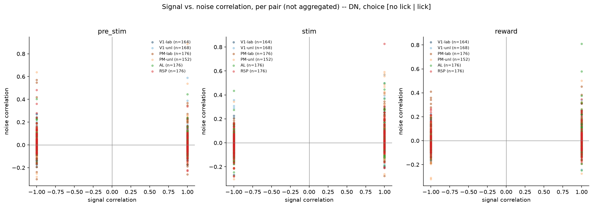

### Noise correlation by group

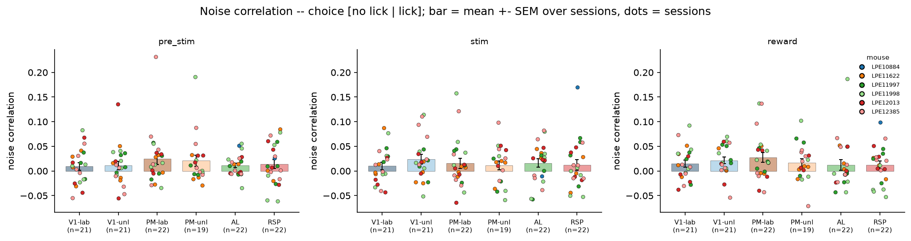

### 2b signal correlation by group

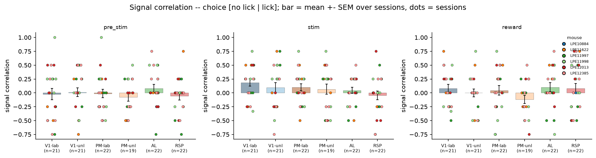

### 2c raw correlation by group

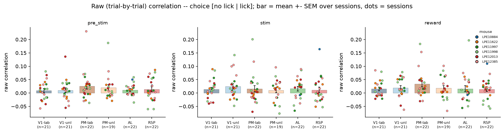

### Shuffle mode comparison

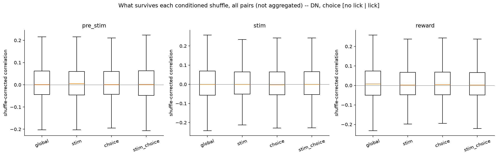

### 3b shuffle mode by group

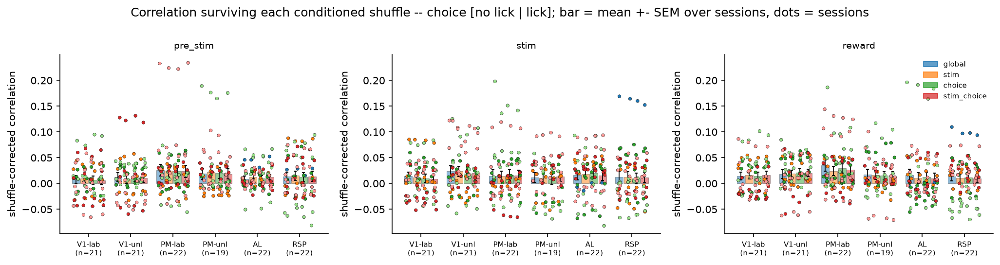

### Compare targets noise corr

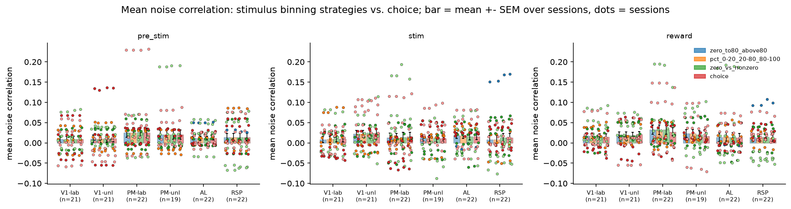

### Compare targets signal corr

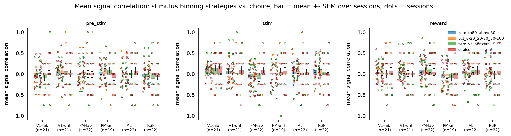

### Noise stim vs choice  pct 0-20 20-80 80-100

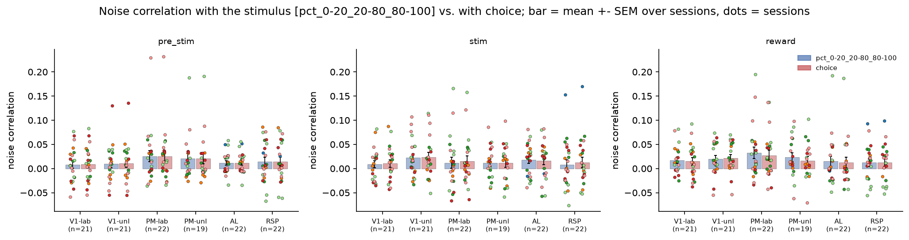

### Noise stim vs choice  zero to80 above80

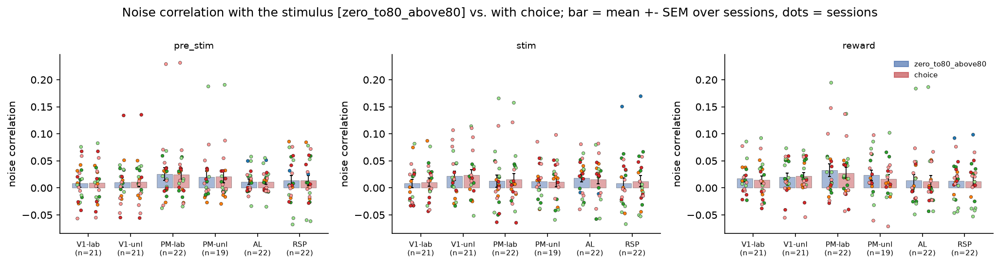

### Noise stim vs choice  zero vs nonzero

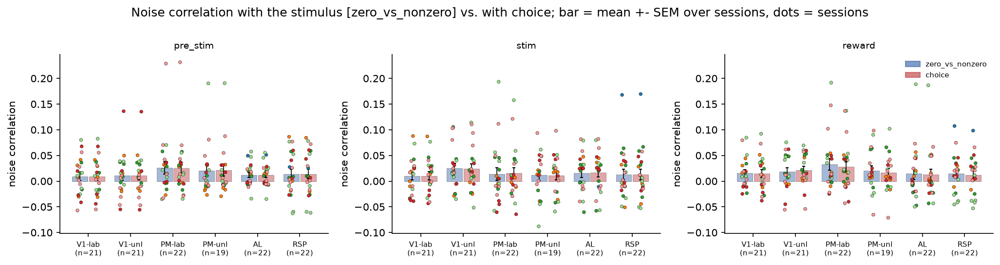

### Signal vs noise correlation

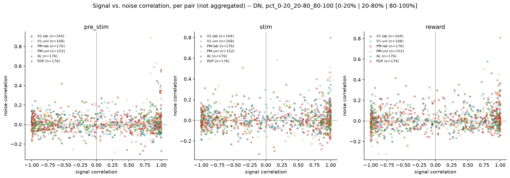

### Noise correlation by group

### 2b signal correlation by group

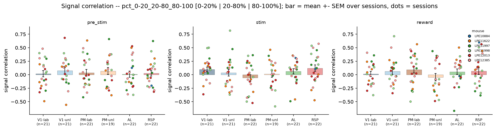

### 2c raw correlation by group

### Shuffle mode comparison

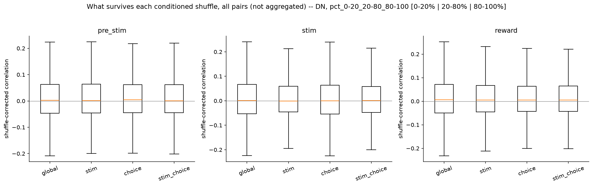

### 3b shuffle mode by group

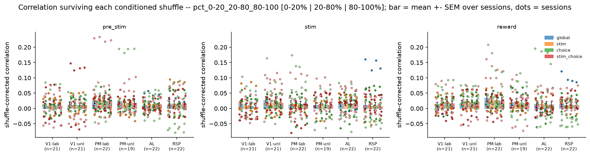

### Signal stim vs choice  pct 0-20 20-80 80-100

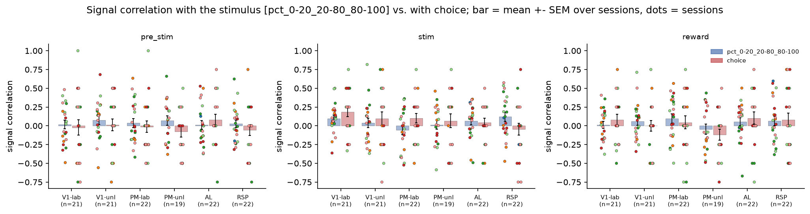

### Signal stim vs choice  zero to80 above80

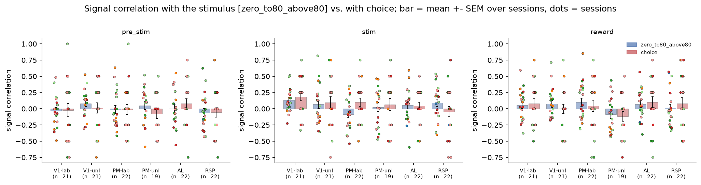

### Signal stim vs choice  zero vs nonzero

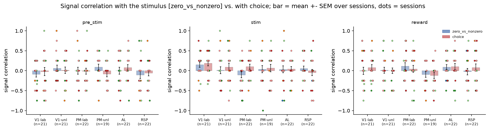

### Signal vs noise correlation

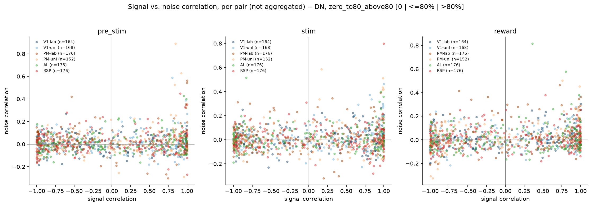

### Noise correlation by group

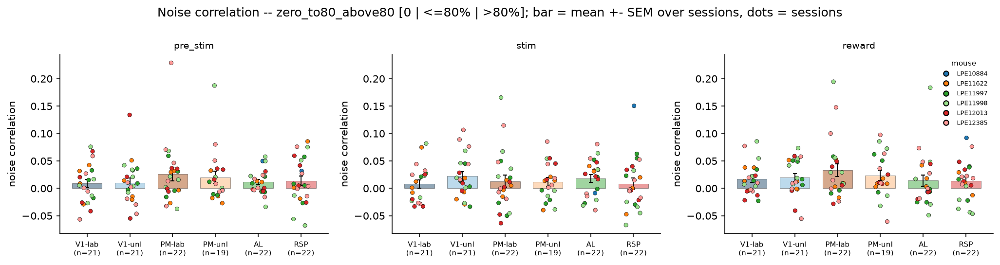

### 2b signal correlation by group

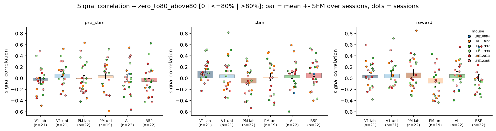

### 2c raw correlation by group

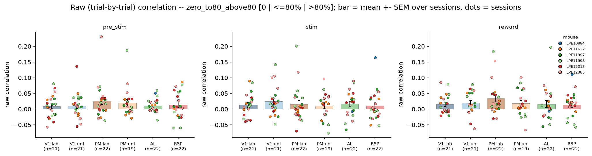

### Shuffle mode comparison

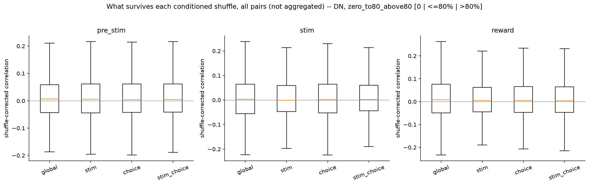

### 3b shuffle mode by group

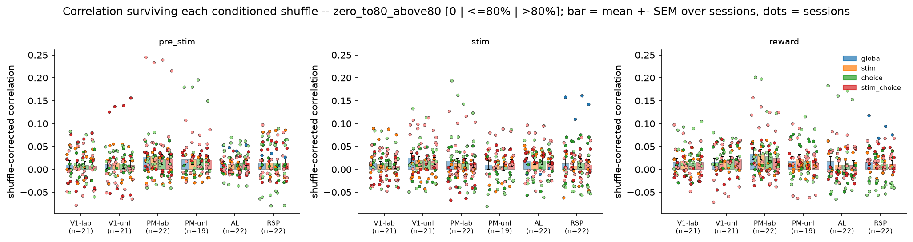

### Signal vs noise correlation

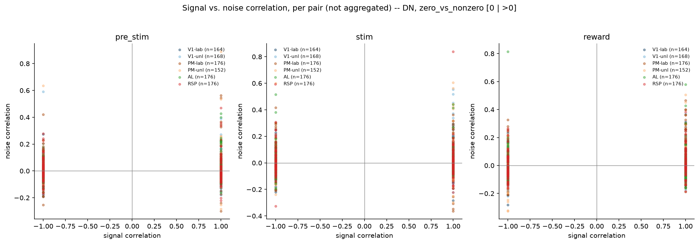

### Noise correlation by group

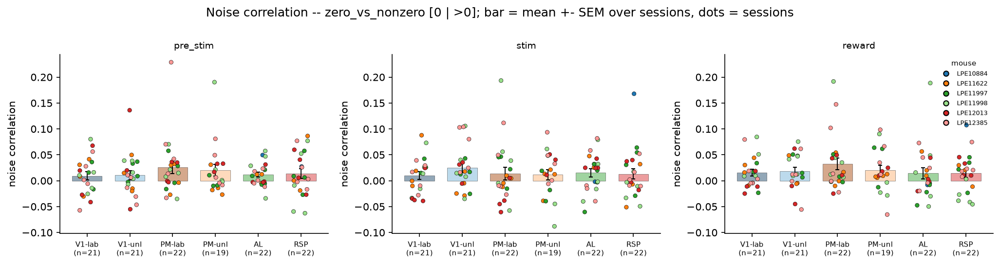

### 2b signal correlation by group

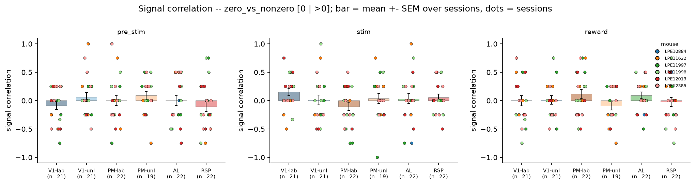

### 2c raw correlation by group

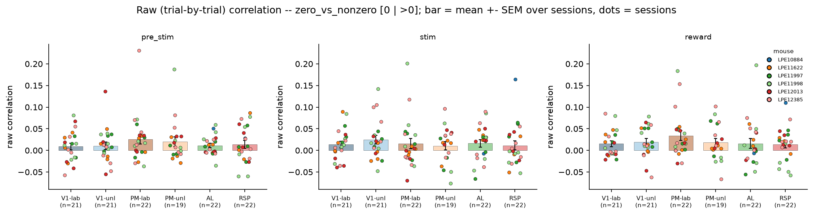

### Shuffle mode comparison

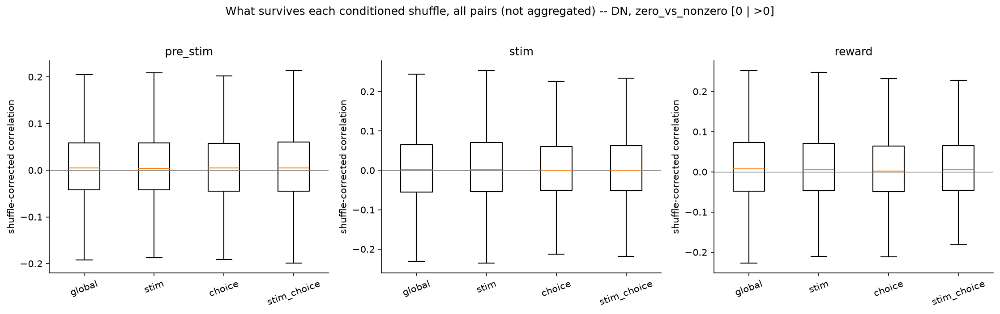

### 3b shuffle mode by group

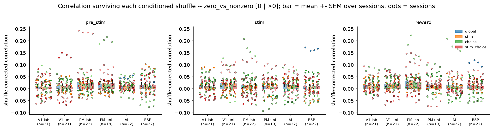
