# 3b_pair_information_breakdown

*Auto-generated from `2_pipeline/3b_pair_information_breakdown/out/` on 2026-11-10 17:48. Re-run `make_progress_md.py` after the script's output changes -- don't hand-edit this file.*

## Figures

### Rsi by group

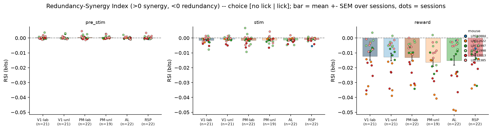

### 1b itotal by group

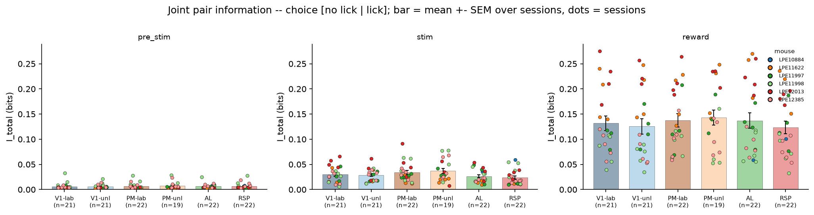

### Component breakdown

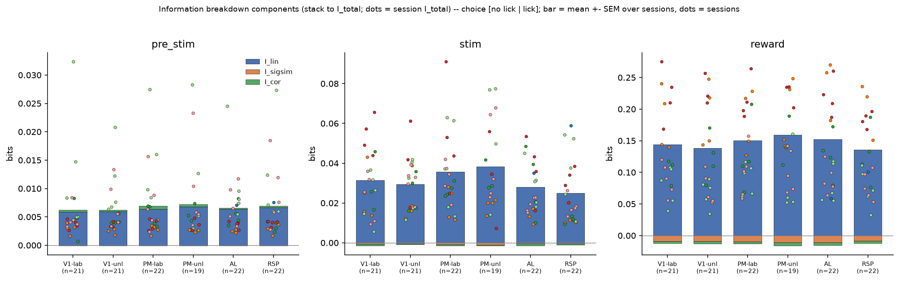

### Corind vs cordep

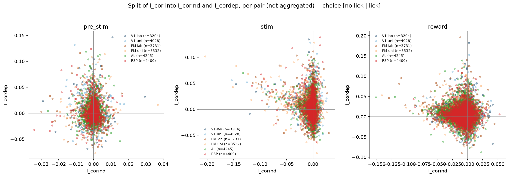

### Compare targets I cor

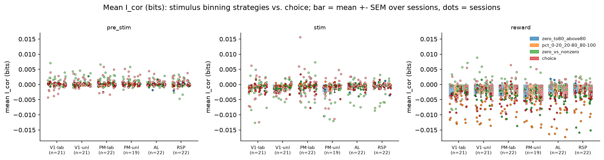

### Compare targets I total

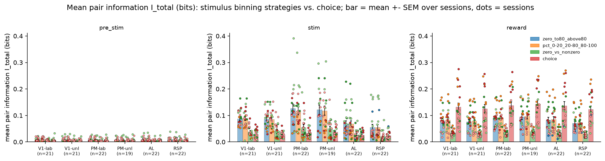

### Compare targets RSI

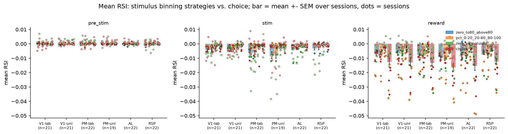

### Rsi by group

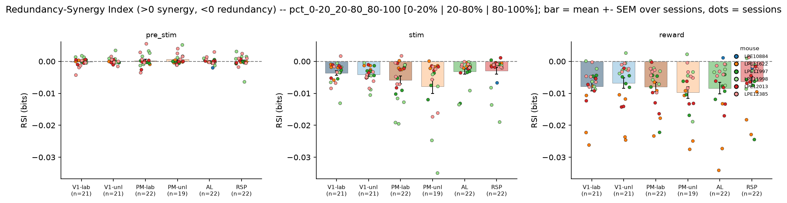

### 1b itotal by group

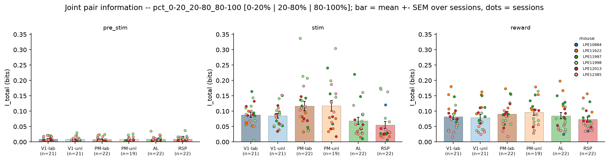

### Component breakdown

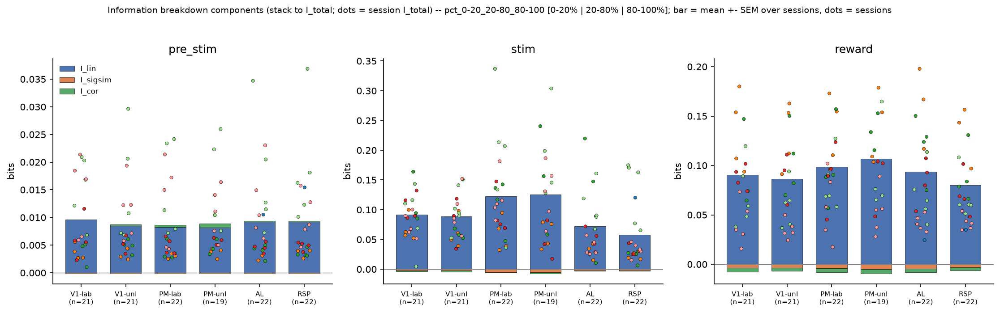

### Corind vs cordep

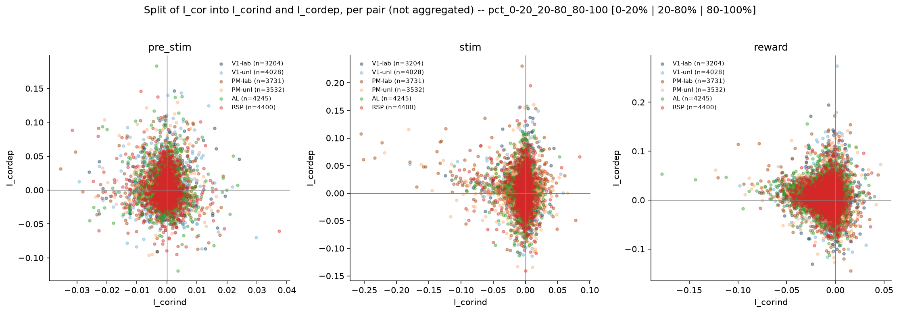

### Rsi by group

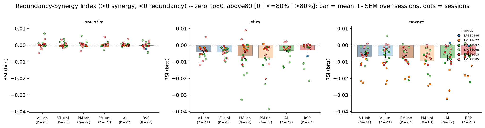

### 1b itotal by group

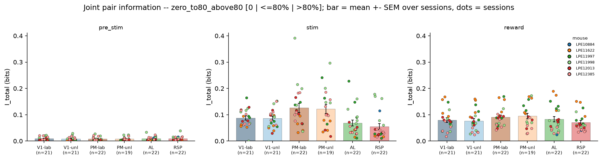

### Component breakdown

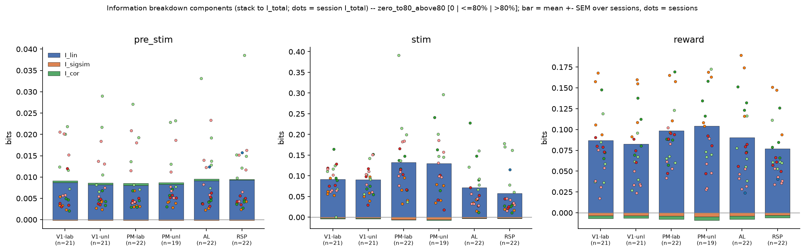

### Corind vs cordep

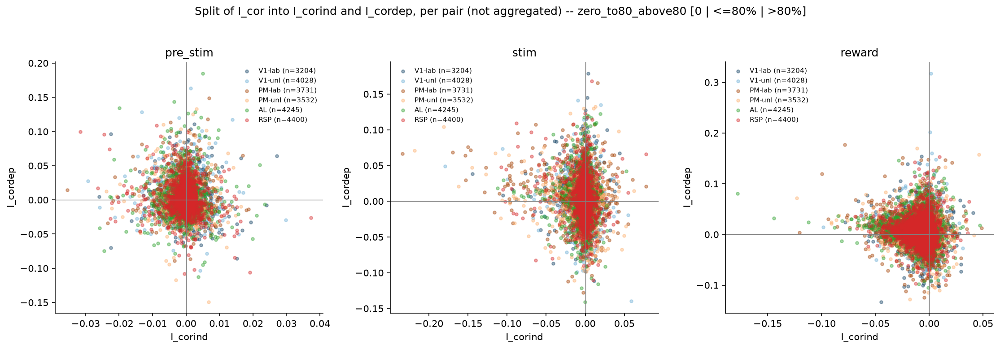

### Rsi by group

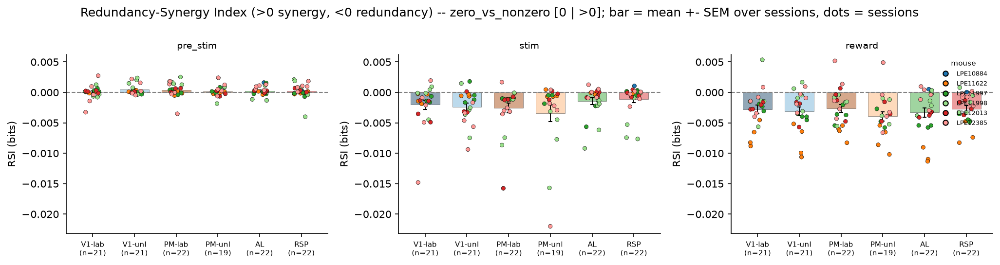

### 1b itotal by group

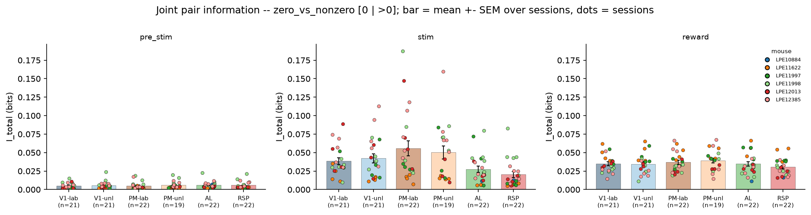

### Component breakdown

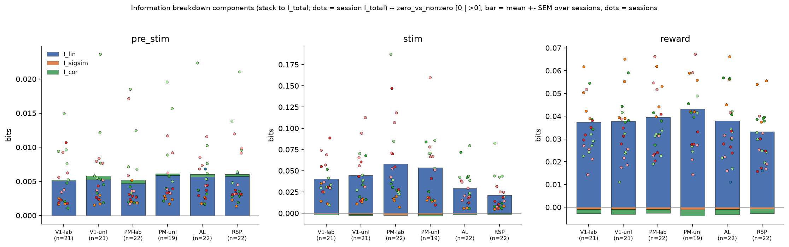

### Corind vs cordep

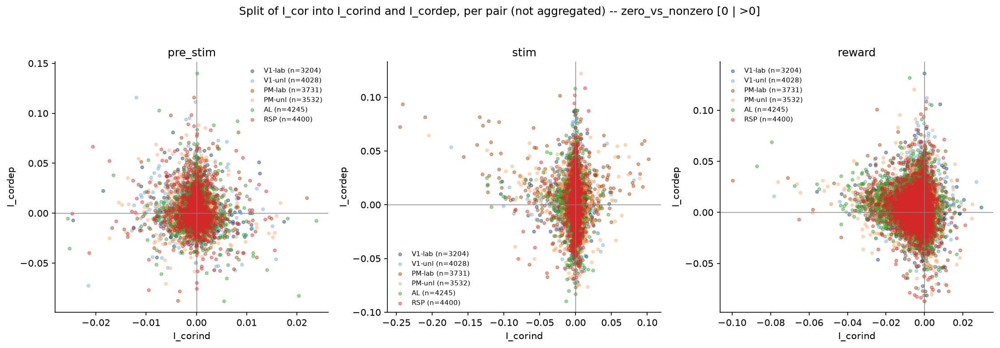

## Tables

### Pair information breakdown

| session_id | animal_id | window | target | roi_name | labeled_grouped | cell_i | cell_j | pair_rank | I_total | I_1 | I_2 | I_lin | I_ind | I_sigsim |
| --- | --- | --- | --- | --- | --- | --- | --- | --- | --- | --- | --- | --- | --- | --- |
| LPE10884_2024_01_12 | LPE10884 | pre_stim | zero_to80_above80 | AL | unl | LPE10884_2024_01_12_7_0042 | LPE10884_2024_01_12_7_0263 | 89 | 0 | 0.003505 | 0 | 0.003505 | 0.003505 | -2.015e-07 |
| LPE10884_2024_01_12 | LPE10884 | pre_stim | zero_to80_above80 | AL | unl | LPE10884_2024_01_12_7_0174 | LPE10884_2024_01_12_7_0267 | 7 | 0 | 0 | 0 | 0 | -3.721e-05 | -3.721e-05 |
| LPE10884_2024_01_12 | LPE10884 | pre_stim | zero_to80_above80 | AL | unl | LPE10884_2024_01_12_7_0073 | LPE10884_2024_01_12_7_0195 | 155 | 0.007007 | 0 | 0 | 0 | -7.821e-05 | -7.821e-05 |
| LPE10884_2024_01_12 | LPE10884 | pre_stim | zero_to80_above80 | AL | unl | LPE10884_2024_01_12_7_0286 | LPE10884_2024_01_12_7_0334 | 185 | 0.03876 | 0.04383 | 0 | 0.04383 | 0.04365 | -0.0001822 |
| LPE10884_2024_01_12 | LPE10884 | pre_stim | zero_to80_above80 | AL | unl | LPE10884_2024_01_12_7_0120 | LPE10884_2024_01_12_7_0278 | 53 | 0 | 0 | 0 | 0 | -1.88e-06 | -1.88e-06 |
| LPE10884_2024_01_12 | LPE10884 | pre_stim | zero_to80_above80 | AL | unl | LPE10884_2024_01_12_7_0122 | LPE10884_2024_01_12_7_0369 | 173 | 0 | 0.01043 | 0 | 0.01043 | 0.01029 | -0.0001404 |
| LPE10884_2024_01_12 | LPE10884 | pre_stim | zero_to80_above80 | AL | unl | LPE10884_2024_01_12_7_0144 | LPE10884_2024_01_12_7_0427 | 14 | 0.03627 | 0 | 0.008032 | 0.008032 | 0.007925 | -0.0001076 |
| LPE10884_2024_01_12 | LPE10884 | pre_stim | zero_to80_above80 | AL | unl | LPE10884_2024_01_12_7_0219 | LPE10884_2024_01_12_7_0247 | 38 | 0.006504 | 0.0006552 | 0.008844 | 0.0095 | 0.009458 | -4.139e-05 |
| LPE10884_2024_01_12 | LPE10884 | pre_stim | zero_to80_above80 | AL | unl | LPE10884_2024_01_12_7_0074 | LPE10884_2024_01_12_7_0107 | 75 | 0 | 0 | 0 | 0 | -9.473e-06 | -9.473e-06 |
| LPE10884_2024_01_12 | LPE10884 | pre_stim | zero_to80_above80 | AL | unl | LPE10884_2024_01_12_7_0055 | LPE10884_2024_01_12_7_0273 | 40 | 0.001487 | 0.004136 | 0 | 0.004136 | 0.004098 | -3.805e-05 |
| LPE10884_2024_01_12 | LPE10884 | pre_stim | zero_to80_above80 | AL | unl | LPE10884_2024_01_12_7_0233 | LPE10884_2024_01_12_7_0300 | 60 | 0 | 0 | 0.001783 | 0.001783 | 0.001738 | -4.421e-05 |
| LPE10884_2024_01_12 | LPE10884 | pre_stim | zero_to80_above80 | AL | unl | LPE10884_2024_01_12_7_0173 | LPE10884_2024_01_12_7_0376 | 26 | 0 | 0 | 0 | 0 | -4.67e-05 | -4.67e-05 |
| LPE10884_2024_01_12 | LPE10884 | pre_stim | zero_to80_above80 | AL | unl | LPE10884_2024_01_12_7_0044 | LPE10884_2024_01_12_7_0376 | 141 | 0.02757 | 0.005317 | 0.008996 | 0.01431 | 0.01411 | -0.0002046 |
| LPE10884_2024_01_12 | LPE10884 | pre_stim | zero_to80_above80 | AL | unl | LPE10884_2024_01_12_7_0168 | LPE10884_2024_01_12_7_0248 | 0 | 0 | 0 | 0.009546 | 0.009546 | 0.009522 | -2.413e-05 |
| LPE10884_2024_01_12 | LPE10884 | pre_stim | zero_to80_above80 | AL | unl | LPE10884_2024_01_12_7_0371 | LPE10884_2024_01_12_7_0399 | 129 | 0.04432 | 0.01703 | 0.0197 | 0.03673 | 0.03633 | -0.0004031 |
| LPE10884_2024_01_12 | LPE10884 | pre_stim | zero_to80_above80 | AL | unl | LPE10884_2024_01_12_7_0014 | LPE10884_2024_01_12_7_0020 | 124 | 0.01529 | 0 | 0.01862 | 0.01862 | 0.01862 | -6.207e-06 |
| LPE10884_2024_01_12 | LPE10884 | pre_stim | zero_to80_above80 | AL | unl | LPE10884_2024_01_12_7_0113 | LPE10884_2024_01_12_7_0250 | 143 | 0 | 0.0003739 | 0.001803 | 0.002177 | 0.00212 | -5.692e-05 |
| LPE10884_2024_01_12 | LPE10884 | pre_stim | zero_to80_above80 | AL | unl | LPE10884_2024_01_12_7_0037 | LPE10884_2024_01_12_7_0283 | 42 | 0 | 0.002476 | 0.001249 | 0.003725 | 0.003672 | -5.325e-05 |
| LPE10884_2024_01_12 | LPE10884 | pre_stim | zero_to80_above80 | AL | unl | LPE10884_2024_01_12_7_0062 | LPE10884_2024_01_12_7_0254 | 98 | 0.04468 | 0.004089 | 0.006524 | 0.01061 | 0.01046 | -0.000155 |
| LPE10884_2024_01_12 | LPE10884 | pre_stim | zero_to80_above80 | AL | unl | LPE10884_2024_01_12_7_0160 | LPE10884_2024_01_12_7_0236 | 126 | 0 | 0 | 0 | 0 | -0.0001012 | -0.0001012 |
| LPE10884_2024_01_12 | LPE10884 | pre_stim | zero_to80_above80 | AL | unl | LPE10884_2024_01_12_7_0302 | LPE10884_2024_01_12_7_0303 | 55 | 0.004316 | 0.02754 | 0.001846 | 0.02939 | 0.02917 | -0.0002152 |
| LPE10884_2024_01_12 | LPE10884 | pre_stim | zero_to80_above80 | AL | unl | LPE10884_2024_01_12_7_0254 | LPE10884_2024_01_12_7_0359 | 30 | 0.0002716 | 0.01052 | 0 | 0.01052 | 0.01051 | -6.566e-06 |
| LPE10884_2024_01_12 | LPE10884 | pre_stim | zero_to80_above80 | AL | unl | LPE10884_2024_01_12_7_0100 | LPE10884_2024_01_12_7_0263 | 150 | 0 | 0 | 0 | 0 | -4.483e-06 | -4.483e-06 |
| LPE10884_2024_01_12 | LPE10884 | pre_stim | zero_to80_above80 | AL | unl | LPE10884_2024_01_12_7_0179 | LPE10884_2024_01_12_7_0214 | 136 | 0.006016 | 0.02528 | 0 | 0.02528 | 0.02522 | -6.715e-05 |
| LPE10884_2024_01_12 | LPE10884 | pre_stim | zero_to80_above80 | AL | unl | LPE10884_2024_01_12_7_0159 | LPE10884_2024_01_12_7_0413 | 3 | 0.001979 | 0 | 0 | 0 | -6.643e-05 | -6.643e-05 |
| LPE10884_2024_01_12 | LPE10884 | pre_stim | zero_to80_above80 | AL | unl | LPE10884_2024_01_12_7_0166 | LPE10884_2024_01_12_7_0216 | 84 | 0.05236 | 0.009609 | 0.03184 | 0.04145 | 0.04083 | -0.0006204 |
| LPE10884_2024_01_12 | LPE10884 | pre_stim | zero_to80_above80 | AL | unl | LPE10884_2024_01_12_7_0141 | LPE10884_2024_01_12_7_0173 | 112 | 0.0184 | 0.007065 | 0 | 0.007065 | 0.007011 | -5.394e-05 |
| LPE10884_2024_01_12 | LPE10884 | pre_stim | zero_to80_above80 | AL | unl | LPE10884_2024_01_12_7_0105 | LPE10884_2024_01_12_7_0251 | 151 | 0.01467 | 0.01243 | 0.01169 | 0.02413 | 0.02386 | -0.0002686 |
| LPE10884_2024_01_12 | LPE10884 | pre_stim | zero_to80_above80 | AL | unl | LPE10884_2024_01_12_7_0167 | LPE10884_2024_01_12_7_0204 | 115 | 0 | 0 | 0 | 0 | -3.446e-05 | -3.446e-05 |
| LPE10884_2024_01_12 | LPE10884 | pre_stim | zero_to80_above80 | AL | unl | LPE10884_2024_01_12_7_0022 | LPE10884_2024_01_12_7_0292 | 28 | 0.01259 | 0.03357 | 0 | 0.03357 | 0.0331 | -0.0004696 |

*(showing first 15 of 26 columns; showing first 30 of 277680 rows -- see the linked CSV for the rest)*

[pair_information_breakdown.csv](../2_pipeline/3b_pair_information_breakdown/out/pair_information_breakdown.csv)

### Pair information breakdown by group

| group | window | target | n_pairs | I_total | I_lin | I_sigsim | I_cor | RSI | I_corind | I_cordep | frac_synergistic |
| --- | --- | --- | --- | --- | --- | --- | --- | --- | --- | --- | --- |
| AL_unl | pre_stim | choice | 105 | 0.007157 | 0.006351 | -8.108e-05 | 0.0008873 | 0.0008062 | -0.0001388 | 0.001026 | 0.2952 |
| AL_unl | pre_stim | pct_0-20_20-80_80-100 | 105 | 0.006161 | 0.006032 | -0.0001005 | 0.0002286 | 0.0001281 | -2.797e-05 | 0.0002566 | 0.2571 |
| AL_unl | pre_stim | zero_to80_above80 | 105 | 0.006212 | 0.006659 | -9.144e-05 | -0.0003558 | -0.0004473 | -7.298e-05 | -0.0002829 | 0.2667 |
| AL_unl | pre_stim | zero_vs_nonzero | 105 | 0.00483 | 0.005058 | -5.792e-05 | -0.0001707 | -0.0002286 | -5.189e-05 | -0.0001188 | 0.2667 |
| AL_unl | reward | choice | 105 | 0.1393 | 0.1564 | -0.01149 | -0.005641 | -0.01713 | -0.005776 | 0.000135 | 0.2095 |
| AL_unl | reward | pct_0-20_20-80_80-100 | 105 | 0.08011 | 0.09148 | -0.004573 | -0.006791 | -0.01136 | -0.007991 | 0.0012 | 0.2286 |
| AL_unl | reward | zero_to80_above80 | 105 | 0.0791 | 0.08907 | -0.004234 | -0.00573 | -0.009965 | -0.007799 | 0.002069 | 0.2952 |
| AL_unl | reward | zero_vs_nonzero | 105 | 0.03223 | 0.0366 | -0.000859 | -0.003515 | -0.004374 | -0.004341 | 0.0008258 | 0.3048 |
| AL_unl | stim | choice | 105 | 0.01953 | 0.02025 | -0.0002938 | -0.0004328 | -0.0007266 | -0.0005286 | 9.578e-05 | 0.3429 |
| AL_unl | stim | pct_0-20_20-80_80-100 | 105 | 0.05517 | 0.05524 | -0.001223 | 0.001153 | -6.976e-05 | -5.721e-05 | 0.00121 | 0.3905 |
| AL_unl | stim | zero_to80_above80 | 105 | 0.0551 | 0.0554 | -0.001245 | 0.0009395 | -0.0003051 | 4.328e-05 | 0.0008962 | 0.4 |
| AL_unl | stim | zero_vs_nonzero | 105 | 0.02138 | 0.02163 | -0.0003734 | 0.0001241 | -0.0002493 | 0.0002008 | -7.668e-05 | 0.3238 |
| PM_lab | pre_stim | choice | 100 | 0.008336 | 0.006528 | -6.5e-05 | 0.001872 | 0.001807 | -1.267e-05 | 0.001885 | 0.35 |
| PM_lab | pre_stim | pct_0-20_20-80_80-100 | 100 | 0.009183 | 0.006755 | -0.0001162 | 0.002544 | 0.002428 | -1.392e-05 | 0.002558 | 0.37 |
| PM_lab | pre_stim | zero_to80_above80 | 100 | 0.005942 | 0.00653 | -0.0001115 | -0.0004759 | -0.0005874 | -6.908e-05 | -0.0004068 | 0.29 |
| PM_lab | pre_stim | zero_vs_nonzero | 100 | 0.002657 | 0.00306 | -2.766e-05 | -0.0003754 | -0.000403 | -0.000275 | -0.0001004 | 0.22 |
| PM_lab | reward | choice | 100 | 0.1482 | 0.1651 | -0.01238 | -0.004539 | -0.01692 | -0.007983 | 0.003444 | 0.24 |
| PM_lab | reward | pct_0-20_20-80_80-100 | 100 | 0.08667 | 0.0941 | -0.003776 | -0.00365 | -0.007426 | -0.008362 | 0.004712 | 0.34 |
| PM_lab | reward | zero_to80_above80 | 100 | 0.0864 | 0.09402 | -0.003539 | -0.004084 | -0.007623 | -0.007945 | 0.003861 | 0.33 |
| PM_lab | reward | zero_vs_nonzero | 100 | 0.03807 | 0.04038 | -0.0008719 | -0.001443 | -0.002315 | -0.004244 | 0.002801 | 0.3 |
| PM_lab | stim | choice | 100 | 0.03258 | 0.03703 | -0.001013 | -0.003436 | -0.00445 | -0.003127 | -0.0003094 | 0.32 |
| PM_lab | stim | pct_0-20_20-80_80-100 | 100 | 0.1126 | 0.1162 | -0.003816 | 0.0002006 | -0.003615 | -0.003057 | 0.003257 | 0.42 |
| PM_lab | stim | zero_to80_above80 | 100 | 0.1227 | 0.1287 | -0.003918 | -0.002059 | -0.005977 | -0.003001 | 0.0009416 | 0.36 |
| PM_lab | stim | zero_vs_nonzero | 100 | 0.05542 | 0.05655 | -0.001999 | 0.0008705 | -0.001128 | 7.232e-05 | 0.0007982 | 0.36 |
| PM_unl | pre_stim | choice | 100 | 0.00733 | 0.006692 | -0.0001177 | 0.0007558 | 0.0006381 | 0.0001396 | 0.0006162 | 0.33 |
| PM_unl | pre_stim | pct_0-20_20-80_80-100 | 100 | 0.008198 | 0.007059 | -0.0001486 | 0.001288 | 0.001139 | 0.000325 | 0.0009625 | 0.31 |
| PM_unl | pre_stim | zero_to80_above80 | 100 | 0.008551 | 0.007455 | -0.0001429 | 0.001239 | 0.001096 | 0.0002009 | 0.001038 | 0.3 |
| PM_unl | pre_stim | zero_vs_nonzero | 100 | 0.003539 | 0.003918 | -5.666e-05 | -0.0003232 | -0.0003799 | -0.000134 | -0.0001892 | 0.29 |
| PM_unl | reward | choice | 100 | 0.1395 | 0.152 | -0.009272 | -0.003272 | -0.01254 | -0.00579 | 0.002517 | 0.24 |
| PM_unl | reward | pct_0-20_20-80_80-100 | 100 | 0.09167 | 0.1009 | -0.004084 | -0.005145 | -0.009229 | -0.007096 | 0.001952 | 0.25 |

*(showing first 30 of 72 rows -- see the linked CSV for the rest)*

[pair_information_breakdown_by_group.csv](../2_pipeline/3b_pair_information_breakdown/out/pair_information_breakdown_by_group.csv)

### Pair information breakdown by group  session

| group | unit | animal_id | window | target | n_pairs | I_total | I_lin | I_sigsim | I_cor | RSI | I_corind | I_cordep | frac_synergistic |
| --- | --- | --- | --- | --- | --- | --- | --- | --- | --- | --- | --- | --- | --- |
| AL_unl | LPE10884_2024_01_12 | LPE10884 | pre_stim | choice | 200 | 0.007038 | 0.007623 | -6.755e-05 | -0.0005168 | -0.0005844 | -5.602e-05 | -0.0004608 | 0.29 |
| AL_unl | LPE11622_2024_02_22 | LPE11622 | pre_stim | choice | 200 | 0.002449 | 0.00245 | -5.006e-06 | 4.862e-06 | -1.44e-07 | -6.634e-06 | 1.15e-05 | 0.305 |
| AL_unl | LPE11622_2024_02_23 | LPE11622 | pre_stim | choice | 200 | 0.002732 | 0.002907 | -9.452e-06 | -0.0001656 | -0.000175 | -3.894e-05 | -0.0001266 | 0.24 |
| AL_unl | LPE11622_2024_02_26 | LPE11622 | pre_stim | choice | 200 | 0.002185 | 0.002412 | -6.19e-06 | -0.0002214 | -0.0002276 | 3.84e-06 | -0.0002253 | 0.255 |
| AL_unl | LPE11997_2024_04_10 | LPE11997 | pre_stim | choice | 200 | 0.004371 | 0.004154 | -2.419e-05 | 0.0002415 | 0.0002173 | -3.231e-05 | 0.0002739 | 0.29 |
| AL_unl | LPE11997_2024_04_16 | LPE11997 | pre_stim | choice | 200 | 0.003478 | 0.004034 | -1.54e-05 | -0.0005401 | -0.0005555 | -5.27e-05 | -0.0004874 | 0.29 |
| AL_unl | LPE11997_2024_04_17 | LPE11997 | pre_stim | choice | 200 | 0.005607 | 0.005658 | -3.323e-05 | -1.734e-05 | -5.058e-05 | -0.0002806 | 0.0002633 | 0.285 |
| AL_unl | LPE11997_2024_04_18 | LPE11997 | pre_stim | choice | 45 | 0.008193 | 0.008208 | -6.222e-05 | 4.732e-05 | -1.49e-05 | 0.0001796 | -0.0001323 | 0.4 |
| AL_unl | LPE11998_2024_04_23 | LPE11998 | pre_stim | choice | 200 | 0.009521 | 0.009425 | -0.000229 | 0.0003249 | 9.588e-05 | 0.0001266 | 0.0001983 | 0.23 |
| AL_unl | LPE11998_2024_04_24 | LPE11998 | pre_stim | choice | 200 | 0.02449 | 0.0224 | -0.0007351 | 0.002828 | 0.002093 | -0.0005452 | 0.003373 | 0.36 |
| AL_unl | LPE11998_2024_04_25 | LPE11998 | pre_stim | choice | 200 | 0.005443 | 0.004764 | -5.948e-05 | 0.0007384 | 0.0006789 | -6.856e-05 | 0.0008069 | 0.29 |
| AL_unl | LPE11998_2024_04_29 | LPE11998 | pre_stim | choice | 200 | 0.008088 | 0.009115 | -0.0001104 | -0.0009164 | -0.001027 | -7.819e-05 | -0.0008382 | 0.26 |
| AL_unl | LPE11998_2024_05_01 | LPE11998 | pre_stim | choice | 200 | 0.007385 | 0.007285 | -9.555e-05 | 0.0001952 | 9.969e-05 | -8.865e-05 | 0.0002839 | 0.275 |
| AL_unl | LPE12013_2024_04_25 | LPE12013 | pre_stim | choice | 200 | 0.004169 | 0.004277 | -2.221e-05 | -8.608e-05 | -0.0001083 | 1.534e-06 | -8.762e-05 | 0.28 |
| AL_unl | LPE12013_2024_04_26 | LPE12013 | pre_stim | choice | 200 | 0.002649 | 0.002604 | -1.109e-05 | 5.633e-05 | 4.524e-05 | -6.608e-06 | 6.293e-05 | 0.25 |
| AL_unl | LPE12013_2024_04_29 | LPE12013 | pre_stim | choice | 200 | 0.00389 | 0.003701 | -1.679e-05 | 0.0002055 | 0.0001888 | -6.17e-05 | 0.0002672 | 0.265 |
| AL_unl | LPE12013_2024_04_30 | LPE12013 | pre_stim | choice | 200 | 0.00379 | 0.004063 | -1.522e-05 | -0.0002579 | -0.0002732 | -5.237e-05 | -0.0002056 | 0.295 |
| AL_unl | LPE12385_2024_06_15 | LPE12385 | pre_stim | choice | 200 | 0.006494 | 0.005576 | -6.632e-05 | 0.0009851 | 0.0009187 | -2.028e-05 | 0.001005 | 0.305 |
| AL_unl | LPE12385_2024_06_16 | LPE12385 | pre_stim | choice | 200 | 0.00508 | 0.004878 | -4.461e-05 | 0.0002461 | 0.0002015 | -0.0001345 | 0.0003807 | 0.285 |
| AL_unl | LPE12385_2024_06_17 | LPE12385 | pre_stim | choice | 200 | 0.003344 | 0.003492 | -2.266e-05 | -0.000125 | -0.0001477 | -3.004e-05 | -9.497e-05 | 0.295 |
| AL_unl | LPE12385_2024_06_26 | LPE12385 | pre_stim | choice | 200 | 0.01169 | 0.01268 | -0.0002531 | -0.0007282 | -0.0009813 | -0.0007376 | 9.364e-06 | 0.315 |
| AL_unl | LPE12385_2024_06_27 | LPE12385 | pre_stim | choice | 200 | 0.009774 | 0.008987 | -0.0001703 | 0.0009581 | 0.0007878 | -0.0002562 | 0.001214 | 0.27 |
| AL_unl | LPE10884_2024_01_12 | LPE10884 | pre_stim | pct_0-20_20-80_80-100 | 200 | 0.01051 | 0.01254 | -0.000164 | -0.001868 | -0.002032 | -0.0001809 | -0.001687 | 0.29 |
| AL_unl | LPE11622_2024_02_22 | LPE11622 | pre_stim | pct_0-20_20-80_80-100 | 200 | 0.002212 | 0.002438 | -6.043e-06 | -0.0002197 | -0.0002258 | -2.121e-06 | -0.0002176 | 0.295 |
| AL_unl | LPE11622_2024_02_23 | LPE11622 | pre_stim | pct_0-20_20-80_80-100 | 200 | 0.00412 | 0.004669 | -1.738e-05 | -0.0005322 | -0.0005495 | 6.472e-07 | -0.0005328 | 0.24 |
| AL_unl | LPE11622_2024_02_26 | LPE11622 | pre_stim | pct_0-20_20-80_80-100 | 200 | 0.003089 | 0.003385 | -9.908e-06 | -0.0002857 | -0.0002956 | -1.536e-05 | -0.0002704 | 0.26 |
| AL_unl | LPE11997_2024_04_10 | LPE11997 | pre_stim | pct_0-20_20-80_80-100 | 200 | 0.004975 | 0.005222 | -3.742e-05 | -0.0002088 | -0.0002462 | -0.0001508 | -5.802e-05 | 0.27 |
| AL_unl | LPE11997_2024_04_16 | LPE11997 | pre_stim | pct_0-20_20-80_80-100 | 200 | 0.004389 | 0.004078 | -2.051e-05 | 0.0003321 | 0.0003116 | 2.101e-05 | 0.0003111 | 0.315 |
| AL_unl | LPE11997_2024_04_17 | LPE11997 | pre_stim | pct_0-20_20-80_80-100 | 200 | 0.004037 | 0.004244 | -1.671e-05 | -0.0001903 | -0.0002071 | -3.073e-05 | -0.0001596 | 0.285 |
| AL_unl | LPE11997_2024_04_18 | LPE11997 | pre_stim | pct_0-20_20-80_80-100 | 45 | 0.00212 | 0.001585 | -1.365e-05 | 0.0005492 | 0.0005356 | 5.519e-05 | 0.000494 | 0.2222 |

*(showing first 30 of 1536 rows -- see the linked CSV for the rest)*

[pair_information_breakdown_by_group__session.csv](../2_pipeline/3b_pair_information_breakdown/out/pair_information_breakdown_by_group__session.csv)
