# 3b_pair_information_breakdown

*Auto-generated from `2_pipeline/3b_pair_information_breakdown/out/` on 2026-10-30 12:23. Re-run `make_progress_md.py` after the script's output changes -- don't hand-edit this file.*

## Tables

### Pair information breakdown

| session_id | animal_id | window | target | roi_name | labeled_grouped | cell_i | cell_j | pair_rank | I_total | I_1 | I_2 | I_lin | I_ind | I_sigsim |
| --- | --- | --- | --- | --- | --- | --- | --- | --- | --- | --- | --- | --- | --- | --- |
| LPE10884_2024_01_12 | LPE10884 | pre_stim | zero_to80_above80 | AL | unl | LPE10884_2024_01_12_7_0039 | LPE10884_2024_01_12_7_0198 | 2 | 0 | 0.008487 | 0 | 0.008487 | 0.008464 | -2.296e-05 |
| LPE10884_2024_01_12 | LPE10884 | pre_stim | zero_to80_above80 | AL | unl | LPE10884_2024_01_12_7_0142 | LPE10884_2024_01_12_7_0278 | 4 | 0 | 0.0007857 | 0 | 0.0007857 | 0.0007491 | -3.662e-05 |
| LPE10884_2024_01_12 | LPE10884 | pre_stim | zero_to80_above80 | AL | unl | LPE10884_2024_01_12_7_0035 | LPE10884_2024_01_12_7_0220 | 1 | 0 | 0 | 0.009352 | 0.009352 | 0.009261 | -9.128e-05 |
| LPE10884_2024_01_12 | LPE10884 | pre_stim | zero_to80_above80 | AL | unl | LPE10884_2024_01_12_7_0116 | LPE10884_2024_01_12_7_0136 | 0 | 0 | 0.01027 | 0 | 0.01027 | 0.01019 | -8.041e-05 |
| LPE10884_2024_01_12 | LPE10884 | pre_stim | zero_to80_above80 | AL | unl | LPE10884_2024_01_12_7_0076 | LPE10884_2024_01_12_7_0177 | 3 | 0.002654 | 0 | 0 | 0 | -1.548e-05 | -1.548e-05 |
| LPE10884_2024_01_12 | LPE10884 | pre_stim | zero_to80_above80 | RSP | unl | LPE10884_2024_01_12_6_0002 | LPE10884_2024_01_12_6_0053 | 0 | 0.01279 | 0 | 0 | 0 | -2.479e-05 | -2.479e-05 |
| LPE10884_2024_01_12 | LPE10884 | pre_stim | zero_to80_above80 | RSP | unl | LPE10884_2024_01_12_6_0032 | LPE10884_2024_01_12_6_0046 | 1 | 0.03723 | 0 | 0.04874 | 0.04874 | 0.04858 | -0.000164 |
| LPE10884_2024_01_12 | LPE10884 | pre_stim | zero_to80_above80 | RSP | unl | LPE10884_2024_01_12_6_0024 | LPE10884_2024_01_12_6_0028 | 4 | 0.014 | 0.005516 | 0.01413 | 0.01964 | 0.01961 | -3.457e-05 |
| LPE10884_2024_01_12 | LPE10884 | pre_stim | zero_to80_above80 | RSP | unl | LPE10884_2024_01_12_6_0019 | LPE10884_2024_01_12_6_0062 | 3 | 0.02622 | 0.00564 | 0.00336 | 0.009 | 0.008875 | -0.0001245 |
| LPE10884_2024_01_12 | LPE10884 | pre_stim | zero_to80_above80 | RSP | unl | LPE10884_2024_01_12_6_0012 | LPE10884_2024_01_12_6_0025 | 2 | 0 | 0 | 0.02027 | 0.02027 | 0.02017 | -0.0001043 |
| LPE10884_2024_01_12 | LPE10884 | pre_stim | pct_0-20_20-80_80-100 | AL | unl | LPE10884_2024_01_12_7_0039 | LPE10884_2024_01_12_7_0198 | 2 | 0 | 0.02389 | 0 | 0.02389 | 0.02377 | -0.0001153 |
| LPE10884_2024_01_12 | LPE10884 | pre_stim | pct_0-20_20-80_80-100 | AL | unl | LPE10884_2024_01_12_7_0142 | LPE10884_2024_01_12_7_0278 | 4 | 0 | 0 | 0.002687 | 0.002687 | 0.002683 | -4.2e-06 |
| LPE10884_2024_01_12 | LPE10884 | pre_stim | pct_0-20_20-80_80-100 | AL | unl | LPE10884_2024_01_12_7_0035 | LPE10884_2024_01_12_7_0220 | 1 | 0 | 0 | 0.003718 | 0.003718 | 0.003695 | -2.306e-05 |
| LPE10884_2024_01_12 | LPE10884 | pre_stim | pct_0-20_20-80_80-100 | AL | unl | LPE10884_2024_01_12_7_0116 | LPE10884_2024_01_12_7_0136 | 0 | 0 | 0 | 0 | 0 | -6.692e-05 | -6.692e-05 |
| LPE10884_2024_01_12 | LPE10884 | pre_stim | pct_0-20_20-80_80-100 | AL | unl | LPE10884_2024_01_12_7_0076 | LPE10884_2024_01_12_7_0177 | 3 | 0 | 0 | 0 | 0 | -9.678e-06 | -9.678e-06 |
| LPE10884_2024_01_12 | LPE10884 | pre_stim | pct_0-20_20-80_80-100 | RSP | unl | LPE10884_2024_01_12_6_0002 | LPE10884_2024_01_12_6_0053 | 0 | 0.03745 | 0 | 0 | 0 | -4.372e-05 | -4.372e-05 |
| LPE10884_2024_01_12 | LPE10884 | pre_stim | pct_0-20_20-80_80-100 | RSP | unl | LPE10884_2024_01_12_6_0032 | LPE10884_2024_01_12_6_0046 | 1 | 0.05503 | 0 | 0.05702 | 0.05702 | 0.05665 | -0.0003721 |
| LPE10884_2024_01_12 | LPE10884 | pre_stim | pct_0-20_20-80_80-100 | RSP | unl | LPE10884_2024_01_12_6_0024 | LPE10884_2024_01_12_6_0028 | 4 | 0 | 0 | 0.005698 | 0.005698 | 0.005626 | -7.138e-05 |
| LPE10884_2024_01_12 | LPE10884 | pre_stim | pct_0-20_20-80_80-100 | RSP | unl | LPE10884_2024_01_12_6_0019 | LPE10884_2024_01_12_6_0062 | 3 | 0.02509 | 0.0006112 | 0.004582 | 0.005193 | 0.004894 | -0.0002989 |
| LPE10884_2024_01_12 | LPE10884 | pre_stim | pct_0-20_20-80_80-100 | RSP | unl | LPE10884_2024_01_12_6_0012 | LPE10884_2024_01_12_6_0025 | 2 | 0 | 0 | 0.009513 | 0.009513 | 0.009355 | -0.0001577 |
| LPE10884_2024_01_12 | LPE10884 | pre_stim | zero_vs_nonzero | AL | unl | LPE10884_2024_01_12_7_0039 | LPE10884_2024_01_12_7_0198 | 2 | 0 | 0 | 0 | 0 | -1.037e-05 | -1.037e-05 |
| LPE10884_2024_01_12 | LPE10884 | pre_stim | zero_vs_nonzero | AL | unl | LPE10884_2024_01_12_7_0142 | LPE10884_2024_01_12_7_0278 | 4 | 0 | 0.003161 | 0 | 0.003161 | 0.003155 | -5.706e-06 |
| LPE10884_2024_01_12 | LPE10884 | pre_stim | zero_vs_nonzero | AL | unl | LPE10884_2024_01_12_7_0035 | LPE10884_2024_01_12_7_0220 | 1 | 0.01016 | 8.169e-05 | 0 | 8.169e-05 | 7.468e-05 | -7.013e-06 |
| LPE10884_2024_01_12 | LPE10884 | pre_stim | zero_vs_nonzero | AL | unl | LPE10884_2024_01_12_7_0116 | LPE10884_2024_01_12_7_0136 | 0 | 0 | 0.005674 | 0 | 0.005674 | 0.005653 | -2.114e-05 |
| LPE10884_2024_01_12 | LPE10884 | pre_stim | zero_vs_nonzero | AL | unl | LPE10884_2024_01_12_7_0076 | LPE10884_2024_01_12_7_0177 | 3 | 0 | 0.0007487 | 0 | 0.0007487 | 0.0007487 | -3.938e-09 |
| LPE10884_2024_01_12 | LPE10884 | pre_stim | zero_vs_nonzero | RSP | unl | LPE10884_2024_01_12_6_0002 | LPE10884_2024_01_12_6_0053 | 0 | 0.02668 | 0.001311 | 0 | 0.001311 | 0.001292 | -1.922e-05 |
| LPE10884_2024_01_12 | LPE10884 | pre_stim | zero_vs_nonzero | RSP | unl | LPE10884_2024_01_12_6_0032 | LPE10884_2024_01_12_6_0046 | 1 | 0 | 0 | 0 | 0 | -1.474e-06 | -1.474e-06 |
| LPE10884_2024_01_12 | LPE10884 | pre_stim | zero_vs_nonzero | RSP | unl | LPE10884_2024_01_12_6_0024 | LPE10884_2024_01_12_6_0028 | 4 | 0.01052 | 0.008712 | 0 | 0.008712 | 0.00869 | -2.246e-05 |
| LPE10884_2024_01_12 | LPE10884 | pre_stim | zero_vs_nonzero | RSP | unl | LPE10884_2024_01_12_6_0019 | LPE10884_2024_01_12_6_0062 | 3 | 0.02481 | 0.008958 | 0 | 0.008958 | 0.008934 | -2.401e-05 |
| LPE10884_2024_01_12 | LPE10884 | pre_stim | zero_vs_nonzero | RSP | unl | LPE10884_2024_01_12_6_0012 | LPE10884_2024_01_12_6_0025 | 2 | 0.0134 | 0 | 0.004964 | 0.004964 | 0.004951 | -1.353e-05 |

*(showing first 15 of 26 columns; showing first 30 of 7608 rows -- see the linked CSV for the rest)*

[pair_information_breakdown.csv](../2_pipeline/3b_pair_information_breakdown/out/pair_information_breakdown.csv)

### Pair information breakdown by group

| group | window | target | n_pairs | I_total | I_lin | I_sigsim | I_cor | RSI | I_corind | I_cordep | frac_synergistic |
| --- | --- | --- | --- | --- | --- | --- | --- | --- | --- | --- | --- |
| AL_unl | pre_stim | choice | 105 | 0.007157 | 0.006351 | -8.108e-05 | 0.0008873 | 0.0008062 | -0.0001388 | 0.001026 | 0.2952 |
| AL_unl | pre_stim | pct_0-20_20-80_80-100 | 105 | 0.006161 | 0.006032 | -0.0001005 | 0.0002286 | 0.0001281 | -2.797e-05 | 0.0002566 | 0.2571 |
| AL_unl | pre_stim | zero_to80_above80 | 105 | 0.006212 | 0.006659 | -9.144e-05 | -0.0003558 | -0.0004473 | -7.298e-05 | -0.0002829 | 0.2667 |
| AL_unl | pre_stim | zero_vs_nonzero | 105 | 0.00483 | 0.005058 | -5.792e-05 | -0.0001707 | -0.0002286 | -5.189e-05 | -0.0001188 | 0.2667 |
| AL_unl | reward | choice | 105 | 0.1393 | 0.1564 | -0.01149 | -0.005641 | -0.01713 | -0.005776 | 0.000135 | 0.2095 |
| AL_unl | reward | pct_0-20_20-80_80-100 | 105 | 0.08011 | 0.09148 | -0.004573 | -0.006791 | -0.01136 | -0.007991 | 0.0012 | 0.2286 |
| AL_unl | reward | zero_to80_above80 | 105 | 0.0791 | 0.08907 | -0.004234 | -0.00573 | -0.009965 | -0.007799 | 0.002069 | 0.2952 |
| AL_unl | reward | zero_vs_nonzero | 105 | 0.03223 | 0.0366 | -0.000859 | -0.003515 | -0.004374 | -0.004341 | 0.0008258 | 0.3048 |
| AL_unl | stim | choice | 105 | 0.01953 | 0.02025 | -0.0002938 | -0.0004328 | -0.0007266 | -0.0005286 | 9.578e-05 | 0.3429 |
| AL_unl | stim | pct_0-20_20-80_80-100 | 105 | 0.05517 | 0.05524 | -0.001223 | 0.001153 | -6.976e-05 | -5.721e-05 | 0.00121 | 0.3905 |
| AL_unl | stim | zero_to80_above80 | 105 | 0.0551 | 0.0554 | -0.001245 | 0.0009395 | -0.0003051 | 4.328e-05 | 0.0008962 | 0.4 |
| AL_unl | stim | zero_vs_nonzero | 105 | 0.02138 | 0.02163 | -0.0003734 | 0.0001241 | -0.0002493 | 0.0002008 | -7.668e-05 | 0.3238 |
| PM_lab | pre_stim | choice | 100 | 0.008336 | 0.006528 | -6.5e-05 | 0.001872 | 0.001807 | -1.267e-05 | 0.001885 | 0.35 |
| PM_lab | pre_stim | pct_0-20_20-80_80-100 | 100 | 0.009183 | 0.006755 | -0.0001162 | 0.002544 | 0.002428 | -1.392e-05 | 0.002558 | 0.37 |
| PM_lab | pre_stim | zero_to80_above80 | 100 | 0.005942 | 0.00653 | -0.0001115 | -0.0004759 | -0.0005874 | -6.908e-05 | -0.0004068 | 0.29 |
| PM_lab | pre_stim | zero_vs_nonzero | 100 | 0.002657 | 0.00306 | -2.766e-05 | -0.0003754 | -0.000403 | -0.000275 | -0.0001004 | 0.22 |
| PM_lab | reward | choice | 100 | 0.1482 | 0.1651 | -0.01238 | -0.004539 | -0.01692 | -0.007983 | 0.003444 | 0.24 |
| PM_lab | reward | pct_0-20_20-80_80-100 | 100 | 0.08667 | 0.0941 | -0.003776 | -0.00365 | -0.007426 | -0.008362 | 0.004712 | 0.34 |
| PM_lab | reward | zero_to80_above80 | 100 | 0.0864 | 0.09402 | -0.003539 | -0.004084 | -0.007623 | -0.007945 | 0.003861 | 0.33 |
| PM_lab | reward | zero_vs_nonzero | 100 | 0.03807 | 0.04038 | -0.0008719 | -0.001443 | -0.002315 | -0.004244 | 0.002801 | 0.3 |
| PM_lab | stim | choice | 100 | 0.03258 | 0.03703 | -0.001013 | -0.003436 | -0.00445 | -0.003127 | -0.0003094 | 0.32 |
| PM_lab | stim | pct_0-20_20-80_80-100 | 100 | 0.1126 | 0.1162 | -0.003816 | 0.0002006 | -0.003615 | -0.003057 | 0.003257 | 0.42 |
| PM_lab | stim | zero_to80_above80 | 100 | 0.1227 | 0.1287 | -0.003918 | -0.002059 | -0.005977 | -0.003001 | 0.0009416 | 0.36 |
| PM_lab | stim | zero_vs_nonzero | 100 | 0.05542 | 0.05655 | -0.001999 | 0.0008705 | -0.001128 | 7.232e-05 | 0.0007982 | 0.36 |
| PM_unl | pre_stim | choice | 100 | 0.00733 | 0.006692 | -0.0001177 | 0.0007558 | 0.0006381 | 0.0001396 | 0.0006162 | 0.33 |
| PM_unl | pre_stim | pct_0-20_20-80_80-100 | 100 | 0.008198 | 0.007059 | -0.0001486 | 0.001288 | 0.001139 | 0.000325 | 0.0009625 | 0.31 |
| PM_unl | pre_stim | zero_to80_above80 | 100 | 0.008551 | 0.007455 | -0.0001429 | 0.001239 | 0.001096 | 0.0002009 | 0.001038 | 0.3 |
| PM_unl | pre_stim | zero_vs_nonzero | 100 | 0.003539 | 0.003918 | -5.666e-05 | -0.0003232 | -0.0003799 | -0.000134 | -0.0001892 | 0.29 |
| PM_unl | reward | choice | 100 | 0.1395 | 0.152 | -0.009272 | -0.003272 | -0.01254 | -0.00579 | 0.002517 | 0.24 |
| PM_unl | reward | pct_0-20_20-80_80-100 | 100 | 0.09167 | 0.1009 | -0.004084 | -0.005145 | -0.009229 | -0.007096 | 0.001952 | 0.25 |

*(showing first 30 of 72 rows -- see the linked CSV for the rest)*

[pair_information_breakdown_by_group.csv](../2_pipeline/3b_pair_information_breakdown/out/pair_information_breakdown_by_group.csv)

### Pair information breakdown by group  session

| group | unit | animal_id | window | target | n_pairs | I_total | I_lin | I_sigsim | I_cor | RSI | I_corind | I_cordep | frac_synergistic |
| --- | --- | --- | --- | --- | --- | --- | --- | --- | --- | --- | --- | --- | --- |
| AL_unl | LPE10884_2024_01_12 | LPE10884 | pre_stim | choice | 5 | 0.0004035 | 0.001513 | -2.505e-05 | -0.001085 | -0.00111 | -0.0001024 | -0.0009823 | 0 |
| AL_unl | LPE11622_2024_02_22 | LPE11622 | pre_stim | choice | 5 | 0.001803 | 0.002007 | -2.333e-07 | -0.0002034 | -0.0002036 | 1.565e-05 | -0.000219 | 0.2 |
| AL_unl | LPE11622_2024_02_23 | LPE11622 | pre_stim | choice | 5 | 0.003882 | 0.00338 | -1.191e-05 | 0.0005144 | 0.0005025 | 0.0001355 | 0.0003789 | 0.4 |
| AL_unl | LPE11622_2024_02_26 | LPE11622 | pre_stim | choice | 5 | 0.0004637 | 0.001516 | -1.763e-06 | -0.001051 | -0.001052 | -2.516e-05 | -0.001026 | 0.2 |
| AL_unl | LPE11997_2024_04_10 | LPE11997 | pre_stim | choice | 5 | 0.003214 | 0.004102 | -3.969e-05 | -0.0008479 | -0.0008876 | -0.0002404 | -0.0006075 | 0.2 |
| AL_unl | LPE11997_2024_04_16 | LPE11997 | pre_stim | choice | 5 | 0.004275 | 0.003757 | -5.932e-06 | 0.0005243 | 0.0005184 | 9.212e-05 | 0.0004322 | 0.4 |
| AL_unl | LPE11997_2024_04_17 | LPE11997 | pre_stim | choice | 5 | 0.002556 | 0.001982 | -9.542e-06 | 0.0005838 | 0.0005742 | 1.146e-05 | 0.0005723 | 0.6 |
| AL_unl | LPE11997_2024_04_18 | LPE11997 | pre_stim | choice | 5 | 0.006557 | 0.009185 | -4.274e-05 | -0.002585 | -0.002627 | 0.0001742 | -0.002759 | 0.2 |
| AL_unl | LPE11998_2024_04_23 | LPE11998 | pre_stim | choice | 5 | 0 | 0.002637 | -5.882e-05 | -0.002579 | -0.002637 | 0.0002959 | -0.002875 | 0 |
| AL_unl | LPE11998_2024_04_24 | LPE11998 | pre_stim | choice | 5 | 0.04146 | 0.03575 | -0.0009697 | 0.006674 | 0.005705 | -0.001834 | 0.008508 | 0.6 |
| AL_unl | LPE11998_2024_04_25 | LPE11998 | pre_stim | choice | 5 | 0.0122 | 0.003341 | -6.074e-05 | 0.00892 | 0.008859 | -0.0001502 | 0.00907 | 0.6 |
| AL_unl | LPE11998_2024_04_29 | LPE11998 | pre_stim | choice | 5 | 0.01045 | 0.01213 | -0.00011 | -0.001575 | -0.001685 | 0.0005996 | -0.002175 | 0.4 |
| AL_unl | LPE11998_2024_05_01 | LPE11998 | pre_stim | choice | 5 | 0.002492 | 0.004304 | -3.074e-05 | -0.001782 | -0.001812 | -1.903e-05 | -0.001763 | 0.2 |
| AL_unl | LPE12013_2024_04_25 | LPE12013 | pre_stim | choice | 5 | 0.002446 | 0.004317 | -4.941e-06 | -0.001866 | -0.001871 | 4.168e-05 | -0.001908 | 0 |
| AL_unl | LPE12013_2024_04_26 | LPE12013 | pre_stim | choice | 5 | 0.005557 | 0.002937 | -2.619e-05 | 0.002646 | 0.00262 | -0.0004665 | 0.003112 | 0.6 |
| AL_unl | LPE12013_2024_04_29 | LPE12013 | pre_stim | choice | 5 | 0 | 0.000852 | -1.556e-06 | -0.0008504 | -0.000852 | -7.269e-06 | -0.0008431 | 0 |
| AL_unl | LPE12013_2024_04_30 | LPE12013 | pre_stim | choice | 5 | 0.002062 | 0.001351 | -4.349e-06 | 0.0007154 | 0.0007111 | -0.0001028 | 0.0008182 | 0.4 |
| AL_unl | LPE12385_2024_06_15 | LPE12385 | pre_stim | choice | 5 | 0.001108 | 0.002153 | -2.356e-05 | -0.001021 | -0.001045 | 3.545e-05 | -0.001057 | 0 |
| AL_unl | LPE12385_2024_06_16 | LPE12385 | pre_stim | choice | 5 | 0.01159 | 0.00969 | -6.157e-05 | 0.001957 | 0.001896 | -7.869e-05 | 0.002036 | 0.4 |
| AL_unl | LPE12385_2024_06_17 | LPE12385 | pre_stim | choice | 5 | 0.007549 | 0.003428 | -1.093e-05 | 0.004132 | 0.004121 | -5.243e-05 | 0.004185 | 0.2 |
| AL_unl | LPE12385_2024_06_26 | LPE12385 | pre_stim | choice | 5 | 0.01168 | 0.009562 | -0.0001798 | 0.002294 | 0.002114 | -0.001777 | 0.004071 | 0.2 |
| AL_unl | LPE12385_2024_06_27 | LPE12385 | pre_stim | choice | 5 | 0.01532 | 0.01302 | -0.0001891 | 0.002492 | 0.002303 | -0.0004445 | 0.002937 | 0.4 |
| AL_unl | LPE10884_2024_01_12 | LPE10884 | pre_stim | pct_0-20_20-80_80-100 | 5 | 0 | 0.006059 | -4.383e-05 | -0.006015 | -0.006059 | 7.034e-05 | -0.006085 | 0 |
| AL_unl | LPE11622_2024_02_22 | LPE11622 | pre_stim | pct_0-20_20-80_80-100 | 5 | 0.0007473 | 0.0003122 | -1.028e-06 | 0.0004361 | 0.000435 | -4.835e-05 | 0.0004844 | 0.4 |
| AL_unl | LPE11622_2024_02_23 | LPE11622 | pre_stim | pct_0-20_20-80_80-100 | 5 | 2.245e-05 | 0.001642 | -3.126e-06 | -0.001616 | -0.001619 | -6.493e-05 | -0.001551 | 0 |
| AL_unl | LPE11622_2024_02_26 | LPE11622 | pre_stim | pct_0-20_20-80_80-100 | 5 | 0.0003267 | 0.0006637 | -1.608e-06 | -0.0003354 | -0.000337 | -1.761e-05 | -0.0003178 | 0.2 |
| AL_unl | LPE11997_2024_04_10 | LPE11997 | pre_stim | pct_0-20_20-80_80-100 | 5 | 0.00143 | 0.003536 | -8.217e-06 | -0.002098 | -0.002107 | -4.622e-05 | -0.002052 | 0.2 |
| AL_unl | LPE11997_2024_04_16 | LPE11997 | pre_stim | pct_0-20_20-80_80-100 | 5 | 0.00735 | 0.005432 | -2.885e-05 | 0.001947 | 0.001918 | 7.691e-05 | 0.00187 | 0.2 |
| AL_unl | LPE11997_2024_04_17 | LPE11997 | pre_stim | pct_0-20_20-80_80-100 | 5 | 0.002039 | 0.00297 | -2.357e-05 | -0.0009074 | -0.000931 | -0.0001568 | -0.0007506 | 0.4 |
| AL_unl | LPE11997_2024_04_18 | LPE11997 | pre_stim | pct_0-20_20-80_80-100 | 5 | 0.007107 | 0.003121 | -1.831e-05 | 0.004004 | 0.003986 | 3.96e-05 | 0.003965 | 0.4 |

*(showing first 30 of 1536 rows -- see the linked CSV for the rest)*

[pair_information_breakdown_by_group__session.csv](../2_pipeline/3b_pair_information_breakdown/out/pair_information_breakdown_by_group__session.csv)

## Figures

### Rsi by group

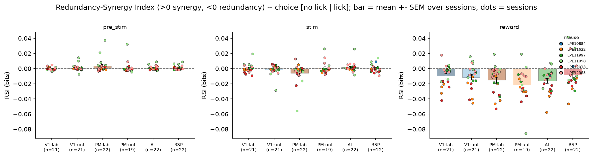

### 1b itotal by group

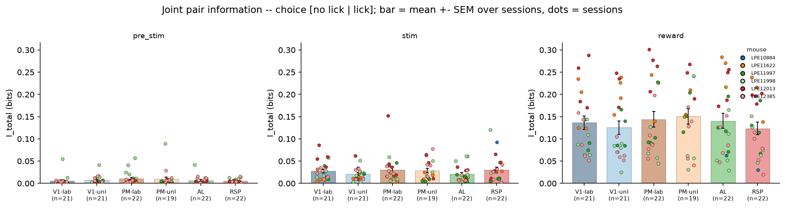

### Component breakdown

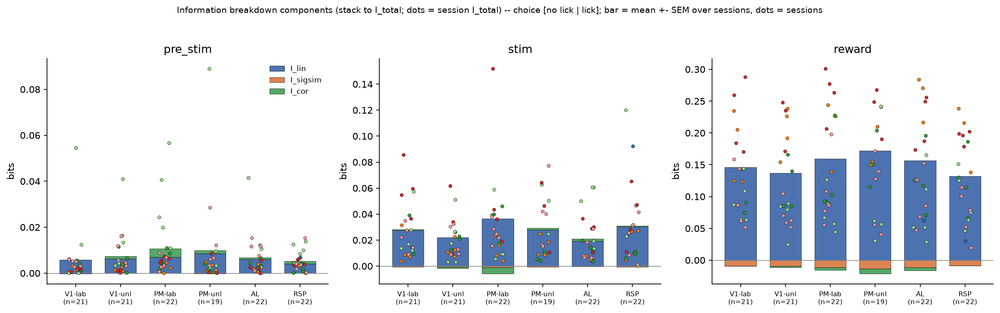

### Corind vs cordep

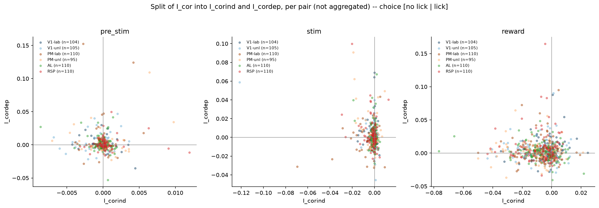

### Compare targets I cor

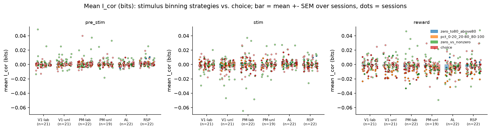

### Compare targets I total

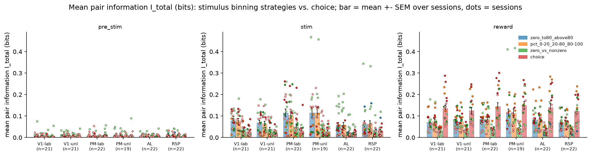

### Compare targets RSI

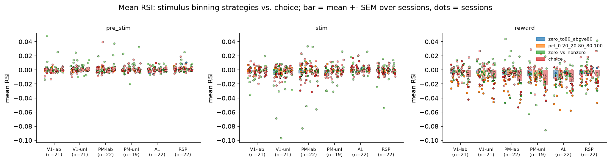

### Rsi by group

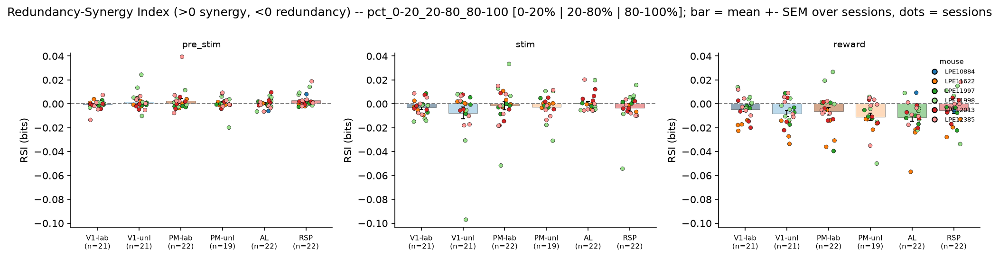

### 1b itotal by group

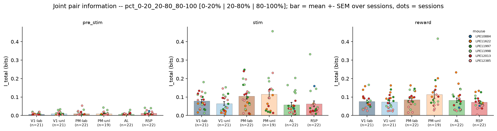

### Component breakdown

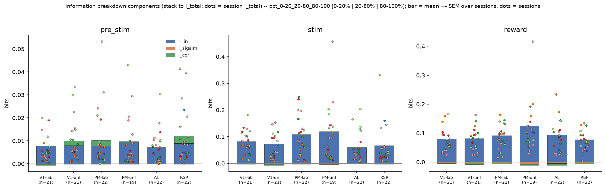

### Corind vs cordep

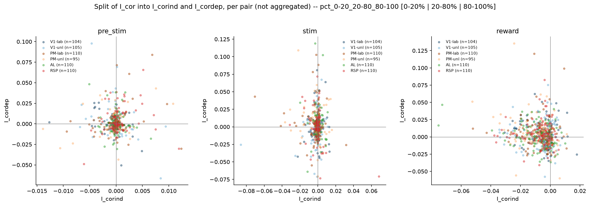

### Rsi by group

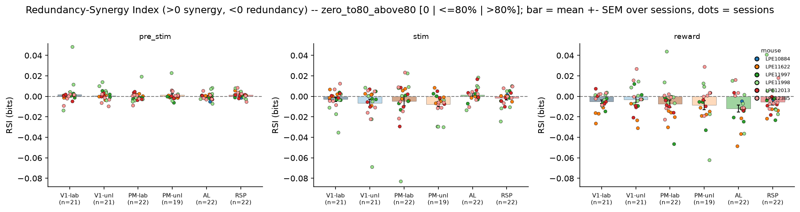

### 1b itotal by group

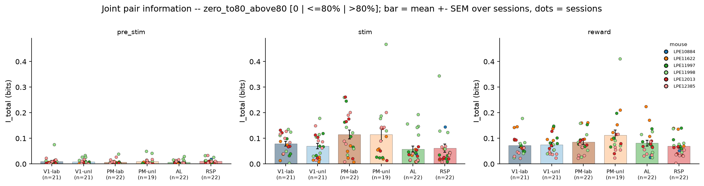

### Component breakdown

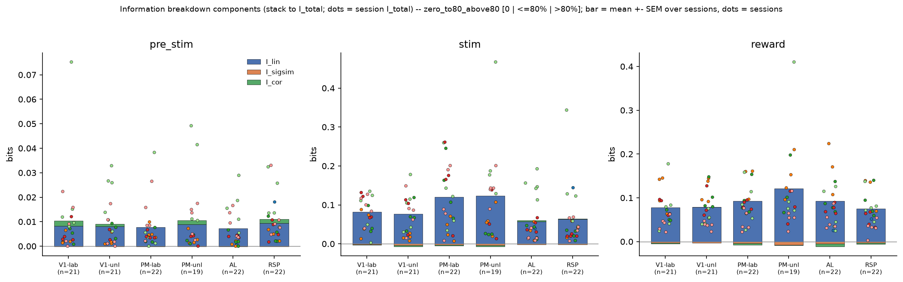

### Corind vs cordep

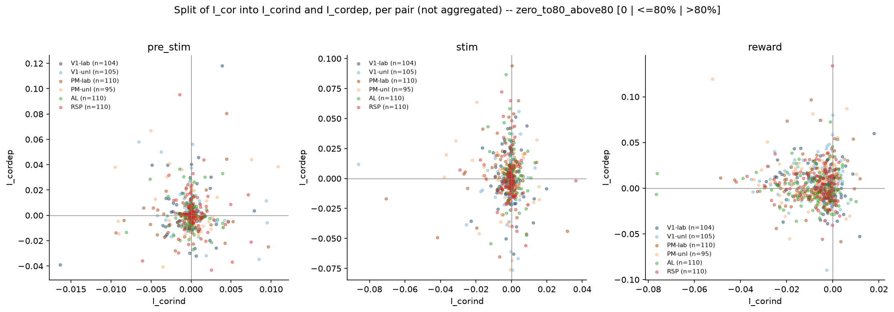

### Rsi by group

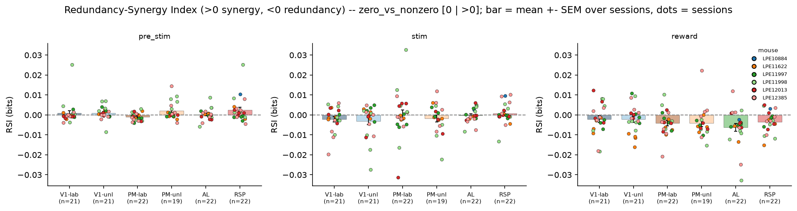

### 1b itotal by group

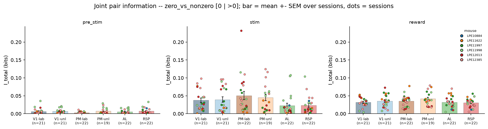

### Component breakdown

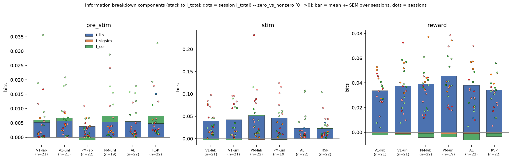

### Corind vs cordep

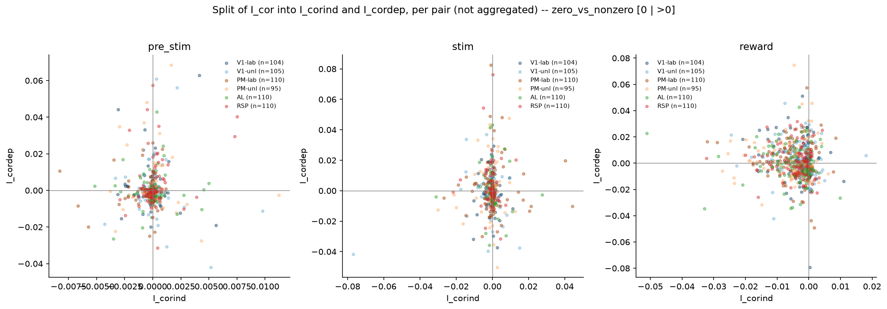
