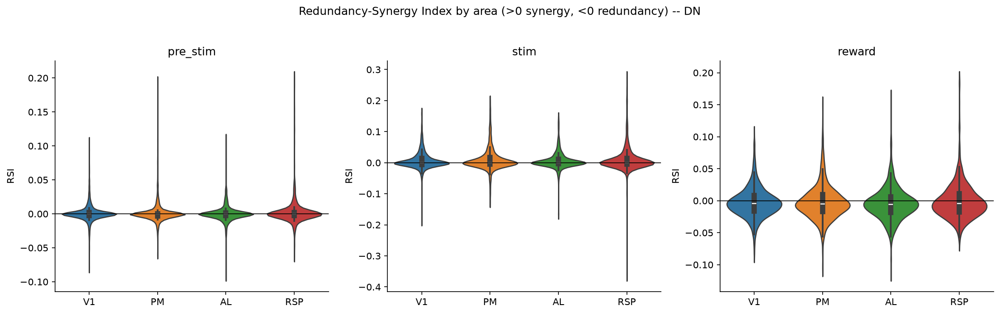
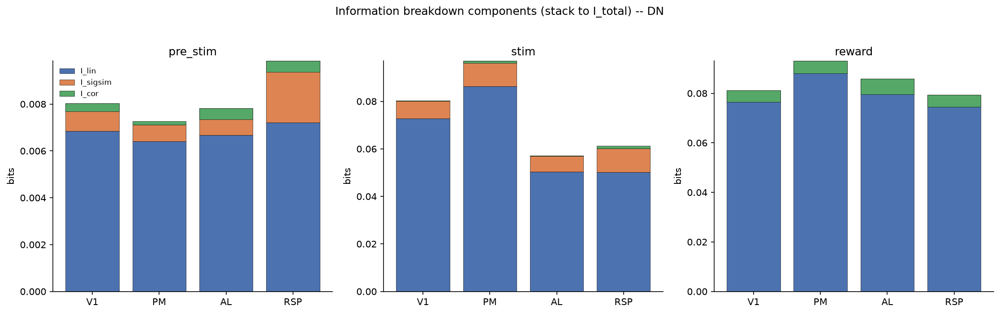
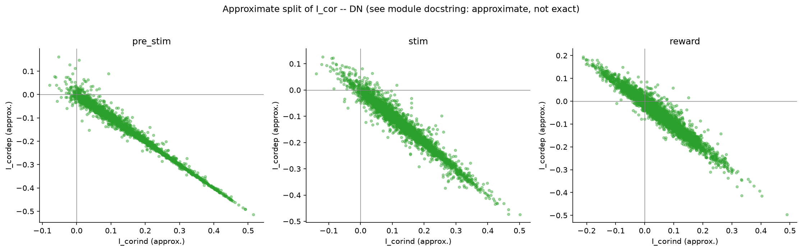

# 3b_pair_information_breakdown

*Auto-generated from `2_pipeline/3b_pair_information_breakdown/out/` on 2026-09-14 16:47. Re-run `make_progress_md.py` after the script's output changes -- don't hand-edit this file.*

## Tables

### Pair information breakdown

| session_id | window | roi_name | labeled_grouped | cell_i | cell_j | n_trials | I_total | I_1 | I_2 | I_lin | I_ind | I_sigsim | I_cor | RSI |
| --- | --- | --- | --- | --- | --- | --- | --- | --- | --- | --- | --- | --- | --- | --- |
| LPE10884_2024_01_12 | pre_stim | AL | unl | LPE10884_2024_01_12_7_0198 | LPE10884_2024_01_12_7_0240 | 209 | 0 | 0 | 0.01005 | 0.01005 | 0.00491 | -0.005135 | -0.00491 | -0.01005 |
| LPE10884_2024_01_12 | pre_stim | AL | unl | LPE10884_2024_01_12_7_0090 | LPE10884_2024_01_12_7_0169 | 209 | 0.006044 | 0 | 0 | 0 | 0.001311 | 0.001311 | 0.004734 | 0.006044 |
| LPE10884_2024_01_12 | pre_stim | AL | unl | LPE10884_2024_01_12_7_0108 | LPE10884_2024_01_12_7_0220 | 209 | 0 | 0 | 0.005557 | 0.005557 | 0.007577 | 0.00202 | -0.007577 | -0.005557 |
| LPE10884_2024_01_12 | pre_stim | AL | unl | LPE10884_2024_01_12_7_0104 | LPE10884_2024_01_12_7_0135 | 209 | 0.04328 | 0.001973 | 0 | 0.001973 | 0.01022 | 0.008248 | 0.03306 | 0.04131 |
| LPE10884_2024_01_12 | pre_stim | AL | unl | LPE10884_2024_01_12_7_0166 | LPE10884_2024_01_12_7_0258 | 209 | 0 | 0.0004731 | 0 | 0.0004731 | 0.003742 | 0.003269 | -0.003742 | -0.0004731 |
| LPE10884_2024_01_12 | pre_stim | AL | unl | LPE10884_2024_01_12_7_0013 | LPE10884_2024_01_12_7_0049 | 209 | 0.04484 | 0 | 0.00565 | 0.00565 | 0.01886 | 0.01321 | 0.02599 | 0.03919 |
| LPE10884_2024_01_12 | pre_stim | AL | unl | LPE10884_2024_01_12_7_0002 | LPE10884_2024_01_12_7_0216 | 209 | 0 | 0.007116 | 0 | 0.007116 | 0.00412 | -0.002996 | -0.00412 | -0.007116 |
| LPE10884_2024_01_12 | pre_stim | AL | unl | LPE10884_2024_01_12_7_0205 | LPE10884_2024_01_12_7_0245 | 209 | 0 | 0.004557 | 0 | 0.004557 | 0.005836 | 0.001279 | -0.005836 | -0.004557 |
| LPE10884_2024_01_12 | pre_stim | AL | unl | LPE10884_2024_01_12_7_0154 | LPE10884_2024_01_12_7_0216 | 209 | 0 | 0 | 0 | 0 | 0 | 0 | 0 | 0 |
| LPE10884_2024_01_12 | pre_stim | AL | unl | LPE10884_2024_01_12_7_0047 | LPE10884_2024_01_12_7_0170 | 209 | 0 | 0 | 0.004561 | 0.004561 | 0 | -0.004561 | 0 | -0.004561 |
| LPE10884_2024_01_12 | pre_stim | AL | unl | LPE10884_2024_01_12_7_0006 | LPE10884_2024_01_12_7_0201 | 209 | 0 | 0 | 0.01425 | 0.01425 | 0.006034 | -0.008215 | -0.006034 | -0.01425 |
| LPE10884_2024_01_12 | pre_stim | AL | unl | LPE10884_2024_01_12_7_0131 | LPE10884_2024_01_12_7_0175 | 209 | 0 | 0.01717 | 0.001197 | 0.01836 | 0.01868 | 0.0003124 | -0.01868 | -0.01836 |
| LPE10884_2024_01_12 | pre_stim | AL | unl | LPE10884_2024_01_12_7_0003 | LPE10884_2024_01_12_7_0179 | 209 | 0.05078 | 0.01002 | 0.04107 | 0.05109 | 0.0666 | 0.01551 | -0.01582 | -0.0003101 |
| LPE10884_2024_01_12 | pre_stim | AL | unl | LPE10884_2024_01_12_7_0030 | LPE10884_2024_01_12_7_0150 | 209 | 0.03572 | 0.0001311 | 0.002555 | 0.002686 | 0.01499 | 0.0123 | 0.02073 | 0.03303 |
| LPE10884_2024_01_12 | pre_stim | AL | unl | LPE10884_2024_01_12_7_0097 | LPE10884_2024_01_12_7_0103 | 209 | 0 | 0 | 0 | 0 | 0 | 0 | 0 | 0 |
| LPE10884_2024_01_12 | pre_stim | AL | unl | LPE10884_2024_01_12_7_0283 | LPE10884_2024_01_12_7_0345 | 209 | 0 | 0 | 0 | 0 | 0.001946 | 0.001946 | -0.001946 | 0 |
| LPE10884_2024_01_12 | pre_stim | AL | unl | LPE10884_2024_01_12_7_0012 | LPE10884_2024_01_12_7_0089 | 209 | 0.02677 | 0 | 0.03105 | 0.03105 | 0.02827 | -0.002779 | -0.001498 | -0.004278 |
| LPE10884_2024_01_12 | pre_stim | AL | unl | LPE10884_2024_01_12_7_0005 | LPE10884_2024_01_12_7_0135 | 209 | 0 | 0.005838 | 0 | 0.005838 | 0.01121 | 0.005374 | -0.01121 | -0.005838 |
| LPE10884_2024_01_12 | pre_stim | AL | unl | LPE10884_2024_01_12_7_0014 | LPE10884_2024_01_12_7_0200 | 209 | 0 | 0 | 0 | 0 | 0.0001818 | 0.0001818 | -0.0001818 | 0 |
| LPE10884_2024_01_12 | pre_stim | AL | unl | LPE10884_2024_01_12_7_0077 | LPE10884_2024_01_12_7_0273 | 209 | 0 | 0.00309 | 0 | 0.00309 | 0.005368 | 0.002278 | -0.005368 | -0.00309 |
| LPE10884_2024_01_12 | pre_stim | AL | unl | LPE10884_2024_01_12_7_0120 | LPE10884_2024_01_12_7_0127 | 209 | 0 | 0 | 0 | 0 | 0.007028 | 0.007028 | -0.007028 | 0 |
| LPE10884_2024_01_12 | pre_stim | AL | unl | LPE10884_2024_01_12_7_0202 | LPE10884_2024_01_12_7_0348 | 209 | 0 | 0 | 0 | 0 | 0 | 0 | 0 | 0 |
| LPE10884_2024_01_12 | pre_stim | AL | unl | LPE10884_2024_01_12_7_0154 | LPE10884_2024_01_12_7_0193 | 209 | 0.01227 | 0 | 0.04126 | 0.04126 | 0.03039 | -0.01087 | -0.01812 | -0.02899 |
| LPE10884_2024_01_12 | pre_stim | AL | unl | LPE10884_2024_01_12_7_0183 | LPE10884_2024_01_12_7_0226 | 209 | 0 | 0 | 0 | 0 | 0.001703 | 0.001703 | -0.001703 | 0 |
| LPE10884_2024_01_12 | pre_stim | AL | unl | LPE10884_2024_01_12_7_0071 | LPE10884_2024_01_12_7_0293 | 209 | 0.03703 | 0 | 0.00259 | 0.00259 | 0.006447 | 0.003857 | 0.03058 | 0.03444 |
| LPE10884_2024_01_12 | pre_stim | AL | unl | LPE10884_2024_01_12_7_0048 | LPE10884_2024_01_12_7_0342 | 209 | 0.02385 | 0.005202 | 0 | 0.005202 | 0.007077 | 0.001874 | 0.01677 | 0.01865 |
| LPE10884_2024_01_12 | pre_stim | AL | unl | LPE10884_2024_01_12_7_0107 | LPE10884_2024_01_12_7_0144 | 209 | 0 | 0 | 0 | 0 | 0.0007466 | 0.0007466 | -0.0007466 | 0 |
| LPE10884_2024_01_12 | pre_stim | AL | unl | LPE10884_2024_01_12_7_0095 | LPE10884_2024_01_12_7_0173 | 209 | 0 | 0 | 0 | 0 | 0.003868 | 0.003868 | -0.003868 | 0 |
| LPE10884_2024_01_12 | pre_stim | AL | unl | LPE10884_2024_01_12_7_0233 | LPE10884_2024_01_12_7_0389 | 209 | 0 | 0 | 0 | 0 | 0.01367 | 0.01367 | -0.01367 | 0 |
| LPE10884_2024_01_12 | pre_stim | AL | unl | LPE10884_2024_01_12_7_0137 | LPE10884_2024_01_12_7_0164 | 209 | 0.01664 | 0.0175 | 0 | 0.0175 | 0.02785 | 0.01035 | -0.01121 | -0.0008624 |

*(showing first 15 of 17 columns; showing first 30 of 13710 rows -- see the linked CSV for the rest)*

[pair_information_breakdown.csv](../2_pipeline/3b_pair_information_breakdown/out/pair_information_breakdown.csv)

## Figures

### Rsi by area

### Component breakdown

### Corind vs cordep approx

