# 3c_pair_information_pid

*Auto-generated from `2_pipeline/3c_pair_information_pid/out/` on 2026-10-30 11:38. Re-run `make_progress_md.py` after the script's output changes -- don't hand-edit this file.*

## Tables

### Pair pid

| session_id | animal_id | window | target | roi_name | labeled_grouped | cell_i | cell_j | pair_rank | n_trials | I1 | I2 | I12 | redundancy | unique1 |
| --- | --- | --- | --- | --- | --- | --- | --- | --- | --- | --- | --- | --- | --- | --- |
| LPE10884_2024_01_12 | LPE10884 | pre_stim | zero_to80_above80 | AL | unl | LPE10884_2024_01_12_7_0039 | LPE10884_2024_01_12_7_0198 | 2 | 209 | 0.02916 | 0.009796 | 0.06725 | -0.003131 | 0.0323 |
| LPE10884_2024_01_12 | LPE10884 | pre_stim | zero_to80_above80 | AL | unl | LPE10884_2024_01_12_7_0061 | LPE10884_2024_01_12_7_0250 | 5 | 209 | 0.005078 | 0.005916 | 0.0251 | -0.002331 | 0.007409 |
| LPE10884_2024_01_12 | LPE10884 | pre_stim | zero_to80_above80 | AL | unl | LPE10884_2024_01_12_7_0081 | LPE10884_2024_01_12_7_0084 | 7 | 209 | 0.003832 | 0.0042 | 0.01138 | -0.002856 | 0.006688 |
| LPE10884_2024_01_12 | LPE10884 | pre_stim | zero_to80_above80 | AL | unl | LPE10884_2024_01_12_7_0142 | LPE10884_2024_01_12_7_0278 | 4 | 209 | 0.005775 | 0.007149 | 0.01717 | -0.0001969 | 0.005972 |
| LPE10884_2024_01_12 | LPE10884 | pre_stim | zero_to80_above80 | AL | unl | LPE10884_2024_01_12_7_0035 | LPE10884_2024_01_12_7_0220 | 1 | 209 | 0.009281 | 0.01407 | 0.05424 | -0.00291 | 0.01219 |
| LPE10884_2024_01_12 | LPE10884 | pre_stim | zero_to80_above80 | AL | unl | LPE10884_2024_01_12_7_0042 | LPE10884_2024_01_12_7_0361 | 6 | 209 | 0.003832 | 0.02764 | 0.05314 | -0.002359 | 0.006191 |
| LPE10884_2024_01_12 | LPE10884 | pre_stim | zero_to80_above80 | AL | unl | LPE10884_2024_01_12_7_0116 | LPE10884_2024_01_12_7_0136 | 0 | 209 | 0.02561 | 0.005996 | 0.05399 | -0.000991 | 0.0266 |
| LPE10884_2024_01_12 | LPE10884 | pre_stim | zero_to80_above80 | AL | unl | LPE10884_2024_01_12_7_0076 | LPE10884_2024_01_12_7_0177 | 3 | 209 | 0.006011 | 1.951e-05 | 0.0394 | -0.004818 | 0.01083 |
| LPE10884_2024_01_12 | LPE10884 | pre_stim | zero_to80_above80 | RSP | unl | LPE10884_2024_01_12_6_0037 | LPE10884_2024_01_12_6_0064 | 6 | 209 | 0.02083 | 0.009469 | 0.05199 | 0.002376 | 0.01845 |
| LPE10884_2024_01_12 | LPE10884 | pre_stim | zero_to80_above80 | RSP | unl | LPE10884_2024_01_12_6_0002 | LPE10884_2024_01_12_6_0053 | 0 | 209 | 0.00556 | 0.009389 | 0.06411 | -0.002243 | 0.007803 |
| LPE10884_2024_01_12 | LPE10884 | pre_stim | zero_to80_above80 | RSP | unl | LPE10884_2024_01_12_6_0032 | LPE10884_2024_01_12_6_0046 | 1 | 209 | 0.002882 | 0.06113 | 0.0896 | -0.0009167 | 0.003799 |
| LPE10884_2024_01_12 | LPE10884 | pre_stim | zero_to80_above80 | RSP | unl | LPE10884_2024_01_12_6_0024 | LPE10884_2024_01_12_6_0028 | 4 | 209 | 0.0183 | 0.04738 | 0.09313 | -0.002194 | 0.0205 |
| LPE10884_2024_01_12 | LPE10884 | pre_stim | zero_to80_above80 | RSP | unl | LPE10884_2024_01_12_6_0030 | LPE10884_2024_01_12_6_0031 | 7 | 209 | 0.006288 | 0.02456 | 0.05407 | -0.002995 | 0.009283 |
| LPE10884_2024_01_12 | LPE10884 | pre_stim | zero_to80_above80 | RSP | unl | LPE10884_2024_01_12_6_0019 | LPE10884_2024_01_12_6_0062 | 3 | 209 | 0.02098 | 0.02201 | 0.07996 | -0.002616 | 0.0236 |
| LPE10884_2024_01_12 | LPE10884 | pre_stim | zero_to80_above80 | RSP | unl | LPE10884_2024_01_12_6_0012 | LPE10884_2024_01_12_6_0025 | 2 | 209 | 0.01467 | 0.03018 | 0.07362 | 0.007228 | 0.007443 |
| LPE10884_2024_01_12 | LPE10884 | pre_stim | zero_to80_above80 | RSP | unl | LPE10884_2024_01_12_6_0023 | LPE10884_2024_01_12_6_0045 | 5 | 209 | 0.04909 | 0.04343 | 0.1346 | 0.02911 | 0.01998 |
| LPE10884_2024_01_12 | LPE10884 | pre_stim | pct_0-20_20-80_80-100 | AL | unl | LPE10884_2024_01_12_7_0039 | LPE10884_2024_01_12_7_0198 | 2 | 209 | 0.04174 | 0.006605 | 0.06544 | -0.0001664 | 0.04191 |
| LPE10884_2024_01_12 | LPE10884 | pre_stim | pct_0-20_20-80_80-100 | AL | unl | LPE10884_2024_01_12_7_0061 | LPE10884_2024_01_12_7_0250 | 5 | 209 | 0.004279 | 0.0022 | 0.03432 | -0.004132 | 0.008411 |
| LPE10884_2024_01_12 | LPE10884 | pre_stim | pct_0-20_20-80_80-100 | AL | unl | LPE10884_2024_01_12_7_0081 | LPE10884_2024_01_12_7_0084 | 7 | 209 | 0.003721 | 0.0009122 | 0.007158 | -0.003223 | 0.006944 |
| LPE10884_2024_01_12 | LPE10884 | pre_stim | pct_0-20_20-80_80-100 | AL | unl | LPE10884_2024_01_12_7_0142 | LPE10884_2024_01_12_7_0278 | 4 | 209 | 0.002131 | 0.0193 | 0.02465 | -0.001491 | 0.003622 |
| LPE10884_2024_01_12 | LPE10884 | pre_stim | pct_0-20_20-80_80-100 | AL | unl | LPE10884_2024_01_12_7_0035 | LPE10884_2024_01_12_7_0220 | 1 | 209 | 0.009091 | 0.01534 | 0.03024 | 0.003221 | 0.00587 |
| LPE10884_2024_01_12 | LPE10884 | pre_stim | pct_0-20_20-80_80-100 | AL | unl | LPE10884_2024_01_12_7_0042 | LPE10884_2024_01_12_7_0361 | 6 | 209 | 0.003862 | 0.006668 | 0.03542 | -0.002339 | 0.006202 |
| LPE10884_2024_01_12 | LPE10884 | pre_stim | pct_0-20_20-80_80-100 | AL | unl | LPE10884_2024_01_12_7_0116 | LPE10884_2024_01_12_7_0136 | 0 | 209 | 0.01546 | 0.005602 | 0.04215 | -0.0008409 | 0.0163 |
| LPE10884_2024_01_12 | LPE10884 | pre_stim | pct_0-20_20-80_80-100 | AL | unl | LPE10884_2024_01_12_7_0076 | LPE10884_2024_01_12_7_0177 | 3 | 209 | 0.002229 | 0.003083 | 0.01895 | -0.003268 | 0.005497 |
| LPE10884_2024_01_12 | LPE10884 | pre_stim | pct_0-20_20-80_80-100 | RSP | unl | LPE10884_2024_01_12_6_0037 | LPE10884_2024_01_12_6_0064 | 6 | 209 | 0.023 | 0.009279 | 0.04212 | 0.0001331 | 0.02287 |
| LPE10884_2024_01_12 | LPE10884 | pre_stim | pct_0-20_20-80_80-100 | RSP | unl | LPE10884_2024_01_12_6_0002 | LPE10884_2024_01_12_6_0053 | 0 | 209 | 0.003773 | 0.02059 | 0.08925 | -0.002944 | 0.006717 |
| LPE10884_2024_01_12 | LPE10884 | pre_stim | pct_0-20_20-80_80-100 | RSP | unl | LPE10884_2024_01_12_6_0032 | LPE10884_2024_01_12_6_0046 | 1 | 209 | 0.0115 | 0.06844 | 0.1047 | 0.004861 | 0.006638 |
| LPE10884_2024_01_12 | LPE10884 | pre_stim | pct_0-20_20-80_80-100 | RSP | unl | LPE10884_2024_01_12_6_0024 | LPE10884_2024_01_12_6_0028 | 4 | 209 | 0.009091 | 0.04674 | 0.06807 | 0.001224 | 0.007867 |
| LPE10884_2024_01_12 | LPE10884 | pre_stim | pct_0-20_20-80_80-100 | RSP | unl | LPE10884_2024_01_12_6_0030 | LPE10884_2024_01_12_6_0031 | 7 | 209 | 0.003494 | 0.01492 | 0.04494 | -0.002252 | 0.005745 |
| LPE10884_2024_01_12 | LPE10884 | pre_stim | pct_0-20_20-80_80-100 | RSP | unl | LPE10884_2024_01_12_6_0019 | LPE10884_2024_01_12_6_0062 | 3 | 209 | 0.005544 | 0.02392 | 0.06622 | -0.001934 | 0.007478 |

*(showing first 15 of 23 columns; showing first 30 of 11568 rows -- see the linked CSV for the rest)*

[pair_pid.csv](../2_pipeline/3c_pair_information_pid/out/pair_pid.csv)

### Pair pid by group  session

| group | unit | animal_id | window | target | n_pairs | I1 | I2 | I12 | redundancy | unique1 | unique2 | synergy | frac_sig_redundancy |
| --- | --- | --- | --- | --- | --- | --- | --- | --- | --- | --- | --- | --- | --- |
| AL_unl | LPE10884_2024_01_12 | LPE10884 | pre_stim | choice | 8 | 0.003358 | 0.004486 | 0.01799 | 0.0001015 | 0.003256 | 0.004384 | 0.01025 | 0 |
| AL_unl | LPE10884_2024_01_17 | LPE10884 | pre_stim | choice | 8 | 0.01414 | 0.003432 | 0.03063 | 0.001024 | 0.01312 | 0.002408 | 0.01408 | 0 |
| AL_unl | LPE11622_2024_02_22 | LPE11622 | pre_stim | choice | 8 | 0.002518 | 0.0002845 | 0.004017 | -0.000292 | 0.00281 | 0.0005766 | 0.0009228 | 0 |
| AL_unl | LPE11622_2024_02_23 | LPE11622 | pre_stim | choice | 8 | 0.0006502 | 0.002364 | 0.004206 | 4.109e-05 | 0.0006091 | 0.002323 | 0.001233 | 0 |
| AL_unl | LPE11622_2024_02_26 | LPE11622 | pre_stim | choice | 8 | 0.00145 | 0.001164 | 0.00314 | -0.0002586 | 0.001709 | 0.001423 | 0.0002668 | 0 |
| AL_unl | LPE11997_2024_04_10 | LPE11997 | pre_stim | choice | 8 | 0.003482 | 0.003914 | 0.01166 | 0.0009265 | 0.002556 | 0.002987 | 0.00519 | 0.125 |
| AL_unl | LPE11997_2024_04_16 | LPE11997 | pre_stim | choice | 8 | 0.003448 | 0.002386 | 0.009062 | 0.0001736 | 0.003275 | 0.002212 | 0.003401 | 0 |
| AL_unl | LPE11997_2024_04_17 | LPE11997 | pre_stim | choice | 8 | 0.002451 | 0.00155 | 0.006014 | 0.0002031 | 0.002248 | 0.001347 | 0.002216 | 0.125 |
| AL_unl | LPE11997_2024_04_18 | LPE11997 | pre_stim | choice | 8 | 0.003878 | 0.0106 | 0.01671 | 0.001924 | 0.001953 | 0.008671 | 0.004162 | 0.125 |
| AL_unl | LPE11998_2024_04_24 | LPE11998 | pre_stim | choice | 8 | 0.03209 | 0.02888 | 0.09837 | 0.002333 | 0.02976 | 0.02654 | 0.03973 | 0 |
| AL_unl | LPE11998_2024_04_25 | LPE11998 | pre_stim | choice | 8 | 0.007396 | 0.006417 | 0.03293 | -0.0005003 | 0.007896 | 0.006917 | 0.01862 | 0 |
| AL_unl | LPE11998_2024_04_29 | LPE11998 | pre_stim | choice | 8 | 0.00931 | 0.01071 | 0.03331 | -0.0002533 | 0.009563 | 0.01096 | 0.01304 | 0.125 |
| AL_unl | LPE11998_2024_05_01 | LPE11998 | pre_stim | choice | 8 | 0.005963 | 0.009129 | 0.02896 | -3.793e-05 | 0.006001 | 0.009167 | 0.01383 | 0.125 |
| AL_unl | LPE12013_2024_04_25 | LPE12013 | pre_stim | choice | 8 | 0.003524 | 0.00403 | 0.01169 | -8.317e-05 | 0.003608 | 0.004113 | 0.004049 | 0.125 |
| AL_unl | LPE12013_2024_04_26 | LPE12013 | pre_stim | choice | 8 | 0.003366 | 0.0041 | 0.01426 | 0.000432 | 0.002934 | 0.003668 | 0.007229 | 0.125 |
| AL_unl | LPE12013_2024_04_29 | LPE12013 | pre_stim | choice | 8 | 0.001197 | 0.004265 | 0.007456 | -0.0006248 | 0.001822 | 0.00489 | 0.001369 | 0 |
| AL_unl | LPE12013_2024_04_30 | LPE12013 | pre_stim | choice | 8 | 0.0008875 | 0.002733 | 0.007198 | -0.0003783 | 0.001266 | 0.003111 | 0.0032 | 0 |
| AL_unl | LPE12385_2024_06_15 | LPE12385 | pre_stim | choice | 8 | 0.007977 | 0.007162 | 0.02885 | -0.0004728 | 0.00845 | 0.007635 | 0.01323 | 0.125 |
| AL_unl | LPE12385_2024_06_16 | LPE12385 | pre_stim | choice | 8 | 0.005757 | 0.01084 | 0.03307 | 7.934e-06 | 0.005749 | 0.01083 | 0.01648 | 0 |
| AL_unl | LPE12385_2024_06_17 | LPE12385 | pre_stim | choice | 8 | 0.00594 | 0.00527 | 0.02252 | 0.0007106 | 0.00523 | 0.00456 | 0.01202 | 0.125 |
| AL_unl | LPE12385_2024_06_27 | LPE12385 | pre_stim | choice | 8 | 0.0164 | 0.01257 | 0.05174 | 0.003785 | 0.01262 | 0.008787 | 0.02655 | 0.125 |
| AL_unl | LPE10884_2024_01_12 | LPE10884 | pre_stim | pct_0-20_20-80_80-100 | 8 | 0.01032 | 0.007463 | 0.03229 | -0.00153 | 0.01185 | 0.008993 | 0.01298 | 0 |
| AL_unl | LPE10884_2024_01_17 | LPE10884 | pre_stim | pct_0-20_20-80_80-100 | 8 | 0.00815 | 0.007811 | 0.03032 | -0.0002147 | 0.008365 | 0.008026 | 0.01414 | 0.125 |
| AL_unl | LPE11622_2024_02_22 | LPE11622 | pre_stim | pct_0-20_20-80_80-100 | 8 | 0.003401 | 0.002079 | 0.008546 | -0.0003125 | 0.003713 | 0.002391 | 0.002754 | 0 |
| AL_unl | LPE11622_2024_02_23 | LPE11622 | pre_stim | pct_0-20_20-80_80-100 | 8 | 0.002765 | 0.003449 | 0.00712 | -0.0001783 | 0.002943 | 0.003627 | 0.0007274 | 0 |
| AL_unl | LPE11622_2024_02_26 | LPE11622 | pre_stim | pct_0-20_20-80_80-100 | 8 | 0.001086 | 0.003746 | 0.006861 | -0.0002901 | 0.001376 | 0.004036 | 0.00174 | 0 |
| AL_unl | LPE11997_2024_04_10 | LPE11997 | pre_stim | pct_0-20_20-80_80-100 | 8 | 0.005727 | 0.004154 | 0.01716 | -0.001982 | 0.007709 | 0.006136 | 0.005301 | 0 |
| AL_unl | LPE11997_2024_04_16 | LPE11997 | pre_stim | pct_0-20_20-80_80-100 | 8 | 0.005392 | 0.007161 | 0.01822 | 0.0007001 | 0.004692 | 0.006461 | 0.006363 | 0.125 |
| AL_unl | LPE11997_2024_04_17 | LPE11997 | pre_stim | pct_0-20_20-80_80-100 | 8 | 0.005456 | 0.00662 | 0.01885 | 0.0009308 | 0.004525 | 0.005689 | 0.007706 | 0.125 |
| AL_unl | LPE11997_2024_04_18 | LPE11997 | pre_stim | pct_0-20_20-80_80-100 | 8 | 0.005021 | 0.004495 | 0.021 | -0.0009734 | 0.005994 | 0.005468 | 0.01051 | 0 |

*(showing first 30 of 1464 rows -- see the linked CSV for the rest)*

[pair_pid_by_group__session.csv](../2_pipeline/3c_pair_information_pid/out/pair_pid_by_group__session.csv)

## Figures

### Redundancy by group

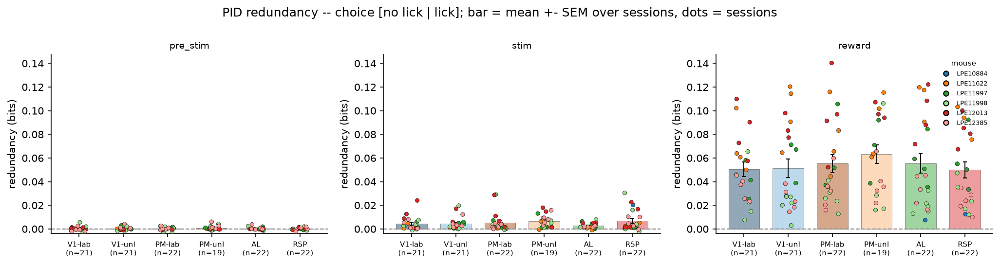

### Synergy by group

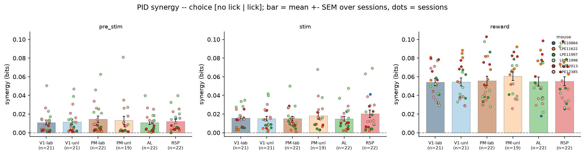

### Unique1 by group

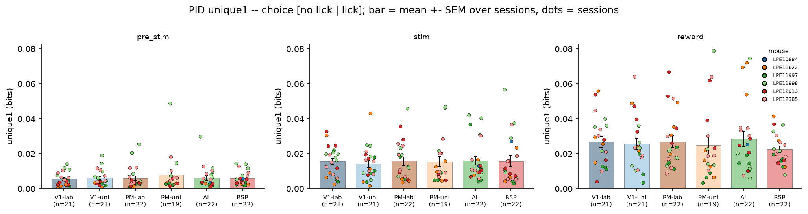

### Unique2 by group

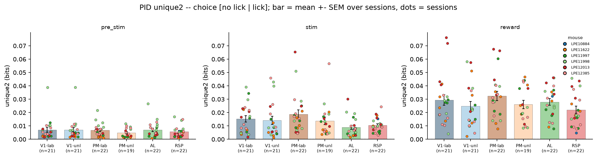

### Component breakdown

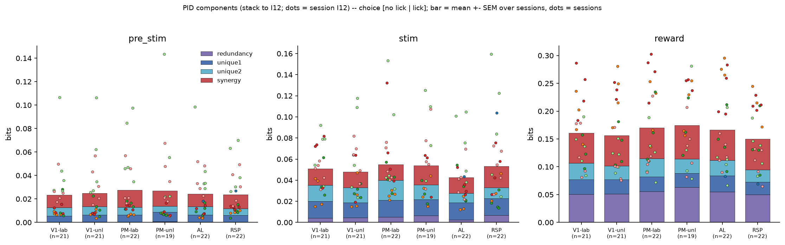

### Redundancy vs synergy

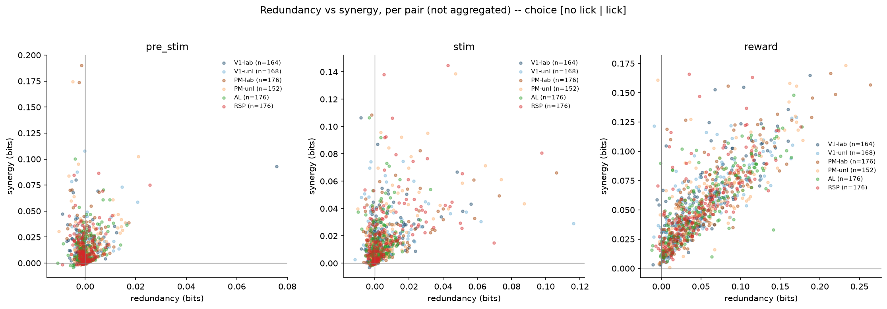

### Compare targets I12

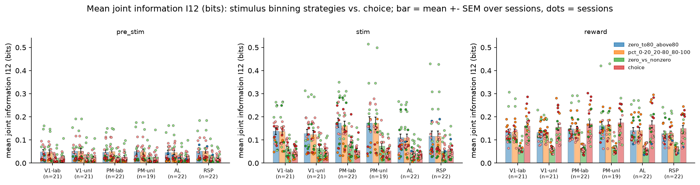

### Compare targets redundancy

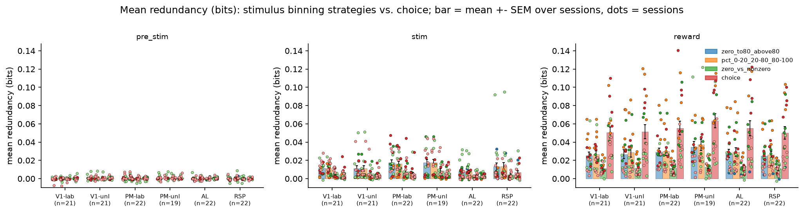

### Compare targets synergy

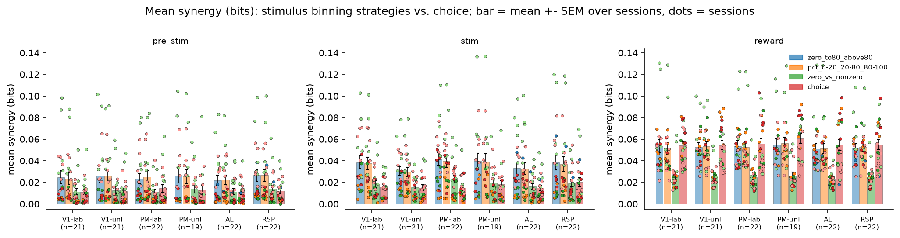

### Redundancy by group

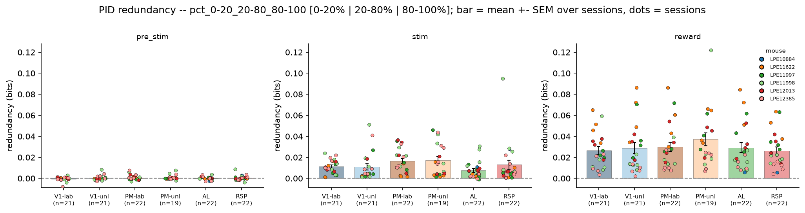

### Synergy by group

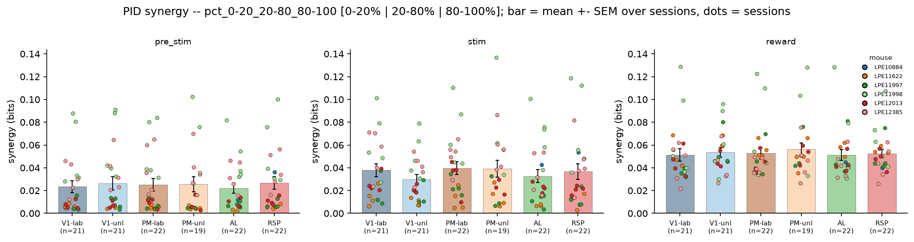

### Unique1 by group

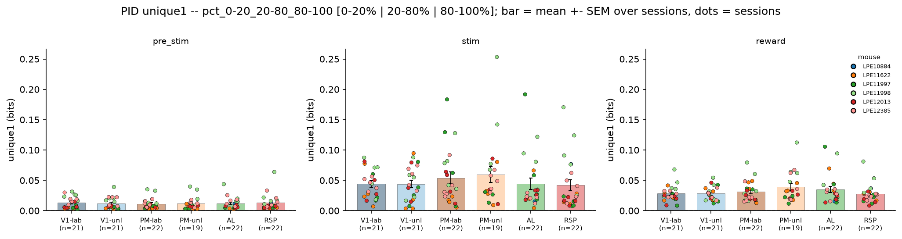

### Unique2 by group

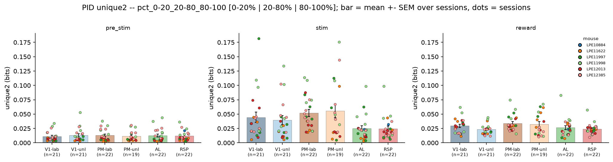

### Component breakdown

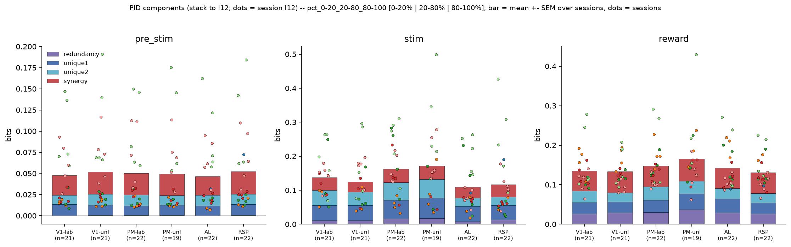

### Redundancy vs synergy

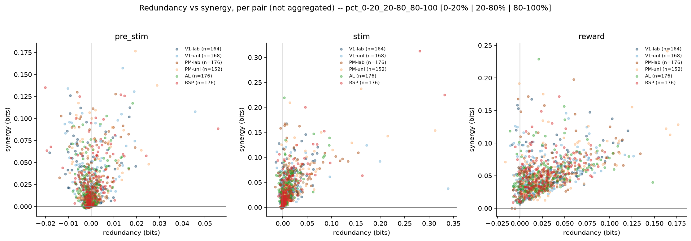

### Redundancy by group

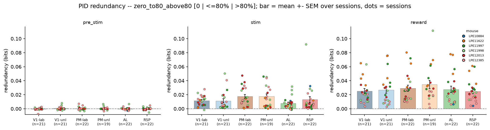

### Synergy by group

### Unique1 by group

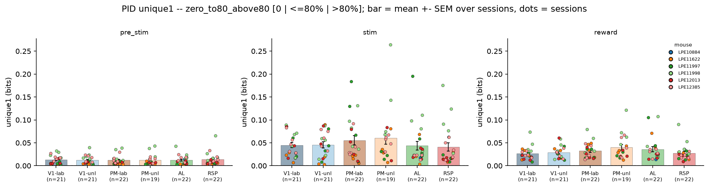

### Unique2 by group

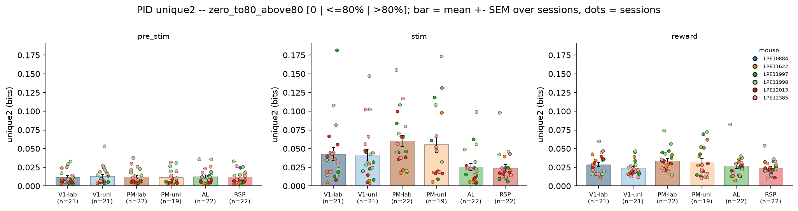

### Component breakdown

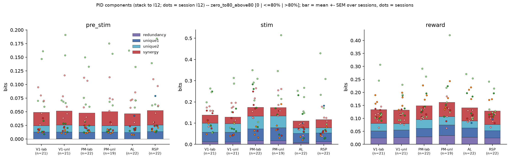

### Redundancy vs synergy

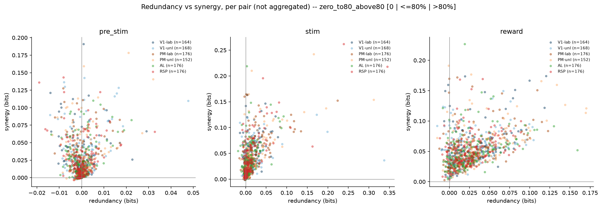

### Redundancy by group

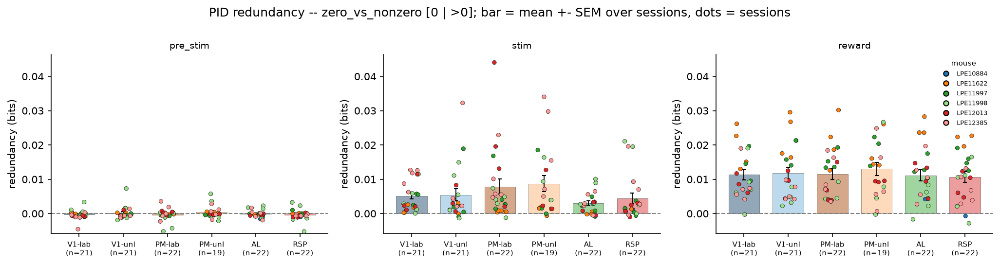

### Synergy by group

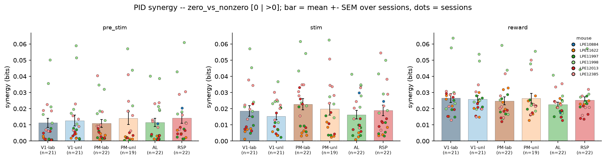

### Unique1 by group

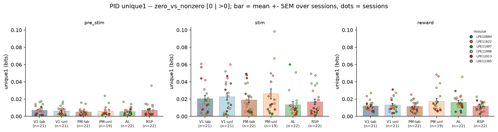

### Unique2 by group

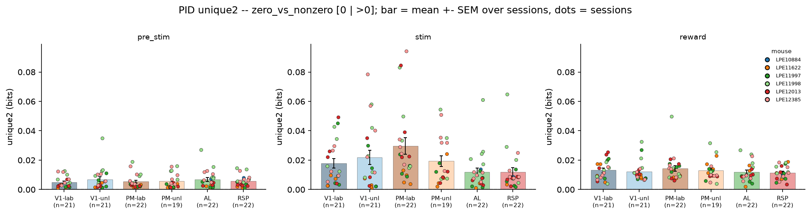

### Component breakdown

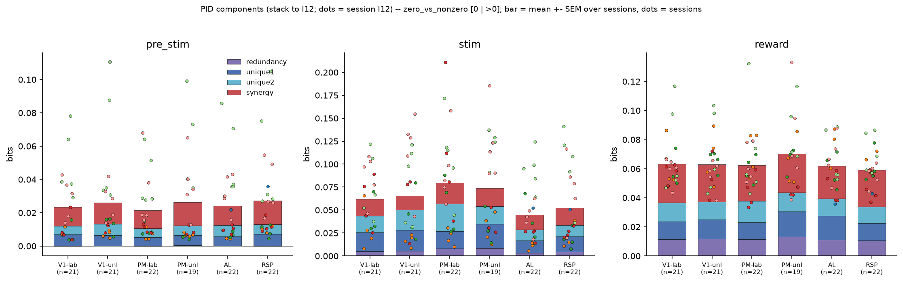

### Redundancy vs synergy

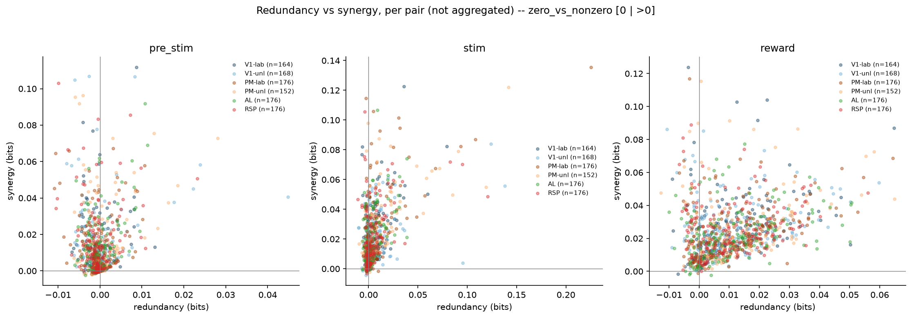
