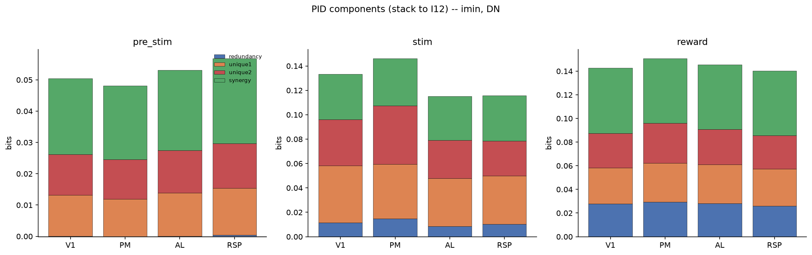
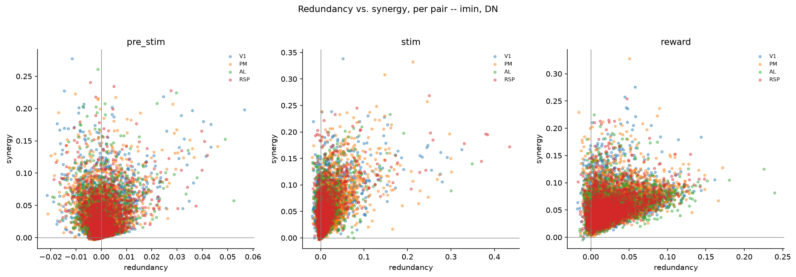

# 3c_pair_information_pid

*Auto-generated from `2_pipeline/3c_pair_information_pid/out/` on 2026-09-14 16:47. Re-run `make_progress_md.py` after the script's output changes -- don't hand-edit this file.*

## Tables

### Pair pid

| session_id | window | roi_name | labeled_grouped | cell_i | cell_j | n_trials | I1 | I2 | I12 | redundancy | unique1 | unique2 | synergy | redundancy_p_value |
| --- | --- | --- | --- | --- | --- | --- | --- | --- | --- | --- | --- | --- | --- | --- |
| LPE10884_2024_01_12 | pre_stim | AL | unl | LPE10884_2024_01_12_7_0046 | LPE10884_2024_01_12_7_0150 | 209 | 0.0322 | 0.02408 | 0.08999 | 0.009281 | 0.02292 | 0.0148 | 0.04299 | 0 |
| LPE10884_2024_01_12 | pre_stim | AL | unl | LPE10884_2024_01_12_7_0003 | LPE10884_2024_01_12_7_0178 | 209 | 0.04309 | 0.0225 | 0.1023 | 0.001245 | 0.04185 | 0.02125 | 0.03793 | 0.4333 |
| LPE10884_2024_01_12 | pre_stim | AL | unl | LPE10884_2024_01_12_7_0060 | LPE10884_2024_01_12_7_0195 | 209 | 0.03154 | 0.006392 | 0.1082 | -0.004678 | 0.03622 | 0.01107 | 0.06562 | 0.8667 |
| LPE10884_2024_01_12 | pre_stim | AL | unl | LPE10884_2024_01_12_7_0151 | LPE10884_2024_01_12_7_0192 | 209 | 0.008396 | 0.05411 | 0.1111 | -0.005438 | 0.01383 | 0.05955 | 0.04314 | 0.8667 |
| LPE10884_2024_01_12 | pre_stim | AL | unl | LPE10884_2024_01_12_7_0014 | LPE10884_2024_01_12_7_0194 | 209 | 0.004224 | 0.02051 | 0.03304 | -0.002309 | 0.006533 | 0.02282 | 0.005999 | 0.7 |
| LPE10884_2024_01_12 | pre_stim | AL | unl | LPE10884_2024_01_12_7_0100 | LPE10884_2024_01_12_7_0170 | 209 | 0.0111 | 0.01016 | 0.03458 | 0.0002351 | 0.01086 | 0.009924 | 0.01356 | 0.5 |
| LPE10884_2024_01_12 | pre_stim | AL | unl | LPE10884_2024_01_12_7_0005 | LPE10884_2024_01_12_7_0133 | 209 | 0.02477 | 0.01254 | 0.05479 | -0.002272 | 0.02704 | 0.01481 | 0.01521 | 0.5667 |
| LPE10884_2024_01_12 | pre_stim | AL | unl | LPE10884_2024_01_12_7_0166 | LPE10884_2024_01_12_7_0204 | 209 | 0.01569 | 0.01393 | 0.0576 | 0.001786 | 0.0139 | 0.01214 | 0.02977 | 0.2667 |
| LPE10884_2024_01_12 | pre_stim | AL | unl | LPE10884_2024_01_12_7_0182 | LPE10884_2024_01_12_7_0390 | 209 | 0.03321 | 0.01174 | 0.11 | 0.002067 | 0.03114 | 0.00967 | 0.06717 | 0.2667 |
| LPE10884_2024_01_12 | pre_stim | AL | unl | LPE10884_2024_01_12_7_0090 | LPE10884_2024_01_12_7_0140 | 209 | 0.009588 | 0.02356 | 0.0617 | -0.0009207 | 0.01051 | 0.02448 | 0.02764 | 0.4 |
| LPE10884_2024_01_12 | pre_stim | AL | unl | LPE10884_2024_01_12_7_0071 | LPE10884_2024_01_12_7_0141 | 209 | 0.01587 | 0.02591 | 0.09179 | 0.005178 | 0.01069 | 0.02073 | 0.05519 | 0.1667 |
| LPE10884_2024_01_12 | pre_stim | AL | unl | LPE10884_2024_01_12_7_0282 | LPE10884_2024_01_12_7_0334 | 209 | 0.01982 | 0.01835 | 0.0672 | 0.003164 | 0.01665 | 0.01519 | 0.03219 | 0.2333 |
| LPE10884_2024_01_12 | pre_stim | AL | unl | LPE10884_2024_01_12_7_0233 | LPE10884_2024_01_12_7_0265 | 209 | 0.03657 | 0.01183 | 0.06651 | 0.001082 | 0.03549 | 0.01075 | 0.01919 | 0.3 |
| LPE10884_2024_01_12 | pre_stim | AL | unl | LPE10884_2024_01_12_7_0127 | LPE10884_2024_01_12_7_0273 | 209 | 0.01419 | 0.01617 | 0.0566 | -0.00489 | 0.01908 | 0.02106 | 0.02134 | 0.8 |
| LPE10884_2024_01_12 | pre_stim | AL | unl | LPE10884_2024_01_12_7_0004 | LPE10884_2024_01_12_7_0180 | 209 | 0.01073 | 0.01661 | 0.1079 | -0.00434 | 0.01507 | 0.02095 | 0.07621 | 0.8667 |
| LPE10884_2024_01_12 | pre_stim | AL | unl | LPE10884_2024_01_12_7_0113 | LPE10884_2024_01_12_7_0130 | 209 | 0.006164 | 0.02693 | 0.06681 | -0.006765 | 0.01293 | 0.0337 | 0.02695 | 0.8667 |
| LPE10884_2024_01_12 | pre_stim | AL | unl | LPE10884_2024_01_12_7_0130 | LPE10884_2024_01_12_7_0244 | 209 | 0.02693 | 0.04324 | 0.1139 | 0.003329 | 0.0236 | 0.03991 | 0.04702 | 0.2333 |
| LPE10884_2024_01_12 | pre_stim | AL | unl | LPE10884_2024_01_12_7_0149 | LPE10884_2024_01_12_7_0281 | 209 | 0.02939 | 0.01105 | 0.07569 | 0.0005836 | 0.02881 | 0.01047 | 0.03583 | 0.3667 |
| LPE10884_2024_01_12 | pre_stim | AL | unl | LPE10884_2024_01_12_7_0104 | LPE10884_2024_01_12_7_0206 | 209 | 0.02955 | 0.006292 | 0.08735 | -0.004295 | 0.03384 | 0.01059 | 0.04721 | 0.7667 |
| LPE10884_2024_01_12 | pre_stim | AL | unl | LPE10884_2024_01_12_7_0020 | LPE10884_2024_01_12_7_0169 | 209 | 0.04134 | 0.02703 | 0.102 | 0.009697 | 0.03165 | 0.01733 | 0.0433 | 0.03333 |
| LPE10884_2024_01_12 | pre_stim | AL | unl | LPE10884_2024_01_12_7_0103 | LPE10884_2024_01_12_7_0421 | 209 | 0.008958 | 0.02149 | 0.08718 | -0.001286 | 0.01024 | 0.02278 | 0.05544 | 0.6333 |
| LPE10884_2024_01_12 | pre_stim | AL | unl | LPE10884_2024_01_12_7_0303 | LPE10884_2024_01_12_7_0347 | 209 | 0.0194 | 0.01922 | 0.1029 | 0.001739 | 0.01766 | 0.01749 | 0.06598 | 0.2333 |
| LPE10884_2024_01_12 | pre_stim | AL | unl | LPE10884_2024_01_12_7_0101 | LPE10884_2024_01_12_7_0278 | 209 | 0.01398 | 0.02305 | 0.05315 | 0.0001801 | 0.0138 | 0.02287 | 0.0163 | 0.4667 |
| LPE10884_2024_01_12 | pre_stim | AL | unl | LPE10884_2024_01_12_7_0137 | LPE10884_2024_01_12_7_0273 | 209 | 0.04248 | 0.01617 | 0.08381 | 0.001947 | 0.04053 | 0.01423 | 0.0271 | 0.3333 |
| LPE10884_2024_01_12 | pre_stim | AL | unl | LPE10884_2024_01_12_7_0111 | LPE10884_2024_01_12_7_0178 | 209 | 0.01316 | 0.0225 | 0.07233 | 0.002838 | 0.01033 | 0.01966 | 0.03951 | 0.3 |
| LPE10884_2024_01_12 | pre_stim | AL | unl | LPE10884_2024_01_12_7_0180 | LPE10884_2024_01_12_7_0204 | 209 | 0.01661 | 0.01393 | 0.0574 | 0.002521 | 0.01409 | 0.0114 | 0.02939 | 0.2667 |
| LPE10884_2024_01_12 | pre_stim | AL | unl | LPE10884_2024_01_12_7_0044 | LPE10884_2024_01_12_7_0229 | 209 | 0.005244 | 0.002671 | 0.02004 | -0.001521 | 0.006765 | 0.004192 | 0.0106 | 0.6333 |
| LPE10884_2024_01_12 | pre_stim | AL | unl | LPE10884_2024_01_12_7_0045 | LPE10884_2024_01_12_7_0075 | 209 | 0.1284 | 0.05784 | 0.1914 | 0.05242 | 0.07598 | 0.005419 | 0.05761 | 0 |
| LPE10884_2024_01_12 | pre_stim | AL | unl | LPE10884_2024_01_12_7_0067 | LPE10884_2024_01_12_7_0394 | 209 | 0.0263 | 0.02023 | 0.0717 | 0.0008057 | 0.02549 | 0.01942 | 0.02598 | 0.3333 |
| LPE10884_2024_01_12 | pre_stim | AL | unl | LPE10884_2024_01_12_7_0030 | LPE10884_2024_01_12_7_0115 | 209 | 0.021 | 0.03427 | 0.1072 | 0.002743 | 0.01826 | 0.03153 | 0.05466 | 0.2 |

*(showing first 30 of 33522 rows -- see the linked CSV for the rest)*

[pair_pid.csv](../2_pipeline/3c_pair_information_pid/out/pair_pid.csv)

## Figures

### Pid components by area

### Redundancy vs synergy

