# 3c_pair_information_pid

*Auto-generated from `2_pipeline/3c_pair_information_pid/out/` on 2026-11-10 17:48. Re-run `make_progress_md.py` after the script's output changes -- don't hand-edit this file.*

## Figures

### Redundancy by group

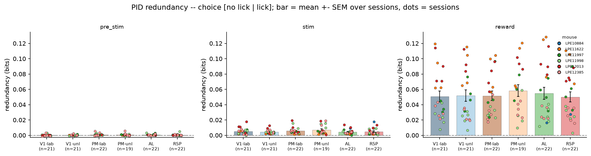

### Synergy by group

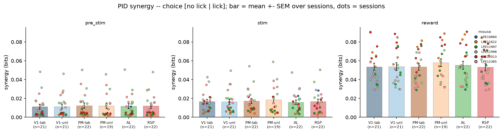

### Unique1 by group

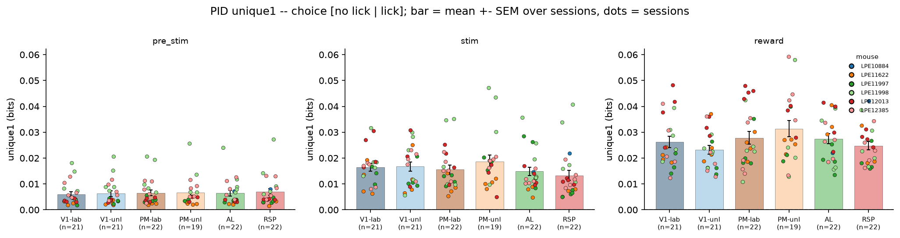

### Unique2 by group

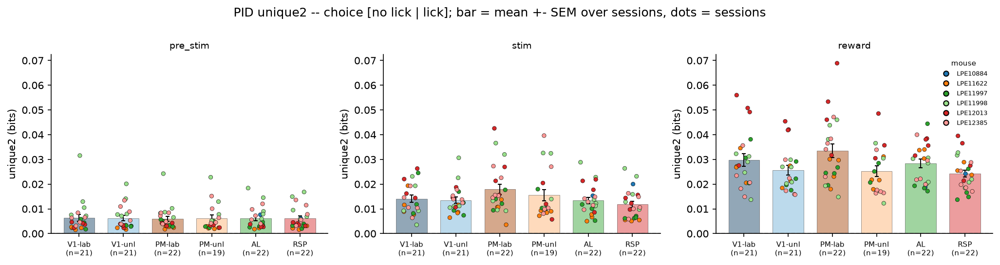

### Component breakdown

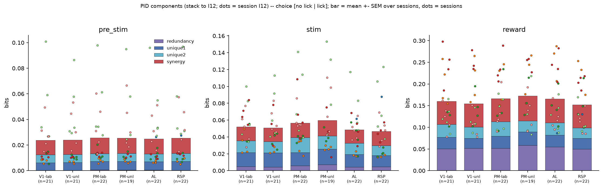

### Redundancy vs synergy

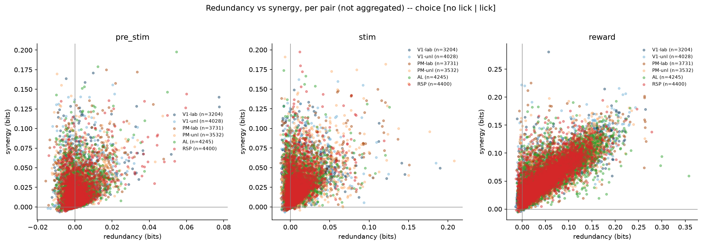

### Compare targets I12

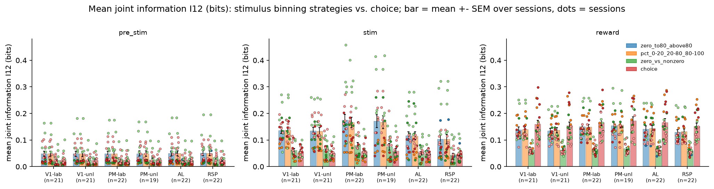

### Compare targets redundancy

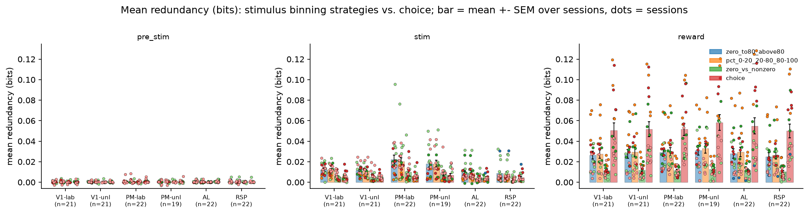

### Compare targets synergy

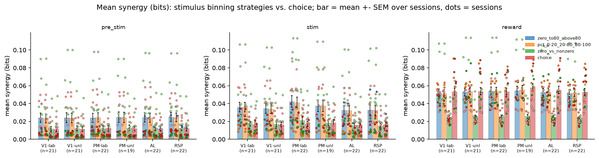

### Redundancy by group

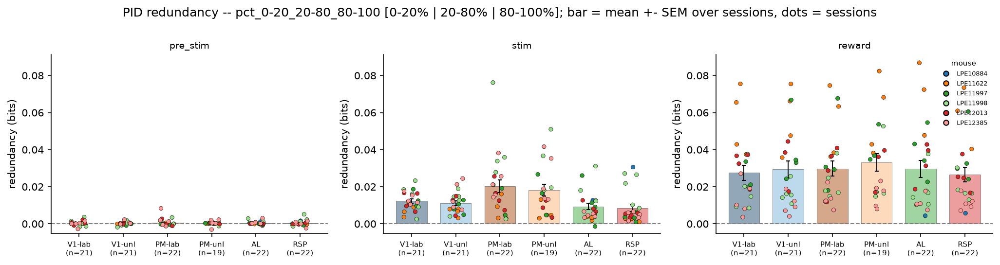

### Synergy by group

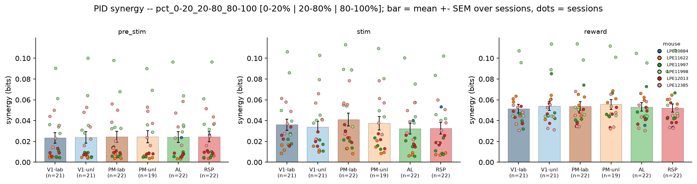

### Unique1 by group

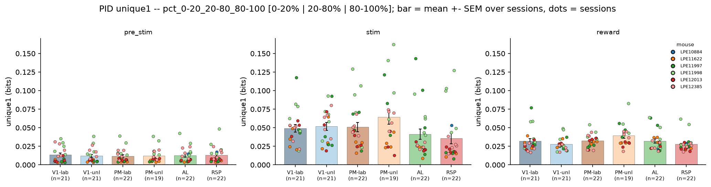

### Unique2 by group

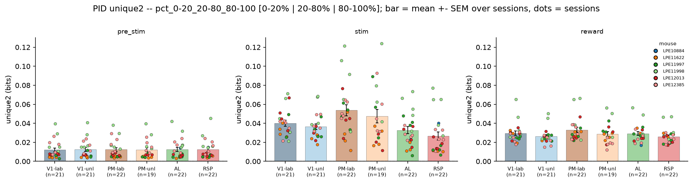

### Component breakdown

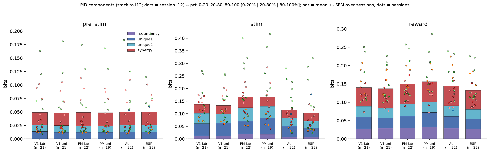

### Redundancy vs synergy

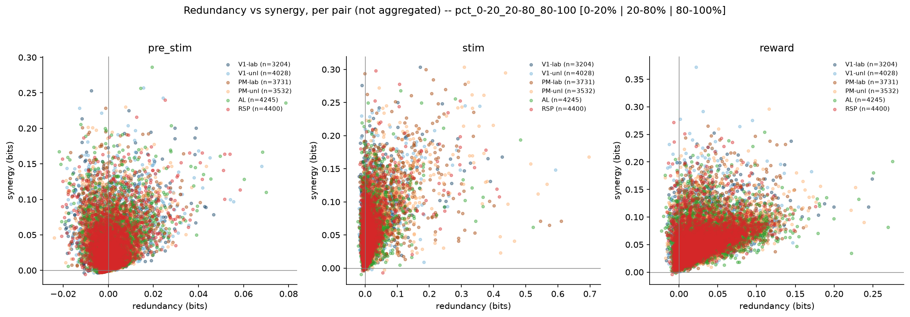

### Redundancy by group

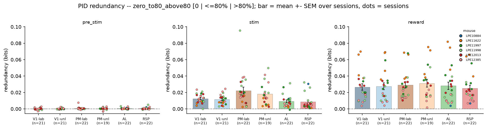

### Synergy by group

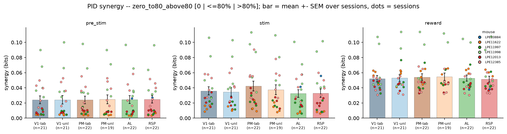

### Unique1 by group

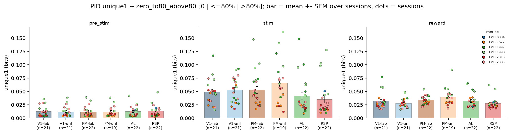

### Unique2 by group

### Component breakdown

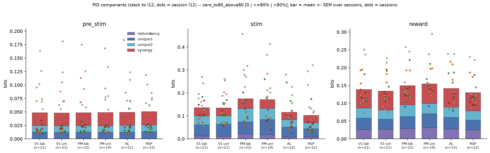

### Redundancy vs synergy

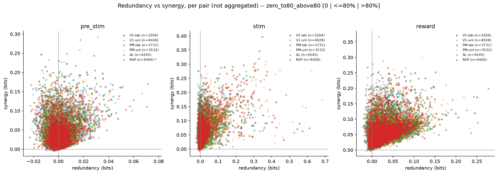

### Redundancy by group

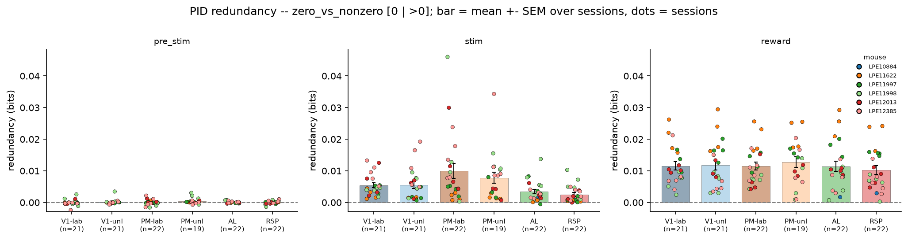

### Synergy by group

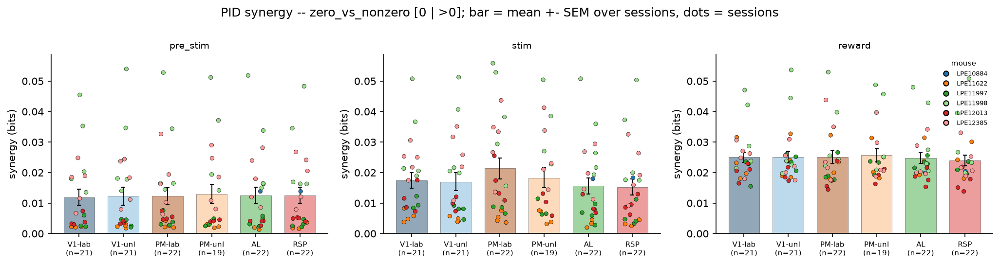

### Unique1 by group

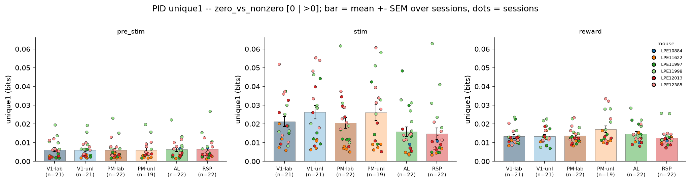

### Unique2 by group

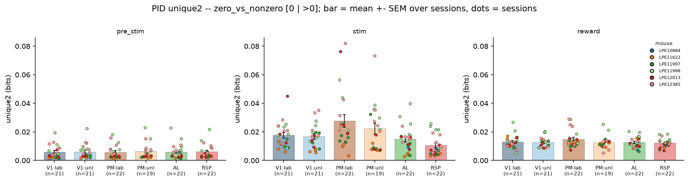

### Component breakdown

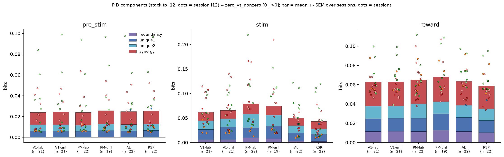

### Redundancy vs synergy

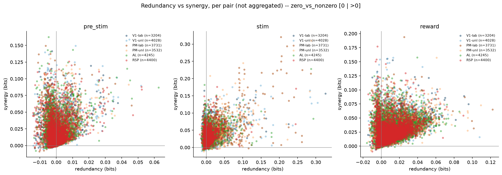

## Tables

### Pair pid

| session_id | animal_id | window | target | roi_name | labeled_grouped | cell_i | cell_j | pair_rank | n_trials | I1 | I2 | I12 | redundancy | unique1 |
| --- | --- | --- | --- | --- | --- | --- | --- | --- | --- | --- | --- | --- | --- | --- |
| LPE10884_2024_01_12 | LPE10884 | pre_stim | zero_to80_above80 | AL | unl | LPE10884_2024_01_12_7_0042 | LPE10884_2024_01_12_7_0263 | 89 | 209 | 0.009043 | 0.0009157 | 0.01081 | -0.00353 | 0.01257 |
| LPE10884_2024_01_12 | LPE10884 | pre_stim | zero_to80_above80 | AL | unl | LPE10884_2024_01_12_7_0174 | LPE10884_2024_01_12_7_0267 | 7 | 209 | 0.005934 | 0.009604 | 0.03478 | -0.002661 | 0.008595 |
| LPE10884_2024_01_12 | LPE10884 | pre_stim | zero_to80_above80 | AL | unl | LPE10884_2024_01_12_7_0073 | LPE10884_2024_01_12_7_0195 | 155 | 209 | 0.008548 | 0.01286 | 0.04892 | 0.001073 | 0.007475 |
| LPE10884_2024_01_12 | LPE10884 | pre_stim | zero_to80_above80 | AL | unl | LPE10884_2024_01_12_7_0286 | LPE10884_2024_01_12_7_0334 | 185 | 209 | 0.05278 | 0.003292 | 0.09081 | -0.00176 | 0.05454 |
| LPE10884_2024_01_12 | LPE10884 | pre_stim | zero_to80_above80 | AL | unl | LPE10884_2024_01_12_7_0120 | LPE10884_2024_01_12_7_0278 | 53 | 209 | 0.0009157 | 0.009309 | 0.0189 | -0.003811 | 0.004727 |
| LPE10884_2024_01_12 | LPE10884 | pre_stim | zero_to80_above80 | AL | unl | LPE10884_2024_01_12_7_0122 | LPE10884_2024_01_12_7_0369 | 173 | 209 | 0.02721 | 0.01321 | 0.05781 | 0.003543 | 0.02366 |
| LPE10884_2024_01_12 | LPE10884 | pre_stim | zero_to80_above80 | AL | unl | LPE10884_2024_01_12_7_0144 | LPE10884_2024_01_12_7_0427 | 14 | 209 | 0.01156 | 0.03471 | 0.08955 | -0.002949 | 0.0145 |
| LPE10884_2024_01_12 | LPE10884 | pre_stim | zero_to80_above80 | AL | unl | LPE10884_2024_01_12_7_0219 | LPE10884_2024_01_12_7_0247 | 38 | 209 | 0.008462 | 0.02086 | 0.03624 | 0.001102 | 0.007359 |
| LPE10884_2024_01_12 | LPE10884 | pre_stim | zero_to80_above80 | AL | unl | LPE10884_2024_01_12_7_0074 | LPE10884_2024_01_12_7_0107 | 75 | 209 | 0.001404 | 0.01012 | 0.01266 | -0.002843 | 0.004246 |
| LPE10884_2024_01_12 | LPE10884 | pre_stim | zero_to80_above80 | AL | unl | LPE10884_2024_01_12_7_0055 | LPE10884_2024_01_12_7_0273 | 40 | 209 | 0.006968 | 0.009144 | 0.02914 | 0.001003 | 0.005965 |
| LPE10884_2024_01_12 | LPE10884 | pre_stim | zero_to80_above80 | AL | unl | LPE10884_2024_01_12_7_0233 | LPE10884_2024_01_12_7_0300 | 60 | 209 | 0.003611 | 0.01897 | 0.05223 | -0.002967 | 0.006578 |
| LPE10884_2024_01_12 | LPE10884 | pre_stim | zero_to80_above80 | AL | unl | LPE10884_2024_01_12_7_0173 | LPE10884_2024_01_12_7_0376 | 26 | 209 | 0.002066 | 0.0196 | 0.05755 | -0.004517 | 0.006583 |
| LPE10884_2024_01_12 | LPE10884 | pre_stim | zero_to80_above80 | AL | unl | LPE10884_2024_01_12_7_0044 | LPE10884_2024_01_12_7_0376 | 141 | 209 | 0.00864 | 0.0196 | 0.0638 | 0.005033 | 0.003607 |
| LPE10884_2024_01_12 | LPE10884 | pre_stim | zero_to80_above80 | AL | unl | LPE10884_2024_01_12_7_0168 | LPE10884_2024_01_12_7_0248 | 0 | 209 | 0.01184 | 0.0192 | 0.05444 | -0.001534 | 0.01337 |
| LPE10884_2024_01_12 | LPE10884 | pre_stim | zero_to80_above80 | AL | unl | LPE10884_2024_01_12_7_0371 | LPE10884_2024_01_12_7_0399 | 129 | 209 | 0.03383 | 0.03993 | 0.1041 | 0.007297 | 0.02654 |
| LPE10884_2024_01_12 | LPE10884 | pre_stim | zero_to80_above80 | AL | unl | LPE10884_2024_01_12_7_0014 | LPE10884_2024_01_12_7_0020 | 124 | 209 | 0.0002216 | 0.02934 | 0.04852 | -0.003057 | 0.003278 |
| LPE10884_2024_01_12 | LPE10884 | pre_stim | zero_to80_above80 | AL | unl | LPE10884_2024_01_12_7_0113 | LPE10884_2024_01_12_7_0250 | 143 | 209 | 0.01101 | 0.007347 | 0.03275 | -0.0006626 | 0.01167 |
| LPE10884_2024_01_12 | LPE10884 | pre_stim | zero_to80_above80 | AL | unl | LPE10884_2024_01_12_7_0037 | LPE10884_2024_01_12_7_0283 | 42 | 209 | 0.01503 | 0.003612 | 0.02184 | -0.0002727 | 0.0153 |
| LPE10884_2024_01_12 | LPE10884 | pre_stim | zero_to80_above80 | AL | unl | LPE10884_2024_01_12_7_0062 | LPE10884_2024_01_12_7_0254 | 98 | 209 | 0.01263 | 0.02473 | 0.1048 | 0.004075 | 0.00856 |
| LPE10884_2024_01_12 | LPE10884 | pre_stim | zero_to80_above80 | AL | unl | LPE10884_2024_01_12_7_0160 | LPE10884_2024_01_12_7_0236 | 126 | 209 | 0.005387 | 0.01998 | 0.03881 | 0.0003057 | 0.005082 |
| LPE10884_2024_01_12 | LPE10884 | pre_stim | zero_to80_above80 | AL | unl | LPE10884_2024_01_12_7_0302 | LPE10884_2024_01_12_7_0303 | 55 | 209 | 0.03922 | 0.01616 | 0.08339 | 0.00399 | 0.03523 |
| LPE10884_2024_01_12 | LPE10884 | pre_stim | zero_to80_above80 | AL | unl | LPE10884_2024_01_12_7_0254 | LPE10884_2024_01_12_7_0359 | 30 | 209 | 0.02473 | 0.0008815 | 0.02899 | -0.003627 | 0.02836 |
| LPE10884_2024_01_12 | LPE10884 | pre_stim | zero_to80_above80 | AL | unl | LPE10884_2024_01_12_7_0100 | LPE10884_2024_01_12_7_0263 | 150 | 209 | 0.003921 | 0.0009157 | 0.03346 | -0.003397 | 0.007318 |
| LPE10884_2024_01_12 | LPE10884 | pre_stim | zero_to80_above80 | AL | unl | LPE10884_2024_01_12_7_0179 | LPE10884_2024_01_12_7_0214 | 136 | 209 | 0.03998 | 0.005037 | 0.07831 | -0.004742 | 0.04472 |
| LPE10884_2024_01_12 | LPE10884 | pre_stim | zero_to80_above80 | AL | unl | LPE10884_2024_01_12_7_0159 | LPE10884_2024_01_12_7_0413 | 3 | 209 | 0.009861 | 0.007328 | 0.04535 | -0.0005592 | 0.01042 |
| LPE10884_2024_01_12 | LPE10884 | pre_stim | zero_to80_above80 | AL | unl | LPE10884_2024_01_12_7_0166 | LPE10884_2024_01_12_7_0216 | 84 | 209 | 0.02633 | 0.04526 | 0.08878 | 0.00771 | 0.01862 |
| LPE10884_2024_01_12 | LPE10884 | pre_stim | zero_to80_above80 | AL | unl | LPE10884_2024_01_12_7_0141 | LPE10884_2024_01_12_7_0173 | 112 | 209 | 0.02347 | 0.002066 | 0.05727 | -0.00311 | 0.02658 |
| LPE10884_2024_01_12 | LPE10884 | pre_stim | zero_to80_above80 | AL | unl | LPE10884_2024_01_12_7_0105 | LPE10884_2024_01_12_7_0251 | 151 | 209 | 0.0228 | 0.01881 | 0.07704 | 0.007756 | 0.01504 |
| LPE10884_2024_01_12 | LPE10884 | pre_stim | zero_to80_above80 | AL | unl | LPE10884_2024_01_12_7_0167 | LPE10884_2024_01_12_7_0204 | 115 | 209 | 0.01026 | 0.002675 | 0.02494 | -0.001021 | 0.01128 |
| LPE10884_2024_01_12 | LPE10884 | pre_stim | zero_to80_above80 | AL | unl | LPE10884_2024_01_12_7_0022 | LPE10884_2024_01_12_7_0292 | 28 | 209 | 0.04487 | 0.01364 | 0.07273 | 0.006524 | 0.03835 |

*(showing first 15 of 23 columns; showing first 30 of 277680 rows -- see the linked CSV for the rest)*

[pair_pid.csv](../2_pipeline/3c_pair_information_pid/out/pair_pid.csv)

### Pair pid by group  session

| group | unit | animal_id | window | target | n_pairs | I1 | I2 | I12 | redundancy | unique1 | unique2 | synergy | frac_sig_redundancy |
| --- | --- | --- | --- | --- | --- | --- | --- | --- | --- | --- | --- | --- | --- |
| AL_unl | LPE10884_2024_01_12 | LPE10884 | pre_stim | choice | 200 | 0.007352 | 0.007866 | 0.02622 | 0.0002391 | 0.007112 | 0.007627 | 0.01124 | 0.04 |
| AL_unl | LPE11622_2024_02_22 | LPE11622 | pre_stim | choice | 200 | 0.002321 | 0.001911 | 0.006092 | 0.0001005 | 0.002221 | 0.001811 | 0.00196 | 0.115 |
| AL_unl | LPE11622_2024_02_23 | LPE11622 | pre_stim | choice | 200 | 0.002646 | 0.002794 | 0.007714 | 4.36e-06 | 0.002642 | 0.00279 | 0.002278 | 0.05 |
| AL_unl | LPE11622_2024_02_26 | LPE11622 | pre_stim | choice | 200 | 0.002083 | 0.002352 | 0.006151 | 9.647e-05 | 0.001987 | 0.002255 | 0.001812 | 0.075 |
| AL_unl | LPE11997_2024_04_10 | LPE11997 | pre_stim | choice | 200 | 0.004311 | 0.004053 | 0.01367 | 0.0004274 | 0.003883 | 0.003626 | 0.00573 | 0.095 |
| AL_unl | LPE11997_2024_04_16 | LPE11997 | pre_stim | choice | 200 | 0.003496 | 0.003211 | 0.008841 | 0.0006227 | 0.002874 | 0.002588 | 0.002756 | 0.145 |
| AL_unl | LPE11997_2024_04_17 | LPE11997 | pre_stim | choice | 200 | 0.004506 | 0.003888 | 0.01085 | 0.0009366 | 0.00357 | 0.002952 | 0.003387 | 0.195 |
| AL_unl | LPE11997_2024_04_18 | LPE11997 | pre_stim | choice | 45 | 0.00635 | 0.007401 | 0.01772 | 0.002722 | 0.003628 | 0.004679 | 0.006689 | 0.3333 |
| AL_unl | LPE11998_2024_04_23 | LPE11998 | pre_stim | choice | 200 | 0.01141 | 0.01421 | 0.05488 | -0.0003213 | 0.01173 | 0.01454 | 0.02894 | 0.05 |
| AL_unl | LPE11998_2024_04_24 | LPE11998 | pre_stim | choice | 200 | 0.02696 | 0.0214 | 0.09591 | 0.003001 | 0.02396 | 0.0184 | 0.05055 | 0.095 |
| AL_unl | LPE11998_2024_04_25 | LPE11998 | pre_stim | choice | 200 | 0.006826 | 0.006133 | 0.02718 | 0.0001438 | 0.006683 | 0.005989 | 0.01436 | 0.05 |
| AL_unl | LPE11998_2024_04_29 | LPE11998 | pre_stim | choice | 200 | 0.009196 | 0.00938 | 0.0335 | 0.0003974 | 0.008799 | 0.008983 | 0.01532 | 0.055 |
| AL_unl | LPE11998_2024_05_01 | LPE11998 | pre_stim | choice | 200 | 0.008519 | 0.008574 | 0.03288 | 0.0006913 | 0.007828 | 0.007882 | 0.01648 | 0.1 |
| AL_unl | LPE12013_2024_04_25 | LPE12013 | pre_stim | choice | 200 | 0.004111 | 0.004051 | 0.01281 | 0.0002406 | 0.003871 | 0.00381 | 0.004886 | 0.1 |
| AL_unl | LPE12013_2024_04_26 | LPE12013 | pre_stim | choice | 200 | 0.002938 | 0.00267 | 0.009143 | -3.403e-05 | 0.002972 | 0.002704 | 0.003501 | 0.07 |
| AL_unl | LPE12013_2024_04_29 | LPE12013 | pre_stim | choice | 200 | 0.003916 | 0.003391 | 0.01133 | 7.577e-05 | 0.003841 | 0.003315 | 0.004095 | 0.055 |
| AL_unl | LPE12013_2024_04_30 | LPE12013 | pre_stim | choice | 200 | 0.003587 | 0.003044 | 0.009381 | 0.0003256 | 0.003262 | 0.002719 | 0.003075 | 0.11 |
| AL_unl | LPE12385_2024_06_15 | LPE12385 | pre_stim | choice | 200 | 0.007404 | 0.006614 | 0.03082 | -0.0006293 | 0.008033 | 0.007243 | 0.01617 | 0.045 |
| AL_unl | LPE12385_2024_06_16 | LPE12385 | pre_stim | choice | 200 | 0.005609 | 0.005512 | 0.02273 | -9.831e-05 | 0.005708 | 0.00561 | 0.01151 | 0.055 |
| AL_unl | LPE12385_2024_06_17 | LPE12385 | pre_stim | choice | 200 | 0.00404 | 0.004126 | 0.01587 | 0.0001084 | 0.003932 | 0.004018 | 0.007809 | 0.08 |
| AL_unl | LPE12385_2024_06_26 | LPE12385 | pre_stim | choice | 200 | 0.01431 | 0.0138 | 0.05108 | 0.001757 | 0.01256 | 0.01204 | 0.02473 | 0.115 |
| AL_unl | LPE12385_2024_06_27 | LPE12385 | pre_stim | choice | 200 | 0.0117 | 0.01037 | 0.04296 | 0.0005744 | 0.01113 | 0.009794 | 0.02146 | 0.06 |
| AL_unl | LPE10884_2024_01_12 | LPE10884 | pre_stim | pct_0-20_20-80_80-100 | 200 | 0.01573 | 0.01517 | 0.05343 | 0.001158 | 0.01457 | 0.01401 | 0.02369 | 0.14 |
| AL_unl | LPE11622_2024_02_22 | LPE11622 | pre_stim | pct_0-20_20-80_80-100 | 200 | 0.003525 | 0.002856 | 0.009825 | -0.0001576 | 0.003682 | 0.003013 | 0.003287 | 0.03 |
| AL_unl | LPE11622_2024_02_23 | LPE11622 | pre_stim | pct_0-20_20-80_80-100 | 200 | 0.004998 | 0.005862 | 0.01525 | -3.191e-05 | 0.00503 | 0.005894 | 0.004359 | 0.04 |
| AL_unl | LPE11622_2024_02_26 | LPE11622 | pre_stim | pct_0-20_20-80_80-100 | 200 | 0.003778 | 0.004071 | 0.0111 | -0.0001116 | 0.003889 | 0.004183 | 0.003137 | 0.055 |
| AL_unl | LPE11997_2024_04_10 | LPE11997 | pre_stim | pct_0-20_20-80_80-100 | 200 | 0.007444 | 0.007926 | 0.02511 | 0.0001003 | 0.007343 | 0.007826 | 0.009838 | 0.065 |
| AL_unl | LPE11997_2024_04_16 | LPE11997 | pre_stim | pct_0-20_20-80_80-100 | 200 | 0.00553 | 0.004829 | 0.01527 | 0.000479 | 0.005051 | 0.00435 | 0.005393 | 0.115 |
| AL_unl | LPE11997_2024_04_17 | LPE11997 | pre_stim | pct_0-20_20-80_80-100 | 200 | 0.004833 | 0.004795 | 0.01464 | -1.305e-06 | 0.004834 | 0.004796 | 0.005008 | 0.075 |
| AL_unl | LPE11997_2024_04_18 | LPE11997 | pre_stim | pct_0-20_20-80_80-100 | 45 | 0.005791 | 0.003888 | 0.01795 | -0.0008769 | 0.006668 | 0.004765 | 0.007392 | 0 |

*(showing first 30 of 1536 rows -- see the linked CSV for the rest)*

[pair_pid_by_group__session.csv](../2_pipeline/3c_pair_information_pid/out/pair_pid_by_group__session.csv)
