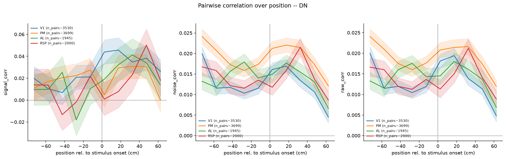

# 3d_pair_activity_statistics_temporal

*Auto-generated from `2_pipeline/3d_pair_activity_statistics_temporal/out/` on 2026-09-14 16:47. Re-run `make_progress_md.py` after the script's output changes -- don't hand-edit this file.*

## Tables

### Pair correlations temporal

| session_id | roi_name | labeled_grouped | cell_i | cell_j | s_rel | n_trials | signal_corr | noise_corr | raw_corr |
| --- | --- | --- | --- | --- | --- | --- | --- | --- | --- |
| LPE10884_2024_01_12 | AL | unl | LPE10884_2024_01_12_7_0046 | LPE10884_2024_01_12_7_0150 | -72.5 | 209 | 0.6772 | -0.04941 | -0.04626 |
| LPE10884_2024_01_12 | AL | unl | LPE10884_2024_01_12_7_0003 | LPE10884_2024_01_12_7_0178 | -72.5 | 209 | 0.1891 | -0.03288 | -0.03044 |
| LPE10884_2024_01_12 | AL | unl | LPE10884_2024_01_12_7_0060 | LPE10884_2024_01_12_7_0195 | -72.5 | 209 | 0.651 | 0.02007 | 0.02246 |
| LPE10884_2024_01_12 | AL | unl | LPE10884_2024_01_12_7_0151 | LPE10884_2024_01_12_7_0192 | -72.5 | 209 | 0.07576 | 0.08016 | 0.08019 |
| LPE10884_2024_01_12 | AL | unl | LPE10884_2024_01_12_7_0014 | LPE10884_2024_01_12_7_0194 | -72.5 | 209 | -0.05522 | -0.0638 | -0.06273 |
| LPE10884_2024_01_12 | AL | unl | LPE10884_2024_01_12_7_0100 | LPE10884_2024_01_12_7_0170 | -72.5 | 209 | -0.9298 | -0.09113 | -0.09505 |
| LPE10884_2024_01_12 | AL | unl | LPE10884_2024_01_12_7_0005 | LPE10884_2024_01_12_7_0133 | -72.5 | 209 | 0.5083 | -0.1148 | -0.1108 |
| LPE10884_2024_01_12 | AL | unl | LPE10884_2024_01_12_7_0166 | LPE10884_2024_01_12_7_0204 | -72.5 | 209 | 0.1161 | 0.1263 | 0.1256 |
| LPE10884_2024_01_12 | AL | unl | LPE10884_2024_01_12_7_0182 | LPE10884_2024_01_12_7_0390 | -72.5 | 209 | 0.1192 | 0.1961 | 0.1954 |
| LPE10884_2024_01_12 | AL | unl | LPE10884_2024_01_12_7_0090 | LPE10884_2024_01_12_7_0140 | -72.5 | 209 | 0.3908 | 0.0195 | 0.02506 |
| LPE10884_2024_01_12 | AL | unl | LPE10884_2024_01_12_7_0071 | LPE10884_2024_01_12_7_0141 | -72.5 | 209 | 0.8195 | 0.04687 | 0.05563 |
| LPE10884_2024_01_12 | AL | unl | LPE10884_2024_01_12_7_0282 | LPE10884_2024_01_12_7_0334 | -72.5 | 209 | -0.8256 | 0.09607 | 0.09161 |
| LPE10884_2024_01_12 | AL | unl | LPE10884_2024_01_12_7_0233 | LPE10884_2024_01_12_7_0265 | -72.5 | 209 | -0.1994 | -0.04652 | -0.0477 |
| LPE10884_2024_01_12 | AL | unl | LPE10884_2024_01_12_7_0127 | LPE10884_2024_01_12_7_0273 | -72.5 | 209 | -0.1597 | 0.001894 | 0.001559 |
| LPE10884_2024_01_12 | AL | unl | LPE10884_2024_01_12_7_0004 | LPE10884_2024_01_12_7_0180 | -72.5 | 209 | -0.449 | -0.04468 | -0.05068 |
| LPE10884_2024_01_12 | AL | unl | LPE10884_2024_01_12_7_0113 | LPE10884_2024_01_12_7_0130 | -72.5 | 209 | -0.4539 | 0.1086 | 0.1037 |
| LPE10884_2024_01_12 | AL | unl | LPE10884_2024_01_12_7_0130 | LPE10884_2024_01_12_7_0244 | -72.5 | 209 | -0.5556 | -0.06744 | -0.07695 |
| LPE10884_2024_01_12 | AL | unl | LPE10884_2024_01_12_7_0149 | LPE10884_2024_01_12_7_0281 | -72.5 | 209 | 0.4051 | 0.07476 | 0.07932 |
| LPE10884_2024_01_12 | AL | unl | LPE10884_2024_01_12_7_0104 | LPE10884_2024_01_12_7_0206 | -72.5 | 209 | 0.7586 | -1.615e-06 | 0.01675 |
| LPE10884_2024_01_12 | AL | unl | LPE10884_2024_01_12_7_0020 | LPE10884_2024_01_12_7_0169 | -72.5 | 209 | 0.4037 | -0.02557 | -0.02235 |
| LPE10884_2024_01_12 | AL | unl | LPE10884_2024_01_12_7_0103 | LPE10884_2024_01_12_7_0421 | -72.5 | 209 | -0.6289 | -0.04001 | -0.04637 |
| LPE10884_2024_01_12 | AL | unl | LPE10884_2024_01_12_7_0303 | LPE10884_2024_01_12_7_0347 | -72.5 | 209 | -0.3322 | 0.01303 | 0.01056 |
| LPE10884_2024_01_12 | AL | unl | LPE10884_2024_01_12_7_0101 | LPE10884_2024_01_12_7_0278 | -72.5 | 209 | 0.5841 | 0.1828 | 0.1855 |
| LPE10884_2024_01_12 | AL | unl | LPE10884_2024_01_12_7_0137 | LPE10884_2024_01_12_7_0273 | -72.5 | 209 | -0.5583 | 0.0005158 | -0.0006987 |
| LPE10884_2024_01_12 | AL | unl | LPE10884_2024_01_12_7_0111 | LPE10884_2024_01_12_7_0178 | -72.5 | 209 | 0.766 | -0.08202 | -0.0715 |
| LPE10884_2024_01_12 | AL | unl | LPE10884_2024_01_12_7_0180 | LPE10884_2024_01_12_7_0204 | -72.5 | 209 | -0.6569 | -0.05519 | -0.06243 |
| LPE10884_2024_01_12 | AL | unl | LPE10884_2024_01_12_7_0044 | LPE10884_2024_01_12_7_0229 | -72.5 | 209 | -0.1314 | 0.1934 | 0.1911 |
| LPE10884_2024_01_12 | AL | unl | LPE10884_2024_01_12_7_0045 | LPE10884_2024_01_12_7_0075 | -72.5 | 209 | 0.1515 | 0.0304 | 0.03104 |
| LPE10884_2024_01_12 | AL | unl | LPE10884_2024_01_12_7_0067 | LPE10884_2024_01_12_7_0394 | -72.5 | 209 | 0.351 | 0.1361 | 0.1374 |
| LPE10884_2024_01_12 | AL | unl | LPE10884_2024_01_12_7_0030 | LPE10884_2024_01_12_7_0115 | -72.5 | 209 | 0.3531 | -0.03144 | -0.02236 |

*(showing first 30 of 111740 rows -- see the linked CSV for the rest)*

[pair_correlations_temporal.csv](../2_pipeline/3d_pair_activity_statistics_temporal/out/pair_correlations_temporal.csv)

## Figures

### Correlation vs position

