# 3d_pair_activity_statistics_temporal

*Auto-generated from `2_pipeline/3d_pair_activity_statistics_temporal/out/` on 2026-10-16 17:39. Re-run `make_progress_md.py` after the script's output changes -- don't hand-edit this file.*

## Tables

### Pair correlations temporal

| session_id | animal_id | target | s_rel | roi_name | labeled_grouped | cell_i | cell_j | pair_rank | n_trials | signal_corr | noise_corr | raw_corr | area | label |
| --- | --- | --- | --- | --- | --- | --- | --- | --- | --- | --- | --- | --- | --- | --- |
| LPE10884_2024_01_12 | LPE10884 | zero_to80_above80 | -52.5 | AL | unl | LPE10884_2024_01_12_7_0039 | LPE10884_2024_01_12_7_0198 | 2 | 209 | 0.6511 | -0.1388 | -0.1276 | AL | unl |
| LPE10884_2024_01_12 | LPE10884 | zero_to80_above80 | -52.5 | AL | unl | LPE10884_2024_01_12_7_0061 | LPE10884_2024_01_12_7_0250 | 5 | 209 | -0.9996 | 0.05737 | 0.0498 | AL | unl |
| LPE10884_2024_01_12 | LPE10884 | zero_to80_above80 | -52.5 | AL | unl | LPE10884_2024_01_12_7_0081 | LPE10884_2024_01_12_7_0084 | 7 | 209 | -0.6236 | -0.03478 | -0.03503 | AL | unl |
| LPE10884_2024_01_12 | LPE10884 | zero_to80_above80 | -52.5 | AL | unl | LPE10884_2024_01_12_7_0142 | LPE10884_2024_01_12_7_0278 | 4 | 209 | -0.3334 | 0.05632 | 0.05486 | AL | unl |
| LPE10884_2024_01_12 | LPE10884 | zero_to80_above80 | -52.5 | AL | unl | LPE10884_2024_01_12_7_0035 | LPE10884_2024_01_12_7_0220 | 1 | 209 | -0.7613 | 0.1199 | 0.1072 | AL | unl |
| LPE10884_2024_01_12 | LPE10884 | zero_to80_above80 | -52.5 | AL | unl | LPE10884_2024_01_12_7_0042 | LPE10884_2024_01_12_7_0361 | 6 | 209 | -0.9187 | -0.04855 | -0.05071 | AL | unl |
| LPE10884_2024_01_12 | LPE10884 | zero_to80_above80 | -52.5 | AL | unl | LPE10884_2024_01_12_7_0116 | LPE10884_2024_01_12_7_0136 | 0 | 209 | -0.5338 | 0.07839 | 0.07647 | AL | unl |
| LPE10884_2024_01_12 | LPE10884 | zero_to80_above80 | -52.5 | AL | unl | LPE10884_2024_01_12_7_0076 | LPE10884_2024_01_12_7_0177 | 3 | 209 | -0.9574 | -0.05975 | -0.07154 | AL | unl |
| LPE10884_2024_01_12 | LPE10884 | zero_to80_above80 | -52.5 | RSP | unl | LPE10884_2024_01_12_6_0037 | LPE10884_2024_01_12_6_0064 | 6 | 209 | -0.9295 | -0.04378 | -0.04522 | RSP | unl |
| LPE10884_2024_01_12 | LPE10884 | zero_to80_above80 | -52.5 | RSP | unl | LPE10884_2024_01_12_6_0002 | LPE10884_2024_01_12_6_0053 | 0 | 209 | 0.9633 | 0.07625 | 0.1051 | RSP | unl |
| LPE10884_2024_01_12 | LPE10884 | zero_to80_above80 | -52.5 | RSP | unl | LPE10884_2024_01_12_6_0032 | LPE10884_2024_01_12_6_0046 | 1 | 209 | 0.8736 | -0.07326 | -0.06761 | RSP | unl |
| LPE10884_2024_01_12 | LPE10884 | zero_to80_above80 | -52.5 | RSP | unl | LPE10884_2024_01_12_6_0024 | LPE10884_2024_01_12_6_0028 | 4 | 209 | -0.9989 | 0.02491 | 0.02425 | RSP | unl |
| LPE10884_2024_01_12 | LPE10884 | zero_to80_above80 | -52.5 | RSP | unl | LPE10884_2024_01_12_6_0030 | LPE10884_2024_01_12_6_0031 | 7 | 209 | 0.3303 | -0.09068 | -0.0911 | RSP | unl |
| LPE10884_2024_01_12 | LPE10884 | zero_to80_above80 | -52.5 | RSP | unl | LPE10884_2024_01_12_6_0019 | LPE10884_2024_01_12_6_0062 | 3 | 209 | -0.2534 | 0.1532 | 0.1564 | RSP | unl |
| LPE10884_2024_01_12 | LPE10884 | zero_to80_above80 | -52.5 | RSP | unl | LPE10884_2024_01_12_6_0012 | LPE10884_2024_01_12_6_0025 | 2 | 209 | -0.7629 | -0.06393 | -0.06448 | RSP | unl |
| LPE10884_2024_01_12 | LPE10884 | zero_to80_above80 | -52.5 | RSP | unl | LPE10884_2024_01_12_6_0023 | LPE10884_2024_01_12_6_0045 | 5 | 209 | -0.4406 | -0.005612 | -0.005314 | RSP | unl |
| LPE10884_2024_01_12 | LPE10884 | pct_0-20_20-80_80-100 | -52.5 | AL | unl | LPE10884_2024_01_12_7_0039 | LPE10884_2024_01_12_7_0198 | 2 | 209 | 0.09347 | -0.1303 | -0.1276 | AL | unl |
| LPE10884_2024_01_12 | LPE10884 | pct_0-20_20-80_80-100 | -52.5 | AL | unl | LPE10884_2024_01_12_7_0061 | LPE10884_2024_01_12_7_0250 | 5 | 209 | -0.3405 | 0.05262 | 0.0498 | AL | unl |
| LPE10884_2024_01_12 | LPE10884 | pct_0-20_20-80_80-100 | -52.5 | AL | unl | LPE10884_2024_01_12_7_0081 | LPE10884_2024_01_12_7_0084 | 7 | 209 | -0.6281 | -0.03415 | -0.03503 | AL | unl |
| LPE10884_2024_01_12 | LPE10884 | pct_0-20_20-80_80-100 | -52.5 | AL | unl | LPE10884_2024_01_12_7_0142 | LPE10884_2024_01_12_7_0278 | 4 | 209 | 0.4639 | 0.05269 | 0.05486 | AL | unl |
| LPE10884_2024_01_12 | LPE10884 | pct_0-20_20-80_80-100 | -52.5 | AL | unl | LPE10884_2024_01_12_7_0035 | LPE10884_2024_01_12_7_0220 | 1 | 209 | -0.9715 | 0.1385 | 0.1072 | AL | unl |
| LPE10884_2024_01_12 | LPE10884 | pct_0-20_20-80_80-100 | -52.5 | AL | unl | LPE10884_2024_01_12_7_0042 | LPE10884_2024_01_12_7_0361 | 6 | 209 | -0.8453 | -0.04736 | -0.05071 | AL | unl |
| LPE10884_2024_01_12 | LPE10884 | pct_0-20_20-80_80-100 | -52.5 | AL | unl | LPE10884_2024_01_12_7_0116 | LPE10884_2024_01_12_7_0136 | 0 | 209 | 0.6098 | 0.07279 | 0.07647 | AL | unl |
| LPE10884_2024_01_12 | LPE10884 | pct_0-20_20-80_80-100 | -52.5 | AL | unl | LPE10884_2024_01_12_7_0076 | LPE10884_2024_01_12_7_0177 | 3 | 209 | -0.8059 | -0.0616 | -0.07154 | AL | unl |
| LPE10884_2024_01_12 | LPE10884 | pct_0-20_20-80_80-100 | -52.5 | RSP | unl | LPE10884_2024_01_12_6_0037 | LPE10884_2024_01_12_6_0064 | 6 | 209 | 0.1982 | -0.04654 | -0.04522 | RSP | unl |
| LPE10884_2024_01_12 | LPE10884 | pct_0-20_20-80_80-100 | -52.5 | RSP | unl | LPE10884_2024_01_12_6_0002 | LPE10884_2024_01_12_6_0053 | 0 | 209 | 0.1047 | 0.1053 | 0.1051 | RSP | unl |
| LPE10884_2024_01_12 | LPE10884 | pct_0-20_20-80_80-100 | -52.5 | RSP | unl | LPE10884_2024_01_12_6_0032 | LPE10884_2024_01_12_6_0046 | 1 | 209 | 0.267 | -0.06813 | -0.06761 | RSP | unl |
| LPE10884_2024_01_12 | LPE10884 | pct_0-20_20-80_80-100 | -52.5 | RSP | unl | LPE10884_2024_01_12_6_0024 | LPE10884_2024_01_12_6_0028 | 4 | 209 | 0.9045 | 0.01935 | 0.02425 | RSP | unl |
| LPE10884_2024_01_12 | LPE10884 | pct_0-20_20-80_80-100 | -52.5 | RSP | unl | LPE10884_2024_01_12_6_0030 | LPE10884_2024_01_12_6_0031 | 7 | 209 | -0.09912 | -0.0909 | -0.0911 | RSP | unl |
| LPE10884_2024_01_12 | LPE10884 | pct_0-20_20-80_80-100 | -52.5 | RSP | unl | LPE10884_2024_01_12_6_0019 | LPE10884_2024_01_12_6_0062 | 3 | 209 | 0.8888 | 0.1419 | 0.1564 | RSP | unl |

*(showing first 15 of 17 columns; showing first 30 of 38560 rows -- see the linked CSV for the rest)*

[pair_correlations_temporal.csv](../2_pipeline/3d_pair_activity_statistics_temporal/out/pair_correlations_temporal.csv)

### Pair correlations temporal by group  session

| binning | target | group | s_rel | raw_corr | raw_corr_sem | n_units | n_pairs | noise_corr | noise_corr_sem | signal_corr | signal_corr_sem |
| --- | --- | --- | --- | --- | --- | --- | --- | --- | --- | --- | --- |
| fixed | all_levels | AL_unl | -52.5 | 0.01315 | 0.002573 | 21 | 3045 | 0.013 | 0.002719 | 0.02161 | 0.004047 |
| fixed | all_levels | AL_unl | -37.5 | 0.01658 | 0.00305 | 21 | 3045 | 0.01663 | 0.003053 | 0.0125 | 0.005827 |
| fixed | all_levels | AL_unl | -22.5 | 0.01485 | 0.002504 | 21 | 3045 | 0.01494 | 0.00247 | 0.01594 | 0.006037 |
| fixed | all_levels | AL_unl | -7.5 | 0.01806 | 0.003224 | 21 | 3045 | 0.01821 | 0.003317 | 0.01802 | 0.006718 |
| fixed | all_levels | AL_unl | 7.5 | 0.01594 | 0.003185 | 21 | 3045 | 0.01676 | 0.002924 | 0.01502 | 0.007375 |
| fixed | all_levels | AL_unl | 22.5 | 0.01911 | 0.003765 | 21 | 3045 | 0.01944 | 0.003672 | 0.02 | 0.00692 |
| fixed | all_levels | AL_unl | 37.5 | 0.013 | 0.002255 | 21 | 3045 | 0.01321 | 0.002212 | 0.01168 | 0.005423 |
| fixed | all_levels | AL_unl | 52.5 | 0.01081 | 0.002904 | 14 | 1995 | 0.011 | 0.002858 | 0.01404 | 0.008058 |
| fixed | all_levels | PM_lab | -52.5 | 0.02474 | 0.005199 | 20 | 2754 | 0.02365 | 0.004989 | 0.02734 | 0.008348 |
| fixed | all_levels | PM_lab | -37.5 | 0.02545 | 0.005517 | 20 | 2754 | 0.0245 | 0.00528 | 0.03287 | 0.009632 |
| fixed | all_levels | PM_lab | -22.5 | 0.02537 | 0.005647 | 20 | 2754 | 0.02645 | 0.005758 | 0.005115 | 0.007351 |
| fixed | all_levels | PM_lab | -7.5 | 0.02675 | 0.005375 | 20 | 2754 | 0.0265 | 0.005284 | 0.02002 | 0.007808 |
| fixed | all_levels | PM_lab | 7.5 | 0.02343 | 0.006384 | 20 | 2754 | 0.02766 | 0.007277 | 0.01468 | 0.00707 |
| fixed | all_levels | PM_lab | 22.5 | 0.03059 | 0.005728 | 20 | 2754 | 0.03294 | 0.00607 | 0.02527 | 0.007797 |
| fixed | all_levels | PM_lab | 37.5 | 0.02932 | 0.0062 | 20 | 2754 | 0.02979 | 0.00635 | 0.02819 | 0.006382 |
| fixed | all_levels | PM_lab | 52.5 | 0.01093 | 0.002766 | 14 | 1854 | 0.01068 | 0.002645 | 0.01659 | 0.009592 |
| fixed | all_levels | PM_unl | -52.5 | 0.01242 | 0.002598 | 20 | 3000 | 0.01266 | 0.002493 | 0.01154 | 0.005984 |
| fixed | all_levels | PM_unl | -37.5 | 0.01318 | 0.002622 | 20 | 3000 | 0.01354 | 0.002749 | 0.006299 | 0.005144 |
| fixed | all_levels | PM_unl | -22.5 | 0.01234 | 0.002953 | 20 | 3000 | 0.01198 | 0.002938 | 0.01565 | 0.00686 |
| fixed | all_levels | PM_unl | -7.5 | 0.01311 | 0.002003 | 20 | 3000 | 0.01348 | 0.001972 | 0.00553 | 0.0059 |
| fixed | all_levels | PM_unl | 7.5 | 0.01371 | 0.00206 | 20 | 3000 | 0.01522 | 0.002741 | 0.01559 | 0.005238 |
| fixed | all_levels | PM_unl | 22.5 | 0.0147 | 0.00194 | 20 | 3000 | 0.01591 | 0.002583 | 0.01392 | 0.006538 |
| fixed | all_levels | PM_unl | 37.5 | 0.01257 | 0.002008 | 20 | 3000 | 0.01294 | 0.001967 | 0.01521 | 0.00433 |
| fixed | all_levels | PM_unl | 52.5 | 0.005297 | 0.002304 | 14 | 2100 | 0.004414 | 0.002554 | 0.01106 | 0.006113 |
| fixed | all_levels | RSP_unl | -52.5 | 0.017 | 0.002866 | 21 | 3150 | 0.01659 | 0.002869 | 0.02776 | 0.006776 |
| fixed | all_levels | RSP_unl | -37.5 | 0.01721 | 0.002656 | 21 | 3150 | 0.01736 | 0.002545 | 0.01595 | 0.008781 |
| fixed | all_levels | RSP_unl | -22.5 | 0.01585 | 0.002444 | 21 | 3150 | 0.01615 | 0.002461 | 0.01527 | 0.007322 |
| fixed | all_levels | RSP_unl | -7.5 | 0.01634 | 0.003137 | 21 | 3150 | 0.01595 | 0.002813 | 0.01673 | 0.006141 |
| fixed | all_levels | RSP_unl | 7.5 | 0.01557 | 0.002515 | 21 | 3150 | 0.01692 | 0.002856 | 0.01177 | 0.006565 |
| fixed | all_levels | RSP_unl | 22.5 | 0.02272 | 0.002584 | 21 | 3150 | 0.02362 | 0.002721 | 0.01969 | 0.006302 |

*(showing first 30 of 900 rows -- see the linked CSV for the rest)*

[pair_correlations_temporal_by_group__session.csv](../2_pipeline/3d_pair_activity_statistics_temporal/out/pair_correlations_temporal_by_group__session.csv)

### Pair correlations temporal moments

| session_id | animal_id | binning | target | s_rel | n_trials | group | raw_corr_n | raw_corr_sum | raw_corr_ss | noise_corr_n | noise_corr_sum | noise_corr_ss | signal_corr_n | signal_corr_sum |
| --- | --- | --- | --- | --- | --- | --- | --- | --- | --- | --- | --- | --- | --- | --- |
| LPE10884_2024_01_12 | LPE10884 | fixed | zero_to80_above80 | -52.5 | 187 | AL_unl | 150 | 2.707 | 1.51 | 150 | 2.642 | 1.504 | 150 | -1.027 |
| LPE10884_2024_01_12 | LPE10884 | fixed | zero_to80_above80 | -52.5 | 187 | RSP_unl | 150 | 4.44 | 2.115 | 150 | 4.471 | 2.131 | 150 | 3.65 |
| LPE10884_2024_01_12 | LPE10884 | fixed | pct_0-20_20-80_80-100 | -52.5 | 187 | AL_unl | 150 | 2.707 | 1.51 | 150 | 2.675 | 1.521 | 150 | 5.631 |
| LPE10884_2024_01_12 | LPE10884 | fixed | pct_0-20_20-80_80-100 | -52.5 | 187 | RSP_unl | 150 | 4.44 | 2.115 | 150 | 4.371 | 2.127 | 150 | 9.634 |
| LPE10884_2024_01_12 | LPE10884 | fixed | zero_vs_nonzero | -52.5 | 187 | AL_unl | 150 | 2.707 | 1.51 | 150 | 2.633 | 1.491 | 0 | 0 |
| LPE10884_2024_01_12 | LPE10884 | fixed | zero_vs_nonzero | -52.5 | 187 | RSP_unl | 150 | 4.44 | 2.115 | 150 | 4.49 | 2.122 | 0 | 0 |
| LPE10884_2024_01_12 | LPE10884 | fixed | all_levels | -52.5 | 187 | AL_unl | 150 | 2.707 | 1.51 | 150 | 2.689 | 1.628 | 150 | 4.581 |
| LPE10884_2024_01_12 | LPE10884 | fixed | all_levels | -52.5 | 187 | RSP_unl | 150 | 4.44 | 2.115 | 150 | 4.592 | 2.19 | 150 | 3.391 |
| LPE10884_2024_01_12 | LPE10884 | fixed | choice | -52.5 | 187 | AL_unl | 150 | 2.707 | 1.51 | 150 | 2.626 | 1.515 | 0 | 0 |
| LPE10884_2024_01_12 | LPE10884 | fixed | choice | -52.5 | 187 | RSP_unl | 150 | 4.44 | 2.115 | 150 | 4.313 | 2.117 | 0 | 0 |
| LPE10884_2024_01_12 | LPE10884 | fixed | zero_to80_above80 | -37.5 | 209 | AL_unl | 150 | 3.373 | 1.626 | 150 | 3.449 | 1.631 | 150 | 3.607 |
| LPE10884_2024_01_12 | LPE10884 | fixed | zero_to80_above80 | -37.5 | 209 | RSP_unl | 150 | 2.863 | 1.654 | 150 | 2.907 | 1.666 | 150 | 5.34 |
| LPE10884_2024_01_12 | LPE10884 | fixed | pct_0-20_20-80_80-100 | -37.5 | 209 | AL_unl | 150 | 3.373 | 1.626 | 150 | 3.475 | 1.643 | 150 | 9.212 |
| LPE10884_2024_01_12 | LPE10884 | fixed | pct_0-20_20-80_80-100 | -37.5 | 209 | RSP_unl | 150 | 2.863 | 1.654 | 150 | 2.983 | 1.684 | 150 | 3.523 |
| LPE10884_2024_01_12 | LPE10884 | fixed | zero_vs_nonzero | -37.5 | 209 | AL_unl | 150 | 3.373 | 1.626 | 150 | 3.412 | 1.624 | 0 | 0 |
| LPE10884_2024_01_12 | LPE10884 | fixed | zero_vs_nonzero | -37.5 | 209 | RSP_unl | 150 | 2.863 | 1.654 | 150 | 2.894 | 1.673 | 0 | 0 |
| LPE10884_2024_01_12 | LPE10884 | fixed | all_levels | -37.5 | 209 | AL_unl | 150 | 3.373 | 1.626 | 150 | 3.871 | 1.681 | 150 | -1.143 |
| LPE10884_2024_01_12 | LPE10884 | fixed | all_levels | -37.5 | 209 | RSP_unl | 150 | 2.863 | 1.654 | 150 | 3.383 | 1.753 | 150 | -2.131 |
| LPE10884_2024_01_12 | LPE10884 | fixed | choice | -37.5 | 209 | AL_unl | 150 | 3.373 | 1.626 | 150 | 3.39 | 1.626 | 0 | 0 |
| LPE10884_2024_01_12 | LPE10884 | fixed | choice | -37.5 | 209 | RSP_unl | 150 | 2.863 | 1.654 | 150 | 2.846 | 1.634 | 0 | 0 |
| LPE10884_2024_01_12 | LPE10884 | fixed | zero_to80_above80 | -22.5 | 209 | AL_unl | 150 | 1.836 | 1.549 | 150 | 2.091 | 1.579 | 150 | -18.93 |
| LPE10884_2024_01_12 | LPE10884 | fixed | zero_to80_above80 | -22.5 | 209 | RSP_unl | 150 | 4.357 | 1.676 | 150 | 4.404 | 1.659 | 150 | 0.3652 |
| LPE10884_2024_01_12 | LPE10884 | fixed | pct_0-20_20-80_80-100 | -22.5 | 209 | AL_unl | 150 | 1.836 | 1.549 | 150 | 2.083 | 1.586 | 150 | -12.89 |
| LPE10884_2024_01_12 | LPE10884 | fixed | pct_0-20_20-80_80-100 | -22.5 | 209 | RSP_unl | 150 | 4.357 | 1.676 | 150 | 4.373 | 1.636 | 150 | -1.589 |
| LPE10884_2024_01_12 | LPE10884 | fixed | zero_vs_nonzero | -22.5 | 209 | AL_unl | 150 | 1.836 | 1.549 | 150 | 1.872 | 1.557 | 0 | 0 |
| LPE10884_2024_01_12 | LPE10884 | fixed | zero_vs_nonzero | -22.5 | 209 | RSP_unl | 150 | 4.357 | 1.676 | 150 | 4.408 | 1.706 | 0 | 0 |
| LPE10884_2024_01_12 | LPE10884 | fixed | all_levels | -22.5 | 209 | AL_unl | 150 | 1.836 | 1.549 | 150 | 2.042 | 1.701 | 150 | 2.967 |
| LPE10884_2024_01_12 | LPE10884 | fixed | all_levels | -22.5 | 209 | RSP_unl | 150 | 4.357 | 1.676 | 150 | 4.53 | 1.651 | 150 | 5.09 |
| LPE10884_2024_01_12 | LPE10884 | fixed | choice | -22.5 | 209 | AL_unl | 150 | 1.836 | 1.549 | 150 | 1.804 | 1.561 | 0 | 0 |
| LPE10884_2024_01_12 | LPE10884 | fixed | choice | -22.5 | 209 | RSP_unl | 150 | 4.357 | 1.676 | 150 | 4.441 | 1.663 | 0 | 0 |

*(showing first 15 of 16 columns; showing first 30 of 17740 rows -- see the linked CSV for the rest)*

[pair_correlations_temporal_moments.csv](../2_pipeline/3d_pair_activity_statistics_temporal/out/pair_correlations_temporal_moments.csv)

## Figures

### Correlation vs position

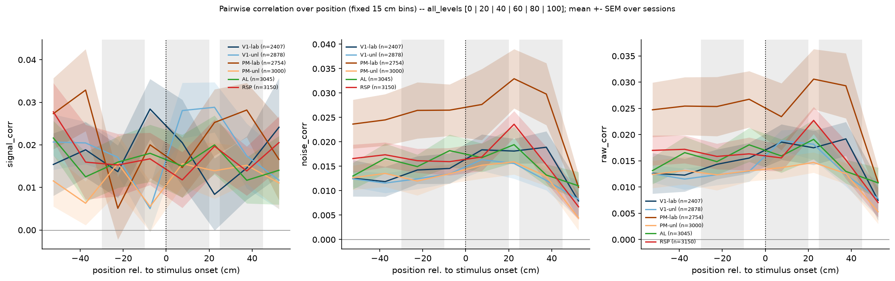

### Correlation vs position

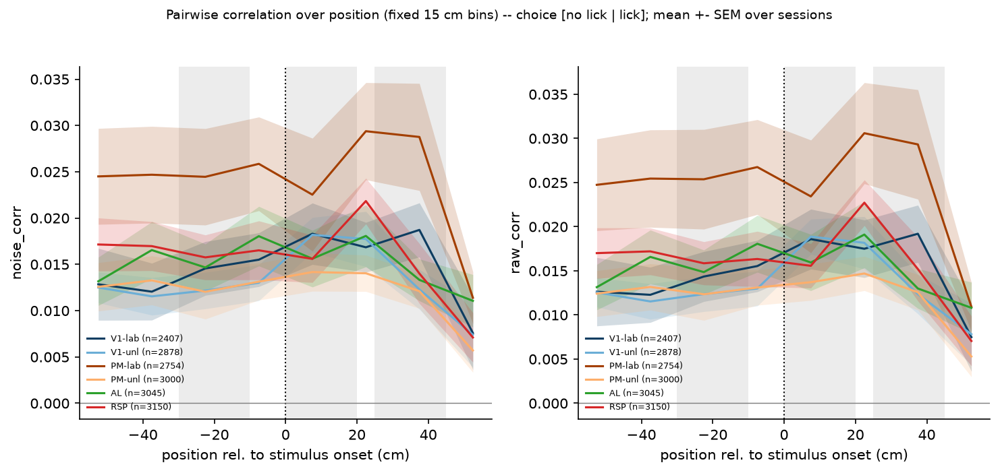

### Compare targets noise corr

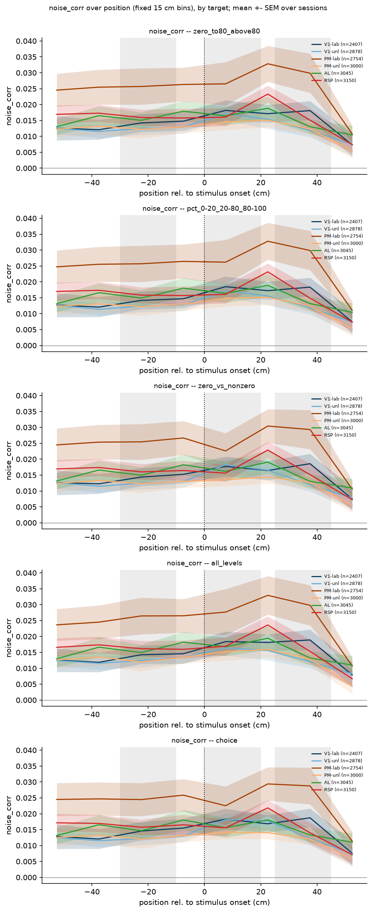

### Compare targets raw corr

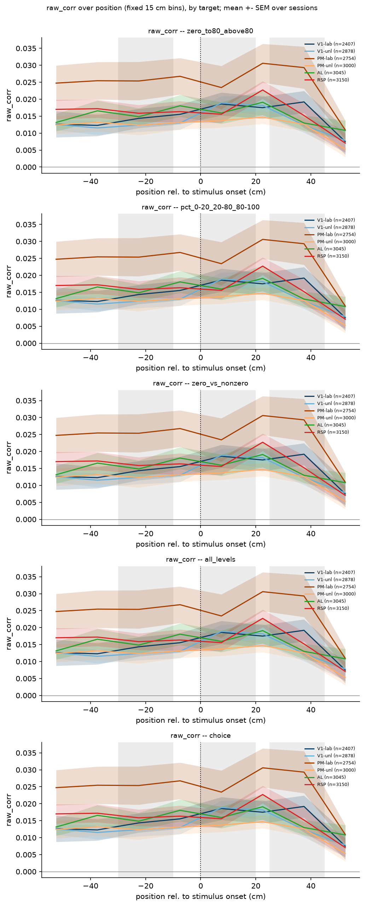

### Compare targets signal corr

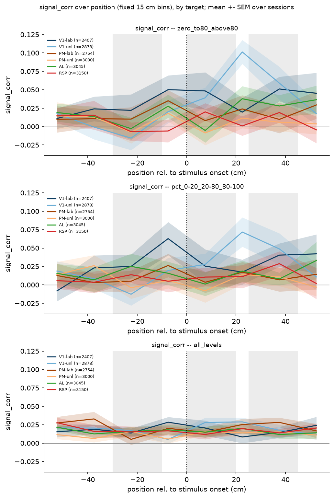

### Correlation vs position

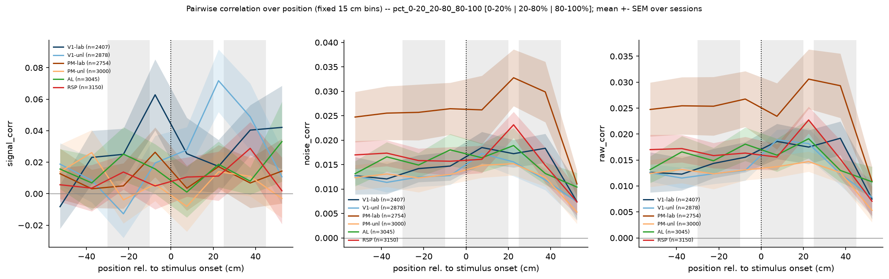

### Correlation vs position

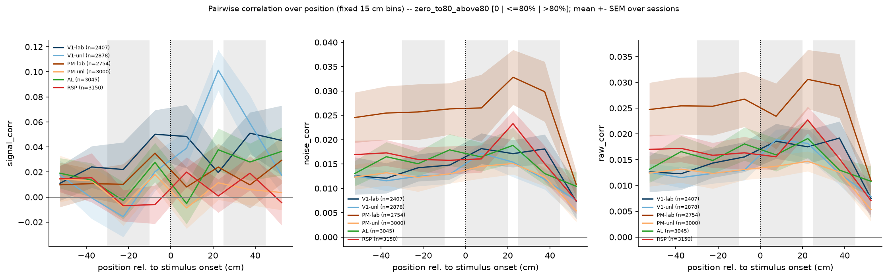

### Correlation vs position

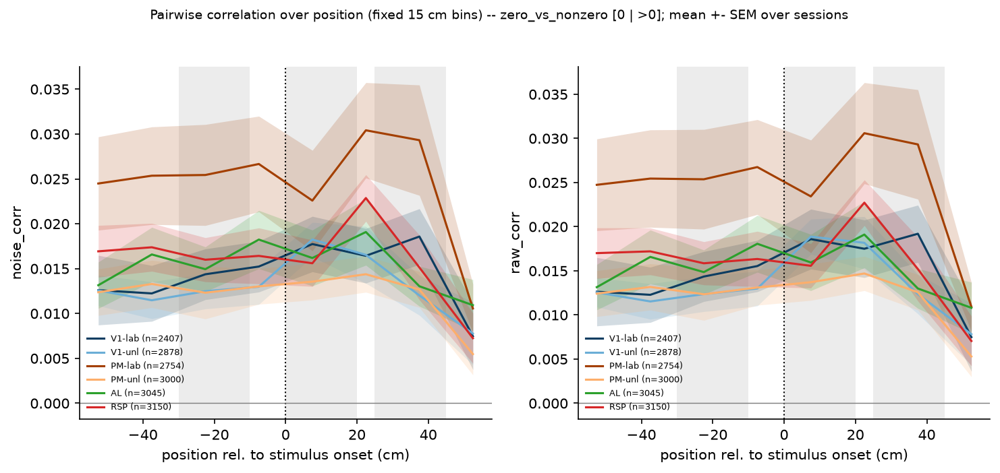

### Correlation vs position

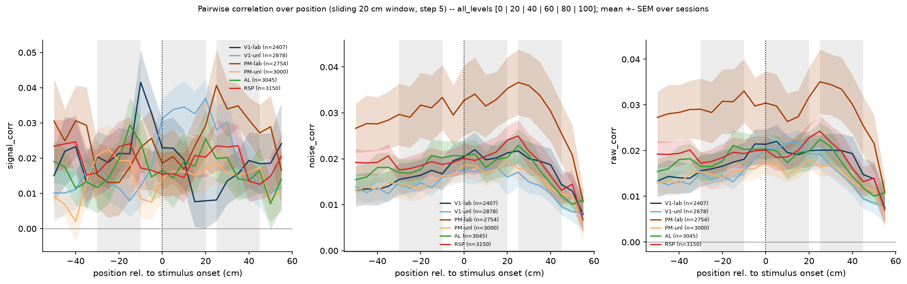

### Correlation vs position

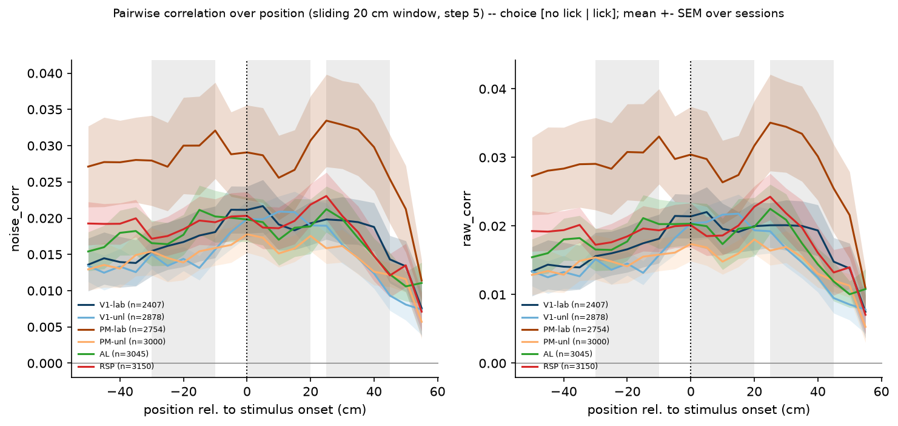

### Compare targets noise corr

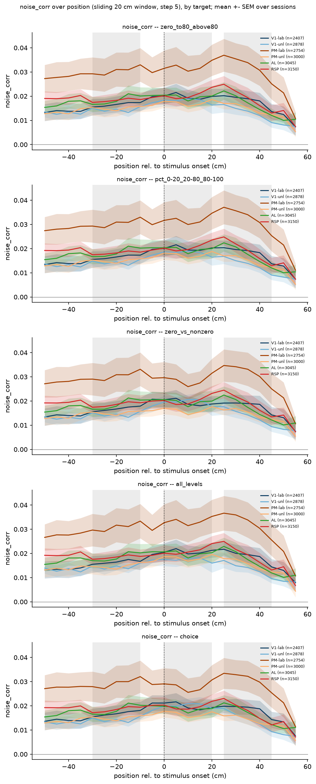

### Compare targets raw corr

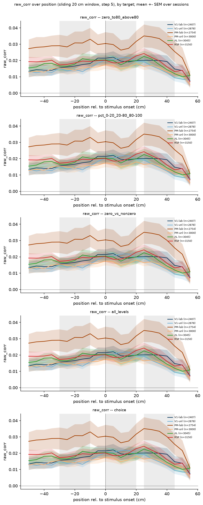

### Compare targets signal corr

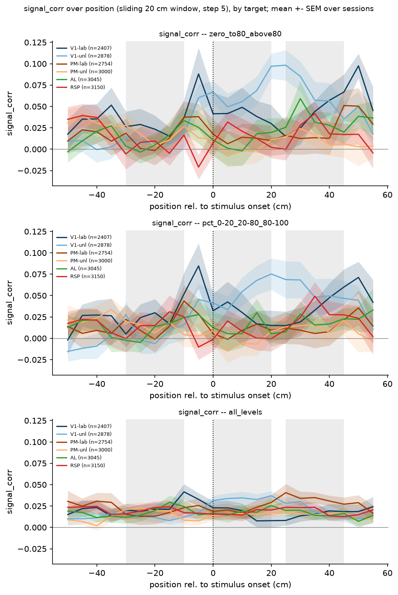

### Correlation vs position

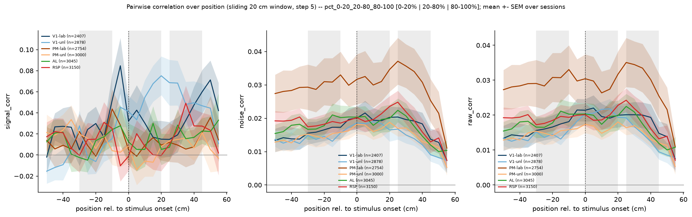

### Correlation vs position

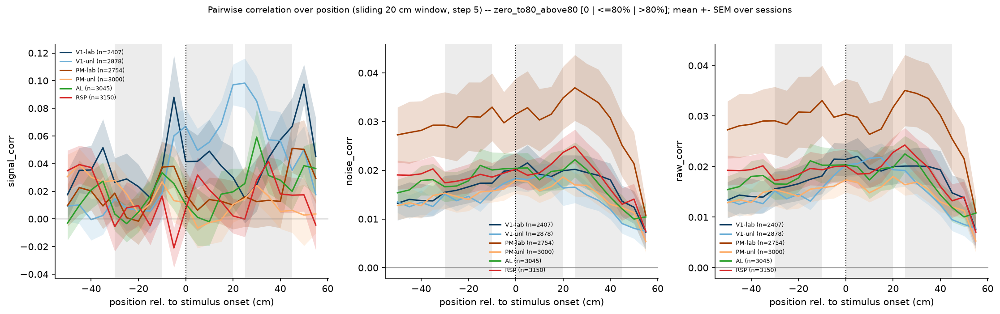

### Correlation vs position

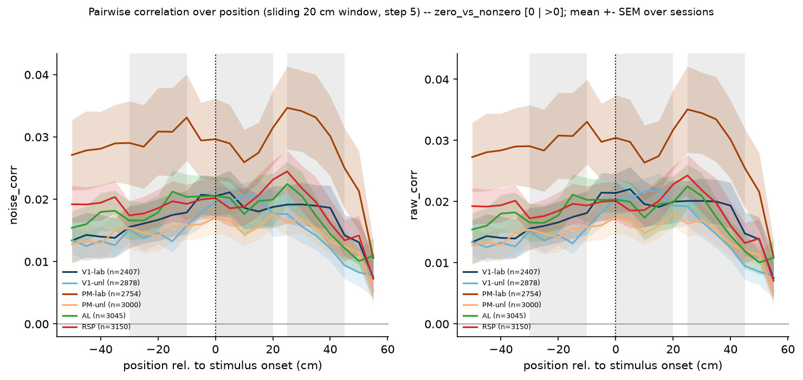
