# 3e_pair_information_breakdown_temporal

*Auto-generated from `2_pipeline/3e_pair_information_breakdown_temporal/out/` on 2026-10-30 11:38. Re-run `make_progress_md.py` after the script's output changes -- don't hand-edit this file.*

## Tables

### Breakdown temporal

| session_id | animal_id | target | s_rel | roi_name | labeled_grouped | cell_i | cell_j | pair_rank | I_total | I_1 | I_2 | I_lin | I_ind | I_sigsim |
| --- | --- | --- | --- | --- | --- | --- | --- | --- | --- | --- | --- | --- | --- | --- |
| LPE10884_2024_01_12 | LPE10884 | zero_to80_above80 | -47.5 | AL | unl | LPE10884_2024_01_12_7_0039 | LPE10884_2024_01_12_7_0198 | 2 | 0 | 0.008291 | 0 | 0.008291 | 0.008204 | -8.715e-05 |
| LPE10884_2024_01_12 | LPE10884 | zero_to80_above80 | -47.5 | AL | unl | LPE10884_2024_01_12_7_0142 | LPE10884_2024_01_12_7_0278 | 4 | 0 | 0.006185 | 0.01865 | 0.02483 | 0.0244 | -0.000437 |
| LPE10884_2024_01_12 | LPE10884 | zero_to80_above80 | -47.5 | AL | unl | LPE10884_2024_01_12_7_0035 | LPE10884_2024_01_12_7_0220 | 1 | 0.02263 | 0 | 0.02615 | 0.02615 | 0.02591 | -0.0002413 |
| LPE10884_2024_01_12 | LPE10884 | zero_to80_above80 | -47.5 | AL | unl | LPE10884_2024_01_12_7_0116 | LPE10884_2024_01_12_7_0136 | 0 | 0.003558 | 0 | 0 | 0 | -2.178e-05 | -2.178e-05 |
| LPE10884_2024_01_12 | LPE10884 | zero_to80_above80 | -47.5 | AL | unl | LPE10884_2024_01_12_7_0076 | LPE10884_2024_01_12_7_0177 | 3 | 0 | 0.001654 | 0.002348 | 0.004002 | 0.003911 | -9.105e-05 |
| LPE10884_2024_01_12 | LPE10884 | zero_to80_above80 | -47.5 | RSP | unl | LPE10884_2024_01_12_6_0002 | LPE10884_2024_01_12_6_0053 | 0 | 0.002658 | 0.01245 | 0 | 0.01245 | 0.01219 | -0.000254 |
| LPE10884_2024_01_12 | LPE10884 | zero_to80_above80 | -47.5 | RSP | unl | LPE10884_2024_01_12_6_0032 | LPE10884_2024_01_12_6_0046 | 1 | 0 | 0.00276 | 0.001574 | 0.004334 | 0.004186 | -0.0001481 |
| LPE10884_2024_01_12 | LPE10884 | zero_to80_above80 | -47.5 | RSP | unl | LPE10884_2024_01_12_6_0024 | LPE10884_2024_01_12_6_0028 | 4 | 0 | 0 | 0 | 0 | -0.0002893 | -0.0002893 |
| LPE10884_2024_01_12 | LPE10884 | zero_to80_above80 | -47.5 | RSP | unl | LPE10884_2024_01_12_6_0019 | LPE10884_2024_01_12_6_0062 | 3 | 0.01818 | 0.007355 | 0.00103 | 0.008384 | 0.008225 | -0.0001588 |
| LPE10884_2024_01_12 | LPE10884 | zero_to80_above80 | -47.5 | RSP | unl | LPE10884_2024_01_12_6_0012 | LPE10884_2024_01_12_6_0025 | 2 | 0 | 0 | 0 | 0 | -1.113e-05 | -1.113e-05 |
| LPE10884_2024_01_12 | LPE10884 | pct_0-20_20-80_80-100 | -47.5 | AL | unl | LPE10884_2024_01_12_7_0039 | LPE10884_2024_01_12_7_0198 | 2 | 0 | 0.003418 | 0 | 0.003418 | 0.003364 | -5.453e-05 |
| LPE10884_2024_01_12 | LPE10884 | pct_0-20_20-80_80-100 | -47.5 | AL | unl | LPE10884_2024_01_12_7_0142 | LPE10884_2024_01_12_7_0278 | 4 | 0.02706 | 0.02425 | 0.01019 | 0.03443 | 0.03391 | -0.0005272 |
| LPE10884_2024_01_12 | LPE10884 | pct_0-20_20-80_80-100 | -47.5 | AL | unl | LPE10884_2024_01_12_7_0035 | LPE10884_2024_01_12_7_0220 | 1 | 0.02666 | 0.005445 | 0.01287 | 0.01832 | 0.0181 | -0.0002185 |
| LPE10884_2024_01_12 | LPE10884 | pct_0-20_20-80_80-100 | -47.5 | AL | unl | LPE10884_2024_01_12_7_0116 | LPE10884_2024_01_12_7_0136 | 0 | 0 | 0.005457 | 0.001861 | 0.007318 | 0.007181 | -0.0001369 |
| LPE10884_2024_01_12 | LPE10884 | pct_0-20_20-80_80-100 | -47.5 | AL | unl | LPE10884_2024_01_12_7_0076 | LPE10884_2024_01_12_7_0177 | 3 | 0.02297 | 0.008716 | 0.001234 | 0.009951 | 0.00942 | -0.000531 |
| LPE10884_2024_01_12 | LPE10884 | pct_0-20_20-80_80-100 | -47.5 | RSP | unl | LPE10884_2024_01_12_6_0002 | LPE10884_2024_01_12_6_0053 | 0 | 0.01733 | 0.005312 | 0.001722 | 0.007034 | 0.006998 | -3.648e-05 |
| LPE10884_2024_01_12 | LPE10884 | pct_0-20_20-80_80-100 | -47.5 | RSP | unl | LPE10884_2024_01_12_6_0032 | LPE10884_2024_01_12_6_0046 | 1 | 0 | 0.004312 | 0 | 0.004312 | 0.004239 | -7.349e-05 |
| LPE10884_2024_01_12 | LPE10884 | pct_0-20_20-80_80-100 | -47.5 | RSP | unl | LPE10884_2024_01_12_6_0024 | LPE10884_2024_01_12_6_0028 | 4 | 0.009384 | 0 | 0.004108 | 0.004108 | 0.003775 | -0.0003332 |
| LPE10884_2024_01_12 | LPE10884 | pct_0-20_20-80_80-100 | -47.5 | RSP | unl | LPE10884_2024_01_12_6_0019 | LPE10884_2024_01_12_6_0062 | 3 | 0.03304 | 0.002673 | 0.01067 | 0.01334 | 0.01298 | -0.0003689 |
| LPE10884_2024_01_12 | LPE10884 | pct_0-20_20-80_80-100 | -47.5 | RSP | unl | LPE10884_2024_01_12_6_0012 | LPE10884_2024_01_12_6_0025 | 2 | 0.01555 | 0.01354 | 0.008442 | 0.02198 | 0.02183 | -0.0001509 |
| LPE10884_2024_01_12 | LPE10884 | zero_vs_nonzero | -47.5 | AL | unl | LPE10884_2024_01_12_7_0039 | LPE10884_2024_01_12_7_0198 | 2 | 0.01187 | 0.002957 | 0 | 0.002957 | 0.002909 | -4.78e-05 |
| LPE10884_2024_01_12 | LPE10884 | zero_vs_nonzero | -47.5 | AL | unl | LPE10884_2024_01_12_7_0142 | LPE10884_2024_01_12_7_0278 | 4 | 0.01903 | 0.006739 | 0.009986 | 0.01672 | 0.01632 | -0.0004092 |
| LPE10884_2024_01_12 | LPE10884 | zero_vs_nonzero | -47.5 | AL | unl | LPE10884_2024_01_12_7_0035 | LPE10884_2024_01_12_7_0220 | 1 | 0 | 0 | 0.008368 | 0.008368 | 0.00835 | -1.72e-05 |
| LPE10884_2024_01_12 | LPE10884 | zero_vs_nonzero | -47.5 | AL | unl | LPE10884_2024_01_12_7_0116 | LPE10884_2024_01_12_7_0136 | 0 | 0.004242 | 0.002392 | 0 | 0.002392 | 0.002379 | -1.353e-05 |
| LPE10884_2024_01_12 | LPE10884 | zero_vs_nonzero | -47.5 | AL | unl | LPE10884_2024_01_12_7_0076 | LPE10884_2024_01_12_7_0177 | 3 | 0 | 0 | 0.01093 | 0.01093 | 0.01086 | -6.637e-05 |
| LPE10884_2024_01_12 | LPE10884 | zero_vs_nonzero | -47.5 | RSP | unl | LPE10884_2024_01_12_6_0002 | LPE10884_2024_01_12_6_0053 | 0 | 0 | 0.005921 | 0.006072 | 0.01199 | 0.01184 | -0.000149 |
| LPE10884_2024_01_12 | LPE10884 | zero_vs_nonzero | -47.5 | RSP | unl | LPE10884_2024_01_12_6_0032 | LPE10884_2024_01_12_6_0046 | 1 | 0.005792 | 0.005143 | 0.002746 | 0.007889 | 0.007775 | -0.000114 |
| LPE10884_2024_01_12 | LPE10884 | zero_vs_nonzero | -47.5 | RSP | unl | LPE10884_2024_01_12_6_0024 | LPE10884_2024_01_12_6_0028 | 4 | 0 | 0 | 0 | 0 | -4.669e-06 | -4.669e-06 |
| LPE10884_2024_01_12 | LPE10884 | zero_vs_nonzero | -47.5 | RSP | unl | LPE10884_2024_01_12_6_0019 | LPE10884_2024_01_12_6_0062 | 3 | 0 | 0 | 0 | 0 | -4.818e-06 | -4.818e-06 |
| LPE10884_2024_01_12 | LPE10884 | zero_vs_nonzero | -47.5 | RSP | unl | LPE10884_2024_01_12_6_0012 | LPE10884_2024_01_12_6_0025 | 2 | 0.005931 | 0 | 0 | 0 | -3.685e-05 | -3.685e-05 |

*(showing first 15 of 24 columns; showing first 30 of 14496 rows -- see the linked CSV for the rest)*

[breakdown_temporal.csv](../2_pipeline/3e_pair_information_breakdown_temporal/out/breakdown_temporal.csv)

### Breakdown temporal by group  session

| binning | target | group | s_rel | I_total | I_total_sem | n_units | n_pairs | I_lin | I_lin_sem | I_sigsim | I_sigsim_sem | I_cor | I_cor_sem | RSI |
| --- | --- | --- | --- | --- | --- | --- | --- | --- | --- | --- | --- | --- | --- | --- |
| fixed | choice | AL_unl | -50 | 0.006804 | 0.001134 | 21 | 3045 | 0.006388 | 0.0009904 | -7.542e-05 | 3.454e-05 | 0.0004919 | 0.0002422 | 0.0004164 |
| fixed | choice | AL_unl | -30 | 0.006678 | 0.00116 | 21 | 3045 | 0.006287 | 0.0009556 | -6.633e-05 | 2.798e-05 | 0.0004583 | 0.0003147 | 0.000392 |
| fixed | choice | AL_unl | -10 | 0.009231 | 0.001548 | 21 | 3045 | 0.009347 | 0.001595 | -0.000126 | 6.44e-05 | 9.225e-06 | 0.0001774 | -0.0001167 |
| fixed | choice | AL_unl | 10 | 0.02802 | 0.00323 | 21 | 3045 | 0.02863 | 0.003444 | -0.0004883 | 9.562e-05 | -0.0001242 | 0.0003444 | -0.0006125 |
| fixed | choice | AL_unl | 30 | 0.1418 | 0.01771 | 21 | 3045 | 0.1624 | 0.0219 | -0.01246 | 0.002862 | -0.008137 | 0.001912 | -0.0206 |
| fixed | choice | AL_unl | 50 | 0.03195 | 0.006186 | 15 | 2145 | 0.03449 | 0.00712 | -0.0007789 | 0.0003733 | -0.001761 | 0.0006827 | -0.00254 |
| fixed | choice | PM_lab | -50 | 0.008207 | 0.001773 | 20 | 2754 | 0.008123 | 0.001791 | -0.0001192 | 4.889e-05 | 0.0002033 | 0.0001936 | 8.404e-05 |
| fixed | choice | PM_lab | -30 | 0.008625 | 0.001816 | 20 | 2754 | 0.008219 | 0.001612 | -0.000108 | 5.026e-05 | 0.0005131 | 0.0003861 | 0.0004051 |
| fixed | choice | PM_lab | -10 | 0.009615 | 0.001958 | 20 | 2754 | 0.00899 | 0.001781 | -0.0001136 | 6.209e-05 | 0.0007384 | 0.0004672 | 0.0006248 |
| fixed | choice | PM_lab | 10 | 0.03333 | 0.004088 | 20 | 2754 | 0.03461 | 0.004547 | -0.0006822 | 0.0001748 | -0.000603 | 0.0004456 | -0.001285 |
| fixed | choice | PM_lab | 30 | 0.1244 | 0.0125 | 20 | 2754 | 0.1381 | 0.01516 | -0.008329 | 0.001512 | -0.005445 | 0.001513 | -0.01377 |
| fixed | choice | PM_lab | 50 | 0.03832 | 0.006376 | 15 | 2004 | 0.04017 | 0.006942 | -0.001002 | 0.0003464 | -0.0008501 | 0.0006 | -0.001852 |
| fixed | choice | PM_unl | -50 | 0.006759 | 0.001211 | 20 | 3000 | 0.00628 | 0.001024 | -7.416e-05 | 3.409e-05 | 0.0005524 | 0.0002967 | 0.0004782 |
| fixed | choice | PM_unl | -30 | 0.007099 | 0.001268 | 20 | 3000 | 0.0067 | 0.001084 | -7.12e-05 | 2.772e-05 | 0.00047 | 0.0002665 | 0.0003988 |
| fixed | choice | PM_unl | -10 | 0.01012 | 0.001963 | 20 | 3000 | 0.009193 | 0.001485 | -0.0001161 | 5.021e-05 | 0.00104 | 0.0005631 | 0.0009234 |
| fixed | choice | PM_unl | 10 | 0.03302 | 0.003205 | 20 | 3000 | 0.03367 | 0.003428 | -0.000677 | 0.0001722 | 2.459e-05 | 0.0004387 | -0.0006524 |
| fixed | choice | PM_unl | 30 | 0.1245 | 0.01351 | 20 | 3000 | 0.1395 | 0.01664 | -0.008726 | 0.001704 | -0.006281 | 0.00172 | -0.01501 |
| fixed | choice | PM_unl | 50 | 0.03675 | 0.006068 | 15 | 2250 | 0.03917 | 0.006919 | -0.0009931 | 0.0003719 | -0.00143 | 0.0006054 | -0.002423 |
| fixed | choice | RSP_unl | -50 | 0.006896 | 0.00127 | 21 | 3150 | 0.006316 | 0.001002 | -6.555e-05 | 2.751e-05 | 0.0006455 | 0.0003345 | 0.0005799 |
| fixed | choice | RSP_unl | -30 | 0.0075 | 0.00165 | 21 | 3150 | 0.007061 | 0.001468 | -9.967e-05 | 5.454e-05 | 0.0005381 | 0.0002993 | 0.0004384 |
| fixed | choice | RSP_unl | -10 | 0.008858 | 0.001447 | 21 | 3150 | 0.008522 | 0.001363 | -9.972e-05 | 3.115e-05 | 0.0004349 | 0.0003164 | 0.0003352 |
| fixed | choice | RSP_unl | 10 | 0.02494 | 0.003386 | 21 | 3150 | 0.02608 | 0.003575 | -0.0005026 | 0.0001302 | -0.0006389 | 0.0004467 | -0.001141 |
| fixed | choice | RSP_unl | 30 | 0.1287 | 0.01687 | 21 | 3150 | 0.1449 | 0.02076 | -0.01039 | 0.00277 | -0.005751 | 0.001665 | -0.01614 |
| fixed | choice | RSP_unl | 50 | 0.02805 | 0.006695 | 15 | 2250 | 0.02982 | 0.007588 | -0.00076 | 0.0004113 | -0.001004 | 0.0005498 | -0.001764 |
| fixed | choice | V1_lab | -50 | 0.004974 | 0.0008086 | 18 | 2407 | 0.004535 | 0.0007378 | -4.329e-05 | 1.889e-05 | 0.0004821 | 0.0002051 | 0.0004388 |
| fixed | choice | V1_lab | -30 | 0.006538 | 0.001278 | 18 | 2407 | 0.005988 | 0.001166 | -7.312e-05 | 4.227e-05 | 0.0006228 | 0.0002624 | 0.0005496 |
| fixed | choice | V1_lab | -10 | 0.008601 | 0.001756 | 18 | 2407 | 0.008005 | 0.001521 | -0.0001062 | 4.764e-05 | 0.0007026 | 0.000393 | 0.0005964 |
| fixed | choice | V1_lab | 10 | 0.03195 | 0.003959 | 18 | 2407 | 0.03329 | 0.00423 | -0.0005883 | 0.0001265 | -0.0007502 | 0.000478 | -0.001339 |
| fixed | choice | V1_lab | 30 | 0.1205 | 0.015 | 18 | 2407 | 0.1351 | 0.01821 | -0.008409 | 0.001918 | -0.006197 | 0.001684 | -0.01461 |
| fixed | choice | V1_lab | 50 | 0.0377 | 0.007818 | 13 | 1657 | 0.04088 | 0.009007 | -0.001082 | 0.0004606 | -0.002095 | 0.0009601 | -0.003177 |

*(showing first 15 of 20 columns; showing first 30 of 672 rows -- see the linked CSV for the rest)*

[breakdown_temporal_by_group__session.csv](../2_pipeline/3e_pair_information_breakdown_temporal/out/breakdown_temporal_by_group__session.csv)

### Breakdown temporal moments

| session_id | animal_id | binning | target | s_rel | n_trials | group | I_total_n | I_total_sum | I_total_ss | I_lin_n | I_lin_sum | I_lin_ss | I_sigsim_n | I_sigsim_sum |
| --- | --- | --- | --- | --- | --- | --- | --- | --- | --- | --- | --- | --- | --- | --- |
| LPE10884_2024_01_12 | LPE10884 | fixed | zero_to80_above80 | -50 | 202 | AL_unl | 150 | 1.451 | 0.041 | 150 | 1.139 | 0.02219 | 150 | -0.009486 |
| LPE10884_2024_01_12 | LPE10884 | fixed | zero_to80_above80 | -50 | 202 | RSP_unl | 150 | 0.9893 | 0.02498 | 150 | 0.9423 | 0.01665 | 150 | -0.008836 |
| LPE10884_2024_01_12 | LPE10884 | fixed | pct_0-20_20-80_80-100 | -50 | 202 | AL_unl | 150 | 1.189 | 0.03136 | 150 | 1.187 | 0.02316 | 150 | -0.008519 |
| LPE10884_2024_01_12 | LPE10884 | fixed | pct_0-20_20-80_80-100 | -50 | 202 | RSP_unl | 150 | 0.9957 | 0.0279 | 150 | 1.224 | 0.02391 | 150 | -0.007937 |
| LPE10884_2024_01_12 | LPE10884 | fixed | zero_vs_nonzero | -50 | 202 | AL_unl | 150 | 0.8137 | 0.01518 | 150 | 0.7759 | 0.01257 | 150 | -0.004223 |
| LPE10884_2024_01_12 | LPE10884 | fixed | zero_vs_nonzero | -50 | 202 | RSP_unl | 150 | 0.816 | 0.01694 | 150 | 0.646 | 0.007975 | 150 | -0.003412 |
| LPE10884_2024_01_12 | LPE10884 | fixed | choice | -50 | 202 | AL_unl | 150 | 1.146 | 0.02953 | 150 | 1.028 | 0.01913 | 150 | -0.004892 |
| LPE10884_2024_01_12 | LPE10884 | fixed | choice | -50 | 202 | RSP_unl | 150 | 0.7955 | 0.01635 | 150 | 0.7318 | 0.01161 | 150 | -0.002989 |
| LPE10884_2024_01_12 | LPE10884 | fixed | zero_to80_above80 | -30 | 209 | AL_unl | 150 | 1.209 | 0.03693 | 150 | 0.9445 | 0.01758 | 150 | -0.009575 |
| LPE10884_2024_01_12 | LPE10884 | fixed | zero_to80_above80 | -30 | 209 | RSP_unl | 150 | 1.187 | 0.03859 | 150 | 0.9806 | 0.01978 | 150 | -0.007558 |
| LPE10884_2024_01_12 | LPE10884 | fixed | pct_0-20_20-80_80-100 | -30 | 209 | AL_unl | 150 | 1.475 | 0.04526 | 150 | 1.025 | 0.01901 | 150 | -0.0116 |
| LPE10884_2024_01_12 | LPE10884 | fixed | pct_0-20_20-80_80-100 | -30 | 209 | RSP_unl | 150 | 1.028 | 0.03001 | 150 | 0.94 | 0.01475 | 150 | -0.008771 |
| LPE10884_2024_01_12 | LPE10884 | fixed | zero_vs_nonzero | -30 | 209 | AL_unl | 150 | 1.044 | 0.0226 | 150 | 0.7726 | 0.009335 | 150 | -0.00397 |
| LPE10884_2024_01_12 | LPE10884 | fixed | zero_vs_nonzero | -30 | 209 | RSP_unl | 150 | 0.6792 | 0.01219 | 150 | 0.5702 | 0.00642 | 150 | -0.002071 |
| LPE10884_2024_01_12 | LPE10884 | fixed | choice | -30 | 209 | AL_unl | 150 | 1.043 | 0.02149 | 150 | 1.004 | 0.01674 | 150 | -0.009197 |
| LPE10884_2024_01_12 | LPE10884 | fixed | choice | -30 | 209 | RSP_unl | 150 | 1.316 | 0.03595 | 150 | 1.089 | 0.0203 | 150 | -0.008879 |
| LPE10884_2024_01_12 | LPE10884 | fixed | zero_to80_above80 | -10 | 209 | AL_unl | 150 | 5.044 | 0.4511 | 150 | 4.816 | 0.4093 | 150 | -0.09347 |
| LPE10884_2024_01_12 | LPE10884 | fixed | zero_to80_above80 | -10 | 209 | RSP_unl | 150 | 11.53 | 1.586 | 150 | 12.05 | 1.759 | 150 | -0.4304 |
| LPE10884_2024_01_12 | LPE10884 | fixed | pct_0-20_20-80_80-100 | -10 | 209 | AL_unl | 150 | 4.286 | 0.411 | 150 | 4.411 | 0.3587 | 150 | -0.0882 |
| LPE10884_2024_01_12 | LPE10884 | fixed | pct_0-20_20-80_80-100 | -10 | 209 | RSP_unl | 150 | 11.73 | 1.639 | 150 | 12.22 | 1.802 | 150 | -0.4276 |
| LPE10884_2024_01_12 | LPE10884 | fixed | zero_vs_nonzero | -10 | 209 | AL_unl | 150 | 1.576 | 0.04355 | 150 | 1.171 | 0.02157 | 150 | -0.01207 |
| LPE10884_2024_01_12 | LPE10884 | fixed | zero_vs_nonzero | -10 | 209 | RSP_unl | 150 | 1.279 | 0.03468 | 150 | 1.056 | 0.02061 | 150 | -0.009307 |
| LPE10884_2024_01_12 | LPE10884 | fixed | choice | -10 | 209 | AL_unl | 150 | 2.034 | 0.07308 | 150 | 1.879 | 0.07094 | 150 | -0.02223 |
| LPE10884_2024_01_12 | LPE10884 | fixed | choice | -10 | 209 | RSP_unl | 150 | 3.101 | 0.1436 | 150 | 3.043 | 0.1543 | 150 | -0.0463 |
| LPE10884_2024_01_12 | LPE10884 | fixed | zero_to80_above80 | 10 | 209 | AL_unl | 150 | 8.736 | 0.8664 | 150 | 9.271 | 0.892 | 150 | -0.254 |
| LPE10884_2024_01_12 | LPE10884 | fixed | zero_to80_above80 | 10 | 209 | RSP_unl | 150 | 22.98 | 5.172 | 150 | 24.8 | 6.464 | 150 | -1.672 |
| LPE10884_2024_01_12 | LPE10884 | fixed | pct_0-20_20-80_80-100 | 10 | 209 | AL_unl | 150 | 8.772 | 0.8761 | 150 | 9.26 | 0.9119 | 150 | -0.2667 |
| LPE10884_2024_01_12 | LPE10884 | fixed | pct_0-20_20-80_80-100 | 10 | 209 | RSP_unl | 150 | 24.24 | 5.892 | 150 | 26.14 | 7.201 | 150 | -1.69 |
| LPE10884_2024_01_12 | LPE10884 | fixed | zero_vs_nonzero | 10 | 209 | AL_unl | 150 | 2.107 | 0.07351 | 150 | 2.011 | 0.0553 | 150 | -0.02011 |
| LPE10884_2024_01_12 | LPE10884 | fixed | zero_vs_nonzero | 10 | 209 | RSP_unl | 150 | 1.731 | 0.06129 | 150 | 2.01 | 0.07174 | 150 | -0.02361 |

*(showing first 15 of 28 columns; showing first 30 of 13240 rows -- see the linked CSV for the rest)*

[breakdown_temporal_moments.csv](../2_pipeline/3e_pair_information_breakdown_temporal/out/breakdown_temporal_moments.csv)

## Figures

### Breakdown vs position

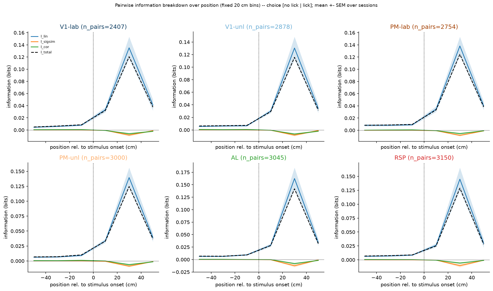

### Group comparison

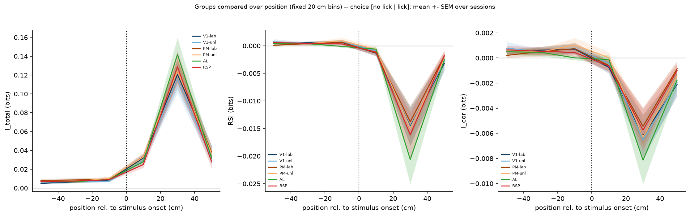

### Compare targets I total

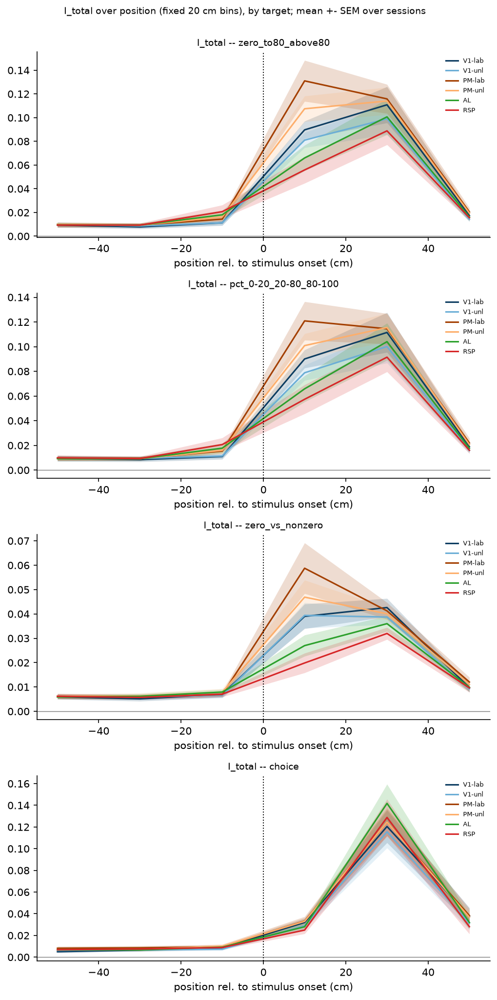

### Compare targets RSI

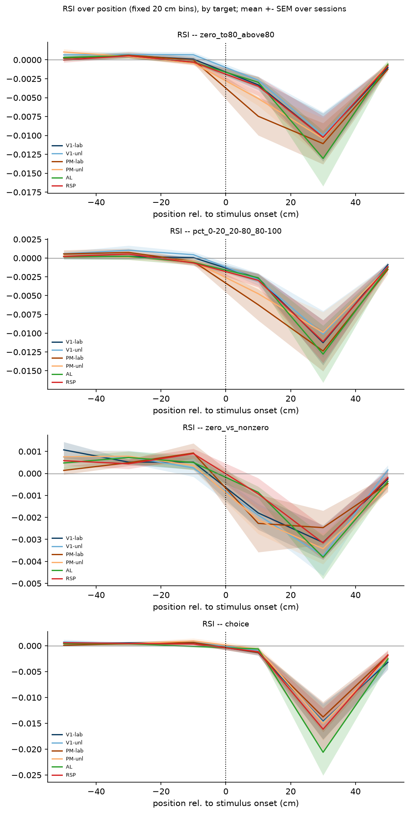

### Breakdown vs position

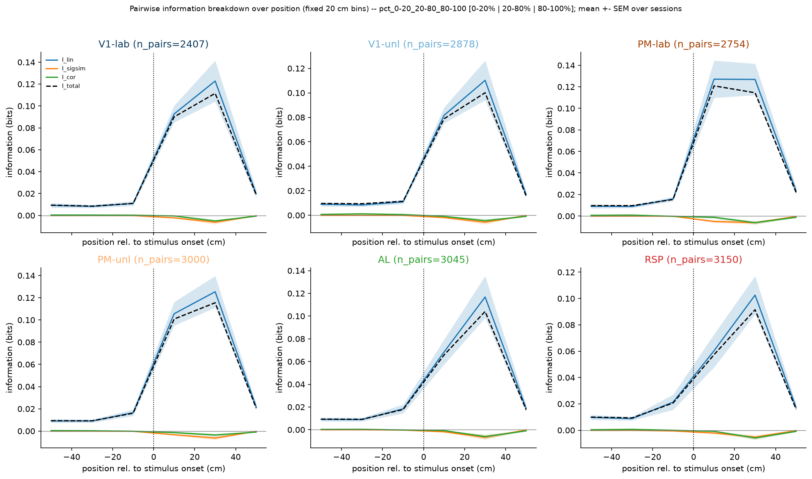

### Group comparison

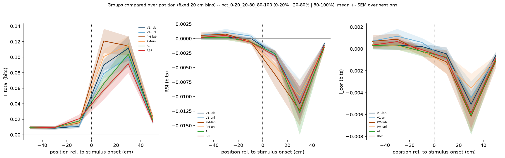

### Breakdown vs position

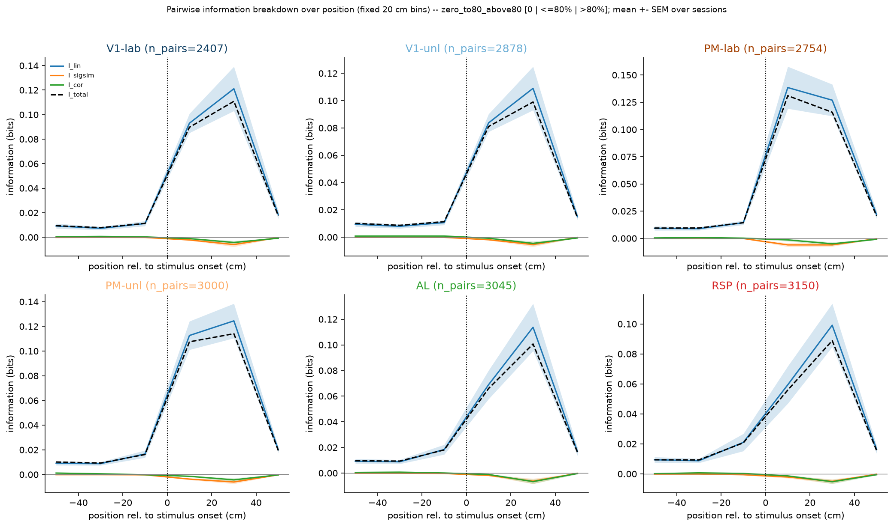

### Group comparison

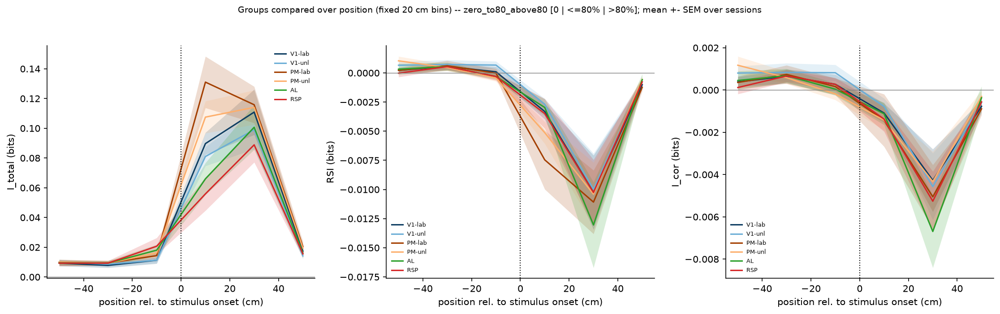

### Breakdown vs position

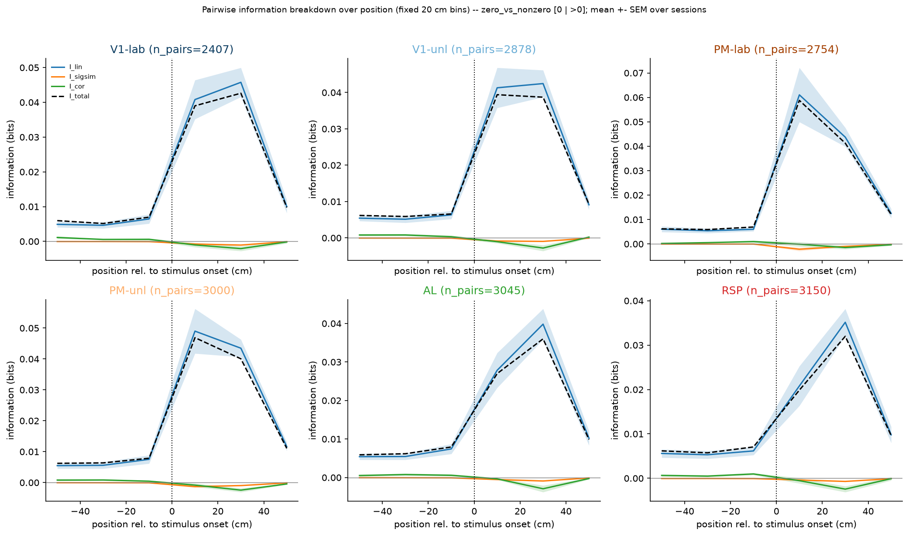

### Group comparison

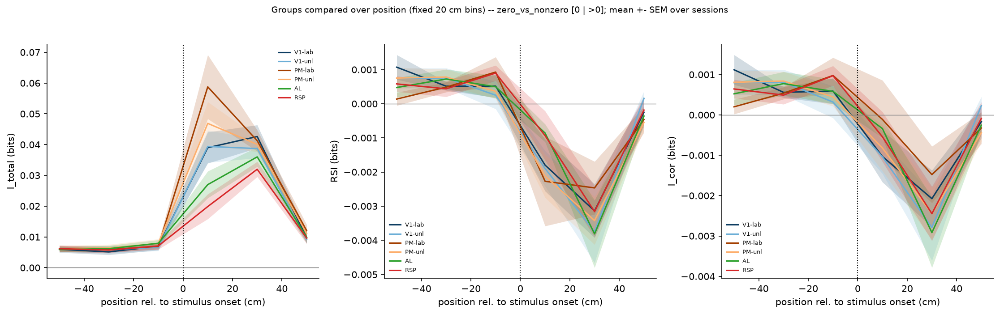

### Breakdown vs position

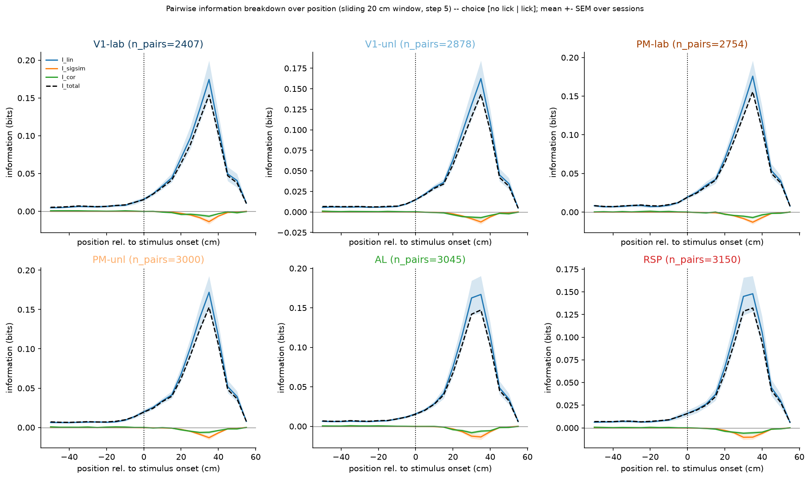

### Group comparison

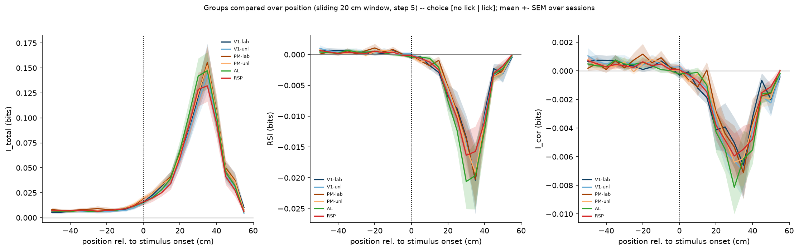

### Compare targets I total

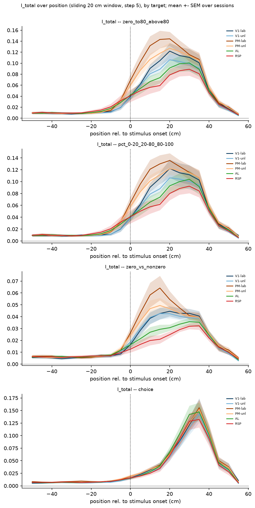

### Compare targets RSI

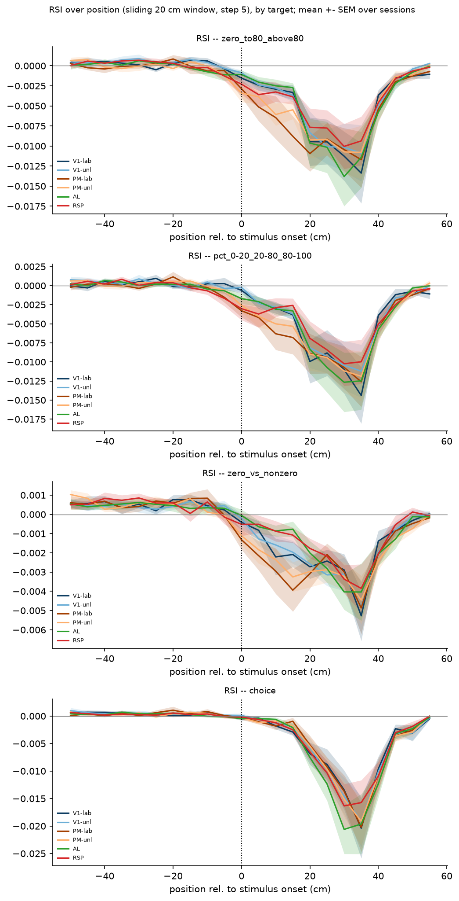

### Breakdown vs position

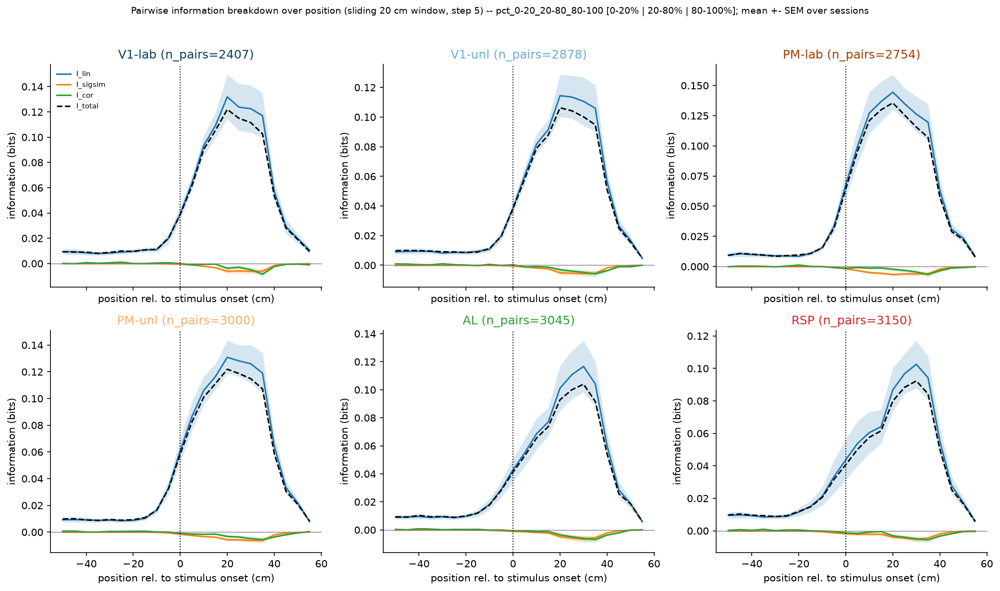

### Group comparison

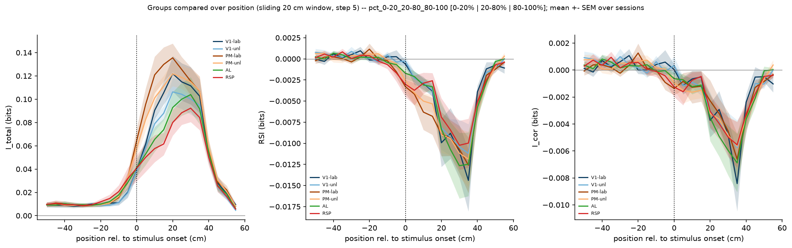

### Breakdown vs position

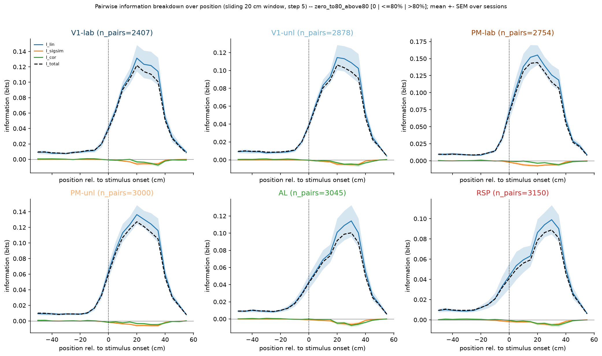

### Group comparison

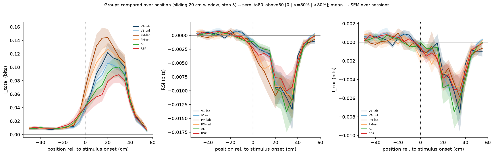

### Breakdown vs position

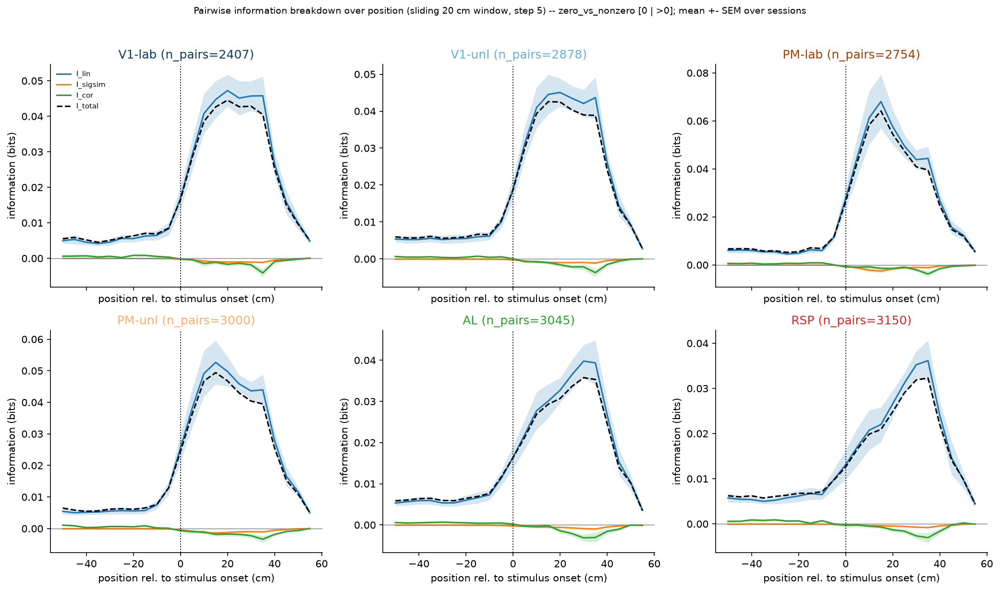

### Group comparison

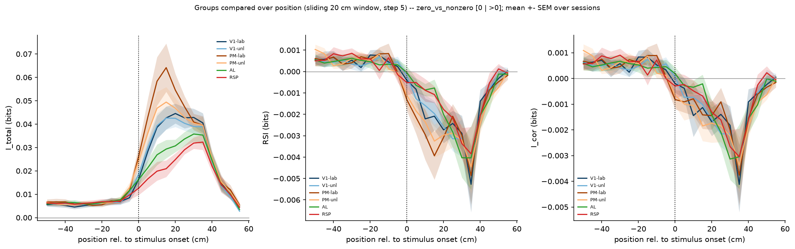
