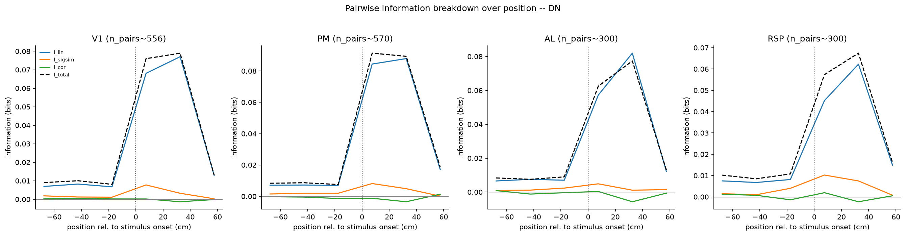

# 3e_pair_information_breakdown_temporal

*Auto-generated from `2_pipeline/3e_pair_information_breakdown_temporal/out/` on 2026-09-14 16:47. Re-run `make_progress_md.py` after the script's output changes -- don't hand-edit this file.*

## Tables

### Breakdown temporal

| session_id | roi_name | labeled_grouped | cell_i | cell_j | s_rel | I_total | I_1 | I_2 | I_lin | I_ind | I_sigsim | I_cor | RSI | I_corind_approx |
| --- | --- | --- | --- | --- | --- | --- | --- | --- | --- | --- | --- | --- | --- | --- |
| LPE10884_2024_01_12 | AL | unl | LPE10884_2024_01_12_7_0047 | LPE10884_2024_01_12_7_0176 | -67.5 | 0.01002 | 0 | 0.007423 | 0.007423 | 0.0009553 | -0.006468 | 0.009061 | 0.002593 | 0.1619 |
| LPE10884_2024_01_12 | AL | unl | LPE10884_2024_01_12_7_0127 | LPE10884_2024_01_12_7_0401 | -67.5 | 0 | 0 | 0 | 0 | 0 | 0 | 0 | 0 | 0.07826 |
| LPE10884_2024_01_12 | AL | unl | LPE10884_2024_01_12_7_0234 | LPE10884_2024_01_12_7_0246 | -67.5 | 0.03702 | 0 | 0 | 0 | 0 | 0 | 0.03702 | 0.03702 | 0.1063 |
| LPE10884_2024_01_12 | AL | unl | LPE10884_2024_01_12_7_0120 | LPE10884_2024_01_12_7_0143 | -67.5 | 0.005308 | 0.01576 | 0 | 0.01576 | 0.005028 | -0.01073 | 0.0002804 | -0.01045 | 0.2069 |
| LPE10884_2024_01_12 | AL | unl | LPE10884_2024_01_12_7_0054 | LPE10884_2024_01_12_7_0244 | -67.5 | 0 | 0 | 0.001717 | 0.001717 | 0.002539 | 0.0008217 | -0.002539 | -0.001717 | 0.02299 |
| LPE10884_2024_01_12 | AL | unl | LPE10884_2024_01_12_7_0183 | LPE10884_2024_01_12_7_0250 | -67.5 | 0 | 0 | 0 | 0 | 0 | 0 | 0 | 0 | 0.07969 |
| LPE10884_2024_01_12 | AL | unl | LPE10884_2024_01_12_7_0199 | LPE10884_2024_01_12_7_0399 | -67.5 | 0 | 0 | 0 | 0 | 0.00315 | 0.00315 | -0.00315 | 0 | 0.03494 |
| LPE10884_2024_01_12 | AL | unl | LPE10884_2024_01_12_7_0006 | LPE10884_2024_01_12_7_0202 | -67.5 | 0 | 0 | 0 | 0 | 0.01343 | 0.01343 | -0.01343 | 0 | 0.03171 |
| LPE10884_2024_01_12 | AL | unl | LPE10884_2024_01_12_7_0095 | LPE10884_2024_01_12_7_0187 | -67.5 | 0 | 0 | 0 | 0 | 0.002272 | 0.002272 | -0.002272 | 0 | 0.06503 |
| LPE10884_2024_01_12 | AL | unl | LPE10884_2024_01_12_7_0097 | LPE10884_2024_01_12_7_0116 | -67.5 | 0.03531 | 0 | 0 | 0 | 0.0005824 | 0.0005824 | 0.03472 | 0.03531 | 0.0568 |
| LPE10884_2024_01_12 | AL | unl | LPE10884_2024_01_12_7_0283 | LPE10884_2024_01_12_7_0402 | -67.5 | 0 | 0.005422 | 0 | 0.005422 | 0.008272 | 0.00285 | -0.008272 | -0.005422 | 0.01424 |
| LPE10884_2024_01_12 | AL | unl | LPE10884_2024_01_12_7_0012 | LPE10884_2024_01_12_7_0091 | -67.5 | 0 | 0 | 0 | 0 | 0.0009529 | 0.0009529 | -0.0009529 | 0 | 0.09878 |
| LPE10884_2024_01_12 | AL | unl | LPE10884_2024_01_12_7_0002 | LPE10884_2024_01_12_7_0216 | -67.5 | 0.03548 | 0.0007837 | 0 | 0.0007837 | 0.006979 | 0.006195 | 0.0285 | 0.0347 | 0.1134 |
| LPE10884_2024_01_12 | AL | unl | LPE10884_2024_01_12_7_0030 | LPE10884_2024_01_12_7_0130 | -67.5 | 0 | 0 | 0 | 0 | 0 | 0 | 0 | 0 | 0.1625 |
| LPE10884_2024_01_12 | AL | unl | LPE10884_2024_01_12_7_0131 | LPE10884_2024_01_12_7_0192 | -67.5 | 0.00415 | 0 | 0.001373 | 0.001373 | 0 | -0.001373 | 0.00415 | 0.002778 | 0.1252 |
| LPE10884_2024_01_12 | RSP | unl | LPE10884_2024_01_12_6_0004 | LPE10884_2024_01_12_6_0005 | -67.5 | 0 | 0 | 0.01252 | 0.01252 | 0.01633 | 0.003817 | -0.01633 | -0.01252 | 0.127 |
| LPE10884_2024_01_12 | RSP | unl | LPE10884_2024_01_12_6_0014 | LPE10884_2024_01_12_6_0075 | -67.5 | 0 | 0 | 0 | 0 | 0 | 0 | 0 | 0 | 0.1545 |
| LPE10884_2024_01_12 | RSP | unl | LPE10884_2024_01_12_6_0037 | LPE10884_2024_01_12_6_0059 | -67.5 | 0 | 0 | 0 | 0 | 0.01155 | 0.01155 | -0.01155 | 0 | 0.003015 |
| LPE10884_2024_01_12 | RSP | unl | LPE10884_2024_01_12_6_0010 | LPE10884_2024_01_12_6_0019 | -67.5 | 0 | 0.001609 | 0.003249 | 0.004858 | 0.009189 | 0.004331 | -0.009189 | -0.004858 | 0.1102 |
| LPE10884_2024_01_12 | RSP | unl | LPE10884_2024_01_12_6_0039 | LPE10884_2024_01_12_6_0040 | -67.5 | 0.01901 | 0.001177 | 0 | 0.001177 | 0.002768 | 0.001592 | 0.01624 | 0.01783 | 0.07712 |
| LPE10884_2024_01_12 | RSP | unl | LPE10884_2024_01_12_6_0000 | LPE10884_2024_01_12_6_0045 | -67.5 | 0.007036 | 0 | 0.004529 | 0.004529 | 0.002274 | -0.002255 | 0.004762 | 0.002507 | 0.1424 |
| LPE10884_2024_01_12 | RSP | unl | LPE10884_2024_01_12_6_0014 | LPE10884_2024_01_12_6_0024 | -67.5 | 0 | 0.004097 | 0 | 0.004097 | 0.002749 | -0.001348 | -0.002749 | -0.004097 | 0.1381 |
| LPE10884_2024_01_12 | RSP | unl | LPE10884_2024_01_12_6_0002 | LPE10884_2024_01_12_6_0060 | -67.5 | 0 | 0 | 0 | 0 | 0 | 0 | 0 | 0 | 0.1108 |
| LPE10884_2024_01_12 | RSP | unl | LPE10884_2024_01_12_6_0000 | LPE10884_2024_01_12_6_0011 | -67.5 | 0.004213 | 0 | 0 | 0 | 0.007123 | 0.007123 | -0.00291 | 0.004213 | 0.08665 |
| LPE10884_2024_01_12 | RSP | unl | LPE10884_2024_01_12_6_0000 | LPE10884_2024_01_12_6_0063 | -67.5 | 0 | 0 | 0 | 0 | 0.001252 | 0.001252 | -0.001252 | 0 | 0.08633 |
| LPE10884_2024_01_12 | RSP | unl | LPE10884_2024_01_12_6_0005 | LPE10884_2024_01_12_6_0050 | -67.5 | 0.03554 | 0.01562 | 0.02309 | 0.03871 | 0.0253 | -0.01341 | 0.01023 | -0.003173 | 0.03817 |
| LPE10884_2024_01_12 | RSP | unl | LPE10884_2024_01_12_6_0002 | LPE10884_2024_01_12_6_0036 | -67.5 | 0.02379 | 0 | 0.01417 | 0.01417 | 0.02025 | 0.006077 | 0.003546 | 0.009623 | 0.09939 |
| LPE10884_2024_01_12 | RSP | unl | LPE10884_2024_01_12_6_0020 | LPE10884_2024_01_12_6_0024 | -67.5 | 0 | 0.0002882 | 0.003504 | 0.003793 | 0.0005795 | -0.003213 | -0.0005795 | -0.003793 | 0.03522 |
| LPE10884_2024_01_12 | RSP | unl | LPE10884_2024_01_12_6_0017 | LPE10884_2024_01_12_6_0037 | -67.5 | 0 | 0 | 0.0004633 | 0.0004633 | 0.00134 | 0.0008765 | -0.00134 | -0.0004633 | 0.02491 |
| LPE10884_2024_01_12 | RSP | unl | LPE10884_2024_01_12_6_0029 | LPE10884_2024_01_12_6_0059 | -67.5 | 0 | 0.002924 | 0 | 0.002924 | 0.01498 | 0.01205 | -0.01498 | -0.002924 | 0.07618 |

*(showing first 15 of 17 columns; showing first 30 of 10356 rows -- see the linked CSV for the rest)*

[breakdown_temporal.csv](../2_pipeline/3e_pair_information_breakdown_temporal/out/breakdown_temporal.csv)

## Figures

### Breakdown vs position

