# 3f_pair_information_pid_temporal

*Auto-generated from `2_pipeline/3f_pair_information_pid_temporal/out/` on 2026-10-16 17:39. Re-run `make_progress_md.py` after the script's output changes -- don't hand-edit this file.*

## Tables

### Pair pid temporal

| session_id | animal_id | target | s_rel | roi_name | labeled_grouped | cell_i | cell_j | pair_rank | n_trials | I1 | I2 | I12 | redundancy | unique1 |
| --- | --- | --- | --- | --- | --- | --- | --- | --- | --- | --- | --- | --- | --- | --- |
| LPE10884_2024_01_12 | LPE10884 | zero_to80_above80 | -50 | AL | unl | LPE10884_2024_01_12_7_0039 | LPE10884_2024_01_12_7_0198 | 2 | 209 | 0.006437 | 0.0044 | 0.01648 | 0.0001262 | 0.006311 |
| LPE10884_2024_01_12 | LPE10884 | zero_to80_above80 | -50 | AL | unl | LPE10884_2024_01_12_7_0061 | LPE10884_2024_01_12_7_0250 | 5 | 209 | 0.01469 | 0.007072 | 0.03357 | -0.003947 | 0.01864 |
| LPE10884_2024_01_12 | LPE10884 | zero_to80_above80 | -50 | AL | unl | LPE10884_2024_01_12_7_0081 | LPE10884_2024_01_12_7_0084 | 7 | 209 | 0.002912 | 0.005257 | 0.01549 | -0.002507 | 0.005419 |
| LPE10884_2024_01_12 | LPE10884 | zero_to80_above80 | -50 | AL | unl | LPE10884_2024_01_12_7_0142 | LPE10884_2024_01_12_7_0278 | 4 | 209 | 0.01347 | 0.01666 | 0.04023 | 0.004964 | 0.008501 |
| LPE10884_2024_01_12 | LPE10884 | zero_to80_above80 | -50 | AL | unl | LPE10884_2024_01_12_7_0035 | LPE10884_2024_01_12_7_0220 | 1 | 209 | 0.009591 | 0.03322 | 0.08735 | 0.0007034 | 0.008887 |
| LPE10884_2024_01_12 | LPE10884 | zero_to80_above80 | -50 | AL | unl | LPE10884_2024_01_12_7_0042 | LPE10884_2024_01_12_7_0361 | 6 | 209 | 0.001829 | 0.007271 | 0.01056 | -0.003144 | 0.004973 |
| LPE10884_2024_01_12 | LPE10884 | zero_to80_above80 | -50 | AL | unl | LPE10884_2024_01_12_7_0116 | LPE10884_2024_01_12_7_0136 | 0 | 209 | 0.0009015 | 0.002905 | 0.01053 | -0.003763 | 0.004665 |
| LPE10884_2024_01_12 | LPE10884 | zero_to80_above80 | -50 | AL | unl | LPE10884_2024_01_12_7_0076 | LPE10884_2024_01_12_7_0177 | 3 | 209 | 0.01022 | 0.02053 | 0.06016 | -0.0001003 | 0.01032 |
| LPE10884_2024_01_12 | LPE10884 | zero_to80_above80 | -50 | RSP | unl | LPE10884_2024_01_12_6_0037 | LPE10884_2024_01_12_6_0064 | 6 | 209 | 0.02345 | 0.000867 | 0.05513 | -0.004015 | 0.02746 |
| LPE10884_2024_01_12 | LPE10884 | zero_to80_above80 | -50 | RSP | unl | LPE10884_2024_01_12_6_0002 | LPE10884_2024_01_12_6_0053 | 0 | 209 | 0.02005 | 0.02809 | 0.0497 | 0.01304 | 0.007012 |
| LPE10884_2024_01_12 | LPE10884 | zero_to80_above80 | -50 | RSP | unl | LPE10884_2024_01_12_6_0032 | LPE10884_2024_01_12_6_0046 | 1 | 209 | 0.009379 | 0.008254 | 0.02165 | 0.005588 | 0.003791 |
| LPE10884_2024_01_12 | LPE10884 | zero_to80_above80 | -50 | RSP | unl | LPE10884_2024_01_12_6_0024 | LPE10884_2024_01_12_6_0028 | 4 | 209 | 0.0347 | 0.01112 | 0.05533 | 0.004212 | 0.03049 |
| LPE10884_2024_01_12 | LPE10884 | zero_to80_above80 | -50 | RSP | unl | LPE10884_2024_01_12_6_0030 | LPE10884_2024_01_12_6_0031 | 7 | 209 | 0.01144 | 0.01691 | 0.04095 | 0.005027 | 0.006408 |
| LPE10884_2024_01_12 | LPE10884 | zero_to80_above80 | -50 | RSP | unl | LPE10884_2024_01_12_6_0019 | LPE10884_2024_01_12_6_0062 | 3 | 209 | 0.0052 | 0.02276 | 0.08036 | -0.002571 | 0.007771 |
| LPE10884_2024_01_12 | LPE10884 | zero_to80_above80 | -50 | RSP | unl | LPE10884_2024_01_12_6_0012 | LPE10884_2024_01_12_6_0025 | 2 | 209 | 0.01347 | 0.004782 | 0.03712 | 0.000808 | 0.01267 |
| LPE10884_2024_01_12 | LPE10884 | zero_to80_above80 | -50 | RSP | unl | LPE10884_2024_01_12_6_0023 | LPE10884_2024_01_12_6_0045 | 5 | 209 | 0.01354 | 0.01048 | 0.03245 | 0.005746 | 0.007791 |
| LPE10884_2024_01_12 | LPE10884 | pct_0-20_20-80_80-100 | -50 | AL | unl | LPE10884_2024_01_12_7_0039 | LPE10884_2024_01_12_7_0198 | 2 | 209 | 0.007892 | 0.003863 | 0.02057 | -0.00168 | 0.009571 |
| LPE10884_2024_01_12 | LPE10884 | pct_0-20_20-80_80-100 | -50 | AL | unl | LPE10884_2024_01_12_7_0061 | LPE10884_2024_01_12_7_0250 | 5 | 209 | 0.007068 | 0.0189 | 0.05817 | 0.0006524 | 0.006416 |
| LPE10884_2024_01_12 | LPE10884 | pct_0-20_20-80_80-100 | -50 | AL | unl | LPE10884_2024_01_12_7_0081 | LPE10884_2024_01_12_7_0084 | 7 | 209 | 0.003179 | 0.007599 | 0.01258 | -0.002312 | 0.005491 |
| LPE10884_2024_01_12 | LPE10884 | pct_0-20_20-80_80-100 | -50 | AL | unl | LPE10884_2024_01_12_7_0142 | LPE10884_2024_01_12_7_0278 | 4 | 209 | 0.015 | 0.009346 | 0.04565 | 0.001423 | 0.01357 |
| LPE10884_2024_01_12 | LPE10884 | pct_0-20_20-80_80-100 | -50 | AL | unl | LPE10884_2024_01_12_7_0035 | LPE10884_2024_01_12_7_0220 | 1 | 209 | 0.016 | 0.02462 | 0.09534 | 0.003683 | 0.01232 |
| LPE10884_2024_01_12 | LPE10884 | pct_0-20_20-80_80-100 | -50 | AL | unl | LPE10884_2024_01_12_7_0042 | LPE10884_2024_01_12_7_0361 | 6 | 209 | 0.006274 | 0.004774 | 0.03934 | -0.0004604 | 0.006735 |
| LPE10884_2024_01_12 | LPE10884 | pct_0-20_20-80_80-100 | -50 | AL | unl | LPE10884_2024_01_12_7_0116 | LPE10884_2024_01_12_7_0136 | 0 | 209 | 0.0007797 | 0.006512 | 0.01071 | -0.003116 | 0.003896 |
| LPE10884_2024_01_12 | LPE10884 | pct_0-20_20-80_80-100 | -50 | AL | unl | LPE10884_2024_01_12_7_0076 | LPE10884_2024_01_12_7_0177 | 3 | 209 | 0.01852 | 0.01831 | 0.05974 | 0.00545 | 0.01307 |
| LPE10884_2024_01_12 | LPE10884 | pct_0-20_20-80_80-100 | -50 | RSP | unl | LPE10884_2024_01_12_6_0037 | LPE10884_2024_01_12_6_0064 | 6 | 209 | 0.02113 | 0.001213 | 0.04335 | -0.002648 | 0.02378 |
| LPE10884_2024_01_12 | LPE10884 | pct_0-20_20-80_80-100 | -50 | RSP | unl | LPE10884_2024_01_12_6_0002 | LPE10884_2024_01_12_6_0053 | 0 | 209 | 0.014 | 0.003862 | 0.03263 | -0.0009165 | 0.01492 |
| LPE10884_2024_01_12 | LPE10884 | pct_0-20_20-80_80-100 | -50 | RSP | unl | LPE10884_2024_01_12_6_0032 | LPE10884_2024_01_12_6_0046 | 1 | 209 | 0.0007315 | 0.002691 | 0.01239 | -0.00164 | 0.002371 |
| LPE10884_2024_01_12 | LPE10884 | pct_0-20_20-80_80-100 | -50 | RSP | unl | LPE10884_2024_01_12_6_0024 | LPE10884_2024_01_12_6_0028 | 4 | 209 | 0.04162 | 0.009648 | 0.07006 | 0.004949 | 0.03667 |
| LPE10884_2024_01_12 | LPE10884 | pct_0-20_20-80_80-100 | -50 | RSP | unl | LPE10884_2024_01_12_6_0030 | LPE10884_2024_01_12_6_0031 | 7 | 209 | 0.01335 | 0.008807 | 0.03774 | 0.005468 | 0.007883 |
| LPE10884_2024_01_12 | LPE10884 | pct_0-20_20-80_80-100 | -50 | RSP | unl | LPE10884_2024_01_12_6_0019 | LPE10884_2024_01_12_6_0062 | 3 | 209 | 0.01222 | 0.01709 | 0.06305 | -0.0008667 | 0.01309 |

*(showing first 15 of 22 columns; showing first 30 of 26992 rows -- see the linked CSV for the rest)*

[pair_pid_temporal.csv](../2_pipeline/3f_pair_information_pid_temporal/out/pair_pid_temporal.csv)

### Pair pid temporal by group  session

| binning | target | group | s_rel | redundancy | redundancy_sem | n_units | n_pairs | unique1 | unique1_sem | unique2 | unique2_sem | synergy | synergy_sem | I12 |
| --- | --- | --- | --- | --- | --- | --- | --- | --- | --- | --- | --- | --- | --- | --- |
| fixed | choice | AL_unl | -50 | 7.292e-05 | 0.0001442 | 21 | 3045 | 0.005791 | 0.001104 | 0.00558 | 0.001015 | 0.009433 | 0.00224 | 0.02088 |
| fixed | choice | AL_unl | -30 | 0.0001601 | 0.0001131 | 21 | 3045 | 0.005614 | 0.000913 | 0.005349 | 0.0008631 | 0.009594 | 0.002337 | 0.02072 |
| fixed | choice | AL_unl | -10 | 0.0007716 | 0.0002339 | 21 | 3045 | 0.006953 | 0.001272 | 0.006948 | 0.001038 | 0.01068 | 0.002326 | 0.02535 |
| fixed | choice | AL_unl | 10 | 0.004751 | 0.0008243 | 21 | 3045 | 0.01286 | 0.001064 | 0.01371 | 0.001391 | 0.01458 | 0.002299 | 0.0459 |
| fixed | choice | AL_unl | 30 | 0.06108 | 0.009561 | 21 | 3045 | 0.02513 | 0.001541 | 0.02678 | 0.002045 | 0.05461 | 0.004819 | 0.1676 |
| fixed | choice | AL_unl | 50 | 0.008142 | 0.002864 | 15 | 2145 | 0.01322 | 0.001834 | 0.01228 | 0.001778 | 0.01162 | 0.002978 | 0.04526 |
| fixed | choice | PM_lab | -50 | 0.001103 | 0.0005594 | 20 | 2754 | 0.006036 | 0.001122 | 0.005963 | 0.001265 | 0.01092 | 0.00295 | 0.02402 |
| fixed | choice | PM_lab | -30 | 0.000737 | 0.0002211 | 20 | 2754 | 0.00566 | 0.0009384 | 0.006353 | 0.001221 | 0.01028 | 0.002516 | 0.02303 |
| fixed | choice | PM_lab | -10 | 0.000778 | 0.0002731 | 20 | 2754 | 0.006003 | 0.001048 | 0.00669 | 0.001145 | 0.01152 | 0.002734 | 0.02499 |
| fixed | choice | PM_lab | 10 | 0.005506 | 0.001001 | 20 | 2754 | 0.01417 | 0.001557 | 0.01739 | 0.002097 | 0.01555 | 0.002612 | 0.05262 |
| fixed | choice | PM_lab | 30 | 0.04761 | 0.006544 | 20 | 2754 | 0.02681 | 0.002317 | 0.02972 | 0.0027 | 0.04769 | 0.003445 | 0.1518 |
| fixed | choice | PM_lab | 50 | 0.009268 | 0.002524 | 15 | 2004 | 0.01483 | 0.001852 | 0.01419 | 0.002049 | 0.01449 | 0.003438 | 0.05278 |
| fixed | choice | PM_unl | -50 | 0.0002201 | 0.0001452 | 20 | 3000 | 0.005307 | 0.0009377 | 0.005383 | 0.00101 | 0.009381 | 0.002395 | 0.02029 |
| fixed | choice | PM_unl | -30 | 0.0002697 | 0.0001173 | 20 | 3000 | 0.005504 | 0.0009943 | 0.005827 | 0.001062 | 0.009615 | 0.002247 | 0.02122 |
| fixed | choice | PM_unl | -10 | 0.001003 | 0.0003 | 20 | 3000 | 0.006417 | 0.001081 | 0.006673 | 0.0009343 | 0.01058 | 0.002591 | 0.02467 |
| fixed | choice | PM_unl | 10 | 0.005354 | 0.0006729 | 20 | 3000 | 0.01479 | 0.001511 | 0.01496 | 0.001548 | 0.01538 | 0.002345 | 0.05048 |
| fixed | choice | PM_unl | 30 | 0.05002 | 0.007293 | 20 | 3000 | 0.02498 | 0.001907 | 0.02545 | 0.001639 | 0.04875 | 0.003768 | 0.1492 |
| fixed | choice | PM_unl | 50 | 0.008837 | 0.002875 | 15 | 2250 | 0.01468 | 0.0015 | 0.01333 | 0.001898 | 0.01275 | 0.002956 | 0.0496 |
| fixed | choice | RSP_unl | -50 | 0.000235 | 8.064e-05 | 21 | 3150 | 0.005822 | 0.00105 | 0.005391 | 0.0008849 | 0.009822 | 0.002462 | 0.02127 |
| fixed | choice | RSP_unl | -30 | 0.0005864 | 0.0003507 | 21 | 3150 | 0.005628 | 0.0009814 | 0.005571 | 0.0009088 | 0.01022 | 0.002503 | 0.02201 |
| fixed | choice | RSP_unl | -10 | 0.0006902 | 0.0002342 | 21 | 3150 | 0.006705 | 0.001114 | 0.006378 | 0.0009169 | 0.01093 | 0.002247 | 0.0247 |
| fixed | choice | RSP_unl | 10 | 0.004962 | 0.0009326 | 21 | 3150 | 0.01307 | 0.00203 | 0.0106 | 0.0009782 | 0.0155 | 0.002556 | 0.04413 |
| fixed | choice | RSP_unl | 30 | 0.05388 | 0.008733 | 21 | 3150 | 0.02267 | 0.00174 | 0.0244 | 0.001881 | 0.05205 | 0.004719 | 0.153 |
| fixed | choice | RSP_unl | 50 | 0.006509 | 0.002606 | 15 | 2250 | 0.01127 | 0.001603 | 0.01004 | 0.001408 | 0.01036 | 0.002552 | 0.03818 |
| fixed | choice | V1_lab | -50 | -0.0004442 | 0.0001695 | 18 | 2407 | 0.004712 | 0.001062 | 0.004871 | 0.0008512 | 0.008905 | 0.002408 | 0.01804 |
| fixed | choice | V1_lab | -30 | 5.519e-05 | 0.0001843 | 18 | 2407 | 0.005079 | 0.0008848 | 0.00577 | 0.001356 | 0.009342 | 0.002524 | 0.02025 |
| fixed | choice | V1_lab | -10 | 0.0004935 | 0.000311 | 18 | 2407 | 0.006063 | 0.00109 | 0.005927 | 0.001236 | 0.01055 | 0.002803 | 0.02303 |
| fixed | choice | V1_lab | 10 | 0.004978 | 0.001002 | 18 | 2407 | 0.01571 | 0.001668 | 0.01384 | 0.001544 | 0.01457 | 0.002248 | 0.0491 |
| fixed | choice | V1_lab | 30 | 0.0477 | 0.007527 | 18 | 2407 | 0.02321 | 0.001802 | 0.0274 | 0.003016 | 0.04753 | 0.003632 | 0.1458 |
| fixed | choice | V1_lab | 50 | 0.009854 | 0.003455 | 13 | 1657 | 0.01507 | 0.00242 | 0.01182 | 0.001836 | 0.01212 | 0.00312 | 0.04887 |

*(showing first 15 of 20 columns; showing first 30 of 672 rows -- see the linked CSV for the rest)*

[pair_pid_temporal_by_group__session.csv](../2_pipeline/3f_pair_information_pid_temporal/out/pair_pid_temporal_by_group__session.csv)

### Pair pid temporal moments

| session_id | animal_id | binning | target | s_rel | n_trials | group | redundancy_n | redundancy_sum | redundancy_ss | unique1_n | unique1_sum | unique1_ss | unique2_n | unique2_sum |
| --- | --- | --- | --- | --- | --- | --- | --- | --- | --- | --- | --- | --- | --- | --- |
| LPE10884_2024_01_12 | LPE10884 | fixed | zero_to80_above80 | -50 | 202 | AL_unl | 150 | 0.05376 | 0.004464 | 150 | 1.466 | 0.02522 | 150 | 1.543 |
| LPE10884_2024_01_12 | LPE10884 | fixed | zero_to80_above80 | -50 | 202 | RSP_unl | 150 | 0.02315 | 0.002333 | 150 | 1.422 | 0.02367 | 150 | 0.9962 |
| LPE10884_2024_01_12 | LPE10884 | fixed | pct_0-20_20-80_80-100 | -50 | 202 | AL_unl | 150 | 0.01419 | 0.003241 | 150 | 1.476 | 0.02401 | 150 | 1.505 |
| LPE10884_2024_01_12 | LPE10884 | fixed | pct_0-20_20-80_80-100 | -50 | 202 | RSP_unl | 150 | 0.03629 | 0.003037 | 150 | 1.345 | 0.02091 | 150 | 1.286 |
| LPE10884_2024_01_12 | LPE10884 | fixed | zero_vs_nonzero | -50 | 202 | AL_unl | 150 | 0.0548 | 0.002044 | 150 | 0.6858 | 0.007315 | 150 | 0.7618 |
| LPE10884_2024_01_12 | LPE10884 | fixed | zero_vs_nonzero | -50 | 202 | RSP_unl | 150 | -0.07707 | 0.001601 | 150 | 0.785 | 0.01014 | 150 | 0.4571 |
| LPE10884_2024_01_12 | LPE10884 | fixed | choice | -50 | 202 | AL_unl | 150 | 0.0009609 | 0.001408 | 150 | 0.7236 | 0.008865 | 150 | 0.6883 |
| LPE10884_2024_01_12 | LPE10884 | fixed | choice | -50 | 202 | RSP_unl | 150 | -0.01597 | 0.001683 | 150 | 0.7038 | 0.008801 | 150 | 0.5726 |
| LPE10884_2024_01_12 | LPE10884 | fixed | zero_to80_above80 | -30 | 209 | AL_unl | 150 | -0.1237 | 0.004763 | 150 | 1.747 | 0.0357 | 150 | 1.721 |
| LPE10884_2024_01_12 | LPE10884 | fixed | zero_to80_above80 | -30 | 209 | RSP_unl | 150 | -0.2856 | 0.004355 | 150 | 1.431 | 0.02199 | 150 | 1.675 |
| LPE10884_2024_01_12 | LPE10884 | fixed | pct_0-20_20-80_80-100 | -30 | 209 | AL_unl | 150 | -0.0699 | 0.005052 | 150 | 1.665 | 0.03347 | 150 | 1.778 |
| LPE10884_2024_01_12 | LPE10884 | fixed | pct_0-20_20-80_80-100 | -30 | 209 | RSP_unl | 150 | -0.05985 | 0.003493 | 150 | 1.526 | 0.02415 | 150 | 1.475 |
| LPE10884_2024_01_12 | LPE10884 | fixed | zero_vs_nonzero | -30 | 209 | AL_unl | 150 | 0.005199 | 0.00255 | 150 | 0.8346 | 0.008979 | 150 | 0.8113 |
| LPE10884_2024_01_12 | LPE10884 | fixed | zero_vs_nonzero | -30 | 209 | RSP_unl | 150 | -0.09706 | 0.00208 | 150 | 0.6478 | 0.00578 | 150 | 0.6311 |
| LPE10884_2024_01_12 | LPE10884 | fixed | choice | -30 | 209 | AL_unl | 150 | 0.009768 | 0.003224 | 150 | 0.8943 | 0.01151 | 150 | 1.077 |
| LPE10884_2024_01_12 | LPE10884 | fixed | choice | -30 | 209 | RSP_unl | 150 | 0.1112 | 0.002833 | 150 | 0.9639 | 0.01458 | 150 | 0.8611 |
| LPE10884_2024_01_12 | LPE10884 | fixed | zero_to80_above80 | -10 | 209 | AL_unl | 150 | 0.9159 | 0.02063 | 150 | 3.229 | 0.2349 | 150 | 3.064 |
| LPE10884_2024_01_12 | LPE10884 | fixed | zero_to80_above80 | -10 | 209 | RSP_unl | 150 | 2.141 | 0.1099 | 150 | 6.019 | 0.7086 | 150 | 4.188 |
| LPE10884_2024_01_12 | LPE10884 | fixed | pct_0-20_20-80_80-100 | -10 | 209 | AL_unl | 150 | 0.7003 | 0.01918 | 150 | 3.28 | 0.2317 | 150 | 3.005 |
| LPE10884_2024_01_12 | LPE10884 | fixed | pct_0-20_20-80_80-100 | -10 | 209 | RSP_unl | 150 | 1.878 | 0.09372 | 150 | 6.259 | 0.7383 | 150 | 4.277 |
| LPE10884_2024_01_12 | LPE10884 | fixed | zero_vs_nonzero | -10 | 209 | AL_unl | 150 | 0.02669 | 0.004855 | 150 | 1.06 | 0.01367 | 150 | 1.224 |
| LPE10884_2024_01_12 | LPE10884 | fixed | zero_vs_nonzero | -10 | 209 | RSP_unl | 150 | -0.0847 | 0.003917 | 150 | 1.088 | 0.01806 | 150 | 1.14 |
| LPE10884_2024_01_12 | LPE10884 | fixed | choice | -10 | 209 | AL_unl | 150 | 0.1101 | 0.005096 | 150 | 1.399 | 0.03869 | 150 | 1.622 |
| LPE10884_2024_01_12 | LPE10884 | fixed | choice | -10 | 209 | RSP_unl | 150 | 0.4484 | 0.007133 | 150 | 1.908 | 0.07745 | 150 | 1.412 |
| LPE10884_2024_01_12 | LPE10884 | fixed | zero_to80_above80 | 10 | 209 | AL_unl | 150 | 2.385 | 0.07938 | 150 | 4.007 | 0.216 | 150 | 3.996 |
| LPE10884_2024_01_12 | LPE10884 | fixed | zero_to80_above80 | 10 | 209 | RSP_unl | 150 | 6.297 | 0.603 | 150 | 11.24 | 2.037 | 150 | 4.846 |
| LPE10884_2024_01_12 | LPE10884 | fixed | pct_0-20_20-80_80-100 | 10 | 209 | AL_unl | 150 | 2.466 | 0.0828 | 150 | 3.758 | 0.1959 | 150 | 3.914 |
| LPE10884_2024_01_12 | LPE10884 | fixed | pct_0-20_20-80_80-100 | 10 | 209 | RSP_unl | 150 | 6.425 | 0.5876 | 150 | 12.54 | 2.775 | 150 | 5.249 |
| LPE10884_2024_01_12 | LPE10884 | fixed | zero_vs_nonzero | 10 | 209 | AL_unl | 150 | 0.2813 | 0.007895 | 150 | 1.394 | 0.0284 | 150 | 1.362 |
| LPE10884_2024_01_12 | LPE10884 | fixed | zero_vs_nonzero | 10 | 209 | RSP_unl | 150 | 0.2965 | 0.008044 | 150 | 2.088 | 0.07789 | 150 | 0.9969 |

*(showing first 15 of 28 columns; showing first 30 of 13240 rows -- see the linked CSV for the rest)*

[pair_pid_temporal_moments.csv](../2_pipeline/3f_pair_information_pid_temporal/out/pair_pid_temporal_moments.csv)

### Pid temporal

| session_id | roi_name | labeled_grouped | cell_i | cell_j | s_rel | n_trials | I1 | I2 | I12 | redundancy | unique1 | unique2 | synergy | redundancy_p_value |
| --- | --- | --- | --- | --- | --- | --- | --- | --- | --- | --- | --- | --- | --- | --- |
| LPE10884_2024_01_12 | AL | unl | LPE10884_2024_01_12_7_0126 | LPE10884_2024_01_12_7_0256 | -50 | 209 | 0.02022 | 0.02415 | 0.09671 | 0.007018 | 0.0132 | 0.01713 | 0.05936 | 0.05 |
| LPE10884_2024_01_12 | AL | unl | LPE10884_2024_01_12_7_0014 | LPE10884_2024_01_12_7_0198 | -50 | 209 | 0.00645 | 0.006111 | 0.01738 | -0.001462 | 0.007912 | 0.007573 | 0.003359 | 0.7 |
| LPE10884_2024_01_12 | AL | unl | LPE10884_2024_01_12_7_0376 | LPE10884_2024_01_12_7_0390 | -50 | 209 | 0.008234 | 0.02448 | 0.08729 | -0.002106 | 0.01034 | 0.02659 | 0.05247 | 0.65 |
| LPE10884_2024_01_12 | AL | unl | LPE10884_2024_01_12_7_0096 | LPE10884_2024_01_12_7_0414 | -50 | 209 | 0.004486 | 0.01368 | 0.06859 | -0.008499 | 0.01298 | 0.02217 | 0.04193 | 0.95 |
| LPE10884_2024_01_12 | AL | unl | LPE10884_2024_01_12_7_0005 | LPE10884_2024_01_12_7_0135 | -50 | 209 | 0.0284 | 0.007491 | 0.04377 | 0.002767 | 0.02563 | 0.004724 | 0.01065 | 0.25 |
| LPE10884_2024_01_12 | AL | unl | LPE10884_2024_01_12_7_0154 | LPE10884_2024_01_12_7_0198 | -50 | 209 | 0.004039 | 0.006111 | 0.02497 | -0.002861 | 0.0069 | 0.008973 | 0.01196 | 0.6 |
| LPE10884_2024_01_12 | AL | unl | LPE10884_2024_01_12_7_0131 | LPE10884_2024_01_12_7_0161 | -50 | 209 | 0.01036 | 0.01268 | 0.05292 | -0.006781 | 0.01714 | 0.01946 | 0.02309 | 0.85 |
| LPE10884_2024_01_12 | AL | unl | LPE10884_2024_01_12_7_0077 | LPE10884_2024_01_12_7_0260 | -50 | 209 | 0.02833 | 0.003863 | 0.0379 | -0.003011 | 0.03134 | 0.006874 | 0.002694 | 0.75 |
| LPE10884_2024_01_12 | AL | unl | LPE10884_2024_01_12_7_0166 | LPE10884_2024_01_12_7_0240 | -50 | 209 | 0.02428 | 0.01142 | 0.05329 | 0.005298 | 0.01898 | 0.006121 | 0.02289 | 0.15 |
| LPE10884_2024_01_12 | AL | unl | LPE10884_2024_01_12_7_0003 | LPE10884_2024_01_12_7_0179 | -50 | 209 | 0.01578 | 0.01116 | 0.06869 | -0.002749 | 0.01852 | 0.01391 | 0.039 | 0.55 |
| LPE10884_2024_01_12 | AL | unl | LPE10884_2024_01_12_7_0069 | LPE10884_2024_01_12_7_0245 | -50 | 209 | 0.01307 | 0.03956 | 0.09727 | -0.0007319 | 0.0138 | 0.04029 | 0.04391 | 0.6 |
| LPE10884_2024_01_12 | AL | unl | LPE10884_2024_01_12_7_0248 | LPE10884_2024_01_12_7_0348 | -50 | 209 | 0.01298 | 0.00657 | 0.04338 | -0.0001893 | 0.01317 | 0.006759 | 0.02364 | 0.45 |
| LPE10884_2024_01_12 | AL | unl | LPE10884_2024_01_12_7_0199 | LPE10884_2024_01_12_7_0299 | -50 | 209 | 0.025 | 0.006093 | 0.08073 | 0.0005374 | 0.02446 | 0.005556 | 0.05018 | 0.45 |
| LPE10884_2024_01_12 | AL | unl | LPE10884_2024_01_12_7_0085 | LPE10884_2024_01_12_7_0361 | -50 | 209 | 0.004921 | 0.02733 | 0.08629 | -0.007708 | 0.01263 | 0.03504 | 0.04633 | 1 |
| LPE10884_2024_01_12 | AL | unl | LPE10884_2024_01_12_7_0119 | LPE10884_2024_01_12_7_0413 | -50 | 209 | 0.02673 | 0.009632 | 0.108 | -0.002719 | 0.02945 | 0.01235 | 0.06887 | 0.7 |
| LPE10884_2024_01_12 | AL | unl | LPE10884_2024_01_12_7_0198 | LPE10884_2024_01_12_7_0222 | -50 | 209 | 0.006111 | 0.01375 | 0.02961 | 0.0002954 | 0.005816 | 0.01345 | 0.01005 | 0.4 |
| LPE10884_2024_01_12 | AL | unl | LPE10884_2024_01_12_7_0054 | LPE10884_2024_01_12_7_0228 | -50 | 209 | 0.04883 | 0.01337 | 0.09656 | 0.001805 | 0.04702 | 0.01157 | 0.03617 | 0.35 |
| LPE10884_2024_01_12 | AL | unl | LPE10884_2024_01_12_7_0006 | LPE10884_2024_01_12_7_0201 | -50 | 209 | 0.01172 | 0.03602 | 0.07838 | 0.00104 | 0.01068 | 0.03498 | 0.03168 | 0.35 |
| LPE10884_2024_01_12 | AL | unl | LPE10884_2024_01_12_7_0000 | LPE10884_2024_01_12_7_0303 | -50 | 209 | 0.00377 | 0.01701 | 0.06606 | -0.002615 | 0.006385 | 0.01962 | 0.04267 | 0.8 |
| LPE10884_2024_01_12 | AL | unl | LPE10884_2024_01_12_7_0184 | LPE10884_2024_01_12_7_0213 | -50 | 209 | 0.006201 | 0.01914 | 0.066 | -0.0001093 | 0.00631 | 0.01925 | 0.04056 | 0.5 |
| LPE10884_2024_01_12 | AL | unl | LPE10884_2024_01_12_7_0137 | LPE10884_2024_01_12_7_0153 | -50 | 209 | 0.01199 | 0.01195 | 0.07482 | -0.003974 | 0.01596 | 0.01592 | 0.04691 | 0.8 |
| LPE10884_2024_01_12 | AL | unl | LPE10884_2024_01_12_7_0030 | LPE10884_2024_01_12_7_0122 | -50 | 209 | 0.02913 | 0.0191 | 0.1287 | 0.009533 | 0.0196 | 0.009564 | 0.09005 | 0.1 |
| LPE10884_2024_01_12 | AL | unl | LPE10884_2024_01_12_7_0000 | LPE10884_2024_01_12_7_0141 | -50 | 209 | 0.00377 | 0.01966 | 0.04478 | -0.002004 | 0.005774 | 0.02167 | 0.01934 | 0.65 |
| LPE10884_2024_01_12 | AL | unl | LPE10884_2024_01_12_7_0127 | LPE10884_2024_01_12_7_0327 | -50 | 209 | 0.02135 | 0.02208 | 0.04956 | 0.007664 | 0.01369 | 0.01442 | 0.01379 | 0 |
| LPE10884_2024_01_12 | AL | unl | LPE10884_2024_01_12_7_0045 | LPE10884_2024_01_12_7_0085 | -50 | 209 | 0.007467 | 0.004921 | 0.0273 | -0.001169 | 0.008636 | 0.006089 | 0.01374 | 0.65 |
| LPE10884_2024_01_12 | AL | unl | LPE10884_2024_01_12_7_0308 | LPE10884_2024_01_12_7_0332 | -50 | 209 | 0.01822 | 0.02278 | 0.08055 | 0.001407 | 0.01681 | 0.02137 | 0.04095 | 0.2 |
| LPE10884_2024_01_12 | AL | unl | LPE10884_2024_01_12_7_0012 | LPE10884_2024_01_12_7_0088 | -50 | 209 | 0.01956 | 0.01661 | 0.08838 | 0.001602 | 0.01796 | 0.015 | 0.05381 | 0.35 |
| LPE10884_2024_01_12 | AL | unl | LPE10884_2024_01_12_7_0180 | LPE10884_2024_01_12_7_0242 | -50 | 209 | 0.01017 | 0.004863 | 0.02198 | -0.001324 | 0.01149 | 0.006187 | 0.005627 | 0.55 |
| LPE10884_2024_01_12 | AL | unl | LPE10884_2024_01_12_7_0104 | LPE10884_2024_01_12_7_0124 | -50 | 209 | 0.03797 | 0.01257 | 0.09201 | 0.003153 | 0.03482 | 0.009419 | 0.04462 | 0.2 |
| LPE10884_2024_01_12 | AL | unl | LPE10884_2024_01_12_7_0053 | LPE10884_2024_01_12_7_0082 | -50 | 209 | 0.01166 | 0.01451 | 0.07191 | -0.001447 | 0.01311 | 0.01595 | 0.0443 | 0.45 |

*(showing first 30 of 47600 rows -- see the linked CSV for the rest)*

[pid_temporal.csv](../2_pipeline/3f_pair_information_pid_temporal/out/pid_temporal.csv)

## Figures

### Pid vs position

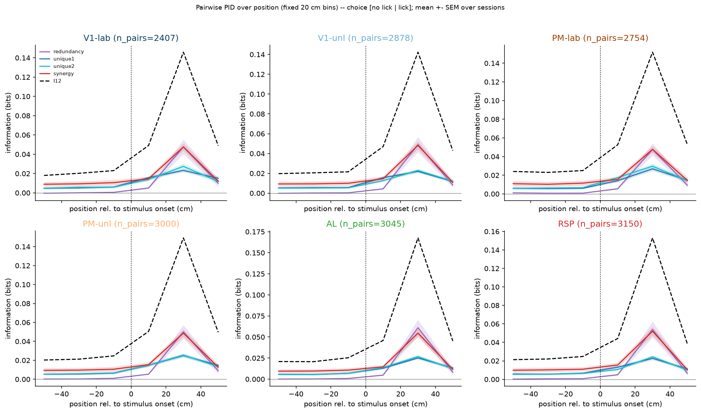

### Group comparison

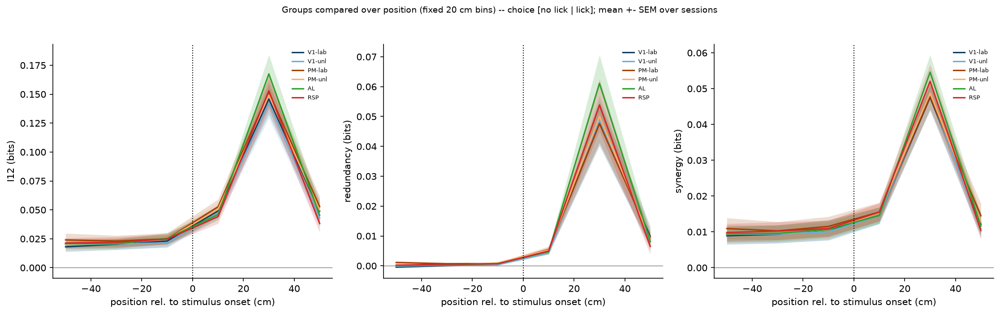

### Compare targets I12

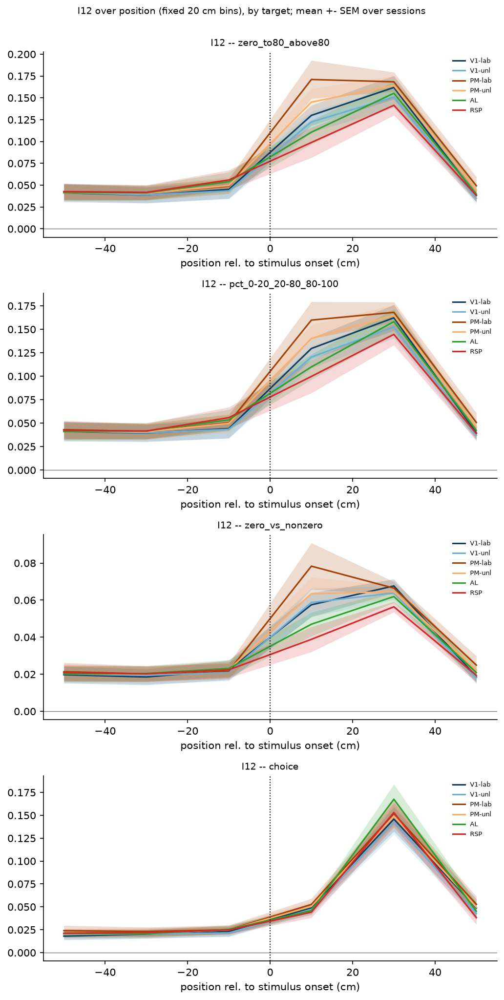

### Compare targets synergy

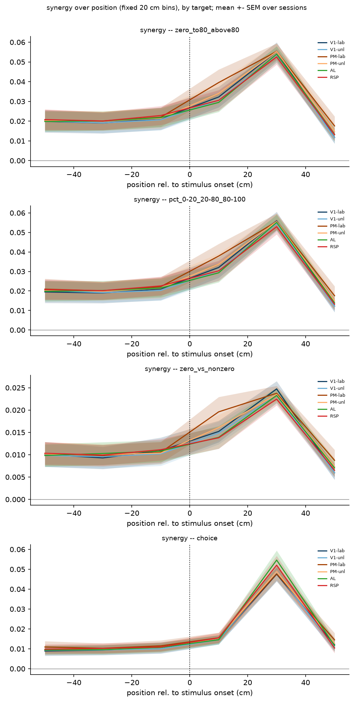

### Pid vs position

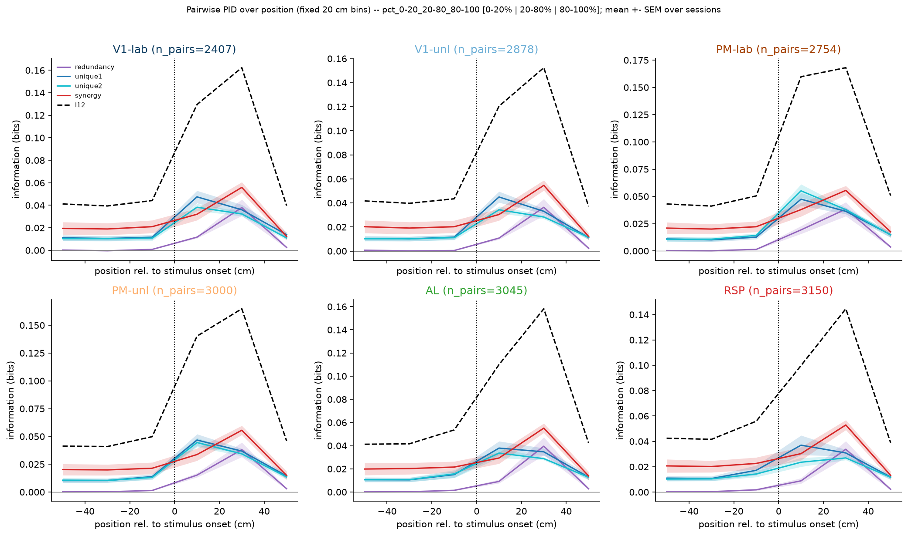

### Group comparison

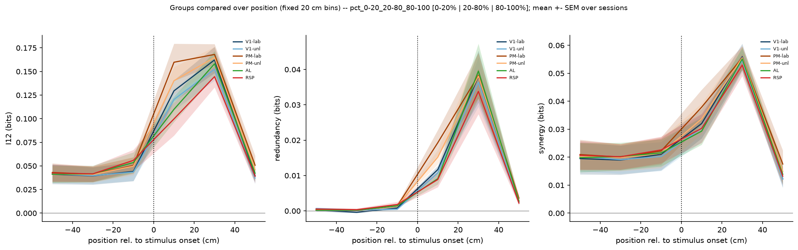

### Pid vs position

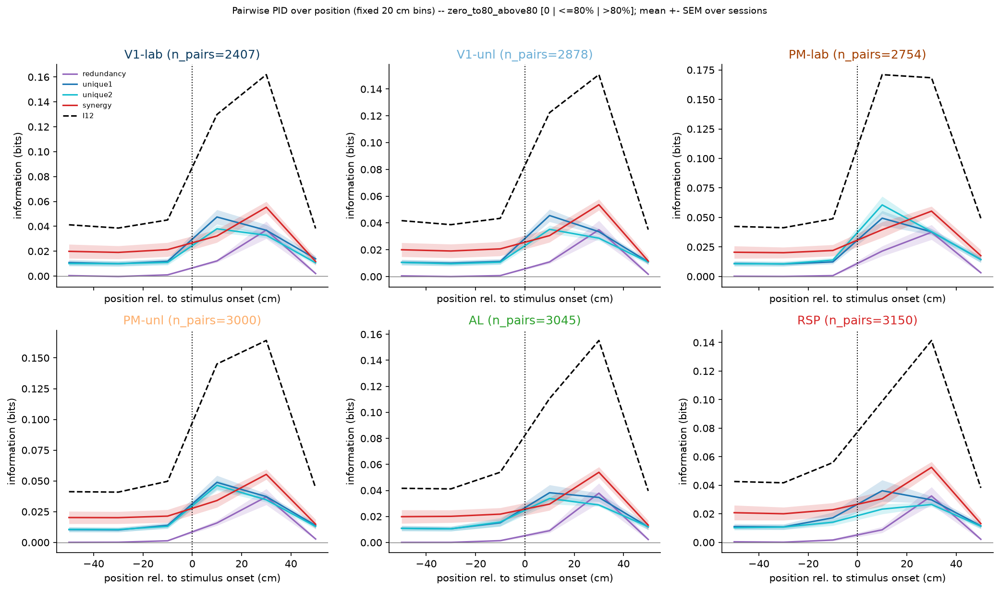

### Group comparison

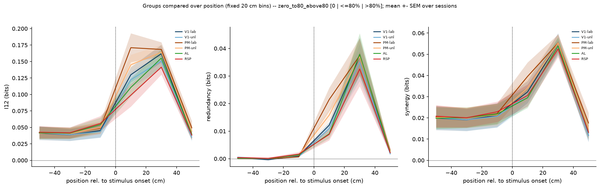

### Pid vs position

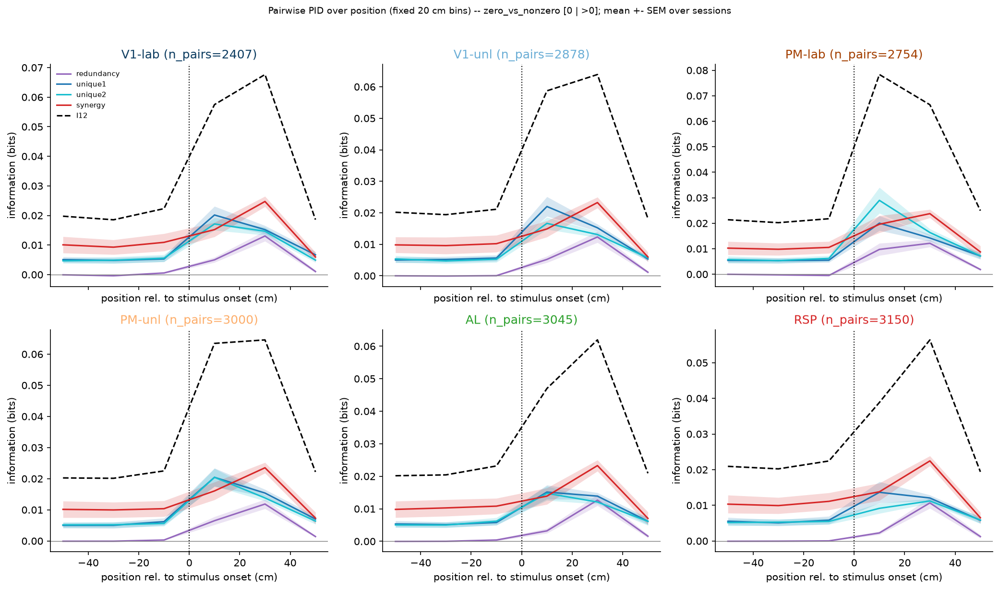

### Group comparison

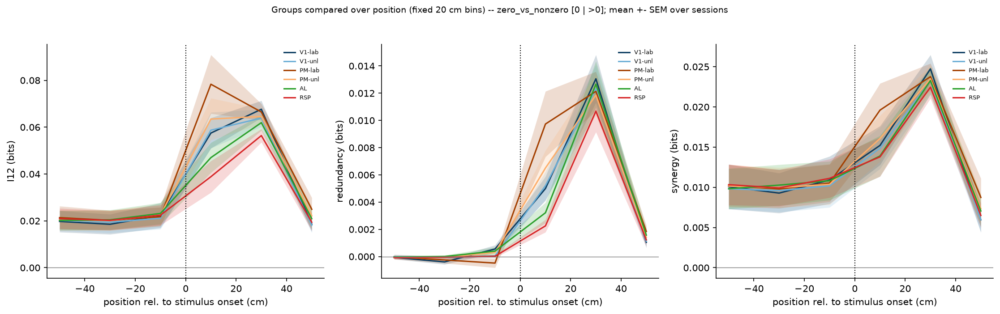

### Pid vs position

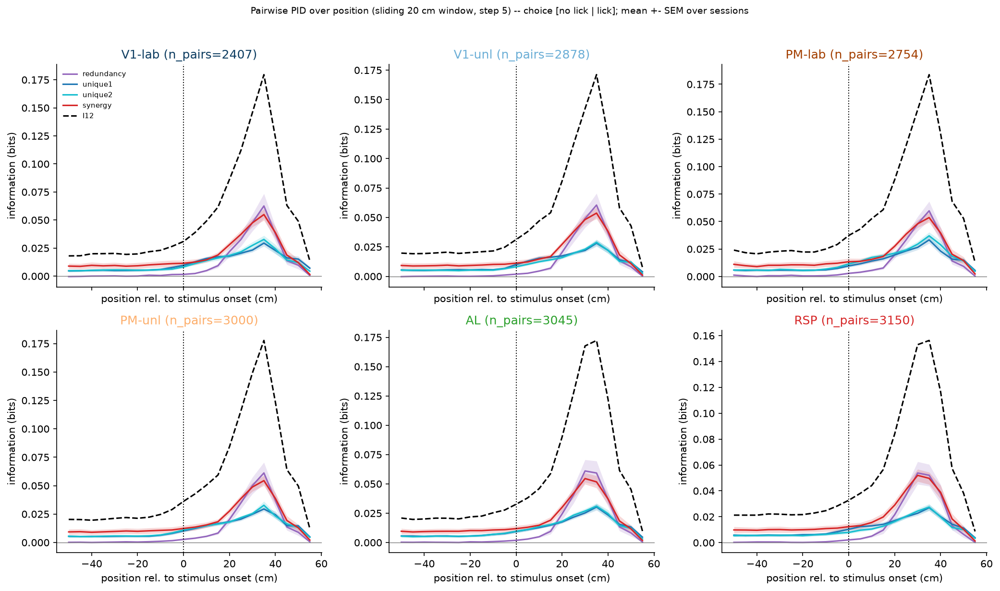

### Group comparison

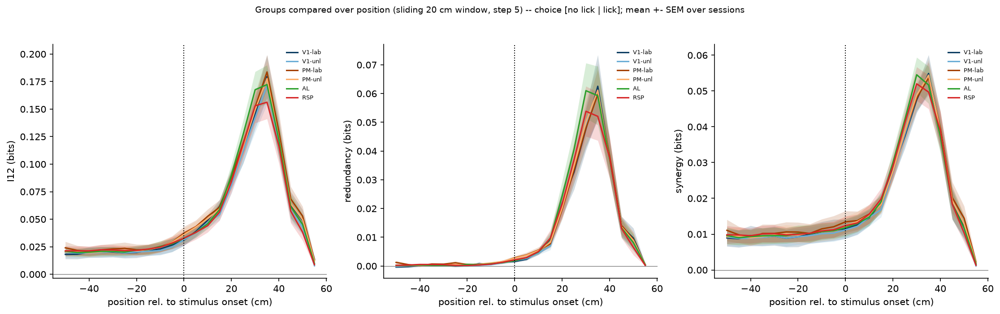

### Compare targets I12

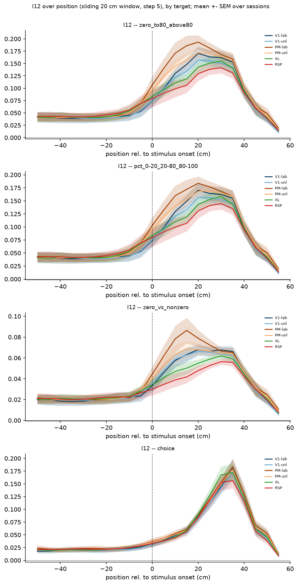

### Compare targets synergy

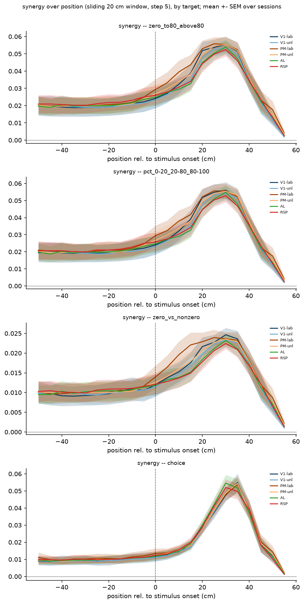

### Pid vs position

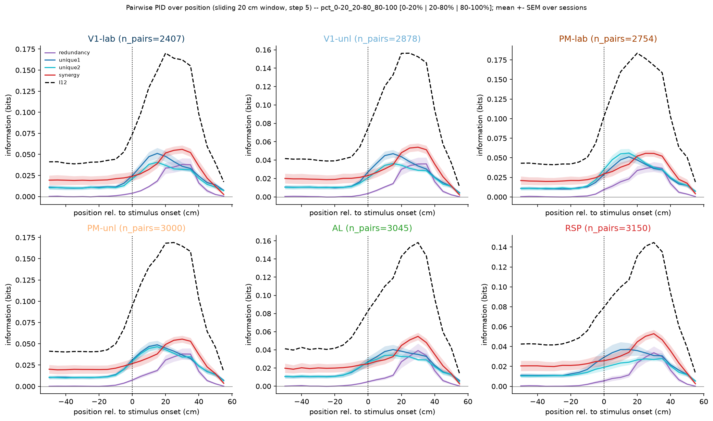

### Group comparison

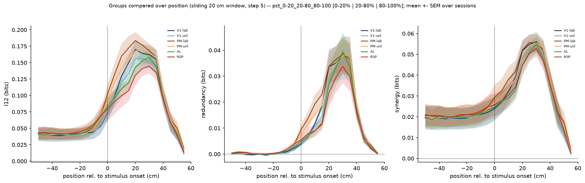

### Pid vs position

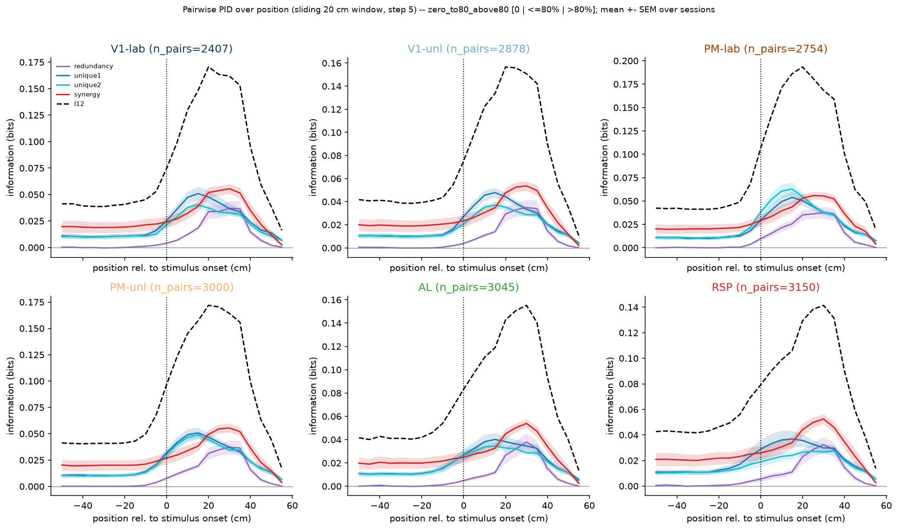

### Group comparison

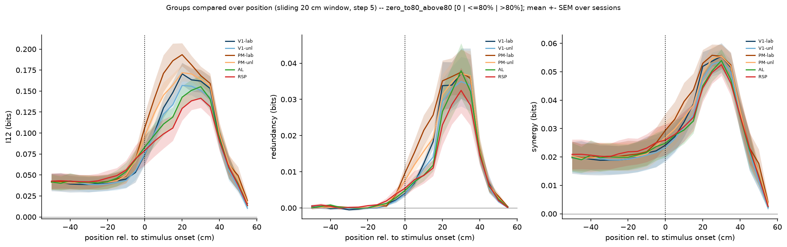

### Pid vs position

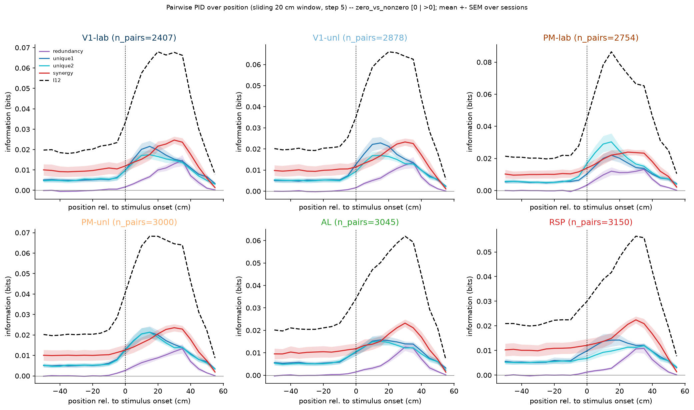

### Group comparison

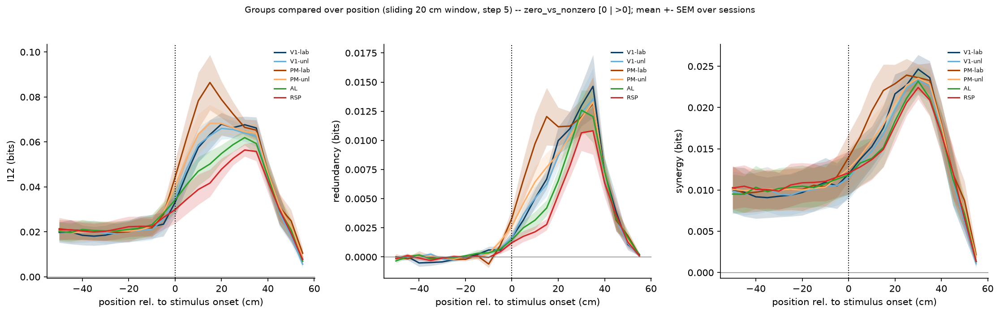
