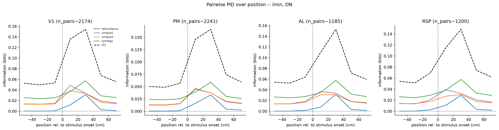

# 3f_pair_information_pid_temporal

*Auto-generated from `2_pipeline/3f_pair_information_pid_temporal/out/` on 2026-09-14 16:47. Re-run `make_progress_md.py` after the script's output changes -- don't hand-edit this file.*

## Tables

### Pid temporal

| session_id | roi_name | labeled_grouped | cell_i | cell_j | s_rel | n_trials | I1 | I2 | I12 | redundancy | unique1 | unique2 | synergy | redundancy_p_value |
| --- | --- | --- | --- | --- | --- | --- | --- | --- | --- | --- | --- | --- | --- | --- |
| LPE10884_2024_01_12 | AL | unl | LPE10884_2024_01_12_7_0126 | LPE10884_2024_01_12_7_0256 | -50 | 209 | 0.02022 | 0.02415 | 0.09671 | 0.007018 | 0.0132 | 0.01713 | 0.05936 | 0.05 |
| LPE10884_2024_01_12 | AL | unl | LPE10884_2024_01_12_7_0014 | LPE10884_2024_01_12_7_0198 | -50 | 209 | 0.00645 | 0.006111 | 0.01738 | -0.001462 | 0.007912 | 0.007573 | 0.003359 | 0.7 |
| LPE10884_2024_01_12 | AL | unl | LPE10884_2024_01_12_7_0376 | LPE10884_2024_01_12_7_0390 | -50 | 209 | 0.008234 | 0.02448 | 0.08729 | -0.002106 | 0.01034 | 0.02659 | 0.05247 | 0.65 |
| LPE10884_2024_01_12 | AL | unl | LPE10884_2024_01_12_7_0096 | LPE10884_2024_01_12_7_0414 | -50 | 209 | 0.004486 | 0.01368 | 0.06859 | -0.008499 | 0.01298 | 0.02217 | 0.04193 | 0.95 |
| LPE10884_2024_01_12 | AL | unl | LPE10884_2024_01_12_7_0005 | LPE10884_2024_01_12_7_0135 | -50 | 209 | 0.0284 | 0.007491 | 0.04377 | 0.002767 | 0.02563 | 0.004724 | 0.01065 | 0.25 |
| LPE10884_2024_01_12 | AL | unl | LPE10884_2024_01_12_7_0154 | LPE10884_2024_01_12_7_0198 | -50 | 209 | 0.004039 | 0.006111 | 0.02497 | -0.002861 | 0.0069 | 0.008973 | 0.01196 | 0.6 |
| LPE10884_2024_01_12 | AL | unl | LPE10884_2024_01_12_7_0131 | LPE10884_2024_01_12_7_0161 | -50 | 209 | 0.01036 | 0.01268 | 0.05292 | -0.006781 | 0.01714 | 0.01946 | 0.02309 | 0.85 |
| LPE10884_2024_01_12 | AL | unl | LPE10884_2024_01_12_7_0077 | LPE10884_2024_01_12_7_0260 | -50 | 209 | 0.02833 | 0.003863 | 0.0379 | -0.003011 | 0.03134 | 0.006874 | 0.002694 | 0.75 |
| LPE10884_2024_01_12 | AL | unl | LPE10884_2024_01_12_7_0166 | LPE10884_2024_01_12_7_0240 | -50 | 209 | 0.02428 | 0.01142 | 0.05329 | 0.005298 | 0.01898 | 0.006121 | 0.02289 | 0.15 |
| LPE10884_2024_01_12 | AL | unl | LPE10884_2024_01_12_7_0003 | LPE10884_2024_01_12_7_0179 | -50 | 209 | 0.01578 | 0.01116 | 0.06869 | -0.002749 | 0.01852 | 0.01391 | 0.039 | 0.55 |
| LPE10884_2024_01_12 | AL | unl | LPE10884_2024_01_12_7_0069 | LPE10884_2024_01_12_7_0245 | -50 | 209 | 0.01307 | 0.03956 | 0.09727 | -0.0007319 | 0.0138 | 0.04029 | 0.04391 | 0.6 |
| LPE10884_2024_01_12 | AL | unl | LPE10884_2024_01_12_7_0248 | LPE10884_2024_01_12_7_0348 | -50 | 209 | 0.01298 | 0.00657 | 0.04338 | -0.0001893 | 0.01317 | 0.006759 | 0.02364 | 0.45 |
| LPE10884_2024_01_12 | AL | unl | LPE10884_2024_01_12_7_0199 | LPE10884_2024_01_12_7_0299 | -50 | 209 | 0.025 | 0.006093 | 0.08073 | 0.0005374 | 0.02446 | 0.005556 | 0.05018 | 0.45 |
| LPE10884_2024_01_12 | AL | unl | LPE10884_2024_01_12_7_0085 | LPE10884_2024_01_12_7_0361 | -50 | 209 | 0.004921 | 0.02733 | 0.08629 | -0.007708 | 0.01263 | 0.03504 | 0.04633 | 1 |
| LPE10884_2024_01_12 | AL | unl | LPE10884_2024_01_12_7_0119 | LPE10884_2024_01_12_7_0413 | -50 | 209 | 0.02673 | 0.009632 | 0.108 | -0.002719 | 0.02945 | 0.01235 | 0.06887 | 0.7 |
| LPE10884_2024_01_12 | AL | unl | LPE10884_2024_01_12_7_0198 | LPE10884_2024_01_12_7_0222 | -50 | 209 | 0.006111 | 0.01375 | 0.02961 | 0.0002954 | 0.005816 | 0.01345 | 0.01005 | 0.4 |
| LPE10884_2024_01_12 | AL | unl | LPE10884_2024_01_12_7_0054 | LPE10884_2024_01_12_7_0228 | -50 | 209 | 0.04883 | 0.01337 | 0.09656 | 0.001805 | 0.04702 | 0.01157 | 0.03617 | 0.35 |
| LPE10884_2024_01_12 | AL | unl | LPE10884_2024_01_12_7_0006 | LPE10884_2024_01_12_7_0201 | -50 | 209 | 0.01172 | 0.03602 | 0.07838 | 0.00104 | 0.01068 | 0.03498 | 0.03168 | 0.35 |
| LPE10884_2024_01_12 | AL | unl | LPE10884_2024_01_12_7_0000 | LPE10884_2024_01_12_7_0303 | -50 | 209 | 0.00377 | 0.01701 | 0.06606 | -0.002615 | 0.006385 | 0.01962 | 0.04267 | 0.8 |
| LPE10884_2024_01_12 | AL | unl | LPE10884_2024_01_12_7_0184 | LPE10884_2024_01_12_7_0213 | -50 | 209 | 0.006201 | 0.01914 | 0.066 | -0.0001093 | 0.00631 | 0.01925 | 0.04056 | 0.5 |
| LPE10884_2024_01_12 | AL | unl | LPE10884_2024_01_12_7_0137 | LPE10884_2024_01_12_7_0153 | -50 | 209 | 0.01199 | 0.01195 | 0.07482 | -0.003974 | 0.01596 | 0.01592 | 0.04691 | 0.8 |
| LPE10884_2024_01_12 | AL | unl | LPE10884_2024_01_12_7_0030 | LPE10884_2024_01_12_7_0122 | -50 | 209 | 0.02913 | 0.0191 | 0.1287 | 0.009533 | 0.0196 | 0.009564 | 0.09005 | 0.1 |
| LPE10884_2024_01_12 | AL | unl | LPE10884_2024_01_12_7_0000 | LPE10884_2024_01_12_7_0141 | -50 | 209 | 0.00377 | 0.01966 | 0.04478 | -0.002004 | 0.005774 | 0.02167 | 0.01934 | 0.65 |
| LPE10884_2024_01_12 | AL | unl | LPE10884_2024_01_12_7_0127 | LPE10884_2024_01_12_7_0327 | -50 | 209 | 0.02135 | 0.02208 | 0.04956 | 0.007664 | 0.01369 | 0.01442 | 0.01379 | 0 |
| LPE10884_2024_01_12 | AL | unl | LPE10884_2024_01_12_7_0045 | LPE10884_2024_01_12_7_0085 | -50 | 209 | 0.007467 | 0.004921 | 0.0273 | -0.001169 | 0.008636 | 0.006089 | 0.01374 | 0.65 |
| LPE10884_2024_01_12 | AL | unl | LPE10884_2024_01_12_7_0308 | LPE10884_2024_01_12_7_0332 | -50 | 209 | 0.01822 | 0.02278 | 0.08055 | 0.001407 | 0.01681 | 0.02137 | 0.04095 | 0.2 |
| LPE10884_2024_01_12 | AL | unl | LPE10884_2024_01_12_7_0012 | LPE10884_2024_01_12_7_0088 | -50 | 209 | 0.01956 | 0.01661 | 0.08838 | 0.001602 | 0.01796 | 0.015 | 0.05381 | 0.35 |
| LPE10884_2024_01_12 | AL | unl | LPE10884_2024_01_12_7_0180 | LPE10884_2024_01_12_7_0242 | -50 | 209 | 0.01017 | 0.004863 | 0.02198 | -0.001324 | 0.01149 | 0.006187 | 0.005627 | 0.55 |
| LPE10884_2024_01_12 | AL | unl | LPE10884_2024_01_12_7_0104 | LPE10884_2024_01_12_7_0124 | -50 | 209 | 0.03797 | 0.01257 | 0.09201 | 0.003153 | 0.03482 | 0.009419 | 0.04462 | 0.2 |
| LPE10884_2024_01_12 | AL | unl | LPE10884_2024_01_12_7_0053 | LPE10884_2024_01_12_7_0082 | -50 | 209 | 0.01166 | 0.01451 | 0.07191 | -0.001447 | 0.01311 | 0.01595 | 0.0443 | 0.45 |

*(showing first 30 of 47600 rows -- see the linked CSV for the rest)*

[pid_temporal.csv](../2_pipeline/3f_pair_information_pid_temporal/out/pid_temporal.csv)

## Figures

### Pid vs position

