# 3g_pair_hit_miss_correlations

*Auto-generated from `2_pipeline/3g_pair_hit_miss_correlations/out/` on 2026-10-30 11:38. Re-run `make_progress_md.py` after the script's output changes -- don't hand-edit this file.*

## Tables

### Distance matching

| session_id | roi_name | window | conditioning | n_lab | n_unl | n_lab_matched | n_unl_matched | median_dist_lab | median_dist_unl_before | median_dist_unl_after |
| --- | --- | --- | --- | --- | --- | --- | --- | --- | --- | --- |
| LPE11622_2024_02_20 | PM | pre_stim | stimulus | 150 | 150 | 131 | 131 | 263.4 | 291.8 | 270.5 |
| LPE11622_2024_02_20 | V1 | pre_stim | stimulus | 150 | 150 | 113 | 113 | 219.3 | 296.8 | 243.1 |
| LPE11622_2024_02_22 | PM | pre_stim | stimulus | 150 | 150 | 120 | 120 | 255.2 | 280.2 | 254.3 |
| LPE11622_2024_02_22 | V1 | pre_stim | stimulus | 150 | 150 | 115 | 115 | 186.4 | 248.6 | 210 |
| LPE11622_2024_02_23 | PM | pre_stim | stimulus | 150 | 150 | 122 | 122 | 234 | 325.1 | 264.6 |
| LPE11622_2024_02_23 | V1 | pre_stim | stimulus | 150 | 150 | 123 | 123 | 201.4 | 230 | 211 |
| LPE11622_2024_02_26 | PM | pre_stim | stimulus | 150 | 150 | 124 | 124 | 196.9 | 257.6 | 215.5 |
| LPE11622_2024_02_26 | V1 | pre_stim | stimulus | 150 | 150 | 109 | 109 | 177.2 | 231.8 | 198.1 |
| LPE11997_2024_04_10 | PM | pre_stim | stimulus | 150 | 150 | 132 | 132 | 307.6 | 300.8 | 278.3 |
| LPE11997_2024_04_10 | V1 | pre_stim | stimulus | 150 | 150 | 128 | 128 | 275.3 | 271.2 | 271.9 |
| LPE11997_2024_04_16 | PM | pre_stim | stimulus | 150 | 150 | 120 | 120 | 370.1 | 386.2 | 404.2 |
| LPE11997_2024_04_16 | V1 | pre_stim | stimulus | 78 | 150 | 78 | 78 | 224.5 | 251.4 | 225.6 |
| LPE11997_2024_04_17 | PM | pre_stim | stimulus | 150 | 150 | 121 | 121 | 323.3 | 341.4 | 327.9 |
| LPE11997_2024_04_17 | V1 | pre_stim | stimulus | 150 | 150 | 127 | 127 | 263.7 | 259.2 | 254.7 |
| LPE11997_2024_04_18 | PM | pre_stim | stimulus | 150 | 150 | 125 | 125 | 349.5 | 418.4 | 401.7 |
| LPE11997_2024_04_18 | V1 | pre_stim | stimulus | 1 | 28 | 0 | 0 | 215.7 | 58.12 |  |
| LPE11998_2024_04_24 | PM | pre_stim | stimulus | 150 | 150 | 118 | 118 | 257.4 | 341.8 | 298.8 |
| LPE11998_2024_04_24 | V1 | pre_stim | stimulus | 150 | 150 | 135 | 135 | 359 | 345.8 | 371.4 |
| LPE11998_2024_04_25 | PM | pre_stim | stimulus | 150 | 150 | 111 | 111 | 384.9 | 354.2 | 372.7 |
| LPE11998_2024_04_25 | V1 | pre_stim | stimulus | 150 | 150 | 132 | 132 | 342 | 313.9 | 345 |
| LPE11998_2024_04_29 | PM | pre_stim | stimulus | 150 | 150 | 129 | 129 | 219.1 | 281.9 | 239.2 |
| LPE11998_2024_04_29 | V1 | pre_stim | stimulus | 3 | 150 | 3 | 3 | 550.1 | 147.6 | 548.3 |
| LPE11998_2024_05_01 | PM | pre_stim | stimulus | 150 | 150 | 118 | 118 | 310.8 | 326.1 | 319.3 |
| LPE11998_2024_05_01 | V1 | pre_stim | stimulus | 150 | 150 | 121 | 121 | 321.1 | 294.8 | 313.2 |
| LPE12013_2024_04_25 | PM | pre_stim | stimulus | 78 | 150 | 75 | 75 | 179.3 | 226 | 178.1 |
| LPE12013_2024_04_25 | V1 | pre_stim | stimulus | 150 | 150 | 126 | 126 | 200.4 | 216.6 | 215.2 |
| LPE12013_2024_04_26 | PM | pre_stim | stimulus | 150 | 150 | 133 | 133 | 259.7 | 244.9 | 248.4 |
| LPE12013_2024_04_26 | V1 | pre_stim | stimulus | 136 | 150 | 117 | 117 | 301.1 | 339.2 | 296.5 |
| LPE12013_2024_04_29 | PM | pre_stim | stimulus | 150 | 150 | 119 | 119 | 211.1 | 197.4 | 187.6 |
| LPE12013_2024_04_29 | V1 | pre_stim | stimulus | 150 | 150 | 109 | 109 | 207.5 | 136.9 | 158 |

*(showing first 30 of 160 rows -- see the linked CSV for the rest)*

[distance_matching.csv](../2_pipeline/3g_pair_hit_miss_correlations/out/distance_matching.csv)

### Hit miss by group  session

| group | unit | animal_id | window | conditioning | n_pairs | r_hit | r_miss | delta | r_hit_unmatched | r_miss_unmatched | delta_unmatched | r_mean | distance_um | subset |
| --- | --- | --- | --- | --- | --- | --- | --- | --- | --- | --- | --- | --- | --- | --- |
| AL_unl | LPE10884_2024_01_12 | LPE10884 | pre_stim | stimulus | 150 | 0.005533 | 0.02971 | -0.02417 | 0.00276 | 0.03102 | -0.02826 | 0.01762 | 277.6 | all pairs |
| AL_unl | LPE10884_2024_01_17 | LPE10884 | pre_stim | stimulus | 150 | 0.04377 | 0.06763 | -0.02386 | 0.04964 | 0.06763 | -0.01799 | 0.0557 | 274.6 | all pairs |
| AL_unl | LPE11622_2024_02_22 | LPE11622 | pre_stim | stimulus | 150 | 0.03068 | 0.0261 | 0.004575 | 0.02491 | 0.02382 | 0.001084 | 0.02839 | 321.9 | all pairs |
| AL_unl | LPE11622_2024_02_23 | LPE11622 | pre_stim | stimulus | 150 | 0.01721 | 0.01907 | -0.001858 | 0.02453 | 0.02166 | 0.002873 | 0.01814 | 291.1 | all pairs |
| AL_unl | LPE11622_2024_02_26 | LPE11622 | pre_stim | stimulus | 150 | 0.004448 | 0.01758 | -0.01313 | 0.006761 | 0.01857 | -0.01181 | 0.01101 | 318.6 | all pairs |
| AL_unl | LPE11997_2024_04_10 | LPE11997 | pre_stim | stimulus | 150 | 0.01834 | 0.0009093 | 0.01743 | 0.0205 | 0.0009093 | 0.01959 | 0.009623 | 328.6 | all pairs |
| AL_unl | LPE11997_2024_04_16 | LPE11997 | pre_stim | stimulus | 150 | 0.0492 | 0.05548 | -0.006288 | 0.04178 | 0.05195 | -0.01017 | 0.05234 | 277.5 | all pairs |
| AL_unl | LPE11997_2024_04_17 | LPE11997 | pre_stim | stimulus | 150 | 0.01362 | 0.00974 | 0.003885 | 0.01579 | 0.00974 | 0.006051 | 0.01168 | 293.6 | all pairs |
| AL_unl | LPE11997_2024_04_18 | LPE11997 | pre_stim | stimulus | 45 | 0.06901 | 0.003565 | 0.06545 | 0.02378 | -0.009088 | 0.03286 | 0.03629 | 176.7 | all pairs |
| AL_unl | LPE11998_2024_04_24 | LPE11998 | pre_stim | stimulus | 150 | 0.01819 | -0.01497 | 0.03316 | 0.008471 | -0.01497 | 0.02344 | 0.001608 | 322.5 | all pairs |
| AL_unl | LPE11998_2024_04_25 | LPE11998 | pre_stim | stimulus | 150 | 0.02582 | 0.05317 | -0.02735 | 0.01598 | 0.05317 | -0.03719 | 0.0395 | 302.7 | all pairs |
| AL_unl | LPE11998_2024_04_29 | LPE11998 | pre_stim | stimulus | 150 | 0.01721 | 0.03184 | -0.01463 | 0.01491 | 0.03257 | -0.01766 | 0.02453 | 254.8 | all pairs |
| AL_unl | LPE11998_2024_05_01 | LPE11998 | pre_stim | stimulus | 150 | 0.01292 | 0.03987 | -0.02695 | 0.01839 | 0.03987 | -0.02148 | 0.02639 | 293.8 | all pairs |
| AL_unl | LPE12013_2024_04_25 | LPE12013 | pre_stim | stimulus | 150 | 0.001692 | 0.01047 | -0.00878 | 0.001184 | 0.01011 | -0.008925 | 0.006082 | 302.4 | all pairs |
| AL_unl | LPE12013_2024_04_26 | LPE12013 | pre_stim | stimulus | 150 | 0.01569 | 0.01455 | 0.00114 | 0.01685 | 0.01098 | 0.005863 | 0.01512 | 294.7 | all pairs |
| AL_unl | LPE12013_2024_04_29 | LPE12013 | pre_stim | stimulus | 150 | 0.0224 | 0.02944 | -0.007041 | 0.02488 | 0.006185 | 0.01869 | 0.02592 | 266.5 | all pairs |
| AL_unl | LPE12013_2024_04_30 | LPE12013 | pre_stim | stimulus | 150 | -0.00515 | 0.005135 | -0.01028 | -0.002243 | -0.001879 | -0.0003637 | -7.292e-06 | 295.8 | all pairs |
| AL_unl | LPE12385_2024_06_15 | LPE12385 | pre_stim | stimulus | 150 | 0.003827 | 0.02999 | -0.02617 | 0.007478 | 0.01708 | -0.009604 | 0.01691 | 248.9 | all pairs |
| AL_unl | LPE12385_2024_06_16 | LPE12385 | pre_stim | stimulus | 150 | -0.008032 | 0.003146 | -0.01118 | -0.007417 | 0.003146 | -0.01056 | -0.002443 | 234.3 | all pairs |
| AL_unl | LPE12385_2024_06_17 | LPE12385 | pre_stim | stimulus | 150 | 0.01601 | 0.01097 | 0.005037 | 0.01508 | 0.01097 | 0.004112 | 0.01349 | 286.1 | all pairs |
| AL_unl | LPE12385_2024_06_27 | LPE12385 | pre_stim | stimulus | 150 | 0.01556 | -0.003921 | 0.01948 | 0.008535 | 0.004882 | 0.003653 | 0.005817 | 290.3 | all pairs |
| AL_unl | LPE10884_2024_01_12 | LPE10884 | pre_stim | stimulus+movement | 150 | 0.0009615 | 0.0145 | -0.01354 | -0.003751 | 0.01775 | -0.02151 | 0.00773 | 277.6 | all pairs |
| AL_unl | LPE10884_2024_01_17 | LPE10884 | pre_stim | stimulus+movement | 150 | 0.02468 | 0.04646 | -0.02178 | 0.03174 | 0.04646 | -0.01473 | 0.03557 | 274.6 | all pairs |
| AL_unl | LPE11622_2024_02_22 | LPE11622 | pre_stim | stimulus+movement | 150 | 0.02124 | 0.0133 | 0.007948 | 0.02045 | 0.01456 | 0.005888 | 0.01727 | 321.9 | all pairs |
| AL_unl | LPE11622_2024_02_23 | LPE11622 | pre_stim | stimulus+movement | 150 | 0.01501 | 0.0151 | -9.305e-05 | 0.01803 | 0.01453 | 0.003498 | 0.01505 | 291.1 | all pairs |
| AL_unl | LPE11622_2024_02_26 | LPE11622 | pre_stim | stimulus+movement | 150 | 0.002354 | 0.01256 | -0.01021 | 0.00189 | 0.01446 | -0.01257 | 0.007459 | 318.6 | all pairs |
| AL_unl | LPE11997_2024_04_10 | LPE11997 | pre_stim | stimulus+movement | 150 | 0.01894 | 0.001558 | 0.01738 | 0.02239 | 0.001558 | 0.02083 | 0.01025 | 328.6 | all pairs |
| AL_unl | LPE11997_2024_04_16 | LPE11997 | pre_stim | stimulus+movement | 150 | 0.03956 | 0.04014 | -0.0005789 | 0.03316 | 0.03696 | -0.003796 | 0.03985 | 277.5 | all pairs |
| AL_unl | LPE11997_2024_04_17 | LPE11997 | pre_stim | stimulus+movement | 150 | 0.01029 | 0.00117 | 0.009121 | 0.01206 | 0.00117 | 0.01089 | 0.00573 | 293.6 | all pairs |
| AL_unl | LPE11997_2024_04_18 | LPE11997 | pre_stim | stimulus+movement | 45 | 0.07391 | -0.004078 | 0.07799 | 0.02442 | -0.005263 | 0.02968 | 0.03492 | 176.7 | all pairs |

*(showing first 30 of 968 rows -- see the linked CSV for the rest)*

[hit_miss_by_group__session.csv](../2_pipeline/3g_pair_hit_miss_correlations/out/hit_miss_by_group__session.csv)

### Hit miss pair correlations

| session_id | animal_id | window | conditioning | roi_name | labeled_grouped | cell_i | cell_j | pair_rank | distance_um | n_hit | n_miss | n_matched | r_hit | r_miss |
| --- | --- | --- | --- | --- | --- | --- | --- | --- | --- | --- | --- | --- | --- | --- |
| LPE10884_2024_01_12 | LPE10884 | pre_stim | stimulus | AL | unl | LPE10884_2024_01_12_7_0119 | LPE10884_2024_01_12_7_0196 | 108 | 150.7 | 113 | 75 | 61 | 0.1415 | 0.2913 |
| LPE10884_2024_01_12 | LPE10884 | pre_stim | stimulus | AL | unl | LPE10884_2024_01_12_7_0010 | LPE10884_2024_01_12_7_0421 | 37 | 524 | 113 | 75 | 61 | -0.04753 | 0.2259 |
| LPE10884_2024_01_12 | LPE10884 | pre_stim | stimulus | AL | unl | LPE10884_2024_01_12_7_0005 | LPE10884_2024_01_12_7_0207 | 10 | 702.8 | 113 | 75 | 61 | -0.09941 | 0.09644 |
| LPE10884_2024_01_12 | LPE10884 | pre_stim | stimulus | AL | unl | LPE10884_2024_01_12_7_0062 | LPE10884_2024_01_12_7_0080 | 65 | 184.1 | 113 | 75 | 61 | -0.06135 | -0.06305 |
| LPE10884_2024_01_12 | LPE10884 | pre_stim | stimulus | AL | unl | LPE10884_2024_01_12_7_0085 | LPE10884_2024_01_12_7_0273 | 83 | 70.1 | 113 | 75 | 61 | -0.05841 | 0.02915 |
| LPE10884_2024_01_12 | LPE10884 | pre_stim | stimulus | AL | unl | LPE10884_2024_01_12_7_0104 | LPE10884_2024_01_12_7_0161 | 103 | 205.5 | 113 | 75 | 61 | 0.04098 | 0.06922 |
| LPE10884_2024_01_12 | LPE10884 | pre_stim | stimulus | AL | unl | LPE10884_2024_01_12_7_0204 | LPE10884_2024_01_12_7_0322 | 39 | 89.88 | 113 | 75 | 61 | 0.08421 | 0.0004797 |
| LPE10884_2024_01_12 | LPE10884 | pre_stim | stimulus | AL | unl | LPE10884_2024_01_12_7_0276 | LPE10884_2024_01_12_7_0427 | 146 | 170.9 | 113 | 75 | 61 | -0.01295 | 0.09723 |
| LPE10884_2024_01_12 | LPE10884 | pre_stim | stimulus | AL | unl | LPE10884_2024_01_12_7_0017 | LPE10884_2024_01_12_7_0083 | 135 | 358 | 113 | 75 | 61 | -0.1638 | 0.01459 |
| LPE10884_2024_01_12 | LPE10884 | pre_stim | stimulus | AL | unl | LPE10884_2024_01_12_7_0001 | LPE10884_2024_01_12_7_0098 | 110 | 343 | 113 | 75 | 61 | -0.2119 | 0.1849 |
| LPE10884_2024_01_12 | LPE10884 | pre_stim | stimulus | AL | unl | LPE10884_2024_01_12_7_0025 | LPE10884_2024_01_12_7_0052 | 98 | 317.6 | 113 | 75 | 61 | -0.1299 | 0.04156 |
| LPE10884_2024_01_12 | LPE10884 | pre_stim | stimulus | AL | unl | LPE10884_2024_01_12_7_0061 | LPE10884_2024_01_12_7_0269 | 35 | 286.9 | 113 | 75 | 61 | 0.2946 | 0.1029 |
| LPE10884_2024_01_12 | LPE10884 | pre_stim | stimulus | AL | unl | LPE10884_2024_01_12_7_0155 | LPE10884_2024_01_12_7_0223 | 61 | 533.7 | 113 | 75 | 61 | 0.02651 | -0.1032 |
| LPE10884_2024_01_12 | LPE10884 | pre_stim | stimulus | AL | unl | LPE10884_2024_01_12_7_0042 | LPE10884_2024_01_12_7_0069 | 53 | 464.1 | 113 | 75 | 61 | -0.07961 | -0.1085 |
| LPE10884_2024_01_12 | LPE10884 | pre_stim | stimulus | AL | unl | LPE10884_2024_01_12_7_0050 | LPE10884_2024_01_12_7_0148 | 102 | 436.8 | 113 | 75 | 61 | 0.1642 | -0.0903 |
| LPE10884_2024_01_12 | LPE10884 | pre_stim | stimulus | AL | unl | LPE10884_2024_01_12_7_0132 | LPE10884_2024_01_12_7_0203 | 59 | 132.8 | 113 | 75 | 61 | 0.002841 | 0.08119 |
| LPE10884_2024_01_12 | LPE10884 | pre_stim | stimulus | AL | unl | LPE10884_2024_01_12_7_0072 | LPE10884_2024_01_12_7_0086 | 142 | 462.8 | 113 | 75 | 61 | -0.02028 | -0.2069 |
| LPE10884_2024_01_12 | LPE10884 | pre_stim | stimulus | AL | unl | LPE10884_2024_01_12_7_0192 | LPE10884_2024_01_12_7_0279 | 50 | 252.5 | 113 | 75 | 61 | -0.0675 | -0.05413 |
| LPE10884_2024_01_12 | LPE10884 | pre_stim | stimulus | AL | unl | LPE10884_2024_01_12_7_0003 | LPE10884_2024_01_12_7_0062 | 145 | 43.22 | 113 | 75 | 61 | 0.2339 | 0.07875 |
| LPE10884_2024_01_12 | LPE10884 | pre_stim | stimulus | AL | unl | LPE10884_2024_01_12_7_0125 | LPE10884_2024_01_12_7_0320 | 69 | 450.3 | 113 | 75 | 61 | 0.04704 | 0.0605 |
| LPE10884_2024_01_12 | LPE10884 | pre_stim | stimulus | AL | unl | LPE10884_2024_01_12_7_0060 | LPE10884_2024_01_12_7_0295 | 76 | 195.1 | 113 | 75 | 61 | 0.1482 | 0.05733 |
| LPE10884_2024_01_12 | LPE10884 | pre_stim | stimulus | AL | unl | LPE10884_2024_01_12_7_0077 | LPE10884_2024_01_12_7_0081 | 113 | 341.8 | 113 | 75 | 61 | 0.02443 | -0.002923 |
| LPE10884_2024_01_12 | LPE10884 | pre_stim | stimulus | AL | unl | LPE10884_2024_01_12_7_0030 | LPE10884_2024_01_12_7_0236 | 80 | 403.1 | 113 | 75 | 61 | 0.03624 | 0.1127 |
| LPE10884_2024_01_12 | LPE10884 | pre_stim | stimulus | AL | unl | LPE10884_2024_01_12_7_0133 | LPE10884_2024_01_12_7_0210 | 41 | 346.5 | 113 | 75 | 61 | -0.09883 | -0.03617 |
| LPE10884_2024_01_12 | LPE10884 | pre_stim | stimulus | AL | unl | LPE10884_2024_01_12_7_0033 | LPE10884_2024_01_12_7_0120 | 126 | 289.9 | 113 | 75 | 61 | -0.05969 | -0.04445 |
| LPE10884_2024_01_12 | LPE10884 | pre_stim | stimulus | AL | unl | LPE10884_2024_01_12_7_0011 | LPE10884_2024_01_12_7_0124 | 89 | 168 | 113 | 75 | 61 | 0.03263 | 0.06118 |
| LPE10884_2024_01_12 | LPE10884 | pre_stim | stimulus | AL | unl | LPE10884_2024_01_12_7_0022 | LPE10884_2024_01_12_7_0268 | 60 | 515.1 | 113 | 75 | 61 | 0.06194 | 0.3031 |
| LPE10884_2024_01_12 | LPE10884 | pre_stim | stimulus | AL | unl | LPE10884_2024_01_12_7_0122 | LPE10884_2024_01_12_7_0156 | 93 | 197.2 | 113 | 75 | 61 | -0.1217 | -0.05878 |
| LPE10884_2024_01_12 | LPE10884 | pre_stim | stimulus | AL | unl | LPE10884_2024_01_12_7_0076 | LPE10884_2024_01_12_7_0314 | 92 | 211.1 | 113 | 75 | 61 | 0.08002 | -0.04662 |
| LPE10884_2024_01_12 | LPE10884 | pre_stim | stimulus | AL | unl | LPE10884_2024_01_12_7_0034 | LPE10884_2024_01_12_7_0188 | 74 | 262.9 | 113 | 75 | 61 | 0.04575 | -0.1169 |

*(showing first 15 of 25 columns; showing first 30 of 68952 rows -- see the linked CSV for the rest)*

[hit_miss_pair_correlations.csv](../2_pipeline/3g_pair_hit_miss_correlations/out/hit_miss_pair_correlations.csv)

## Figures

### Compare conditioning delta

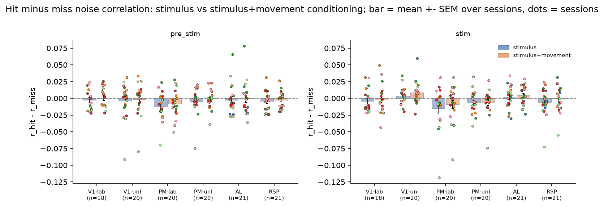

### Hit vs miss

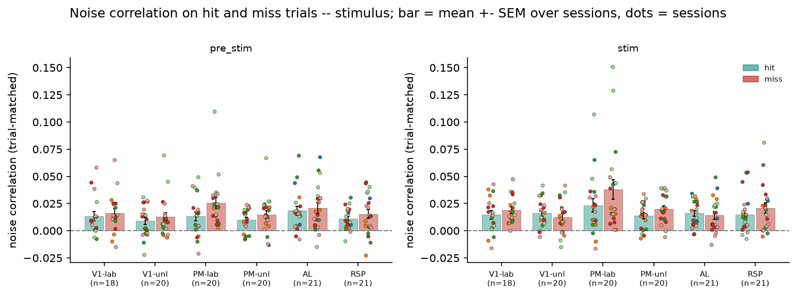

### Delta hit minus miss

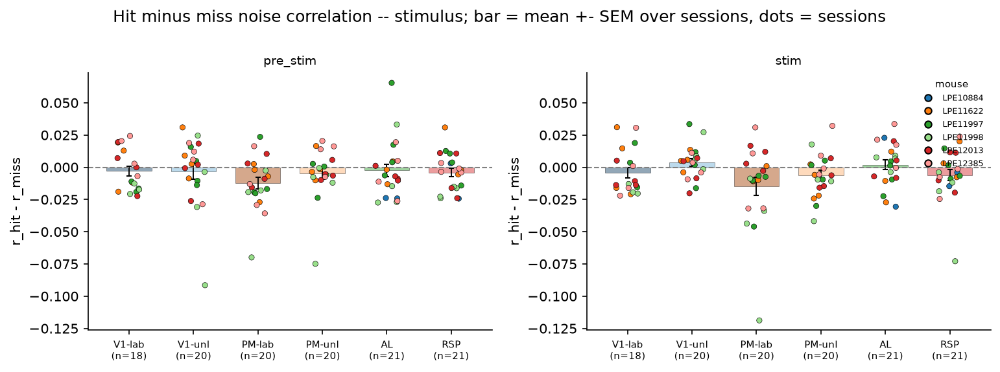

### Effect of trial matching

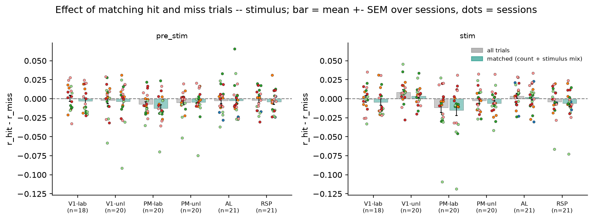

### Distance matched delta

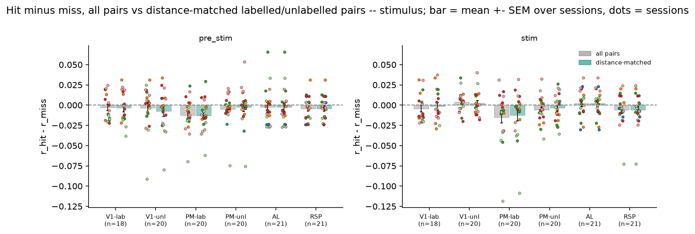

### Noise correlation vs distance

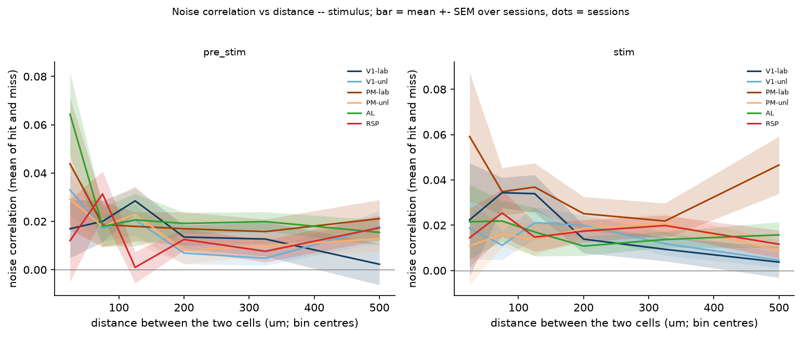

### Hit vs miss

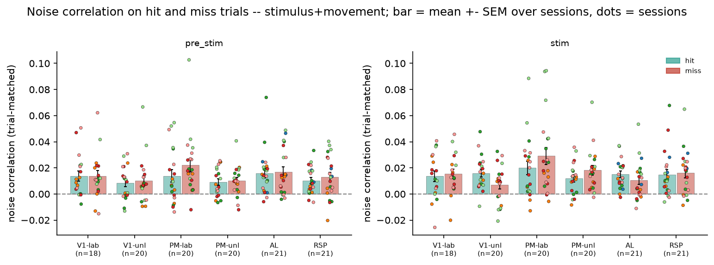

### Delta hit minus miss

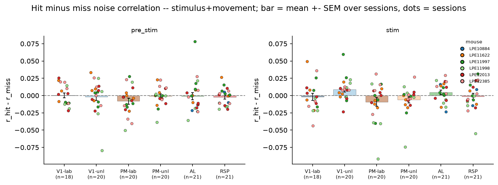

### Effect of trial matching

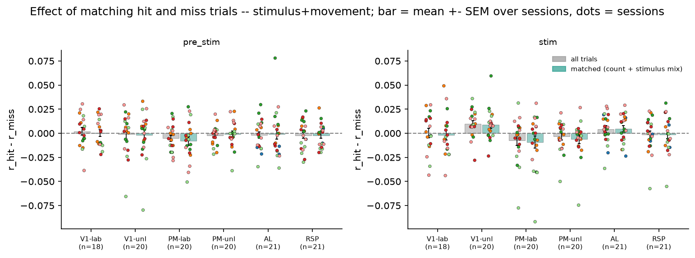

### Distance matched delta

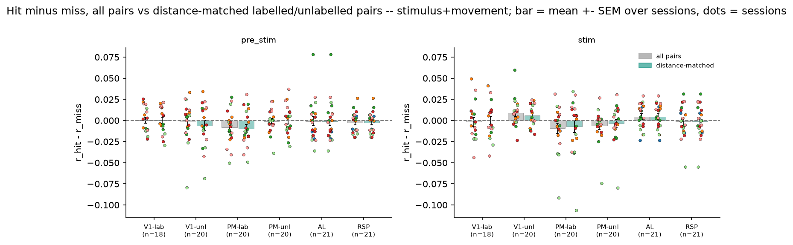

### Noise correlation vs distance

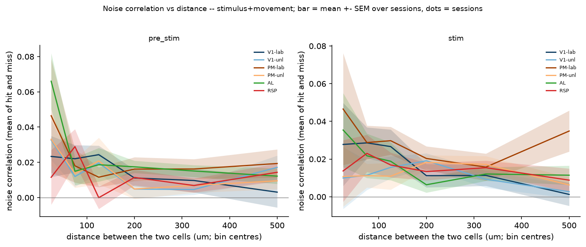
