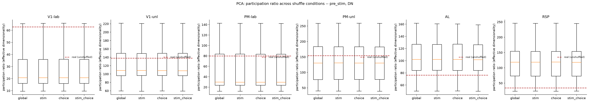
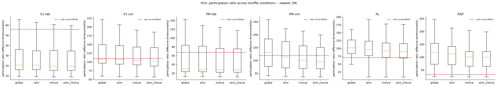
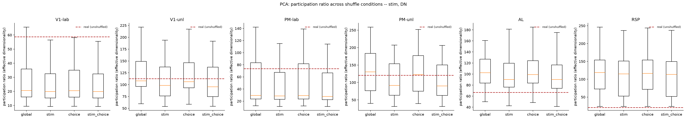
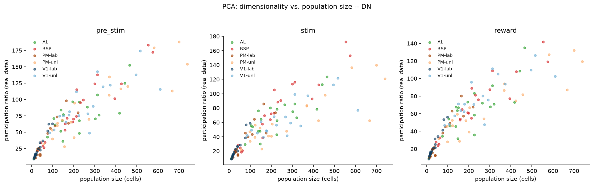
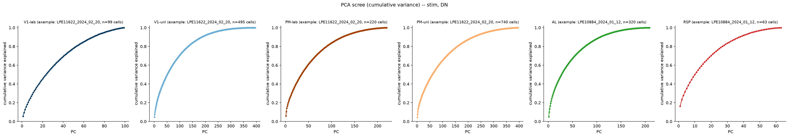
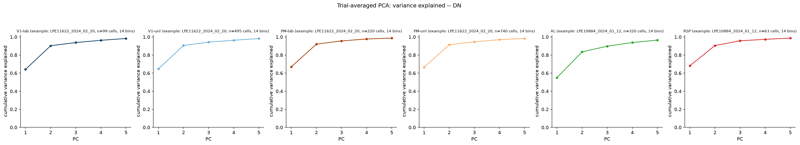
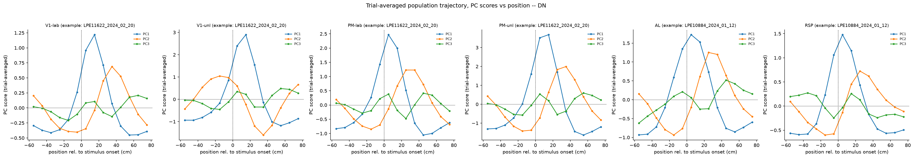
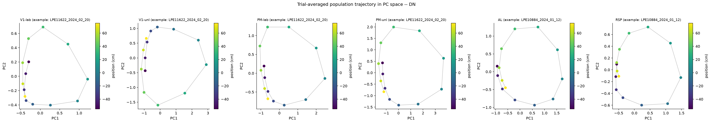

# 4a_population_pca

*Auto-generated from `2_pipeline/4a_population_pca/out/` on 2026-10-30 11:38. Re-run `make_progress_md.py` after the script's output changes -- don't hand-edit this file.*

## Tables

### Pca real summary

| session_id | window | roi_name | labeled_grouped | n_cells | n_trials | var_ratio_per_pc |
| --- | --- | --- | --- | --- | --- | --- |
| LPE10884_2024_01_12 | pre_stim | AL | unl | 320 | 209 | 0.046849,0.037721,0.032251,0.027762,0.025010,0.022942,0.020570,0.018546,0.017956,0.016618,0.016095,0.015017,0.014106,0.013855,0.013431,0.012509,0.012111,0.011870,0.011534,0.011155,0.011062,0.010762,0.010529,0.010074,0.009833,0.009725,0.009558,0.009311,0.009096,0.008926,0.008608,0.008464,0.008356,0.008242,0.008082,0.007981,0.007904,0.007702,0.007677,0.007578,0.007411,0.007275,0.007123,0.007057,0.006994,0.006906,0.006852,0.006770,0.006735,0.006452,0.006415,0.006222,0.006126,0.006038,0.005980,0.005808,0.005772,0.005729,0.005665,0.005531,0.005485,0.005343,0.005239,0.005203,0.005093,0.004990,0.004951,0.004910,0.004825,0.004761,0.004690,0.004660,0.004569,0.004475,0.004452,0.004377,0.004327,0.004257,0.004139,0.004104,0.004009,0.003965,0.003923,0.003900,0.003791,0.003771,0.003712,0.003668,0.003558,0.003516,0.003497,0.003429,0.003380,0.003327,0.003300,0.003211,0.003085,0.003015,0.003012,0.002978,0.002958,0.002909,0.002851,0.002827,0.002768,0.002713,0.002678,0.002640,0.002544,0.002531,0.002443,0.002412,0.002398,0.002387,0.002291,0.002221,0.002200,0.002158,0.002137,0.002097,0.002068,0.001969,0.001931,0.001889,0.001885,0.001871,0.001830,0.001780,0.001746,0.001691,0.001652,0.001637,0.001604,0.001580,0.001523,0.001511,0.001497,0.001484,0.001430,0.001420,0.001391,0.001371,0.001327,0.001299,0.001286,0.001280,0.001211,0.001188,0.001157,0.001139,0.001103,0.001081,0.001058,0.001035,0.000995,0.000975,0.000944,0.000923,0.000913,0.000891,0.000874,0.000841,0.000817,0.000802,0.000777,0.000765,0.000746,0.000732,0.000707,0.000684,0.000674,0.000666,0.000638,0.000619,0.000603,0.000574,0.000562,0.000556,0.000527,0.000513,0.000507,0.000501,0.000461,0.000451,0.000432,0.000416,0.000407,0.000397,0.000372,0.000370,0.000349,0.000338,0.000335,0.000305,0.000295,0.000282,0.000264,0.000252,0.000236,0.000227,0.000210,0.000197,0.000184,0.000172,0.000168,0.000141,0.000114,0.000081,0.000000 |
| LPE10884_2024_01_12 | stim | AL | unl | 320 | 209 | 0.051206,0.048959,0.034609,0.031205,0.028009,0.024009,0.021834,0.020119,0.017898,0.017237,0.015621,0.015380,0.014321,0.013282,0.013105,0.012701,0.012090,0.011945,0.011728,0.011049,0.010892,0.010593,0.010388,0.010296,0.010077,0.009749,0.009559,0.009479,0.009356,0.009107,0.008925,0.008730,0.008343,0.008181,0.008064,0.007929,0.007685,0.007569,0.007473,0.007284,0.007189,0.006985,0.006979,0.006830,0.006740,0.006615,0.006383,0.006340,0.006269,0.006121,0.006038,0.006013,0.005891,0.005740,0.005555,0.005508,0.005466,0.005384,0.005331,0.005212,0.005159,0.004974,0.004914,0.004869,0.004822,0.004738,0.004572,0.004523,0.004470,0.004447,0.004418,0.004300,0.004259,0.004187,0.004150,0.004068,0.004066,0.004010,0.003846,0.003792,0.003750,0.003670,0.003624,0.003596,0.003532,0.003475,0.003414,0.003328,0.003320,0.003258,0.003209,0.003186,0.003149,0.003088,0.003011,0.002978,0.002930,0.002871,0.002824,0.002771,0.002701,0.002622,0.002610,0.002548,0.002505,0.002454,0.002427,0.002397,0.002370,0.002273,0.002244,0.002193,0.002171,0.002157,0.002133,0.002088,0.002016,0.001978,0.001944,0.001894,0.001874,0.001841,0.001805,0.001784,0.001740,0.001718,0.001696,0.001680,0.001617,0.001596,0.001572,0.001522,0.001492,0.001467,0.001457,0.001436,0.001400,0.001375,0.001350,0.001283,0.001255,0.001238,0.001233,0.001207,0.001186,0.001140,0.001133,0.001118,0.001086,0.001070,0.000992,0.000984,0.000980,0.000962,0.000935,0.000888,0.000873,0.000856,0.000844,0.000820,0.000792,0.000763,0.000747,0.000733,0.000710,0.000684,0.000683,0.000674,0.000653,0.000638,0.000604,0.000589,0.000567,0.000558,0.000540,0.000519,0.000507,0.000487,0.000476,0.000465,0.000461,0.000444,0.000422,0.000405,0.000394,0.000374,0.000361,0.000355,0.000331,0.000314,0.000300,0.000287,0.000267,0.000255,0.000248,0.000245,0.000224,0.000195,0.000190,0.000176,0.000165,0.000153,0.000134,0.000127,0.000122,0.000115,0.000097,0.000080,0.000000 |
| LPE10884_2024_01_12 | reward | AL | unl | 320 | 209 | 0.050442,0.040757,0.036563,0.029069,0.025431,0.020915,0.019806,0.018551,0.017564,0.016590,0.016474,0.015992,0.014538,0.014193,0.013595,0.013066,0.012666,0.012176,0.011799,0.011649,0.011457,0.011310,0.011157,0.010668,0.010593,0.010079,0.009804,0.009604,0.009509,0.009222,0.009180,0.008733,0.008676,0.008403,0.008118,0.008061,0.007997,0.007952,0.007718,0.007586,0.007413,0.007319,0.007266,0.007062,0.006849,0.006732,0.006570,0.006473,0.006371,0.006216,0.006175,0.006127,0.006019,0.005934,0.005919,0.005886,0.005644,0.005551,0.005509,0.005411,0.005378,0.005254,0.005237,0.005163,0.005051,0.004980,0.004954,0.004802,0.004784,0.004708,0.004571,0.004475,0.004423,0.004345,0.004246,0.004210,0.004137,0.004058,0.003991,0.003971,0.003818,0.003742,0.003694,0.003683,0.003641,0.003577,0.003510,0.003448,0.003384,0.003332,0.003274,0.003241,0.003229,0.003125,0.003070,0.003061,0.003002,0.002961,0.002934,0.002901,0.002782,0.002773,0.002730,0.002603,0.002571,0.002521,0.002483,0.002469,0.002397,0.002372,0.002346,0.002305,0.002296,0.002223,0.002192,0.002136,0.002111,0.002060,0.002037,0.001947,0.001915,0.001892,0.001846,0.001800,0.001781,0.001736,0.001705,0.001685,0.001663,0.001624,0.001581,0.001530,0.001506,0.001467,0.001433,0.001433,0.001344,0.001337,0.001284,0.001255,0.001239,0.001216,0.001194,0.001156,0.001138,0.001128,0.001084,0.001069,0.001015,0.001001,0.000990,0.000948,0.000930,0.000908,0.000883,0.000879,0.000847,0.000827,0.000800,0.000779,0.000745,0.000737,0.000706,0.000663,0.000652,0.000633,0.000627,0.000615,0.000584,0.000557,0.000542,0.000525,0.000516,0.000501,0.000469,0.000452,0.000439,0.000436,0.000412,0.000402,0.000391,0.000375,0.000358,0.000345,0.000330,0.000324,0.000306,0.000295,0.000291,0.000272,0.000243,0.000238,0.000227,0.000222,0.000208,0.000197,0.000181,0.000167,0.000156,0.000150,0.000147,0.000138,0.000119,0.000111,0.000103,0.000087,0.000080,0.000049,0.000000 |
| LPE10884_2024_01_12 | pre_stim | RSP | unl | 63 | 209 | 0.075390,0.067838,0.045501,0.042894,0.037747,0.035211,0.032468,0.030173,0.029325,0.027419,0.025432,0.024287,0.022866,0.022085,0.021848,0.020460,0.019777,0.019402,0.018742,0.017542,0.017067,0.016867,0.016202,0.015356,0.014875,0.014683,0.014147,0.013762,0.013220,0.012268,0.012139,0.011541,0.011263,0.011104,0.010647,0.010223,0.009682,0.009282,0.008739,0.008447,0.008095,0.007637,0.007259,0.006948,0.006744,0.006459,0.006222,0.006170,0.005794,0.005560,0.005047,0.004867,0.004513,0.004063,0.004036,0.003606,0.003520,0.003177,0.002854,0.002745,0.002450,0.002355,0.001959 |
| LPE10884_2024_01_12 | stim | RSP | unl | 63 | 209 | 0.163209,0.071073,0.043329,0.040362,0.033852,0.033341,0.031595,0.029069,0.028459,0.026084,0.024425,0.023857,0.022359,0.021661,0.020194,0.019403,0.018477,0.017955,0.017307,0.016505,0.016060,0.015174,0.014679,0.014485,0.013485,0.012737,0.012181,0.011667,0.010890,0.010226,0.010059,0.009836,0.009452,0.008890,0.008398,0.008229,0.007900,0.007585,0.007347,0.006908,0.006452,0.006265,0.005999,0.005750,0.005284,0.004743,0.004604,0.004440,0.004295,0.004099,0.003647,0.003234,0.003070,0.002948,0.002789,0.002553,0.002350,0.002130,0.001790,0.001560,0.001300,0.001163,0.000836 |
| LPE10884_2024_01_12 | reward | RSP | unl | 63 | 209 | 0.098711,0.053797,0.047566,0.038063,0.035759,0.034087,0.033376,0.028789,0.027439,0.026209,0.025368,0.025048,0.023216,0.022551,0.021520,0.021051,0.020228,0.019478,0.018668,0.018224,0.017081,0.016825,0.016126,0.015940,0.015025,0.014356,0.014255,0.013773,0.012685,0.012377,0.012234,0.011499,0.011007,0.010651,0.010394,0.009918,0.009546,0.009228,0.008937,0.008263,0.008250,0.007573,0.007372,0.006989,0.006608,0.006507,0.006089,0.005688,0.005572,0.005422,0.005103,0.004829,0.004588,0.004072,0.003707,0.003551,0.003285,0.003221,0.002939,0.002552,0.002377,0.002241,0.002199 |
| LPE10884_2024_01_17 | pre_stim | AL | unl | 417 | 258 | 0.068152,0.026907,0.025575,0.020929,0.020513,0.017226,0.016187,0.016108,0.014537,0.014397,0.013505,0.012637,0.012588,0.011900,0.011849,0.011140,0.011048,0.010593,0.010337,0.009971,0.009844,0.009541,0.009409,0.009167,0.009053,0.008743,0.008691,0.008568,0.008477,0.008206,0.008140,0.008022,0.007856,0.007808,0.007605,0.007471,0.007336,0.007333,0.007080,0.006970,0.006916,0.006853,0.006803,0.006693,0.006525,0.006390,0.006337,0.006250,0.006211,0.006139,0.006023,0.005926,0.005840,0.005783,0.005747,0.005579,0.005553,0.005477,0.005393,0.005354,0.005254,0.005206,0.005187,0.005056,0.004951,0.004909,0.004874,0.004753,0.004717,0.004667,0.004610,0.004487,0.004449,0.004421,0.004376,0.004350,0.004285,0.004225,0.004192,0.004113,0.004084,0.004026,0.003966,0.003947,0.003826,0.003707,0.003700,0.003657,0.003631,0.003603,0.003569,0.003490,0.003448,0.003426,0.003358,0.003296,0.003262,0.003241,0.003160,0.003150,0.003095,0.003061,0.003025,0.002978,0.002962,0.002903,0.002875,0.002867,0.002825,0.002778,0.002742,0.002723,0.002706,0.002607,0.002592,0.002561,0.002547,0.002528,0.002511,0.002451,0.002403,0.002375,0.002318,0.002304,0.002279,0.002249,0.002241,0.002213,0.002182,0.002141,0.002093,0.002069,0.002041,0.002028,0.002011,0.001986,0.001952,0.001929,0.001921,0.001873,0.001846,0.001821,0.001802,0.001791,0.001767,0.001753,0.001672,0.001657,0.001632,0.001619,0.001589,0.001564,0.001555,0.001542,0.001515,0.001482,0.001458,0.001437,0.001423,0.001394,0.001381,0.001358,0.001344,0.001313,0.001300,0.001287,0.001271,0.001247,0.001204,0.001185,0.001172,0.001163,0.001149,0.001130,0.001111,0.001098,0.001056,0.001050,0.001046,0.001040,0.001015,0.001004,0.000987,0.000961,0.000950,0.000911,0.000901,0.000886,0.000861,0.000850,0.000838,0.000828,0.000816,0.000787,0.000778,0.000747,0.000728,0.000715,0.000700,0.000688,0.000674,0.000662,0.000650,0.000635,0.000629,0.000622,0.000605,0.000598,0.000589,0.000574,0.000556,0.000535,0.000528,0.000513,0.000499,0.000488,0.000482,0.000466,0.000456,0.000449,0.000441,0.000426,0.000418,0.000410,0.000405,0.000391,0.000380,0.000361,0.000343,0.000340,0.000336,0.000330,0.000315,0.000311,0.000295,0.000288,0.000281,0.000279,0.000273,0.000254,0.000242,0.000231,0.000220,0.000217,0.000205,0.000204,0.000185,0.000184,0.000175,0.000168,0.000156,0.000144,0.000141,0.000134,0.000119,0.000116,0.000107,0.000000 |
| LPE10884_2024_01_17 | stim | AL | unl | 417 | 258 | 0.064538,0.036463,0.027409,0.020961,0.019901,0.017755,0.016416,0.015514,0.014151,0.013765,0.013387,0.012827,0.012252,0.011771,0.011460,0.011163,0.010763,0.010663,0.010422,0.010047,0.009717,0.009583,0.009372,0.009049,0.008978,0.008877,0.008760,0.008509,0.008295,0.008066,0.008006,0.007866,0.007685,0.007483,0.007408,0.007269,0.007168,0.007095,0.006986,0.006857,0.006778,0.006685,0.006605,0.006508,0.006414,0.006325,0.006138,0.006097,0.006035,0.006007,0.005964,0.005868,0.005798,0.005684,0.005611,0.005575,0.005503,0.005428,0.005332,0.005310,0.005275,0.005190,0.005098,0.005091,0.005027,0.004935,0.004819,0.004727,0.004707,0.004667,0.004622,0.004499,0.004387,0.004351,0.004310,0.004284,0.004234,0.004209,0.004170,0.004072,0.003984,0.003963,0.003888,0.003822,0.003785,0.003743,0.003723,0.003662,0.003660,0.003595,0.003566,0.003491,0.003441,0.003396,0.003372,0.003345,0.003291,0.003242,0.003179,0.003154,0.003125,0.003071,0.003030,0.003019,0.002978,0.002910,0.002845,0.002832,0.002777,0.002774,0.002722,0.002684,0.002664,0.002639,0.002608,0.002588,0.002544,0.002504,0.002474,0.002417,0.002389,0.002359,0.002330,0.002286,0.002278,0.002247,0.002241,0.002203,0.002141,0.002122,0.002114,0.002085,0.002064,0.002053,0.002033,0.001977,0.001939,0.001928,0.001891,0.001878,0.001857,0.001825,0.001779,0.001737,0.001706,0.001692,0.001648,0.001631,0.001603,0.001599,0.001569,0.001544,0.001519,0.001515,0.001488,0.001459,0.001432,0.001403,0.001391,0.001384,0.001376,0.001359,0.001346,0.001302,0.001300,0.001287,0.001244,0.001235,0.001209,0.001191,0.001173,0.001164,0.001139,0.001122,0.001085,0.001064,0.001050,0.001031,0.001025,0.001005,0.000994,0.000983,0.000970,0.000950,0.000932,0.000897,0.000892,0.000865,0.000855,0.000853,0.000848,0.000820,0.000803,0.000775,0.000757,0.000755,0.000742,0.000731,0.000713,0.000696,0.000681,0.000668,0.000662,0.000649,0.000638,0.000619,0.000616,0.000609,0.000596,0.000579,0.000575,0.000560,0.000551,0.000535,0.000521,0.000510,0.000497,0.000489,0.000479,0.000473,0.000450,0.000441,0.000424,0.000411,0.000408,0.000392,0.000385,0.000372,0.000362,0.000350,0.000333,0.000327,0.000324,0.000311,0.000305,0.000294,0.000284,0.000276,0.000267,0.000259,0.000251,0.000249,0.000238,0.000226,0.000216,0.000212,0.000211,0.000200,0.000194,0.000175,0.000168,0.000162,0.000157,0.000140,0.000138,0.000115,0.000087,0.000000 |
| LPE10884_2024_01_17 | reward | AL | unl | 417 | 258 | 0.057994,0.050213,0.029833,0.024125,0.020654,0.019513,0.017331,0.016611,0.015245,0.014517,0.014121,0.013616,0.012771,0.012259,0.011756,0.011674,0.011105,0.011014,0.010896,0.010398,0.010130,0.009910,0.009814,0.009627,0.009241,0.009128,0.008856,0.008667,0.008424,0.008138,0.007997,0.007946,0.007892,0.007727,0.007598,0.007463,0.007441,0.007338,0.007272,0.007169,0.006867,0.006865,0.006706,0.006645,0.006444,0.006362,0.006278,0.006220,0.006128,0.006053,0.005982,0.005856,0.005821,0.005754,0.005612,0.005475,0.005450,0.005422,0.005366,0.005203,0.005181,0.005172,0.005059,0.004975,0.004898,0.004894,0.004731,0.004709,0.004650,0.004551,0.004465,0.004457,0.004343,0.004283,0.004252,0.004208,0.004132,0.004032,0.003946,0.003883,0.003861,0.003776,0.003767,0.003704,0.003660,0.003604,0.003580,0.003518,0.003460,0.003414,0.003363,0.003337,0.003286,0.003259,0.003203,0.003149,0.003102,0.003066,0.003026,0.002975,0.002957,0.002885,0.002852,0.002802,0.002745,0.002738,0.002705,0.002695,0.002614,0.002591,0.002550,0.002541,0.002526,0.002469,0.002409,0.002376,0.002352,0.002328,0.002293,0.002262,0.002218,0.002204,0.002121,0.002113,0.002087,0.002057,0.002038,0.002003,0.001976,0.001937,0.001882,0.001881,0.001818,0.001804,0.001776,0.001757,0.001748,0.001697,0.001679,0.001660,0.001636,0.001628,0.001574,0.001556,0.001536,0.001505,0.001498,0.001484,0.001442,0.001423,0.001400,0.001374,0.001332,0.001318,0.001317,0.001265,0.001257,0.001239,0.001209,0.001199,0.001189,0.001137,0.001126,0.001124,0.001102,0.001089,0.001050,0.001037,0.001023,0.001011,0.000985,0.000970,0.000947,0.000926,0.000916,0.000908,0.000875,0.000839,0.000830,0.000823,0.000810,0.000797,0.000787,0.000781,0.000749,0.000726,0.000718,0.000705,0.000699,0.000672,0.000669,0.000649,0.000638,0.000628,0.000620,0.000594,0.000591,0.000584,0.000561,0.000551,0.000543,0.000518,0.000496,0.000492,0.000486,0.000478,0.000460,0.000448,0.000426,0.000424,0.000414,0.000408,0.000386,0.000382,0.000378,0.000368,0.000360,0.000352,0.000342,0.000335,0.000321,0.000307,0.000300,0.000298,0.000287,0.000283,0.000275,0.000269,0.000266,0.000251,0.000249,0.000232,0.000226,0.000216,0.000211,0.000208,0.000193,0.000186,0.000180,0.000174,0.000169,0.000167,0.000160,0.000152,0.000146,0.000134,0.000122,0.000118,0.000115,0.000103,0.000102,0.000096,0.000091,0.000073,0.000069,0.000063,0.000056,0.000000 |
| LPE10884_2024_01_17 | pre_stim | RSP | unl | 159 | 258 | 0.057569,0.041066,0.036138,0.031349,0.023826,0.022619,0.021082,0.019697,0.019030,0.017714,0.017213,0.016609,0.015802,0.015182,0.014817,0.014664,0.014298,0.013965,0.013340,0.012905,0.012464,0.012373,0.011871,0.011587,0.011439,0.011186,0.010868,0.010705,0.010681,0.010369,0.010235,0.009877,0.009747,0.009464,0.009370,0.009027,0.008806,0.008602,0.008450,0.008329,0.008133,0.008002,0.007912,0.007858,0.007652,0.007626,0.007411,0.007206,0.007123,0.007044,0.006854,0.006707,0.006454,0.006352,0.006331,0.006205,0.006084,0.005935,0.005686,0.005639,0.005519,0.005469,0.005336,0.005268,0.005218,0.005168,0.005027,0.004942,0.004795,0.004758,0.004678,0.004529,0.004376,0.004335,0.004242,0.004117,0.004046,0.003926,0.003802,0.003761,0.003680,0.003624,0.003545,0.003459,0.003356,0.003268,0.003211,0.003083,0.003059,0.002997,0.002957,0.002908,0.002823,0.002792,0.002710,0.002618,0.002597,0.002480,0.002395,0.002362,0.002361,0.002280,0.002248,0.002156,0.002130,0.002079,0.002033,0.001976,0.001951,0.001863,0.001848,0.001770,0.001762,0.001701,0.001616,0.001594,0.001516,0.001508,0.001467,0.001390,0.001298,0.001270,0.001244,0.001186,0.001175,0.001124,0.001092,0.001052,0.001019,0.001008,0.000973,0.000919,0.000889,0.000842,0.000807,0.000789,0.000769,0.000711,0.000692,0.000660,0.000655,0.000607,0.000585,0.000576,0.000516,0.000508,0.000471,0.000438,0.000389,0.000381,0.000344,0.000332,0.000300,0.000295,0.000265,0.000243,0.000201,0.000191,0.000155 |
| LPE10884_2024_01_17 | stim | RSP | unl | 159 | 258 | 0.113769,0.054029,0.032101,0.030983,0.026858,0.023190,0.021905,0.020187,0.019596,0.017459,0.016589,0.015827,0.015552,0.015203,0.014193,0.013875,0.013433,0.013405,0.012368,0.012203,0.012029,0.011881,0.011521,0.011447,0.011013,0.010521,0.010195,0.010152,0.009824,0.009628,0.009362,0.009181,0.009115,0.008724,0.008615,0.008586,0.008286,0.008190,0.007674,0.007530,0.007471,0.007348,0.007212,0.007142,0.006962,0.006825,0.006730,0.006590,0.006440,0.006325,0.006106,0.006015,0.005779,0.005724,0.005608,0.005440,0.005292,0.005236,0.005205,0.005123,0.005041,0.004901,0.004756,0.004746,0.004662,0.004533,0.004437,0.004261,0.004239,0.004148,0.004095,0.003976,0.003856,0.003716,0.003581,0.003497,0.003454,0.003365,0.003259,0.003239,0.003140,0.003124,0.003038,0.002895,0.002844,0.002747,0.002638,0.002604,0.002523,0.002469,0.002401,0.002365,0.002344,0.002189,0.002177,0.002120,0.002082,0.002056,0.002045,0.001963,0.001939,0.001816,0.001789,0.001736,0.001648,0.001628,0.001557,0.001509,0.001500,0.001440,0.001364,0.001321,0.001261,0.001216,0.001176,0.001160,0.001120,0.001104,0.001076,0.001034,0.000950,0.000941,0.000900,0.000886,0.000836,0.000831,0.000796,0.000783,0.000743,0.000737,0.000698,0.000696,0.000645,0.000613,0.000577,0.000572,0.000544,0.000530,0.000506,0.000476,0.000450,0.000433,0.000392,0.000375,0.000356,0.000351,0.000340,0.000295,0.000278,0.000274,0.000235,0.000228,0.000197,0.000184,0.000175,0.000140,0.000136,0.000119,0.000087 |
| LPE10884_2024_01_17 | reward | RSP | unl | 159 | 258 | 0.062837,0.046640,0.045891,0.032633,0.026861,0.025412,0.023558,0.022717,0.019662,0.018989,0.018066,0.017411,0.016669,0.016321,0.015854,0.014626,0.014263,0.013824,0.013663,0.013385,0.012866,0.012730,0.012327,0.012176,0.011647,0.011581,0.011331,0.011062,0.010785,0.010713,0.010281,0.010112,0.009675,0.009570,0.009383,0.009115,0.008778,0.008530,0.008312,0.008143,0.008017,0.007892,0.007652,0.007475,0.007358,0.007080,0.006960,0.006868,0.006741,0.006587,0.006479,0.006455,0.006206,0.006059,0.005867,0.005815,0.005722,0.005643,0.005590,0.005519,0.005297,0.005095,0.005043,0.004846,0.004734,0.004663,0.004453,0.004446,0.004194,0.004157,0.004023,0.003909,0.003835,0.003766,0.003545,0.003482,0.003399,0.003342,0.003289,0.003159,0.003110,0.003014,0.002904,0.002900,0.002820,0.002802,0.002714,0.002609,0.002543,0.002495,0.002459,0.002398,0.002326,0.002226,0.002113,0.002069,0.002012,0.001936,0.001905,0.001858,0.001769,0.001764,0.001725,0.001656,0.001640,0.001602,0.001541,0.001495,0.001455,0.001429,0.001407,0.001380,0.001322,0.001274,0.001259,0.001237,0.001137,0.001094,0.001084,0.001044,0.001006,0.000999,0.000957,0.000915,0.000905,0.000826,0.000777,0.000746,0.000733,0.000695,0.000672,0.000663,0.000626,0.000617,0.000604,0.000567,0.000551,0.000514,0.000498,0.000472,0.000433,0.000401,0.000392,0.000383,0.000358,0.000341,0.000312,0.000293,0.000291,0.000267,0.000263,0.000233,0.000207,0.000194,0.000178,0.000158,0.000145,0.000123,0.000099 |
| LPE11622_2024_02_20 | pre_stim | PM | lab | 220 | 396 | 0.055943,0.050794,0.021611,0.018462,0.016537,0.016139,0.015215,0.014531,0.013608,0.012772,0.012263,0.011866,0.011467,0.011243,0.010929,0.010829,0.010765,0.010308,0.010280,0.010031,0.009920,0.009715,0.009538,0.009398,0.009150,0.008941,0.008869,0.008698,0.008628,0.008570,0.008288,0.008226,0.008178,0.008095,0.007968,0.007796,0.007748,0.007589,0.007539,0.007506,0.007348,0.007231,0.007154,0.007072,0.006883,0.006842,0.006739,0.006698,0.006593,0.006586,0.006472,0.006402,0.006345,0.006229,0.006170,0.006108,0.005955,0.005900,0.005750,0.005711,0.005594,0.005540,0.005503,0.005432,0.005327,0.005276,0.005207,0.005147,0.005068,0.005027,0.004984,0.004932,0.004862,0.004721,0.004668,0.004609,0.004574,0.004481,0.004403,0.004348,0.004283,0.004257,0.004205,0.004129,0.004111,0.004050,0.004031,0.003974,0.003916,0.003890,0.003839,0.003770,0.003704,0.003696,0.003604,0.003557,0.003523,0.003487,0.003465,0.003381,0.003343,0.003279,0.003247,0.003212,0.003135,0.003129,0.003094,0.003055,0.003036,0.003000,0.002962,0.002907,0.002882,0.002857,0.002788,0.002759,0.002698,0.002675,0.002601,0.002564,0.002534,0.002504,0.002482,0.002421,0.002395,0.002378,0.002346,0.002306,0.002233,0.002187,0.002160,0.002128,0.002097,0.002090,0.002059,0.002044,0.002027,0.001959,0.001943,0.001887,0.001833,0.001828,0.001817,0.001784,0.001738,0.001727,0.001658,0.001648,0.001609,0.001549,0.001522,0.001497,0.001489,0.001486,0.001441,0.001425,0.001408,0.001368,0.001353,0.001317,0.001287,0.001265,0.001245,0.001226,0.001194,0.001188,0.001166,0.001139,0.001118,0.001107,0.001102,0.001034,0.001026,0.001001,0.000980,0.000975,0.000966,0.000948,0.000919,0.000900,0.000870,0.000841,0.000808,0.000782,0.000759,0.000751,0.000717,0.000699,0.000695,0.000688,0.000668,0.000661,0.000651,0.000631,0.000609,0.000577,0.000574,0.000564,0.000558,0.000523,0.000513,0.000474,0.000472,0.000457,0.000443,0.000420,0.000408,0.000394,0.000373,0.000352,0.000344,0.000335,0.000314,0.000306,0.000263,0.000259,0.000238,0.000228,0.000215,0.000160 |
| LPE11622_2024_02_20 | stim | PM | lab | 220 | 396 | 0.060097,0.044378,0.038381,0.019384,0.018839,0.018179,0.015515,0.014646,0.014268,0.013181,0.012844,0.012594,0.012297,0.011789,0.011482,0.011114,0.010951,0.010591,0.010378,0.010244,0.010099,0.010010,0.009640,0.009584,0.009387,0.009158,0.008951,0.008832,0.008785,0.008482,0.008379,0.008313,0.008259,0.007877,0.007825,0.007692,0.007599,0.007514,0.007474,0.007392,0.007227,0.007100,0.007011,0.006919,0.006822,0.006726,0.006592,0.006506,0.006421,0.006344,0.006186,0.006151,0.006092,0.005947,0.005837,0.005792,0.005768,0.005678,0.005554,0.005485,0.005457,0.005359,0.005307,0.005252,0.005131,0.005043,0.005026,0.004916,0.004822,0.004742,0.004716,0.004663,0.004572,0.004561,0.004517,0.004449,0.004384,0.004341,0.004274,0.004263,0.004125,0.004081,0.004024,0.004011,0.003993,0.003911,0.003826,0.003788,0.003706,0.003688,0.003595,0.003535,0.003470,0.003459,0.003431,0.003410,0.003305,0.003220,0.003173,0.003136,0.003111,0.003060,0.003026,0.002994,0.002951,0.002931,0.002911,0.002848,0.002825,0.002791,0.002746,0.002698,0.002650,0.002624,0.002591,0.002512,0.002508,0.002403,0.002386,0.002339,0.002336,0.002267,0.002236,0.002207,0.002188,0.002166,0.002143,0.002087,0.002051,0.002009,0.001985,0.001954,0.001926,0.001884,0.001847,0.001833,0.001785,0.001781,0.001745,0.001737,0.001710,0.001678,0.001637,0.001590,0.001581,0.001551,0.001513,0.001485,0.001483,0.001457,0.001409,0.001368,0.001358,0.001340,0.001305,0.001295,0.001271,0.001258,0.001233,0.001214,0.001193,0.001175,0.001152,0.001144,0.001110,0.001105,0.001085,0.001044,0.001034,0.001002,0.000987,0.000983,0.000947,0.000933,0.000908,0.000874,0.000863,0.000840,0.000832,0.000824,0.000788,0.000764,0.000756,0.000750,0.000713,0.000703,0.000676,0.000657,0.000653,0.000643,0.000639,0.000600,0.000589,0.000581,0.000559,0.000526,0.000515,0.000510,0.000483,0.000470,0.000463,0.000442,0.000431,0.000421,0.000401,0.000385,0.000376,0.000360,0.000345,0.000332,0.000318,0.000301,0.000270,0.000264,0.000250,0.000223,0.000218,0.000206,0.000188,0.000145 |
| LPE11622_2024_02_20 | reward | PM | lab | 220 | 396 | 0.061742,0.051439,0.036827,0.023945,0.020483,0.018252,0.016468,0.016214,0.015720,0.014747,0.013824,0.013441,0.012636,0.012506,0.012205,0.011456,0.011183,0.010943,0.010704,0.010502,0.010313,0.010045,0.009881,0.009731,0.009583,0.009381,0.009336,0.008997,0.008864,0.008739,0.008499,0.008319,0.008206,0.008053,0.007966,0.007778,0.007736,0.007541,0.007456,0.007321,0.007286,0.007228,0.007117,0.006970,0.006809,0.006690,0.006629,0.006524,0.006432,0.006386,0.006260,0.006208,0.006141,0.005967,0.005883,0.005834,0.005678,0.005588,0.005578,0.005403,0.005344,0.005303,0.005146,0.005035,0.004936,0.004892,0.004869,0.004748,0.004701,0.004583,0.004540,0.004467,0.004439,0.004398,0.004364,0.004272,0.004175,0.004132,0.004074,0.004044,0.003988,0.003913,0.003869,0.003793,0.003751,0.003700,0.003672,0.003585,0.003547,0.003494,0.003453,0.003393,0.003357,0.003296,0.003216,0.003157,0.003132,0.003084,0.003008,0.002898,0.002873,0.002848,0.002835,0.002811,0.002761,0.002740,0.002704,0.002651,0.002608,0.002571,0.002519,0.002494,0.002449,0.002387,0.002347,0.002309,0.002245,0.002224,0.002198,0.002182,0.002146,0.002071,0.002021,0.002004,0.001971,0.001957,0.001942,0.001882,0.001836,0.001779,0.001764,0.001714,0.001681,0.001656,0.001638,0.001621,0.001601,0.001579,0.001545,0.001519,0.001485,0.001471,0.001432,0.001359,0.001341,0.001304,0.001281,0.001260,0.001249,0.001231,0.001207,0.001197,0.001164,0.001143,0.001132,0.001105,0.001079,0.001051,0.001021,0.001006,0.000986,0.000980,0.000962,0.000952,0.000912,0.000900,0.000876,0.000863,0.000829,0.000825,0.000807,0.000801,0.000779,0.000768,0.000746,0.000696,0.000684,0.000674,0.000650,0.000644,0.000623,0.000615,0.000602,0.000598,0.000576,0.000551,0.000541,0.000528,0.000511,0.000499,0.000491,0.000475,0.000466,0.000463,0.000445,0.000420,0.000412,0.000408,0.000387,0.000367,0.000359,0.000349,0.000347,0.000321,0.000317,0.000312,0.000299,0.000288,0.000272,0.000261,0.000246,0.000240,0.000224,0.000213,0.000207,0.000192,0.000186,0.000177,0.000164,0.000149 |
| LPE11622_2024_02_20 | pre_stim | PM | unl | 740 | 396 | 0.036811,0.028327,0.016492,0.014564,0.013565,0.011558,0.010371,0.010118,0.009834,0.009267,0.009012,0.008214,0.007972,0.007728,0.007600,0.007382,0.007228,0.007185,0.007024,0.006890,0.006724,0.006574,0.006513,0.006406,0.006368,0.006297,0.006217,0.006184,0.006093,0.005961,0.005894,0.005857,0.005709,0.005638,0.005615,0.005563,0.005558,0.005480,0.005417,0.005338,0.005279,0.005213,0.005182,0.005150,0.005135,0.005080,0.005015,0.004995,0.004979,0.004915,0.004891,0.004843,0.004795,0.004755,0.004717,0.004690,0.004672,0.004608,0.004573,0.004503,0.004499,0.004468,0.004436,0.004370,0.004331,0.004307,0.004291,0.004239,0.004201,0.004181,0.004153,0.004082,0.004065,0.004028,0.003994,0.003961,0.003948,0.003913,0.003899,0.003873,0.003855,0.003824,0.003801,0.003777,0.003723,0.003701,0.003688,0.003672,0.003653,0.003608,0.003572,0.003522,0.003512,0.003502,0.003463,0.003442,0.003401,0.003382,0.003369,0.003346,0.003319,0.003313,0.003288,0.003284,0.003244,0.003230,0.003207,0.003162,0.003156,0.003146,0.003113,0.003110,0.003100,0.003058,0.003030,0.003002,0.002994,0.002969,0.002962,0.002947,0.002925,0.002920,0.002885,0.002862,0.002832,0.002802,0.002785,0.002772,0.002747,0.002737,0.002713,0.002678,0.002647,0.002632,0.002626,0.002612,0.002588,0.002567,0.002561,0.002536,0.002504,0.002494,0.002490,0.002482,0.002463,0.002430,0.002405,0.002396,0.002374,0.002360,0.002341,0.002338,0.002325,0.002300,0.002287,0.002268,0.002252,0.002233,0.002220,0.002208,0.002196,0.002174,0.002167,0.002141,0.002130,0.002117,0.002102,0.002095,0.002067,0.002054,0.002039,0.002032,0.002013,0.002000,0.001995,0.001958,0.001941,0.001938,0.001920,0.001907,0.001894,0.001885,0.001879,0.001862,0.001836,0.001819,0.001814,0.001797,0.001787,0.001773,0.001747,0.001728,0.001714,0.001711,0.001697,0.001692,0.001673,0.001667,0.001644,0.001641,0.001628,0.001626,0.001613,0.001602,0.001595,0.001585,0.001571,0.001563,0.001547,0.001516,0.001513,0.001508,0.001492,0.001479,0.001467,0.001464,0.001456,0.001447,0.001438,0.001423,0.001410,0.001405,0.001382,0.001356,0.001351,0.001347,0.001341,0.001326,0.001324,0.001317,0.001307,0.001274,0.001265,0.001262,0.001238,0.001232,0.001228,0.001221,0.001219,0.001196,0.001194,0.001189,0.001178,0.001164,0.001153,0.001152,0.001138,0.001129,0.001111,0.001104,0.001098,0.001087,0.001079,0.001071,0.001059,0.001049,0.001037,0.001033,0.001018,0.001015,0.001007,0.001002,0.000988,0.000980,0.000973,0.000965,0.000957,0.000952,0.000938,0.000926,0.000913,0.000911,0.000903,0.000895,0.000885,0.000875,0.000873,0.000851,0.000849,0.000842,0.000833,0.000828,0.000822,0.000817,0.000807,0.000796,0.000792,0.000788,0.000782,0.000770,0.000766,0.000757,0.000752,0.000744,0.000731,0.000728,0.000722,0.000704,0.000697,0.000690,0.000685,0.000683,0.000665,0.000660,0.000651,0.000639,0.000634,0.000627,0.000624,0.000622,0.000609,0.000607,0.000604,0.000596,0.000583,0.000578,0.000572,0.000570,0.000561,0.000559,0.000550,0.000543,0.000530,0.000526,0.000519,0.000515,0.000511,0.000500,0.000495,0.000491,0.000484,0.000482,0.000473,0.000464,0.000455,0.000450,0.000446,0.000436,0.000433,0.000428,0.000419,0.000415,0.000408,0.000405,0.000400,0.000398,0.000389,0.000383,0.000377,0.000373,0.000370,0.000364,0.000355,0.000349,0.000345,0.000344,0.000336,0.000333,0.000326,0.000323,0.000312,0.000305,0.000302,0.000296,0.000295,0.000290,0.000286,0.000278,0.000276,0.000271,0.000267,0.000259,0.000258,0.000255,0.000250,0.000244,0.000234,0.000229,0.000225,0.000222,0.000212,0.000210,0.000206,0.000203,0.000201,0.000194,0.000186,0.000184,0.000182,0.000169,0.000160,0.000158,0.000152,0.000150,0.000134,0.000000 |
| LPE11622_2024_02_20 | stim | PM | unl | 740 | 396 | 0.042838,0.034362,0.026018,0.024248,0.015672,0.013561,0.011784,0.010983,0.010089,0.009704,0.009374,0.008717,0.008519,0.008476,0.008282,0.008016,0.007951,0.007473,0.007407,0.007374,0.007178,0.006952,0.006784,0.006759,0.006495,0.006418,0.006395,0.006351,0.006279,0.006178,0.006015,0.005940,0.005929,0.005860,0.005778,0.005725,0.005638,0.005618,0.005497,0.005439,0.005374,0.005328,0.005276,0.005230,0.005177,0.005131,0.005107,0.004989,0.004945,0.004884,0.004843,0.004808,0.004753,0.004688,0.004644,0.004597,0.004582,0.004554,0.004494,0.004478,0.004425,0.004379,0.004312,0.004284,0.004266,0.004223,0.004187,0.004174,0.004138,0.004080,0.004056,0.004012,0.003977,0.003935,0.003904,0.003865,0.003841,0.003825,0.003762,0.003736,0.003712,0.003681,0.003672,0.003634,0.003611,0.003582,0.003563,0.003526,0.003511,0.003492,0.003452,0.003424,0.003400,0.003366,0.003332,0.003300,0.003265,0.003217,0.003208,0.003188,0.003162,0.003120,0.003094,0.003078,0.003045,0.003025,0.003010,0.002981,0.002962,0.002957,0.002930,0.002886,0.002865,0.002853,0.002819,0.002813,0.002799,0.002770,0.002739,0.002729,0.002706,0.002697,0.002674,0.002649,0.002623,0.002609,0.002593,0.002568,0.002564,0.002545,0.002519,0.002488,0.002476,0.002451,0.002443,0.002407,0.002389,0.002365,0.002361,0.002347,0.002333,0.002318,0.002308,0.002296,0.002255,0.002239,0.002216,0.002210,0.002195,0.002170,0.002158,0.002154,0.002140,0.002133,0.002107,0.002077,0.002070,0.002053,0.002025,0.002017,0.002005,0.001985,0.001969,0.001954,0.001944,0.001932,0.001914,0.001893,0.001876,0.001871,0.001845,0.001820,0.001813,0.001790,0.001783,0.001776,0.001754,0.001747,0.001742,0.001724,0.001706,0.001694,0.001672,0.001663,0.001642,0.001635,0.001617,0.001614,0.001599,0.001591,0.001574,0.001566,0.001558,0.001538,0.001533,0.001512,0.001507,0.001496,0.001476,0.001452,0.001444,0.001433,0.001422,0.001412,0.001400,0.001398,0.001370,0.001363,0.001346,0.001336,0.001326,0.001318,0.001309,0.001295,0.001288,0.001277,0.001261,0.001256,0.001254,0.001236,0.001225,0.001212,0.001206,0.001195,0.001187,0.001167,0.001156,0.001153,0.001136,0.001129,0.001121,0.001106,0.001099,0.001087,0.001078,0.001069,0.001060,0.001048,0.001043,0.001036,0.001031,0.001019,0.001014,0.001004,0.000989,0.000979,0.000971,0.000959,0.000946,0.000940,0.000933,0.000924,0.000917,0.000907,0.000899,0.000888,0.000888,0.000876,0.000872,0.000866,0.000859,0.000853,0.000839,0.000828,0.000818,0.000813,0.000809,0.000797,0.000787,0.000784,0.000768,0.000764,0.000756,0.000747,0.000742,0.000731,0.000730,0.000728,0.000717,0.000711,0.000705,0.000694,0.000682,0.000677,0.000676,0.000663,0.000658,0.000654,0.000645,0.000638,0.000628,0.000620,0.000619,0.000608,0.000598,0.000592,0.000591,0.000580,0.000577,0.000571,0.000569,0.000561,0.000555,0.000546,0.000546,0.000533,0.000528,0.000517,0.000510,0.000507,0.000502,0.000495,0.000485,0.000484,0.000479,0.000474,0.000471,0.000465,0.000457,0.000452,0.000444,0.000438,0.000433,0.000423,0.000421,0.000418,0.000407,0.000402,0.000397,0.000393,0.000389,0.000382,0.000379,0.000372,0.000370,0.000363,0.000360,0.000354,0.000340,0.000338,0.000331,0.000325,0.000324,0.000320,0.000314,0.000309,0.000307,0.000305,0.000300,0.000294,0.000287,0.000284,0.000276,0.000272,0.000269,0.000264,0.000262,0.000256,0.000251,0.000248,0.000246,0.000241,0.000235,0.000230,0.000227,0.000220,0.000215,0.000212,0.000210,0.000204,0.000201,0.000197,0.000194,0.000190,0.000186,0.000179,0.000178,0.000175,0.000171,0.000167,0.000165,0.000160,0.000157,0.000151,0.000146,0.000144,0.000139,0.000131,0.000128,0.000126,0.000118,0.000114,0.000111,0.000104,0.000095,0.000000 |
| LPE11622_2024_02_20 | reward | PM | unl | 740 | 396 | 0.042847,0.033979,0.022730,0.018475,0.017407,0.014429,0.013842,0.012104,0.011426,0.011184,0.010572,0.009771,0.009487,0.008931,0.008819,0.008645,0.008342,0.008100,0.008051,0.007901,0.007649,0.007495,0.007458,0.007299,0.007182,0.007031,0.006964,0.006856,0.006779,0.006679,0.006626,0.006553,0.006451,0.006345,0.006328,0.006273,0.006143,0.006033,0.006021,0.005903,0.005823,0.005767,0.005684,0.005613,0.005518,0.005444,0.005421,0.005405,0.005334,0.005296,0.005227,0.005203,0.005101,0.005008,0.004963,0.004910,0.004869,0.004844,0.004803,0.004758,0.004724,0.004706,0.004593,0.004522,0.004504,0.004439,0.004376,0.004338,0.004276,0.004251,0.004234,0.004170,0.004130,0.004091,0.004037,0.004018,0.003966,0.003921,0.003896,0.003877,0.003795,0.003746,0.003733,0.003718,0.003695,0.003664,0.003607,0.003560,0.003533,0.003517,0.003452,0.003423,0.003422,0.003385,0.003355,0.003339,0.003276,0.003249,0.003236,0.003217,0.003174,0.003126,0.003113,0.003067,0.003057,0.003031,0.002981,0.002947,0.002942,0.002895,0.002876,0.002855,0.002841,0.002820,0.002783,0.002776,0.002756,0.002733,0.002707,0.002662,0.002651,0.002641,0.002602,0.002591,0.002567,0.002563,0.002511,0.002502,0.002491,0.002459,0.002417,0.002397,0.002366,0.002356,0.002338,0.002329,0.002292,0.002287,0.002270,0.002252,0.002221,0.002202,0.002173,0.002163,0.002160,0.002149,0.002124,0.002089,0.002084,0.002073,0.002053,0.002030,0.002020,0.001997,0.001976,0.001950,0.001939,0.001919,0.001889,0.001887,0.001870,0.001857,0.001847,0.001831,0.001829,0.001796,0.001771,0.001764,0.001756,0.001735,0.001712,0.001697,0.001678,0.001676,0.001655,0.001628,0.001623,0.001611,0.001596,0.001590,0.001562,0.001548,0.001542,0.001531,0.001528,0.001497,0.001479,0.001469,0.001455,0.001426,0.001415,0.001412,0.001396,0.001391,0.001369,0.001359,0.001342,0.001338,0.001326,0.001312,0.001303,0.001286,0.001273,0.001263,0.001252,0.001244,0.001227,0.001211,0.001199,0.001188,0.001180,0.001164,0.001155,0.001138,0.001124,0.001122,0.001114,0.001110,0.001097,0.001080,0.001076,0.001068,0.001060,0.001046,0.001036,0.001026,0.001015,0.001010,0.000999,0.000982,0.000978,0.000969,0.000951,0.000943,0.000940,0.000935,0.000927,0.000913,0.000901,0.000893,0.000880,0.000873,0.000867,0.000861,0.000849,0.000835,0.000826,0.000822,0.000812,0.000808,0.000804,0.000798,0.000792,0.000783,0.000771,0.000758,0.000750,0.000748,0.000738,0.000735,0.000725,0.000717,0.000706,0.000699,0.000687,0.000682,0.000682,0.000675,0.000666,0.000651,0.000647,0.000641,0.000635,0.000629,0.000623,0.000621,0.000613,0.000604,0.000591,0.000586,0.000584,0.000578,0.000569,0.000562,0.000561,0.000553,0.000541,0.000538,0.000533,0.000531,0.000523,0.000516,0.000509,0.000503,0.000502,0.000493,0.000484,0.000474,0.000471,0.000469,0.000463,0.000456,0.000455,0.000448,0.000444,0.000438,0.000432,0.000427,0.000425,0.000420,0.000413,0.000406,0.000404,0.000403,0.000397,0.000389,0.000386,0.000377,0.000374,0.000372,0.000361,0.000360,0.000356,0.000351,0.000346,0.000340,0.000339,0.000334,0.000331,0.000329,0.000325,0.000317,0.000313,0.000308,0.000304,0.000301,0.000294,0.000289,0.000289,0.000280,0.000277,0.000273,0.000269,0.000261,0.000257,0.000255,0.000250,0.000246,0.000245,0.000237,0.000232,0.000230,0.000227,0.000222,0.000220,0.000216,0.000212,0.000209,0.000202,0.000200,0.000197,0.000194,0.000192,0.000188,0.000181,0.000179,0.000177,0.000175,0.000169,0.000167,0.000163,0.000159,0.000153,0.000152,0.000152,0.000147,0.000146,0.000145,0.000143,0.000137,0.000136,0.000132,0.000126,0.000125,0.000120,0.000119,0.000114,0.000112,0.000104,0.000100,0.000098,0.000091,0.000090,0.000085,0.000083,0.000000 |
| LPE11622_2024_02_20 | pre_stim | V1 | lab | 99 | 396 | 0.052432,0.037747,0.031763,0.023707,0.022316,0.021224,0.020247,0.019688,0.019155,0.018306,0.018131,0.017390,0.016992,0.016821,0.016494,0.015630,0.015446,0.015231,0.014929,0.014631,0.014229,0.014010,0.013852,0.013541,0.013218,0.012954,0.012726,0.012609,0.012336,0.011926,0.011740,0.011614,0.011569,0.011356,0.010970,0.010872,0.010661,0.010508,0.010218,0.010007,0.009858,0.009579,0.009429,0.009337,0.009120,0.008982,0.008837,0.008589,0.008465,0.008356,0.008289,0.007936,0.007852,0.007701,0.007526,0.007381,0.007139,0.007054,0.007000,0.006797,0.006659,0.006549,0.006491,0.006378,0.006219,0.006008,0.005837,0.005762,0.005632,0.005393,0.005315,0.005151,0.004951,0.004895,0.004729,0.004574,0.004500,0.004280,0.004218,0.004194,0.004055,0.003980,0.003853,0.003750,0.003738,0.003458,0.003380,0.003324,0.003274,0.003195,0.002996,0.002882,0.002649,0.002638,0.002531,0.002485,0.002265,0.002000,0.001395 |
| LPE11622_2024_02_20 | stim | V1 | lab | 99 | 396 | 0.055135,0.039684,0.033053,0.030052,0.023845,0.023210,0.022098,0.021302,0.020585,0.019936,0.019328,0.018586,0.017443,0.016998,0.016366,0.015752,0.015579,0.015284,0.015209,0.014724,0.014345,0.014106,0.013792,0.013712,0.013221,0.013016,0.012799,0.012537,0.012274,0.011833,0.011657,0.011467,0.011214,0.011192,0.010909,0.010731,0.010325,0.010181,0.010071,0.009863,0.009563,0.009456,0.009163,0.008956,0.008805,0.008560,0.008461,0.008170,0.007962,0.007926,0.007830,0.007545,0.007328,0.007139,0.007031,0.006936,0.006781,0.006632,0.006500,0.006201,0.006124,0.006017,0.005867,0.005798,0.005669,0.005628,0.005492,0.005323,0.005249,0.005053,0.004971,0.004834,0.004653,0.004540,0.004404,0.004255,0.004071,0.003851,0.003819,0.003727,0.003672,0.003552,0.003397,0.003261,0.003199,0.003095,0.003032,0.002855,0.002822,0.002730,0.002611,0.002571,0.002333,0.002267,0.002180,0.002050,0.001879,0.001715,0.001074 |
| LPE11622_2024_02_20 | reward | V1 | lab | 99 | 396 | 0.052745,0.043377,0.038254,0.030194,0.028716,0.025679,0.023493,0.021946,0.021412,0.020712,0.019016,0.018651,0.017834,0.017183,0.016995,0.016517,0.016335,0.015541,0.015166,0.014983,0.014718,0.014218,0.013947,0.013471,0.013256,0.013232,0.012791,0.012595,0.012263,0.012163,0.011713,0.011478,0.011161,0.010727,0.010503,0.010441,0.010105,0.009884,0.009600,0.009561,0.009297,0.008927,0.008911,0.008667,0.008428,0.008175,0.007912,0.007872,0.007652,0.007549,0.007306,0.007227,0.006853,0.006799,0.006650,0.006524,0.006201,0.006124,0.005935,0.005809,0.005635,0.005559,0.005527,0.005336,0.005271,0.005104,0.004995,0.004772,0.004713,0.004620,0.004418,0.004298,0.004167,0.004152,0.003978,0.003875,0.003797,0.003610,0.003558,0.003466,0.003314,0.003269,0.003211,0.003149,0.003070,0.002974,0.002811,0.002776,0.002690,0.002570,0.002486,0.002359,0.002321,0.002126,0.002014,0.001968,0.001858,0.001621,0.001168 |
| LPE11622_2024_02_20 | pre_stim | V1 | unl | 495 | 396 | 0.041701,0.021187,0.017005,0.016584,0.014381,0.012566,0.012159,0.011074,0.010692,0.009999,0.009657,0.009528,0.009502,0.009226,0.008883,0.008819,0.008413,0.008329,0.008190,0.007812,0.007724,0.007657,0.007569,0.007475,0.007262,0.007214,0.007110,0.006970,0.006885,0.006732,0.006680,0.006613,0.006454,0.006417,0.006294,0.006217,0.006110,0.006021,0.005992,0.005936,0.005925,0.005845,0.005810,0.005714,0.005682,0.005653,0.005607,0.005544,0.005490,0.005407,0.005397,0.005300,0.005278,0.005185,0.005165,0.005103,0.005067,0.005000,0.004942,0.004907,0.004886,0.004829,0.004823,0.004754,0.004741,0.004667,0.004657,0.004591,0.004566,0.004535,0.004509,0.004480,0.004424,0.004369,0.004315,0.004286,0.004274,0.004220,0.004180,0.004134,0.004108,0.004084,0.004060,0.004006,0.003980,0.003949,0.003927,0.003892,0.003816,0.003771,0.003735,0.003719,0.003693,0.003680,0.003652,0.003605,0.003582,0.003530,0.003517,0.003510,0.003463,0.003432,0.003410,0.003397,0.003382,0.003323,0.003315,0.003275,0.003234,0.003222,0.003202,0.003187,0.003163,0.003113,0.003091,0.003046,0.003007,0.002998,0.002958,0.002932,0.002905,0.002892,0.002879,0.002845,0.002838,0.002818,0.002789,0.002776,0.002741,0.002728,0.002689,0.002680,0.002626,0.002612,0.002600,0.002580,0.002557,0.002529,0.002503,0.002489,0.002452,0.002441,0.002428,0.002390,0.002357,0.002340,0.002335,0.002291,0.002282,0.002267,0.002255,0.002235,0.002215,0.002198,0.002171,0.002134,0.002119,0.002100,0.002088,0.002078,0.002060,0.002031,0.002021,0.002009,0.001968,0.001941,0.001937,0.001933,0.001901,0.001883,0.001860,0.001843,0.001829,0.001823,0.001806,0.001783,0.001775,0.001747,0.001739,0.001726,0.001694,0.001682,0.001663,0.001659,0.001649,0.001632,0.001614,0.001606,0.001594,0.001571,0.001559,0.001545,0.001521,0.001508,0.001490,0.001482,0.001474,0.001463,0.001435,0.001416,0.001398,0.001391,0.001380,0.001368,0.001361,0.001356,0.001342,0.001305,0.001302,0.001286,0.001273,0.001265,0.001240,0.001228,0.001214,0.001209,0.001204,0.001187,0.001180,0.001152,0.001143,0.001139,0.001126,0.001108,0.001099,0.001084,0.001069,0.001069,0.001058,0.001038,0.001032,0.001016,0.001012,0.001001,0.000993,0.000961,0.000959,0.000944,0.000931,0.000924,0.000903,0.000899,0.000889,0.000880,0.000878,0.000863,0.000855,0.000844,0.000840,0.000828,0.000820,0.000808,0.000797,0.000789,0.000780,0.000774,0.000764,0.000751,0.000739,0.000729,0.000718,0.000713,0.000698,0.000689,0.000683,0.000678,0.000663,0.000660,0.000650,0.000645,0.000632,0.000625,0.000616,0.000610,0.000599,0.000592,0.000586,0.000575,0.000571,0.000564,0.000547,0.000545,0.000535,0.000530,0.000527,0.000518,0.000514,0.000498,0.000493,0.000488,0.000480,0.000463,0.000458,0.000455,0.000449,0.000445,0.000438,0.000435,0.000421,0.000420,0.000412,0.000409,0.000403,0.000393,0.000386,0.000383,0.000379,0.000372,0.000368,0.000356,0.000355,0.000345,0.000340,0.000338,0.000327,0.000321,0.000312,0.000309,0.000302,0.000297,0.000292,0.000286,0.000283,0.000278,0.000268,0.000260,0.000257,0.000255,0.000254,0.000245,0.000239,0.000233,0.000233,0.000228,0.000219,0.000218,0.000206,0.000204,0.000198,0.000195,0.000192,0.000188,0.000182,0.000179,0.000175,0.000170,0.000168,0.000164,0.000161,0.000157,0.000155,0.000150,0.000147,0.000145,0.000141,0.000136,0.000133,0.000126,0.000123,0.000122,0.000121,0.000117,0.000114,0.000112,0.000105,0.000100,0.000098,0.000092,0.000091,0.000088,0.000086,0.000085,0.000081,0.000079,0.000075,0.000071,0.000067,0.000065,0.000059,0.000058,0.000054,0.000051,0.000050,0.000048,0.000044,0.000043,0.000040,0.000039,0.000035,0.000033,0.000031,0.000030,0.000026,0.000024,0.000020,0.000000 |
| LPE11622_2024_02_20 | stim | V1 | unl | 495 | 396 | 0.046375,0.031164,0.024004,0.018616,0.016523,0.014971,0.014030,0.012977,0.011855,0.011554,0.011302,0.011220,0.010426,0.010187,0.009934,0.009441,0.009072,0.008769,0.008670,0.008370,0.008189,0.007951,0.007805,0.007594,0.007487,0.007369,0.007285,0.007123,0.006971,0.006886,0.006812,0.006686,0.006613,0.006590,0.006506,0.006460,0.006430,0.006295,0.006129,0.006073,0.006007,0.005933,0.005867,0.005733,0.005723,0.005657,0.005639,0.005581,0.005506,0.005441,0.005308,0.005268,0.005218,0.005177,0.005136,0.005060,0.005010,0.004985,0.004974,0.004855,0.004800,0.004783,0.004720,0.004690,0.004597,0.004565,0.004549,0.004508,0.004475,0.004404,0.004384,0.004334,0.004258,0.004220,0.004214,0.004182,0.004111,0.004053,0.004014,0.004002,0.003953,0.003925,0.003874,0.003860,0.003819,0.003803,0.003771,0.003717,0.003680,0.003625,0.003586,0.003569,0.003517,0.003492,0.003458,0.003455,0.003403,0.003383,0.003377,0.003343,0.003319,0.003228,0.003214,0.003196,0.003145,0.003120,0.003087,0.003084,0.003050,0.003044,0.002978,0.002960,0.002927,0.002905,0.002897,0.002874,0.002829,0.002810,0.002768,0.002732,0.002708,0.002694,0.002690,0.002663,0.002647,0.002637,0.002611,0.002563,0.002531,0.002499,0.002468,0.002461,0.002410,0.002398,0.002350,0.002327,0.002309,0.002291,0.002241,0.002239,0.002222,0.002189,0.002158,0.002130,0.002124,0.002109,0.002089,0.002078,0.002069,0.002037,0.002026,0.001996,0.001965,0.001960,0.001934,0.001912,0.001887,0.001875,0.001861,0.001843,0.001831,0.001810,0.001793,0.001789,0.001763,0.001736,0.001725,0.001714,0.001682,0.001671,0.001645,0.001633,0.001619,0.001608,0.001586,0.001574,0.001554,0.001533,0.001528,0.001526,0.001493,0.001482,0.001454,0.001437,0.001431,0.001409,0.001402,0.001385,0.001373,0.001343,0.001322,0.001312,0.001298,0.001288,0.001276,0.001263,0.001248,0.001224,0.001220,0.001208,0.001197,0.001174,0.001160,0.001156,0.001141,0.001128,0.001122,0.001105,0.001090,0.001077,0.001060,0.001050,0.001041,0.001021,0.001001,0.000983,0.000972,0.000967,0.000963,0.000943,0.000931,0.000924,0.000918,0.000912,0.000904,0.000898,0.000889,0.000873,0.000864,0.000858,0.000846,0.000829,0.000821,0.000810,0.000799,0.000791,0.000788,0.000773,0.000765,0.000759,0.000755,0.000728,0.000725,0.000718,0.000704,0.000701,0.000688,0.000687,0.000673,0.000660,0.000657,0.000646,0.000643,0.000636,0.000631,0.000621,0.000611,0.000603,0.000596,0.000586,0.000580,0.000573,0.000563,0.000561,0.000559,0.000550,0.000536,0.000529,0.000522,0.000517,0.000505,0.000500,0.000493,0.000477,0.000472,0.000465,0.000460,0.000459,0.000449,0.000446,0.000439,0.000432,0.000429,0.000420,0.000413,0.000408,0.000399,0.000395,0.000385,0.000378,0.000375,0.000369,0.000364,0.000356,0.000352,0.000343,0.000331,0.000329,0.000325,0.000319,0.000311,0.000307,0.000304,0.000300,0.000296,0.000289,0.000282,0.000277,0.000271,0.000265,0.000263,0.000251,0.000251,0.000248,0.000245,0.000242,0.000235,0.000234,0.000224,0.000222,0.000214,0.000212,0.000209,0.000201,0.000197,0.000196,0.000188,0.000185,0.000183,0.000181,0.000178,0.000174,0.000171,0.000168,0.000164,0.000162,0.000157,0.000153,0.000152,0.000147,0.000142,0.000138,0.000136,0.000129,0.000127,0.000127,0.000121,0.000118,0.000116,0.000112,0.000110,0.000109,0.000107,0.000104,0.000101,0.000100,0.000097,0.000095,0.000091,0.000088,0.000083,0.000082,0.000080,0.000078,0.000075,0.000073,0.000071,0.000070,0.000067,0.000065,0.000061,0.000059,0.000055,0.000054,0.000053,0.000052,0.000048,0.000046,0.000044,0.000042,0.000040,0.000036,0.000035,0.000035,0.000032,0.000030,0.000027,0.000026,0.000025,0.000024,0.000023,0.000020,0.000018,0.000016,0.000014,0.000000 |
| LPE11622_2024_02_20 | reward | V1 | unl | 495 | 396 | 0.041936,0.038399,0.022110,0.020370,0.016295,0.015440,0.014258,0.012859,0.012309,0.011837,0.011321,0.010907,0.010280,0.010106,0.009823,0.009753,0.009305,0.009079,0.008890,0.008649,0.008559,0.008338,0.008231,0.007998,0.007902,0.007859,0.007569,0.007545,0.007433,0.007315,0.007254,0.007110,0.006998,0.006862,0.006823,0.006645,0.006586,0.006531,0.006368,0.006326,0.006275,0.006134,0.006061,0.006009,0.005902,0.005869,0.005775,0.005710,0.005672,0.005611,0.005498,0.005472,0.005423,0.005344,0.005283,0.005239,0.005144,0.005062,0.004984,0.004958,0.004899,0.004843,0.004814,0.004783,0.004683,0.004633,0.004615,0.004555,0.004485,0.004420,0.004391,0.004371,0.004344,0.004260,0.004193,0.004182,0.004146,0.004071,0.004021,0.003952,0.003922,0.003901,0.003892,0.003882,0.003792,0.003754,0.003686,0.003658,0.003602,0.003591,0.003564,0.003520,0.003506,0.003463,0.003376,0.003340,0.003302,0.003294,0.003276,0.003218,0.003197,0.003150,0.003122,0.003105,0.003065,0.003035,0.003019,0.002972,0.002952,0.002916,0.002893,0.002882,0.002845,0.002834,0.002794,0.002765,0.002719,0.002673,0.002670,0.002604,0.002598,0.002584,0.002542,0.002539,0.002521,0.002477,0.002469,0.002423,0.002406,0.002392,0.002375,0.002357,0.002323,0.002304,0.002276,0.002263,0.002237,0.002213,0.002191,0.002162,0.002156,0.002120,0.002109,0.002054,0.002048,0.002026,0.002008,0.001985,0.001970,0.001947,0.001920,0.001914,0.001876,0.001868,0.001848,0.001835,0.001816,0.001801,0.001791,0.001764,0.001763,0.001743,0.001721,0.001701,0.001685,0.001655,0.001624,0.001620,0.001608,0.001581,0.001579,0.001561,0.001522,0.001514,0.001489,0.001480,0.001463,0.001455,0.001434,0.001429,0.001423,0.001393,0.001376,0.001374,0.001348,0.001330,0.001323,0.001308,0.001300,0.001285,0.001273,0.001252,0.001248,0.001239,0.001222,0.001217,0.001209,0.001187,0.001157,0.001147,0.001135,0.001125,0.001118,0.001097,0.001092,0.001086,0.001064,0.001056,0.001043,0.001030,0.001011,0.001006,0.000991,0.000971,0.000965,0.000946,0.000944,0.000932,0.000919,0.000911,0.000901,0.000894,0.000866,0.000857,0.000849,0.000844,0.000825,0.000818,0.000810,0.000807,0.000803,0.000788,0.000774,0.000762,0.000755,0.000743,0.000737,0.000717,0.000707,0.000695,0.000693,0.000680,0.000670,0.000667,0.000656,0.000653,0.000647,0.000630,0.000621,0.000613,0.000599,0.000588,0.000583,0.000574,0.000567,0.000561,0.000558,0.000544,0.000539,0.000534,0.000525,0.000516,0.000509,0.000507,0.000495,0.000488,0.000483,0.000478,0.000475,0.000466,0.000449,0.000446,0.000438,0.000426,0.000422,0.000415,0.000414,0.000408,0.000405,0.000397,0.000392,0.000385,0.000380,0.000376,0.000368,0.000361,0.000359,0.000356,0.000347,0.000340,0.000336,0.000333,0.000329,0.000323,0.000319,0.000311,0.000302,0.000299,0.000292,0.000287,0.000285,0.000282,0.000275,0.000268,0.000266,0.000262,0.000258,0.000257,0.000252,0.000247,0.000243,0.000237,0.000229,0.000224,0.000220,0.000215,0.000211,0.000208,0.000206,0.000200,0.000198,0.000193,0.000192,0.000184,0.000181,0.000176,0.000174,0.000170,0.000169,0.000165,0.000162,0.000158,0.000152,0.000150,0.000149,0.000144,0.000142,0.000138,0.000136,0.000133,0.000130,0.000130,0.000126,0.000122,0.000118,0.000116,0.000113,0.000111,0.000109,0.000104,0.000102,0.000099,0.000097,0.000093,0.000090,0.000085,0.000084,0.000082,0.000079,0.000077,0.000076,0.000076,0.000074,0.000071,0.000068,0.000067,0.000063,0.000062,0.000060,0.000057,0.000056,0.000054,0.000051,0.000049,0.000048,0.000047,0.000043,0.000042,0.000040,0.000039,0.000038,0.000037,0.000034,0.000032,0.000030,0.000030,0.000028,0.000026,0.000025,0.000023,0.000020,0.000018,0.000017,0.000015,0.000013,0.000000 |
| LPE11622_2024_02_22 | pre_stim | AL | unl | 105 | 438 | 0.045116,0.027879,0.026442,0.022922,0.020821,0.020150,0.019415,0.019350,0.018245,0.017669,0.017412,0.016797,0.016296,0.016087,0.015576,0.015447,0.015183,0.015053,0.014764,0.014419,0.014073,0.013911,0.013585,0.013291,0.013151,0.012860,0.012666,0.012327,0.012105,0.011977,0.011596,0.011534,0.011241,0.011209,0.011085,0.010992,0.010940,0.010617,0.010362,0.010219,0.010096,0.009968,0.009783,0.009569,0.009465,0.009157,0.009020,0.008677,0.008455,0.008320,0.008204,0.008157,0.007998,0.007846,0.007744,0.007599,0.007522,0.007455,0.007341,0.006987,0.006978,0.006902,0.006745,0.006396,0.006201,0.006085,0.006031,0.005892,0.005821,0.005743,0.005628,0.005535,0.005460,0.005351,0.005192,0.005142,0.005025,0.005013,0.004919,0.004719,0.004640,0.004498,0.004411,0.004178,0.004104,0.003999,0.003972,0.003891,0.003797,0.003655,0.003533,0.003482,0.003392,0.003217,0.003068,0.002963,0.002784,0.002677,0.002497,0.002448,0.002377,0.002202,0.002024,0.001762,0.001513 |
| LPE11622_2024_02_22 | stim | AL | unl | 105 | 438 | 0.074523,0.036715,0.029952,0.025540,0.023275,0.021645,0.020138,0.019380,0.018768,0.018052,0.017664,0.017304,0.016532,0.016392,0.015959,0.015476,0.015236,0.014991,0.014575,0.014170,0.013649,0.013477,0.013062,0.012839,0.012665,0.012207,0.011895,0.011733,0.011296,0.011193,0.011054,0.010945,0.010559,0.010431,0.010248,0.010109,0.009982,0.009952,0.009603,0.009432,0.009344,0.009219,0.008985,0.008765,0.008717,0.008561,0.008406,0.008274,0.008164,0.008015,0.007805,0.007744,0.007487,0.007396,0.007160,0.006975,0.006837,0.006715,0.006656,0.006514,0.006352,0.006211,0.006169,0.005975,0.005805,0.005761,0.005572,0.005523,0.005368,0.005290,0.005090,0.004949,0.004893,0.004834,0.004708,0.004477,0.004373,0.004318,0.004119,0.003934,0.003821,0.003786,0.003743,0.003640,0.003547,0.003422,0.003324,0.003198,0.003120,0.003083,0.002998,0.002833,0.002696,0.002570,0.002448,0.002307,0.002241,0.002169,0.001966,0.001870,0.001732,0.001672,0.001495,0.001399,0.000842 |
| LPE11622_2024_02_22 | reward | AL | unl | 105 | 438 | 0.070170,0.041691,0.032293,0.027609,0.024442,0.023618,0.021431,0.021139,0.020074,0.019711,0.018843,0.018534,0.017700,0.016649,0.016561,0.016145,0.015630,0.015191,0.015125,0.014685,0.014142,0.013763,0.013557,0.013105,0.012898,0.012850,0.012422,0.012074,0.012031,0.011743,0.011608,0.011043,0.011033,0.010609,0.010369,0.010121,0.009774,0.009692,0.009453,0.009270,0.009198,0.008965,0.008666,0.008596,0.008436,0.008365,0.008198,0.007850,0.007707,0.007601,0.007245,0.007118,0.006962,0.006711,0.006518,0.006449,0.006350,0.006259,0.006205,0.005953,0.005853,0.005796,0.005711,0.005475,0.005400,0.005142,0.005019,0.004824,0.004676,0.004617,0.004554,0.004498,0.004377,0.004334,0.004247,0.004031,0.003880,0.003817,0.003685,0.003532,0.003421,0.003311,0.003241,0.003207,0.003069,0.002995,0.002881,0.002837,0.002726,0.002629,0.002577,0.002474,0.002347,0.002290,0.002281,0.002187,0.002016,0.001832,0.001781,0.001667,0.001559,0.001507,0.001351,0.001221,0.000974 |
| LPE11622_2024_02_22 | pre_stim | PM | lab | 120 | 438 | 0.043105,0.038683,0.027568,0.022944,0.020540,0.019058,0.018674,0.017909,0.017230,0.016726,0.016248,0.016013,0.015616,0.015445,0.014367,0.014288,0.014008,0.013614,0.013314,0.013270,0.012987,0.012761,0.012429,0.012138,0.011986,0.011783,0.011534,0.011395,0.011328,0.011157,0.010836,0.010656,0.010458,0.010336,0.010185,0.010099,0.010072,0.009756,0.009726,0.009568,0.009383,0.009085,0.009006,0.008821,0.008482,0.008454,0.008394,0.008235,0.007984,0.007933,0.007811,0.007696,0.007534,0.007445,0.007403,0.007309,0.007127,0.007054,0.006920,0.006750,0.006663,0.006558,0.006506,0.006398,0.006315,0.006094,0.005999,0.005924,0.005698,0.005589,0.005505,0.005348,0.005287,0.005193,0.005131,0.005012,0.004999,0.004927,0.004836,0.004639,0.004568,0.004436,0.004344,0.004280,0.004203,0.004137,0.004117,0.003979,0.003876,0.003825,0.003698,0.003634,0.003576,0.003431,0.003394,0.003339,0.003313,0.003253,0.003179,0.003044,0.002950,0.002867,0.002787,0.002678,0.002587,0.002568,0.002540,0.002480,0.002366,0.002288,0.002193,0.002118,0.002024,0.001852,0.001828,0.001787,0.001542,0.001363,0.001206,0.001098 |
| LPE11622_2024_02_22 | stim | PM | lab | 120 | 438 | 0.052965,0.044141,0.033714,0.027338,0.024783,0.022265,0.019774,0.018387,0.017441,0.016754,0.016234,0.015251,0.015075,0.014653,0.014323,0.014060,0.013866,0.013702,0.013249,0.012816,0.012648,0.012411,0.012112,0.011988,0.011862,0.011623,0.011590,0.011429,0.011181,0.010910,0.010750,0.010429,0.010307,0.010159,0.010096,0.009868,0.009751,0.009475,0.009261,0.009076,0.009069,0.008914,0.008666,0.008537,0.008093,0.008050,0.007939,0.007828,0.007716,0.007502,0.007434,0.007282,0.007223,0.007151,0.007005,0.006806,0.006753,0.006677,0.006532,0.006434,0.006339,0.006159,0.005926,0.005880,0.005769,0.005697,0.005565,0.005489,0.005384,0.005240,0.005151,0.005097,0.004903,0.004786,0.004722,0.004569,0.004509,0.004476,0.004380,0.004303,0.004285,0.004166,0.004075,0.003991,0.003912,0.003783,0.003660,0.003579,0.003461,0.003382,0.003335,0.003268,0.003183,0.003084,0.003026,0.002976,0.002919,0.002884,0.002774,0.002714,0.002658,0.002571,0.002537,0.002385,0.002308,0.002276,0.002090,0.002043,0.001990,0.001911,0.001830,0.001791,0.001732,0.001630,0.001556,0.001472,0.001362,0.001279,0.001242,0.001208 |
| LPE11622_2024_02_22 | reward | PM | lab | 120 | 438 | 0.055246,0.038808,0.035193,0.028594,0.023966,0.022457,0.020443,0.019823,0.018439,0.017983,0.017389,0.016571,0.016385,0.016245,0.015542,0.015075,0.014684,0.014309,0.014099,0.013722,0.013282,0.013087,0.012881,0.012504,0.012249,0.012121,0.011940,0.011768,0.011366,0.010946,0.010766,0.010613,0.010189,0.009935,0.009771,0.009560,0.009513,0.009456,0.009160,0.009013,0.008574,0.008514,0.008442,0.008401,0.008177,0.007904,0.007791,0.007707,0.007555,0.007435,0.007386,0.007317,0.007132,0.007018,0.006710,0.006601,0.006522,0.006398,0.006252,0.006162,0.006135,0.006067,0.005885,0.005773,0.005638,0.005568,0.005473,0.005335,0.005158,0.005143,0.004869,0.004768,0.004710,0.004643,0.004516,0.004410,0.004313,0.004266,0.004214,0.003953,0.003914,0.003855,0.003762,0.003659,0.003598,0.003500,0.003368,0.003256,0.003154,0.003100,0.003024,0.002938,0.002898,0.002750,0.002703,0.002641,0.002602,0.002575,0.002448,0.002402,0.002369,0.002258,0.002205,0.002125,0.002096,0.002029,0.001974,0.001901,0.001794,0.001765,0.001697,0.001613,0.001503,0.001473,0.001415,0.001384,0.001279,0.001081,0.001025,0.000939 |

*(showing first 30 of 339 rows -- see the linked CSV for the rest)*

[pca_real_summary.csv](../2_pipeline/4a_population_pca/out/pca_real_summary.csv)

### Pca shuffle results

| session_id | window | roi_name | labeled_grouped | n_cells | condition | rep | participation_ratio | var_pc1 | var_top3 |
| --- | --- | --- | --- | --- | --- | --- | --- | --- | --- |
| LPE10884_2024_01_12 | pre_stim | AL | unl | 320 | real | 0 | 76.35 | 0.04685 | 0.1168 |
| LPE10884_2024_01_12 | pre_stim | AL | unl | 320 | global | 0 | 125.8 | 0.01523 | 0.04499 |
| LPE10884_2024_01_12 | pre_stim | AL | unl | 320 | global | 1 | 125.8 | 0.0153 | 0.04512 |
| LPE10884_2024_01_12 | pre_stim | AL | unl | 320 | global | 2 | 125.8 | 0.01598 | 0.04562 |
| LPE10884_2024_01_12 | pre_stim | AL | unl | 320 | global | 3 | 125.2 | 0.0165 | 0.04649 |
| LPE10884_2024_01_12 | pre_stim | AL | unl | 320 | global | 4 | 125.9 | 0.01539 | 0.04486 |
| LPE10884_2024_01_12 | pre_stim | AL | unl | 320 | global | 5 | 125.9 | 0.01509 | 0.04433 |
| LPE10884_2024_01_12 | pre_stim | AL | unl | 320 | global | 6 | 125.5 | 0.01542 | 0.04454 |
| LPE10884_2024_01_12 | pre_stim | AL | unl | 320 | global | 7 | 125.1 | 0.01597 | 0.04513 |
| LPE10884_2024_01_12 | pre_stim | AL | unl | 320 | global | 8 | 126.8 | 0.01559 | 0.04441 |
| LPE10884_2024_01_12 | pre_stim | AL | unl | 320 | global | 9 | 126 | 0.01524 | 0.04422 |
| LPE10884_2024_01_12 | pre_stim | AL | unl | 320 | global | 10 | 125.6 | 0.01582 | 0.04508 |
| LPE10884_2024_01_12 | pre_stim | AL | unl | 320 | global | 11 | 126.6 | 0.01548 | 0.04424 |
| LPE10884_2024_01_12 | pre_stim | AL | unl | 320 | global | 12 | 126.3 | 0.01559 | 0.04483 |
| LPE10884_2024_01_12 | pre_stim | AL | unl | 320 | global | 13 | 126.4 | 0.01474 | 0.04378 |
| LPE10884_2024_01_12 | pre_stim | AL | unl | 320 | global | 14 | 126.2 | 0.01502 | 0.04437 |
| LPE10884_2024_01_12 | pre_stim | AL | unl | 320 | global | 15 | 126.4 | 0.01496 | 0.04393 |
| LPE10884_2024_01_12 | pre_stim | AL | unl | 320 | global | 16 | 126.3 | 0.01516 | 0.04406 |
| LPE10884_2024_01_12 | pre_stim | AL | unl | 320 | global | 17 | 126.9 | 0.01506 | 0.04361 |
| LPE10884_2024_01_12 | pre_stim | AL | unl | 320 | global | 18 | 125.7 | 0.01549 | 0.04542 |
| LPE10884_2024_01_12 | pre_stim | AL | unl | 320 | global | 19 | 125.5 | 0.01546 | 0.04443 |
| LPE10884_2024_01_12 | pre_stim | AL | unl | 320 | stim | 0 | 124.8 | 0.017 | 0.0471 |
| LPE10884_2024_01_12 | pre_stim | AL | unl | 320 | stim | 1 | 125.6 | 0.01724 | 0.04662 |
| LPE10884_2024_01_12 | pre_stim | AL | unl | 320 | stim | 2 | 124.8 | 0.01808 | 0.04769 |
| LPE10884_2024_01_12 | pre_stim | AL | unl | 320 | stim | 3 | 125.4 | 0.01723 | 0.04713 |
| LPE10884_2024_01_12 | pre_stim | AL | unl | 320 | stim | 4 | 126.8 | 0.01722 | 0.04586 |
| LPE10884_2024_01_12 | pre_stim | AL | unl | 320 | stim | 5 | 126.3 | 0.01692 | 0.04674 |
| LPE10884_2024_01_12 | pre_stim | AL | unl | 320 | stim | 6 | 125.3 | 0.0164 | 0.04648 |
| LPE10884_2024_01_12 | pre_stim | AL | unl | 320 | stim | 7 | 125.2 | 0.0175 | 0.04732 |
| LPE10884_2024_01_12 | pre_stim | AL | unl | 320 | stim | 8 | 125.1 | 0.01745 | 0.04817 |

*(showing first 30 of 27459 rows -- see the linked CSV for the rest)*

[pca_shuffle_results.csv](../2_pipeline/4a_population_pca/out/pca_shuffle_results.csv)

### Trajectory scores

| session_id | roi_name | labeled_grouped | s_rel | PC1 | PC2 | PC3 | PC4 | PC5 |
| --- | --- | --- | --- | --- | --- | --- | --- | --- |
| LPE10884_2024_01_12 | AL | unl | -55 | -0.9339 | 0.1556 | -0.6206 | 0.05687 | 0.3944 |
| LPE10884_2024_01_12 | AL | unl | -45 | -0.9137 | -0.1084 | -0.4353 | -0.07863 | 0.1429 |
| LPE10884_2024_01_12 | AL | unl | -35 | -0.722 | -0.4833 | -0.2772 | -0.2197 | -0.1855 |
| LPE10884_2024_01_12 | AL | unl | -25 | -0.2086 | -0.7922 | -0.1172 | -0.2792 | -0.343 |
| LPE10884_2024_01_12 | AL | unl | -15 | 0.5926 | -0.9369 | 0.09071 | -0.2386 | -0.1255 |
| LPE10884_2024_01_12 | AL | unl | -5 | 1.35 | -0.7649 | 0.2107 | -0.108 | 0.2378 |
| LPE10884_2024_01_12 | AL | unl | 5 | 1.723 | -0.2018 | 0.05582 | 0.07203 | 0.2598 |
| LPE10884_2024_01_12 | AL | unl | 15 | 1.53 | 0.6149 | -0.2498 | 0.2062 | -0.08347 |
| LPE10884_2024_01_12 | AL | unl | 25 | 0.7335 | 1.252 | -0.2383 | 0.06659 | -0.285 |
| LPE10884_2024_01_12 | AL | unl | 35 | -0.2114 | 1.2 | 0.234 | -0.26 | -0.06468 |
| LPE10884_2024_01_12 | AL | unl | 45 | -0.7576 | 0.6452 | 0.5185 | -0.2723 | 0.1522 |
| LPE10884_2024_01_12 | AL | unl | 55 | -0.8531 | 0.1119 | 0.4231 | 0.05813 | 0.11 |
| LPE10884_2024_01_12 | AL | unl | 65 | -0.7334 | -0.2432 | 0.25 | 0.3994 | -0.04581 |
| LPE10884_2024_01_12 | AL | unl | 75 | -0.5958 | -0.4493 | 0.1554 | 0.5971 | -0.1641 |
| LPE10884_2024_01_12 | RSP | unl | -55 | -0.5631 | 0.09478 | 0.1967 | 0.2181 | 0.1292 |
| LPE10884_2024_01_12 | RSP | unl | -45 | -0.5911 | -0.1161 | 0.225 | 0.1327 | 0.04423 |
| LPE10884_2024_01_12 | RSP | unl | -35 | -0.5777 | -0.3376 | 0.2736 | -0.02193 | -0.04765 |
| LPE10884_2024_01_12 | RSP | unl | -25 | -0.3646 | -0.4732 | 0.2143 | -0.1252 | -0.1212 |
| LPE10884_2024_01_12 | RSP | unl | -15 | 0.2315 | -0.5996 | -0.03936 | -0.05195 | -0.121 |
| LPE10884_2024_01_12 | RSP | unl | -5 | 1.058 | -0.5743 | -0.2467 | 0.102 | -0.02263 |
| LPE10884_2024_01_12 | RSP | unl | 5 | 1.478 | -0.1318 | -0.0334 | 0.07662 | 0.07754 |
| LPE10884_2024_01_12 | RSP | unl | 15 | 1.148 | 0.452 | 0.2575 | -0.09767 | 0.05677 |
| LPE10884_2024_01_12 | RSP | unl | 25 | 0.4328 | 0.7253 | 0.1298 | -0.1034 | -0.0512 |
| LPE10884_2024_01_12 | RSP | unl | 35 | -0.1705 | 0.6208 | -0.1627 | 0.05627 | -0.1305 |
| LPE10884_2024_01_12 | RSP | unl | 45 | -0.4746 | 0.3478 | -0.2401 | 0.09125 | -0.115 |
| LPE10884_2024_01_12 | RSP | unl | 55 | -0.563 | 0.1227 | -0.183 | -0.01185 | -0.003422 |
| LPE10884_2024_01_12 | RSP | unl | 65 | -0.5502 | -0.02107 | -0.1695 | -0.1071 | 0.118 |
| LPE10884_2024_01_12 | RSP | unl | 75 | -0.4939 | -0.1097 | -0.2223 | -0.1579 | 0.1869 |
| LPE10884_2024_01_17 | AL | unl | -55 | -0.6182 | -0.8002 | 0.4503 | 0.1772 | 0.4342 |
| LPE10884_2024_01_17 | AL | unl | -45 | -0.9574 | -0.5517 | 0.438 | 0.06021 | 0.2787 |

*(showing first 30 of 1582 rows -- see the linked CSV for the rest)*

[trajectory_scores.csv](../2_pipeline/4a_population_pca/out/trajectory_scores.csv)

### Trajectory variance

| session_id | roi_name | labeled_grouped | PC | var_ratio | n_cells | n_bins |
| --- | --- | --- | --- | --- | --- | --- |
| LPE10884_2024_01_12 | AL | unl | 1 | 0.5505 | 320 | 14 |
| LPE10884_2024_01_12 | AL | unl | 2 | 0.2845 | 320 | 14 |
| LPE10884_2024_01_12 | AL | unl | 3 | 0.06278 | 320 | 14 |
| LPE10884_2024_01_12 | AL | unl | 4 | 0.0403 | 320 | 14 |
| LPE10884_2024_01_12 | AL | unl | 5 | 0.02743 | 320 | 14 |
| LPE10884_2024_01_12 | RSP | unl | 1 | 0.6814 | 63 | 14 |
| LPE10884_2024_01_12 | RSP | unl | 2 | 0.2233 | 63 | 14 |
| LPE10884_2024_01_12 | RSP | unl | 3 | 0.05293 | 63 | 14 |
| LPE10884_2024_01_12 | RSP | unl | 4 | 0.01615 | 63 | 14 |
| LPE10884_2024_01_12 | RSP | unl | 5 | 0.01358 | 63 | 14 |
| LPE10884_2024_01_17 | AL | unl | 1 | 0.5551 | 417 | 14 |
| LPE10884_2024_01_17 | AL | unl | 2 | 0.3197 | 417 | 14 |
| LPE10884_2024_01_17 | AL | unl | 3 | 0.05375 | 417 | 14 |
| LPE10884_2024_01_17 | AL | unl | 4 | 0.02753 | 417 | 14 |
| LPE10884_2024_01_17 | AL | unl | 5 | 0.02336 | 417 | 14 |
| LPE10884_2024_01_17 | RSP | unl | 1 | 0.6483 | 159 | 14 |
| LPE10884_2024_01_17 | RSP | unl | 2 | 0.282 | 159 | 14 |
| LPE10884_2024_01_17 | RSP | unl | 3 | 0.03299 | 159 | 14 |
| LPE10884_2024_01_17 | RSP | unl | 4 | 0.01437 | 159 | 14 |
| LPE10884_2024_01_17 | RSP | unl | 5 | 0.01135 | 159 | 14 |
| LPE11622_2024_02_20 | PM | lab | 1 | 0.6692 | 220 | 14 |
| LPE11622_2024_02_20 | PM | lab | 2 | 0.2513 | 220 | 14 |
| LPE11622_2024_02_20 | PM | lab | 3 | 0.03538 | 220 | 14 |
| LPE11622_2024_02_20 | PM | lab | 4 | 0.02155 | 220 | 14 |
| LPE11622_2024_02_20 | PM | lab | 5 | 0.009931 | 220 | 14 |
| LPE11622_2024_02_20 | PM | unl | 1 | 0.6645 | 740 | 14 |
| LPE11622_2024_02_20 | PM | unl | 2 | 0.2492 | 740 | 14 |
| LPE11622_2024_02_20 | PM | unl | 3 | 0.03197 | 740 | 14 |
| LPE11622_2024_02_20 | PM | unl | 4 | 0.02438 | 740 | 14 |
| LPE11622_2024_02_20 | PM | unl | 5 | 0.01371 | 740 | 14 |

*(showing first 30 of 565 rows -- see the linked CSV for the rest)*

[trajectory_variance.csv](../2_pipeline/4a_population_pca/out/trajectory_variance.csv)

## Figures

### Shuffle comparison pre stim

### Shuffle comparison reward

### Shuffle comparison stim

### Dimensionality vs size

### Scree example stim

### Trajectory variance explained

### Trajectory pc vs position

### Trajectory pc1 pc2

