# 4a_population_pca_whole_trial

*Auto-generated from `2_pipeline/4a_population_pca_whole_trial/out/` on 2026-09-14 16:47. Re-run `make_progress_md.py` after the script's output changes -- don't hand-edit this file.*

## Tables

### Pca real summary

| session_id | window | roi_name | labeled_grouped | n_cells | n_trials | participation_ratio | pr_fraction_of_rank | n_pc_50 | n_pc_80 | n_pc_90 | pca_rank | var_pc1 | var_top3 | var_ratio_per_pc |
| --- | --- | --- | --- | --- | --- | --- | --- | --- | --- | --- | --- | --- | --- | --- |
| LPE10884_2024_01_12 | pre_stim | AL | unl | 320 | 209 | 76.35 | 0.3671 | 31 | 80 | 111 | 208 | 0.04685 | 0.1168 | 0.046848697,0.037721388,0.032251003,0.027762122,0.025009916,0.022941986,0.020570055,0.018545796,0.017956081,0.016618218,0.016094704,0.015016823,0.014106354,0.013855341,0.013431221,0.012509484,0.012111319,0.011869756,0.011534324,0.011155261,0.011061688,0.010762096,0.010529241,0.010074067,0.0098330702,0.0097246972,0.0095579588,0.009310884,0.009095563,0.0089260006,0.0086077221,0.0084640103,0.0083560062,0.0082415233,0.0080823406,0.0079809694,0.0079037205,0.0077022329,0.007676509,0.00757836,0.0074105025,0.0072748466,0.0071226273,0.0070572225,0.0069942906,0.0069056329,0.0068520862,0.0067696527,0.0067354123,0.0064520503,0.0064152522,0.0062222153,0.006125608,0.006038394,0.0059798222,0.0058079576,0.0057720747,0.005729337,0.0056647839,0.005530593,0.0054852421,0.0053431946,0.0052387882,0.0052034927,0.0050925818,0.0049902405,0.0049507724,0.0049102043,0.0048249031,0.0047614131,0.0046904352,0.0046600638,0.0045688401,0.004475036,0.0044524656,0.0043765976,0.0043266661,0.0042574781,0.004139244,0.004103969,0.0040091871,0.0039650637,0.0039225608,0.0038996937,0.0037912671,0.003770576,0.0037123855,0.0036676049,0.0035579008,0.0035159636,0.0034974812,0.0034286836,0.0033801067,0.0033268967,0.0033003415,0.0032110012,0.0030852086,0.0030153061,0.0030115513,0.0029777952,0.002957972,0.0029088477,0.0028508755,0.002826684,0.0027679875,0.0027127255,0.0026780779,0.0026395891,0.0025443808,0.002530775,0.0024427633,0.0024119877,0.0023975263,0.0023868289,0.0022905576,0.0022209842,0.0021995019,0.0021576611,0.0021365943,0.0020971123,0.0020684777,0.0019691281,0.001930614,0.0018886211,0.0018845653,0.001870693,0.0018295548,0.0017804357,0.0017463574,0.0016905915,0.001652025,0.0016365293,0.0016041347,0.001580108,0.0015226496,0.0015111383,0.0014966729,0.0014837076,0.0014301155,0.0014196725,0.0013907174,0.0013709889,0.0013272882,0.0012994622,0.0012856155,0.0012801484,0.0012111094,0.0011881014,0.0011572393,0.0011391689,0.0011025768,0.0010809838,0.0010584903,0.0010352559,0.00099503824,0.00097517381,0.00094413615,0.00092273377,0.00091307998,0.00089139602,0.00087351554,0.0008412959,0.00081747911,0.00080231702,0.00077745618,0.0007646216,0.00074553135,0.00073179811,0.000707263,0.00068419223,0.00067386761,0.00066580804,0.00063806136,0.00061902771,0.00060254424,0.00057414461,0.00056177667,0.00055560542,0.00052680638,0.00051340378,0.00050652484,0.00050104,0.00046084554,0.00045071404,0.00043173168,0.00041581495,0.00040688566,0.00039738164,0.00037222649,0.00036967906,0.00034898219,0.00033824014,0.0003346605,0.00030502975,0.00029542322,0.00028156227,0.00026367961,0.0002520091,0.00023647391,0.00022724564,0.00021023836,0.00019680402,0.00018363984,0.0001717361,0.00016814116,0.00014104759,0.0001139674,8.0756539e-05 |
| LPE10884_2024_01_12 | stim | AL | unl | 320 | 209 | 66.72 | 0.3208 | 28 | 76 | 107 | 208 | 0.05121 | 0.1348 | 0.051206104,0.048958987,0.034608636,0.031205166,0.028009171,0.024008856,0.021833977,0.020119057,0.017897951,0.017237185,0.015620641,0.01538038,0.014320587,0.013281643,0.013104957,0.012701361,0.012089506,0.011945311,0.011727612,0.011048639,0.010892233,0.010593191,0.010388057,0.010296147,0.010077318,0.0097485451,0.0095588037,0.0094790155,0.0093556509,0.0091068422,0.0089253496,0.0087300584,0.0083432901,0.0081810175,0.0080642365,0.0079288729,0.0076849141,0.0075685623,0.0074732509,0.0072844975,0.0071889851,0.0069852712,0.0069788515,0.0068295717,0.0067400339,0.0066150491,0.006383247,0.0063400486,0.0062685238,0.0061205389,0.0060381085,0.0060130332,0.0058913731,0.0057403899,0.0055551004,0.0055081281,0.0054663861,0.0053842438,0.0053312257,0.0052124536,0.0051593391,0.0049744561,0.0049135856,0.004868779,0.0048222799,0.0047384949,0.0045717211,0.004523381,0.004469707,0.0044470266,0.0044175726,0.004299641,0.0042586879,0.0041870507,0.0041504936,0.004067929,0.0040659141,0.0040102715,0.0038460154,0.0037924945,0.0037497609,0.0036699467,0.0036236474,0.0035959373,0.0035320208,0.0034754729,0.0034139523,0.0033282554,0.0033197894,0.0032584446,0.0032086252,0.0031859099,0.0031487489,0.0030882441,0.0030106515,0.0029783254,0.0029300416,0.0028709732,0.0028236694,0.0027707932,0.0027007622,0.0026219533,0.0026096764,0.0025480416,0.0025050081,0.002454035,0.0024273639,0.00239721,0.0023698332,0.00227338,0.0022442073,0.0021930668,0.0021714745,0.0021568116,0.0021325092,0.0020882523,0.0020157982,0.0019782549,0.0019444265,0.0018938115,0.0018741158,0.0018409363,0.0018045662,0.001783742,0.0017400611,0.0017183081,0.0016962501,0.0016796214,0.0016172667,0.0015961097,0.0015716671,0.0015218721,0.0014917751,0.0014671337,0.0014566675,0.0014355148,0.0013998969,0.001375243,0.0013497888,0.0012825101,0.0012554157,0.0012380712,0.0012327932,0.0012069057,0.0011859017,0.0011396552,0.0011329952,0.0011178056,0.0010857494,0.0010701297,0.00099210458,0.00098402156,0.00098016327,0.0009621644,0.00093454781,0.0008878086,0.00087283071,0.00085623377,0.00084402281,0.0008203728,0.00079234647,0.00076288164,0.00074660274,0.0007328538,0.00071001943,0.000684152,0.00068250588,0.00067381131,0.00065281147,0.00063804175,0.00060426217,0.00058943525,0.00056727129,0.0005580475,0.00054038769,0.00051888512,0.00050701475,0.00048656753,0.00047562374,0.00046455322,0.00046083502,0.00044372019,0.00042195563,0.00040462862,0.00039386866,0.00037427166,0.00036125539,0.00035495766,0.00033116931,0.00031351871,0.00030033987,0.00028672254,0.00026666222,0.00025481785,0.00024821229,0.00024450696,0.00022417972,0.00019516735,0.00019032186,0.00017569718,0.00016482389,0.00015271272,0.00013380099,0.00012722442,0.00012181548,0.00011505766,9.6670809e-05,8.0199591e-05 |
| LPE10884_2024_01_12 | reward | AL | unl | 320 | 209 | 71 | 0.3413 | 29 | 76 | 107 | 208 | 0.05044 | 0.1278 | 0.050442457,0.040757483,0.036562557,0.029068615,0.025431486,0.020914606,0.01980649,0.018551296,0.017564388,0.016590049,0.016473875,0.015992281,0.014538468,0.01419335,0.0135955,0.013065544,0.012665869,0.012176098,0.011799303,0.011648701,0.01145691,0.011309645,0.011156718,0.010667596,0.010593485,0.010079419,0.009803763,0.0096043421,0.0095092619,0.0092216362,0.0091804904,0.0087326534,0.0086762047,0.0084026304,0.0081178951,0.0080608064,0.007997182,0.007952424,0.0077176934,0.0075862841,0.0074125625,0.0073186162,0.0072656054,0.0070619659,0.0068489101,0.0067323198,0.0065699951,0.006473104,0.0063714016,0.0062155189,0.0061753101,0.0061273651,0.0060190736,0.00593405,0.0059186901,0.0058864515,0.0056435284,0.0055505982,0.0055086344,0.0054108557,0.005378001,0.0052536015,0.0052367923,0.0051631869,0.005051099,0.0049803423,0.0049542459,0.0048023304,0.004783923,0.0047079029,0.0045708188,0.004474767,0.0044229894,0.0043454568,0.0042458111,0.0042099753,0.0041368898,0.0040576106,0.0039911283,0.0039706192,0.0038179669,0.0037418581,0.0036941354,0.0036827983,0.0036405481,0.0035767249,0.0035096619,0.0034476536,0.0033841875,0.0033315904,0.0032741056,0.0032412091,0.0032291849,0.0031249139,0.0030698236,0.0030611268,0.0030021217,0.0029609269,0.0029339155,0.0029006367,0.0027824399,0.0027726581,0.002729773,0.0026031258,0.0025711554,0.0025210653,0.0024834172,0.0024686385,0.0023968181,0.0023719767,0.0023460891,0.0023049538,0.0022959123,0.0022228019,0.0021923572,0.0021357454,0.0021113549,0.0020599795,0.0020373296,0.0019466073,0.001914643,0.0018918984,0.0018463589,0.0017997047,0.0017814236,0.0017358161,0.0017049871,0.0016854434,0.0016633743,0.0016240121,0.0015808096,0.0015296826,0.0015060081,0.0014674468,0.0014333447,0.0014332366,0.0013444625,0.0013372203,0.0012841178,0.0012548405,0.001238672,0.0012163963,0.0011935696,0.0011563784,0.0011384362,0.001127592,0.0010843488,0.0010691938,0.0010150659,0.001000519,0.00099015377,0.00094779273,0.00092985245,0.00090763163,0.00088271277,0.00087940088,0.00084710751,0.00082697564,0.00079994564,0.00077944693,0.00074482494,0.00073665271,0.0007061599,0.00066312175,0.00065235093,0.00063311788,0.00062661749,0.00061487005,0.0005842134,0.00055734706,0.00054204673,0.00052477923,0.00051642905,0.00050099065,0.00046896282,0.00045183569,0.00043880998,0.00043570165,0.00041229418,0.00040182631,0.00039100561,0.00037505958,0.00035844877,0.00034529744,0.00032954171,0.00032429027,0.00030578642,0.00029499675,0.00029099735,0.00027185292,0.0002434115,0.0002378178,0.00022687297,0.00022184291,0.00020771785,0.00019732745,0.00018071183,0.0001673678,0.00015624444,0.00015009059,0.00014703838,0.00013823476,0.00011906783,0.00011095177,0.00010287496,8.7077356e-05,7.9721883e-05,4.8584491e-05 |
| LPE10884_2024_01_12 | whole_trial | AL | unl | 320 | 209 | 38.81 | 0.1866 | 19 | 62 | 92 | 208 | 0.1061 | 0.2142 | 0.10614116,0.057736653,0.050288687,0.035911173,0.028335929,0.025187398,0.022696913,0.020798743,0.019044975,0.017436629,0.016363378,0.014207938,0.014055957,0.01346868,0.013271184,0.012612784,0.012314984,0.011863574,0.011697351,0.011001829,0.010379623,0.010095052,0.0099730486,0.0094930279,0.0093300095,0.0093002332,0.0090052534,0.0087984907,0.0085728312,0.0083461297,0.0081044361,0.0079195787,0.0077832409,0.0075828883,0.0074270557,0.007209249,0.0070850853,0.0069553942,0.0068728257,0.0067856391,0.0066733524,0.0065311029,0.0063849378,0.0062707416,0.0061324505,0.0058961065,0.0057789769,0.005738145,0.0056290331,0.0054958153,0.0054817759,0.0053582173,0.0052808963,0.005261975,0.0051435318,0.0049242812,0.0047410716,0.0046655839,0.0046351905,0.0045389619,0.0043762236,0.0043445359,0.0042775523,0.0042304976,0.0042266442,0.0041042237,0.003965417,0.003916326,0.0038517411,0.0037638962,0.0036948228,0.0036003627,0.0035431079,0.0035024807,0.0034759158,0.0033757582,0.003332998,0.0032490202,0.0031859197,0.0031470554,0.0030794413,0.0030390917,0.0029714731,0.0029219205,0.0029050146,0.0028336457,0.0028067895,0.0026711469,0.0026159004,0.0025723157,0.0025629265,0.0024918465,0.0024601287,0.00244468,0.0023901148,0.0023338216,0.0023159877,0.0022976317,0.0021867216,0.00216875,0.0021107925,0.0020950534,0.0019935555,0.0019493868,0.0019098924,0.0018648402,0.0018186632,0.0017742571,0.0017549275,0.0017251593,0.0017051153,0.0016799771,0.0016557539,0.0016345087,0.0015699727,0.0015186122,0.0015115784,0.00147189,0.0014221516,0.0013913918,0.0013691544,0.0013347755,0.0013120945,0.0012866397,0.0012467427,0.0012226362,0.0012144851,0.0011595366,0.0011174804,0.0011094256,0.0010815273,0.0010524734,0.0010437277,0.0010120441,0.0010010038,0.00095128259,0.00093689942,0.00090368489,0.00089142833,0.00088437884,0.00085927314,0.00082861741,0.00080502346,0.00077842585,0.00076415826,0.00072954191,0.00071636198,0.0006890698,0.00068708838,0.0006714213,0.00063993734,0.00062943643,0.00059971045,0.00059711191,0.00058997066,0.00056000332,0.00054430286,0.00053407351,0.00051583768,0.0004911053,0.00047605326,0.00046531882,0.00044845165,0.00043912048,0.00042608055,0.00041392092,0.00040108053,0.0003802559,0.00037098422,0.00035508735,0.00034404486,0.00033693099,0.00032282141,0.00030773538,0.00029511827,0.00028794425,0.00027935934,0.00027173073,0.00026910863,0.00024430614,0.00024151944,0.00022195877,0.00022051698,0.00020886988,0.00020710713,0.00019708388,0.00019512991,0.0001865478,0.0001726485,0.00016408735,0.00015682211,0.00014353114,0.00014153492,0.00013337514,0.0001255555,0.00011730552,0.00011204803,0.00010710283,9.7129745e-05,9.0754365e-05,7.5416157e-05,7.1635076e-05,6.3734434e-05,5.6542466e-05,5.458582e-05,5.0463936e-05,4.2156122e-05,3.9009532e-05 |
| LPE10884_2024_01_12 | pre_stim | RSP | unl | 63 | 209 | 34.57 | 0.5487 | 14 | 32 | 42 | 63 | 0.07539 | 0.1887 | 0.075389631,0.067837703,0.045501109,0.042894225,0.037747477,0.035210516,0.032468479,0.030172543,0.029324947,0.027419471,0.025431587,0.024286948,0.022866319,0.022085375,0.021848069,0.020460077,0.019777216,0.019401953,0.018741995,0.017541848,0.017066819,0.016867411,0.016202288,0.015355989,0.014874525,0.014683276,0.014147264,0.013761824,0.013219555,0.012268255,0.012138543,0.011540575,0.011263326,0.011104037,0.010647172,0.010223301,0.0096815767,0.0092822729,0.0087394622,0.0084467277,0.0080951699,0.0076368369,0.007259436,0.0069478382,0.0067436055,0.0064585548,0.0062219716,0.0061701735,0.0057935022,0.0055603534,0.0050465873,0.0048667388,0.0045130998,0.0040632294,0.0040358535,0.0036063587,0.003519528,0.0031766117,0.0028541029,0.00274454,0.0024502849,0.0023551545,0.0019587835 |
| LPE10884_2024_01_12 | stim | RSP | unl | 63 | 209 | 20.93 | 0.3322 | 10 | 27 | 38 | 63 | 0.1632 | 0.2776 | 0.16320908,0.071072522,0.043329162,0.040361882,0.033852231,0.033341409,0.031594981,0.02906861,0.028458699,0.026083513,0.024424503,0.023857014,0.022358844,0.021660519,0.020193792,0.019402759,0.018476507,0.01795474,0.017307084,0.016504779,0.016059796,0.015174463,0.014678543,0.014485138,0.013484982,0.01273678,0.012181005,0.011667019,0.010889573,0.010225616,0.010059186,0.0098364992,0.00945215,0.0088896215,0.0083980295,0.0082291736,0.0078995126,0.0075849515,0.0073474915,0.00690821,0.0064520003,0.0062649839,0.0059988465,0.0057496201,0.0052838503,0.004743349,0.0046038951,0.0044403808,0.0042947903,0.004099148,0.0036465096,0.0032336503,0.0030703435,0.0029478113,0.0027891365,0.0025525,0.0023502436,0.0021298396,0.0017895962,0.0015599663,0.0013001991,0.0011633361,0.00083564151 |
| LPE10884_2024_01_12 | reward | RSP | unl | 63 | 209 | 32.52 | 0.5162 | 14 | 32 | 42 | 63 | 0.09871 | 0.2001 | 0.098710794,0.053797129,0.047565877,0.038063315,0.035758527,0.034087398,0.033376042,0.028788573,0.027438505,0.026208573,0.025367642,0.02504824,0.023216106,0.022551058,0.021520365,0.021050585,0.020228235,0.019478145,0.018667972,0.018223595,0.017080937,0.016824566,0.016126307,0.015940143,0.015024625,0.014355823,0.014255169,0.013773427,0.012685036,0.012376551,0.012234394,0.011499264,0.011006525,0.010650535,0.010393698,0.0099181541,0.0095462035,0.0092282192,0.008937234,0.008263232,0.008249929,0.0075733977,0.0073718085,0.006989202,0.0066077111,0.0065065544,0.0060885418,0.0056879545,0.0055717524,0.0054218497,0.0051029925,0.0048285538,0.0045883728,0.0040715035,0.0037073265,0.00355147,0.003284798,0.0032208667,0.0029392801,0.0025523271,0.0023770782,0.0022405205,0.0021994924 |
| LPE10884_2024_01_12 | whole_trial | RSP | unl | 63 | 209 | 14.97 | 0.2376 | 7 | 23 | 33 | 63 | 0.2036 | 0.3562 | 0.20357559,0.089363053,0.06324889,0.048534575,0.041585043,0.036579114,0.031593962,0.028406485,0.02486623,0.022640981,0.021592492,0.020098238,0.019321722,0.018719313,0.017585816,0.016829158,0.015988573,0.015641516,0.015050723,0.013789388,0.013224993,0.012996903,0.012575836,0.012110265,0.01178273,0.010892681,0.01050605,0.0097644233,0.0093055771,0.0090582077,0.0088081446,0.0081233996,0.0080026067,0.0074096453,0.0066419691,0.0066106281,0.0061245261,0.005530231,0.0054398694,0.0050574527,0.0047896357,0.0045743769,0.0041469037,0.0040377944,0.0037819036,0.0037048771,0.0030710231,0.0028943708,0.0026706622,0.0025696169,0.002462579,0.0021957391,0.0020370205,0.0018571832,0.0017247161,0.001533504,0.0015324133,0.0014044454,0.0010558006,0.0010009652,0.0007662846,0.00069292662,0.00051825703 |
| LPE10884_2024_01_17 | pre_stim | AL | unl | 417 | 258 | 79.14 | 0.3079 | 37 | 98 | 137 | 257 | 0.06815 | 0.1206 | 0.068151585,0.026906531,0.025575031,0.020928867,0.020512675,0.017226273,0.016186552,0.01610815,0.014536934,0.014397449,0.013505301,0.012637063,0.012587595,0.011899931,0.011848964,0.011140329,0.011047676,0.01059281,0.010337264,0.0099708149,0.0098439528,0.0095411775,0.0094093257,0.009167377,0.0090526967,0.0087432225,0.0086909561,0.0085678214,0.0084765333,0.0082064996,0.0081402933,0.0080220202,0.0078563182,0.0078081769,0.0076046237,0.0074707059,0.0073356262,0.0073332344,0.007079613,0.0069696311,0.0069157006,0.0068526333,0.0068032064,0.0066932934,0.006524975,0.0063895834,0.0063366836,0.0062501471,0.0062108516,0.0061385964,0.0060225979,0.0059262848,0.0058401159,0.0057829885,0.0057474024,0.0055785815,0.0055529208,0.0054772243,0.0053933438,0.0053544738,0.0052542117,0.0052062614,0.0051871668,0.0050563772,0.0049508486,0.0049092838,0.0048735394,0.0047531186,0.0047174607,0.0046674532,0.0046101724,0.0044865181,0.0044487962,0.0044213542,0.0043755262,0.0043503952,0.0042853227,0.0042253708,0.0041918319,0.0041126742,0.0040843568,0.0040257959,0.0039658238,0.0039468242,0.0038256812,0.0037068229,0.0037002727,0.0036574883,0.0036312457,0.003602959,0.0035689492,0.0034902875,0.0034475986,0.0034261798,0.0033584837,0.0032958281,0.0032623311,0.0032411173,0.0031601926,0.0031495841,0.0030947093,0.00306139,0.003025439,0.0029775546,0.0029617668,0.0029029695,0.0028752741,0.0028669615,0.0028250529,0.0027777034,0.0027415167,0.002722792,0.0027058983,0.0026073093,0.0025918852,0.0025608644,0.0025470553,0.0025284399,0.002510836,0.0024506878,0.0024031079,0.002374848,0.002318156,0.0023042282,0.0022791138,0.0022492362,0.0022410452,0.0022128036,0.0021824553,0.0021407416,0.0020930865,0.0020692262,0.0020414231,0.0020282507,0.0020114279,0.0019859685,0.0019519165,0.0019293213,0.0019214496,0.001873102,0.0018464853,0.0018209225,0.0018017312,0.0017914758,0.0017673315,0.0017528653,0.0016723743,0.0016571642,0.0016322007,0.0016193055,0.0015890372,0.0015638161,0.0015552154,0.0015421838,0.001514563,0.0014824642,0.0014583386,0.0014370301,0.0014225892,0.0013938504,0.0013808294,0.0013577895,0.0013435193,0.0013127126,0.0013000241,0.0012865709,0.0012711252,0.0012474412,0.0012035243,0.001185189,0.001172162,0.0011626338,0.001149278,0.0011304775,0.0011113798,0.0010984814,0.0010563783,0.0010501118,0.0010463841,0.0010401959,0.0010153024,0.0010036767,0.00098674862,0.00096094587,0.00095002818,0.00091131816,0.000900728,0.00088615135,0.00086050958,0.00085036991,0.00083835865,0.00082793443,0.00081578245,0.00078672629,0.00077763444,0.00074724312,0.00072764218,0.00071503082,0.00069996082,0.00068818701,0.0006738696,0.00066193316,0.00064970535,0.00063549089,0.00062934745,0.00062238313,0.0006049672,0.00059766209,0.00058865003,0.00057405993,0.00055609149,0.00053522927,0.00052814608,0.00051304746,0.00049870385,0.00048839864,0.00048178217,0.00046628145,0.00045590757,0.0004491117,0.00044100317,0.00042553991,0.00041822541,0.00041020681,0.00040516742,0.00039146647,0.00037966669,0.00036089747,0.00034301107,0.00033972802,0.00033569492,0.00033038294,0.00031457187,0.00031082437,0.00029529287,0.00028791179,0.00028114054,0.00027891577,0.00027300567,0.00025421268,0.00024224363,0.00023084027,0.00021986146,0.00021692492,0.00020526825,0.00020401114,0.00018508258,0.00018434367,0.00017455263,0.00016757416,0.00015603612,0.00014393086,0.00014148319,0.00013367996,0.00011925112,0.00011556348,0.00010656423 |
| LPE10884_2024_01_17 | stim | AL | unl | 417 | 258 | 78.59 | 0.3058 | 37 | 98 | 137 | 257 | 0.06454 | 0.1284 | 0.064538319,0.036463115,0.027409024,0.020961166,0.019900667,0.017755013,0.016416465,0.015513785,0.014151159,0.013764738,0.013386752,0.01282711,0.012252373,0.01177121,0.01146012,0.011163019,0.010763258,0.010663124,0.010422473,0.010047124,0.0097171157,0.009582671,0.0093720233,0.0090487484,0.0089776099,0.0088767136,0.0087602719,0.0085088267,0.0082948041,0.0080656454,0.0080060073,0.0078663348,0.0076850911,0.0074827334,0.0074084047,0.0072690114,0.0071677254,0.0070951601,0.0069858535,0.0068570487,0.0067775779,0.0066848099,0.006605019,0.006507671,0.0064140435,0.0063251553,0.006137837,0.0060967366,0.0060350729,0.0060068759,0.0059641923,0.0058679848,0.0057980905,0.0056836393,0.00561104,0.0055750979,0.0055027891,0.0054276353,0.0053320693,0.0053096069,0.0052754892,0.0051904733,0.0050982106,0.005090682,0.0050273326,0.004934947,0.0048194483,0.0047271158,0.0047066163,0.004666711,0.004621895,0.0044985275,0.00438735,0.0043507497,0.0043104456,0.0042835887,0.0042338277,0.0042093017,0.0041699936,0.0040719595,0.0039844716,0.003963375,0.0038878578,0.0038217727,0.0037851071,0.0037432421,0.0037231595,0.0036623669,0.0036601122,0.0035953118,0.0035655611,0.0034910497,0.0034406276,0.0033956672,0.003371557,0.0033454778,0.0032914923,0.0032422152,0.003179331,0.0031544983,0.003125417,0.0030707768,0.003029908,0.0030187703,0.0029780754,0.0029096509,0.0028449714,0.0028323591,0.0027770116,0.0027739981,0.0027220048,0.0026836383,0.0026642993,0.002639237,0.0026081532,0.0025877377,0.0025438597,0.0025040296,0.0024739299,0.0024172044,0.0023894536,0.002358775,0.0023301962,0.0022857542,0.0022783553,0.0022469219,0.0022407586,0.0022029819,0.0021406855,0.002122159,0.0021142903,0.00208489,0.0020635165,0.0020530048,0.0020325699,0.0019768332,0.0019387225,0.0019280913,0.0018906487,0.0018779856,0.0018571145,0.0018247974,0.0017794854,0.0017373517,0.0017059056,0.0016916536,0.0016482766,0.001630972,0.0016029484,0.0015987315,0.0015691183,0.0015444023,0.0015186756,0.0015147955,0.0014881757,0.001459094,0.0014316218,0.0014031892,0.0013911945,0.0013844541,0.0013764146,0.0013588969,0.0013457221,0.0013020969,0.0013002362,0.0012874639,0.0012436872,0.001234557,0.0012090092,0.001191302,0.0011730512,0.0011636649,0.0011385349,0.0011223098,0.0010848493,0.0010641412,0.0010496395,0.0010313446,0.0010247213,0.0010054248,0.00099440675,0.00098312811,0.00097028819,0.00095023221,0.00093184942,0.00089742843,0.00089217648,0.00086534141,0.00085472573,0.00085302865,0.00084769103,0.00081991738,0.00080292823,0.00077510772,0.00075699087,0.0007551616,0.00074153968,0.00073073041,0.00071300613,0.00069606921,0.00068076927,0.00066755618,0.00066206795,0.00064879681,0.00063768459,0.00061852882,0.00061600532,0.00060910169,0.00059555725,0.00057894148,0.00057482507,0.00055993504,0.00055058428,0.00053540796,0.00052129913,0.00051030978,0.0004966377,0.00048893216,0.00047889576,0.00047309919,0.000450077,0.00044051482,0.00042379912,0.00041075421,0.00040839486,0.00039188553,0.00038490727,0.00037150807,0.00036232219,0.00035028417,0.0003330362,0.00032714095,0.00032367535,0.00031120065,0.00030510045,0.00029390435,0.00028350216,0.00027582441,0.00026661031,0.00025926949,0.00025099388,0.00024914676,0.00023801697,0.00022599455,0.00021644232,0.00021209335,0.00021141401,0.00020045645,0.00019419842,0.00017454145,0.00016771628,0.00016207853,0.00015709409,0.00013996554,0.0001375577,0.00011505746,8.6508077e-05 |
| LPE10884_2024_01_17 | reward | AL | unl | 417 | 258 | 72.9 | 0.2837 | 33 | 90 | 128 | 257 | 0.05799 | 0.138 | 0.057993628,0.050213323,0.029832731,0.024124986,0.020654095,0.019512849,0.017331007,0.016611247,0.015245385,0.01451695,0.014120637,0.01361581,0.01277138,0.012259165,0.011755513,0.011674246,0.011104683,0.011014041,0.010895746,0.010398163,0.010130021,0.0099097697,0.009814365,0.009627363,0.0092408434,0.0091283436,0.0088562776,0.0086674538,0.0084236582,0.0081383881,0.0079971849,0.0079455913,0.007892402,0.0077271515,0.0075978363,0.0074632038,0.0074411002,0.0073382702,0.0072719201,0.0071694842,0.0068667221,0.0068654031,0.0067058319,0.0066447955,0.0064443442,0.0063619987,0.006278197,0.0062195413,0.0061280751,0.0060532147,0.0059819584,0.0058559019,0.0058206651,0.0057535848,0.0056116262,0.0054750643,0.0054499341,0.0054221952,0.00536631,0.0052028838,0.0051808974,0.0051716627,0.0050592781,0.0049745221,0.0048980801,0.0048944337,0.0047312642,0.0047092951,0.0046498938,0.0045509928,0.0044647184,0.0044567305,0.0043431137,0.0042834841,0.0042521248,0.0042081661,0.0041315627,0.0040318859,0.0039456689,0.0038826388,0.0038611759,0.0037762047,0.0037668456,0.0037041102,0.0036601136,0.0036038461,0.0035796735,0.0035178924,0.0034601442,0.0034137287,0.003363106,0.0033371989,0.0032864126,0.0032586031,0.0032033627,0.0031490516,0.0031016228,0.003066305,0.0030260248,0.0029754716,0.0029566443,0.0028850215,0.0028522126,0.0028023584,0.0027452584,0.0027378997,0.0027045937,0.0026952432,0.0026139852,0.0025907075,0.0025497459,0.0025408728,0.0025257725,0.002469031,0.002409122,0.0023760546,0.0023523422,0.0023280464,0.0022927899,0.0022620289,0.0022177881,0.00220426,0.002120696,0.0021132822,0.0020873505,0.002056677,0.0020380417,0.0020026839,0.0019757554,0.0019374615,0.0018819174,0.0018810826,0.0018176256,0.0018040272,0.001776243,0.001756732,0.0017483088,0.0016965732,0.0016791643,0.0016597791,0.0016357301,0.0016278376,0.001574475,0.0015561033,0.0015358477,0.0015050791,0.0014981774,0.0014839701,0.0014415789,0.0014227139,0.0014000705,0.0013740208,0.0013324588,0.0013182389,0.0013171653,0.0012653692,0.0012565074,0.0012390463,0.0012087818,0.001198984,0.0011894804,0.0011368898,0.0011258276,0.0011235904,0.0011021977,0.0010893693,0.0010499577,0.0010374662,0.0010228368,0.0010107219,0.00098527984,0.00097044093,0.00094711785,0.00092553074,0.000916184,0.00090797746,0.00087475208,0.00083887141,0.00082969686,0.00082348173,0.00080953676,0.00079699072,0.00078681367,0.00078064125,0.00074905161,0.00072639997,0.00071786158,0.0007047553,0.00069858014,0.00067246599,0.00066935595,0.00064905858,0.00063783896,0.00062775597,0.00062000663,0.00059367421,0.00059059678,0.0005839812,0.00056084069,0.00055144135,0.00054251402,0.00051846995,0.00049580386,0.00049245348,0.0004860894,0.00047847731,0.00045989983,0.00044772941,0.00042574071,0.00042370841,0.0004141831,0.00040758299,0.00038586652,0.00038151555,0.00037792057,0.00036761246,0.00035983922,0.0003515821,0.00034150506,0.00033474466,0.00032145294,0.00030702463,0.00029966166,0.0002975458,0.00028691044,0.00028261072,0.0002745922,0.00026858853,0.00026609001,0.0002514121,0.00024928565,0.00023248828,0.00022551637,0.00021585707,0.00021079539,0.00020793616,0.00019345506,0.00018570997,0.00018043556,0.00017449306,0.00016934037,0.00016673784,0.00016008646,0.00015202571,0.00014589683,0.0001338818,0.00012235871,0.00011774618,0.00011526441,0.0001034641,0.00010181968,9.5980483e-05,9.109446e-05,7.3015147e-05,6.9053087e-05,6.3142057e-05,5.5569931e-05 |
| LPE10884_2024_01_17 | whole_trial | AL | unl | 417 | 258 | 45.88 | 0.1785 | 27 | 82 | 119 | 257 | 0.1015 | 0.1976 | 0.10147031,0.060612325,0.035479472,0.025924548,0.023082669,0.019534413,0.017736974,0.017009837,0.015741538,0.014888304,0.01312565,0.01257779,0.011837347,0.011340425,0.011116998,0.010965114,0.010579761,0.01046086,0.010238798,0.0098433723,0.0096421265,0.0093440055,0.0090861619,0.0088742165,0.008753156,0.008545483,0.0083425344,0.0082213255,0.0080447723,0.0079467286,0.0078201239,0.0077492974,0.0076191845,0.0073435764,0.0072574346,0.0070736283,0.0069914514,0.0067766824,0.0066628492,0.0065544948,0.0063272987,0.0063006273,0.0062326878,0.0061876931,0.0060195309,0.0059702045,0.0058713518,0.0057844123,0.0056218234,0.0055528849,0.0054738713,0.0053508233,0.0052466324,0.0051886232,0.0051192261,0.0050459164,0.0049382797,0.0048663385,0.0048021047,0.0047774313,0.0047275781,0.0046178257,0.0045620564,0.0045125885,0.0044111969,0.00432733,0.0042954411,0.0042522211,0.0041916844,0.0041652103,0.0041042384,0.0040378092,0.0039583209,0.0038990738,0.0038597883,0.0037987613,0.0037706614,0.0036959276,0.0035994818,0.0035677334,0.0035177748,0.0035026741,0.0033908829,0.0033073749,0.0033018767,0.0032791973,0.0031893114,0.0031705104,0.0031222219,0.0030522989,0.0030291444,0.0030024555,0.0029774477,0.002926214,0.0028812125,0.002837018,0.002802137,0.0027141917,0.0026755076,0.0026176943,0.0026087778,0.0025953942,0.0025403737,0.0025078486,0.0024922051,0.00244779,0.0024092738,0.0023784967,0.0023531481,0.0023398082,0.0022529048,0.0022317788,0.002189846,0.0021738711,0.0021387939,0.0021159328,0.0020899848,0.0020581992,0.0020205631,0.0019711822,0.0019460109,0.0019276878,0.0018670541,0.0018327464,0.0018240796,0.0018200668,0.00176369,0.001734694,0.001723262,0.0016819894,0.0016597405,0.0016536327,0.0016122461,0.0016064319,0.0015644625,0.0015409471,0.0014869674,0.0014729886,0.0014379332,0.0014206326,0.0013927677,0.0013839724,0.0013675024,0.0013508336,0.0013452497,0.0013063485,0.0012844822,0.0012595755,0.0012320741,0.0012167578,0.0011901006,0.0011673189,0.0011602324,0.0011342153,0.0011238486,0.0010955554,0.0010871081,0.0010605768,0.0010273669,0.0010081599,0.00098298432,0.00096930423,0.00095865303,0.00095668747,0.00093288174,0.00091893634,0.00089432449,0.00088316524,0.00085559559,0.00082884609,0.00082519156,0.00079979716,0.00078597611,0.00077429611,0.00075463106,0.00074762693,0.0007285709,0.00071759582,0.0007124055,0.00069782805,0.00068318,0.00067483919,0.00066327947,0.00064480619,0.00063678076,0.00062274325,0.00058281393,0.00058092872,0.00057038585,0.00056435683,0.00054982847,0.00053168124,0.00052117376,0.00051105796,0.00049589654,0.0004888707,0.00048216226,0.00046990505,0.00045216727,0.00042880549,0.00042567794,0.00042089687,0.00041224963,0.00040284739,0.00038735487,0.00037546922,0.00036344794,0.00035973194,0.00035912396,0.00034323777,0.00033333776,0.00032411015,0.0003200082,0.00030896181,0.00030124343,0.00029122354,0.00028193294,0.00027738789,0.00027176138,0.00026697608,0.00026157867,0.00024991106,0.00024398462,0.00023517053,0.00022878969,0.00022341029,0.00021432516,0.00020422938,0.00020191854,0.00020117122,0.00018372078,0.00018042204,0.00017630519,0.00017105447,0.00015666416,0.00015390929,0.00014089297,0.00013771517,0.00012880305,0.00012627158,0.00011562293,0.0001139038,0.00010446437,0.00010255054,9.9942252e-05,8.9523634e-05,8.7999422e-05,8.1226889e-05,7.4611251e-05,6.9611178e-05,6.1547395e-05,5.8111452e-05,5.5959188e-05,4.754862e-05,3.799069e-05,2.7506068e-05,1.0634421e-05 |
| LPE10884_2024_01_17 | pre_stim | RSP | unl | 159 | 258 | 62.75 | 0.3947 | 26 | 64 | 87 | 159 | 0.05757 | 0.1348 | 0.057569023,0.041065861,0.03613845,0.031348684,0.023825522,0.022618803,0.021082149,0.019697085,0.019029935,0.017713851,0.017212715,0.016608721,0.015801808,0.015181505,0.014816938,0.014663831,0.014298213,0.013964897,0.013340278,0.012904869,0.012464233,0.012373489,0.011870644,0.011587058,0.011439241,0.011186186,0.010867979,0.010705158,0.010681205,0.01036883,0.010235288,0.0098772348,0.0097468182,0.0094637696,0.0093696546,0.0090273446,0.0088055732,0.0086020185,0.0084503144,0.0083289747,0.0081331861,0.0080023668,0.0079123139,0.0078575503,0.0076516424,0.0076264107,0.0074109148,0.0072055484,0.0071231269,0.007044339,0.0068543596,0.0067071987,0.0064539677,0.0063516856,0.006330756,0.0062046767,0.0060840395,0.0059354831,0.0056857265,0.0056385579,0.0055186084,0.0054694487,0.0053356674,0.0052677866,0.005218063,0.0051675755,0.0050270414,0.0049416243,0.0047946958,0.00475763,0.004678274,0.0045289687,0.0043763629,0.0043351075,0.0042417359,0.0041174909,0.0040461092,0.0039263998,0.0038020066,0.0037605615,0.0036799362,0.0036238158,0.0035450042,0.0034589215,0.0033560957,0.0032676381,0.003210635,0.0030830477,0.0030594368,0.0029966075,0.0029574172,0.0029080055,0.0028230648,0.0027917179,0.0027098414,0.002618148,0.0025972371,0.0024796553,0.0023949765,0.0023619465,0.0023607223,0.0022797982,0.0022482935,0.0021561938,0.0021300398,0.0020792812,0.0020328533,0.0019755536,0.0019511,0.001862777,0.0018483928,0.0017704667,0.0017621944,0.001701034,0.0016156422,0.0015936043,0.0015158247,0.001508316,0.0014667305,0.001390455,0.0012980329,0.0012697462,0.0012438059,0.0011857865,0.0011746029,0.0011240098,0.0010920277,0.0010516974,0.0010194902,0.0010077689,0.00097343267,0.00091921612,0.00088861252,0.00084160513,0.00080652279,0.00078913599,0.00076888307,0.00071089318,0.00069238945,0.0006597377,0.00065539936,0.00060694302,0.00058482797,0.00057617251,0.00051551497,0.0005077135,0.00047131662,0.00043771125,0.00038915123,0.00038052483,0.00034447216,0.00033196819,0.00029966213,0.00029509586,0.00026496271,0.00024250594,0.00020080654,0.00019123678,0.00015503692 |
| LPE10884_2024_01_17 | stim | RSP | unl | 159 | 258 | 38.52 | 0.2423 | 20 | 57 | 80 | 159 | 0.1138 | 0.1999 | 0.11376873,0.054029454,0.03210122,0.030983187,0.026857682,0.023189565,0.021905305,0.020187394,0.019595935,0.017459331,0.016589285,0.015827493,0.01555168,0.015203107,0.014193499,0.013875008,0.013433117,0.013404976,0.012368124,0.012203041,0.012029054,0.011880981,0.01152109,0.011446697,0.011013278,0.010521046,0.010194948,0.01015225,0.0098238859,0.0096276133,0.0093622144,0.0091813067,0.0091153443,0.0087243441,0.0086149515,0.0085857485,0.0082859061,0.0081901841,0.0076741112,0.0075301451,0.0074705964,0.0073475981,0.0072117658,0.0071420797,0.0069615661,0.0068254931,0.0067303879,0.0065896906,0.0064398707,0.0063245326,0.0061056392,0.006014599,0.005779003,0.0057239599,0.0056077226,0.0054404375,0.0052917373,0.0052355588,0.0052048256,0.005122548,0.0050414631,0.0049005301,0.0047557031,0.0047460917,0.0046619288,0.004533394,0.004437484,0.0042610591,0.0042392739,0.0041480065,0.0040946075,0.0039764343,0.0038555791,0.0037164301,0.0035808632,0.0034972159,0.0034536343,0.003365076,0.0032587321,0.0032393111,0.0031397061,0.0031238997,0.0030384053,0.0028946458,0.0028442387,0.0027472848,0.0026379881,0.0026039561,0.0025225513,0.0024688908,0.0024009104,0.0023652751,0.0023444127,0.0021888129,0.0021770954,0.0021196366,0.0020819729,0.0020561376,0.0020447404,0.0019633472,0.0019385969,0.0018163086,0.0017886932,0.0017360834,0.0016476389,0.0016279621,0.0015565973,0.0015093961,0.0014999758,0.0014399122,0.001364292,0.0013209303,0.0012607748,0.0012158754,0.0011760844,0.0011603905,0.0011195625,0.001103866,0.0010764072,0.0010336633,0.00095044722,0.00094117341,0.00090042846,0.00088595047,0.00083632405,0.00083117033,0.00079629066,0.00078333127,0.00074264699,0.00073682997,0.00069816355,0.00069612839,0.00064454814,0.00061281918,0.00057691052,0.00057225533,0.00054361712,0.00053049309,0.0005059707,0.0004764747,0.00045045164,0.00043292003,0.00039173555,0.00037514414,0.00035623729,0.00035136533,0.00034022737,0.00029518076,0.00027823056,0.00027359474,0.00023456364,0.00022811356,0.00019706063,0.00018430706,0.00017537031,0.00013997456,0.00013640339,0.00011851796,8.7049954e-05 |
| LPE10884_2024_01_17 | reward | RSP | unl | 159 | 258 | 54 | 0.3396 | 22 | 57 | 80 | 159 | 0.06284 | 0.1554 | 0.062836661,0.046639631,0.045891433,0.032633367,0.026860597,0.025411939,0.023558355,0.022717173,0.019662141,0.018988802,0.018065779,0.017410536,0.016668968,0.016320776,0.015853857,0.014625581,0.01426285,0.013823837,0.013663444,0.0133854,0.012866224,0.012730238,0.0123268,0.01217612,0.011647393,0.011580721,0.011330887,0.011061905,0.010784894,0.010713445,0.010281045,0.010111831,0.0096750517,0.0095702921,0.0093827462,0.0091150134,0.0087780277,0.0085295145,0.0083115754,0.0081426522,0.0080173915,0.0078922795,0.0076520495,0.0074754748,0.0073581423,0.0070804696,0.0069597467,0.0068681333,0.00674051,0.0065871765,0.0064787116,0.0064551455,0.0062061795,0.0060586341,0.0058667226,0.0058152736,0.0057223938,0.0056428367,0.0055902,0.0055185882,0.0052970497,0.0050952467,0.0050427764,0.0048459263,0.0047341934,0.0046631062,0.0044527159,0.0044458253,0.0041939562,0.0041571574,0.0040225495,0.0039086995,0.0038349129,0.0037657657,0.0035453084,0.0034815942,0.0033988331,0.003341577,0.0032892907,0.0031590915,0.0031100035,0.0030141299,0.0029035277,0.0029000415,0.0028195226,0.0028017667,0.0027141466,0.0026085971,0.0025425984,0.0024954817,0.0024593515,0.0023982333,0.0023259819,0.0022263479,0.002113372,0.0020688204,0.0020124361,0.0019363875,0.0019049024,0.0018578046,0.0017686295,0.0017640798,0.0017249117,0.0016564752,0.0016404437,0.0016019982,0.0015412523,0.0014948125,0.0014552473,0.0014287139,0.0014065493,0.0013797798,0.0013220149,0.0012737988,0.0012593335,0.0012365222,0.0011368163,0.0010941132,0.0010835819,0.0010440386,0.0010061883,0.00099882296,0.00095673426,0.00091520126,0.00090509662,0.00082604516,0.00077707245,0.00074628395,0.00073297475,0.00069518002,0.00067215953,0.00066272572,0.00062589959,0.0006171151,0.00060352028,0.00056731985,0.00055069735,0.00051423072,0.00049801566,0.00047222838,0.00043327098,0.00040094055,0.00039231019,0.00038299481,0.00035794994,0.0003410545,0.00031180808,0.00029255339,0.00029088803,0.00026683437,0.00026293342,0.00023268106,0.00020697917,0.00019400125,0.00017839325,0.00015841472,0.00014504532,0.00012261893,9.9112808e-05 |
| LPE10884_2024_01_17 | whole_trial | RSP | unl | 159 | 258 | 30.37 | 0.191 | 14 | 46 | 68 | 159 | 0.1152 | 0.2499 | 0.11518807,0.084741365,0.050004278,0.038582696,0.031370126,0.027449666,0.024278773,0.022837546,0.021355434,0.019193049,0.018909889,0.018126901,0.017351198,0.015822795,0.015349809,0.014410157,0.013411153,0.012900364,0.012431588,0.011728705,0.011400767,0.011193871,0.010856093,0.010542489,0.010294533,0.0099206484,0.0095889617,0.0092764918,0.0090769965,0.0087969345,0.0086602452,0.0084919769,0.008075193,0.0080339781,0.0076695384,0.0074878798,0.007449603,0.0073061783,0.0071704257,0.0068865494,0.0066764268,0.006611203,0.0062337904,0.0061899015,0.005952313,0.0059328313,0.0057868281,0.005603636,0.0054905757,0.0053530493,0.0053033333,0.0051010801,0.0050076472,0.0049292188,0.004802999,0.0045576296,0.0043747078,0.0043220104,0.0042720999,0.0041486033,0.0040368443,0.0039743063,0.0038978544,0.0037756025,0.0037579839,0.0035790616,0.0034218467,0.0033869213,0.0032186536,0.0031458378,0.0030170777,0.002959791,0.002799726,0.0027706386,0.0026831748,0.0026341585,0.0025135816,0.0024251057,0.0023855729,0.0022489607,0.0022243062,0.0022015703,0.0021691442,0.0021008336,0.0020787535,0.0019761129,0.0019429551,0.0018780678,0.0017799137,0.0017689974,0.001741358,0.0017204869,0.0016447333,0.0016008885,0.001578156,0.0014972747,0.0014406544,0.0014132126,0.0013819514,0.0013346893,0.0012799979,0.0012390444,0.0011978853,0.0011871992,0.0011457606,0.0010778607,0.0010490115,0.0010330347,0.0010174986,0.0009564893,0.00093730746,0.00087938435,0.00086890968,0.00084821896,0.00082611411,0.00080883147,0.00076382995,0.00074492636,0.00073818076,0.00068636527,0.00065898824,0.00061252832,0.00060191024,0.00058984804,0.00056957327,0.00054084783,0.0005231825,0.00049625099,0.00048964944,0.00044422177,0.00044032687,0.00041783007,0.0004029419,0.00039038607,0.00037052652,0.00036114454,0.00035944064,0.00032665876,0.0003091598,0.00028660573,0.00028404477,0.00027780888,0.00025376564,0.0002324989,0.00022999838,0.00021537276,0.00019075532,0.0001717846,0.0001604543,0.00015890295,0.00015162625,0.00014167717,0.00012415819,0.00012008196,0.00010859756,9.8375828e-05,8.6213698e-05,7.3144225e-05,6.3311148e-05 |
| LPE11622_2024_02_20 | pre_stim | PM | lab | 220 | 396 | 79.82 | 0.3628 | 38 | 94 | 128 | 220 | 0.05594 | 0.1283 | 0.055942946,0.050794179,0.021610858,0.018462066,0.016537288,0.016138756,0.015214729,0.014530592,0.013607676,0.012771677,0.012262773,0.011865648,0.011467469,0.011242527,0.010929381,0.010829134,0.01076451,0.010308363,0.010279955,0.010030538,0.0099195407,0.0097145972,0.0095375074,0.0093975552,0.0091502858,0.0089412481,0.0088690445,0.0086982912,0.0086279223,0.0085701046,0.0082879985,0.0082255035,0.0081781557,0.0080949214,0.007967544,0.0077964766,0.0077483254,0.0075893926,0.0075389109,0.0075059517,0.007347704,0.0072305507,0.0071538604,0.0070719333,0.0068833123,0.0068422723,0.0067391296,0.0066975961,0.0065928649,0.0065864916,0.0064720857,0.0064016552,0.0063454989,0.0062292439,0.0061700735,0.0061076222,0.0059553993,0.0059002433,0.0057497367,0.0057110296,0.0055935161,0.0055400295,0.0055034995,0.0054320029,0.0053273724,0.0052761871,0.0052066654,0.0051470398,0.0050676995,0.0050272017,0.0049836083,0.0049321676,0.0048622661,0.0047212137,0.0046679506,0.0046088754,0.0045740597,0.0044805484,0.0044027307,0.0043476777,0.0042833905,0.0042571224,0.0042051209,0.0041289364,0.0041110058,0.0040499847,0.0040312878,0.0039740163,0.0039158607,0.0038903624,0.0038393021,0.0037704365,0.0037040619,0.0036963354,0.0036044968,0.0035571456,0.0035229928,0.0034867234,0.0034654886,0.0033813901,0.0033427177,0.0032793723,0.0032465665,0.003212291,0.0031347091,0.0031293971,0.0030939565,0.0030554679,0.0030360646,0.0029997703,0.002962089,0.0029067484,0.002881964,0.0028572061,0.002788169,0.0027592885,0.0026977612,0.002675355,0.0026008099,0.0025637226,0.0025335751,0.0025036495,0.0024819474,0.0024213094,0.0023953041,0.0023779109,0.0023455038,0.0023059924,0.0022332224,0.0021866418,0.002159987,0.0021280164,0.002097088,0.0020903934,0.0020591685,0.0020443508,0.0020272674,0.0019593688,0.0019428176,0.0018869158,0.0018333855,0.0018282297,0.001816893,0.0017841413,0.001737905,0.0017265711,0.0016580869,0.0016479765,0.0016090645,0.0015489003,0.0015219715,0.0014974305,0.0014893311,0.0014863757,0.0014405441,0.001425485,0.0014083479,0.0013679704,0.0013531949,0.0013165251,0.0012867102,0.0012650936,0.0012450534,0.0012256785,0.0011944799,0.0011883099,0.0011659434,0.0011386569,0.0011182962,0.0011074975,0.0011019845,0.0010343619,0.0010256996,0.0010009542,0.00097982529,0.00097467339,0.00096608235,0.00094831794,0.00091912197,0.00090017427,0.00086960473,0.00084110287,0.00080783818,0.0007819211,0.00075930576,0.00075137942,0.00071714349,0.00069879184,0.00069494393,0.00068821587,0.00066770318,0.0006605155,0.00065082901,0.00063127273,0.00060939249,0.00057732413,0.00057438196,0.00056375869,0.00055802985,0.00052298184,0.00051291611,0.0004743721,0.0004724303,0.00045720908,0.00044311963,0.00042028253,0.00040762567,0.00039421661,0.00037312265,0.00035219318,0.00034369808,0.00033465496,0.00031353984,0.00030622982,0.00026297979,0.00025856364,0.00023767451,0.00022811984,0.00021491072,0.00016018398 |
| LPE11622_2024_02_20 | stim | PM | lab | 220 | 396 | 73.65 | 0.3348 | 35 | 90 | 124 | 220 | 0.0601 | 0.1429 | 0.060096843,0.044377854,0.038381443,0.019384402,0.018838947,0.018178515,0.01551516,0.014645577,0.014268373,0.013181421,0.012843701,0.012594387,0.012297496,0.011788837,0.01148172,0.011114204,0.010950933,0.010591177,0.010377546,0.010244325,0.010099025,0.010010018,0.0096395823,0.0095840968,0.00938714,0.0091581568,0.0089505717,0.0088324033,0.0087846687,0.0084815491,0.0083793332,0.0083134655,0.0082587784,0.0078769496,0.0078254043,0.0076919759,0.0075993419,0.0075143813,0.0074737583,0.0073924268,0.0072273461,0.0070996347,0.0070114359,0.0069190712,0.0068219535,0.0067258806,0.0065923467,0.0065062682,0.00642085,0.0063440604,0.00618554,0.0061507795,0.0060922428,0.0059467851,0.0058372742,0.0057921335,0.0057677824,0.0056777424,0.0055538037,0.0054850605,0.0054567055,0.0053589818,0.0053072526,0.0052519842,0.005131137,0.0050426561,0.0050255196,0.0049158203,0.0048216974,0.0047418707,0.0047155406,0.0046628765,0.0045723194,0.0045606224,0.0045167165,0.0044489077,0.0043836238,0.0043411154,0.0042736159,0.0042629014,0.0041250843,0.0040811878,0.004024086,0.00401064,0.0039925136,0.003910643,0.0038260662,0.0037884989,0.0037055632,0.003687669,0.0035946117,0.003535463,0.0034696597,0.0034587414,0.0034310805,0.0034103939,0.0033045415,0.0032200287,0.0031734761,0.00313601,0.0031110416,0.0030604436,0.0030262461,0.0029942904,0.0029512843,0.0029312916,0.0029112562,0.0028483995,0.002825057,0.0027908013,0.0027464593,0.0026976517,0.0026504679,0.002623588,0.0025914377,0.0025123074,0.0025084965,0.0024032618,0.0023855776,0.0023391833,0.0023363596,0.0022665207,0.0022361196,0.0022071037,0.0021876416,0.002165774,0.0021426953,0.0020866762,0.0020514204,0.0020085316,0.0019845638,0.0019536835,0.0019263732,0.0018844032,0.0018471337,0.0018331841,0.0017847579,0.0017811535,0.0017448382,0.0017367946,0.0017100909,0.0016782603,0.0016373806,0.0015904694,0.0015808838,0.0015513348,0.0015130756,0.0014851019,0.0014833234,0.0014566973,0.0014090097,0.0013682377,0.0013576869,0.0013398041,0.0013047772,0.0012954707,0.0012712254,0.0012579175,0.001233361,0.0012138027,0.0011926648,0.0011753072,0.001151761,0.0011436576,0.0011103385,0.0011047125,0.0010846167,0.0010438272,0.0010335678,0.0010016216,0.00098672646,0.00098315684,0.0009472682,0.00093339023,0.00090800593,0.00087406736,0.00086347436,0.00083968369,0.00083193733,0.00082359643,0.00078763271,0.00076423936,0.00075589267,0.00075030944,0.0007133439,0.00070250525,0.00067552125,0.00065682354,0.00065270254,0.00064333167,0.0006388671,0.00059959111,0.00058927369,0.00058059128,0.00055900336,0.00052633542,0.00051526933,0.00051020823,0.00048276806,0.000469714,0.00046299295,0.00044204003,0.00043127074,0.00042060339,0.00040114299,0.00038498098,0.00037597117,0.00036032554,0.00034451454,0.00033151229,0.00031770939,0.0003006689,0.00027033161,0.00026448279,0.00025020737,0.0002233179,0.00021776401,0.00020586554,0.00018832919,0.00014477631 |
| LPE11622_2024_02_20 | reward | PM | lab | 220 | 396 | 67.44 | 0.3065 | 32 | 84 | 117 | 220 | 0.06174 | 0.15 | 0.061741901,0.051438934,0.036826999,0.023944927,0.020483288,0.018251572,0.016468059,0.016214304,0.015719925,0.014747161,0.013824222,0.013441183,0.012636196,0.012506037,0.012205103,0.011455793,0.011183105,0.010943403,0.010704154,0.010501898,0.01031255,0.01004474,0.0098806721,0.009730894,0.0095834942,0.0093813977,0.0093362336,0.0089969947,0.0088635562,0.0087390574,0.0084985174,0.0083194913,0.0082061448,0.0080525579,0.0079656398,0.0077777993,0.0077355798,0.0075411153,0.0074561221,0.0073207583,0.0072861491,0.0072284615,0.0071168842,0.0069698486,0.0068091397,0.0066895672,0.0066285762,0.0065238271,0.0064315187,0.006385551,0.0062601312,0.0062075973,0.0061406916,0.0059666231,0.0058832395,0.0058339881,0.0056781942,0.0055875246,0.0055780346,0.0054032192,0.0053436617,0.0053026145,0.0051457935,0.0050350016,0.0049362942,0.004892288,0.0048693154,0.0047481551,0.004700873,0.0045828103,0.0045401875,0.0044673828,0.0044391935,0.0043982408,0.0043637689,0.0042723626,0.0041749511,0.004132458,0.0040741168,0.0040438486,0.0039884566,0.0039132474,0.003868729,0.0037927151,0.0037513809,0.0036997047,0.0036715417,0.0035845394,0.0035467348,0.0034943549,0.0034532664,0.0033933747,0.0033569208,0.0032955482,0.0032164257,0.003156953,0.0031323659,0.0030838543,0.0030079735,0.0028984079,0.0028733996,0.0028481059,0.0028354632,0.0028106999,0.0027608762,0.0027403515,0.0027044465,0.0026513603,0.0026075608,0.0025714059,0.0025185309,0.0024942078,0.0024488375,0.0023871637,0.0023472503,0.0023088609,0.0022448991,0.002224066,0.0021981297,0.0021823735,0.002145633,0.0020714871,0.0020211545,0.0020035754,0.0019714075,0.0019568305,0.001941533,0.0018822773,0.0018363484,0.0017794907,0.0017640199,0.0017137515,0.0016807045,0.0016560207,0.001638059,0.0016208947,0.0016012629,0.0015789536,0.0015449703,0.0015190175,0.0014846749,0.001471003,0.0014323493,0.0013593745,0.0013410925,0.0013035972,0.0012805029,0.0012604623,0.0012491333,0.0012312311,0.0012072599,0.0011966613,0.0011639338,0.0011428946,0.0011321955,0.0011051151,0.0010791051,0.0010506314,0.0010212639,0.0010064914,0.00098610405,0.00097968687,0.00096193842,0.00095230003,0.00091188132,0.00090036459,0.00087573863,0.00086347957,0.00082920404,0.00082522365,0.00080722273,0.0008010651,0.00077917493,0.00076817593,0.00074572175,0.00069573322,0.00068367731,0.00067373142,0.00065019356,0.00064449465,0.00062314227,0.00061482556,0.00060209619,0.00059823373,0.00057636748,0.00055093444,0.0005406632,0.00052753644,0.00051135634,0.00049889109,0.00049137659,0.0004746987,0.00046585837,0.00046251307,0.00044536088,0.00041985086,0.00041175926,0.00040827341,0.00038651132,0.00036682063,0.00035886591,0.00034929615,0.00034661686,0.00032135119,0.00031689077,0.00031184365,0.00029855389,0.0002882848,0.00027201684,0.00026143919,0.00024556454,0.00023969776,0.0002244564,0.00021340761,0.00020732953,0.00019156915,0.00018608459,0.00017747452,0.00016381404,0.00014884523 |
| LPE11622_2024_02_20 | whole_trial | PM | lab | 220 | 396 | 47.61 | 0.2164 | 23 | 72 | 106 | 220 | 0.08541 | 0.1894 | 0.085410264,0.056512867,0.047522434,0.036320647,0.025233728,0.024589973,0.020678412,0.019798808,0.018745902,0.01802635,0.016803502,0.015084471,0.013438581,0.012920615,0.012483539,0.011391645,0.010954367,0.010666488,0.010555243,0.010250825,0.0099489095,0.0098332657,0.0097312879,0.0095372348,0.0091656573,0.0087526213,0.0085896777,0.0084775159,0.0082689469,0.0080262476,0.0077143088,0.0075378188,0.0074154879,0.0073147761,0.0072603856,0.0070561727,0.0069364572,0.0068671875,0.0067844818,0.006668673,0.0065278906,0.0065107612,0.0063243822,0.0062575372,0.0061539448,0.0060827061,0.0058144705,0.0057485269,0.005670317,0.0054868036,0.0054396203,0.0054034832,0.0052570305,0.0051881362,0.0051007915,0.0050628661,0.0049748454,0.0048958475,0.0048472781,0.0048282882,0.0047662229,0.0046610961,0.0045898291,0.0044173122,0.0043193206,0.0042363037,0.0041771338,0.0041459699,0.0040273815,0.0039917162,0.0039735123,0.0038654573,0.0037980662,0.003738411,0.0036728076,0.0036318086,0.003539229,0.0034479282,0.0034153495,0.0033732267,0.0033413252,0.0032683377,0.0032171437,0.0031602775,0.0031273124,0.0030843466,0.0029675083,0.0029378908,0.0028944467,0.0028565032,0.0028213485,0.0027779457,0.0027602205,0.0026977427,0.002669561,0.0026190931,0.0025883763,0.0025225774,0.0024691836,0.002432219,0.0024101042,0.0023549728,0.0023459558,0.0023181516,0.0022503001,0.0022392338,0.0021981249,0.0021285185,0.0020775358,0.0020438815,0.0020194564,0.0019206183,0.0019098349,0.0019058082,0.0018504916,0.0018434488,0.0017977703,0.0017885768,0.001759405,0.0017249389,0.0016896376,0.0016501803,0.0016370971,0.00162506,0.00157129,0.0015531336,0.0015330645,0.0014840613,0.0014675115,0.0014225607,0.0013973145,0.0013692343,0.0013522969,0.0013245286,0.0013137829,0.0012984596,0.0012667137,0.0012430507,0.0012175179,0.0011846668,0.0011642842,0.0011445542,0.0011218398,0.0010933976,0.001085819,0.0010749702,0.001049463,0.0010285602,0.00099289199,0.00097401941,0.00096275013,0.00092819208,0.00092013,0.0008938085,0.00088478378,0.00086546556,0.0008563047,0.00084259027,0.00081392402,0.00079565509,0.00076057857,0.00074554778,0.00072472778,0.00071914472,0.00071078192,0.00070741619,0.00068775354,0.00067034471,0.00065233198,0.00064354133,0.00060927493,0.00060454223,0.00058674932,0.00057881436,0.00055757569,0.00054387566,0.00051732721,0.00050926729,0.00047664547,0.00047266557,0.00046525351,0.00046253082,0.00045374665,0.0004338808,0.00041613115,0.00040465898,0.00038593342,0.00038164695,0.00037051673,0.00036346806,0.00034440929,0.00034141139,0.00033135394,0.00032067592,0.00031243655,0.00030523082,0.0002998108,0.00029104985,0.00027829077,0.00027355324,0.00026074339,0.00025379877,0.00023257241,0.00023030349,0.00022514862,0.00021305738,0.00021096912,0.00019694677,0.00018650998,0.00018278275,0.00016808337,0.00016645767,0.00014410129,0.00013525708,0.00012828464,0.00012446145,0.00011698967,9.7020692e-05,9.2537921e-05,8.4639139e-05 |
| LPE11622_2024_02_20 | pre_stim | PM | unl | 740 | 396 | 154 | 0.3899 | 71 | 173 | 235 | 395 | 0.03681 | 0.08163 | 0.036810612,0.028327216,0.016491978,0.014564082,0.013565384,0.011557677,0.010370983,0.010118081,0.0098335694,0.0092670223,0.0090121516,0.0082136539,0.0079724917,0.007728401,0.0076004597,0.0073819034,0.0072276041,0.0071852739,0.0070241648,0.0068903328,0.0067237968,0.006573819,0.0065129339,0.0064059306,0.0063682411,0.0062972119,0.0062168381,0.0061837347,0.0060929596,0.0059607827,0.0058940175,0.0058565159,0.0057090481,0.005638156,0.0056148034,0.0055633403,0.0055579974,0.005480266,0.0054173933,0.0053383642,0.0052786513,0.0052133569,0.0051817362,0.0051495463,0.0051353429,0.0050800526,0.0050146865,0.0049947567,0.0049793308,0.0049146679,0.0048906321,0.0048426276,0.0047950917,0.0047549466,0.0047170804,0.0046904911,0.0046718757,0.0046080204,0.004573394,0.0045032026,0.0044992292,0.0044678255,0.0044358232,0.0043702251,0.0043308677,0.004307144,0.0042910781,0.0042394666,0.0042011177,0.004181404,0.0041533302,0.0040818142,0.004065154,0.0040281411,0.0039942861,0.0039613076,0.0039477722,0.0039129308,0.0038990544,0.0038727457,0.0038545154,0.0038237432,0.0038007252,0.0037771691,0.0037227423,0.0037012632,0.0036877363,0.0036722496,0.0036525889,0.0036076022,0.0035723736,0.0035216371,0.0035117284,0.0035022238,0.0034632132,0.0034421491,0.0034008429,0.0033821368,0.0033685618,0.0033459006,0.0033185436,0.0033125989,0.0032875146,0.0032840399,0.0032437238,0.0032300423,0.0032067706,0.0031617135,0.0031564466,0.0031456201,0.0031130594,0.0031103788,0.0030996318,0.0030583608,0.0030301977,0.0030024912,0.0029942445,0.002969006,0.0029623097,0.0029470082,0.0029249418,0.0029198521,0.0028849198,0.0028619861,0.0028324021,0.0028020159,0.0027848701,0.0027724631,0.0027470073,0.0027371018,0.0027134519,0.0026780503,0.0026472001,0.0026320438,0.0026255549,0.0026119404,0.002588191,0.0025666542,0.002560765,0.0025356546,0.0025039588,0.0024941955,0.0024895671,0.0024819605,0.0024632867,0.0024295913,0.0024051279,0.0023960952,0.0023743588,0.0023602482,0.0023408539,0.0023379609,0.0023254337,0.0022999038,0.0022871892,0.0022684711,0.0022523074,0.0022327734,0.0022204202,0.0022080011,0.0021964745,0.0021741019,0.0021665306,0.0021405558,0.0021299375,0.0021173651,0.002102302,0.0020945697,0.0020669742,0.0020540529,0.0020392879,0.0020320469,0.0020131197,0.0020001102,0.0019945958,0.0019582192,0.0019405482,0.0019379179,0.0019199007,0.0019071736,0.0018938869,0.0018854526,0.0018788231,0.0018616432,0.001835842,0.0018185177,0.0018137823,0.001797434,0.0017874381,0.0017733479,0.0017468304,0.0017277673,0.0017136876,0.00171121,0.0016966494,0.0016923559,0.0016733111,0.0016665401,0.0016442629,0.0016410104,0.0016280643,0.0016259268,0.0016133931,0.0016018765,0.001595051,0.0015848999,0.0015714221,0.0015628759,0.0015474465,0.0015156071,0.0015126131,0.0015075935,0.001492167,0.0014792518,0.0014668895,0.0014640356,0.0014561956,0.0014471974,0.0014379607,0.001423036,0.0014103224,0.0014045451,0.001382157,0.0013563349,0.0013511179,0.0013466361,0.0013405133,0.0013263651,0.0013243085,0.0013167926,0.0013073007,0.0012738025,0.0012647807,0.0012620024,0.0012375576,0.0012316609,0.0012276112,0.0012211813,0.001218757,0.0011961403,0.0011937009,0.0011889951,0.0011784499,0.0011638982,0.0011527092,0.0011520803,0.0011378796,0.001128643,0.0011108471,0.0011041611,0.0010982799,0.0010865925,0.0010785881,0.0010710588,0.0010591989,0.0010493161,0.0010368808,0.0010334119,0.0010181789,0.0010146429,0.0010074586,0.0010016016,0.00098773402,0.00098031129,0.00097312125,0.00096488741,0.00095686809,0.00095225384,0.00093838562,0.00092557174,0.00091298771,0.00091077836,0.00090257014,0.00089464916,0.00088470629,0.0008752021,0.00087307925,0.00085086793,0.00084868339,0.00084238944,0.0008326915,0.00082770056,0.0008215698,0.00081698245,0.00080738898,0.00079591995,0.00079215982,0.00078842457,0.00078247595,0.00076973349,0.00076551333,0.00075742753,0.00075243911,0.00074373416,0.00073111575,0.00072778709,0.00072158905,0.00070446784,0.00069716487,0.00068966057,0.00068500869,0.0006831179,0.00066483514,0.00065969589,0.0006505891,0.00063921829,0.00063390162,0.0006266366,0.00062387075,0.00062208931,0.00060935573,0.00060692527,0.00060400039,0.00059583036,0.00058277689,0.00057816256,0.00057200134,0.00057006181,0.00056119583,0.00055854473,0.00054975607,0.00054311797,0.00052998384,0.00052588319,0.00051944114,0.00051529817,0.00051137464,0.00049978855,0.00049504857,0.0004907199,0.00048408362,0.00048174415,0.00047282351,0.00046428653,0.00045493098,0.00044950115,0.00044603832,0.00043630832,0.00043299006,0.00042813669,0.0004189835,0.00041526382,0.00040836841,0.00040521609,0.00040044206,0.00039832684,0.00038907934,0.00038291072,0.00037680101,0.00037257983,0.00037044116,0.00036423868,0.00035499365,0.00034934831,0.00034526313,0.00034371902,0.00033568553,0.00033331137,0.00032640882,0.0003233721,0.00031209203,0.00030453316,0.00030234326,0.00029602486,0.00029486173,0.00029040925,0.00028610915,0.00027808939,0.00027568075,0.00027092119,0.00026722624,0.00025926644,0.00025791878,0.00025514316,0.00025036289,0.00024439437,0.00023381862,0.00022944844,0.00022516971,0.00022242406,0.00021212051,0.00020955264,0.00020637024,0.00020285178,0.00020077135,0.00019413658,0.00018621446,0.00018390418,0.00018200031,0.00016851036,0.00016030099,0.00015778827,0.00015193535,0.00014975884,0.00013420982 |
| LPE11622_2024_02_20 | stim | PM | unl | 740 | 396 | 120.8 | 0.3059 | 60 | 158 | 220 | 395 | 0.04284 | 0.1032 | 0.042837787,0.034362276,0.026017846,0.024247732,0.015672051,0.013560685,0.011783548,0.010982666,0.010088962,0.0097035742,0.00937413,0.0087174467,0.00851948,0.0084762368,0.0082817847,0.0080161844,0.007950918,0.0074732776,0.0074070869,0.0073740888,0.0071775501,0.0069518883,0.0067841241,0.0067591698,0.0064953682,0.0064177128,0.0063947114,0.0063511762,0.0062789436,0.0061779579,0.0060150905,0.00593953,0.0059290263,0.0058603081,0.0057784733,0.0057253275,0.005637728,0.0056181303,0.005497075,0.0054387827,0.0053744492,0.0053280955,0.0052755699,0.0052298869,0.0051773789,0.0051312598,0.0051066527,0.0049890479,0.0049447682,0.0048835615,0.0048433283,0.004807567,0.0047531617,0.0046879525,0.0046444372,0.004596509,0.0045822184,0.0045537868,0.0044941609,0.0044783279,0.0044254953,0.004379048,0.0043120334,0.004283738,0.0042664389,0.0042232029,0.0041865308,0.004174164,0.0041376512,0.0040799289,0.0040563792,0.0040120363,0.0039766135,0.0039346935,0.0039039582,0.0038647823,0.0038408382,0.0038248951,0.0037616646,0.0037361281,0.0037117581,0.0036808368,0.0036719823,0.0036339503,0.0036110059,0.0035824227,0.0035626321,0.003525801,0.0035109865,0.0034915172,0.0034519635,0.0034241047,0.0034004392,0.0033660722,0.0033324687,0.0033003889,0.0032653566,0.0032169001,0.0032081816,0.0031882438,0.0031617622,0.0031200115,0.0030944877,0.003078384,0.0030448225,0.0030252082,0.0030099531,0.0029813414,0.0029619788,0.0029574256,0.0029299454,0.0028861276,0.002865325,0.002852517,0.0028190323,0.0028133142,0.0027993812,0.0027699618,0.0027391534,0.0027285243,0.0027063778,0.0026967253,0.0026736517,0.0026494005,0.0026230595,0.0026089163,0.0025930978,0.0025682977,0.0025635937,0.0025451021,0.0025188363,0.0024881011,0.0024758221,0.0024505764,0.0024428967,0.0024065505,0.0023890242,0.0023649621,0.0023605413,0.0023466085,0.002332539,0.0023184081,0.0023080865,0.0022957518,0.0022548707,0.0022390576,0.002216017,0.0022099634,0.0021945466,0.0021704488,0.0021582629,0.0021537268,0.0021398229,0.0021329532,0.0021066877,0.0020765887,0.0020695155,0.0020533592,0.002024741,0.002017021,0.0020050635,0.0019851142,0.0019693124,0.0019538935,0.0019435884,0.0019323095,0.001913927,0.0018934104,0.0018759255,0.0018709359,0.001844972,0.0018203955,0.0018125542,0.0017901632,0.001782737,0.0017761094,0.0017537841,0.0017468247,0.0017420345,0.001723798,0.0017057626,0.0016938728,0.0016718142,0.0016626541,0.0016420964,0.001634958,0.0016173322,0.0016139864,0.0015993025,0.0015908434,0.0015739462,0.0015659637,0.0015575254,0.0015384758,0.001532529,0.0015119841,0.0015074009,0.0014959725,0.001476323,0.0014521234,0.0014440843,0.0014328561,0.0014215272,0.0014120075,0.0014002936,0.0013980197,0.0013703343,0.0013628348,0.0013457295,0.0013360762,0.0013259526,0.0013184622,0.0013085788,0.0012951105,0.0012882737,0.001277072,0.0012607423,0.0012562974,0.0012541977,0.001235717,0.0012247909,0.0012122693,0.0012060465,0.0011950684,0.0011868992,0.0011669818,0.001156296,0.0011527596,0.0011362645,0.0011293755,0.0011205447,0.0011058153,0.0010994115,0.0010870556,0.0010779651,0.0010690175,0.0010603204,0.0010483752,0.0010426572,0.0010355855,0.0010306832,0.0010190216,0.0010142771,0.0010037442,0.00098912552,0.000978669,0.00097066008,0.00095923619,0.00094625168,0.00094017591,0.0009331143,0.00092407928,0.00091737122,0.00090723225,0.0008989095,0.00088823208,0.00088759094,0.00087610921,0.00087162592,0.00086608622,0.00085909517,0.0008531807,0.00083949116,0.00082766779,0.00081818406,0.00081289811,0.00080917331,0.00079692223,0.00078655614,0.00078358373,0.00076807278,0.00076390295,0.00075611355,0.00074740323,0.00074231511,0.00073098455,0.00072990397,0.00072750998,0.00071652043,0.00071051613,0.00070465656,0.0006938814,0.00068222313,0.00067742013,0.0006761811,0.00066291477,0.00065784592,0.00065416081,0.00064487545,0.00063780275,0.00062807001,0.00062011038,0.00061874826,0.00060780501,0.00059822667,0.00059211358,0.00059050702,0.00058039537,0.00057707638,0.00057137299,0.00056878076,0.0005610574,0.00055545571,0.0005464505,0.00054576498,0.00053346704,0.00052768255,0.00051732318,0.00050986234,0.00050687202,0.00050177382,0.00049539832,0.00048468249,0.00048365888,0.00047875335,0.00047418761,0.00047145349,0.00046497598,0.00045712349,0.00045181327,0.00044390151,0.00043812738,0.0004326857,0.00042325139,0.00042052677,0.00041802385,0.00040667783,0.00040160775,0.00039727761,0.00039302839,0.000388659,0.00038172991,0.00037861925,0.00037230056,0.00036982032,0.00036298334,0.00035981247,0.00035448529,0.00034042354,0.00033846496,0.00033128058,0.00032512337,0.00032428924,0.0003201104,0.00031350829,0.00030889439,0.00030665918,0.00030501603,0.00029953081,0.00029361081,0.00028665857,0.00028397735,0.00027639941,0.00027192417,0.0002687191,0.00026407107,0.00026150968,0.00025559637,0.00025149805,0.00024802046,0.0002462606,0.00024098617,0.0002350767,0.00022987397,0.00022680788,0.00022034062,0.0002146577,0.00021234157,0.00021015644,0.00020449758,0.00020147788,0.00019715272,0.0001936144,0.00019019625,0.00018551508,0.00017941713,0.00017751633,0.00017523869,0.00017100922,0.00016677515,0.00016527892,0.0001603585,0.00015742819,0.00015056209,0.00014566372,0.000144399,0.00013891658,0.00013064418,0.00012828074,0.00012570353,0.0001184319,0.00011373541,0.00011120898,0.00010388723,9.4927622e-05 |
| LPE11622_2024_02_20 | reward | PM | unl | 740 | 396 | 119.5 | 0.3025 | 55 | 146 | 206 | 395 | 0.04285 | 0.09956 | 0.042846933,0.033978961,0.022730373,0.018475417,0.017406565,0.014428623,0.013842375,0.012104335,0.011425846,0.011184215,0.010572013,0.0097706856,0.0094869813,0.0089314524,0.0088186931,0.008644763,0.0083417771,0.0080997106,0.0080513858,0.0079014014,0.0076487057,0.0074946807,0.0074576102,0.007299214,0.0071816099,0.0070311908,0.0069635282,0.0068559668,0.0067789586,0.0066794725,0.0066260664,0.006553088,0.0064506473,0.0063452148,0.0063276654,0.0062733593,0.0061428646,0.0060331386,0.0060212839,0.005903329,0.0058226801,0.0057667746,0.0056837187,0.0056131669,0.0055182129,0.0054441296,0.0054207727,0.0054053299,0.0053342187,0.0052959449,0.0052265374,0.0052028777,0.0051009853,0.0050080362,0.0049628855,0.0049104023,0.0048687164,0.004843949,0.0048033121,0.0047580914,0.0047238,0.0047059772,0.0045927034,0.0045220663,0.0045042116,0.0044393661,0.0043755887,0.0043377263,0.0042761053,0.0042513162,0.004234307,0.0041702978,0.0041299819,0.0040912314,0.0040373505,0.0040177331,0.003965987,0.0039214726,0.003895804,0.0038770525,0.0037954267,0.0037459394,0.0037334345,0.0037176826,0.0036950899,0.0036640377,0.0036067887,0.0035595423,0.0035327418,0.0035172269,0.0034522778,0.0034229587,0.0034217118,0.0033852675,0.0033548973,0.0033389976,0.0032761878,0.0032485047,0.0032356554,0.0032172937,0.0031741769,0.0031258085,0.0031130347,0.0030669091,0.0030566195,0.0030312853,0.0029814075,0.0029469617,0.002941776,0.002895408,0.0028757077,0.0028553636,0.0028405099,0.002820087,0.0027828424,0.0027762309,0.0027560523,0.0027330638,0.0027073724,0.0026618761,0.0026507033,0.0026408901,0.0026023731,0.0025911816,0.0025666297,0.0025634763,0.0025107984,0.0025017289,0.0024906251,0.0024590727,0.0024171195,0.0023965177,0.0023660035,0.0023556017,0.0023384713,0.0023291616,0.0022923954,0.0022868242,0.0022699287,0.0022517314,0.0022213533,0.0022017064,0.0021725038,0.0021634401,0.0021597132,0.0021489963,0.0021243794,0.0020893763,0.0020836807,0.0020730437,0.0020533134,0.0020300272,0.0020199798,0.0019966598,0.0019758607,0.0019501521,0.0019387161,0.0019186609,0.0018891161,0.0018873461,0.001869565,0.0018574346,0.0018471626,0.0018314216,0.0018289515,0.001795914,0.0017714173,0.0017636092,0.0017560335,0.0017354447,0.0017124819,0.0016971182,0.0016780529,0.0016757222,0.00165537,0.0016276438,0.0016231109,0.0016112893,0.0015955005,0.0015904181,0.0015619507,0.001548398,0.0015420512,0.0015309488,0.0015280348,0.0014973518,0.0014793793,0.0014685723,0.0014546336,0.0014264958,0.0014154903,0.0014123449,0.0013955923,0.0013909291,0.0013685512,0.00135919,0.0013416074,0.0013379228,0.0013257344,0.0013124327,0.0013030618,0.0012859303,0.0012732608,0.0012631762,0.001252199,0.001243541,0.0012265132,0.001211086,0.001198898,0.001188429,0.0011800334,0.0011641572,0.0011547843,0.0011380995,0.0011243137,0.0011217803,0.0011140711,0.0011099016,0.0010973346,0.0010798085,0.0010762457,0.0010681496,0.0010604735,0.0010462058,0.0010358549,0.0010255018,0.0010149502,0.00100976,0.00099883361,0.00098180648,0.00097811416,0.00096929498,0.00095142275,0.00094277804,0.0009398791,0.00093468554,0.00092663309,0.00091342765,0.00090060219,0.00089290629,0.00087958524,0.0008732835,0.00086682843,0.0008611855,0.00084900125,0.00083485886,0.00082572886,0.00082166006,0.00081155657,0.00080787207,0.00080405434,0.00079820271,0.000791969,0.00078263558,0.00077146824,0.00075843052,0.00075001368,0.00074759207,0.00073813955,0.00073451125,0.00072532116,0.000716873,0.00070555212,0.00069870151,0.00068734852,0.00068185579,0.00068155639,0.0006753466,0.00066637747,0.00065091814,0.00064666424,0.00064057444,0.00063544008,0.00062941628,0.00062251069,0.00062071545,0.00061261717,0.00060352263,0.00059088678,0.00058616181,0.00058378371,0.00057830681,0.00056855412,0.00056222392,0.00056138577,0.00055256818,0.00054050238,0.00053849783,0.0005328783,0.00053098282,0.00052254199,0.00051588129,0.00050878656,0.00050266329,0.00050168569,0.00049333247,0.00048405141,0.0004737018,0.00047099655,0.00046877403,0.00046277873,0.00045620023,0.00045465642,0.00044771603,0.00044361628,0.00043814862,0.0004318531,0.00042680623,0.00042451361,0.00042000313,0.00041289867,0.00040552058,0.00040409777,0.00040254003,0.0003971507,0.00038859182,0.00038624996,0.00037735787,0.00037373995,0.00037232918,0.000361314,0.00036011091,0.00035602987,0.00035131316,0.00034645827,0.00034003004,0.0003394542,0.00033405227,0.00033088496,0.00032901607,0.00032534954,0.00031690165,0.00031257277,0.00030786958,0.00030446068,0.00030144207,0.00029374459,0.00028934676,0.00028855724,0.00028000886,0.00027671394,0.000273489,0.00026876799,0.00026074934,0.00025739801,0.00025496232,0.00024979229,0.00024613239,0.00024490874,0.00023658669,0.0002317913,0.00023017219,0.00022714478,0.00022231246,0.00022003455,0.00021599113,0.00021159414,0.00020866502,0.00020194898,0.00020019065,0.00019730854,0.00019410869,0.00019211595,0.00018809908,0.00018073436,0.00017858647,0.00017743093,0.00017526453,0.00016858732,0.00016745006,0.00016263641,0.00015914166,0.00015343052,0.0001519912,0.00015175782,0.00014735725,0.00014567295,0.00014515998,0.00014341738,0.00013739132,0.00013601733,0.00013172519,0.00012638777,0.00012529211,0.000120201,0.00011885153,0.00011394408,0.00011162524,0.00010428483,0.00010008708,9.7923756e-05,9.1151573e-05,8.9543137e-05,8.4740055e-05,8.2998687e-05 |
| LPE11622_2024_02_20 | whole_trial | PM | unl | 740 | 396 | 75.49 | 0.1911 | 38 | 123 | 183 | 395 | 0.06162 | 0.1372 | 0.061622045,0.038517092,0.037055744,0.031614335,0.029536163,0.020253849,0.018581508,0.017164157,0.016389835,0.014326303,0.01378228,0.012382585,0.011172875,0.010426012,0.0099835938,0.0094551803,0.0090044416,0.008546611,0.0084658229,0.0082155662,0.0079832568,0.0079048812,0.007749827,0.0073727183,0.0071859986,0.0069088042,0.0067209784,0.0064975895,0.006404161,0.0063778157,0.0063120497,0.0061794718,0.0060516643,0.005930049,0.0058918858,0.0057860159,0.0056561479,0.0055973964,0.0055539181,0.0054217707,0.0053497516,0.0052344188,0.0051473179,0.0050902961,0.0050122273,0.0049902982,0.004945769,0.0048528897,0.0047850615,0.0047218947,0.004661211,0.0045822012,0.0045561562,0.0044284577,0.0044235729,0.0043185361,0.0042713136,0.0042559643,0.0041559777,0.0041413994,0.0041256829,0.0040827053,0.0040709179,0.0040265757,0.0039313132,0.003905337,0.0038455402,0.0038327738,0.0037972313,0.0037489601,0.0036960926,0.0036690016,0.0036587554,0.0035591352,0.0035289867,0.0035138958,0.0034606578,0.0034158383,0.0034119894,0.0033711621,0.0032978088,0.0032883105,0.0032547234,0.0032288678,0.003199325,0.0031292569,0.0031016712,0.0030958019,0.0030684518,0.0030462193,0.0030129684,0.002994715,0.0029503017,0.0029183843,0.0029135787,0.0028697556,0.0028358582,0.0028152297,0.0027572879,0.0027279175,0.0026932814,0.0026884498,0.002651992,0.0026311909,0.002607284,0.0025826788,0.0025651699,0.0025399493,0.0025289754,0.0025086176,0.0024800385,0.0024546722,0.002441317,0.0024079673,0.0023685357,0.0023571597,0.0023514176,0.0023150911,0.002287875,0.0022661227,0.0022439408,0.0022267424,0.0022128691,0.0021749503,0.0021646592,0.0021533365,0.0021327811,0.0021155966,0.002068934,0.002055329,0.0020352218,0.0020001195,0.0019947213,0.0019675982,0.001958938,0.0019332874,0.0019110248,0.0019077182,0.0018766858,0.0018683853,0.0018454286,0.0018310541,0.0018227492,0.0017876686,0.0017740945,0.001751923,0.0017321095,0.0017252181,0.0017055737,0.0016936206,0.0016711747,0.001670453,0.0016444165,0.0016350201,0.0016107819,0.0015925239,0.0015818251,0.0015656266,0.0015521746,0.0015407879,0.0015262217,0.0015169973,0.0015112541,0.0014872046,0.0014761744,0.0014631715,0.0014459,0.0014229935,0.0014034371,0.0013923047,0.0013797582,0.0013628604,0.0013537118,0.0013426152,0.0013301316,0.0013215603,0.0013127091,0.001293066,0.0012804574,0.001269932,0.0012562387,0.0012383113,0.0012306927,0.0012099983,0.0012031613,0.0011903644,0.0011827435,0.0011695956,0.0011612382,0.0011482449,0.0011424501,0.001135775,0.0011320783,0.0011213569,0.0011106474,0.001095241,0.0010797534,0.0010730576,0.0010692735,0.0010552881,0.0010370053,0.0010318405,0.0010164942,0.0010086288,0.00099521321,0.00098385437,0.00097202983,0.000966746,0.00095685724,0.00095069137,0.00094665273,0.00093116124,0.00091476557,0.00091106371,0.00089849172,0.00089050823,0.00088582431,0.00087781807,0.00086831802,0.00085880043,0.00085363895,0.00084296998,0.00083590553,0.00081973315,0.0008117935,0.00080998069,0.00080635114,0.00080054683,0.00078115216,0.00077615434,0.00076037291,0.00075550299,0.00074565667,0.00072862108,0.00071793609,0.00071255684,0.00070559829,0.00070109887,0.00069730879,0.00068605226,0.00068357038,0.00067220377,0.00066628617,0.00066113741,0.0006537975,0.00064510018,0.00064003162,0.00063557211,0.00062479319,0.00062277104,0.00061426578,0.00060198491,0.00059987992,0.00059262015,0.00059055115,0.00057991706,0.00057347901,0.00056900667,0.00056014266,0.0005530878,0.00054060473,0.00053753666,0.00053247638,0.00053026097,0.00052116472,0.00051307281,0.00050381595,0.00049966635,0.00049444711,0.00049009495,0.00047825767,0.00047625365,0.00047026853,0.00046760117,0.00046087063,0.00045722967,0.00045321453,0.00044927862,0.00044655986,0.0004385715,0.00043430796,0.00042617906,0.0004253628,0.00041783927,0.0004137966,0.00040155483,0.00039881839,0.00039546906,0.00039051475,0.00038342833,0.00037799809,0.00037325276,0.00036866174,0.00036538694,0.0003595768,0.00035338826,0.0003478337,0.00034287313,0.00034157012,0.00033486904,0.00032927434,0.00032167722,0.00031804112,0.00031597092,0.0003072878,0.00030233294,0.00029938388,0.00029741605,0.0002972531,0.00029212035,0.00028741503,0.00028291658,0.00027689631,0.00027442006,0.00027097117,0.00026879256,0.00026295239,0.00025956298,0.00025560296,0.00025089759,0.00024427724,0.000240706,0.00023893924,0.00023546669,0.00022708135,0.00022560725,0.00021921351,0.0002187637,0.00021651694,0.00021228489,0.00020787165,0.0002048856,0.00020092351,0.00019757411,0.00019534524,0.00019283856,0.00018823427,0.00018559175,0.000183048,0.00017971142,0.0001757466,0.00017411384,0.00017114112,0.0001648189,0.00016232726,0.00015871986,0.00015681775,0.00015437399,0.00015087505,0.00014755728,0.00014327142,0.00014014442,0.00013962594,0.00013705754,0.00013304948,0.00012911817,0.00012639463,0.00012038647,0.00011939835,0.00011686278,0.0001156347,0.00011472485,0.00011096168,0.00010945091,0.00010727656,0.00010517702,0.00010170218,0.00010003486,9.5758147e-05,9.3841012e-05,9.2343645e-05,8.905264e-05,8.7226415e-05,8.3452972e-05,8.0395161e-05,7.9825642e-05,7.7597639e-05,7.6513746e-05,7.131174e-05,7.0239468e-05,6.7267192e-05,6.548998e-05,6.4086947e-05,6.2122596e-05,6.0311962e-05,5.6969428e-05,5.6467737e-05,5.2244548e-05,5.2090523e-05,4.9031978e-05,4.6010867e-05,4.4184027e-05,4.2152385e-05,4.0114765e-05,3.6323471e-05 |
| LPE11622_2024_02_20 | pre_stim | V1 | lab | 99 | 396 | 62.83 | 0.6347 | 26 | 56 | 71 | 99 | 0.05243 | 0.1219 | 0.05243171,0.037746979,0.031762612,0.023707026,0.022316468,0.021224023,0.020247455,0.019687925,0.019154553,0.018306279,0.018131136,0.017389521,0.01699186,0.016820647,0.016494231,0.015630075,0.015445685,0.015230556,0.014929221,0.014630597,0.014229027,0.014010386,0.01385203,0.013540559,0.013217771,0.012954068,0.012726094,0.012608759,0.012336431,0.011925776,0.011739854,0.011613663,0.011568786,0.011355576,0.010969663,0.010872223,0.010661464,0.010507546,0.010217905,0.010007406,0.00985758,0.0095787923,0.0094293821,0.0093365567,0.009119615,0.0089821317,0.0088373911,0.0085888883,0.0084652155,0.0083563301,0.0082889607,0.0079358002,0.0078523546,0.007700673,0.0075259801,0.0073806311,0.0071390135,0.0070540974,0.0070001279,0.0067972896,0.006659169,0.0065487094,0.0064908358,0.0063776086,0.0062192714,0.0060075119,0.00583652,0.0057624194,0.0056317573,0.005393457,0.0053151098,0.0051513041,0.004951013,0.0048949783,0.0047285431,0.0045736259,0.0044995111,0.0042801951,0.0042178531,0.0041944576,0.0040545045,0.0039797095,0.0038530708,0.0037504868,0.0037376736,0.0034580768,0.0033797917,0.0033237544,0.0032742108,0.0031946118,0.0029958245,0.0028819407,0.0026493504,0.0026380558,0.0025306191,0.0024846282,0.0022651641,0.0019997555,0.0013945652 |
| LPE11622_2024_02_20 | stim | V1 | lab | 99 | 396 | 58.71 | 0.5931 | 24 | 53 | 69 | 99 | 0.05513 | 0.1279 | 0.055134837,0.039684236,0.033052953,0.030052456,0.023844694,0.023209883,0.022097787,0.021302253,0.020584616,0.019935834,0.019328335,0.018585505,0.017442992,0.016998035,0.016365588,0.015751877,0.015579315,0.01528404,0.015209292,0.014723959,0.014344521,0.014105682,0.01379234,0.013711558,0.013220587,0.0130161,0.012799321,0.012537171,0.012274348,0.011832702,0.011657437,0.011467392,0.011213812,0.011192431,0.010909403,0.010730725,0.010325274,0.010181262,0.010071235,0.0098632707,0.0095627103,0.0094564576,0.0091631377,0.0089556111,0.0088050996,0.0085598466,0.0084608419,0.0081702945,0.007961803,0.0079261345,0.0078302804,0.0075448995,0.0073279502,0.007138516,0.0070308931,0.0069361468,0.0067814192,0.0066315409,0.0065002469,0.0062007136,0.006124232,0.0060172872,0.0058670271,0.0057984025,0.0056693579,0.005627999,0.0054921151,0.005323308,0.0052492214,0.0050526025,0.0049709247,0.0048344136,0.0046534666,0.0045397318,0.0044037237,0.0042547372,0.0040707736,0.0038508793,0.0038188844,0.0037270299,0.0036721026,0.0035516525,0.0033970751,0.0032612346,0.0031988073,0.0030952703,0.0030316725,0.0028546832,0.0028219328,0.0027298015,0.0026109729,0.0025710391,0.0023326573,0.0022667201,0.0021798687,0.0020496493,0.0018792631,0.0017154532,0.0010744252 |
| LPE11622_2024_02_20 | reward | V1 | lab | 99 | 396 | 56.03 | 0.566 | 22 | 51 | 68 | 99 | 0.05275 | 0.1344 | 0.052745267,0.043376976,0.038253769,0.030193826,0.028715762,0.025678751,0.023492701,0.021946025,0.021411977,0.020711647,0.019015961,0.018650701,0.017834034,0.017182781,0.01699503,0.016517112,0.016335476,0.015540984,0.015166296,0.014983038,0.014717602,0.014218427,0.013946934,0.013471425,0.013256318,0.01323247,0.012791386,0.012595071,0.012262998,0.01216294,0.011713281,0.01147758,0.011160636,0.010727411,0.010502816,0.010441478,0.010105202,0.0098841174,0.0095996147,0.0095614296,0.0092971141,0.0089273445,0.0089105049,0.0086671457,0.0084280858,0.0081745106,0.0079119984,0.0078723366,0.0076520962,0.0075491133,0.0073055329,0.0072266906,0.0068529117,0.0067994427,0.0066495967,0.0065239867,0.006201484,0.0061236325,0.0059347537,0.005808557,0.005634735,0.0055593596,0.005527338,0.0053361789,0.0052707242,0.005104436,0.0049951687,0.0047722176,0.0047134103,0.0046203702,0.0044180125,0.0042979892,0.0041671005,0.0041520069,0.0039783178,0.0038750664,0.0037969709,0.0036104664,0.0035575587,0.0034664422,0.003313664,0.0032691863,0.0032110095,0.0031487017,0.0030696609,0.0029740328,0.0028107667,0.0027759143,0.0026897153,0.002570128,0.0024855932,0.0023587248,0.0023205628,0.0021260154,0.0020140878,0.0019678839,0.0018578165,0.001620571,0.0011680036 |
| LPE11622_2024_02_20 | whole_trial | V1 | lab | 99 | 396 | 43.58 | 0.4402 | 18 | 46 | 63 | 99 | 0.07786 | 0.1774 | 0.077855699,0.055137203,0.044426699,0.033579056,0.031893813,0.028023975,0.02677849,0.024742611,0.023746942,0.022799957,0.019510036,0.018883066,0.018538095,0.01775404,0.016929702,0.015719545,0.015519372,0.015374758,0.014926029,0.014345091,0.014052551,0.013447893,0.012993873,0.012782961,0.012409056,0.011812478,0.0114868,0.011064108,0.010962545,0.010799102,0.010600143,0.010389745,0.010063898,0.0099447545,0.0096038339,0.0095090401,0.0091765809,0.0089504582,0.0086829886,0.0085886311,0.0084300785,0.0083064595,0.0079295993,0.007708039,0.0074614843,0.007394219,0.0072448192,0.0069219693,0.0066889352,0.0064844633,0.0064066716,0.00623736,0.0061245524,0.0060539054,0.0059078092,0.0058106238,0.0057160596,0.0054157798,0.0051969558,0.0051186174,0.0049592209,0.0049496693,0.004690273,0.0045505914,0.0045022492,0.0043809399,0.0043290101,0.0041088505,0.004086147,0.0037784447,0.0037272321,0.0036693314,0.0036547911,0.0034818572,0.0033493051,0.0033234187,0.003217476,0.0031173295,0.003017187,0.0028343354,0.0027759155,0.0025981255,0.0024828991,0.0024760133,0.002380651,0.0023495874,0.0022321301,0.0020985714,0.0020622889,0.0019150592,0.0018400553,0.0018020156,0.0017557675,0.0016435753,0.0014602386,0.0012931967,0.001250527,0.00095071367,0.00054098775 |
| LPE11622_2024_02_20 | pre_stim | V1 | unl | 495 | 396 | 137.9 | 0.3492 | 61 | 147 | 202 | 395 | 0.0417 | 0.07989 | 0.041701094,0.021186943,0.017005104,0.016583511,0.014381072,0.012565562,0.012159422,0.011073678,0.010691543,0.0099992123,0.0096573287,0.0095282705,0.009502212,0.0092261407,0.0088825022,0.0088185243,0.0084127312,0.0083291796,0.008190324,0.0078120358,0.0077238856,0.007656901,0.0075689334,0.0074753565,0.0072620351,0.0072141228,0.0071100145,0.0069704288,0.0068846573,0.0067318577,0.0066800979,0.0066126089,0.0064543414,0.0064172432,0.0062944711,0.0062169379,0.0061100261,0.0060211957,0.0059924393,0.0059357142,0.0059252562,0.0058448391,0.0058104565,0.0057143548,0.0056823409,0.0056528418,0.0056070517,0.0055438108,0.0054897292,0.0054073847,0.0053971027,0.0052999643,0.0052778039,0.0051845714,0.0051649717,0.0051034926,0.0050665268,0.0049999441,0.0049424649,0.0049071335,0.0048856857,0.0048292888,0.0048226906,0.0047540118,0.0047413626,0.0046666014,0.0046570104,0.0045905476,0.0045661806,0.0045347424,0.0045086412,0.0044801151,0.0044237862,0.0043690758,0.0043151537,0.0042860173,0.0042743446,0.0042198928,0.004180048,0.0041337557,0.0041082204,0.0040837556,0.0040601778,0.0040063062,0.0039803235,0.0039492157,0.0039267473,0.0038923799,0.0038155935,0.0037706109,0.0037352954,0.0037189778,0.0036926845,0.0036800877,0.0036519506,0.0036053067,0.0035821006,0.0035304585,0.0035166405,0.0035104802,0.003463484,0.0034315951,0.0034104538,0.0033974213,0.0033819397,0.0033234482,0.0033152513,0.0032753179,0.0032336426,0.0032216746,0.0032020775,0.0031872267,0.0031633209,0.0031130995,0.0030912837,0.0030458862,0.0030073543,0.0029976509,0.0029575267,0.0029315761,0.002905244,0.0028920017,0.0028794381,0.0028449241,0.0028381439,0.0028181733,0.0027890305,0.0027763462,0.0027407248,0.002728138,0.0026889622,0.0026795347,0.0026257068,0.0026118473,0.0025999999,0.0025798645,0.0025569878,0.0025291951,0.0025030554,0.0024887881,0.0024515585,0.0024406614,0.0024281105,0.0023896578,0.0023571594,0.0023404947,0.0023346181,0.0022907267,0.0022821796,0.0022666869,0.0022550761,0.0022349378,0.0022153089,0.0021975702,0.0021708849,0.0021339173,0.0021189415,0.0020997208,0.0020881852,0.0020780394,0.0020600879,0.0020311423,0.0020211228,0.0020087903,0.0019682255,0.0019408771,0.0019371398,0.0019326528,0.0019013375,0.0018830797,0.0018597361,0.0018428848,0.0018291493,0.0018233303,0.0018059801,0.0017825486,0.001774902,0.0017471064,0.0017387192,0.0017264573,0.0016938238,0.0016824096,0.0016626024,0.0016593545,0.0016490302,0.0016324042,0.0016144458,0.0016064749,0.0015943278,0.0015713534,0.0015593303,0.0015448069,0.0015214463,0.0015084476,0.0014902136,0.0014824159,0.0014737744,0.00146257,0.0014351352,0.0014158015,0.0013977728,0.0013911239,0.0013795449,0.0013680469,0.0013614162,0.0013562886,0.001342124,0.0013045868,0.0013023242,0.0012862574,0.0012734313,0.0012645962,0.0012396625,0.0012283735,0.001214244,0.0012087962,0.0012043233,0.0011872633,0.0011798481,0.001151523,0.0011426978,0.0011387519,0.0011257329,0.001108478,0.0010994474,0.0010839629,0.001069058,0.0010685,0.0010577799,0.0010381417,0.0010321526,0.0010156178,0.0010121775,0.0010009143,0.00099332147,0.00096134643,0.00095949117,0.00094416991,0.00093067781,0.00092367136,0.00090336772,0.00089888006,0.00088919434,0.00087974896,0.00087841987,0.00086335549,0.00085522829,0.000844426,0.00083951086,0.00082805322,0.00081999758,0.00080753134,0.00079686538,0.00078918977,0.00077973212,0.00077395773,0.00076402078,0.00075070819,0.00073870954,0.00072920776,0.00071819652,0.00071271726,0.00069755247,0.00068948762,0.0006827419,0.00067796548,0.00066295142,0.00066030388,0.00064993099,0.00064512301,0.00063231427,0.000625214,0.00061637431,0.00060965123,0.00059874941,0.00059211775,0.0005864937,0.00057480337,0.00057099083,0.00056380633,0.00054723024,0.00054478114,0.00053463133,0.00052976239,0.00052678852,0.0005180613,0.00051365193,0.00049849093,0.00049310846,0.00048823653,0.00047956541,0.00046289425,0.00045776456,0.00045465854,0.00044944052,0.00044493099,0.00043752971,0.00043475776,0.00042095048,0.00041975251,0.00041199577,0.00040875146,0.00040295221,0.00039255179,0.00038634226,0.00038301703,0.0003789199,0.00037228497,0.00036808486,0.00035610385,0.00035473111,0.00034491213,0.00034009122,0.00033803195,0.0003273391,0.00032068413,0.00031200584,0.00030949932,0.00030194272,0.00029732931,0.0002915558,0.0002856157,0.00028290478,0.00027766058,0.00026783567,0.00026033385,0.00025738718,0.00025494001,0.00025392553,0.00024489948,0.00023932252,0.0002331383,0.00023267977,0.00022812725,0.00021917906,0.00021758682,0.00020563748,0.00020355695,0.00019840288,0.00019500883,0.00019159602,0.00018772687,0.00018159171,0.00017898593,0.00017525369,0.00017046035,0.00016847655,0.00016364887,0.00016084525,0.00015743891,0.00015503977,0.00014956795,0.00014666181,0.00014508634,0.0001409389,0.00013605353,0.00013319333,0.00012644831,0.00012330359,0.00012211836,0.00012149567,0.00011668554,0.0001139477,0.00011179134,0.00010469452,9.9919221e-05,9.7855431e-05,9.2348992e-05,9.0985388e-05,8.7826917e-05,8.6376024e-05,8.4577892e-05,8.0817924e-05,7.9255467e-05,7.4868169e-05,7.1223757e-05,6.6686109e-05,6.5133476e-05,5.8800012e-05,5.7643829e-05,5.3697266e-05,5.1327278e-05,4.9635812e-05,4.8173105e-05,4.439567e-05,4.289523e-05,3.9949958e-05,3.8909069e-05,3.4576605e-05,3.2724475e-05,3.1172294e-05,3.0026211e-05,2.624309e-05,2.3889613e-05,2.0353203e-05 |
| LPE11622_2024_02_20 | stim | V1 | unl | 495 | 396 | 112.5 | 0.2848 | 51 | 133 | 187 | 395 | 0.04637 | 0.1015 | 0.046374585,0.031164349,0.024003824,0.018616445,0.016523115,0.014970771,0.014029576,0.012977223,0.011854646,0.01155376,0.011301516,0.011220482,0.01042603,0.010186768,0.0099337935,0.0094406793,0.0090723151,0.0087691075,0.0086699271,0.0083698352,0.008188527,0.0079506153,0.0078054755,0.0075937254,0.0074872546,0.0073694431,0.0072849737,0.0071234058,0.0069711436,0.0068862144,0.0068119485,0.0066857361,0.0066127934,0.0065898037,0.0065062917,0.0064598838,0.0064297094,0.0062951047,0.0061288285,0.0060727848,0.0060070748,0.0059330012,0.0058672522,0.0057325338,0.0057226759,0.0056568695,0.0056387035,0.0055808464,0.0055057846,0.0054409634,0.0053082294,0.0052681562,0.0052175809,0.0051771988,0.0051357244,0.0050599842,0.0050101562,0.0049853322,0.0049743451,0.0048545253,0.0048001586,0.0047828536,0.0047195364,0.0046899269,0.0045973055,0.0045645525,0.0045492765,0.0045075053,0.0044748366,0.0044039591,0.0043843322,0.0043336971,0.0042577259,0.0042196242,0.0042136803,0.0041821704,0.0041105415,0.0040529246,0.0040138762,0.0040015862,0.0039533956,0.0039245742,0.0038740575,0.0038601652,0.0038189296,0.0038032912,0.0037706501,0.0037172293,0.0036802116,0.0036251011,0.0035861283,0.003568673,0.0035168362,0.0034924896,0.0034583617,0.0034545747,0.0034032866,0.00338306,0.0033767478,0.0033431191,0.0033193577,0.0032281065,0.0032138928,0.0031956403,0.0031449052,0.0031200051,0.0030865092,0.0030841242,0.0030496684,0.0030441991,0.0029777778,0.0029599792,0.0029269781,0.002904724,0.0028965454,0.0028737074,0.0028289412,0.0028097423,0.0027684336,0.0027317181,0.0027081739,0.0026939072,0.0026904136,0.0026632858,0.0026465634,0.0026371581,0.002610776,0.0025628806,0.0025314931,0.0024988937,0.0024679179,0.0024605437,0.0024096086,0.0023984026,0.0023499388,0.0023269436,0.0023088369,0.0022909071,0.0022414885,0.0022386695,0.00222217,0.0021887149,0.0021583333,0.0021299693,0.0021244367,0.0021089734,0.0020892702,0.0020783381,0.0020690689,0.0020371427,0.0020257236,0.0019958373,0.0019648243,0.001960089,0.0019344921,0.0019122619,0.001886952,0.0018746119,0.0018609555,0.0018431772,0.0018314568,0.0018095814,0.0017927503,0.0017888423,0.0017631647,0.0017359927,0.0017250848,0.00171376,0.001681661,0.0016712696,0.0016447525,0.0016331263,0.0016188977,0.0016075664,0.0015855493,0.0015735236,0.0015540208,0.0015326478,0.0015283765,0.0015263995,0.0014929915,0.0014818791,0.0014539311,0.0014369891,0.0014309125,0.0014092141,0.0014016099,0.0013848998,0.0013731588,0.0013431185,0.0013217897,0.0013120571,0.0012976649,0.0012879931,0.0012763929,0.0012630557,0.0012476376,0.0012239221,0.0012201477,0.0012079203,0.0011970739,0.0011735678,0.0011603087,0.0011556954,0.0011413188,0.0011280877,0.0011222438,0.0011047544,0.0010901239,0.00107677,0.0010595518,0.0010504096,0.0010408729,0.0010207337,0.0010005695,0.00098262876,0.00097234247,0.00096659638,0.00096306641,0.0009427716,0.00093105653,0.00092387351,0.00091774369,0.00091242813,0.00090366415,0.00089771263,0.00088906905,0.00087320623,0.00086446162,0.00085783742,0.00084573702,0.00082890522,0.00082107109,0.00081046046,0.00079877094,0.00079143893,0.00078834414,0.0007731976,0.00076483237,0.00075870403,0.00075483877,0.00072762544,0.00072478606,0.00071806513,0.00070389768,0.00070099107,0.00068781913,0.00068657566,0.00067330781,0.00065972312,0.00065717878,0.00064553212,0.00064252352,0.00063649751,0.00063070634,0.00062091092,0.00061098841,0.00060266599,0.00059622983,0.00058556967,0.00058049993,0.00057310148,0.00056324029,0.00056081221,0.00055887257,0.00055043651,0.00053573975,0.00052927504,0.00052155805,0.00051722924,0.00050539064,0.00049986801,0.00049263138,0.00047700541,0.00047222971,0.0004653887,0.00045984685,0.00045870344,0.00044920055,0.00044578054,0.00043905113,0.00043213966,0.00042948746,0.00042003369,0.00041274844,0.00040792144,0.00039898581,0.00039511092,0.00038491781,0.00037757215,0.00037472296,0.00036855877,0.00036449215,0.0003559108,0.00035209431,0.00034280148,0.00033129857,0.00032949624,0.00032544074,0.00031928581,0.00031083682,0.00030705554,0.00030411505,0.00030047562,0.00029605577,0.00028945087,0.00028166642,0.00027737488,0.00027079841,0.00026531017,0.00026257683,0.00025146933,0.00025119903,0.00024787019,0.00024527092,0.00024192243,0.0002347758,0.00023375642,0.00022438958,0.00022244489,0.00021425874,0.00021201128,0.00020891759,0.00020139887,0.00019727242,0.00019555108,0.0001884754,0.00018492047,0.00018308499,0.00018118442,0.00017765475,0.00017434777,0.00017073866,0.00016807128,0.00016419647,0.0001624852,0.00015691533,0.000153212,0.00015234776,0.00014651205,0.00014206784,0.00013831701,0.00013632143,0.00012873104,0.00012742888,0.00012713206,0.00012072578,0.00011835315,0.00011580652,0.00011185776,0.00010962289,0.00010870756,0.0001071042,0.00010410499,0.00010074807,0.0001000298,9.6937108e-05,9.4961724e-05,9.0935654e-05,8.7762714e-05,8.3237004e-05,8.1648057e-05,8.012446e-05,7.7828154e-05,7.5381546e-05,7.3235581e-05,7.0758912e-05,6.9773205e-05,6.6538153e-05,6.4648795e-05,6.1084286e-05,5.9302444e-05,5.5366915e-05,5.4001174e-05,5.2781377e-05,5.1714999e-05,4.7880307e-05,4.6383969e-05,4.3829099e-05,4.1608291e-05,4.0233106e-05,3.6475537e-05,3.5220685e-05,3.4821611e-05,3.2284834e-05,2.977081e-05,2.7306649e-05,2.5741457e-05,2.4816584e-05,2.3928176e-05,2.3294045e-05,2.0206553e-05,1.8227429e-05,1.5707297e-05,1.438578e-05 |

*(showing first 30 of 452 rows -- see the linked CSV for the rest)*

[pca_real_summary.csv](../2_pipeline/4a_population_pca_whole_trial/out/pca_real_summary.csv)

### Pca shuffle results

| session_id | window | roi_name | labeled_grouped | n_cells | condition | rep | participation_ratio | pr_fraction_of_rank | var_pc1 | var_top3 | n_pc_50 | n_pc_80 | n_pc_90 | pca_rank |
| --- | --- | --- | --- | --- | --- | --- | --- | --- | --- | --- | --- | --- | --- | --- |
| LPE10884_2024_01_12 | pre_stim | AL | unl | 320 | real | 0 | 76.35 | 0.3671 | 0.04685 | 0.1168 | 31 | 80 | 111 | 208 |
| LPE10884_2024_01_12 | pre_stim | AL | unl | 320 | global | 0 | 127.2 | 0.6114 | 0.01509 | 0.04371 | 47 | 98 | 128 | 208 |
| LPE10884_2024_01_12 | pre_stim | AL | unl | 320 | global | 1 | 126.5 | 0.608 | 0.01531 | 0.04489 | 47 | 98 | 128 | 208 |
| LPE10884_2024_01_12 | pre_stim | AL | unl | 320 | global | 2 | 126.3 | 0.607 | 0.01638 | 0.04531 | 47 | 98 | 128 | 208 |
| LPE10884_2024_01_12 | pre_stim | AL | unl | 320 | global | 3 | 126.4 | 0.6076 | 0.01547 | 0.04487 | 47 | 98 | 127 | 208 |
| LPE10884_2024_01_12 | pre_stim | AL | unl | 320 | global | 4 | 126.9 | 0.6103 | 0.01513 | 0.04448 | 47 | 98 | 128 | 208 |
| LPE10884_2024_01_12 | pre_stim | AL | unl | 320 | global | 5 | 126.9 | 0.6101 | 0.01525 | 0.04393 | 47 | 98 | 128 | 208 |
| LPE10884_2024_01_12 | pre_stim | AL | unl | 320 | global | 6 | 126.6 | 0.6088 | 0.0152 | 0.04391 | 47 | 98 | 128 | 208 |
| LPE10884_2024_01_12 | pre_stim | AL | unl | 320 | global | 7 | 127.4 | 0.6126 | 0.01465 | 0.04291 | 47 | 98 | 128 | 208 |
| LPE10884_2024_01_12 | pre_stim | AL | unl | 320 | global | 8 | 125.6 | 0.604 | 0.01522 | 0.04481 | 46 | 97 | 128 | 208 |
| LPE10884_2024_01_12 | pre_stim | AL | unl | 320 | global | 9 | 127.5 | 0.6128 | 0.01566 | 0.04473 | 47 | 99 | 129 | 208 |
| LPE10884_2024_01_12 | pre_stim | AL | unl | 320 | global | 10 | 126.5 | 0.6084 | 0.01504 | 0.044 | 47 | 98 | 128 | 208 |
| LPE10884_2024_01_12 | pre_stim | AL | unl | 320 | global | 11 | 127.3 | 0.6121 | 0.01516 | 0.044 | 47 | 99 | 128 | 208 |
| LPE10884_2024_01_12 | pre_stim | AL | unl | 320 | global | 12 | 126 | 0.6057 | 0.01527 | 0.04481 | 47 | 97 | 127 | 208 |
| LPE10884_2024_01_12 | pre_stim | AL | unl | 320 | global | 13 | 127.2 | 0.6115 | 0.01481 | 0.04334 | 47 | 98 | 128 | 208 |
| LPE10884_2024_01_12 | pre_stim | AL | unl | 320 | global | 14 | 127.2 | 0.6116 | 0.01486 | 0.04395 | 47 | 99 | 128 | 208 |
| LPE10884_2024_01_12 | pre_stim | AL | unl | 320 | global | 15 | 126.5 | 0.6081 | 0.01492 | 0.04394 | 47 | 98 | 127 | 208 |
| LPE10884_2024_01_12 | pre_stim | AL | unl | 320 | global | 16 | 126.2 | 0.6066 | 0.01488 | 0.04387 | 47 | 98 | 127 | 208 |
| LPE10884_2024_01_12 | pre_stim | AL | unl | 320 | global | 17 | 127.3 | 0.612 | 0.01515 | 0.0446 | 47 | 98 | 128 | 208 |
| LPE10884_2024_01_12 | pre_stim | AL | unl | 320 | global | 18 | 126.4 | 0.6076 | 0.01523 | 0.04464 | 47 | 98 | 128 | 208 |
| LPE10884_2024_01_12 | pre_stim | AL | unl | 320 | global | 19 | 126.8 | 0.6097 | 0.0156 | 0.04454 | 47 | 98 | 128 | 208 |
| LPE10884_2024_01_12 | pre_stim | AL | unl | 320 | stim | 0 | 126.4 | 0.6076 | 0.01697 | 0.04617 | 47 | 98 | 128 | 208 |
| LPE10884_2024_01_12 | pre_stim | AL | unl | 320 | stim | 1 | 125 | 0.601 | 0.01712 | 0.04662 | 46 | 97 | 127 | 208 |
| LPE10884_2024_01_12 | pre_stim | AL | unl | 320 | stim | 2 | 124.6 | 0.599 | 0.01675 | 0.04679 | 46 | 97 | 127 | 208 |
| LPE10884_2024_01_12 | pre_stim | AL | unl | 320 | stim | 3 | 125.2 | 0.6021 | 0.01695 | 0.04649 | 46 | 97 | 128 | 208 |
| LPE10884_2024_01_12 | pre_stim | AL | unl | 320 | stim | 4 | 125.2 | 0.6021 | 0.01813 | 0.04716 | 47 | 97 | 127 | 208 |
| LPE10884_2024_01_12 | pre_stim | AL | unl | 320 | stim | 5 | 125 | 0.6009 | 0.01743 | 0.04697 | 46 | 97 | 127 | 208 |
| LPE10884_2024_01_12 | pre_stim | AL | unl | 320 | stim | 6 | 125.9 | 0.6053 | 0.01705 | 0.04629 | 46 | 98 | 128 | 208 |
| LPE10884_2024_01_12 | pre_stim | AL | unl | 320 | stim | 7 | 126 | 0.6056 | 0.01645 | 0.0452 | 47 | 98 | 128 | 208 |
| LPE10884_2024_01_12 | pre_stim | AL | unl | 320 | stim | 8 | 124.6 | 0.5988 | 0.01797 | 0.04841 | 46 | 98 | 128 | 208 |

*(showing first 15 of 16 columns; showing first 30 of 36612 rows -- see the linked CSV for the rest)*

[pca_shuffle_results.csv](../2_pipeline/4a_population_pca_whole_trial/out/pca_shuffle_results.csv)

## Figures

### Shuffle comparison pre stim

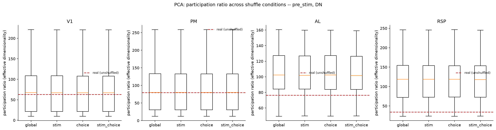

### Shuffle comparison reward

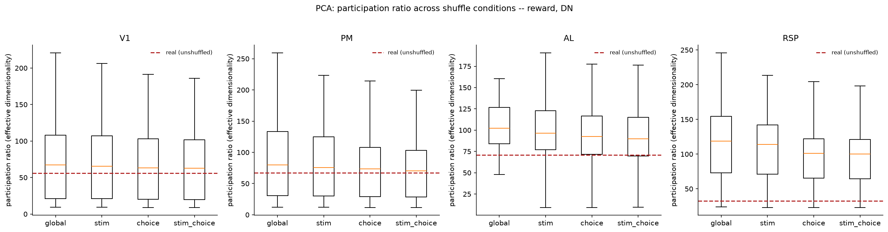

### Shuffle comparison stim

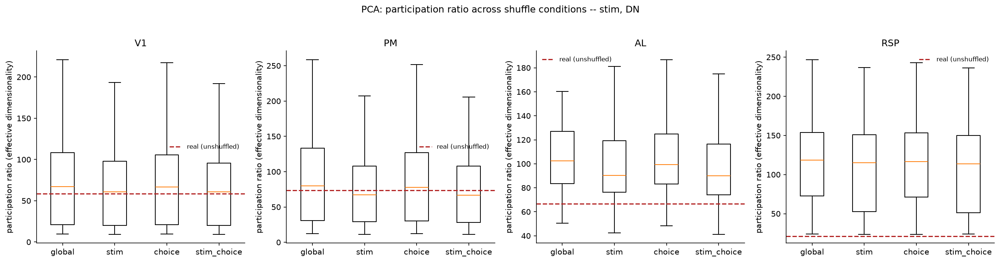

### Shuffle comparison whole trial

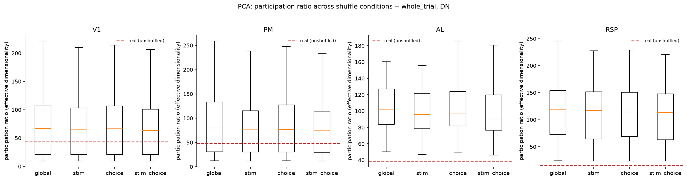

### Dimensionality vs size

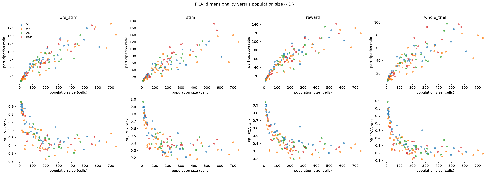

### Pca spectrum pre stim

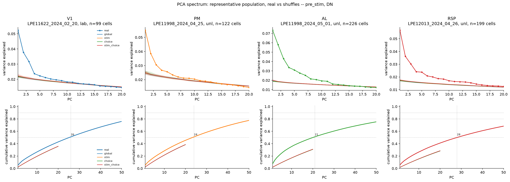

### Pca spectrum reward

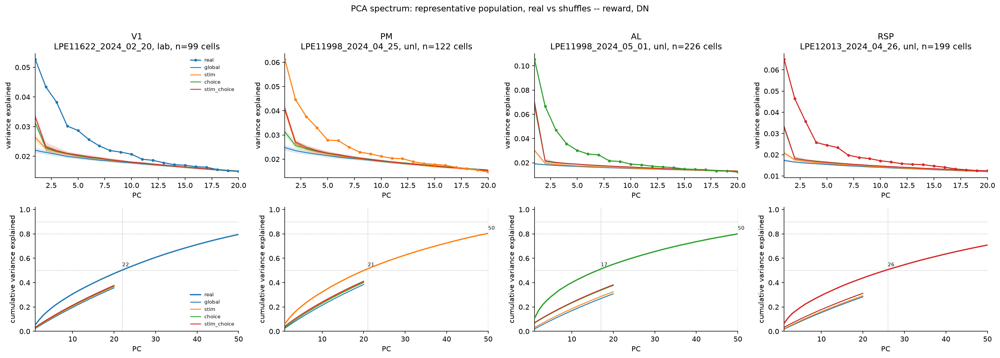

### Pca spectrum stim

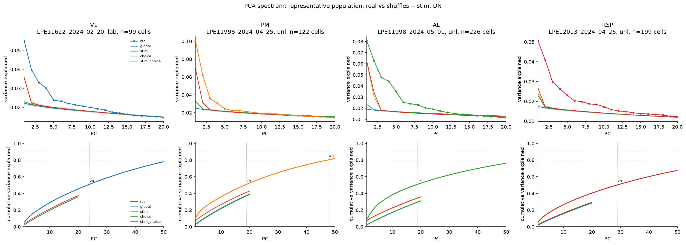

### Pca spectrum whole trial

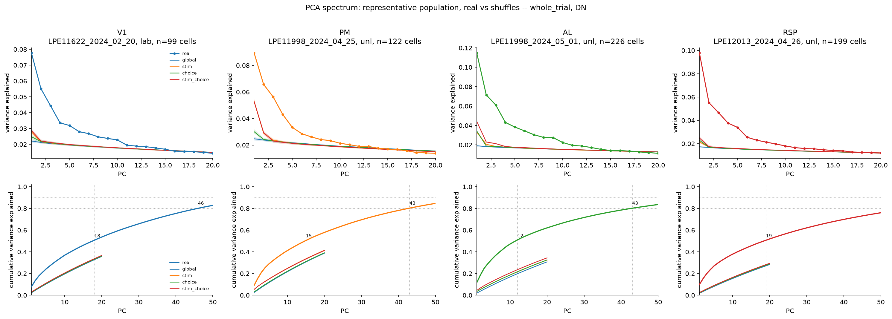

### Pca shuffle effects pre stim

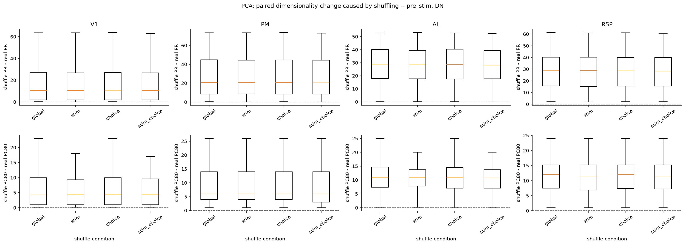

### Pca shuffle effects reward

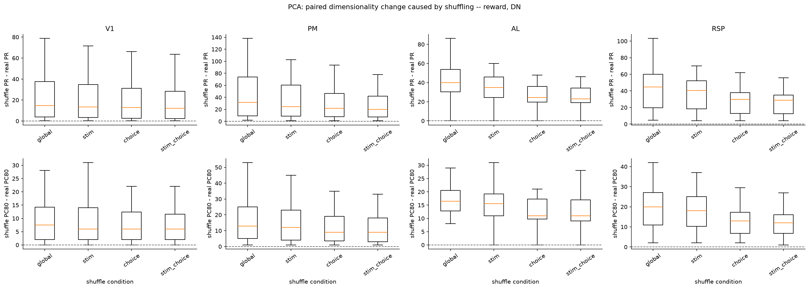

### Pca shuffle effects stim

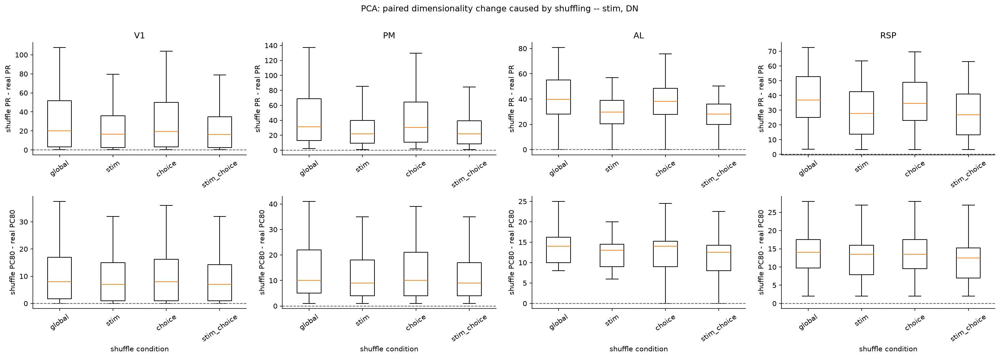

### Pca shuffle effects whole trial

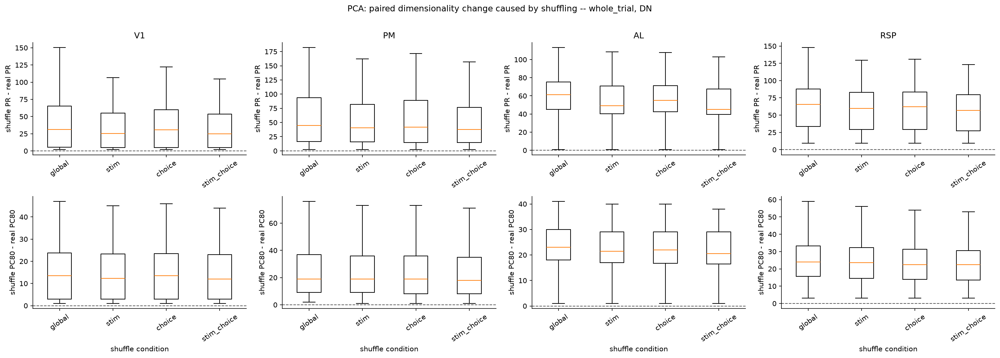

### Pca spectrum population pre stim

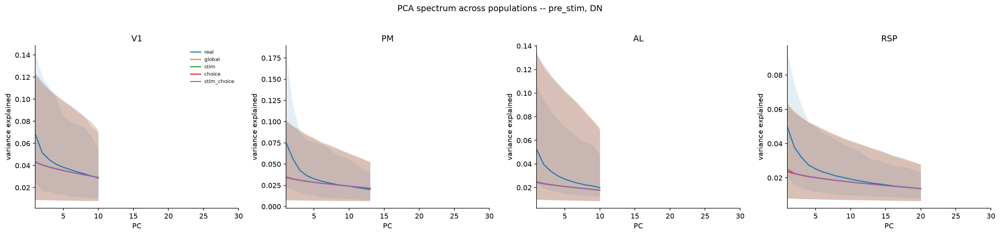

### Pca spectrum population reward

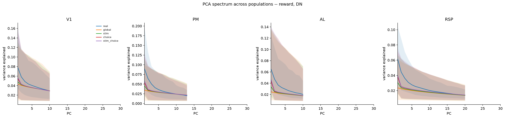

### Pca spectrum population stim

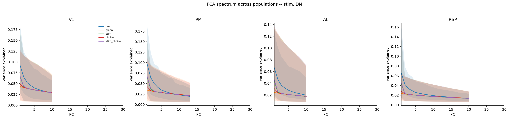

### Pca spectrum population whole trial

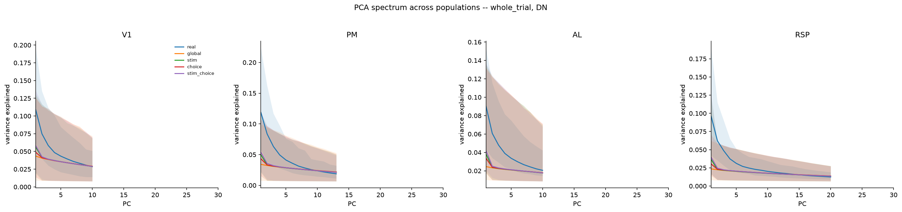
