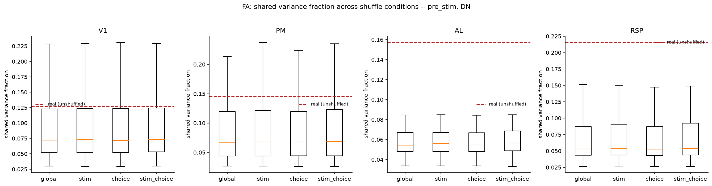
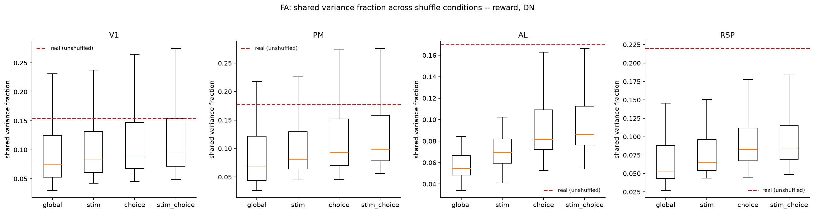
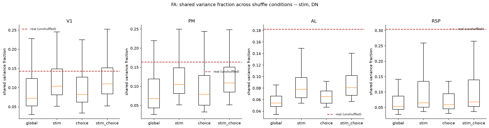
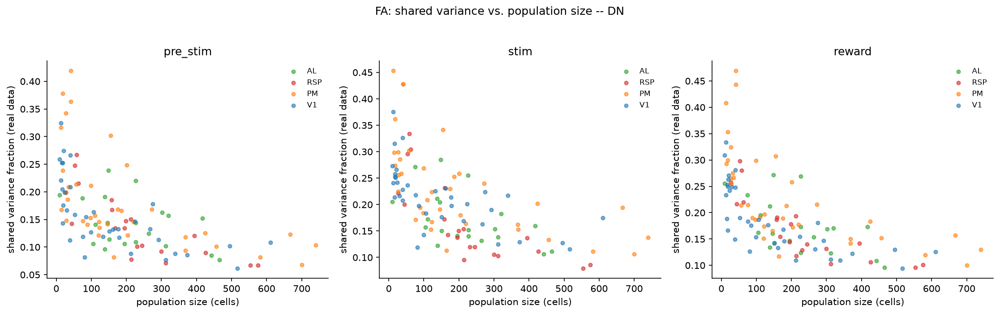
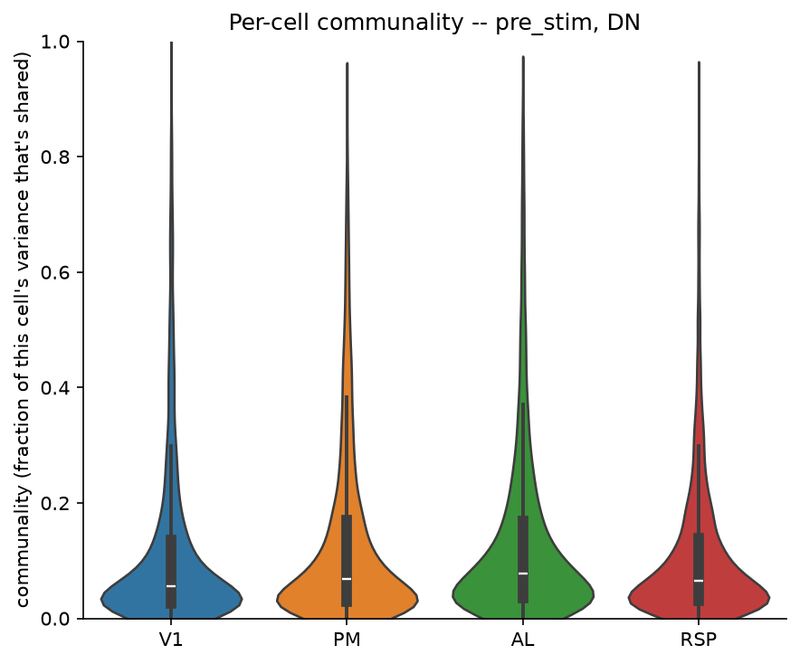
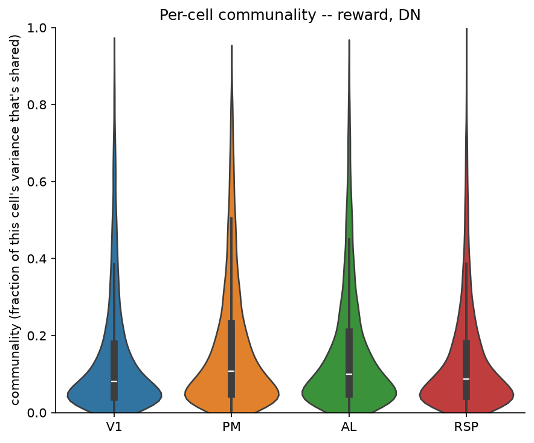
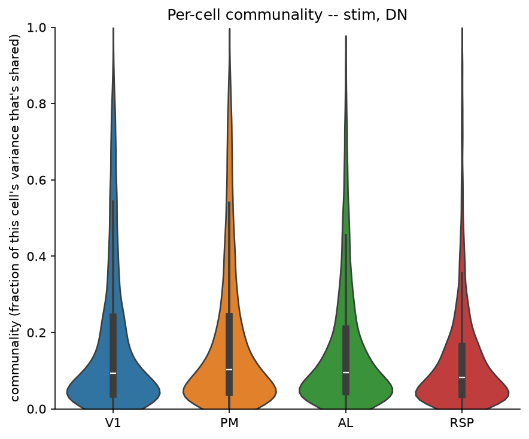

# 4b_population_fa

*Auto-generated from `2_pipeline/4b_population_fa/out/` on 2026-10-30 11:38. Re-run `make_progress_md.py` after the script's output changes -- don't hand-edit this file.*

## Tables

### Fa real communality

| session_id | window | roi_name | labeled_grouped | cell_id | communality |
| --- | --- | --- | --- | --- | --- |
| LPE10884_2024_01_12 | pre_stim | AL | unl | LPE10884_2024_01_12_7_0033 | 0.225 |
| LPE10884_2024_01_12 | pre_stim | AL | unl | LPE10884_2024_01_12_7_0039 | 0.04753 |
| LPE10884_2024_01_12 | pre_stim | AL | unl | LPE10884_2024_01_12_7_0215 | 0.103 |
| LPE10884_2024_01_12 | pre_stim | AL | unl | LPE10884_2024_01_12_7_0176 | 0.04614 |
| LPE10884_2024_01_12 | pre_stim | AL | unl | LPE10884_2024_01_12_7_0002 | 0.4524 |
| LPE10884_2024_01_12 | pre_stim | AL | unl | LPE10884_2024_01_12_7_0140 | 0.08652 |
| LPE10884_2024_01_12 | pre_stim | AL | unl | LPE10884_2024_01_12_7_0138 | 0.2582 |
| LPE10884_2024_01_12 | pre_stim | AL | unl | LPE10884_2024_01_12_7_0156 | 0.157 |
| LPE10884_2024_01_12 | pre_stim | AL | unl | LPE10884_2024_01_12_7_0042 | 0.142 |
| LPE10884_2024_01_12 | pre_stim | AL | unl | LPE10884_2024_01_12_7_0029 | 0.3685 |
| LPE10884_2024_01_12 | pre_stim | AL | unl | LPE10884_2024_01_12_7_0069 | 0.145 |
| LPE10884_2024_01_12 | pre_stim | AL | unl | LPE10884_2024_01_12_7_0342 | 0.03486 |
| LPE10884_2024_01_12 | pre_stim | AL | unl | LPE10884_2024_01_12_7_0125 | 0.07212 |
| LPE10884_2024_01_12 | pre_stim | AL | unl | LPE10884_2024_01_12_7_0090 | 0.02056 |
| LPE10884_2024_01_12 | pre_stim | AL | unl | LPE10884_2024_01_12_7_0022 | 0.3071 |
| LPE10884_2024_01_12 | pre_stim | AL | unl | LPE10884_2024_01_12_7_0105 | 0.03423 |
| LPE10884_2024_01_12 | pre_stim | AL | unl | LPE10884_2024_01_12_7_0107 | 0.6195 |
| LPE10884_2024_01_12 | pre_stim | AL | unl | LPE10884_2024_01_12_7_0359 | 0.006769 |
| LPE10884_2024_01_12 | pre_stim | AL | unl | LPE10884_2024_01_12_7_0180 | 0.2294 |
| LPE10884_2024_01_12 | pre_stim | AL | unl | LPE10884_2024_01_12_7_0135 | 0.07636 |
| LPE10884_2024_01_12 | pre_stim | AL | unl | LPE10884_2024_01_12_7_0189 | 0.1503 |
| LPE10884_2024_01_12 | pre_stim | AL | unl | LPE10884_2024_01_12_7_0115 | 0.1164 |
| LPE10884_2024_01_12 | pre_stim | AL | unl | LPE10884_2024_01_12_7_0052 | 0.04472 |
| LPE10884_2024_01_12 | pre_stim | AL | unl | LPE10884_2024_01_12_7_0210 | 0.09851 |
| LPE10884_2024_01_12 | pre_stim | AL | unl | LPE10884_2024_01_12_7_0113 | 0.2052 |
| LPE10884_2024_01_12 | pre_stim | AL | unl | LPE10884_2024_01_12_7_0149 | 0.05022 |
| LPE10884_2024_01_12 | pre_stim | AL | unl | LPE10884_2024_01_12_7_0292 | 0.2389 |
| LPE10884_2024_01_12 | pre_stim | AL | unl | LPE10884_2024_01_12_7_0136 | 0.08813 |
| LPE10884_2024_01_12 | pre_stim | AL | unl | LPE10884_2024_01_12_7_0152 | 0.02738 |
| LPE10884_2024_01_12 | pre_stim | AL | unl | LPE10884_2024_01_12_7_0169 | 0.04438 |

*(showing first 30 of 65289 rows -- see the linked CSV for the rest)*

[fa_real_communality.csv](../2_pipeline/4b_population_fa/out/fa_real_communality.csv)

### Fa shuffle results

| session_id | window | roi_name | labeled_grouped | n_cells | condition | rep | shared_variance_fraction |
| --- | --- | --- | --- | --- | --- | --- | --- |
| LPE10884_2024_01_12 | pre_stim | AL | unl | 320 | real | 0 | 0.1573 |
| LPE10884_2024_01_12 | pre_stim | AL | unl | 320 | global | 0 | 0.05435 |
| LPE10884_2024_01_12 | pre_stim | AL | unl | 320 | global | 1 | 0.05639 |
| LPE10884_2024_01_12 | pre_stim | AL | unl | 320 | global | 2 | 0.05504 |
| LPE10884_2024_01_12 | pre_stim | AL | unl | 320 | global | 3 | 0.05794 |
| LPE10884_2024_01_12 | pre_stim | AL | unl | 320 | global | 4 | 0.05622 |
| LPE10884_2024_01_12 | pre_stim | AL | unl | 320 | global | 5 | 0.05634 |
| LPE10884_2024_01_12 | pre_stim | AL | unl | 320 | global | 6 | 0.05343 |
| LPE10884_2024_01_12 | pre_stim | AL | unl | 320 | global | 7 | 0.05401 |
| LPE10884_2024_01_12 | pre_stim | AL | unl | 320 | global | 8 | 0.0551 |
| LPE10884_2024_01_12 | pre_stim | AL | unl | 320 | global | 9 | 0.0541 |
| LPE10884_2024_01_12 | pre_stim | AL | unl | 320 | global | 10 | 0.05558 |
| LPE10884_2024_01_12 | pre_stim | AL | unl | 320 | global | 11 | 0.05541 |
| LPE10884_2024_01_12 | pre_stim | AL | unl | 320 | global | 12 | 0.05456 |
| LPE10884_2024_01_12 | pre_stim | AL | unl | 320 | global | 13 | 0.05623 |
| LPE10884_2024_01_12 | pre_stim | AL | unl | 320 | global | 14 | 0.05541 |
| LPE10884_2024_01_12 | pre_stim | AL | unl | 320 | global | 15 | 0.05562 |
| LPE10884_2024_01_12 | pre_stim | AL | unl | 320 | global | 16 | 0.05561 |
| LPE10884_2024_01_12 | pre_stim | AL | unl | 320 | global | 17 | 0.05349 |
| LPE10884_2024_01_12 | pre_stim | AL | unl | 320 | global | 18 | 0.05485 |
| LPE10884_2024_01_12 | pre_stim | AL | unl | 320 | global | 19 | 0.05432 |
| LPE10884_2024_01_12 | pre_stim | AL | unl | 320 | stim | 0 | 0.05955 |
| LPE10884_2024_01_12 | pre_stim | AL | unl | 320 | stim | 1 | 0.05715 |
| LPE10884_2024_01_12 | pre_stim | AL | unl | 320 | stim | 2 | 0.05973 |
| LPE10884_2024_01_12 | pre_stim | AL | unl | 320 | stim | 3 | 0.05617 |
| LPE10884_2024_01_12 | pre_stim | AL | unl | 320 | stim | 4 | 0.05878 |
| LPE10884_2024_01_12 | pre_stim | AL | unl | 320 | stim | 5 | 0.05856 |
| LPE10884_2024_01_12 | pre_stim | AL | unl | 320 | stim | 6 | 0.05924 |
| LPE10884_2024_01_12 | pre_stim | AL | unl | 320 | stim | 7 | 0.0566 |
| LPE10884_2024_01_12 | pre_stim | AL | unl | 320 | stim | 8 | 0.05935 |

*(showing first 30 of 27459 rows -- see the linked CSV for the rest)*

[fa_shuffle_results.csv](../2_pipeline/4b_population_fa/out/fa_shuffle_results.csv)

## Figures

### Shuffle comparison pre stim

### Shuffle comparison reward

### Shuffle comparison stim

### Shared variance vs size

### Communality by area pre stim

### Communality by area reward

### Communality by area stim

