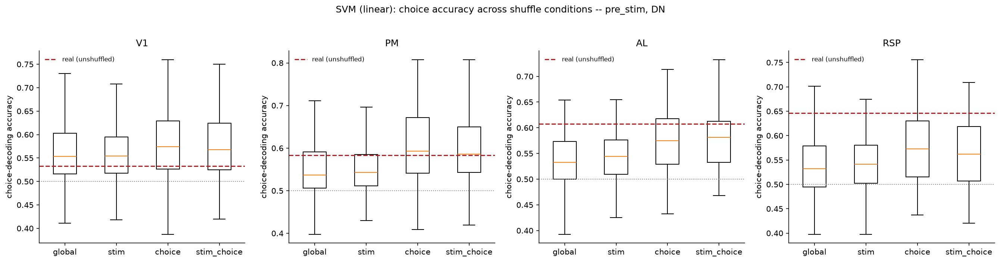
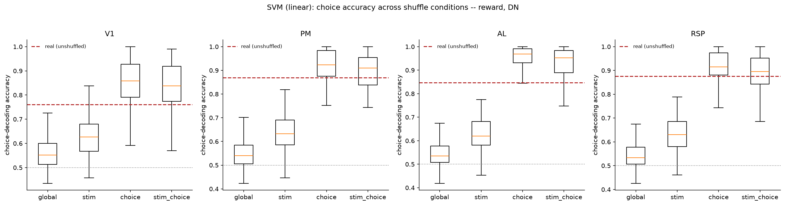
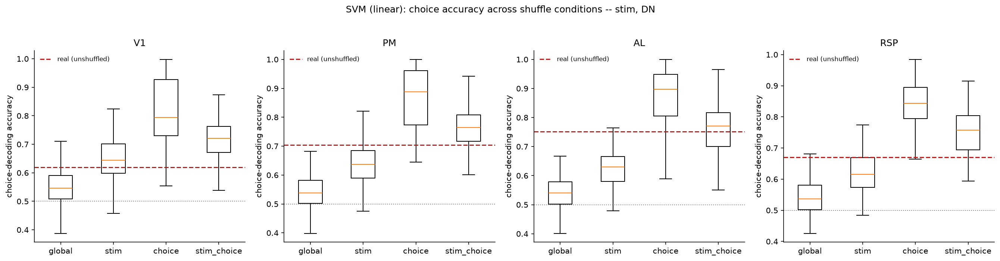
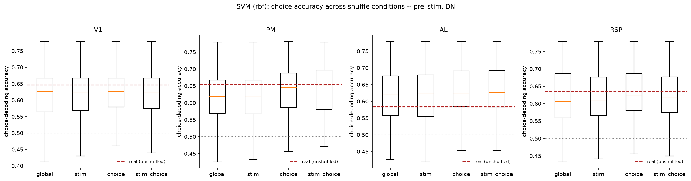
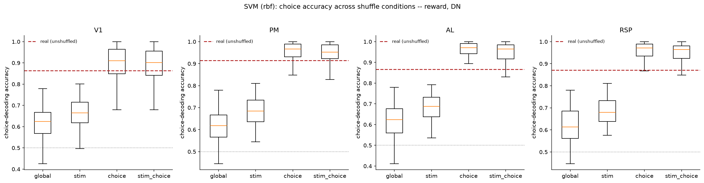
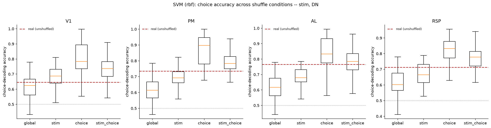
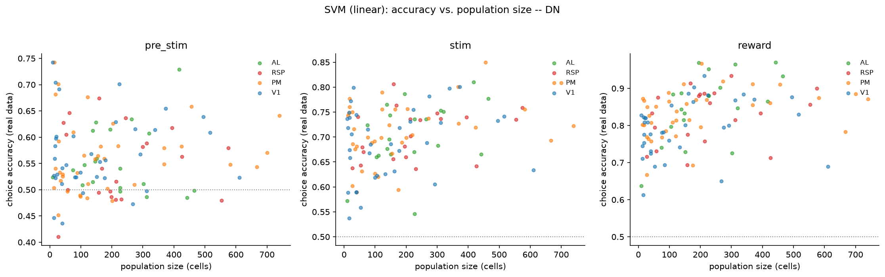
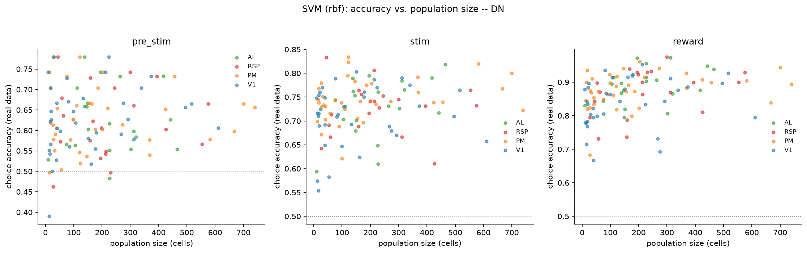
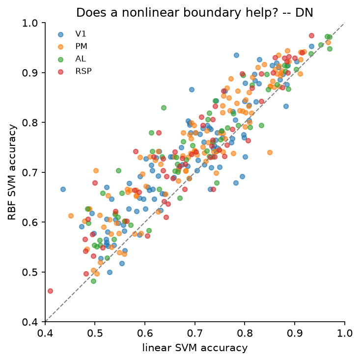

# 4c_population_svm

*Auto-generated from `2_pipeline/4c_population_svm/out/` on 2026-10-30 11:38. Re-run `make_progress_md.py` after the script's output changes -- don't hand-edit this file.*

## Tables

### Svm dimensionality risk

| session_id | window | roi_name | labeled_grouped | n_cells | n_trials | cells_to_trials_ratio |
| --- | --- | --- | --- | --- | --- | --- |
| LPE10884_2024_01_12 | pre_stim | AL | unl | 320 | 209 | 1.531 |
| LPE10884_2024_01_12 | stim | AL | unl | 320 | 209 | 1.531 |
| LPE10884_2024_01_12 | reward | AL | unl | 320 | 209 | 1.531 |
| LPE10884_2024_01_12 | pre_stim | RSP | unl | 63 | 209 | 0.3014 |
| LPE10884_2024_01_12 | stim | RSP | unl | 63 | 209 | 0.3014 |
| LPE10884_2024_01_12 | reward | RSP | unl | 63 | 209 | 0.3014 |
| LPE10884_2024_01_17 | pre_stim | AL | unl | 417 | 258 | 1.616 |
| LPE10884_2024_01_17 | stim | AL | unl | 417 | 258 | 1.616 |
| LPE10884_2024_01_17 | reward | AL | unl | 417 | 258 | 1.616 |
| LPE10884_2024_01_17 | pre_stim | RSP | unl | 159 | 258 | 0.6163 |
| LPE10884_2024_01_17 | stim | RSP | unl | 159 | 258 | 0.6163 |
| LPE10884_2024_01_17 | reward | RSP | unl | 159 | 258 | 0.6163 |
| LPE11622_2024_02_20 | pre_stim | PM | lab | 220 | 396 | 0.5556 |
| LPE11622_2024_02_20 | stim | PM | lab | 220 | 396 | 0.5556 |
| LPE11622_2024_02_20 | reward | PM | lab | 220 | 396 | 0.5556 |
| LPE11622_2024_02_20 | pre_stim | PM | unl | 740 | 396 | 1.869 |
| LPE11622_2024_02_20 | stim | PM | unl | 740 | 396 | 1.869 |
| LPE11622_2024_02_20 | reward | PM | unl | 740 | 396 | 1.869 |
| LPE11622_2024_02_20 | pre_stim | V1 | lab | 99 | 396 | 0.25 |
| LPE11622_2024_02_20 | stim | V1 | lab | 99 | 396 | 0.25 |
| LPE11622_2024_02_20 | reward | V1 | lab | 99 | 396 | 0.25 |
| LPE11622_2024_02_20 | pre_stim | V1 | unl | 495 | 396 | 1.25 |
| LPE11622_2024_02_20 | stim | V1 | unl | 495 | 396 | 1.25 |
| LPE11622_2024_02_20 | reward | V1 | unl | 495 | 396 | 1.25 |
| LPE11622_2024_02_22 | pre_stim | AL | unl | 105 | 438 | 0.2397 |
| LPE11622_2024_02_22 | stim | AL | unl | 105 | 438 | 0.2397 |
| LPE11622_2024_02_22 | reward | AL | unl | 105 | 438 | 0.2397 |
| LPE11622_2024_02_22 | pre_stim | PM | lab | 120 | 438 | 0.274 |
| LPE11622_2024_02_22 | stim | PM | lab | 120 | 438 | 0.274 |
| LPE11622_2024_02_22 | reward | PM | lab | 120 | 438 | 0.274 |

*(showing first 30 of 339 rows -- see the linked CSV for the rest)*

[svm_dimensionality_risk.csv](../2_pipeline/4c_population_svm/out/svm_dimensionality_risk.csv)

### Svm shuffle results

| session_id | window | roi_name | labeled_grouped | n_cells | n_trials | kernel | condition | rep | accuracy |
| --- | --- | --- | --- | --- | --- | --- | --- | --- | --- |
| LPE10884_2024_01_12 | pre_stim | AL | unl | 320 | 209 | linear | real | 0 | 0.6075 |
| LPE10884_2024_01_12 | pre_stim | AL | unl | 320 | 209 | linear | global | 0 | 0.4976 |
| LPE10884_2024_01_12 | pre_stim | AL | unl | 320 | 209 | linear | global | 1 | 0.5262 |
| LPE10884_2024_01_12 | pre_stim | AL | unl | 320 | 209 | linear | global | 2 | 0.5356 |
| LPE10884_2024_01_12 | pre_stim | AL | unl | 320 | 209 | linear | global | 3 | 0.5264 |
| LPE10884_2024_01_12 | pre_stim | AL | unl | 320 | 209 | linear | global | 4 | 0.4495 |
| LPE10884_2024_01_12 | pre_stim | AL | unl | 320 | 209 | linear | global | 5 | 0.3925 |
| LPE10884_2024_01_12 | pre_stim | AL | unl | 320 | 209 | linear | global | 6 | 0.4783 |
| LPE10884_2024_01_12 | pre_stim | AL | unl | 320 | 209 | linear | global | 7 | 0.5598 |
| LPE10884_2024_01_12 | pre_stim | AL | unl | 320 | 209 | linear | stim | 0 | 0.5454 |
| LPE10884_2024_01_12 | pre_stim | AL | unl | 320 | 209 | linear | stim | 1 | 0.5502 |
| LPE10884_2024_01_12 | pre_stim | AL | unl | 320 | 209 | linear | stim | 2 | 0.5264 |
| LPE10884_2024_01_12 | pre_stim | AL | unl | 320 | 209 | linear | stim | 3 | 0.4687 |
| LPE10884_2024_01_12 | pre_stim | AL | unl | 320 | 209 | linear | stim | 4 | 0.5838 |
| LPE10884_2024_01_12 | pre_stim | AL | unl | 320 | 209 | linear | stim | 5 | 0.5692 |
| LPE10884_2024_01_12 | pre_stim | AL | unl | 320 | 209 | linear | stim | 6 | 0.5024 |
| LPE10884_2024_01_12 | pre_stim | AL | unl | 320 | 209 | linear | stim | 7 | 0.5741 |
| LPE10884_2024_01_12 | pre_stim | AL | unl | 320 | 209 | linear | choice | 0 | 0.6511 |
| LPE10884_2024_01_12 | pre_stim | AL | unl | 320 | 209 | linear | choice | 1 | 0.6511 |
| LPE10884_2024_01_12 | pre_stim | AL | unl | 320 | 209 | linear | choice | 2 | 0.617 |
| LPE10884_2024_01_12 | pre_stim | AL | unl | 320 | 209 | linear | choice | 3 | 0.6458 |
| LPE10884_2024_01_12 | pre_stim | AL | unl | 320 | 209 | linear | choice | 4 | 0.5597 |
| LPE10884_2024_01_12 | pre_stim | AL | unl | 320 | 209 | linear | choice | 5 | 0.5931 |
| LPE10884_2024_01_12 | pre_stim | AL | unl | 320 | 209 | linear | choice | 6 | 0.6415 |
| LPE10884_2024_01_12 | pre_stim | AL | unl | 320 | 209 | linear | choice | 7 | 0.6125 |
| LPE10884_2024_01_12 | pre_stim | AL | unl | 320 | 209 | linear | stim_choice | 0 | 0.5455 |
| LPE10884_2024_01_12 | pre_stim | AL | unl | 320 | 209 | linear | stim_choice | 1 | 0.5214 |
| LPE10884_2024_01_12 | pre_stim | AL | unl | 320 | 209 | linear | stim_choice | 2 | 0.6124 |
| LPE10884_2024_01_12 | pre_stim | AL | unl | 320 | 209 | linear | stim_choice | 3 | 0.5934 |
| LPE10884_2024_01_12 | pre_stim | AL | unl | 320 | 209 | linear | stim_choice | 4 | 0.6265 |

*(showing first 30 of 22374 rows -- see the linked CSV for the rest)*

[svm_shuffle_results.csv](../2_pipeline/4c_population_svm/out/svm_shuffle_results.csv)

### Svm stim decoding

| session_id | window | roi_name | labeled_grouped | n_cells | kernel | accuracy | n_classes |
| --- | --- | --- | --- | --- | --- | --- | --- |
| LPE10884_2024_01_12 | pre_stim | AL | unl | 320 | linear |  | 4 |
| LPE10884_2024_01_12 | pre_stim | AL | unl | 320 | rbf |  | 4 |
| LPE10884_2024_01_12 | stim | AL | unl | 320 | linear |  | 4 |
| LPE10884_2024_01_12 | stim | AL | unl | 320 | rbf |  | 4 |
| LPE10884_2024_01_12 | reward | AL | unl | 320 | linear |  | 4 |
| LPE10884_2024_01_12 | reward | AL | unl | 320 | rbf |  | 4 |
| LPE10884_2024_01_12 | pre_stim | RSP | unl | 63 | linear |  | 4 |
| LPE10884_2024_01_12 | pre_stim | RSP | unl | 63 | rbf |  | 4 |
| LPE10884_2024_01_12 | stim | RSP | unl | 63 | linear |  | 4 |
| LPE10884_2024_01_12 | stim | RSP | unl | 63 | rbf |  | 4 |
| LPE10884_2024_01_12 | reward | RSP | unl | 63 | linear |  | 4 |
| LPE10884_2024_01_12 | reward | RSP | unl | 63 | rbf |  | 4 |
| LPE10884_2024_01_17 | pre_stim | AL | unl | 417 | linear |  | 4 |
| LPE10884_2024_01_17 | pre_stim | AL | unl | 417 | rbf |  | 4 |
| LPE10884_2024_01_17 | stim | AL | unl | 417 | linear |  | 4 |
| LPE10884_2024_01_17 | stim | AL | unl | 417 | rbf |  | 4 |
| LPE10884_2024_01_17 | reward | AL | unl | 417 | linear |  | 4 |
| LPE10884_2024_01_17 | reward | AL | unl | 417 | rbf |  | 4 |
| LPE10884_2024_01_17 | pre_stim | RSP | unl | 159 | linear |  | 4 |
| LPE10884_2024_01_17 | pre_stim | RSP | unl | 159 | rbf |  | 4 |
| LPE10884_2024_01_17 | stim | RSP | unl | 159 | linear |  | 4 |
| LPE10884_2024_01_17 | stim | RSP | unl | 159 | rbf |  | 4 |
| LPE10884_2024_01_17 | reward | RSP | unl | 159 | linear |  | 4 |
| LPE10884_2024_01_17 | reward | RSP | unl | 159 | rbf |  | 4 |
| LPE11622_2024_02_20 | pre_stim | PM | lab | 220 | linear |  | 3 |
| LPE11622_2024_02_20 | pre_stim | PM | lab | 220 | rbf |  | 3 |
| LPE11622_2024_02_20 | stim | PM | lab | 220 | linear |  | 3 |
| LPE11622_2024_02_20 | stim | PM | lab | 220 | rbf |  | 3 |
| LPE11622_2024_02_20 | reward | PM | lab | 220 | linear |  | 3 |
| LPE11622_2024_02_20 | reward | PM | lab | 220 | rbf |  | 3 |

*(showing first 30 of 678 rows -- see the linked CSV for the rest)*

[svm_stim_decoding.csv](../2_pipeline/4c_population_svm/out/svm_stim_decoding.csv)

## Figures

### Shuffle comparison linear pre stim

### Shuffle comparison linear reward

### Shuffle comparison linear stim

### Shuffle comparison rbf pre stim

### Shuffle comparison rbf reward

### Shuffle comparison rbf stim

### Accuracy vs size linear

### Accuracy vs size rbf

### Linear vs rbf

